# BTC ยังลงได้อีก?

- ช่อง: Art Of Investing
- ลิงก์: https://www.youtube.com/watch?v=LetDz1KmzYg
- วันที่: 2026-08-12
- ความยาว: 1:19:22
- ที่มา: คำบรรยายอัตโนมัติ (auto-generated) ภาษาไทยของ YouTube — อาจมีคำสะกดผิด/คำผิดเสียง
- ภาพ: 41 ภาพจากวิดีโอช่วงที่เปิดกราฟแท่งเทียน (เลือกอัตโนมัติจากสีแท่งเทียน · ตัดภาพซ้ำ) อยู่ในโฟลเดอร์ frames/

---

[00:01:23] สวัสดีครับสวัสดีสวัสดีทุกคนด้วยนะครับ โทษทีเรทเลยนะครับไปอาบน้ำมานะครับพอดีผม ไปออกกำลังกายมาเนาะแล้วก็คิดว่าเอ้ย น่าจะทันนะครับก็กลับมากินข้าวกินอาหาร อะไรเรียบร้อยนะครับแล้วก็ไปอาบน้ำโอ้โห สรุปไม่ทันครับหัวยังฟูอยู่เลยนะครับยัง เช็ดไม่แห้งไม่ได้เป่าเลยแต่ผมเห็นเอ้ยมา 20:00 น.กว่าละผมก็เลยเออวิ่งวิ่งลงมา ไลฟ์ก่อนนะครับเพราะว่าวันนี้ก็กะว่าไลฟ์ ประมาณชั่วโมงนึงก็น่าจะอยู่ะนะครับ วิเคราะห์ตลาดก็ไม่น่ามีอะไรนะครับเพราะ ว่าเรา take  profit ไปแล้วเนาะใครที่ตาม ไลฟ์แล้วก็ตามบทความใน Facebook ก็น่าจะ เห็นว่าผม take  profit ไปตั้งแต่เช้า แล้วแล้วก็วันเนี้ผมไม่เทรดเพราะว่ามี CPI แต่ว่ามันตรงกับ OI เป๊ะเลยนะมันตรงกับ OI เป๊ะเลยนะก็คือ 64500 นะครับของวันนี้ เดี๋ยวผมจะวิเคราะห์ให้ฟังแล้วกันนะครับ วันมุมมอง CPI ก็เพิ่งประกาศเนาะนะครับโอขอบคุณซอ Chat  179 บาทครับคุณฮาร์ดวลขอบคุณมาก

[00:02:25] เลยครับขอบคุณครับสวัสดีทุกท่านด้วยนะ ครับวันนี้วันแม่เนาะก็ไม่รู้ว่าไปฉลอง พักผ่อนที่ไหนกันบ้างหรือเปล่านะครับพา คุณแม่ไปเที่ยวที่ไหนเนาะก็แชร์กันได้ เดี๋ยววันนี้ผมเริ่มเลยแล้วกันนะครับจะ ได้ไม่เสียเวลาเนาะพอดีมาเรทะนะครับแหเรท ซะได้เดี๋ยวนะมองไม่เห็นเลยขาตั้งกล้อง บังหน้าจอผมนะครับตอนนี้ผมเซต สายระยงระยางเหมือนป่าเลยครับวันนี้พอดี ไม่ทันนะรีบมาก โอเคเดี๋ยว เซ็ตทีละอันนะครับปึ๊บๆ เอานี้ไว้นี่ก่อนเอานี้ไว้นี่ก่อน เคครับมาๆๆเพื่อให้ไม่เสียเวลาขึ้นหน้าจอ

[00:03:34] แป๊บนะครับไม่ได้เซ็ตอะไรไว้เลยครับวิ่ง ลงมาจากห้องน้ำเลยครับตึมๆๆโอเคแป๊บนึงนะ เห็นมั้แชทอยู่ไหนวะเนี่ยเดี๋ยวๆๆๆ ป๊ามันเอาแชทลงยังไงวะ อ่ะโอเค นะครับสวัสดีสวัสดีทุกคนครับอ่ะโอเค โอ้เดี๋นะฮะ รีบไปหมดวัน สักครู่ครับเช็ดแว่นก่อน

[00:04:37] อ่าโอเคเคมาชัดแล้วครับโอเค เริ่มนะครับ CPI นะครับก็เพิ่งประกาศออก ไปนะครับออกมาตามคาดการณ์หมดจำได้มว่าใน บทความใน Facebook นะครับที่ผมเขียนไปบอก ว่าหลังจากที่นอนฟาร์มออกมาต่ำกว่าคาด การณ์ค่อนข้างมากเนี่ยโอเคเราคุยกันทีละ ตัวเลขนะครับแล้วเดี๋ยวผมจะเชื่อมโยงแต่ ละส่วนให้ฟังนะครับแล้วก็จะไปวิเคราะห์ กราฟกันนะครับพรุ่งนี้ผมไปงานศพเพื่อนผม นะเออเดี๋ยวเดี๋วิเคราะห์กราฟอะไรเสร็จผม จะชวนคุยเรื่องเรื่องนี้นิดนึงนะครับว่า แบบเออความตายมันใกล้ตัวมากบางคนดูสุขภาพ ดีแล้วก็แวบไปเลยอะไรอย่างเงี้ยนะครับอ่ะ nonฟาร์มเนี่ยมันออกมาต่ำกว่าคาดการณ์ ค่อนข้างมาก บางคนยังไม่รู้เลยนะครับว่าnonฟาร์ม nonฟารมคืออะไรnonฟarm pay ไปฟังโค้ชท่าน อื่นมาเ้าบอกว่าเนี่ยข่าวเนี้ยแรงเดี๋ยว เทรดตามข่าวหรือว่าอย่าไปเทรดสวนข่าวอะไร เงี้ยเขาก็ท่องกันนอนฟาร์มนอนฟาร์มเดือน นึงมีครั้งนึงอะไรเงี้ยนอนฟาร์มคือตัวเลข สถิติการจ้างงานนอกภาคการเกษตรนะครับที

[00:05:40] เนี้ยหลายคนก็จะงงว่าอ้าจ้างงานน้อยมันก็ น้อยดิทำไมทำไมจ้างงานแล้วมันติดลบได้นะ ครับมันก็คือมันจะมีตัวเลขจ้างงานกับเลิก จ้างพอเอามาหักล้างกันมันก็เลยติดลบนะ ครับฉะนั้นตัวเลขการจ้างงานนอกภาคการ เกษตรมันติดลบขนาดนั้นน่ะลบ 23,000 เนี่ย บ่งบอกว่าตลาดแรงงานไม่แข็งแรงนะครับโดน Layอคนโดนlayอฟจะหางานใหม่จ้างงานใหม่ก็ น้อยฉะนั้นเศรษฐกิจไม่พร้อมที่จะรับแรง กระแทกพอเป็นเคสเนี้ยทุกคนก็เลยอยากดู 2 ตัวเลขนะครับก็คือ CPI กับ PPI คำถามคือดู 2 ตัวนี้จะดูอะไรอ่ะ ตรงเนี้ยมันบอกมาแล้วนะครับว่าไม่พร้อม รับแรงกระแทก ไม่พร้อมกระแทกโอ้โหลายมือนะครับเขาบอก ว่าคนเก่งลายมือจะไม่สวย อ่ะไม่พร้อมรับแรงกระแทกฉะนั้นถ้าเงิน เฟ้อมันดื้ออีกอ่ะเฟซจะตัดสินใจยากมากตาม

[00:06:44] ทันมั้ยครับคำถามคือทำไมถึงตัดสินใจยาก เพราะว่าถ้าเกิดสมมุตินะสมมุตินะเงินเฟ้อ เนี่ยจากเอ่อ 3.4 เนี่ยสมมุตินะวันนี้ ประกาศขึ้นมา 3.8  8 เงี้ยโอ้โหเอาละผม บอกเลยว่าตลาดทุบรากสนุกสนานเลยครับตึ้มๆ ๆๆคำถามคือทำไม เพราะว่าถ้าเกิดเงินเฟ้อสูงเฟดก็บอกว่า เฮ้ยแบบเนี้ยต้องขึ้นดอก เฮ้ยขึ้นดอกไม่ได้บริษัทในประเทศตายเอา แล้วอ้าวเฟซก็บอกแล้วถ้าบริษัทในประเทศ ตายแต่เงินเฟ้อก็เอาไม่อยู่ว่ะดอลลาร์ก็ มีปัญหาอยู่ดีหนี้ประเทศก็เพิ่มอ่ะฉะนั้น นะครับเสียงมันเลยจะแตกมากถ้าเกิดเงิน เฟ้อมันดันดื้อซึ่งตอนแรกอ่ะผมแอบมีความ คิดประมาณนั้นด้วยนะครับเพราะว่าน้ำมัน มันกลับขึ้นมาเห็นมั้ยคือตอนแรกมันเด้ง กลับมา 90 แล้วก็ลงไป 70 ใช่มั้ยทีเนี้ย

[00:07:45] ถ้ามันอยู่แถวๆ 70 อ่ะผมก็คิดว่าเออเฮ้ย เอ่อตัวเลขเงินเฟ้อมันอาจจะออกมาไม่ได้มี ปัญหามากน้ำมันมันขึ้นมาเนาะเงินเฟ้อมัน ก็ยังอยู่ในตัวเลขที่เท่าเดิมแต่เราต้อง บอกว่ามันเป็นของตัวเลขของเดือนก่อนหน้า นะฉะนั้นมันอาจจะdelดีลayออกมาในเดือนถัด ไปก็ได้นะครับเอาเดือนนี้ก่อนประกาศออกมา ว่าตามคาดการณ์อ่ะฉะนั้นแนวโน้มตอนเนี้ย นะครับก็ทำ[เสียงกระแอม]ให้เฟซเนี่ยยัง ตัดสินใจยากอยู่นะแต่ไม่ถึงขั้นลำบากนะ ครับเพราะว่าถ้าเกิดขั้นเนี้ยผมเรียกเลย ว่าวิกฤต ขึ้นดอกปั๊บเฮ้ยบริษัทตายจ้างพนักงาน ไม่ไหวเว้ยโอ้โหดอกดอกเบี้ยไม่ขาดสภาพ คล่องกู้ก็ไม่ได้ยืดบริหารงานบริษัทก็ไม่ ได้ไม่รู้จะทำไงไม่ขึ้นปุ๊บอ้าเงินเฟ้อ เอาอีกเอาหนี้ประเทศเพดานหนี้ก็เพิ่มอีก อ่ะทำอะไรไม่ถูกนะครับมันก็เลยมีปัญหาออก มาตามคาดการณ์เนี่ยตัวแรกต่อไปที่จะต้อง ดูก็คือ PPI นะครับเป็นดัชนีฝั่งผู้ผลิต

[00:08:45] แนวโน้มเสียงเริ่มแตกนะครับหากหากดู Fed Watch  2 ก่อนที่นอนฟาร์มประกาศอ่ะนะ ครับตัวเลขที่มองว่าจะคงดอกอยู่เฉยๆอ่ะ ยังสูงกว่าแต่พอนอนฟาร์มออกมาต่ำมากอ่ะ ตอนเนี้ยเสียงแตกละมันแทบจะเป็นครึ่งๆ แล้วครับระหว่างโครงดอกกับขึ้นดอกรถดอก นี่ปิดประตูเลยตอนเนี้ยนะครับก็จะมีคงดอก กลับขึ้นดอก ทีเนี้ยถ้าเกิดขึ้นดอกเนี่ย เงินมันก็จะูฟไปหาบอยหรือพันธบัตรถูกมั้ ครับแล้วก็ออกจากสินทรัพย์เสี่ยงถูกมั้ย ฉะนั้นตลาดหุ้นก็มีโอกาสจะย่อ Cryptocurrency ก็มีโอกาสจะย่อซึ่งก็พอ ดีนะถ้าเกิดว่าเป็นเคสนั้นก็ค่อนข้างดี ต่อโมเดลของเราเพราะว่าโมเดลของเราเนี่ย ตามสถิติที่เก็บมามันจะเริ่มเทรนด์รอบ ใหม่ประมาณพฤศจิกายนถูกมั้ยทีเนี้ย 3

[00:09:47] เหตุการณ์มันจะเข้ามาพร้อมกันคือ 1 MidmมctionของTrัมปก็ช่วงพฤศจิกายน ตลตลาดคริปโตจะเริ่มขึ้นอีกครั้งก็ช่วง พฤศจิกายนฉะนั้นถ้าขึ้นดอกแล้วเกิดการทุบ จนเกิดนิวโรเนี่ยมันก็ต้องการระยะเวลาใน การสะสมโมเมนตัมใหม่ก็มีแนวโน้มว่ามันก็ จะไปค่อยๆขึ้นใหม่ปลายปีอ่ะถ้าเป็นเคส นั้นทุกอย่างมันก็จะดูสัมพันธ์กันไปหมด แล้วก็ผมค่อนข้างได้กลิ่น bottom ประมาณ นึงอธิบายอย่างงี้คำว่ากลิ่นของ bottom เนี่ยคือทุกครั้งที่ตลาดมันใกล้จะก้นนะ ครับเราจะได้ยินความเงียบอ่ะผมผมใช้ใช้ แบบนี้นะเราจะไม่ได้ยินเสียงกรีดร้องนะ ครับเราจะไม่ได้ยินเสียงกรีดร้องอ่ะคุณ ซุยนโทกำลังคอมเมนต์ในสิ่งที่ผมกำลังจะ พูดพอดีเลยที่คุณซุยกันโทบอกว่าตลาดเงียบ เหงานั่นน่ะทำให้ผมรู้สึกว่าถ้าทุบแรงๆ อีกทีนึงอ่ะมีแนวโน้มที่จะ bottom ผมให้ น้ำหนักมากขึ้นนะครับมีแนวโน้มที่จะถึง ก้นสูงขึ้นถ้าทุบหนักๆอีกทีเพราะว่าช่วง

[00:10:47] ที่คนครวนครางเจ็บปวดที่สุดเนี่ยมันจะ เป็นช่วงตรงกลางระหว่างราคาลงเพราะคนยัง รับไม่ได้ว่าแบบเฮ้ยมันจะกลับไปขึ้นอีก มั้ยเฮ้ยฉันจะทำยังไงดีฉันจะคัดมั้โอ้โห ฉันเสียเงินสูญเสียมากมายเลยทำไงดีเอ้ย ฉันคัดแล้วฉันออกจากตลาดดีกว่าเฮ้ยฉัน พอร์ตแตกแล้วฉันออกจากตลาดดีกว่าช่วงตรง นั้นน่ะมันมักจะเป็นช่วงเวลาตรงกลางแต่ ตอนที่มันใกล้จะก้นนะครับมันจะเริ่มไม่มี ความสนใจในตลาดเหลือแล้วคือคนไม่อยากดู แล้วปิดแอปดีกว่าซื้อไปก็ไม่กลับมาขึ้น หรอกสินทรัพย์มันน่าเบื่อแล้วแล้วช่วง เนี้ยผมเห็นบทความถี่มาก 1 เอ่อ OG Bitcoin ที่เคยเป็นนักขุดขุดมา 15 ปี ประกาศขายบitcoinทั้งหมดของตัวเองและ ประกาศว่าจะไม่กลับมาซื้ออีกแล้วเาค้าก็ พูดเนื้อความข้างในนะว่า Developer เก่งๆ เนี่ยก็จาก Blockchain ไปทำ AI กันแล้ว บitcoinเนี่ยได้รับเวลาพิสูจน์มาตั้ง 10 กว่าปีแล้วก็ยังไม่ถูกใช้งานอย่างแพร่ หลายอ่ะเริ่มมาละบทความที่อยู่กับบitคin

[00:11:47] มานานยอมทิ้งบitคin 2 เราโดน นะครับที่เป็นฮาร์ดร์ Wallet ประเภท Card แต่ว่ามันมีปัญหาด้านซอฟต์แวร์ไม่ใช่ ฮาร์ดแวร์เนาะ จนคนเริ่มแชร์และเริ่มมองกันแล้วว่าเฮ้ย เก็บก็ยากเทรดก็ยากตลาดก็คนแทรกแซงเยอะ เฮ้ยไปเทรดตลาดอื่นดีกว่าเฮ้ยไปเก็บสิน ทรัพย์อื่นดีกว่าจะอยู่กับสินทรัพย์อย่าง งี้จริงๆหรอไปเก็บเงินสดใส่เซฟยังดีกว่า อีกไปเก็บทองแท่งยังดีกว่าอีกอ่ะพอกระแส พวกเนี้ยรวมกันนะครับมันเลยเข้าสู่ภาวะ แบบไม่เชื่อไม่เชื่อไม่สนใจซึ่งกลิ่น เนี้ยค่อนข้างใกล้ Bottom นะครับBบottom ไม่ใช่ความเจ็บปวด Bottom จะเป็นความน่า เบื่อความเหงาความไม่มีใครเลยนะเออฉะนั้น ผมก็เลยมองว่าถ้าเป็นเคสเนี้ย มันจะสัมพันธ์กับที่ผมไปพูดไว้ตั้งแต่ใน สยาม Blockchain นะครับก็คือหลายเดือนละ นะครับรอบแรกทุบลงมาต่ำกว่า 60,000 แล้ว ใช่มั้ยแล้วผมก็บอกแล้วว่าต่ำกว่า 60,000 เป็นราคาที่ไม่น่าเกลียดแล้วถ้าใครจะ

[00:12:48] เริ่ม DCA หรือเริ่มซื้อตอนนั้นแล้วมันก็ ดีดกลับขึ้นมา 60,000  14,000 ฉะนั้น เดี๋ยววันเนี้ยผมจะวิเคราะห์กันแต่ถ้า เกิดมันทุบอีกครั้งนึงแล้วขึ้นดอกในโฟมซ Meeting ครั้งต่อไป midterm  election ของทรัมป์จะต้องปั่นป่วนแน่นอนเพราะว่า ทรัมป์ไม่ยอมแพ้แน่ๆถ้าแพ้จะออกนโยบาย อะไรมาก็โดนขัดแข้งขัดขานะครับและเทรนด์ ของบitคinจะขึ้นหลังจากการพักตัว 15 เดือนมาแล้ว 3 ครั้งครั้งนี้จะเป็นครั้ง ที่ 4 หรือเปล่ามันก็จะไปถ้าเกิดขึ้นดอก บวกนิวโร ก็จะเข้านั้นถ้า week  MD เหนือ 0io  boss ก็เป็นเทรด setup ผมเลยนะครับฉะนั้นภาพ รวมให้เราดูแบบนี้ก่อนนะครับทีนี้อ้าวคุณ อาร์ตแล้วแบบเนี้ยราคามันจะไปยังไงต่อตัว เลขมันฟ้องครับอ่ะจะบอกแบบนี้จริงๆตอน เช้าวันเนี้ยนะครับถ้าเราดูของวันนี้เนาะ วันที่ 12 เนี่ยซึ่งมันหมดอายุไปตอน 15:30 น.นะครับผมเห็นเสาเดียวเลยถ้าเกิดใครดูนะ

[00:13:49] ก็คือ 645 โอฮัลโหลโอเคเสียงกลับมาแล้วะนะครับไมค์ ดับไมค์ดับผมต้องไปเปลี่ยนสายละนะครับคิด ว่าสายมันน่าจะช็อตเพราะว่ามันระยงระยาง มากนะครับแล้วก็เวลาผมดึงสายกล้องมาเสียบ สายเมาส์สายจอมันมีหลายจอเนาะสายคอมสาย ไมค์อย่างเงี้ยมันบางทีมันพันกันแล้วสาย มันน่าจะหักข้างในนะครับเดี๋ยวผมน่าจะ ต้องไปเปลี่ยนสาย

[00:14:50] อ่ะทีเนี้ยตอนเช้าอ่ะมันมีเสาคออยู่เสา เดียวเลยก็คือ 64,500 ของวันที่ 12 เนาะ ซึ่งหมดอายุไปแล้วราคาเนี่ยคุณดูดิตอนที่ ประกาศข่าวตัวเลข CPI อ่ะมันก็ขึ้นไปชน 64,000 ปลายๆ 6400 ปลายๆอ่ะแล้วก็เด้งกลับมาตอนเนี้ย 63,000 เห็นมั้ย 63,000  900 คำถามคือแล้วทำไมผม ถึงไม่ได้เทรดนะครับผมทำไมไม่เทรดเอ่อ เสาร์นั้นทั้งๆที่เห็นก็ต้องบอกแบบนี้ contract เท่าที่วิจัยมานะมันน้อยจนมัน ไม่เกิดความได้เปรียบของระบบนะครับ คำว่าความได้เปรียบของระบบอ่ะคือสมมุติ ว่ามันเกิดแบบเนี้ยมันจะสะท้อนกี่ครั้ง จาก 100 ครั้งจาก 200 ครั้งจาก 500 ครั้ง นึกออกมั้ยแล้วถ้าเปอร์เซ็นต์มันสูงพออ่ะ เราถึงจะนับว่าระบบมันมีความได้เปรียบ หรือมีของระบบฉะนั้นไอ้ตรงเนี้ยผม

[00:15:50] วิเคราะห์มาแล้วนะครับเฉพาะปี 2026 แล้วก็เฉพาะ option บน deribit นะ ครับถ้าไม่ใช่ซีรีย์ที่ปิดวันศุกร์หรือ ปิดสิ้นเดือนเนี่ยนัยยะสำคัญไม่สูงต่อให้ เสานั้นน่ะจะมีเกิน 300  contract นะครับคือมันจะชนแล้วสะท้อนบ้างวิ่งถึง บ้างและวิ่งไม่ถึงบ้างความน่าจะเป็นไม่ เยอะพอให้เทรดนะครับฉะนั้นผมก็เลยไม่ได้ เทรดแม้ว่ามันจะตรงกับเสาเห็นมั้ยอย่าง ที่บอกผมเป็นคนไม่ชอบเคลมซั่วเนาะ Digital Footprint ผมก็ดูได้ทุกไลฟ์แล้วก็ทุกบท ความใน Facebook เนาะผมวิเคราะหยังไงผมก็ จะเทรดอย่างงั้นถ้าโดนผมก็จะโพสต์ว่าโดน ถ้าได้ผมก็จะโพสต์ว่าได้ฉะนั้น Digital Foodprint มันมันมีให้เห็นหมดนะครับผมก็ เลยจะบอกอย่างเงี้ยเวลาเราทำวิจัยมาเรา ต้องหา age ตรงนี้ก่อนซึ่งมันไม่มากพอ งั้นทำไมก็ไม่เทรดไงสมมุติว่าโอกาสมันมี

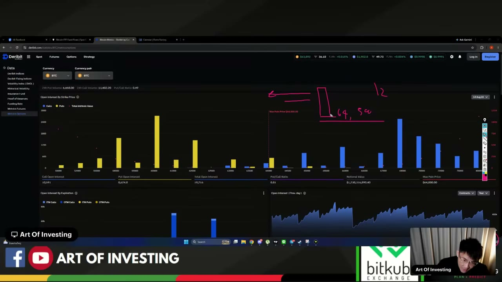

[00:16:52] แค่ 5050 อ่ะอันเนี้ยต่ำถูกป่ะครึ่งๆ ฉะนั้นผมมองว่ามันต่ำไปนะครับก็เลยไม่ได้ เทรดงั้นเราก็เลยมาดูวันที่หมดอายุวันที่ 14 เนี่ยครับที่จำนวนคactมันค่อนข้างมี นัยยะละแล้วเป็นการคำนวณราคาจาก future นะครับเสาที่เราเห็นเนี่ยเราอาจจะเห็นว่า ตรงเนี้ยสูง กับตรงเนี้ยสูงถูกป่ะแต่ว่าถ้าเราคำนวณ ระยะค่าเบี่ยงเบนมาตรฐานนะที่เราเรียกว่า standard  deviation โดยผมคำนวณโดยการ โยนสูตรของ cm ที่คำนวณ หน้า to ของทองคำเนี่ยเข้าไประยะ 1  SD เนี่ยจะอยู่แค่ 66,000 กับ 62,000 นะครับอ่ะระยะเนี่ยมันจะอยู่แค่เนี้ย 66,000 ถึง 62,000 โอกาสที่จะวิ่งอยู่ใน เนี้ยครับคือ 68%

[00:17:52] บางคนบอกเอ้ย 68 เองอุ้ยอีก 2% มัน 70 แล้วนะถูกมั้ยอันเนี้เป็นสูตรอ้างอิง เกี่ยวกับ Standard  Devation ในทองของ CME นะครับยังต้องวิจัยเพิ่มเรื่อยๆนะ ตอนนี้ผมก็เก็บสถิติเพิ่มเรื่อยๆเพราะว่า อย่างที่บอกมันไม่สามารถซื้อ data ย้อน หลังบน CME ได้นะครับ delit เไม่ได้ขาย data ย้อนหลังเหมือนเหมือนกับ CME  CME เค้าขาย data ย้อนหลังเดือนละหมื่หมื่บาท นะครับแต่ว่า contract บน CME อ่ะมันน้อย นะครับฉะนั้นซื้อมาเนี่ยก็ไม่สามารถวิจัย จนได้ประสิทธิภาพก็เลยต้องเก็บสถิติเอง แต่ว่าคร่าวๆถ้าอิงว่ามีแนวโน้มจะมีระยะ ด้วยสูตรคำนวณโ to เนี่ยนะครับใกล้เคียง กัน standard เนี่ยก็คืออยู่ในโซนเนี้ย ประมาณ 68% ผมเลยมองว่าตราบใดก็ตามที่มัน ไม่หลุด 2 กรอบเนี้ยมันจะไม่เป็นเทรนด์ ถูกมั้ยเพราะว่าถ้าเกิดหลุดเนี่ยมันจะ เกิด Gma  Squma หรือขายฟิวเจอร์เพิ่มเหฉะนั้นน่ะถ้าเกิด

[00:18:54] มันทะลุตรงนี้ไปอ่ะมันก็เลยจะพุ่ง นะครับมันก็ผมมันก็เลยไปผนวกกับโมเมนตัม พอดีเป๊ะที่ผมเขียนบทความไว้ ราคาไม่สามารถเบรค 60,000-62,000 หรือ 65,000-67,000 มันจะไม่วิ่งเป็นเทรนด์ นี่คือสาเหตุนะฮเพราะว่าเอ่อด้วยตัวจำนวน คactนะครับคำนวณผ่านเป็นvolุeเนี่ย 68% น่าจะวิ่งไม่ผ่าน 62,000 และ 66,000 โดย ขอบของมันพอดีเป๊ะเนี่ยก็ดันมีเสาด้วยนะ ครับฉะนั้นแสดงว่ามันเป็นระยะที่รายใหญ่ ให้ความสนใจเหมือนกันนะครับก็เลยคิดว่า ยังจะอยู่ในกรอบนี้แหละอ่ะทีเนี้ยเรามาดู บทความที่ผมเขียนไปแล้วบ้างนะครับ ก็คือตรง อ่ะอันนี้ก่อนนะครับตอนแรกเนี่ยผมช็อตลง มาถูกมยก็คืออันนี้ก็ไปอ่านเต็มๆกันได้นะ ครับอ่ะเราดูอยู่แล้วว่ามันจะไม่ผ่าน 65,000-67,000 นะครับทีเนี้ยมันเป็นเกาะ

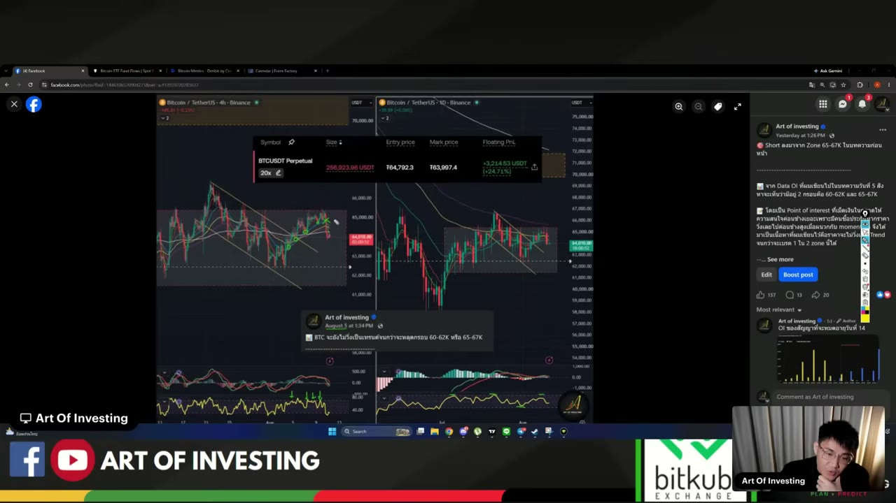

[00:19:56] balance  zone เนาะก็คือ RSI เนี่ย overbard ก็ไม่ได้ก็ไม่ได้เคสตรงเนี้ย มันเป็นการconเฟิร์มว่าโมเมนตัมไม่เกิดพอ โมเมนตัมไม่เกิดเนี่ยครับผมก็เลยประนวก กับ OI ว่ามันน่าจะเบรค 65,000-67,000 ได้ยากนะครับก็ก็เลยช็อตออกมาเพราะว่า หลุดdiscาzซoneของ 4H เห็นมั้ยผมไม่ได้ เข้าแถวนี้นะ 65,000 400 เนี่ยเห็นป่ะผมไม่เคยได้ของปลายไส้ นะแต่ว่าทุกครั้งที่มันชนค่าเฉลี่ยที่ เป็นdisคา ไม่ทำ new  high พร้อมกับหลุด disoun มัน แปลว่าของที่คนเคยมองว่ามันลดราคามันไม่ ลดแล้วนะครับราคาที่เขา้าบอกว่าเฮ้ยได้ เซลล์ได้ของลดราคาไม่ลดลดแล้วนี่หว่า ฉะนั้นหลุดแบบเนี้ย RSI ก็ไม่สามารถ overbard ได้เลยโมเมนตัมก็ไม่เกิดเหมือน กันผมก็เลยช็อตลงมานะครับโดยจุดข้าวผม อยู่ประมาณ 64,000  700 แล้วผมก็บอกว่า ให้ระวังราคาที่กลางกล่องนะครับเพราะว่า

[00:20:57] เวลามันเกิดบาanceซโซนเนี่ยกรอบของ ออเดอร์อ่ะมันก็จะอยู่ 2 ฝั่งถูกป่ะที เนี้ยเวลาที่เขา้าเติมออเดอร์สู้กันไปสู้ กันมาเนี่ยก็คือเวลาเค้าวางขวางไว้อ่ะ ครับแล้วราคามันขึ้นเป็นแมตชมันก็จะทิ้ง เป็นไส้ๆเพราะว่ามันมันเจอก้อนออเดอร์ ขวางถูกมั้ยฉะนั้นเราคิดว่าออเดอร์ตรงไหน มันจะหนาแน่นที่สุดอ่ะก็คือตรงกลางถูกป่ะ เพราะว่ามันเหมือนมันตีปิงปองอ่ะแล้วเรา คิดว่าเราเอามือไปวางตรงไหนเราน่าจะเจอ ปิงปองแน่นอนคำตอบก็คือตรงกลางนะครับผมก็ เลยเขียนไว้ว่าตรงกลางตรงเนี้ยถ้าเกิดมัน ลงมาเทสเนี่ยมันก็จะเป็นขอบของบู flag พอ ดีที่เกิดการเทสนะครับแล้วก็เป็นกลาง กล่องของ balance  zone หรือจุด ฉะนั้นผมเขียนไว้แล้วว่าถ้าเกิดนะครับมัน เกิดลงตรงนี้แล้วรีเจคเนี่ยก็คือมีแรง ซื้อสวนเนี่ยผมจะ TP เลยเพราะว่าวันนี้ อันนี้เป็นบทความเมื่อวานเพราะว่าวัน เนี้ยมันจะมี CPI นะครับฉะนั้นเนี่ยมันก็ มีแนวโน้มว่ามันจะลากราคาเนี่ยดีดกลับ

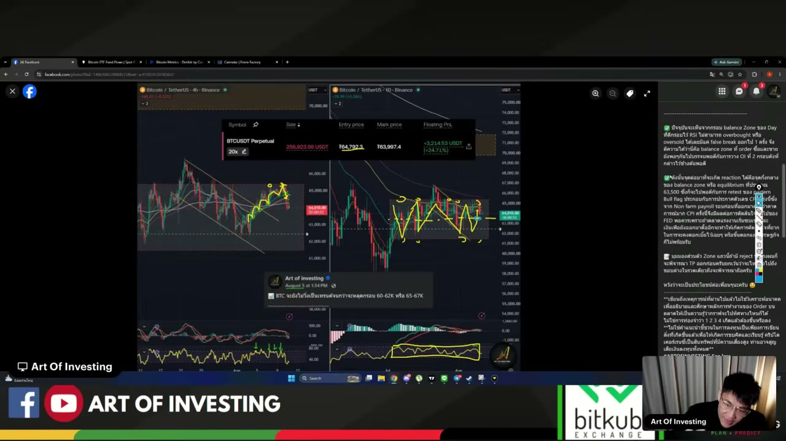

[00:21:57] ขึ้นมาก่อนได้ซึ่งก็ขึ้นมาจริงๆอ่ะมาดู เมื่อเช้านี่ครับเนี่ยถ้าเกิดผมขายที่ที่ ตรงนี้เลยเนาะผมก็ได้ 6,700 นะเห็นป่ะ กำไรผมหายไปตั้ง 2,000 กว่าดอนนะครับหาย ไปเกือบแสนอ่ะ 6-70,000 อ่ะนะฉะนั้นเรา ไม่รู้หรอกว่าตรงไหนก้นไม่ก้นแต่สิ่งที่ เราต้องดูแล้วเราต้องเข้าใจในในโมเดลการ เทรดของเราคือตรงนี้เห็นป่ะเนี่ยมันลงมา กลางกล่องตามที่เรามองเลยแล้วก็เป็นระยะ ขอบของบูชดีดผมออกแล้วถ้าผมไม่ได้ออกตรง นั้นนะครับที่แถว 63,000 เนี่ยเห็นมั้ย 63,000  600 เนี่ยมันขึ้นไปถึง 64,500 เลยเห็นป่ะ วันเนี้ยเมื่อกี้ตอนข่าว CBI อ่ะแล้วต้น ทุนผมอยู่เท่าไหร่ ถูกป่ะ เนี่ยถ้าเกิดผมไม่ขายอ่ะ นะครับกำไรผมหายหมดอ่ะเนี่ย 120,000 10,000 เนี่ยนะครับกำไรผมหายหมดถูกป่ะ เนี่ยครับคือคำว่า age ของระบบหรือความ

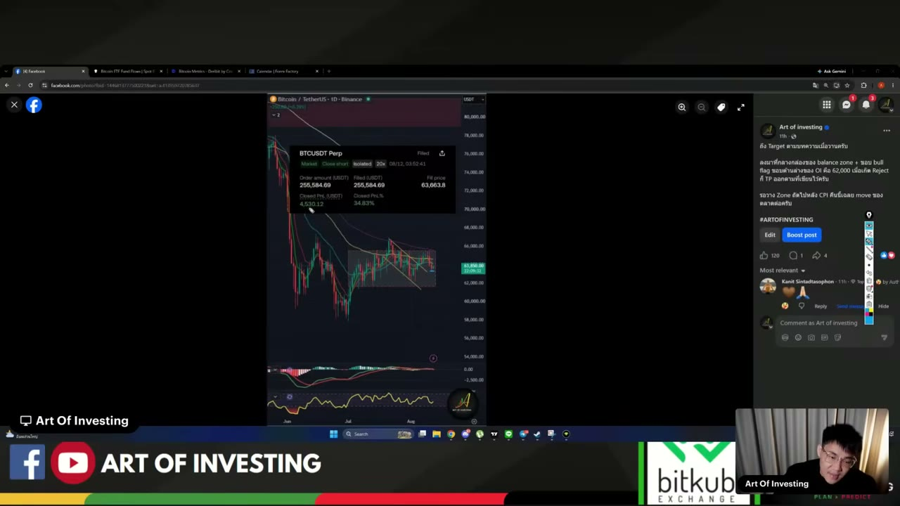

[00:22:59] ได้เปรียบของระบบเราต้องรู้ก่อนว่าระบบ เราเนี่ยหรือ trading  model ของเราอ่ะ มันได้เปรียบในสภาวะไหนแล้วมันจะเริ่ม เสียเปรียบเมื่อสภาวะไหนคำตอบสำหรับการ ใช้โมเมนตัมผนุกับ OI อ่ะคือเวลาที่มัน ไม่ได้ไปถึงขอบอ่ะมันไม่ได้มีความได้ เปรียบในการเทรดสูง เท่ากับการไปถึงนะครับฉะนั้นระหว่างกลาง เนี่ยเราต้องดูหมดเลยว่ามันมีอะไรบ้างไอ้ ตรงเนี้ยนะผมกล้าพูดนะถ้าเกิดว่าวันนี้ ไม่มี CPI อ่ะผมไม่ขายเห็นป่ะอันเนี้ยผม เข้าใจของระบบผมสูงกว่าเดิมอีกเพราะว่า ถ้าเกิดมันลงมาตรงนี้แล้วมันไม่มี CPI ผมก็มองว่าถ้าเกิดมันดีดกลับขึ้นมาไม่ถึง high เดิม แนวโน้มมันก็จะยังไม่ผ่าน 66,000 ผมก็เลย มองว่างั้นมันมีโอกาสสูงมากที่มันจะลงไป ถึง 62,000 นะครับก็ผมก็น่าจะได้กำไร ประมาณ 10,000 ดอนประมาณ 10,700 ตอนแรก เนาะที่คำนวณไว้แต่ทีเนี้ยมันมี CPI ตรง กลางเห็นป่ะ ฉะนั้นคำถามที่เมื่อกี้มีมีคนถามอ่ะ

[00:24:01] เดี๋ยวผมหยิบหยิบมาตอบก่อนเพราะผมมองว่า มันเป็นมันเป็นคำถามที่หน้าตอบนะครับได้ ได้ประโยชน์ทุกคนสอบถามครับถ้าเรามีระบบ เทรดของตัวเองแล้วมี Money  Management แล้วเราควรศึกษาหรือพนันเรื่องอะไรเนี่ย ครับคือเรื่องที่สำคัญแล้วควรศึกษาต่อ ครับคุณจรวัฒไม่รู้ยังดูอยู่มั้นะถ้าดู อยู่พิมพ์ตอบผมด้วยนะนะครับคือของระบบคำ ว่ามีระบบการเทรดอ่ะครับผมอยากรีเซตความ เข้าใจคุณใหม่นะโค้ชทั้งหลายอาจจะสอนว่า เส้นนี้ตัดกันเป็นขาขึ้นใช้อินดิเคเตอร์ ตัวนี้หลุดกรอบอินดิเคเตอร์แล้วแปลว่า หลุด channel ของมันแล้วเดี๋มันจะต้องดีด แบบเข้ามาตรงกลางเป็น mean  reversion หรือโค้ชบางคนบอกว่าตีเส้นเส้น demand น เส้นซัพพlyายเส้นเด้งเส้นสะท้อนชื่ออะไร ก็แล้วแต่แล้วคุณเรียกตรงนั้นว่าระบบนั่น ไม่ใช่ระบบนะครับนั่นคือคition เข้าใจใหม่นะคitionเป็นแค่สับเซตนึงของ ระบบเรียนเรื่องสับเซตกันมั้ยคณิตศาสตร์ อ่ะอันเนี้ยคือระบบ

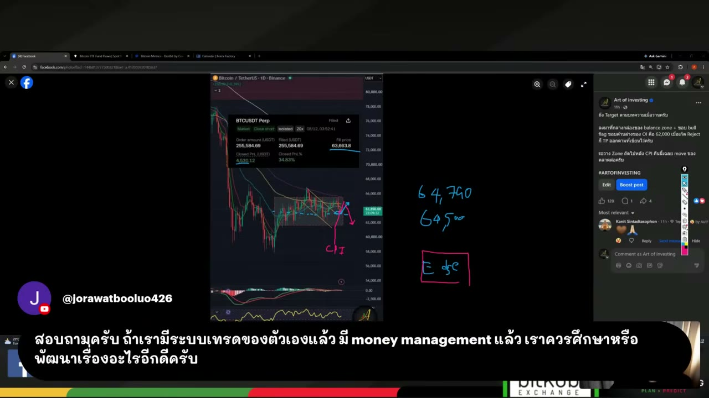

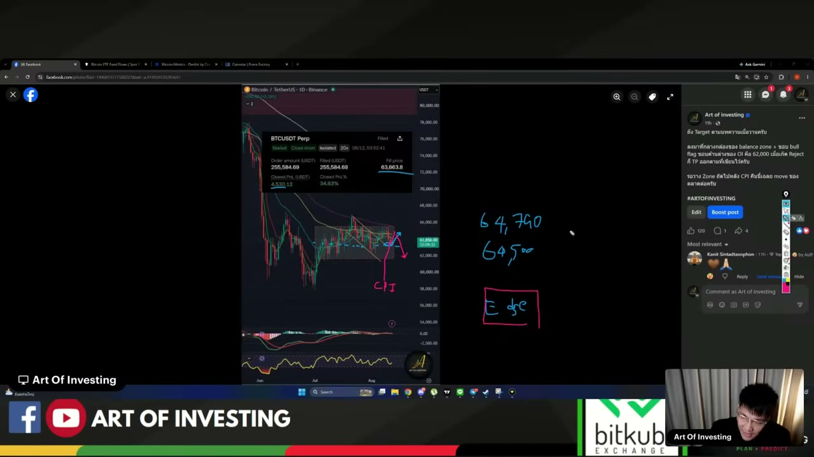

[00:25:03] conditionition คือเงื่อนไขเงื่อนไขมัน เป็นแค่สับเซตครับ ถูกมั้ยแล้วมันจะต้องมีสับเซตอะไรที่อยู่ บนเงื่อนไขอีกคำตอบก็คือปัจจัยภายนอก แล้วตรงเนี้ยคือระบบนะครับคำว่าระบบเนี่ย คือเราต้องเห็นภาพรวมทั้งหมดว่าโมเดลของ เราอ่ะมันคำนวณมาจากอะไรแล้วมันจะมีความ ได้เปรียบทาง data หรือทางข้อมูลถ้าเกิด เป็นภาพแบบ อย่างกับผมเนี่ยเฮ้ยโมเมนตัมเว้ยดีที่สุด คือตอนเป็นเทรนด์เสียเปรียบที่สุดคือตอน และเราเทรดด้วยผสมกับ OI ฉะนั้น OI เนี่ย จะเห็นเป็นกรอบของราคาถ้าเกิดราคามันวิ่ง แล้วมีปัจจัยภายนอกมากระทบระหว่างทางแปล ว่าความได้เปรียบของระบบผมน้อยลงทันทีผม TP ออก ไอ้ตรงเมันแค่คอitionไอ้ ถึง OI แล้วไม่ผ่านแล้วโมเมนตัมเกิดไม่

[00:26:03] ได้ RSI ไม่หลุด discount พวกเนี้ยคือคำ ว่าคitionนะครับเข้าใจใหม่นะไอ้ที่เราไป ได้ยินมาจากช่องไหนหรือโค้ชคนไหนก็แล้ว แต่ที่เค้าบอกว่าเฮ้ยจำระบบไว้นะครับระบบ ไม่ใช่สิ่งที่เขา้าสอนคุณคือเงื่อนไขถ้า เกิดคุณจะเข้าใจทั้งระบบจริงอ่ะคุณต้อง เข้าใจว่าเงื่อนไขตรงเนี้ยมันได้ผลดีใน ช่วงแบบไหนมันได้ผลไม่ดีในช่วงแบบไหนแล้ว หน้าตามันเหมือนเดิมเป๊ะเลยแต่เราไม่ควร เทรดในช่วงแบบไหนนั่นคือระบบนะครับคุณ ต้องมีdata้าหมดถ้าเกิดมีปัจจัยภายนอกแบบ นี้โอกาสจะเกิดเคสนี้กี่เปอร์เซ็นต์กี่ เปอร์เซ็นต์กี่เปอร์เซ็นต์ทำไมผมถึงชอบ เอาไวเพราะมันตอบผมได้อยู่ใน 1  SD  68% อยู่ใน 2  SD  95% อยู่ใน 3  SD  99.7%  7% อย่างเงี้ยเออมันเลยเป็นตัวเลขที่บ่งบอก ได้ว่าถ้าไม้เนี้ยเราจะ take  action เ ความน่าจะเป็นเราเป็นกี่เปอร์เซ็นต์ที่จะ ยังอยู่ในกรอบฉะนั้นถ้าเกิดมันมาถึง 62,000 เนี่ยความน่าจะเป็นที่จะทะลุลงไป

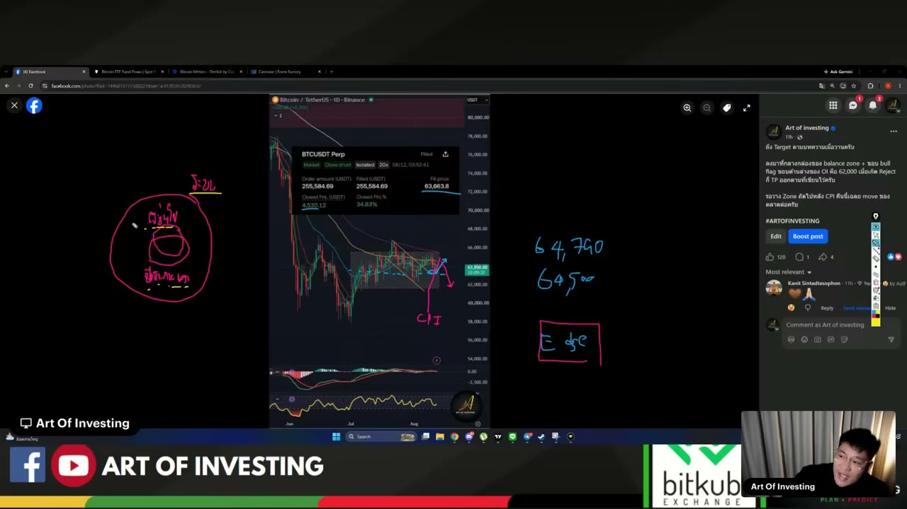

[00:27:03] ได้ในลวดเดียวในวันที่ 14 นะต้องบอกแบบ นี้นะในวันที่ 14 นะคือ 32% อ่ะถ้าถ้าอิงตาม Standard  Devation นะ ครับ 32% งั้นผมก็เลยวางไปจุดจุด TP ตอนแรกประมาณ เกือบๆถึง 62,000 เนี่ยเพราะแถวเนี้ยมัน มีออเดอร์หมดเลยในเชิงโมเมนตัมถูกมั้ย แล้วก็เป็นกรอบ Balance  zone ผนวกกับมี OI อีกงั้นถ้าถึงตรงเนี้ยเออผมก็เลยวาง เป็น TP แรกแต่มันมี CPI แทรกซะก่อนก็ TP ออกก่อนเนี่ยครับเนี่ยคือคำว่าระบบนะครับ อ่ะแสดงว่าไม่ไม่อยู่แล้วเนาะคนถามไม่ เป็นไรนะครับก็คิดว่าเพื่อนๆที่ฟังอยู่ก็ ได้ประโยชน์นะครับรบกวนขอเอด้าได้ครับ เดี๋ยวดูให้ครับ เอ่อสุขสันวันแม่ครับขอบคุณครับสุขสันวัน แม่เช่นกันครับคุณอาร์ตเสียงหายอ่ะเมื่อ กี้ไมค์ผมดับครับผมขอบคุณที่แจ้งเข้ามา ครับรอจานมาไลฟ์มาได้ทุกวันเลยครับโอ้ ขอบคุณครับดีใจที่รอกันครับคุณบอยสวัสดี ครับคุณมณีรัตน์รักจันทร์อาร์ทั้งใจ สวัสดีครับคุณอารักพงษ์เทพสวัสดีครับอ่ะ

[00:28:03] โอเคทีนี้เราไปวิเคราะห์กราฟกันต่อบ้าง นะครับอ่ะวิเคราะห์กราฟกันต่อ เนครับผมก็ยังมองว่าแนวโน้มเนี่ย ไปได้ทั้ง 2 ฝั่งเหมือนกันนะครับความได้ เปรียบในการเทรดณปัจจุบันถ้ายังไม่มีไม้

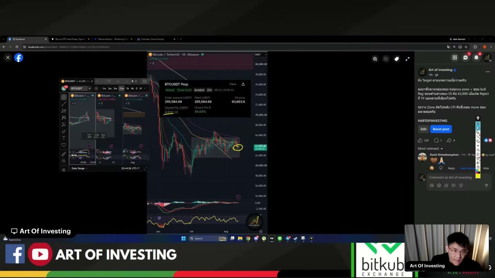

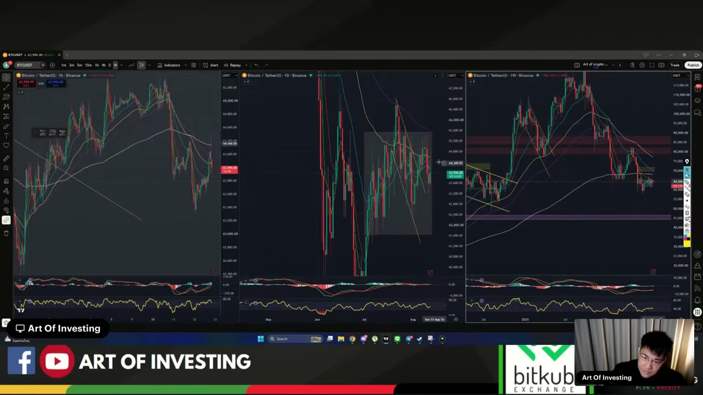

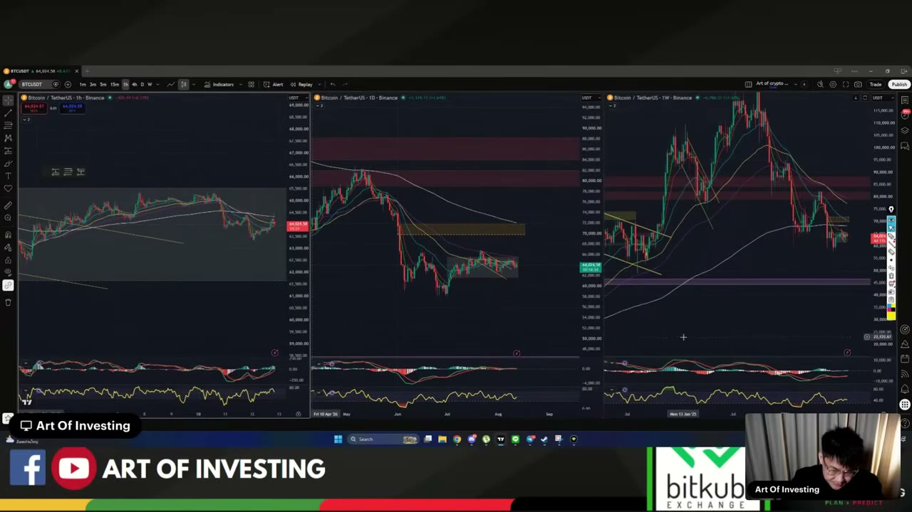

[00:29:05] อ่ะด้วยศาสตร์ผมนะตอนนี้ไม่มีนะครับไม่มี ไม่มีความได้เปรียบในการในการเทรดสักเท่า ไหร่เพราะว่าขอบบนน่ะมันอยู่ตรงนี้ ขอบล่างก็อยู่ตรงนี้ทีเนี้ยถ้าเกิดบอกว่า คุณอาร์ตนี่ไงก็ขึ้นมาติด โซนแล้วตรงนี้เนี่ยทำ New  High ไม่ได้ แบบนี้ช็อตลงไปได้มั้ยคำตอบคือได้แต่คุณ อาจจะโดน Stop  Loss ก่อนที่มันจะไปมั้ย เช่นสมมุติว่าคุณมองว่าราคามันจะลงแบบนี้ ถูกป่ะ แต่มันขึ้นไปก่อนไปเทสก่อนตรงนี้แลบไป แล้วค่อยลงเงี้ยคุณกระโดด Stop  Loss และ ถูกมั้ยหรือถ้าเกิดมันขึ้นไปอย่างี้แล้ว ไปยาวเลยคุณก็โดนอยู่ดีนะครับฉะนั้นตรง เนี้ยมันอยู่ตรงกลางเทรดได้มั้ยได้แต่ ความได้เปรียบของระบบไม่มีนะครับไม่มี งั้นมุมมองเนี่ยถ้าเกิดราคามันเบรคขึ้นไป นะครับเราเห็นมยว่าdisคาเอ้ยขออภัย

[00:30:06] พรีเมemiมใน week เนี่ยมันลงมาเรื่อยๆนะ ครับคำว่าพีemiมมันจะตรงกันข้ามกับ disc คือค่าเฉลี่ยที่ลงมาแล้วเกิดแรงซื้อ จนเป็น new  high ตลอดนะครับเราจะเรียกตรงเนี้ย ว่า disc ถูกมยแต่คำว่าพีemiอ่ะคือจุดที่ ขึ้นมาแล้วจะเกิดแรงขายจน New ตลอดมันจะ เป็นจุดที่เราเรียกว่าพรีเมี่มเพราะว่า คนมองว่าราคาแพงเกินไปขอขายก่อนดีกว่านะ ครับมันก็จะเป็นหน้าตาอย่างงี้งั้นตอน เนี้ยพรีเมี่มเนี่ยก็อยู่ที่โซนประมาณ 70,000 ถามว่าขึ้นไปได้มย ถ้าถ้าเอาภายในวันที่ 14 นะภายในวันที่ 14 อ่ะผมว่าผ่าน 66,000 ยากมาก 68,000 ผ่าน แทบแทบเป็นไปไม่ได้นะครับอ่ะอาจจะเป็นเคส นั้นซึ่งถ้าเกิดสมมุติว่ามันมันเบรก 66,000 ได้จริงๆแล้วยืนได้อ่ะผมก็อาจจะ follow ไปนะครับอาจจะ follow ไปสมมุติ

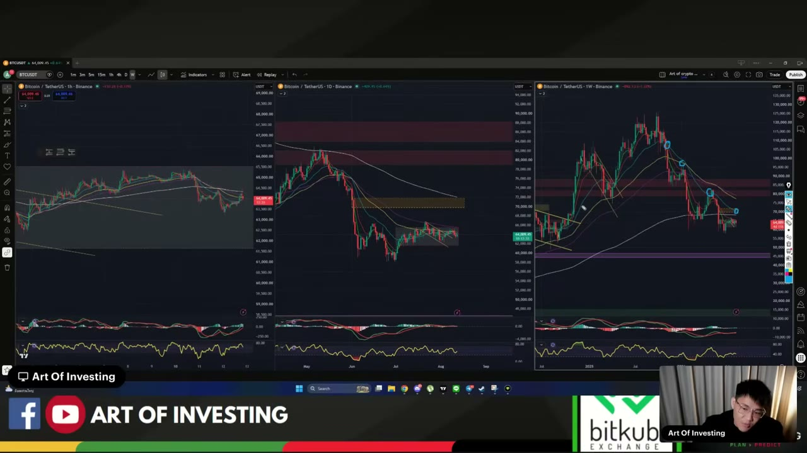

[00:31:08] ว่ามันเบรคอย่างี้ขึ้นไปเนาะอ่ะอย่าง เงี้ยปื๊ดๆขึ้นไปแล้วย่อมารีทestแล้วเกิด โมเมนตัมเบรคอีกทีเงี้ยอ่ะผมอาจจะ follow ช็อตนี้ขึ้นไปนะครับแถว 66,000 เนี่ยแล้ว ผมอาจจะเทรดขึ้นไปถึง 67,000 ปลายๆหรือ 68,000 นะอาจอาจจะเป็นท่านั้นตรงเนี้ย เดี๋ยวเราก็ต้องมาดู OI อีกทีซึ่งเดี๋ยว ผมจะเขียนบทความลงเพจ Facebook อยู่แล้ว ถ้าเกิดมันเกิดตัวเลขแบบนั้นก็ไปตามเพจ Facebook กันไว้นะผมเขียนตลอดอยู่แล้วก็ จะเป็นท่านั้นนะครับถ้าถ้าเกิดเบรคขึ้น หรือมีอีกท่านึงก็คือถ้าเกิดเบรคขึ้นแล้ว ยืนไม่ได้อ่ะผมก็จะยังจะช็อตนะครับเพราะ ว่ามุมมองของผมเนี่ยตลาดเนี่ยภาพรวมในweค อ่ะมันยังเป็นขาลงอยู่นะครับอ่ะเดี๋ยวผม ขยายดูสุดท้ายแล้ว อันนี้พูดทุกไลฟ์เลยนะครับก็คือเวลาที่ ตลาดเนี่ยมันเป็นขาขึ้นยาวๆเราจะเห็นว่า MACD มันน่ะจะอยู่เหนือศูนย์หมดเลยเห็น

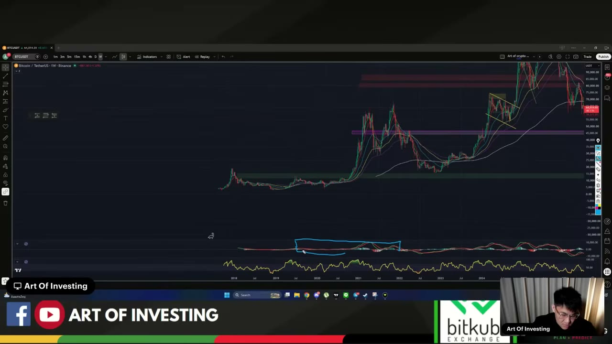

[00:32:10] เนี่ยมันเป็นโซนที่ออเดอร์ซื้อมันเยอะ กว่าออเดอร์ขายแบบชัดเจนเราก็จะเรียกโซน ตรงเนี้ยนะครับว่าเป็นเทรนซึ่งการใช้ MACD ว่าเฮ้ย MACD  2 เส้นอยู่เหนือ 0 แบบนี้ เป็นเทรนด์ขาขึ้นไม่สามารถทำแบบนั้นได้นะ ครับกับทุกสินทรัพย์อ่ะใช้คำนี้ไม่สามารถ ทำแบบนั้นกับทุกสินทรัพย์ได้นะครับคุณ สามารถใช้ความคิดแบบนี้กับสินทรัพย์ที่มี หน้าตาเป็นวัฏจักรหรือเป็นไซเคิลเท่านั้น นะครับเพราะว่าบitcoinอ่ะตลาดขาขึ้นกับ ตลาดขาลงมันแยกตัวออกจากกันอย่างชัดเจน อย่างที่ผมพูดประจำนะครับฉะนั้นเวลาที่ ออเดอร์ซื้อมันเยอะเยอะกว่าขายมันก็เป็น เทรนด์เลยเวลาที่ออเดอร์ขายเยอะกว่าซื้อ มันก็เป็นเทรนด์ขาลงเลยนะครับพอวัฏจักร มันเป็นแบบเนี้ยเราก็จะเห็นว่าตอนตลาดหมี มันก็ลงเห็นมั้ยตอนตลาดกระทิงมันก็ขึ้น เงี้เห็นมั้ยขึ้นไปจนแสนกว่านะครับแล้ว ตอนเนี้ยมันยังอยู่ข้างล่างนะครับฉะนั้น จนกว่าที่ MACD  week เนี่ยนะครับมันจะ

[00:33:12] เบรคกลับขึ้นมาเหนือ 0 ได้เนี่ยโมเมนตัม มันยังเป็นขาลงนะครับจนกว่ามันจะเบรค พรีเมี่มอย่างเงี้ยปึ้งขึ้นมา MAD เหนือ 0 RSI  overbard บ่งบอกว่าโมเมนตัมมันเกิด แล้วซึ่งมันจะเป็นแบบเนี้ยทุกครั้งที่ กำลังจะเกิดเทรนด์เห็นป่ะก็คือติดๆเบรก ได้แล้ว Magdin  0  b เนี่ยมันจะเป็น อย่างเงี้ยครับทุกๆครั้ง ฉะนั้นตราบใดก็ตามที่ภาพนี้ยังไม่เกิดอ่ะ นะครับผมยังให้น้ำหนักว่ามันก็ยังจะ ไซด์เวย์กึ่งๆขาลงแบบเนี้ยต่อไปได้อีก หน่อยเนี่ยงั้นเรารู้แล้วว่าweคเนี่ยมัน มันยังเป็นขาลงนะครับฉะนั้นนั้นเนี่ยผมก็ เลยมองว่าต่อให้มันสามารถเบรก EMA  10 ตรงนี้ได้เนี่ยมันก็ยังมีโซนที่มันยังไม่ สามารถผ่านได้ที่ยังเป็นพรีเมี่มอยู่นะ ครับก็คือ EMA  25 ฉะนั้นผมถึงบอกว่าถ้า เกิดมันเบรคขึ้นไปได้จริงๆผมก็อาจจะ follow สั้นๆอย่างเงี้ยเห็นมั้ย 60,000 ประมาณถึง 68,000 เพราะผมมองว่าเบรกได้ยากแล้วซึ่งไปพอดี กับ EMA  200 พอดีเป๊ะเลยด้วยเห็นมั้ยตรง

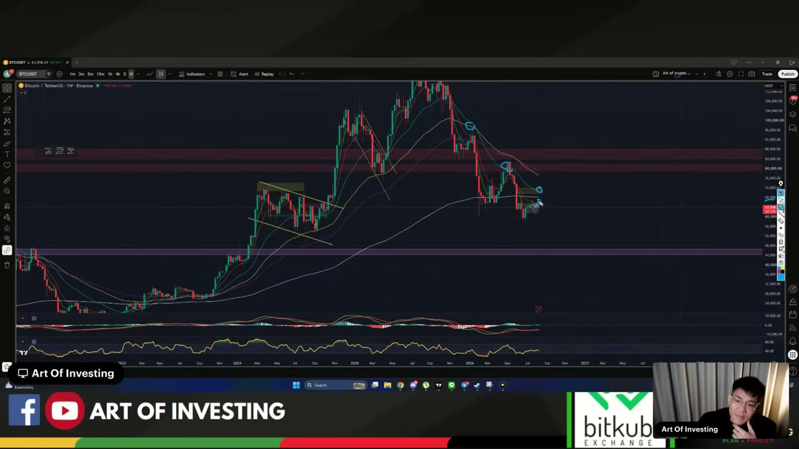

[00:34:13] นี้นะครับก็จะเป็นเคสนั้นส่วนถ้าเกิดเบรก ลงตรงนี้นะครับอ่ะก็ ใจผมนะผมคิดว่าไม่น่าจะ ยากเท่าไหร่นะครับที่ที่จะเทรดในขาลงนะ ครับตรงเนี้ยถ้าเกิดว่าพรุ่งนี้หรืออะไร เนี่ยผมเริ่มเห็น OI มากขึ้นสมมุติเนาะ ว่าวันนี้วันที่ 12 พรุ่งนี้ 13 มะลืน 14 เนี่ยผมเริ่มเห็นเสาสมมุติว่าตอนเนี้ยเสา มันอยู่ที่ 66,000 นะครับแล้วตรงเนี้ย 68,000 แล้วถ้าอยู่เสา 65,000  15,000 เนี่ยมัน งอกงๆๆๆมากขึ้นเรื่อยๆเนี่ยนะครับแปลว่า คนเริ่มกังวลว่ามันจะจะเบรก 65,000 มากขึ้นนะครับฉะนั้นโอกาสที่มันจะต้องไป ถึง 66,000  68,000 เนี่ยอาจจะอาจจะน้อย ลงแล้วมันอาจจะเกิดรีแอคชัตั้งแต่ 65,000 แล้วผมก็อาจจะพิจารณาเข้าช็อตได้นะครับ ซึ่งอันเนี้ยเดี๋ยวต้องรอดูก่อนตอนเมัน ยังไม่มีเสาที่ 65,000 เลยนะครับทำให้แถว เนี้ยยังไม่ค่อยเกิด edge เท่าไหร่แต่ถ้า

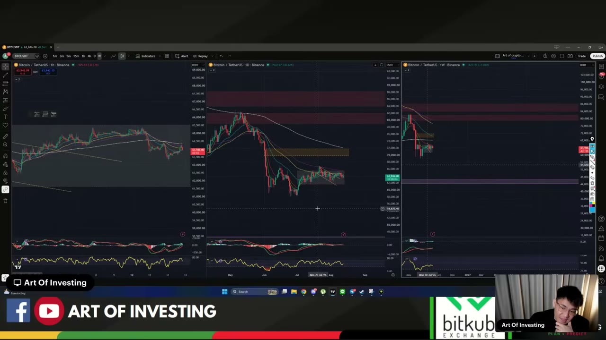

[00:35:14] สมมุติมันเริ่มเกิด 65,000  64,000 ก็แนว โน้มว่ามันน่าจะเบรคตรงนี้ได้ยากแล้วนะ ครับฉะนั้นถ้าเกิดเกิดการรีเจคลงเงี้ย อย่างเงี้ยอ่ะผมก็อาจจะช็อตลงมาถึงกรอบ ล่างนะครับเนี่ยครับพอเรามี OI ให้ดูเนี่ยมันจะเริ่มเห็นเม็ดเงินจริงๆนะ ครับที่มันขยับในตลาดเราเราต้องเข้าใจ ก่อนว่าทำไมเราถึงดู Option มากกว่า Liquidation  Heat  Map ส่วนใหญ่ที่เรา เห็นฝั่งิปโtoเนาะเขาจะดู Liquidation Heat  Map นะครับหรือว่าไอ้อ่ะเดี๋ยวผม เอาให้ เราจะได้นึกออกบางคนไม่เข้าใจว่าเค้า เรียกว่าอะไรอ่ะพวกเพจหลายๆเพจเค้าจะชอบ เอาหน้าเมาลง นะครับก็คือเฮ้ยเนี่ยชนตรงไหนเนี่ยจะโดน Force  liquidate นะครับจะโดน Stop  loss อ่ะพูดง่ายๆอ่ะจะโดน Stop  Loss อะไร เนี่ยนะครับ อ่ะที่มันที่มันเป็นแบบเนี้ยอย่าลืมนะว่า

[00:36:15] position  future อ่ะ liquidation ไอ้ liquidation  Levate ตรงเนี้ยมันยกออก ตอนไหนก็ได้นะคุณนึกออกป่ะสมมุติว่านึก ภาพคุณวางคุณวาง Stop  Loss ไว้อ่ะแล้ว คุณอยากย้าย Stop  Loss อ่ะคุณก็ย้ายได้ เลยคุณอยากจะเฮ้ยไม่อยากรอถึง Stop  Loss แล้วคุณคัทก่อนคุณก็คัชเลยนะครับฉะนั้น น้ำหนัก Liquidation  Map เนี่ยมันเลยจะ น้อยกว่า OI เพราะ OI คุณทำแบบนั้นไม่ได้ มันมีค่าน้ำซึ่งค่าน้ำในที่เนี้ยเราเรียก ว่าค่าพรีเมี่ม Option เนี่ยมันจะซื้อและ ขายกันนึกออกมั้ยมันจะมีคนที่มองว่าราคา จะต้องถึงตรงนี้เช่นคนซื้อคอที่ 66,000 แปลว่าราคาจะต้องถึงหรือทะลุคนที่ซื้ออชั ตรงนั้นน่ะถึงจะกำไรตอนที่คนซื้อปุ๊บอ่ะ เขาจะต้องจ่ายค่าน้ำส่วนนึงให้กับคนขาย แล้วนะครับคนขายอtionัมันจะมีคนที่มองว่า จะถึงและคนที่จะมองว่าไม่ถึงฉะนั้นเนี่ย ถ้าเกิดคุณวางๆยกๆวางๆยกๆเนี่ยคุณจะเสีย ค่าน้ำจน

[00:37:16] ไม่คุ้มอ่ะ ก็คือมันไม่มีใครไปนั่งเสียค่าน้ำเล่นน่ะ นึกนึกออกมั้ยสมมุติว่าคุณไปสนามม้าอย่าง เงี้ยคุณบอกเอาตัวนี้เค้าก็เก็บค่าน้ำคุณ ไปแล้วคุณบอกเอ้ยเปลี่ยนใจไม่เอาละเอา เบอร์นี้ดีกว่ามันดูแข็งแรงดีเฮ้ยเปลี่ยน ใจไม่เอาละอย่างเงี้ยคุณคุณจิ้มม้าไป 3 ทีอ่ะคุณโดนค่าน้ำจนกินทุนคุณหมดแล้วนะ ครับมันจะเป็นภาพแบบนั้นนั่นเลยเป็น สาเหตุที่ผมอ่ะจะยึดอtionัมากกว่าอันนะ ครับอันนี้เท่าที่ไปศึกษาเพิ่มมาเนาะอื งั้นตรงเนี้ยมันก็ยังไม่ใช่ trading  zone ที่เหมาะสมเท่าไหร่ถ้าเกิดจะเข้าจะแยบอ่ะ ผมก็แนะนำว่าให้ใช้ไม้ที่มันไม่ใหญ่มากจน ดีกว่านะครับอ่ะเดี๋ยวนะdisคอร์ดผมเด้ง รัวเลยนะครับน่าจะมีน่าจะมีchชannลไหนโดน โดนแฮกแต่ว่าอ่ะช่างมันมันเงียบไปะ discอร์เนี่ยเป็นหนึ่งในแพลตฟอร์มที่คน โดน pitching ไซต์เยอะมากนะเช่นแบบคลิก ลิงก์แล้วแล้วAccาตัวเองก็โดนแฮกแล้วมัน ก็จะไปส่งลิงก์แปลกๆให้กับห้องอื่นๆนะ ครับเยอะมาอ่ะภาพประมาณนี้ครับฉะนั้นตอน

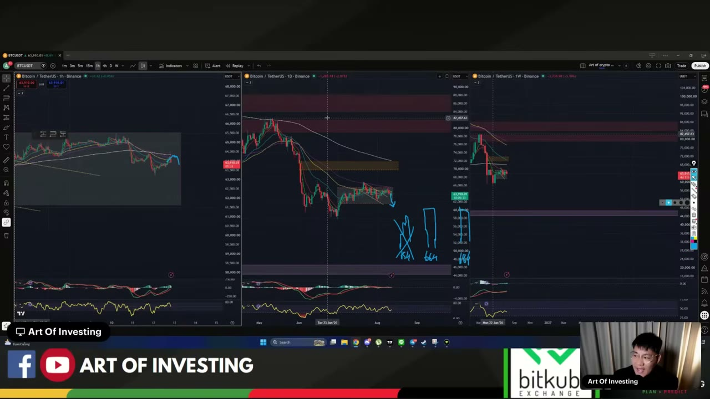

[00:38:20] เนี้ยลงได้มั้ยได้แต่ว่าถ้าเกิดอยากจะ เทรดอ่ะผมมองว่าให้เทรดไม้เล็กหน่อยแล้ว กันนะครับไซส์อย่าเพิ่งอัดอัดไซส์ใหญ่มาก นะเพราะว่ายังไม่ใช่จุดได้เปรียบถ้าเทรด ก็อาจจะเทรดครึ่งไม้แล้วถ้ามันวิ่งมาถึง ขอบก็เราก็จะได้ทบไซส์ได้นะครับเพื่อ เพื่อเทรดให้มันcoverอรตรงเนี้ยก็เทรดได้ ถ้าเทรดแบบแต่ความได้เปรียบมันต่ำนะครับ อืแล้วแต่เนาะอย่างอย่างที่เห็นก็ก็คือ เดี๋ยวนี้ผมจะออกตอนก่อนผมใช้โมเมนตัม เพียวก็คือไม่ได้ใช้ data เลยแบบพวก o พวกอะไรอย่างเงี้ยผมก็จะเข้าเทรดบ่อยถ้า เกิดผมไม่ใช้ data เลยจุดเผมเข้าไปแล้ว แต่ทีเนี้ยแทนที่เราผมจะเทรดบ่อยเท่าเดิม อ่ะผมกลับมาเป็นเทรดไม้ใหญ่ขึ้นแทนสมัย ก่อนคุณจะเห็นผม Take  profit ไม้นึงอ่ะ ประมาณ 1,000 นึงไม่เกิน 1,500 เห็นมั้ย ว่าไซส์มันเปลี่ยนจาก 1000 เนี่ยผมเทคโฟ ทีนึง 4-5,000 ะแต่ผมไม่ได้เทรดทุกวัน เท่าเท่าเดิมเนาะมันก็จะเป็นแบบอาทิตย์ละ 2 ไม้อาทิตย์ละ 1 ไม้แทนผมก็เลยแทนที่ผม จะเทรดไม้เล็กเล็กย่อยๆทุกวันเนี่ยผมมารอ เทรดช่วงที่มันตรงกับ data พอดีแล้วผมก็ เอาไม้ทั้งหมดน่ะไปรวมไซส์ไว้เดียว win

[00:39:23] rate มันเลยสูงขึ้นนะครับอ่ะก็ตรงเนี้ย เทรดได้อย่างที่บอกเนาะแต่ว่าความได้ เปรียบไม่สูงให้ดูกรอบตรงนี้ไว้อย่างที่ ผมดู 60-62 นะครับแล้วก็ 65 ถึงอ่ะผมให้ 66 เลย 66 ถึง 68 อ่ะ 67 [เสียงหัวเราะ] แล้วอ่ะเอา 67 พอเอา 2 ทรงเนี้ยอ่ะ นะครับเนี่ยอ่ะผมให้ตรงนี้เลยบีบดอบมัน เข้ามานะครับคิดว่าราคาน่าจะวิ่งกระต๊อก กระ๊กกระต๊อกแตก อยู่ตรงนี้ก่อนนะครับทีนี้ถ้าเกิดมันเกิด new  low ได้จริงๆเนี่ยโอเคอันเนี้ยมัน จะไปตรงกับต้นไลฟ์และที่ผมอธิบายไปว่า ทำไม 3  3 อย่างเนี่ยมันประกบเข้ามาหากัน หมดเลยนะครับไปดูตรงนี้ เห็นมั้ยนะครับอันเนี้ยเป็นสถิติที่ผม เก็บนะครับเห็นมั้ยว่าเวลาที่ผมจะอธิบาย อะไรอ่ะผมจะไม่อธิบายว่าเฮ้ยผมเห็นมัน บ่อยเฮ้ยผมเทรดมา 12 ปีกว่าแล้วผมรู้เดี๋ มันจะเป็นอย่างี้เฮ้ยหน้าตาอย่างเงี้ย

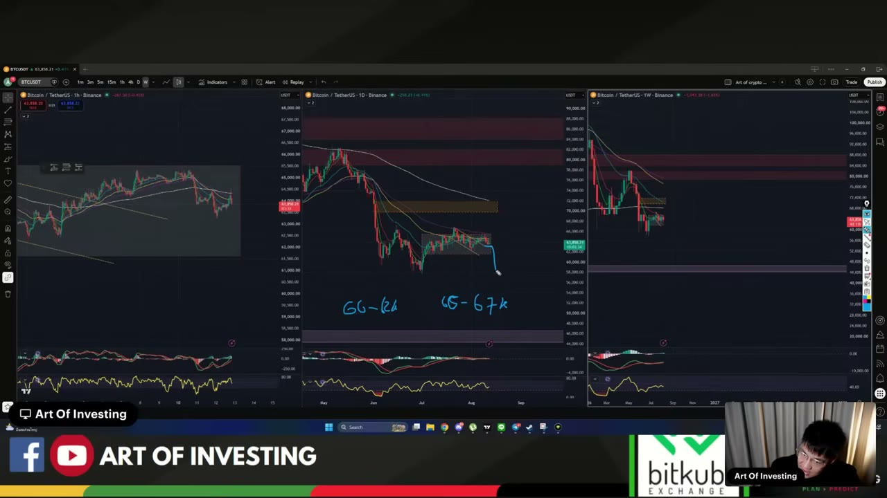

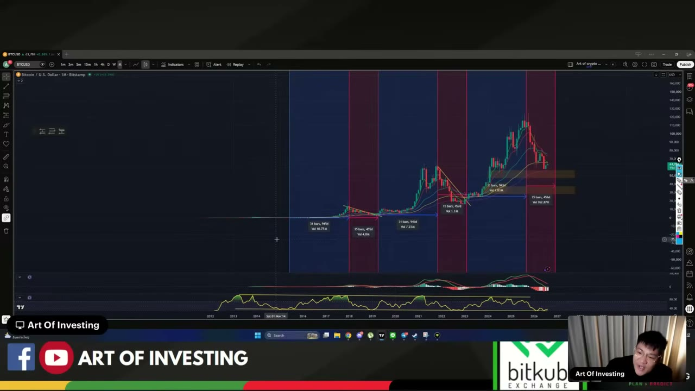

[00:40:25] เดี๋ยวมันจะต้องเป็นเคสนี้แน่นอนผมไม่ใช่ คนเทรดแบบนั้นแต่ผมอ่ะจะเป็นคนมี data ใน มือว่าเฮ้ยมันเป็นถ้ามันเป็นเคสนี้มันจะ ต้องหน้าตาแบบนี้ถ้ามันเป็นเคสนี้มันจะ ต้องหน้าตาแบบนี้นะครับอ่ะทีเนี้ย มันจะเป็นกระทิง 31 เดือนหมี 15 เดือน 315 5  315 มันเป็นมา 3 รอบและทีนี้เราต้อง ดูว่ามันจะเป็นรอบที่ 4 มั้ยที่จะขึ้น หลังจากการพักประมาณ 15 เดือนคือตรงเนี้ย มันไม่ใช่เป็นกฎที่มันจะต้องเกิดนะแต่มัน มีคนบางกลุ่มได้ผลประโยชน์จากการแทรกแซง สภาพคล่องในตลาดที่ช่วงเวลาแบบนี้มันก็ เลยยังจะเป็นแพทเทิร์นแบบนี้อยู่นะครับ วันไหนที่กลุ่มคนเหล่านั้นไม่สามารถสร้าง ผลประโยชน์ได้แล้วเช่นตลาดมันใหญ่ขึ้นมาก ๆจนแทรกแซงออเดอร์ได้ยาก cycle  mod ตรงนี้ก็จะหายไปอยากให้ทุกคน รู้ว่าวันนึง 4  year  cycle ของ Bitcoin จะค่อยๆจางลงเรื่อยๆถ้าเกิดมันได้รับการ ยอมรับมากขึ้นเรื่อยๆนะครับเพราะว่าการ แทรกแซงจะทำได้ยากขึ้นเรื่อยๆงั้นตอน

[00:41:27] เนี้ยถ้าเกิดว่าตลาดมันยังไม่ได้ใหญ่ขนาด นั้นคลังสำรองก็ยังไม่ได้ซื้อด้วยเงินจาก ภาษีประชาชนได้เนี่ยนะครับสมมุติว่ามัน ย่อมาตรงเนี้ย แล้วเราเห็นมั้ยว่าเห็นมั้ยตุลาคม พฤศจิกายนและธันวาคมนะครับงั้นตรงเนี้ย พฤศจิกายนธันวาคมเนี่ยที่มันเป็นช่วงที่ กำลังจะเกิดเทรนด์ทุกครั้งเลยเนี่ยนะครับ มันจะไปตรงกับ midterm  election ของชอป พอดีนะครับการเลือกตั้งกลางเทอมจะเลือก ว่าลูกน้องในรัฐบาลจะเป็นของพรรคตัวเอง หรือพรรคฝั่งตรงข้ามถ้าเกิดเขาแพ้ให้เรา นึกว่าเทรัมป์จะเป็นผู้นำแต่คนที่จะคอย เซ็นว่านโยบายเขาผ่านไม่ผ่านน่ะจะเป็นของ อีกฝั่งหมดเลยหรืออีกพรรคฉะนั้นทรัมป์ไม่ อยากแพ้ครับตอนเสงครามยังไม่จบดี midterm election ใกล้เข้ามาเรื่อยๆ carity  act โดนเลื่อนผมก็เลยคิดว่าถ้าเกิดจะเป็นภาพ นั้นเนี่ยมันก็มีแนวโน้มนะครับว่ามันจะลง มาเป็นงี้เห็นมั้ยอ่ะเป็นsวิอย่างงี้ก็ ได้อ่าแล้วก็อาจจะ sideway มยกุกๆกิกๆกุก

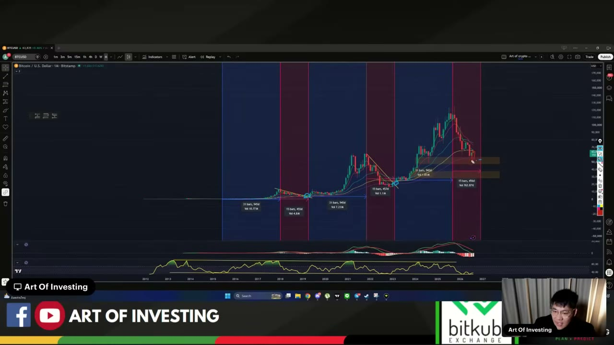

[00:42:28] ๆๆแล้วก็ขึ้นทีเนี้ยเราไม่ได้รอซื้อตาม โซนอย่างเดียวถูกมั้เรารอให้ week เนี่ย มันแสดงผลของมันก่อนนะครับ Week ต้องแสดง อาการก่อนว่า MACD เหนือ 0  RSI  overbard นะครับแล้วก็ premium โซนได้ก็จะเป็นจุด follow เพิ่มของผมส่วนโซนด้านล่างข้อ เนี้ยผมมองว่ายากถ้ามันไม่ได้ล้มขนาดแบบ บริษัท Strategy ล้มอ่ะแล้วก็ดึงให้กอง ทุนอื่นๆหรือบริษัทอื่นๆที่เก็บ Treasury เป็น Bitcoin เนี่ยหรือ ETF ที่เป็น Leverage เนี่ยร่มเป็น Domino เหมือนกับ cycle ที่แล้วเช่นเอ่อ FTX ร่ม Genesis ร่ม Treac ร่มเงี้ยล้มเงี้ยเออผมว่าเคส นั้นเป็นไปได้ที่มันจะทุบแบบเทกระจาดแต่ ว่าเคสเนี้ยอืมนะครับผมมองว่ายากที่จะลง ถึงโซนนี้ไอ้โซนเนี้ยมันคือตัวเลขแบบจาก ยอดถึงก้นมันจะประมาณ 70% ปลายๆถึง 80% ทุกครั้งนะครับอย่างเงี้ยเห็นมั้ยฉะนั้น น่ะเค้าก็เลยบอกว่าเอ้ยรอบเนี้ยถ้าจะลง เนี่ยมันก็ต้องถึงตรงนั้นหรือเปล่าซึ่งผม

[00:43:31] กลับมองว่ามันยากแต่ก็ไม่ไม่ได้ปิดประตู ความเป็นไปได้นะว่าไม่เกิดแน่ๆอ่ะก็ก็ยัง ให้โอกาสเหมือนว่ายังมีแนวโน้มที่จะเป็น ไปได้อยู่แค่ส่วนตัวผมมองว่ายากนะครับ สวัสดีคนดู 160 ท่านนะครับสวัสดีครับ เนี่ยผมเลยมองว่ามันยากหน่อยนะครับที่จะ เกิดตรงนั้นก็เลยผมก็เลยมองว่าตรงเนี้ย เป็นราคาที่เหมาะสมะถ้าลงมาอีกแล้ววเกิด ภาพเดิมเนี่ยนะครับผมค่อนข้างแฮปปี้มากๆ ก็คือภาพนี้ถูกป่ะ นี่ Magdin  0  RSI  overbard อืเนี่ย เป็นจุดเนี้ยถ้าถ้าถ้าเกิดเป็นเคสนี้เกิด ขึ้นนะครับผมก็คิดว่าผมก็จะวาง Stop ไว้ ที่ low นั้นนะครับฉะนั้นเนี่ยมันอาจจะ ยังลงได้อีกตบตลบหรือเปล่าแล้วเบรคตรงนี้ อย่างเงี้ยนะครับเคสเผมจะแฮปปี้มากเลย แล้วผมก็น่าจะเอาบitcoinผมมาเปิดคอย M อันนี้ส่วนตัวนะส่วนตัวนะอย่าทำตามนะครับ เพราะว่าผมคำนวณพอร์ต Alpha เบต้าไว้ เรียบร้อยแล้วผมเทคความเสี่ยงเรียบร้อย

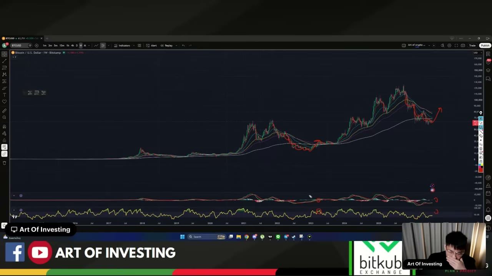

[00:44:32] แล้วเพราะว่ามันเป็นอย่างี้มา 3 ครั้ง แล้วอ่ะทีเนี้ยคนเราอ่ะที่ที่มีปัญหานะ คือจะบอกว่าตอนที่ผมอยู่มหาลัยอ่ะครับ กลุ่มเนี่ย 10 เกือบ 20 คนน่ะเหลือผมคน เดียวที่ที่ยังเป็นเทรดเดอร์อยู่นะครับ นอกนั้นก็อาจจะเป็นลงทุนระยะยาวหรือว่า แบบไม่ได้จริงจังกับในตลาดไปแล้วอย่าง เงี้ยสิ่งนึงที่ผมทำให้เห็นคนพลาดเยอะที่ สุดคือคนไม่กล้าอัดในจุดที่ควรจะต้องอัด แล้วไปกล้าในจุดที่ไม่ควรจะอัดเช่นเฮ้ย จุดเนี้ยความน่าจะเป็นสูงมากคุณวิเคราะห์ มาฉึบฉับฉึบๆๆโอกาสจะเกิดเคสนี้สูงเท่า นี้ๆๆมีความน่าจะเป็นเท่านี้ๆๆแต่คุณไม่ อัดคุณเข้าไม้เล็กนิดเดียวแล้วก็ชนะคุณก็ แฮปปี้เอ้ยเออค่อยๆเก็บ small  win ไป เรื่อยๆก็ได้ค่อยๆเก็บก็ได้ทีนี้กลับด้าน จุดที่ไม่ควรจะอัดคุณโดนไปะ stop  loss ในจุดที่ความน่าจะเป็นมันสูงเพราะคุณเล่น ไม้เล็กมาตลอดนึกภาพตามผมนะคุณเล่นไม้ เล็กมาตลอดแล้วคุณโดน Stop  Loss ปั้งคุณ

[00:45:35] บอกเฮ้ยต้องเอาคืนอัดไม้ใหญ่แต่ตรงนั้น น่ะมันไม่ใช่จุดของระบบเลยอ่ะแล้วคุณก็ไป อัดๆสุดท้ายคุณก็จะโดนนะครับแล้วมันก็จะ โดนไม้ใหญ่ในจุดที่ไม่คุ้มค่าความเสี่ยง งั้นพอย์เนี้ยผมว่าเป็นหนึ่งพอย์ที่ที่คน พลาดกันค่อนข้างเยอะเยอะมากๆนะครับอยาก ให้ทุกคนระวังเรื่องเรื่องตรงนี้กันด้วย นะครับคือผมอยากให้ถ้าเกิดคุณวิเคราะห์มา แล้วคุณแบ่งความเสี่ยงมาแล้วอ่ะถึงจุดที่ ควรจะต้องเข้าคุณต้องเข้านะครับแล้วก็ให้ กล้าตอนที่มันเหมาะสมไม่ใช่ว่าแบบเอ้ย เข้าดีไม่เข้าดีเฮ้ยหรือไม่เอาเดี๋ยวรอ ราคามันย้อนมาก่อนเป็นอย่างงู้นมาก่อนนะ ครับไปโดนหนักๆก่อนค่อยไปอันนั้นจะมี ปัญหาสวัสดีคุณวุินันท์ครับสวัสดีคุณ จิรพัฒครับเชียงใหม่ฝนตกหนักอ๋อโอเคครับ วันนี้ราชพฤกษ์ตกปลอยๆนะครับแล้วก็หยุดไป ประมาณนี้นะครับสำหรับบitคinเนาะฉะนั้น ถ้าลงมาผมมองอีกทีที่ไหนอืมถ้าลงมาผมมอง

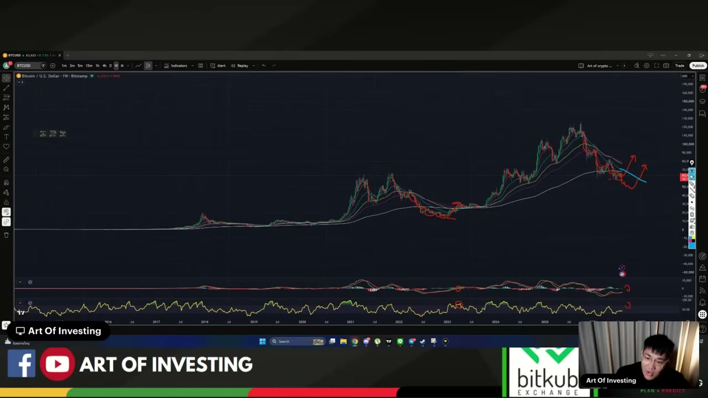

[00:46:36] อีกทีหรอเหรอก็คือถ้าหลุดถ้าหลุด 62,000 และหลุดนิวโรที่ 58,000 นะผมคิดว่าโซนที่ เหมาะสมสำหรับผมนะโดยส่วนตัวนะครับผมคิด ว่าไม่น่าเกิน 46,000 นะครับ 46,000 เนี่ยสวยแล้ว 46,000  50,000 ต้นเนี่ย ครับแถวเนี้ยแล้วก็ถ้าลงมาใช่มั้ยปึ๊บๆๆ แล้วเริ่มยกอย่างี้นะแล้วเบรกตรงนี้อ่ะ โอเคก็เข้าคอitionผมละนะครับก็ผมคงก็ยัง รอตรงนี้ถ้าเกิดเคสนี้นะหรือมันอาจจะเป็น ครั้งแรกในประวัติศาสตร์ก็ได้เพื่อนนึก ออกป่ะครั้งแรกประวัติศาสตร์ที่แบบไม่ ขึ้นตอน 15 เดือนแล้วก็แบบเบรคไปเลยแต่ อย่างงั้นน่ะมันก็จะยังไม่ตรงdata้าตาม ที่เราเก็บมาความได้เปรียบมันยังไม่มีก็ ผมก็รอรอ take  profit ในในจุดที่ผมได้ เปรียบที่สุดแค่นั้นเอง ประมาณนี้ สำหรับบitcoinนะครับอ่ะเดี๋ยวเราไปดูตัว อื่นต่อ

[00:47:36] ส่วนถ้าเบรกผมมองยากเหลือเกินนะเนี่ยเห็น มั้ยตรงนี้ถ้าโมเมนตัมเปล่าผมเทรดไปแล้ว แต่อย่างที่บอกนะครับ[เสียงสูดหายใจ]วิล rate มันจะไม่สูงมาก เทรดได้ครับก็ยังอยู่ในกรอบนี้ ต่อมาอีธเรiumนะครับเอ่ออธeriเรียมเนี่ย ย่อน้อยกว่าบitcoinเนาะอาการเนี่ยค่อน ข้างต่ำกว่าแต่ทีเนี้ยอธีเรiumเนี่ย balance โซนมันชัดกว่า balance โซนอธีม โคตรชัดนะครับฉะนั้นก็คือตรงนี้ถูกป่ะ เนี่ยทีเนี้ยถ้าเป็นอธีเรียมอ่ะจุดตรง เนี้ยคุณเทรดได้เออถ้าเป็นอธีเรียมนะ เนี่ยอย่างเงี้ยเรียกว่าได้เปรียบนะครับ เพราะว่าเราจะเห็นอย่างี้เห็นป่ะ เนี่ยอ่ะขออภัยอันนี้มันต้องลากยาวไปนะ เดี๋ยวมันลากไม่ถึงนะครับจินตนาการภาพเอา เนี่ยพอมันเป็นอย่างเงี้ยนะครับมันเทรด ได้เพราะมันถึงกรอบแล้วแต่บitcoinมันยัง ไม่ถึงอันเนี้คือวิธีการดูว่ามันถึงจุด ได้เปรียบของโมเดลหรือยังเพราะว่าสมมุติ ว่าคุณเข้าแบบนี้ใช่มั้ คุณมองว่าไม่ผ่านคุณดู OI แล้วไปอิงกับ บitcoinแล้วอะไรก็แล้วแต่โซนตรงนี้ผ่าน

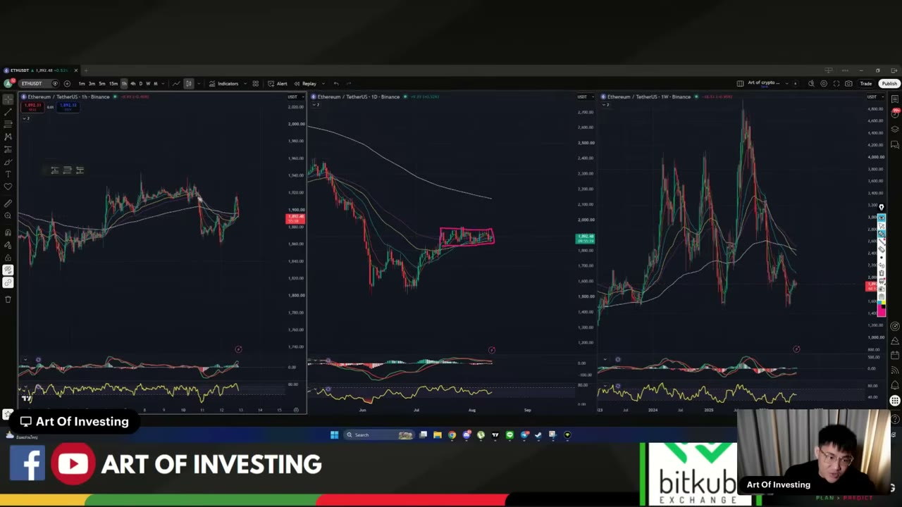

[00:48:37] ได้ยากสมมุติว่าคุณเข้าตรงเนี้ยแล้วคุณ Stop  loss ที่เหนือเหนือกล่องไปนะครับ อย่างเงี้ยแล้วคุณก็ take  profit แรกที่ กลางกล่องอ่ะถึงแล้ว take  profit ที่ 2 เต็มๆก็คือก้นกล่องเงี้อย่างเงี้ยได้ เปรียบอย่างงั้นก็เทรดได้นะครับอ่ะภาพ ระยะสั้นผ่านมาแล้วอธีเรียมฉะนั้นกลาง กล่องก็ถึงแล้วเนาะก็คิดว่าอธีเรียiม เนี่ยก็จะอยู่ตรงนี้ก่อนนะครับเนี่ย 1,870 เนี่ยอ่ะก็จะอาจจะกุ๊กกิ๊กๆิ๊กๆหน่อยส่วน อีทธเรียมเนี่ยถ้าเกิดจะลงจนทะลุนะคุณ เห็นไส้ตรงนี้มั้ย การที่ราคาไปตรงไหนแล้วมันเป็นแต่ไส้นะ ครับแสดงว่ามันมีออเดอร์ก้อนนึงอ่ะวาง อย่างงี้แล้วชนปุ๊บแมตแช ก็คือมันยังโดนก้อนออเดอร์ซื้อตรงนั้นน่ะ ซับออกไปถ้าเกิดมันจะวิ่งเป็นเทรนด์แล้ว ไหลลงแรงๆได้นะครับมันก็จะต้องมีออเดอร์ ขายเนี่ยที่เยอะจนแบบ match ออเดอร์ซื้อ Match ออเดอร์ซื้อ Mat ออเดอร์ซื้อคือ match เท่าไหร่ก็ยังออเดอร์ขายเยอะกว่า นะครับมันก็ถึงจะวิ่งเป็นเทรนดลงไปนะครับ

[00:49:38] เป็นเคสนั้นอ่ะเราก็จะเรียกว่ามันจะเริ่ม วิ่งแบบ imbalance ให้เราดูตรงนี้เห็น มั้ยสมมุติว่าอย่างเงี้ยเห็นป่ะเห็นป่ะ คุณดูนะ เนี่ยเนี่ยก็ balance  zone เห็นป่ะเนี่ย เด้งๆๆๆมีแต่ไส้แล้วก็แบบปิดทะลุไส้ได้ละ อย่างเงี้ยเริ่มเป็นเทรนด์ละฉะนั้นตรง เนี้ยเรากำลังรอภาพนั้นอยู่ถ้าเป็นขาลง ส่วนถ้าขาขึ้นก็ตรงนี้อย่างที่ผมบอกนะ ครับก็คือต้องเบรคด้านบนให้ได้ก่อนแถว 1930 นะครับแถว 1930-1940 ปิดเต็มแท่ง RSI  over  B นะครับมันถึงจะ แครี่ขึ้นไปได้ถ้าขึ้นไปได้ก็จะไปเทสที่ แรกผมมองว่าไม่เกิน 2,070 นะครับถ้าถ้าปิดเต็มแท่งตรงนี้ขึ้นไปได้ นะส่วนถ้าเกิดทะลุตรงนี้ลงมานะก็อาจจะ เป็นโซนแรกที่เทสตรงนี้ก่อนนะครับประมาณ ส่วนภาพยาวๆบitคinผมก็ยังยึดยึดที่เดิม ที่ที่ผมมอง นะครับผมมองว่าโซนตรงนั้นเป็นโซนที่ผม ค่อนข้างสนใจก็คือถ้าเกิดมันย่ออีกทีก่อน หรือเบรคขึ้นไปอีกทีก่อนตอนเนี้ยยังยัง เทรดไม้ใหญ่ใหๆ่แล้วไม่ค่อยได้เปรียบเท่า

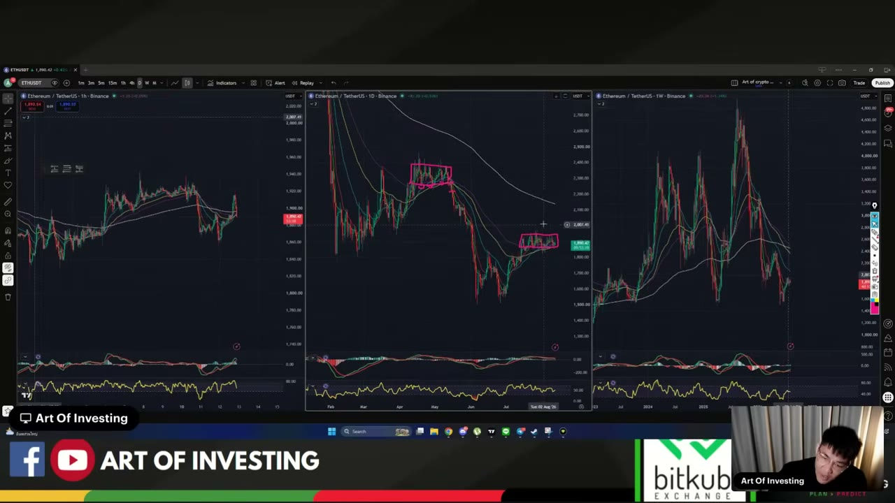

[00:50:39] ไหร่นะครับ อ่ะส่วนภาพรวมตลาด เนี่ยนะครับ Bitcoin  Dominance ก็อย่าง เงี้ยผมผมก็ยังไม่เทรด outcoin เห็นมั้ย นะครับเอ่อ Bitcoin  Dominance ร่วงราคา Bitcoin ก็ร่วงแปลว่าเงินไหลออกจากตลาด หรือไปพักอยู่ที่ Stable  Coin ถ้าเราดู Stable  Co  dominance อย่าง USDT.d ดี เนี่ยเห็นมั้ยดีดขึ้นเห็นมั้ยแสดงว่าคน พักเงินเป็นเงินสดอยู่ณเวลาอย่างเงี้ยผม ก็จะยังไม่ค่อยเทรด outcoin ครับถามว่า มันขึ้นมั้ยบางตัวมันก็มีนะครับแต่มันถาม คือมันขึ้นกี่ตัวจากบรรดาทั้งหมดนะอย่าง เงี้ยมันเทรดแล้วมันไม่คุ้มความเสี่ยงผม ถึงบอกว่าถ้าเกิดคุณบอกว่าเฮ้ยแต่เทรด บitcoinอ่ะมันสเอ้ยแต่เทรดบitcoinมันวิ่ง แคบมันต้องใช้เลateเยอะถ้าถ้าเกิดเทรด outcoin อ่ะมันวิ่งได้ไกลกว่าคำตอบคือ ใช่แต่ทีเงี้ยคุณไม่คุณก็อัดอัดต้นทุน เพิ่มดิแล้วคุณก็วาง Stop  Loss เท่าเดิม อ่ะแทนที่คุณจะเทรด outcoin  5 เหรียญ

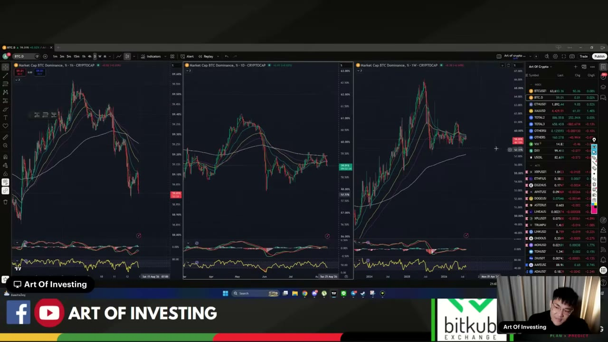

[00:51:40] เ้าชิบะอะไรคุณกระจายไปใช่ป่ะคุณก็เอา เงินทั้งหมดอ่ะรวบแล้วเทรดบitcoinตัว เดียวในจังหวะที่มันได้เปรียบอ่ะมันได้ ตังค์เท่ากันน่ะแถมมันเทรดง่ายกว่าเพราะ ว่าบitคinมันไม่เกิดการสะบัดนะครับยกเว้น ว่าตอนที่ตลาดน่ะมันจะเป็นบูรันเต็มตัวพอ มันเป็นบูรันเต็มตัวอย่างเงี้ยเออเฮ้ยผม ก็อยากเทรด outcoin ละเพราะมันวิ่งมัน เทรนด์มันไม่ค่อยย้อนแล้วมันวิ่งยิ่งไกล นะครับแต่ว่าตอนนี้มันยังเห็นมั้ยเนี่ย หลายๆตัวมันมันเป็นอย่างเงี้ยนะครับผมก็ เลยมองว่าเอ่อ ไปได้ยากนะครับอย่างอันเนี้ยเห็นมั้ยเฮ้ย คุณอาร์ตเนี่ยกราฟ Day เบรคพรีเมี่มโซน แล้วทำไมราคามันถูกตบกลับมาก็โมเมนตัมมัน ไม่เกิดไงเพราะมันเบรคพีemium zone แม็ก ดีขึ้น 0 ได้ป่ะ RSI  overbard ได้ป่ะ เนี่ยเห็นมั้ยไอ้พวกนี้ไม่ใช่ระบบนะไอ้ พวกนี้เรียกว่าคitionหรือเงื่อนไขส่วน ระบบอ่ะเฮ้ยมันเกิดเงื่อนไขในสภาวะไหนมัน เกิดเงื่อนไขในสภาวะที่ตลาดยังเป็นแร marาร์เก็ตหรือตลาดหมีอยู่เลยฉะนั้น มันจะเป็นอย่างงี้ใช่ป่ะมันขึ้นยากมัน ขึ้นไม่ได้เพราะว่าภาพรวมอู้หูตั้วเหหลง

[00:52:43] ถามว่าอยู่ในโซนเหมาะมยอยู่ในโซนเหมาะสม แล้วแต่ว่าจุดได้เปรียบหรือยังมีแนวโน้ม อะไรที่มันจะต้องดีดในแถวนี้เงี้ยมันเทรด ยากนะครับงั้นเรารอก่อนมั้ยแทนที่เราจะ ต้องเทรดเป็นคนแรกถูกป่ะคุณก็รอมันเกิด เบรคอย่างนี้ก่อนดิเห็นมั้ยเบรคเบรAK Zone ขออภัย Break  Premium zซoneก่อนนะครับ เกิดโมเมนตัมก่อนตลาดเป็นขาขึ้นก่อนแล้ว คุณค่อยกลับมาเข้าก็ได้ช่วงนี้คุณเทรด Bitcoin  Eiium อะไรอย่างเงี้ยที่ Movement มันชัดอ่ะดีกว่าครับแล้วคุณ กล้าอัดไม้ใหญ่ด้วยแบบผมอ่ะแล้วคุณก็ไปดู อ่ะผมก็กล้าพูดว่ามันมันมีไม่กี่เพจหรอก ครับที่มันลงทุกออเดอร์ได้แบบนั้นน่ะ โดนผมก็ลงให้ดูอ่ะนะครับเนี่ยเนี่ยแหละผม จะลงทุกเดือนน่ะนะผมก็จะลงไปเรื่อยๆ อย่างเงี้ยนะนะครับเนี่ยคุณดูอ่ะเนี่ยผม ลงเงี้ยทุกออเดอร์นะครับได้ตัวไหนบ้างโดน ตัวไหนบ้างวันไหนบวกวันไหนลบเนี่ยครับ เนี่ยเห็นป่ะเดือนแรกบวก 10,000 เดือนนี้ ตอนแรกบวกเยอะนะบวก 12,000 ก็ไปโดนสิ้น เดือนเห็นป่ะ 7,000  4,000 ได้คืนมา 5,400

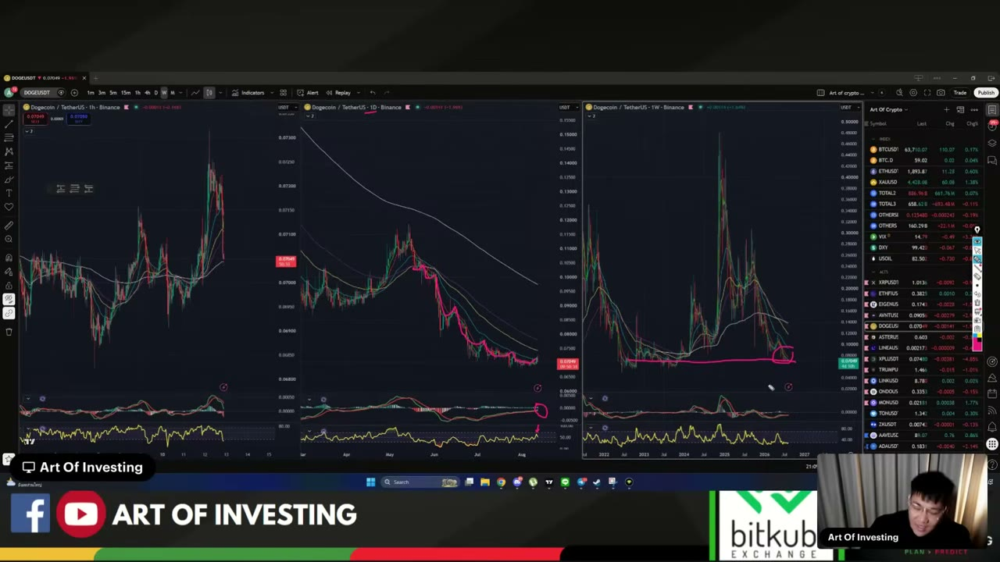

[00:53:45] ก็บวกแค่ 6,000 จริงๆบวก 12,000 เนี่ยก็ โดนแล้วก็อันเนี้ยบวก 13,000 ใช่มั้ยเอ่อ เดือนเมเนี่ยผมจะบอกว่าสิ้นเดือนผมก็เทรด เพิ่มเหลือ 8,000 เนี่ยเดือนนี้เทรดอยู่เนี่ย My  Forx Book เห็นป่ะ -  99.9%  9% เฮ้ยพอแตกนี่ ใช่แต่กำไรล้านแล้วถอนไป ถอนไปถอนกำไรไป 500,000 เหลืออีก 500,000 ไว้เบสต่อ 500,000 นั้นโดนอีก 500,000 ถอนออกเนี่ยผมโพสต์หมดแล้วผมไม่ได้โพสต์ แค่นี้นะผมโพสต์แบบเนี้ย เนี่ยแบบทุกออเดอร์เลยอ่ะ เนี่ยครับอย่างเงี้ยผมแค่อยากให้เห็นว่า เฮ้ยการเทรดอ่ะอยากให้ทุกคนตื่นรู้อ่ะว่า มันไม่ใช่วางระบบแบบเอ้ยอันนี้เส้นนี้ตัด กันคุณไม่ท่องเลยนะคุณ Back  test  back test มันเป็นแค่สัดส่วนเล็กๆส่วนนึงอ่ะ ในในการในการที่จะเทรดในการที่คุณจะต้อง เข้าใจระบบที่ทำงานด้วยแบบ technical analysis อ่ะมันไม่ใช่ว่าเกิดขึ้นกี่

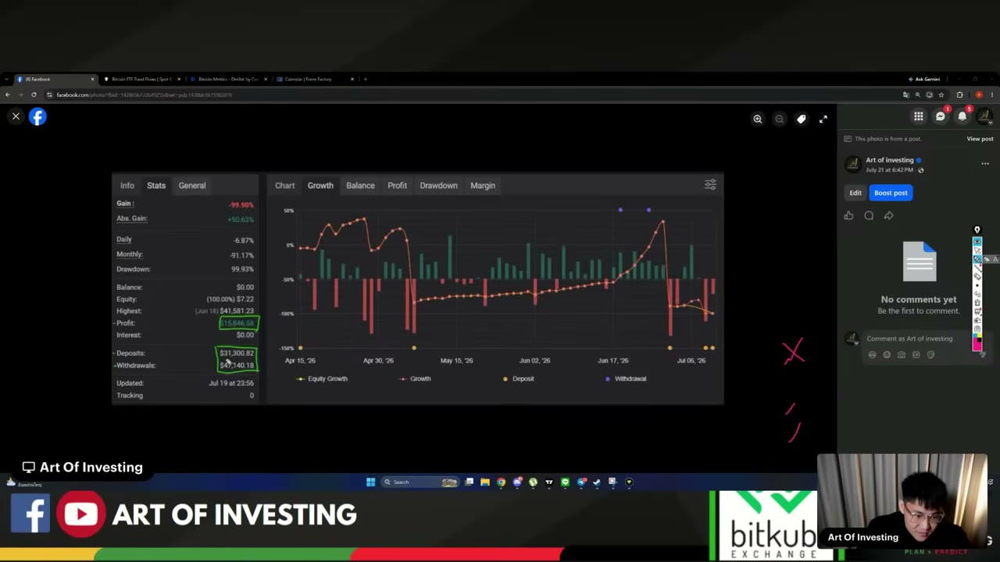

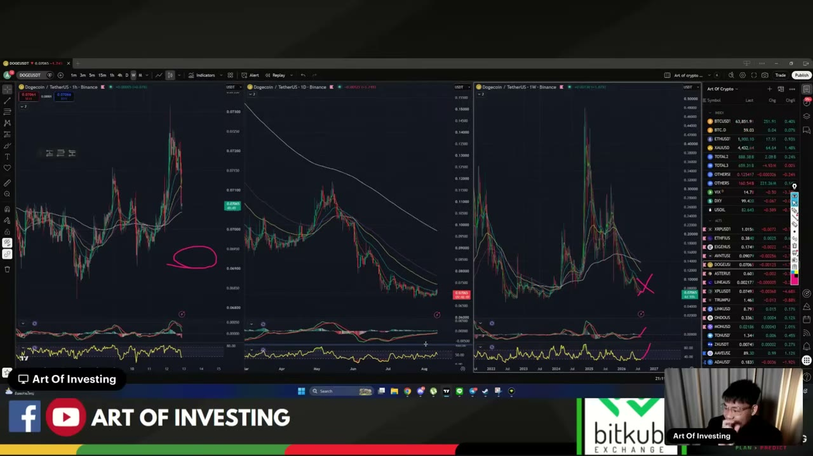

[00:54:46] ครั้งแล้วแล้วจะอัดเลยมันต้องเข้าใจด้วย ว่าทำไมโมเดลนั้นน่ะมันถึงเหมาะสม ทำไมมันถึงเกิดขึ้นแบบนี้แล้วมันยังใช้ ได้คือคุณต้องเข้าใจมันลึกกว่านั้นนะครับ เหมือนเหมือนคุณไปไป back  test เรื่องกฎหมายอ่ะกฎหมายบอกว่า ทุกคนต้องเคารพกฎจราจรถูกป่ะไฟเขียวไฟแดง ทุกคนต้องเคารพไฟเขียวไฟแดงห้ามผ่าไฟแดง ทีเนี้ยถ้าเกิดคุณไปในประเทศที่เจริญแล้ว ในเมืองที่เจริญแล้วในโซนที่ตำรวจเยอะคน มันจะไม่ค่อยฝ่าไฟแดงหรอกแต่เกิดคุณไปใน โซนนักเลงโซนมาเฟียโซนในประเทศที่แบบเค้า ค่อนข้างกฎหมายเอาคนเหล่านี้ไม่อยู่อ่ะ ก็ขับฝ่าไฟแดงกันหมดอ่ะแล้วคุณก็ คitionไปครอบว่าไฟแดงรถต้องไม่มีฝ่าไฟแดง รถต้องต้องจอดหมดอย่างเงี้ยคือคุณต้องดู ปัจจัยภายนอกด้วยว่ามันอยู่ประเทศอะไร ฉะนั้นตอนที่คุณจะสร้างระบบการเทรดสร้าง คitionในการเทรดนะครับเข้าใจมันภาพรวมแบบ นี้อย่างเงี้ยผมเข้าใจเฮ้ยโมเมนตัมมันยัง ไม่เกิดเพราะอะไรเพราะว่าตลาดมันเป็นแบบ

[00:55:48] นี้ปัจจัยบitcoinมันปกติเกิดตลาดหมีมันจะ เกิดกี่เดือนแล้วผมมีปัจจัยmidเทมอ election ของทรัมป์มี OI มีอะไรเงี้ย แล้วผมหาจุดเชื่อมโยงไม่ใช่เอาแต่ละจุด ที่มันขัดกันมานะครับค่อยๆดู flow ไปบาง คนอาจจะแบบเอ้ยฟังแล้วไม่รู้เรื่องผมบอก แบบนี้งั้นคุณเคยลองไปฟังอะไรที่มันฟัง ง่ายๆฟังแล้วเก็ทเลยใช่ป่ะคุณถามตัวเอง ว่าแล้วคุณฟังแบบนั้นแล้วคุณเอาไปใช้อ่ะ คุณได้ตังค์หรือยังคุณรอดกับการเทรดหรือ ยังคุณสำเร็จกับมันหรือยังพอแรกๆผมก็เป็น แบบนั้นผม 12 กว่าปีกว่าแล้วผมก็เลยพูด ได้ถูกมั้ยครับฉะนั้นถ้าเกิดคุณลองฟัง อะไรที่มันเข้าใจง่ายๆเฮ้ยมันเก็ตเลยว่ะ เฮ้ยระบบไม่เห็นต้องยุ่งยากเลยกูก็ไป ซื้ออินดิเคเตอร์ตัวนี้มาใช้เฮ้ยกูก็ไป เรียนวาง demand supัlyแล้วกูก็จบไปอะไร อย่างเงี้ยผมอยากให้คุณถามย้อนตัวเองคุณ สำเร็จกันมาหรือยังมันใช้ได้ในระยะยาว มั้ยคุณปรับตัวทันตลาดที่มันค่อยๆเปลี่ยน ไปมั้ยคุณรู้ตัวหรือเปล่าว่าจังหวะไหน โมเดลของคุณใช้ได้หรือโมเดลคุณใช้ไม่ได้

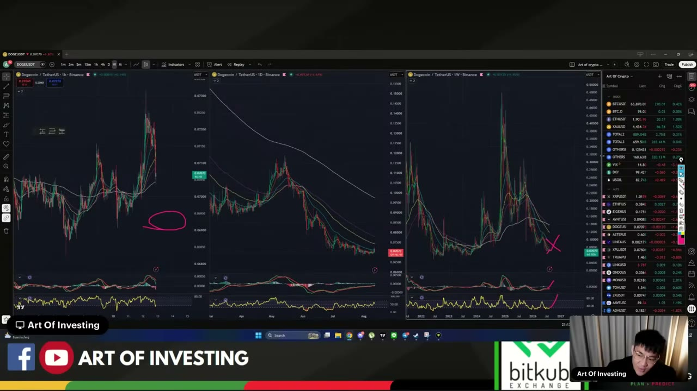

[00:56:50] แล้วคุณต้องปรับตัวเมื่อไหร่คุณคุณตอบตัว เองตรงนี้ได้มั้ย ถ้าคำตอบมันคือไม่ได้งั้นผมก็เลยบอกว่า ลองเปลี่ยนดูมั้ยถ้าเกิดฟังอะไรที่มัน ง่ายๆแล้วไม่เวิร์คลองฟังแล้วทำอะไรที่ มันยากขึ้นดูมันอาจจะเป็นคำตอบที่คุณหลีก หนีมาตลอดก็ได้เฮ้ยยากไม่เอาหรอกแต่ถ้า เกิดยากแล้วมันได้เงิน ถ้ายากแล้วมันทำได้ถ้ายากแล้วมันสำเร็จ ถูกมั้ยอ่ะผมพูดประมาณนี้แล้วกันตัดสินใจ กันเองนะครับบางเรื่องไม่ควรง่ายอื บางเรื่องไม่ควรง่ายผมพูดแค่นี้นะครับอ่ะ โอเคเมื่อกี้ก็มีมีคนขอเทสลเนาะอ่ะก็ เดี๋ยวดูให้หน่อยแล้วก็เดี๋ดูทองให้นะ tสlaขอดูภาพรวมหน่อยนะจ๊ะ disco  Tesla ใกล้ถึงแล้วครับนะครับ Discount  Tesla อยู่ประมาณนี้เห็นมั้ย

[00:57:51] ทุกครั้งที่อยู่แถว EMA  GAP นะระหว่าง EMA  50 กับ EM  75 เนี่ยจะเป็นdiscซone เนี่ยครับเวลาดู Discount  Zone ให้ดูแบบ นี้ไม่ใช่ว่าเส้นนี้จะเป็นเส้นแนวรับให้ ท่องไปเลยสีนี้เป็นแนวรับไม่ใช่ให้คุณ แบ่งตลาดออกเป็นเฟสก่อนอย่างเฟสเนี้ยเรา เรียกว่าอะไร Super  Cycle Hyper  Bullish อ่ะมีเป็น 10 ชื่ออ่ะอ่ะ แล้วแต่ว่าคุณจะเรียกว่าอะไรทีเนี้ยพอพอ ดูเสร็จปุ๊บให้คุณหาก่อนว่าในเฟสนั้นน่ะ จุดdiscคัอยู่ไหนคำตอบคือจุดdiscคอันนั้น น่ะคือเส้นสีแดงหรือ EMA  10 เห็นมยหลุด ปั๊บแสดงว่าจบซอ Cycle มันก็ย่อมาSซwayที นี้มันกลายเป็นเฟสอะไรเป็นเฟสใหญ่ที่เป็น การปรับฐานงั้นเฟสตรงเนี้ยdiscาอยู่ไหน ไม่ใช่สีชมพูละ

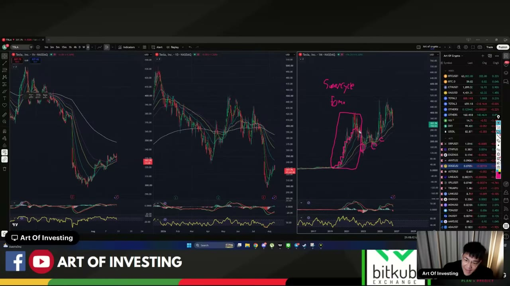

[00:58:55] disc อยู่นี่ เนี่ยครับฉะนั้นถ้าเกิดtสlaอยู่ใน gap เนี่ยแถวประมาณเนี้ย 290 260 เนี่ยครับก็จะเป็นโซนที่คนในตลาด เนี่ยมักจะรู้สึกว่าtสlaเนี่ยถูกนะครับ แต่ว่าผมอยากให้ดูอย่างนึงนะก็คือถ้าเรา ดูใน mon เนี่ยครับเอ่อมันไม่เคย oversow เลยนะครับมันมันไม่เคยoverวเลยนะฉะนั้น มันจิ้มแล้วมันรีบาวตลอดงั้นถ้าเกิดมันลง มาตรงเนี้ยแล้วมันเป็นภาพการ oversow อย่างเงี้ยมันแปลว่าคนในตลาดยังรู้สึก เหมือนเดิมถูกป่ะก็คือเป็นจุดdiscคาแต่ ถ้าเกิดมันลงมาแล้วมันแช่อวsowเนี่ยตรง นี้ต้องระวังนะถ้าเกิดtสlaหลุด 250  240 แล้วแช่อย่างเงี้ยมันมีโอกาสที่จะพักตัว ลึกได้กว่านั้นนะครับเพราะมันจะเปลี่ยน เฟสของตลาดแสดงว่าdiscาตรงเงี้ยถูกทำลาย ไปแล้วะเนี่ยครับ age ของระบบมันจะเป็น

[00:59:57] แบบนี้คือให้คุณหาก่อนว่าdiscemiเemiมัน อยู่ไหนแล้วโซนเหล่านั้นน่ะมันจะเริ่มใช้ ไม่ได้ประสิทธิภาพตอนที่มันหลุดฉะนั้นคุณ ก็จะไป stop  loss แค่ครั้งเดียวในตอนที่ มันหลุดแล้วแล้วต้องการที่จะเปลี่ยนโซน ตอนที่มันไม่ได้หลุดคุณก็จะเทรดแล้วก็ take  action ได้ตามปกติก็ take  profit ไปเรื่อยๆนะครับวนไปก็จะเป็นภาพแบบ น่าจะเห็นภาพเนาะอ่ะต่อมาทองนะครับทอง เนี่ยเออทองเนี่ยเป็นตัวที่ผมผมก็เทรดนะ ผมเทรดตรงเนี้ยผมช็อตไปแถว 4,300 เนี่ย แล้วผมก็ TP ไปไม่ลึกมากครับ 2,000  4,260 เงี้ยแล้วมันทะลุมาตรงเนี้ยผมก็เลยแบบ เฮ้ยเออทะลุพรีเมี่มได้แล้ว จริงๆนะครับฉะนั้นทองตอนเนี้ยผมมองว่าถ้า จะย่อเนี่ย อาจจะย่อแบบSidewayยก่อนนะครับเพราะว่า พรีเมี่มของทองเนี่ยอ่ะให้ดูอย่างี้เห็น ป่ะเวลาดูอยากให้ผมบอกให้ดูเป็นทีละเฟส

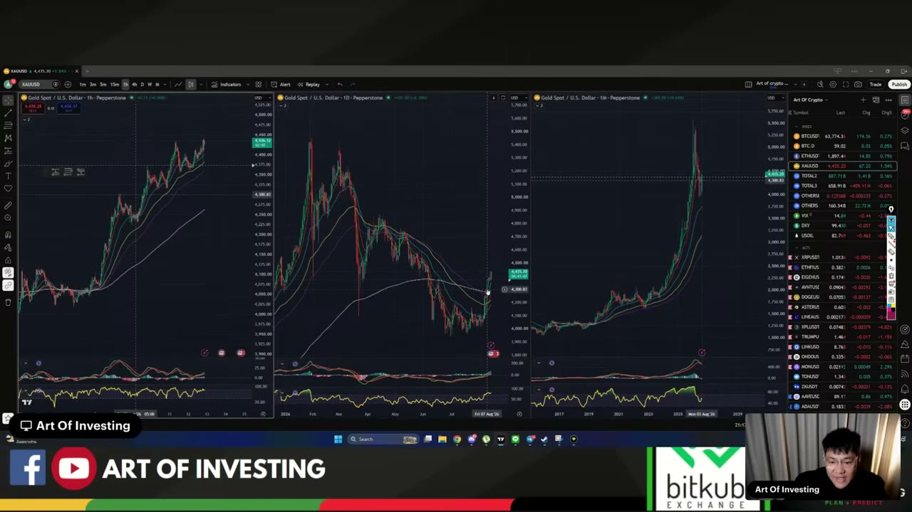

[01:01:00] อย่างเนี้ยมันติดพรีเมี่มตลอด เห็นมย เงี้ยแล้วมันเบรกได้แล้ว MacD  10  RSI Overbard แล้วตอนแรกอ่ะผมผมก็เลยเบว่า เอ้ยมันน่าจะขึ้นมาแล้วติดแค่ Flip zซone ถูกมั้ยสรุปเป็นเบรคนะครับไอ้ช็อตเนี้ย ไลฟ์ที่แล้วผมมองว่าผ่าน 4,300 ยากได้ใช่ มั้ยสรุปทะลุนะครับอันเนี้ยไปแล้ว งั้นตรงเนี้ยผมเลยมองว่าถ้าเกิดจะย่ออ่ะ รูปแบบหน้าตาอย่างเงี้ย นะครับทองอย่างอย่างนะผมก็มองว่าแถว 4,280 อ่ะน่าจะยังไม่ไม่ทะลุตรงนั้นในจังหวะ เดียวต่อให้ย่อนะครับสมมุติว่ามันย่อมา ตรงเนี้ยเทสตรงเนี้ยแล้วค่อยขึ้นอีก สัปดาห์อ่ะก็ก็ตรงนี้เป็นหนึ่งแนวรับนะ ครับส่วนแนวต้านถัดไปผมมองแถวนี้เลยนะ ครับถ้าเกิดว่าย่อแล้วยังไม่หลุด 4280 เนาะก็คือแถวๆปลายๆ 4,300 เนี่ยก็มีโอกาส ขึ้นไปเทสได้ถึงนู่นน่ะครับ 4,500  4,600 มีสิทธิ์อยู่มีสิทธิ์อยู่ตรงนี้ก็ก็เป็น gap นะถ้าสมมุติว่าคุณนะครับคุณรันเทรน

[01:02:05] นะครับสมมุตินะว่าว่าเกิดคุณมีของที่แถว เนี้ยอ่ะสมมุติว่าคุณมีของที่ 4,100 อ่ะ มุมมองส่วนตัวนะไม่ใช่คำแนะนำในการลงทุน เป็นผมนะผมก็อาจจะ TP สัก 20% แล้วที่ เหลือผมก็จะกั้น Stop  Loss แถวนี้ะเพราะ ว่าโมเมนตัมว่ามันเกิดแล้วมันไม่ควรเกิด New นะครับแล้วก็ดูว่ามันจะขึ้นไปถึงแถว นี้มั้ยซึ่งผมมองว่า 4,500  4,600 นี่ก็ ก็เริ่มเบรคได้ค่อนข้างยากแล้วนะครับอ่ะ อย่างดูโซนตรงนี้ไว้อ่ะผมก็มองว่ามันจะ เป็น flip  zone อ่ะผมมองนี่แล้ว 4570 อืมที่อาจจะเบรคได้ยากนิดนึงนะครับก็จะ เป็นโซนตรงนี้นะครับโซนตรงนี้ส่วนตรงนี้ ก็อยู่ในกรอบตรงนี้นะครับก็สามารถหา จังหวะเล่นได้นะครับลองดูส่วนต่อมาก็คือ ตรงนี้เนาะอันนี้ก็เป็นdiscาเหมือนกันแต่ ว่าเวลาโม่หนักๆมันก็จะเป็นอย่างงี้เห็น มั้ยdiscามันอยู่ตรงนี้เห็นป่ะเนี่ยเกิด ข่าวแล้วถึงdisคาก็ยังวิ่งขึ้นไปอยู่ที เนี้ยมันจะต้องวัดและไอ้ตรงเนี้ยถ้าเกิด เบรคไม่ได้อ่ะมันก็จะปรับฐานคือไม่เกิด

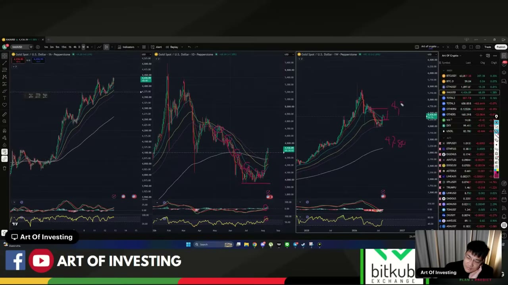

[01:03:08] new  high แล้วหลุดdisคาอ่ะแบบเนี้ยแสดง ว่าdisคาตรงเจะโดนทำลายถูกป่ะมันก็จะย่อ ลงมาแถวนี้ไงอ่าแล้วก็แล้วก็เริ่มเฟสใหม่ เนี่ยครับมันจะวนแบบ น้ำมันหรอน้ำมันช่วงนี้ไซเวย์ครับแล้วก็ ช่องแค่เพมุสก็ยังไม่แน่นอนนะครับฉะนั้น ผมมองว่ามันน่าจะอยู่อย่างี้สักพักน่าจะ ไซด์อยู่อย่างี้แหละนะครับกรอบของมันน่า จะอยู่ตรงเนี้ย เนี่ยนะครับผมว่ากรอบน้ำมันน่ะอยู่ตรง เนี้ยกุกากุกิใครเปิดกฤก็ผมว่ากรอบเนี้ย 70 เนี่ยถึง 90 เนี่ยนะครับน่าจะขุกขิกๆ ขิกๆขิกๆขิกอยู่อย่างเงี้ยนะครับถ้าออก โซนก็ไม่ต้องเก็บไม้เพิ่มก็ได้เพราะว่า เอ่อเดี๋ยวถ้าเกิดเค้าตกลงปรองดองกันได้ นะครับซัพพlyายมันก็จะ flow เข้ามาถูก มั้ยคือมันไม่ใช่แค่น้ำมันแต่ว่ามันมันจะ ค่อนข้างdelลayนะเพราะว่าน้ำมันมันต้องขน ส่งทางเรือถูกมั้ยก็คือขั้นแรกอ่ะถ้าเกิด น้ำมันมันทุบอ่ะมันจะทุบด้วยความ

[01:04:11] พานิคของคนก่อนว่าแบบเฮ้ยกลับมาเปิดแล้ว เว้ยแบบนี้น้ำมันต้องลงแน่เลยอ่ะขายๆกัน มันจะเป็นเวนั้นก่อนแล้วสักพักอ่ะมันจะ ค่อยๆไซด์เวย์เพราะว่าการที่มันปิดไปนาน ทุ่นระเบิดมันยังอยู่อะไรอย่างเงี้ยมัน ต้องใช้เวลาค่อยๆเคลียร์แล้วมันผ่านไม่ ได้ flow ทันทีแล้วหลังจากนั้นน่ะราคามัน จะค่อยๆ stable ขึ้นนะครับฉะนั้นผมมองว่า น้ำมันก็น่าจะอยู่ในกรอบนี้ก่อนนะครับ ส่วนถ้าเกิดยิงกันลึ่มล่ำๆล่ำอะไรอีกผมก็ คิดว่าไม่น่าเกิน 90 ไปได้ไกลมากถ้าเกิน ตรงนั้นก็ผมคิดว่าราคาอยู่ในโซนที่แพง เกินไปนะครับสำหรับ 90 ผมก็มองว่าถ้าถ้า เกิดในโซนนั้นก็เป็นโซนที่ราคาเนี่ยค่อน ข้างแพงเกินไปก็อยากให้ลองดูลองดูนะ ประมาณนี้ เอ่อ SPX หมายถึงว่า Space  X ใช่มั้ครับ SpaceX ผมยังดูได้ไม่เยอะต้องบอกแบบนี้ การการจะใช้กราฟเราต้องดูด้วยว่ามันมัน สามารถวิเคราะห์ได้เปรียบอะไรหรือเปล่า กราฟเนี่ยครับมันคือการดูการจดบันทึกใน อดีตถูกมั้ยว่ามีการซื้อขายกี่โมงวันไหน

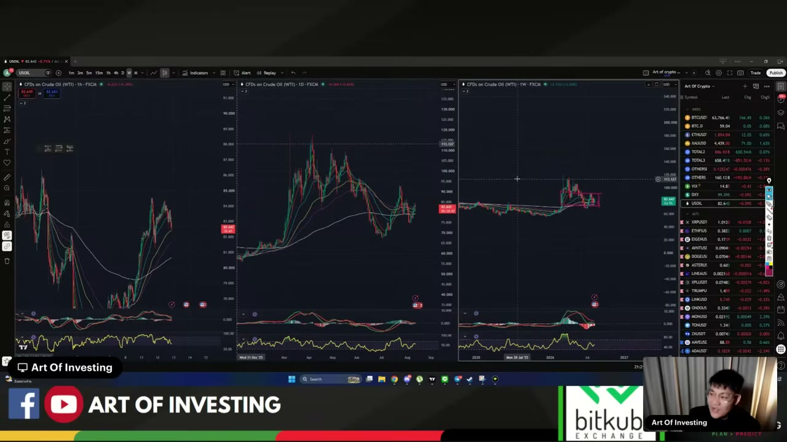

[01:05:12] บ้างออเดอร์ซื้อหรือขายเท่าไหร่บ้างเยอะ มั้ยน้อยมั้ยทีเนี้ยเนี่ยการที่มันเป็น หุ้นที่เพิ่งก่อตั้งอ่ะนะครับข้อ 1 เรา ต้องดู Fundamental มันก่อนหรือ Valuation สิ่งที่ SpaceX ขายอ่ะคืออนาคตอนาคตว่า เขาจะเอาหลายๆอย่างบนโลกนี้ออกสู่อวกาศ ได้เขาจะทำจรวดแล้วเขาจะเอา Data  Center ไปตั้งที่ดาวอังคารไปตั้งที่ดวงจันทร์ไป ตั้งในพื้นที่ที่มันมีอย่างไม่จำกัดเพราะ ไม่มีใครเคยสร้างอะไรบนนั้นทีเนี้ยพลัง งานที่โลกขาดแคลนก็จะไม่ขาดอีกต่อไปอาหาร เงินทุกคนก็จะเข้าถึงได้อ่ะอะไรเงี้ยมัน คือโลกยูโทปียฉะนั้นตอนเนี้ยโปรดักเค้า อ่ะที่ออกมาแล้วใช้งานได้เลยอ่ะยังไม่มี เลยนะครับมันก็เลยเป็นการ วัดภาพกับอนาคตแต่ทีเนี้ยถ้าเกิดมองใน เรื่องกราฟเนี่ยข้อ 1 เลยนะ SPX อ่ะจะยัง ไม่สามารถวิเคราะห์แบบ Discount  premium ที่เป็นเทรนได้จะดูได้แค่ว่าโมเมนตัมเกิด กับความเกิดแล้วหรือยังเพราะว่าอะไรที่

[01:06:14] เราจะดูเป็นเทรนด์ในระยะยาวได้ครับมัน ต้องสามารถ valuation ตัวราคาได้ก่อนซึ่ง ตอนเนี้ยผมมองว่ามันเป็นการมองถึงอนาคต หมดเลยถ้ามองอย่างงี้ อ่ะผมอธิบายให้ฟังก่อนนะอย่างเงี้ยสมมุติ นะ[เสียงสูดหายใจ]ถามว่าโมเมนตัมเกิดมก็ เกิดแต่ถามว่าแล้วคุณจะดูอะไรจากมันคุณจะ วิเคราะห์อะไรจากมันถูกมอย่างสมมุติว่า เฮ้ย Space  X หยุดไหลเมื่อไหร่ไอ้แบบ เนี้ยตอบได้ก็คือ อ่ะเดี๋ยวเปลี่ยนสีให้มันชัดเจนก่อนอย่าง เงี้ยเฮ้ยติดพรีเมี่มว่ะเฮ้ยทะลุพรีเมี่ม แล้วว่ะแต่อะไรใต้ 0  RSI ยังoverบอไม่ ได้เงี้ยก็นับว่าโมเมนตัมยังไม่เกิดแต่ อย่าเงี้ยนะครับมันก็ขึ้นแล้วฉะนั้นเนี่ย ผมถึงบอกว่ากราฟอ่ะบางคนบอกว่าใช้ไม่ได้ จะได้ใช้ได้แต่เราต้องดูบริบทมันด้วยว่า เราใช้มันอย่างได้เปรียบแล้วแล้วถูก ตำแหน่งมยอย่างอันเนี้ยผมก็เลยมองว่าถ้า จะใช้อ่ะยังไม่ได้ความได้เปรียบอะไรเพราะ ว่าใน day ไม่สามารถบอกอะไรได้คุณก็ต้อง ย่อยไปดูfrฟมที่เล็กกว่านั้นอย่าง

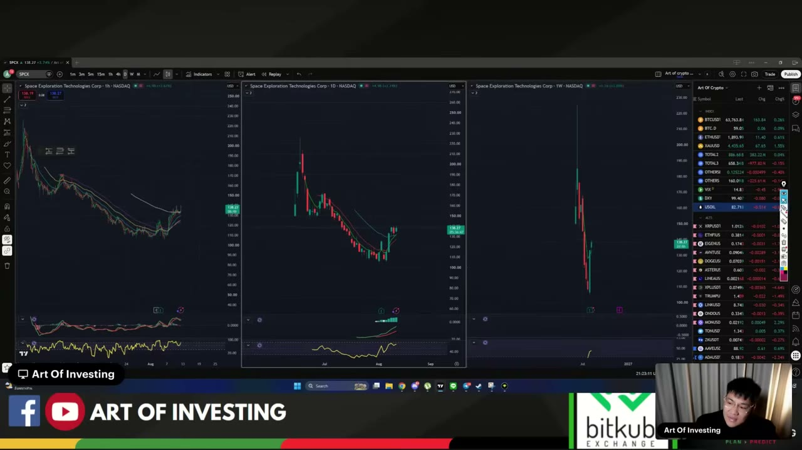

[01:07:15] พรีเมี่มเนี่ยเนี่ยมันอยู่ตรงนี้เห็นป่ะ อ่ะอันเนี้ย MACD เนี่ย 0 แล้ว RSI  overb แล้วแล้วเบรAK EMA สีชมพูได้แล้ว EMA  75 ฉะนั้นถ้า Stop  Loss ผมก็จะ stop ตรงนี้ เห็นป่ะเพราะว่าเวลาเกิดโมเมนตัมแล้ว เนี่ยมันไม่ค่อยจะมีนิว Low อย่างี้เกือบ นะแล้วก็ขึ้นไปเงี้ยอ่ะอันนี้อาจจะได้คุณ ก็อาจจะมองว่าเออถ้าหลุดโลเนี้ยคัดก่อน หรืออะไรอย่างเงี้ยมองอย่างเงี้ยได้ครับ เทรนด์ก็เริ่มเกิดแล้วใน 1 ช่โมงใน day ยังใน week ยังแล้วก็ในมุมมองผมอ่ะถ้าจะ ซื้อหุ้นน่ะ ผมจะไม่ค่อยซื้อตัวแบบนี้ในระยะเวลาแบบ นี้ในฐานะการลงทุนผมจะซื้อแค่หวยเช่นผม แบ่งเงินมาละผมกำไรเดือนนี้มาแบ่งมาสัก หน่อยนึงลงซัก 200,000 แล้วทิ้งไว้ 5 ปี อะไรอย่างเงี้ยอ่ะออาจจะเป็นเวยแบบนั้น ถ้าเกิดจะลงแต่ส่วนถ้ามองเป็นการลงทุนน่ะ ผมค่อนข้างมองว่ามันเป็นหุ้นที่ขายอนาคต มากไปซึ่งในปัจจุบันเนี่ยมันมีตัวที่ใกล้ กว่านั้นพวกบริษัท AI ต่างๆที่จะลิสเข้า ตลาดพวกเอ่อการ distribution ของ

[01:08:15] เทคโนโลยีพลังงานการผลิตชิปพวกเนี้ยมัน เป็นปัจจุบันที่แบบใช้งานได้เลยแล้วโลก เราก็ต้องใช้จริงๆมากกว่าเออฉะนั้นถ้าจะ DCA อะไรอย่างเงี้ยตอนที่ตลาดย่อผมจะ หยิบอะไรที่มันใกล้กับปัจจุบันมากกว่าไม่ ใช่เพราะว่ามันวิ่งได้แรงกว่าแต่ว่ามันมี ความน่าจะเป็นที่จะวิ่งสูงกว่ามันขึ้น อยู่กับว่าเราบริหารพอร์ตของเราอ่ะเรา กระจายความเสี่ยงยังไงสวัสดีคนดู 180 ท่านนะครับสวัสดีครับ อาจารย์ค่าบอน้ำมันยังเปิดอยู่มั้ครับไม่ เห็นเปิดออเดอร์ปกติครับแต่ว่ามันอยู่ใน จุดที่ต้องต้องพักแล้วครับเพราะว่ามันมัน ไม่ไม่ได้มีอtionัที่เปิดราคามากกว่านี้ น้อยกว่านี้ครับก็เบรคกำไรมันเยอะแล้วนี่ แบคทีเรียล 2 เดือนจะ 5% แล้วอ่ะเยอะนะ ถูกป่าแล้วน้ำมันวิ่งจาก 90 ลงไป 60 อ่ะ ดาว 10% น่ะแล้วกลับมาเนี่ยกำไรเกือบ 5% 2 เดือนน่ะท่วมแล้วคุณจะไป [เสียงหัวเราะ]ที่ไหนถูกป่ะฉะนั้นนั้นตอน เนี้ยผมเลยมองว่าไอ้ไอ้ตัวไดนamิก่ะนะ

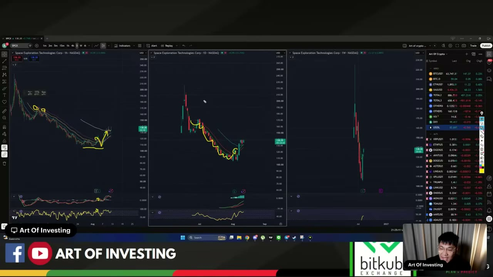

[01:09:16] ครับของน้ำมันน่ะก็มันอยู่ในโซนที่เก็บไป ละฉะนั้นน่ะเราไม่อยากจะดอยก็คือไม่ได้ แบบโอ้โหต้องกวาดทุกราคานะครับเราสามารถ ดู OI ได้ว่ารายใหญ่อ่ะเดี๋ยวเปิดให้ดู สุดท้ายแล้วนะก่อนก่อนแวบไปนะครับช่วงนี้ ผมก็จะเวลาน้อยลงนิดนึงเนาะเพราะว่าอย่าง ที่บอกเพื่อนผมเพิ่งเสียแล้วก็เดี๋ยว พรุ่งเผมจะไปงานศพเพื่อนผมนะครับ มันมยเป็นไง ชอบมั้ยความรู้แบบนี้นะครับเฮ้ยมีมีใคร แบบเพิ่งเข้ามาฟังครั้งแรกมั้ยแบบปกติฟัง แต่แบบแนวรับแนวต้านอยู่ไหนเฮ้ยไหนจิ้มมา ดูหน่อยดิไอ้ไอ้เดนี่มันเป็นยังไงวะช่อง Art  of  Interting อะไรเงี้ยเฮ้ย ใครใครที่แบบเพิ่งเข้ามาดูครั้งแรกพิมพ์ พิมพ 1 ให้ผมหน่อยนะ

[01:10:35] เนี่ยครับดูแค่ของของสัปดาห์นี้นะคุณ แบคทีเรียลเห็นตรงนี้มั้ย เราดูแค่ตรงเนี้ยนะครับเราจะเห็นว่า ออเดอร์ที่มันกระจุกเนี่ยมันก็อยู่ๆอยู่ แถวโซนนี้ถูกมั้ยแล้วหลังจาก 85 เนี่ยมัน ไม่ค่อยมีและ ไปมีอีกทีนู่น 92  2 นะครับคุณแบคทีเรียล ฉะนั้นตรงเนี้ยถ้าเกิดว่าเราเก็บๆตอนนี้ มัน 82.8 ถูกป่ะราคาสมมุติเราเก็บๆแล้ว มันไม่ผ่าน 85 อย่างเงี้ยเราก็ดอยยาวเลย นะเพราะว่าหลังเนี้ยมันไม่ค่อยมีคนเล่น กันราคามันตู้มนู่นเลยอ่ะนะครับฉะนั้นถ้า มันผ่านไม่ได้อ่ะมันก็ย่อยกลับมาเงี้ย โอ้โหก็ถือไม้อื้อเลยนะครับเนี่ยฉะนั้น น่ะเราเราดูตรงนี้ได้นะครับสมมุติว่าแต่ ว่าถ้าลงมาหลัง 78 เนี่ยหลังจากเนี้ยก็ ยังพอมีคนเล่นบ้างไม่ได้แห้งเท่าเลเวลนี้ นะครับแต่ว่าอาจจะน้อยไปหน่อยอย่างเงี้ย เราจะใช้ตรงเนี้ยดูคร่าวๆนะครับก็อาจจะ เป็นหนึ่งในสาเหตนะครับที่แบบเอ้ยมันมัน

[01:11:37] ใกล้จะท็อปและก็ไม่อยากจะรีบเก็บไม้เพิ่ม เนี่ยมัน 8 นับว่า 83 อ่ะตรงเนี้ยถูกป่ะ ฉะนั้นถ้าเลยถ้ามันผ่าน 85 ไม่ได้เนี่ย เก็บก็อาจจะดอยก็ถือเฉยๆไม่เก็บ อ่ะประมาณนี้โอ๊ยแสดงว่า 180 คนนี่ส่วน ใหญ่เป็น follower เก่าหมดเลยนะครับผมที่ ที่ติดตามกันมาโอ้หแสดงว่าเหนียวแน่นมากๆ คนมาดูใหม่น้อยอ่ะโอเควันนี้ขอบคุณทุก ท่านมากๆเลยนะครับก็ดีใจที่แวะมารับชมมา ให้กำลังใจมาแซวกันเสมอนะครับก็หวังว่าจะ เป็นประโยชน์ต่อทุกท่านนะครับเดี๋ยวเจอ กันใหม่วันพุธนะครับแล้วก็อย่าลืมนะไป Follow เพจ Facebook ไว้นะครับผมเขียนบท ความค่อนข้างบ่อยมากๆเลยแล้วก็นี่นะครับ สามารถเข้ากลุ่ม Telegram มาได้เลยนะครับ เป็นกลุ่มพูดคุยนะครับที่ไม่ต้องสมัคร ลิงก์ไม่ต้องอะไรไม่ต้องต่อลิงก์ไม่ต้อง จ่ายรายเดือนนะครับเข้ามาได้เลยนะครับแต่ ว่าไม่มีSignลอะไรนะครับแต่เป็นกลุ่มที่ ผมจะแชร์ความรู้มากกว่าว่าเฮ้ยไม้เนี้ย ทำไมผม Take  profit แล้วหรือไม้เนี้ยผม

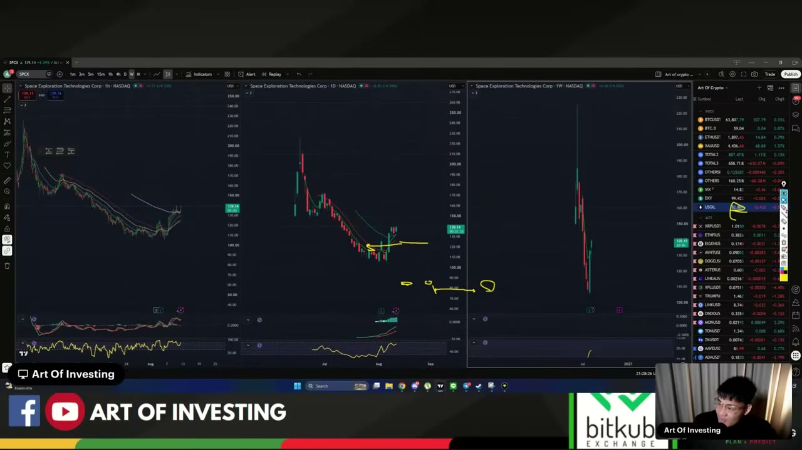

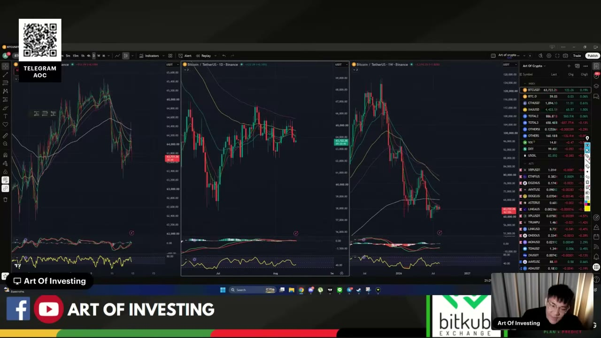

[01:12:37] Stop  Loss ไปแล้วเพราะอะไรจุดเนี้ทำไม ผมตัดสินใจเข้าจุดเทำไมผมตัดสินใจว่าผมจะ ไม่เล่นอะไรอย่างเงี้ยนะครับก็มันจะเร็ว ที่สุดเนาะเพราะว่าผมคิดได้ผมก็พิมพ์เลย มันเป็นกลุ่มอ่ะมันเร็วมันไม่ต้องแบบไป เรียบเรียงบทความลงเพจ Facebook ไงเออ ฉะนั้นน่ะเร็วที่สุดอ่ะก็จะเป็นกลุ่ม Telegram นะครับก็แล้วก็ลองลงมาก็จะเป็น เพจ Facebook ที่ผมก็จะเขียนเขียนบทความ เกือบทุกวันแหละนะครับแล้วก็ช้าสุดก็จะ เป็นไลฟ์นะครับก็จะมาไลฟ์สาระเยอะหน่อย พูดมากพูดน้ำลายเหนียวหน่อยก็จะเป็นทุก วันพุธนะครับประมาณ 20:00 น.ประมาณนี้ สุขสัต์วัดแม่ทุกคนเช่นกันนะครับอ่ะเออดี เลยที่ที่พูดเรื่องนี้นะครับคุณ เออเพื่อนผมนะตอนสมัยผมเรียนวิศวะเนี่ย อย่างที่บอกนะครับผมอ่ะเป็นคนเก่งวิชา คำนวณตั้งแต่เด็กและคือเลขอะไรอย่างเงี้ย ผมผมค่อนข้างถนัดนะครับก็เคยไปสอบแข่งพวก เอ่อวิชาการน่ะอ่ะเด็กๆนะเด็กๆจนมามหาลัย

[01:13:41] เงี้ยแคลคูลัสอะไรเงี้ยผมผมค่อนข้างโอเค แต่ว่าพวกวิชาคำนวณวิชาเขียนโค้ดวิชา optimization  signal ที่มันเป็นวิชาของ วิศวะคอมอ่ะผมจะแย่มากแล้วก็ทำไม่ค่อยได้ มันจะมีเพื่อนคนเนี้ยที่เขา้าไปเป็นผู้ หญิงนะครับแล้วเาค้าก็ค่อนข้างเป็นเด็ก เรียนน่ะผมก็จะไปให้เค้าติวให้ประจำเลย ช่วงแบบก่อนสอบเงี้ยผมก็จะแบบไปเลี้ยง ข้าวเ้าแล้วก็รวมกลุ่มเพื่อนผมไปมันก็จะ เป็นกลุ่มวิศวะผู้ชายใช่มั้ยที่แบบเรียน ไม่ค่อยไม่ค่อยเก่งอ่ะไม่ใช่ท็อปห้องอ่ะ 6-7 คนก็จะไปรวมให้ผู้หญิงคนเนี้ยติวแบบ ผมก็จะยืมเลคเชอร์ที่เขาจดในคลาสเงี้ยเอา มาอ่านเอามาลอกอะไรเงี้ยเออแล้วหลังจาก เรียนจบอ่ะ ผมไม่ได้คุยกับเค้าเลยเนาะแต่ว่าก็ก็มี IG มีเฟซนะก็ก็แบบเออตั้งแต่เรียนจบอ่ะ 10 กว่าปีเป็นหลัก 10 กว่าปีะก็ไม่ไม่ได้คุย กันเลยจนเมื่อ 2 วันก่อน นะครับเมื่อ 2 วันก่อนผมตกใจมากเพื่อนผม

[01:14:44] ลงสตอี่ว่าเค้าตายแล้วเค้าเสียแล้วผมก็ แบบเฮ้ยผมทักไปเลยว่าแบบเฮ้ยเกิดอะไรขึ้น เก็ทเก็เสียหรออะไรเงี้ยคือแบบไม่ได้คุย กันเลยนะครับตั้งแต่ตั้งแต่เรียนจบหลัก 10 ปีผมบอกเออเสียแล้วเป็นมะเร็งผมแบบเฮ้ยคน เรามันจะไปมันไปอย่างนั้นเลยเหรอคือแบบ วึ๊บแล้วก็ไปอย่างเงี้ยนะครับผมเลยมองว่า เออชีวิตคนเรามันไม่รู้เลยจริงๆเนาะว่า แบบใครจะไปในเวลาไหนจะเจอกันในเวลาไหน อย่างเงี้ยเราเราไม่ได้คุยกับเค้ามาเป็น 10 ปีอ่ะอยู่ๆเขาก็หายไปแล้วแบบเจอกัน ไม่ได้อีกแล้วอะไรเงี้ยขอบคุณไม่ได้อีก แล้วอะไรเงี้ยเออฉะนั้นวันนี้ก็เป็นวัน แม่เนาะผมก็เลยแบบเอ้ยอยากให้คนทุกคนน่ะ มีอะไรที่อยากทำ เหอครับเราไม่รู้เลยเนาะว่าวันเนี้ยมันจะ วันสุดท้ายของใครบ้างมันไม่รู้จริงๆนะบาง คนนั่งอยู่ในบ้านก็ยังมีรถแบบที่เขา้า อยู่ตึกแถวเงี้ยก็มีรถ 10 ล้อเมาขับ เข้ามาชนในบ้านตายอย่างเงี้ยเออผมเลยว่า

[01:15:44] ถ้าอยากทำแล้วมันไม่เดือดร้อนใครครับทำ เหอะนะครับมันสั้นจริงๆครับพอชีวิตมัน เริ่มเข้าเลข 3 เลข 4 อ่ะมันเป็นวัยที่ เราจะเจอเพื่อนต่อเมื่อเป็นงานศพหรืองาน แต่งแล้วอ่ะจากตอนก่อนเราสามารถไปกิน เหล้ากันไปเฮาไปเจอกันวัยมันเปลี่ยนจริงๆ ครับจนวันเนี้ยมันเป็นวัยที่แบบเราเริ่ม เห็นคนรอบตัวหายไปทีละคนแล้วนะครับก็เลย เออเฮ้ยดูแลสุขภาพกันด้วยนะไอ้ตรวจมะเร็ง อะไรอย่าเงี้ยผมว่ามันอาจจะหลายพันใช่ มั้ยอาจจะ 2 ปี 3 ปีตรวจทีก็ได้แต่ว่าผม อยากให้ตรวจไว้บ้างเดี๋ยวผมก็จะไปตรวจแบบ ละเอียดเหมือนกันนะครับก็คิดว่าถ้ามัน เป็นระยะ 1 ระยะ 2 ก็อาจจะรักษานะครับแต่ ว่าถ้าสมมุติว่าผมไปตรวจแล้วเจอระยะ 4 อ่ะผมคุยกับที่บ้านทุกคนไว้เหมือนกันว่า ไม่รักษาแม่กับยายผมก็เห็นด้วยนะครับถ้า ถ้าเราคุยกันไว้ว่า 3 คนในบ้านผมอ่ะถ้า ใครเป็นมะเร็งอ่ะเราจะไม่รักษาเลยเพราะ ว่ามันทรมานเราเคยรักษามาคนนึงแล้วก็คือ ตัปลาผมนะครับทั้งรักษาทุกอย่างออกซิเจน มาอยู่บ้านเป็นมะเร็งปอดสุดท้ายครับช่วง

[01:16:46] ปลายชีวิตเทรมานมากต้องกินยาของที่อยาก กินก็ไม่ได้กินแล้วเราก็รู้สึกว่าเฮ้ยถ้า เราไม่รักษาเราเรากินอย่างที่อยากกินแล้ว เราก็จากไปในแบบที่แบบร่างกายมันไม่ไหว แล้วอ่ะมันก็ดีกว่าการแบบไปฝืนมันนะครับ ฉะนั้นถ้าเจอระยะ 1  2 อ่ะเอออาจจะรักษา แต่ถ้า 4 ก็คือโอเคชีวิตเรามาแค่นี้นะ ครับก็ก็ปล่อยเลยจะเป็นภาพนั้นอ่ะ ทุกคนครับเจอกันใหม่พุธหน้าครับผมสวัสดี ครับวันนี้ฝากไว้เนาะดูแลสุขภาพกันด้วยนะ ครับเดี๋พรุ่งนี้ผมก็ไม่อยู่นะครับก็จะไป งานศพเพื่อนคนนี้แหละนะครับวันศุกร์ก็ เป็นวันเผาซึ่งเออดีเลยประชาสัมพันธ์วัน ศุกร์วันศุกร์ผมไปเป็นสปกเกอร์นะครับที่ บิดค Cup นะเดี๋ยวๆๆ มาได้นะครับก็จะมีผมพี่กอล์ฟลองลงทุนพี่ แชมป์ไอออนะครับเดี๋ยวเดี๋ยว ลืมๆ

[01:17:47] นี่นะครับนะครับ อย่าลืมอย่าลืม นะครับก็ไปเจอกันได้ไปเช็คแฮนดหรืออะไร กันนะครับอยากเจออยากคุยนะครับก็คราวที่ แล้วก็มีเพื่อนเพื่อนมาหาผมเหมือนกันนะ ครับจากต่างจังหวัดลงทุนเดินทางมานะก็คุย กันเป็นชั่วโมงเลยครับคุยเรื่องเทรดโมเดล นี่แหละว่าแบบเอ้ยพี่ผมเก็บสถิติมา อย่างี้ผมจะปรับยังไงอย่าเงี้ยเฮ้ยผมตอบ นะก็รอผมคุยบนเวทีเสร็จเนาะก็คือเป็น สปกเกอร์ให้เค้าเสร็จนะครับก็ เดินมาหาผมได้เลยทักทายคุยกันได้เลยนะ ครับกันเองนะสบายๆไม่ต้องแบบเตรียมเติม อะไรนะคุยเป็นเพื่อนกันนี่แหละเออคุณ อาร์ตเอาชีทมาก็ได้เอาเอาโปรแกรมเอาเอา คอมอะไรมาช่วยเปิดเดี๋เดี๋ยวผมช่วยดูให้ นะครับก็ไหนๆได้เจอกันทั้งทีเนาะนะครับ เออเดี๋ยวผมช่วยดูให้เอ้ยโมเดลผมเก็บมา เงี้ยพี่อาร์ตว่ามีตรงไหนที่ผมมองข้ามไป มั้ยอะไรเงี้ยเออเรามาคุยกันได้นะครับก็ วันศุกร์เนาะผมจะอยู่ตั้งแต่ 17:00 น.เลย

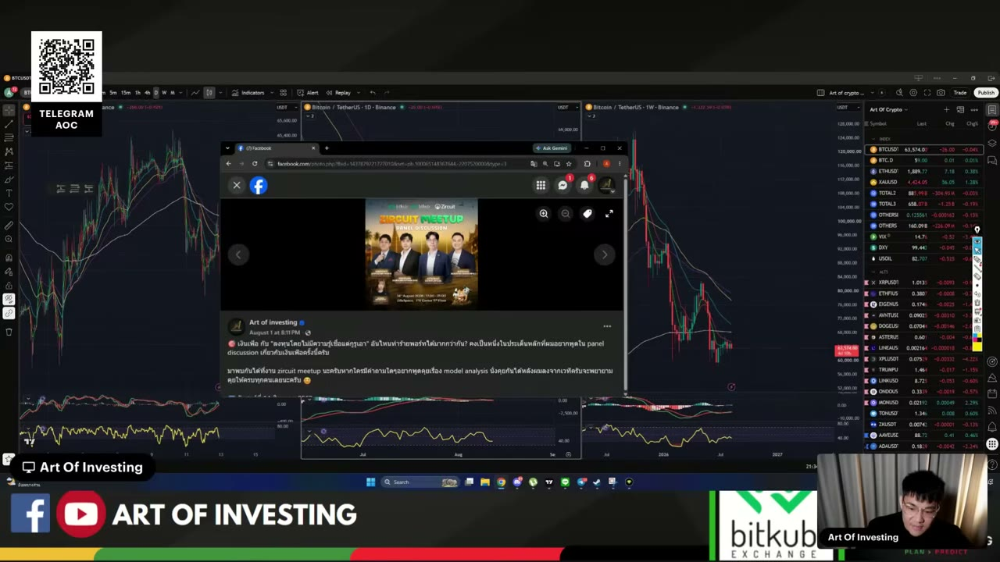

[01:18:48] ถึง 21:00 น.นะครับถ้าใครมาเร็วก็ก่อนผม ขึ้นเวทีถ้าว่างถ้าเค้าไม่ได้เรียกผมไป ไหนก็มาถ่ายรูปมานั่งคุยกันเรื่อง Teทคnical Analysis กันได้นะครับก็หวัง ว่าจะเจอกันนะครับวันศุกร์นะ 17:00 น- 21:00 น.นะครับที่บิดครับแล้วเชิญครับ ทุกคนมันเหลือเชื่อจริงๆครับอาจารย์โลก นี้ตอนเพื่อนเป็นก็นั่งคุยกันจริงครับมัน มันไปคือมันไปเลยจริงๆครับโลกนี้มันเป็น โรคที่แบบมันทำร้ายกำลังใจนะก็ขอให้ทุกคน สุขภาพแข็งแรงนะครับเจอกันใหม่ Art  of investing ขอให้ทุกท่านมีความสุขในการลง ทุนครับบ๊ายบายไป

