# BTC จะเริ่มกลับมามี trend?

- ช่อง: Art Of Investing
- ลิงก์: https://www.youtube.com/watch?v=Lr95wsGFJpE
- วันที่: 2026-08-20
- ความยาว: 1:23:00
- ที่มา: คำบรรยายอัตโนมัติ (auto-generated) ภาษาไทยของ YouTube — อาจมีคำสะกดผิด/คำผิดเสียง
- ภาพ: 44 ภาพจากวิดีโอช่วงที่เปิดกราฟแท่งเทียน (เลือกอัตโนมัติจากสีแท่งเทียน · ตัดภาพซ้ำ) อยู่ในโฟลเดอร์ frames/

---

[00:01:14] สวัสดีครับสวัสดีครับแหสวัสดีในจังหวะที่ ตลาดระเบิดขึ้นมานะช็อตเมื่อกี้นะครับตอน แรกนะวันที่ผมไปคุยกับพี่กอล์ฟลงทุนกับ พี่แชมป์นะก่อนก่อนขึ้นเวทีเน

[00:01:28] เอ่อเอ่อเป็นช่วงที่ ผมเพิ่งคัดทองไปใช่มั้ยตอนนั้นประมาณ 2,000  2,000 กว่าดอนใช่มั้ยแล้วก็ขึ้น เวทีไปผมก็ได้ไป Take  Profit ใช่มยไม้ ชอตบitcoinนะครับแล้วก็เสาร์อาทิตย์นะผม ก็เปิดช็อตเพิ่มมานะครับก็มีช็อตเมื่อกี้ ผมก็โดนไปนะครับรวมกับทองเมื่อกี้ผมน่าจะ โดนตอนแรกผมก็คุยกับพี่กอล์ฟตลกๆเว้ยว่า เฮ้ยเดือนเนี้ยวันที่ผมไปพูดอ่ะครึ่ง เดือนคือวันที่ 14 ใช่ป่ะผมก็ไปคุยกับพี่ กอล์ฟว่าเอ้ยพี่เดือนเนี้ยผม Performance ไม่ค่อยดีว่ะคือผมเทรดทั้ง เดือนน่ะเท่าทุนอ่าคือวันที่ 14 นะมาวัน เนี้ยเข้าเนื้อะนะครับเดือนนี้เดือนนี้ ติดลบประมาณ 200,000 กว่าบาทนะครับเดือน นี้เทรดเทรดติดลบประมาณ 200,000 กว่าบาท 3 เดือนที่ผ่านมามันบวกประมาณประมาณล้านถูก มั้ย 3 เดือนที่ผ่านมาผมบวกมาประมาณ1ล้าน เออเดือนนี้เอาไป 200,000 กว่าบาทและ นะก็ยังเหลือกำไรอยู่ประมาณประมาณล้าน

[00:02:29] เนาะจาก 3 เดือน 20 วันเออก็ถือว่า Performance ผมไม่ค่อยดีในเดือนนี้นะ ครับในเดือนนี้ Performance ค่อนข้างดรอป ค่อนข้างดรอป ก็คิดว่าเดี๋ยวเอ่อจะวิเคราะห์เนาะว่าแบบ เออทำไม Performance ผมผมถึงดรอปกว่าช่วง ที่ผ่านมาแล้วก็เมื่อกี้เกิดข่าวอะไรทำไม ตลาดถึงพุ่งนะครับผมเป็นคนไม่ชอบปิดบัง อยู่แล้วนะโดนผมก็จะบอกว่าโดนนะครับอย่าง อันเนี้ยเออก็ก็โดนนะครับก็เมื่อกี้ก็โดน ไปโดนไปโดนไปวันนี้โดนไปเยอะอยู่เหมือน กันก็รวมๆฮะนะรวมๆก็เดือนเนี้ยลบประมาณ 200,000 กว่าบาทแหละซึ่งโอเค สาเหตุที่ที่ดรอปนะส่วนตัวนะเพราะว่าผม อ่ะเป็นคนเทรดด้วยโมเมนตัมเป็นหลักใช่ มั้ยทีเนี้ยเดือนเนี้ยมันไม่ค่อยมีเทรนด์ นะครับเอ่อเทรนด์มันไม่ยาวก็คือมันเกิด แล้วมันก็ดับไปเกิดแล้วมันก็ดับไปมันวิ่ง ค่อนข้างอยู่ในกรอบเนาะผมก็เลยโดนค่อน ข้างเยอะนะครับคือเดือนนี้ทั้งเดือนน่ะ

[00:03:30] ที่ผมบวกอ่ะแล้วก็อ่ะขอพูดผิดเดือนนี้ ทั้งเดือนที่ผมโดนน่ะที่ลบอ่ะเกือบทุกไม้ ผมบวกก่อนหมดเลยนะก็คือบวกไป 3,000 ดอน ย้อนกลับมา -  2,400 อย่างเงี้ยบวกไป 4,000 ย้อนกลับมาลบ 3,000 อย่างเงี้ยนะ ครับก็คือมันไม่ถึง Target แล้วมันก็ย้อน ย้อนกลับมา Stop  Loss ก่อนด้วยความที่ผม เล่นไม้ไซส์ค่อนข้างใหญ่เนาะเพราะว่าเล่น ตามโซน OI ของบitcoinแต่ว่าเดือนนี้ทั้ง เดือนน่ะมันแคบแคบไปหน่อยนะครับก็เลย บitคinตอนแรกเท่าทุนมีช็อตเมื่อกี้นะครับ โดนโดนพร้อมกับทองเลยโดนเลยโดนเยอะนิดนึง นะครับ สวัสดีครับขอโซด โดน SL นุ่มเลยเอ้ยผมก็โดนผมก็โดนผมก็โดน นะครับทองผมก็โดนวันนี้ผมก็โดนจานไม่มา เมามันกับทองหรอครับโดนๆผมโดนก่อนขึ้น ไลฟ์แล้วคุณแคุณแอผมโดนแล้วผมโดนแล้ว สวัสดีครับคุณจตรงค์สวัสดีครับอาจารย์ ช่วยขยายข่าวเมื่อครู่ได้มั้ครับกระทรวน การคลังอเมริกาประกาศซื้อพันธบัตร 10-30 ปีทีครับมีผลยังไงได้เนี่ยผมกำลังจะ

[00:04:31] อธิบายแหละก็ผมโดน Stop เพราะว่าข่าวนี้ นี่แหละคือคนน่ะมันไปตีความว่าเฮ้ยมัน เหมือนหาทาง QE หรืออัดฉีดสภาพข้องเข้า ตลาดทางอ้อมหรือเปล่าแต่จริงๆมันไม่ได้ทำ งานแบบนั้นโดยตรงเดี๋ยวๆผมจะอธิบายให้ฟัง นะครับผมโดนมาข่าวนี้นี่แหละเออก็รู้สึก มาเหมือนกันว่าเฮ้ยเดือนเนี้ย อั้นว่ะมันมันรออะไรสักอย่างนึงเทรนด์มัน ไม่ค่อยยาวนะครับว่าเออเออมีเริ่มมีตัว ตัวจุดชนวนเทรนด์ละนะครับก็เดี๋ยว 20:30 น.เนาะตลาดเปิดก็เดี๋ยวดูว่าตลาดมันจะ กระโดดบึ้งบังๆบๆๆบๆอีกหรือเปล่านะครับผม ก็ดรอปครับศิษย์พี่อาร์ตจริงๆเออเนี่ยโ โดนก็โดนนะช่วงช่วงแย่ก็มีเทรดเดอร์เป็น งี้แหละ โดนกับจานเอเลยครับใช่ๆผมผมโดนเหมือนกัน นะครับก็เมื่อเช้ากำไรด้วยนะแล้วก็ ย้อนมาโดนก็ไม่เป็นไรสวัสดีครับอาจารย์ ช่วงนี้ตลาดสวิงบนล้างล่างใช่ครับมันไม่ ค่อยมีเทรนด์ครับแต่ว่าคิดว่าหลังจาก เนี้ยมีสิทธิ์แล้วนะถ้าเกิดเทรนด์จะเกิด นะครับส่วนทองอ่ะผมมองมองไว้แถวนี้เลยก็

[00:05:32] คือเมื่อวานน่ะผมบอกว่าถ้าเกิดมันเบรกแถว ไม่ได้เนี่ยมันก็จะส่งโมเมนตัมให้ไม่ สำเร็จถูกมั้ยก็มันหลุดdisคาไปแล้วก็มี โอกาสจะกลับมาลงแต่ตอนเนี้ยมันเด้งขึ้นมา เทสละทีเนี้ยเราต้องดูแล้วว่าอ่ะพูดแล้ว อธิบายข่าวเลยดีกว่าจะได้ไม่เสียไวลงเวลา นะครับอ่ะเดี๋ยวอธิบายข่าวแป๊บนึง นะครับแป๊บนึงนะโปรแกรมปักกงปากกาพร้อม ยังวะ เอ่อตึ๊บโอเคสวัสดีครับสวัสดีทุกคนเลยนะ โอเคเดี๋ยวนะหน้าผมเอ๊ะทำไมผมไม่ชินเลยวะ อ๋อโอเคจอมันเล็กแล้วไม่ได้แชร์หน้าจอ ก่อนตดึม โอโอเคโอเคนะครับมาทีนี้นะครับไอ้การ

[00:06:32] ประกาศซื้อพันธบัตรระยะยาวเนี่ยนะครับคือ ต้องบอกแบบนี้คนก็เลยมองว่าเฮ้ยผลตอบแทน จากพันธบัตรมันก็จะต้องเริ่มลดลงถูกมั้ย เพราะว่าพอเาเริ่มซื้อพันธบัตรคืนเนี่ย ครับยหรือผลตอบแทนเนี่ยมันก็ต้องเริ่มลด ลงคนก็เลยไปตีความว่าเฮ้ยมันคล้ายๆแอบลด ดอกเบี้ยหรือเปล่าแบบเนี้ยเพราะว่าสภาพ คล่องมันก็จะสูงขึ้นเพราะเเพราะว่าเค้าไป ซื้อคืนถูกมั้ยอันเนี้ยมันคือจังหวะช็อต แรกที่ตลาดมองนะครับซึ่งรายใหญ่เค้าก็ อาศัยช่วงนี้แหละเารู้แหละว่าเดี๋ยวตลาด จะต้องมองยังไงแล้วก็มันจะน่าจะมีสภาพ คล่องเนี่ยวิ่งเข้าสู่ตลาดนะครับมันก็เลย วิ่งรับข่าวไปละแต่ทีเนี้ยเดี๋สักพักอ่ะ ครับมันจะเริ่มดรอปลงมาเพราะว่าคนจะเริ่ม เข้าใจคำว่าดรอปลงมาไม่ได้แปลว่าเทรนด์ ตรงนี้จะหายไปนะแต่ว่ามันจะไม่ได้วิ่งแบบ ปื๊ดเราลากยาวทีเดียวอ่ะนะครับเดี๋ยวมัน จะมีช่วงความคลุ้งของข่าวมันดรอปลงนะครับ ทีเนี้ยไอ้พารทตรงเนี้ยเราต้องอย่าลืมนะ

[00:07:35] ว่ามันขึ้นอยู่กับอีก 1 ปัจจัยนะแล้วผม เริ่มเห็นความเก่งของของเอ่อรัฐบาล อเมริกานะครับ US  Departmentary  of Treasury นะครับหรือว่ากระทรวงการคลัง เนี่ยครับว่าเออลูกเล่นเค้าเนี่ยมันต่อ ยอดได้หลายจุดดีเพื่อนๆลองนึกภาพตามผมแบบ นี้นะ การลดดอกดอกเบี้ยก็คือการลดดอกเบี้ยตรงๆ ถูกป่ะคุณจะกู้เงินไปทำธุรกิจคุณจะกู้ เงินไปทำอะไรก็แล้วแต่เนี่ยคือคุณต้อง จ่ายดอกน้อยลงแต่ว่าการที่เค้าซื้อ พันธบัตรระยะยาวคืนน่ะคุณต้องอย่าลืมนะ ว่ามันมีพันธบัตรที่เขาออกได้ในอนาคตออก เพิ่มมาด้วย ผมพูดถูกมั้ยฉะนั้นสมมุติว่าเค้าซื้อคืน 4 บิลเลี่ยนแต่เค้าผลิตเพิ่ม 4 หรือมากกว่า 4 บิลเลี่ยนเท่ากันนะถูกป่ะสภาพ คล่องไม่ได้อัดฉีดเข้าตลาดโดยตรงขนาดนั้น ไม่ได้มีผลต่อภาวะที่ดอกเบี้ยมันจะอ่อน

[00:08:36] แต่แต่เนี้ยมันขึ้นอยู่กับว่าเขา้าจะผลิต เพิ่มมากน้อยแค่ไหนจะออกพันธบัตรออกมาขาย เพิ่มมากน้อยแค่ไหนเทียบกับที่เค้าซื้อ คืนเนาะอันนี้ก็จะเป็นอัตราส่วนที่ต้อง เทียบกันอีกทีแต่ทีเนี้ยคำถามคือทำไมสิน ทรัพย์เสี่ยงกับทองวิ่งเรื่องเนี้ยครับผม อธิบายมา 2-3 ปีละที่ที่ช่วงนี้มันมัน เป็นจังหวะแบบนี้นะครับคนก็จะสงสัยว่า เฮ้ยคุณอาร์ตผมโคตรงงเลยว่ะปกติทองกับสิน ทรัพย์เสี่ยงอ่ะมันวิ่งคนละด้านถูกป่ะ เช่นสินทรัพย์เสี่ยงวิ่งขึ้นทองก็ต้องลง สิเพราะว่าเขาบอกว่าช่วงเนี้ยมันเป็นแบบ risk  on  cash  is  trash หรือเงินสด เป็นขยะฉันไปซื้อหุ้นดีกว่าไปซื้อไปกู้ ธนาคารมาทำธุรกิจดีกว่าอ่ะเป็นช่วง R  on นะครับเขาเรียกภาวะแบบนั้นเอ้าแล้วทำไม ช่วงนี้เป็นอย่างี้วะหุ้นก็ขึ้นเอ่อ ใช้คำว่าทองก็ขึ้นเอ้าทำไมอ่ะเพราะว่าการ ที่ยดลงหรือผลตอบแทนพันธบัตรเนี่ยมันมี

[00:09:39] แนวโน้มจะลดลงเนี่ยครับทองเนี่ยตอนแรกอ่ะ มันเป็นแค่ Stop  value ที่เค้าพูดกันว่า มึงไม่ให้ปันผลต่อปีซื้อบันธบัตรรัฐบาลดิ ได้ปีละ 4-5% แบบแทบจะไร้ความเสี่ยงเพราะ ว่าอเมริกาเป็นประเทศที่มีหนี้สูงที่สุด ในโลกแล้วอเมริกาไม่มีทางไม่ใช้หนี้เพราะ อเมริกาเอาหนี้ตัวเองมาขายในอนาคตเพื่อ เอาเงินในปัจจุบันมาใช้หนี้ปัจจุบันอ่า เราเราพูดแบบนี้เห็นภาพง่ายๆก็คือใช้หนี้ ต่อหนี้หนี้ต่อหนี้ไปเรื่อยๆฉะนั้นน่ะ เค้าเค้ามีตังค์ใช้หนี้แน่ๆแค่เงินเขาจะ เฟ้อขึ้นมากขึ้นเรื่อยๆนะครับก็ต้องคอย ควบคุมเป็นระยะไปอืฉะนั้นทองเนี่ยตอนแรก มันมีข้อเสียเปรียบคือมันไม่มีผลตอบแทน รายปีให้คุณเลยทีเนี้ยผลตอบแทนรายปีของ บรรทบัตรลดลงทองจากไม่มีผลตอบแทนมันก็เลย ดูใกล้เคียงกันมากขึ้นเฮ้ยเริ่มเริ่มี แต้มต่อมันก็เลยส่งให้ทองเนี่ยวิ่งขึ้นมา ก่อนเนาะจากตัวทรัมป์เองด้วยที่ประกาศว่า เฮ้ยเรายังไม่มีท่าทีเจรจาการคุยอะไร

[00:10:41] สงครามก็ยังดูไม่สงบช่องแคบเฮอร์มุสจะ กลับมาเปิดจะกลับมาเปิดก็ยังกลับมาเปิด ได้ไม่เต็มที่อ่าภาวะนี้ก็เลยขึ้นทั้งทอง ทั้งสินทรัพย์เสี่ยงนะเป็นแบบ นะครับขอบพระคุณในความรู้อาจารย์นี่แหละ ครับอธิบายง่ายและเข้าใจที่สุดโอยินดี ครับยินดีครับยินดีครับแหมก่อนไลฟ์ผมผมก็ หงุดหงิดนะมันจะไม่ได้หงุดหงิดอะไรนะผม หงุดหงิดให้ผมโดนนะครับทั้งเดือนเนี่ยตอน แรกผมเทรดบวกๆลบๆบๆๆนะบ 150,000 ลบเหลือ 60,000 กลับไปติดลบ 120,000 กลับมาบวก 50,000 อะไรเงี้ยอ่ะ 14 วันแรกนะที่ก่อน ไปขึ้นเวทีบitคมันบวกๆลบๆมีวันเนี้ยเข้า เนื้อ 200,000 กว่าบาทก็อย่างที่บอกเทรด มา 3 เดือน 19 วันกำไร 1 ล้าน 3 เหลือ 1 ล้านนะครับซึ่งก็ไม่แน่นะอาจจะโดนเพิ่มก็ ได้ในในเดือนนี้นะเพราะว่าอย่างที่บอกว่า เดือนนี้ Performance ตกผมก็จะลงอย่าง เงี้ยเดี๋ยวผมก็จะอัปเดตทุกเดือนน่ะว่า เอ้ยเดือนนี้เข้าเนื้อว่ะเดือนนี้กลับมา

[00:11:43] บวกแล้วอะไรอย่างเงี้ยนะครับสาเหตุที่ผม ทำแบบเนี้ยเพราะอะไรรู้ป่ะเพราะว่าผมไม่ อยากให้คนน่ะมันติดภาพเว้ยว่าพอคุณไป เรียนเทรดหรือว่าคุณมีความรู้เข้าใจในการ เทรดแล้วอ่ะคุณจะไม่เจอช่วงแบบนี้อีกแล้ว เพราะว่าการที่เค้าขายคอร์สคุณน่ะอ่ะผมผม พูดในฐานะคนที่ก็ขายคอร์สนะเพราะว่าก่อน หน้าเนี้ย 3-4 ปีผมสอนไม่หยุดเลยมีแค่ปี เนี้ยผมยุ่งงานเรื่องธุรกิจนะครับก็เลย ไม่ได้ขายคอร์สทุกเดือนแต่ทีเนี้ยคอร์สผม เป็นคอร์สสดผมตรวจการบ้านมันเหมือนการ เรียนการสอนprรเวทกรุ๊ปอ่ะผมอธิบายแบบนี้ ก่อนแต่ส่วนใหญ่เวลาเค้าขายคอร์สอ่ะเค้า ขายความหวังว่าเฮ้ยถ้าคุณเรียนน่ะคุณจะ ไม่เจอการ stop  loss ติดกันถ้าคุณเรียน น่ะคุณจะไม่มีแบบเดินหน้าแล้วถอยหลังเดิน หน้าแล้วถอยหลังถ้าคุณเรียนคุณจะจัดการ ทุกอย่างเป็นระบบ Stop  Loss ปุ๊บๆแป๊บๆ เดี๋คุณก็จะได้คืนนะครับที่ผมลง Trading Journal ของผมอ่ะมาตลอดเลยถ้าใครได้เห็น ตามมา 4-5 ปีจะเห็นผมลงทุกปีอ่ะลง

[00:12:45] ปั้งๆลงแบบทุกออเดอร์เพราะผมอยากเห็นแบบ เนี้ยผม 12 ปีกว่าแล้วะยังมีบางเดือนที่ เทรดยังไงไงก็ติดลบแน่นอนมันอาจจะติดลบ ไม่เยอะแต่ว่าในฐานะเทรดเดอร์อ่ะมันก็รู้ สึกไม่พอใจในผลงานตัวเองเฮ้ยเทรดเทรดทั้ง เดือนติดลบว่ะถึงจะลบแค่แบบ 200,000 แต่สุดท้ายติดลบคือติดลบหรือบางช่วงถ้า คุณไปดูโพสต์ที่ผมปักหมุดปักหมุดปักหมุด เนี่ยคุณจะเห็นว่าผมโดนติดกัน 4-5 วันก็ มีนะครับนี่คือ 12 ปีกว่าแล้วก็ไม่ได้ เป็นความรู้แบบที่ ผมแค่จำด้วยคือคำว่าจำๆคือกราฟน่าจะเป็น แบบนี้เทรดไว้ก่อนนะครับผมอยากเป็นหนึ่ง ในตัวแทนแล้วกันให้เห็นว่าเออเทรดจริงๆ อ่ะเป็นงี้แหละช็อตโดนมันก็มีนะครับ อ่ะทีนี้เดี๋ยวก่อนเราจะไปวิเคราะห์กราฟ แล้วก็วิเคราะห์ตัว OI กันซึ่งผมว่าเดี๋ พรุ่งเนี้ยน่าจะเปลี่ยนแน่นะครับผมผม อยากอยากเห็นเลยว่าตัวเลขแถว 66,000

[00:13:47] นะครับผมอยากเห็นว่าตัวเลข 66,000 อ่ะ มันมันเพิ่มมั้ยเพราะว่าถ้าเกิดตัวเลข 66,000  67,000 มันเพิ่มสูงขึ้นเรื่อยๆ เนี่ยเพราะว่าตัวปัจจุบันเนี่ยครับมัน เป็นระยะขอบมันแปลว่าเค้าซื้อประกันเพิ่ม ขึ้นเยอะขึ้นเรื่อยๆนะถูกมั้ฉะนั้นน่ะถ้า เกิดว่ากระแสข่าวเนี้ยมันไม่ได้แค่แบบมา เล่นแล้วก็เดี๋ยวตบลงมาเล่นแล้วก็เดี๋ยว ตบลงนะคุณเปิด OI ไปอ่ะอาจจะต้องตลาดคืน นี้จบก่อนนะเป็นพรุ่งนี้เป็นอะไรอย่าง เงี้ยคุณจะได้เห็นแน่นอน เพราะเค้ากลัวว่ามันจะเบรคเช่นโอโหเฮ้ย เข้ามาตลาดเยอะว่ะออเดอร์ซื้อลิมิ เข้ามาบเลยมีทั้ง Aggressive  Buyer มีทั้ง passive  buyer โอหรือแบบออเดอร์ ซื้อมันเยอะพูดอย่างงี้เข้ามาปุ๊บเนี่ย เค้าต้องซื้อประกันละเพราะว่าอย่างที่ผม บอกรายใหญ่อ่ะเค้าไม่จับออเดอร์ชนกันแล้ว กินค่าน้ำนะครับฉะนั้นเค้าก็เลยจะกังวล เฮ้ยถ้าเบรคไปเราต้อง ซื้อขายก็คือ long หรือ short  future

[00:14:49] เพิ่มเลยเราต้องคำนวณตรงนั้นตรงนี้เรา ต้องทำ Delta Hงั้นถ้ามันผ่านไปเนี่ยค่า พรีเมี่มของเราตรงเนี้ยเราจะไม่ได้กินฟรี แล้วมันไม่ได้เป็น 0 เค้าก็จะเริ่มซื้อ ประกันกันเพิ่มตึ่งๆๆๆแล้วการที่เขาซื้อ ประกันเพิ่มกันน่ะมันแปลว่าตลาดกำลังกลัว ว่าราคาจะเลยไปมันเลยยิ่งมีแนวโน้มจะไป ถึงได้อ่ะอย่างที่ผมอธิบายเรื่องเสามัน ดูดราคาเนาะอ่ะอ่ะตลาดอเมริกาเปิดแล้ว ครับใช่มั้ยยังช่วงนี้เปิด 20:30 น.ปผมก็ ไม่ได้เช็ค day แต่น่าจะ 20:30 น.นะครับ อ่ะเดี๋ยวเราไปวิเคราะห์ ETF กันต่อ ผมก็คิดว่าวันเนี้ย ETF น่าจะบวกเถูกป่ะ ผมก็คิดว่าวันเนี้ยเงิน Fund  Flow ที่ ไหลเข้า EDF เนี่ยหรือ Exchange  Trading Funds อ่ะผมคิดว่าน่าจะบวกเพราะว่ามัน บวกมา 2 วันและแล้ววันนี้ก็มีข่าวที่ตลาด ตีความกลายๆว่าเฮ้ยมันคล้ายๆกับการลดดรอป เบี้ยหรือเปล่าแต่ว่าผมอธิบายต้นไลฟ์ไป แล้วเนาะนะครับอืฉะนั้นพาร์ทต่อมาเนี่ย คือกรอบราคานะครับวันเนี้ยเพื่อนๆรอรับ

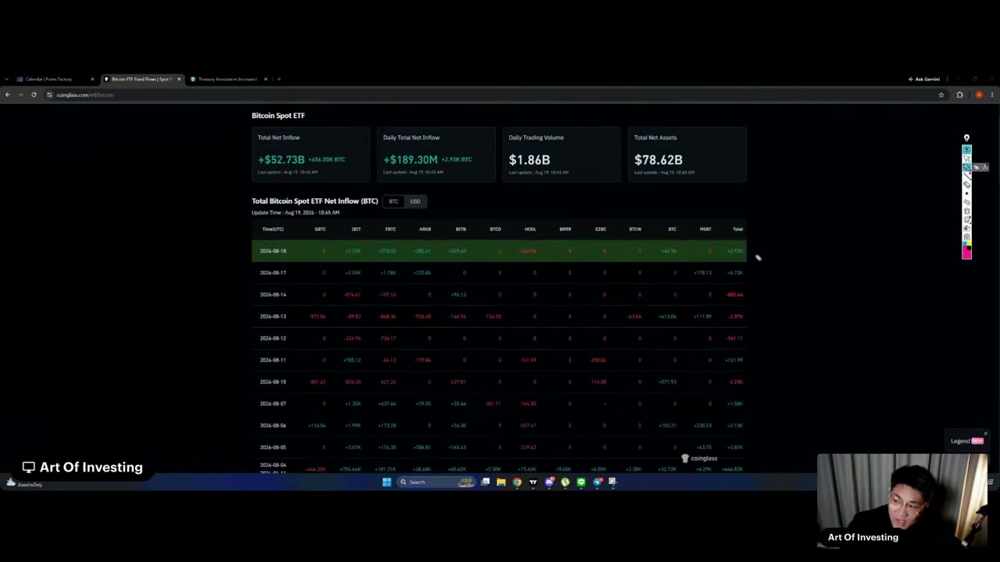

[00:15:50] แรงกระแทกนิดนึงนะจะใช้คำนั้นก็จะดูแรงไป มั้ยใช้คำว่าระวังความผันผวนตอน 1:00 น. นะครับอยากให้เพื่อนๆระวังความผันผวนตอน 1:00 น.ให้ดีเพราะว่า 1:00 น.มี c meeting  minut นะครับเรารู้อยู่แล้วนี่ ว่าหน้าที่ของเอ่อ c  meeting  minut เนี่ยคือการพูดถึงเงินเฟ้อถูกป่ะเฮ้ยจะ จัดการยังไงดีเราจะเอามันอยู่มยเราจะ รักษามันยังไงเราจะกดมันให้ลงไปยังไงแล้ว ตอนเนี้ยมันมีข่าวประกาศขอซื้อ เริ่ม back แล้วกันเริ่มซื้อพันธบัตรใน ระยะยาวคืนพอเป็นแบบเนี้ยมันก็ ต้องอยากฟังความคิดจากเฟซว่าเอ้ยคุณคิด ยังไงคุณมองdata้าตรงนี้เป็นยังไงคุณจะ เริ่มลดดอกเบี้ยต่อเป็นสเต็ปต่อไปเลยมั้ย หรือคุณจะยังคงดอกหรือยังมีโอกาสเพิ่มดอก มั้ยเพราะมีการซื้อคืนตรงนี้สภาพคล่องมัน

[00:16:50] จะสูงขึ้นหรือเปล่าฉะนั้น คำพูดตรงเนี้ยครับผมคิดว่าน่าจะมีความผัน ผวนประมาณนึงอืมอยากให้ระวังกันนิดนึงนะ ครับถ้าถ้าเกิดใครเทรดก็เทรดด้วยความ ระมัดระวังนะครับอือย่าอย่าไปแบบใส่สุด มากว่าแบบเอ้ยอันเนี้ยเดี๋ยวเทรนด์ไปแล้ว อัดยาวอัดอะไรนะครับก็ระวังตรงนี้นิดนึง ส่วนถ้าเกิดใครที่ซื้อมาก่อนเนาะก็คือเรา พูดง่ายๆว่ารันเทรนด์นั่นแหละนะครับใคร ที่รันรันเทรนด์มาแล้วก็ทำ trailing ทำ อะไรหน่อยแล้วกันนะครับดูดูคำนวณ position sizing ดูอะไรดีๆนะครับก็หวังว่าขอให้ เป็นบวกนะดูแลกำไรตัวเองด้วยนะครับอ่ะ ส่วนผมเนี่ยเดี๋ยวผมไปหาจังหวะเข้าใหม่ก็ เดี๋ยวจะอธิบายมุมมองผมเพิ่มให้ฟังทีนี้ มุมมองผมเป็นแบบนี้นะครับ

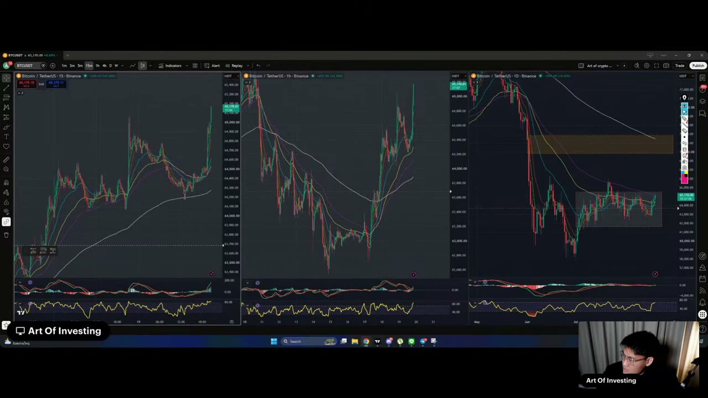

[00:17:53] อ่ะโอเค เดี๋ยวผมขอดู Snapsot นะ วันนี้ 19 โอเค อ่ะตอนเนี้ย OI ยังไม่ค่อยมีการเปลี่ยน แปลงนะครับเดี๋ยวผมจะรอดูตอนประมาณงาน พรุ่งนี้นะครับตลาดปิด 3:00 น.เนี่ยเออ ว่าว่าเค้าซื้อประกันเพิ่มกันเยอะมั้ยใน โซนหลังจาก 66,000 ไปอ่ะเดี๋ยวมาดูตรงนี้ ก่อนนะครับดูตรงนี้ โอ้ขอบคุณซอ Chat ก่อนครับคุณอ๊อดขอบคุณ มากเลยครับ 55 บาทขอบคุณสำหรับกำลังใจนะ ครับคุณอ๊อดขอบคุณมากครับ โอเคนะครับทีเนี้ยเอ่อวันหมดอายุเนาะ

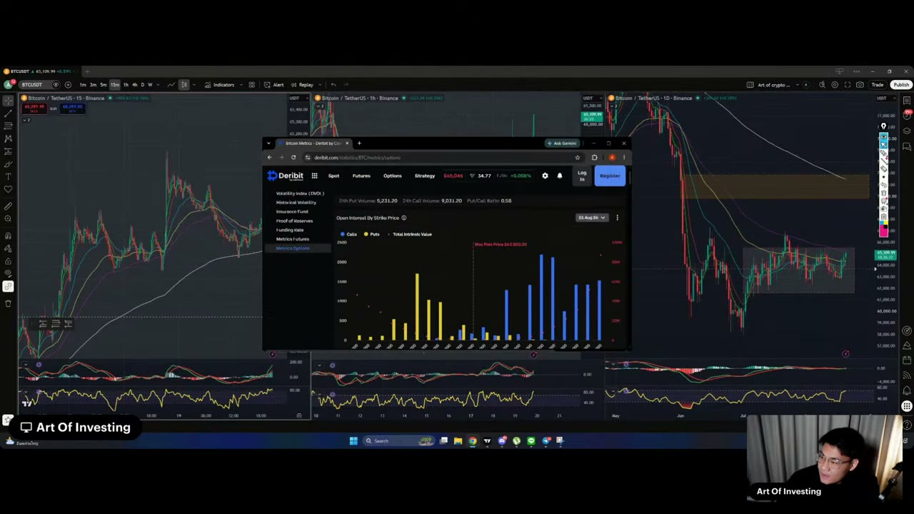

[00:18:56] อย่างที่ผมบอกว่า contract มันเม็ดเงิน ไม่เยอะเท่าทองคำนะครับโอ้ยขอบคุณซเปอร์ Chat จากคุณฮาร์ดวลครับ 179 บาทขอบคุณ มากเลยครับขอบคุณสำหรับกำลังใจครับเอ่อ มันไม่เยอะเท่าทองคำที่เราจะสามารถเอามา แบบเทรดได้เป๊ะๆทุกวันซึ่งผมก็พยายามปรับ system ให้มันเหมาะกับเอ่อสภาพคล่องตรง นี้อยู่แต่ทีเนี้ย การที่เรารู้แล้วอ่ะว่าวันไหนมีนัยยะผม เลยอยากให้เบสโฟกัสแค่วันนั้นๆก่อนเช่น ตอนเนี้ยครับวันที่มีนัยยะเนี่ยเฉพาะวัน และสิ้นเดือนนะครับก็ให้เพื่อนๆดูตรงนี้ นะครับว่าเห็นมั้ยว่า expiry เนี่ยครับ หรือวันหมดอายุเนี่ยวันไหนมีวอลลุ่มบ้าง นะครับอย่างอันเนี้ยมันเตี้ยครับมันก็ไม่ มีนัยยะเหมือนกับว่าคุณจะไปดูว่าถ้าเกิด ฉันมาขายไก่ทอดที่ตลาดนี้ฉันจะขายดีมั้ย แต่ตลาดนั้นทั้งตลาดมีคนเดินอยู่ 100 คน เงี้ยครับมันก็ไม่สามารถวัดนัยยะได้ว่า

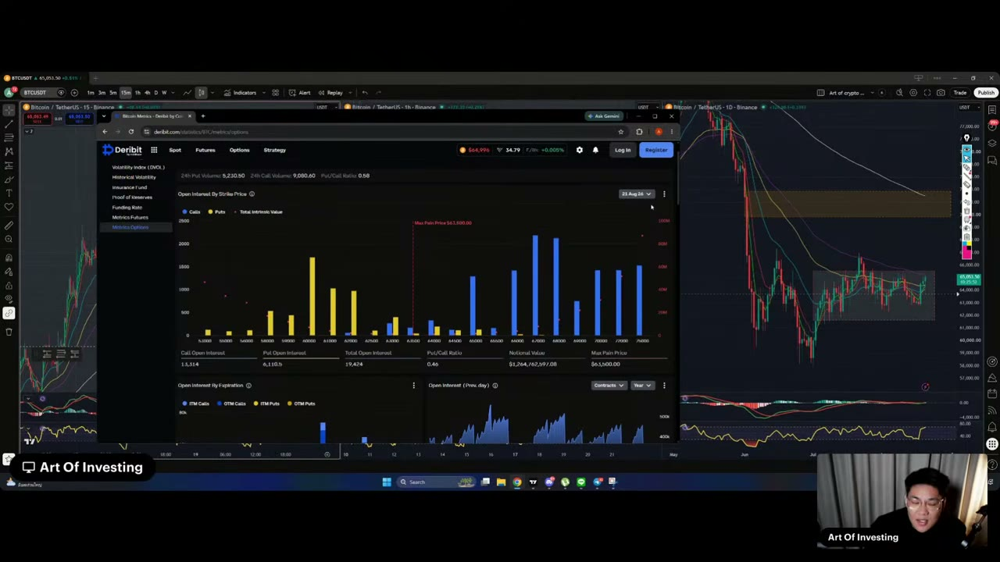

[00:19:57] เฮ้ยสรุปแล้วไก่เนี่ยมันขายไม่ดีเพราะคน ไม่เยอะหรือมันขายดีเพราะว่าคนมันชอบแค่ เฉพาะกลุ่มนะครับฉะนั้นให้คุณไปดูตอนที่ เขา้าไปโรงงานแบบโotทopเงี้ยไปงานระดับ ตำบลระดับจังหวัดระดับประเทศอย่างเงี้ย ว่าแบบเฮ้ยอันเนี้ย Sample  siiz ที่เอา ลองเอาไก่ทอดไปขายอ่ะคนที่ได้เห็นน่ะมัน ไม่ใช่แค่คนที่บ้านอยู่แถวนั้นและมันเป็น คนระดับชุมชนเป็นแบบได้ออกโotทopแล้วนะ ครับงั้นตรงเนี้ยมันเลยจะมีนัยยะก็เลยจะ เป็นวันที่ 21 ก่อนก็คือศุกร์นี้แล้วก็ เป็นอีกทีคือ 28 นะครับที่ที่จะมีออเดอร์ ค่อนข้างเยอะนะครับมีไม่ใช่ออเดอร์สิ สัญญา option ที่รอการ settement หรือยัง ไม่ได้เคลียร์สัญญานะครับก็ตรงเนี้ยค่อน ข้างหนาเห็นมั้ครับทีเนี้ยถามว่าแบบเนี้ย มันจะต้องไปเสาที่สูงที่สุดหรือเปล่าคำ ตอบคือไม่ไม่ใช่แบบนั้นนะครับไม่ไม่ใช่ แบบนั้นอ่ะเริ่มย่อละเห็นมั้ยนะครับเริ่ม ย่อละก็เดี๋ยวรอดูนะว่าสัก 21:30 น.เค้า จะย่อเจะอะไรอีกเปล่านะครับมันจะวนอย่าง เงี้ยอย่างที่ผมบอกนะครับก็คือมันจะมีการ

[00:20:57] ตีความข่าวระยะสั้นก่อนระยะโฟโม่ก่อนแล้ว หลังจากจบระยะโฟโม่มันก็จะเริ่มกรองเอ๊ะ ไม่ใช่รถดอกนี่หว่าอ่ะอะไรอย่างเงี้ย นะครับโอเค ทีนี้เสาที่สูงที่สุดไม่ได้จะต้องไปโอ้โห ต้องอย่างงี้ดิวะทองสวยอ่ะ ทีเนี้ยพักดีใจแป๊บนึงนะครับผมยังติดไม้ เซลล์อยู่ไงนะครับผมเพิ่งเข้าไปอีกไม้นึง แถวๆนี้แหละแถวๆตอนไลฟ์อ่ะนะครับแล้วก็ โอเคละผมคิดว่าเดี๋ยวแถวเนี้ยลงมาซักแถว นี้น่าจะปิดแล้วครับไม่เกิน 4430 เ่ะแล้ว ก็เดี๋ยวเดี๋ยวขอกั้นหน้าทุนก่อนแล้วกัน นะเดี๋ยวก่อนนะครับเพิ่งโด stop  loss ไป ครับ 200,000 กว่าบาทครับไม้นี้ไม่อยาก โดน stop ครับเดี๋ขออนุญาต คีย์ออเดอร์กั้นหน้าทุนก่อนครับเดี๋ยว เลื่อนนู่นเลื่อนนี่ก่อนครับ โอเคเค นะครับเอ่อสวัสดีครับคุณทีสวัสดีครับคุณ กันอ่ะเดี๋ยวอธิบายให้ฟังครับ

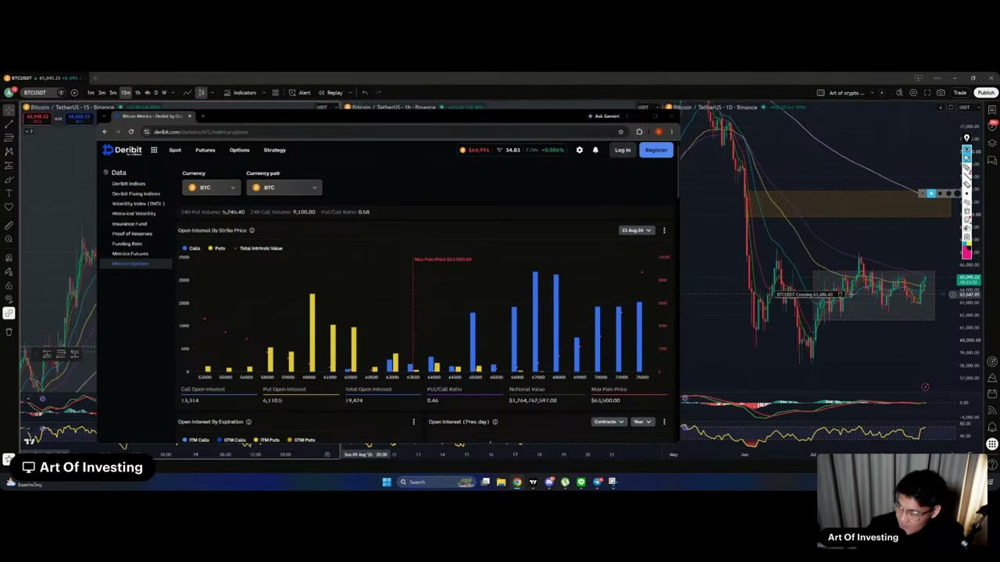

[00:21:59] อ่ะทีนี้ มันคือความกังวลถูกป่ะ อ่าเพราะในมุมนึงอtionัมีหลายมิติมากนะ แต่ผมนำเสนอมิติแรกก่อนนะครับมิติแรกก่อน คือเรื่องการมองเป็นประกัน อ่าในเรื่องการทำ H การทำ Delta  H อะไร ก็แล้วแต่นะครับทีเนี้ย ให้เรามองว่ากลุ่มคนที่มีเงินเยอะมากๆใน ตลาดไม่ไม่ได้ใช้คำว่ารายใหญ่แล้วกันมี เงินเยอะมากๆในตลาดเนี่ยไม่อยากให้ราคา เนี่ยวิ่งเลยไกลไปกว่านั้นนะครับก็เลย ซื้อประกันไว้เพื่อทำเพจทำอะไรก็แล้วแต่ ฉะนั้นการที่เสามันเริ่มติดกันเนี่ยมัน ไม่ได้แปลว่าอู้หูแบบนี้ต้องทะลุไป 68,000 แบบนี้ต้องทะลุไป 70,000 แต่ให้คุณสังเกต ว่าถ้าเกิดเสาที่ใกล้ขึ้นเรื่อยๆเนี่ย มันเริ่มงอกสูงขึ้นอ่ะอันเนี้อันนี้ฟัง แล้วอยากให้คิดตามนะครับไม่อยากให้แค่แค่ ฟังแล้วก็เอ่อ

[00:23:00] จำว่าแบบเสาสูงเดี๋ยวไปตรงนั้นเดี๋ต้อง สะท้อนให้เราลองฟังเราคิดตามนะถ้าเกิด อย่างที่ผมบอกนะว่าทำไมผมถึงอยากเห็นตรง นี้นะครับถ้าเกิดมันขึ้นไกลขึ้นเนี่ยอ่ะ แสดงว่าคนเริ่มคิดแล้วว่าน่าจะเบรคแถวนี้ อ่ะมากขึ้นถูกมั้ยเค้าก็เลยไปซื้อประกัน ที่ไกลกว่าเดิมเพราะเอ้ยตรงนี้เบรคได้ อยู่แล้วเดี๋เบรกเบรกตรงเนี้ยเดี๋ยวเรา เลยต้องเทเพิ่มอะไรต้องกังวลอ่ะเค้าไป ซื้อไกลแต่ถ้าเค้าซื้อใกล้ขึ้นเรื่อยๆอ่ะ ให้เราคิดภาพแบบนี้ถ้าเค้าซื้อใกล้ขึ้น เรื่อยๆเนี่ยแสดงว่าเค้าเริ่มคิดว่าแนว โน้มที่มันจะไปถึงตรงนี้ตรงนี้ตรงนี้ เนี่ยมันอาจจะน้อยลงด้วยหรือเปล่าถูกมั้ย เค้าเลยซื้อประกันในราคาที่ใกล้กว่าเดิม เพราะอะไรอ่ะเพราะว่าราคาที่มันใกล้กว่า เดิมอ่ะครับ เราอย่าลืมนะว่าอtionัน่ะมันมีวันหมดอายุ ก็จริงแต่มันสามารถปิดสัญญาก่อนหมดอายุ ได้ถูกมั้ยฉะนั้นถ้าปิดสัญญาก่อนหมดอายุ ได้เนี่ยก็คือราคาเลยไปปุ๊บเค้าสามารถ settle ได้เลยมันก็เลยต้องตัดสินใจว่า ถ้าเกิดราคามันวิ่งเข้าใกล้เสาที่มันใกล้

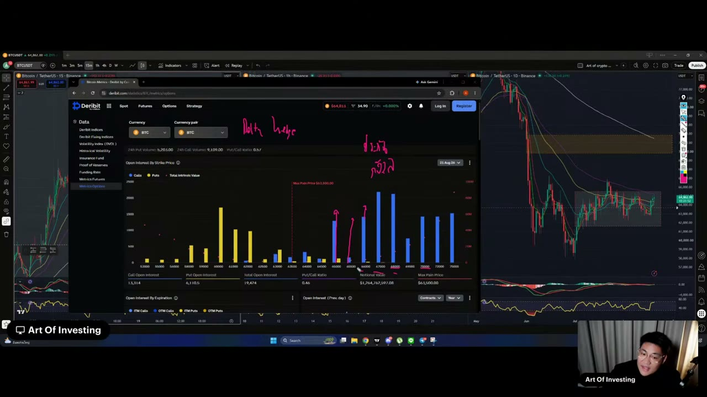

[00:24:03] ขึ้นเรื่อยๆแล้วเนี่ยเม็ดเงินในเสานั้น น่ะตัดสินใจ settlement หรือเคลียร์สัญญา ปุ๊บเนี่ยครับมันก็จะดีดกลับมาทีเนี้ยผม เลยอยากดูเลยว่าเอ้ยพรุ่งเนี้ยมันจะเป็น ไงวะหลังจากตลาดปิดไปนะครับว่าโซนไหนมัน จะขึ้นระหว่างโซนแบบใกล้ไม่ไกลมากหรือไป โซนที่ไกลกว่าเดิมนะครับถ้าไปโซนที่ไกล กว่าเดิมเนี่ยบวกกับโมเมนตัมที่มันกำลัง จะส่งถึง day เนี่ยมันก็เลยมีแนวโน้มว่า เฮ้ยออเดอร์ในตลาดเริ่มมองว่าโอกาสน่าจะ เบรคถูกมยโอกาสน่าจะเบรคออกแหมลงมาไม่ถึง TP ผมนะเด้งซะก่อนนะครับอ่ะไม่เป็นไร เนี่ยครับแต่ถ้ามันงอกมาใกล้ขึ้นเรื่อยๆ งั้นผมก็คิดแล้วโอเคเฮ้ยแถวนี้ก็ยัง ยากนี่หว่าคนเขาก็ยังกังวลกันเหมือนเดิม นี่หว่านะครับอ่ะประมาณสำหรับ OI นะก็ยัง เป็นกรอบนี้อยู่นะครับถ้าคำนวณด้วยvolุม ด้วยค่า IV เนาะก็คือถ้าเราจะเข้าไปดูตรง เนี้ยนะครับก็คือวันดูวันที่ 21 นะอย่าง เงี้ยนะครับก็จะเห็นมันก็จะมีเปอร์เซ็นต์ บวกลบนะครับใน 1  standard  division

[00:25:05] เห็นมย one  standard  division  expected move นะครับก็คือบวกลบจากราคาปัจจุบัน เนี่ยประมาณ 1,100 จุดนะครับก็คือมันจะ อยู่ใกล้เคียงกับ 66,000 มากเห็นมั้ย อันเนี้ยถ้าอิงตามสูตรเดียวกับทองคำบน CME ก็คือ 68% ที่จะอยู่ในกรอบแต่ว่าอันนั้น มันเป็นศูนย์ Date  Trading นะก็คือเป็น กลไกของ option ที่วันหมดอายุเท่านั้นแต่ นี้มันยังไม่ยังไม่ถึงวันสุดท้ายของการ หมดอายุมันเหลืออีก 2 วันถูกมั้ยอ่ะมันก็ จะเป็นตรงนี้นะครับซึ่งเดี๋ยว มันจะอยู่แถว 66,000 พอดีก็เลยมีแนวโน้ม ว่าถ้าเกิดในวันที่ 21 หรืออีก 2 วัน เนี่ยราคาเนี่ยค่าเฉลี่ยหรือมีเนี่ยยัง อยู่แถวๆนี้มันก็มีแนวเนาะประมาณ 68% นะ ครับถ้าเทียบหลักการเดียวกับทองคำนะครับ 1 Standard ที่จะอยู่ในกรอบ 66,000 นะครับ กับ 62,000  68% ก็คืออีก 32% เนี่ยคือ เป็นโอกาสที่จะทะลุไปได้แต่ทีเนี้ยถ้า เกิดอย่างที่ผมบอกเนาะสัญญามันเยอะขึ้น

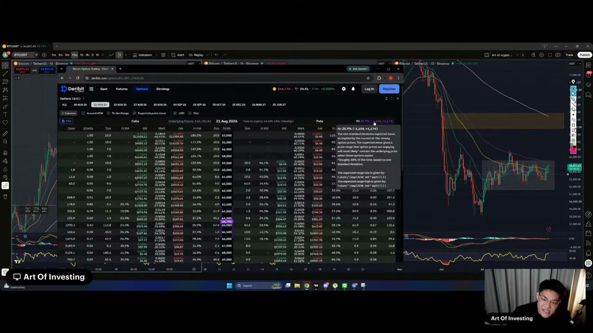

[00:26:07] เรื่อยๆที่ 70,000  7,000  69,000 อะไร เงี้ยก็แสดงว่ามีแนวโน้มที่เค้าคิดว่า ราคาเนี่ยมันจะไปถึงตรงนั้นได้มากขึ้นแต่ ว่าอย่าลืมนะว่า 21 อ่ะมันใกล้หมดอายุ อายุนะครับอีก 2 วันแล้วนะครับก็ผมเชื่อ ว่า 2 วันมันไม่มีทางที่จะไปถึงโซนตรง นั้นนะครับงั้นมันก็จะเป็นค่าเฉลี่ยที่ ค่อนข้างไกลเกินไปจุดแรกอ่ะดูแค่ 67,000 66,000 หนาขึ้นแค่ไหนจะเบรกแล้วจะเกิด reีอคtionมั้ยโฟกัสทีละจุดแบบนั้นก่อนนะ ครับตอนนี้ผมเลยมองแบบนี้อ่ะโอเคพูด เรื่องสัญญาไปละต่อมาดูที่กราฟกันบ้างนะ อืพูดเรื่องโมเมนตัมบ้างนะครับ แล้วก็ผมเห็น out หลายตัวเริ่มออกตัวแล้ว นะอย่างลิงก์อย่างอะไรอย่างเงี้ยมันก็ ทะลุพีเemiumโซนขึ้นมาแล้วแต่ว่าเดี๋ยวผม จะอธิบายให้ฟังหน่อยว่ามันมีจุดต้องระวัง มั้ยหรือว่าถ้าเกิดจะรันเทรนด์เนี่ยคุณ ต้องรันด้วยไอเดียไหนอะไรอย่าเงี้ยอ่ะ

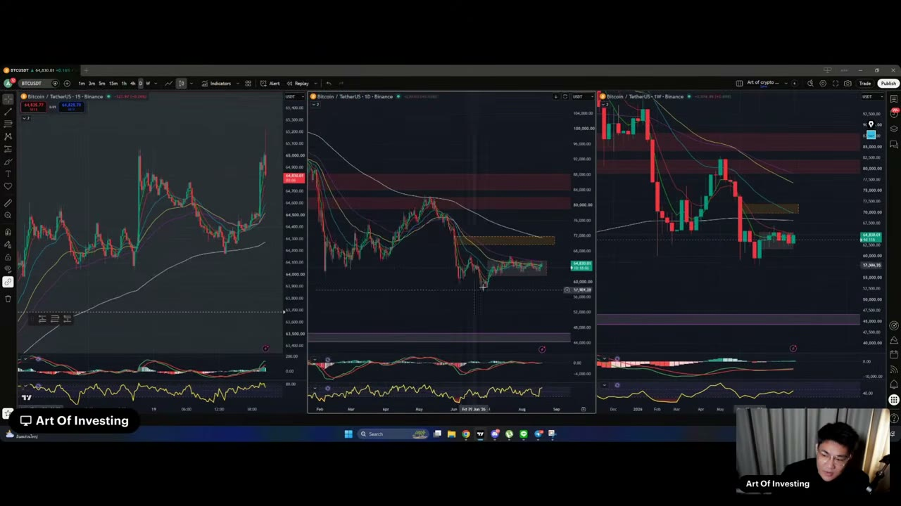

[00:27:09] เดี๋ยวผมจะเสริมให้นะครับเพราะว่าผมไม่ อยากให้ทุกคนเกิดกำไรแล้วสำหรับใครที่ลอง มานะส่วนตัวผมไม่ได้ลอง outcoin อยู่แล้ว ในชาวสภาวะตลาดหมีเนาะเพราะว่าผมไม่ชอบ เล่นกับการตรงข้ามของตลาดผมจะเล่น outcoin ต่อเมื่อเป็นตลาดบู market นะครับอ่ะ เดี๋ยวเสริมตรงนั้นให้อธิบายตรงนี้ก่อน พาร์ทแรกนะครับเหมือนเดิมเลย week นะครับ ผมพูดทุกไลฟ์ใช่มั้ยอ่ะไลฟ์พี่ก็จะพูดอีก ครั้งนึงนะครับสมมุติฐานเนี่ยคือแมกdนะ ใครที่ฟังไลฟ์ผมมาทุกครั้งผมสามารถท่อง ได้แล้วผมพูดอยู่นั่นน่ะนะครับ อ่ะแบบนี้คือ moving  average  convergent divergent ถูกมั้ยครับก็คือค่าเฉลี่ยที่ สัมพันธ์กันกับไม่สัมพันธ์กันคนเขาก็ชอบ มาดูว่า MACD ตัดขึ้นเป็นขาขึ้น MACD ตัด ลงเป็นขาลงซึ่งจริงๆมันไม่ได้ทำงานแบบ นั้นนะครับ MACD เนี่ยมันคือค่าเฉลี่ย 2 เส้นเส้นนึงช้ากว่าอีกเส้นเส้นนึงเร็ว กว่าอีกเส้นนึงทีเนี้ยเวลาที่ราคามัน เริ่มกลับตัวจากลงไปขึ้นหรือขึ้นไปลงอ่ะ

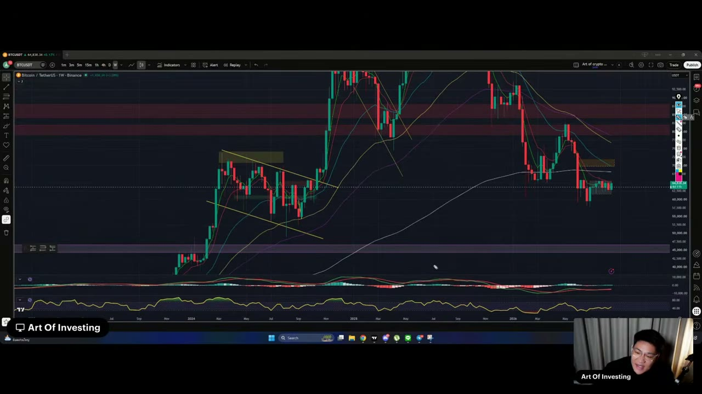

[00:28:12] ค่าเฉลี่ยที่ใกล้ปัจจุบันมากกว่ามันจะ กลับตัวก่อนอยู่แล้วนึกภาพทันมั้ยเพราะ มันคำนวณจากจำนวนแท่งที่น้อยกว่าก็คือ แท่งที่ใกล้ปัจจุบันมากกว่าคำนวณคำนวคำนว คำนวฉะนั้นเนี่ยมันการตัดขึ้นของมันเนี่ย ไม่ได้บ่งบอกเลยถึงว่ากำลังจะกลับตัวมัน แค่บอกว่าเฮ้ยช่วงละระยะสั้นลงตรงเนี้ยนะ ครับเนี่ยตั้งแต่ตรงเนี้ยเห็นมั้ยเนี่ย ตั้งแต่ตรงเนี้ยเนี่ยที่เกิดการตัดขึ้น เนี่ยราคามันเริ่มปิดเป็นบวกแล้วนะมัน เริ่มสูงขึ้นแล้วนะพอราคาสูงขึ้นค่า เฉลี่ยมันก็สูงขึ้นนะครับพูดง่ายๆคือ ออเดอร์ซื้อในระยะสั้นน่ะเริ่มมาและเริ่ม เข้ามาละนะครับเริ่มเข้ามาละเป็นพาร์ทแบบ นี้มากกว่าฉะนั้นคุณต้องมีสมมุติฐานให้ มันด้วยนะครับในการที่คุณจะหยิบมันมาใช้ อ่ะโดนหน้าทุนผมและไม้นี้ช่างมันทองนะ ครับอ่ะ คุณต้องมีสมมุติฐานด้วยว่าทำไมคุณถึงจะ

[00:29:16] หยิบอินดิเคเตอร์ตรงนั้นหรือการตีความ สมการตรงนั้นน่ะมาใช้เป็นคitionในการเทรด ให้มองแบบนี้นะครับโดยสมมุติฐานที่ผมมี กับ Bitcoin นะครับอ่ะอธิบายให้ฟังก่อน คือบitcoinเป็นสินทรัพย์ที่เราทุกคนเถียง ไม่ได้ว่ามันวิ่งเป็นวัฏจักรหรือไซเคิle ถูกมั้ย มันวิ่งเป็นวัฏจักรมากๆคือกระทิ้งก็แบบ วิ่งปึ๊กๆๆๆนะครับอย่างสมัยก่อนนี่ยิ่ง แรงใหญ่เลยนะครับผมวิ่งจากแบบอย่างเงี้ย นะครับจากโลเเนี่ยแบบ 3,800 ขึ้นไปโอโห 60,000 อย่างเงี้ยนะครับโอโหวิ่งแบบ 10 20 เด้งจากกลอย่าเงี้ยช่วงลงจากยอดก็ลง แบบตาเหลือกเลยนะครับไม่ไม่เหลือให้กำลัง ใจให้คนแบบที่เป็นมือใหม่หรือเพิ่งเข้ามา ในตลาดเลยก็ลงแบบเละเทะถูกมั้ยฉะนั้นน่ะ มันเป็นไซเคิลที่แยกออกจากกันเลยว่าตอน เนี้ยชั้นเป็นขาขึ้นนะหรือตอนเนี้ยชั้น เป็นขาลงนะฉะนั้นจำนวนออเดอร์ในตลาดอ่ะ

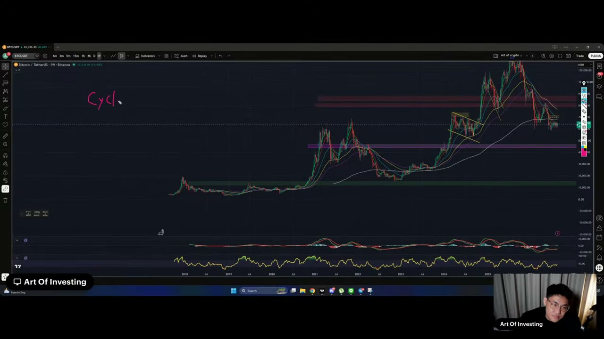

[00:30:19] มันเลยเอามาตีความได้เพราะว่าถ้าเกิด ออเดอร์ซื้อเยอะกว่าตลาดอย่างชัดเจนมันก็ จะเป็นตลาดกระทิง ถ้าออเดอร์ขายมันเยอะกว่าออเดอร์ซื้อใน ตลาดอย่างชัดเจนมันก็จะเป็นตลาดหมีซึ่ง assumption เหล่าเนี้ยหรือว่าผมก็นึก ภาษาไทยไม่ออกนะเอ่อสมมุติฐานตรงเนี้ย ครับมันจะใช้ได้เฉพาะสินทรัพย์ที่มันวิ่ง แยกโซนแบบนี้คือขึ้นก็ขึ้นลงก็ลงถ้าเกิด คุณไปใช้ตลาดใหญ่ที่มันวิ่งในกรอบ ไซด์เวย์ระยะยาวอ่ะมันจะไม่ได้ ประสิทธิภาพเลยนะครับหรือประสิทธิภาพมัน จะค่อนข้างน้อยคุณก็จะต้องเปลี่ยนtimeม frฟมหรือเปลี่ยนอะไรเพราะว่าตลาดนั้นน่ะ ออเดอร์ซื้อกับขายอ่ะมันไม่ได้แตกต่างกัน มากในช่วงที่เป็นขาขึ้นมันก็จะต้องมีคน ขายคนช็อตคนทำอะไรแยกกันไปแต่บitคinมัน ยังเป็นสินทรัพย์ที่ค่อนข้างใหม่มันอยู่ มาบนโลกนี้ยังไม่ถึง 20 ปีเลยนะครับงั้น ภาพที่เห็นมันเลยเป็นแบบนี้อ่ะเดี๋ยวผม เอาตั้งแต่ 2013 ให้ดู อธิบายเหมือนเดิมทุกๆทุกอาทิตย์นะครับอ่ะ

[00:31:21] พูดไป อ่ะดูตรงนี้นะครับดูตรงนี้อ่ะเราก็จะเห็น นะว่าช่วงที่มันขึ้นเนี่ยเห็นมั้ย MACD เนี่ยมันอยู่เหนือ 0 หมดเลยแล้วช่วงที่ มันลงมาเรื่อยๆเนี่ยนะครับลงมาเรื่อยๆ เนี่ยแม็กเนี่ยมันก็อยู่ต่ำ 0 หมดเลยนะ ครับโดยพาร์ทตรงเนี้ยเฮ้ยคุณอาร์ตแล้ว แล้วดูยังไงว่าเหนือ 0 คืออะไรใต้ 0 คือ อะไรนะครับเหนือ 0 เนี่ยมันคือการที่เรา เอาค่าเฉลี่ยหักล้างกันแล้วเป็นบวกใต้ 0 ก็คือค่าเฉลี่ยหักล้างกันแล้วเป็นลบ ฉะนั้นเนี่ยครับมันก็พูดง่ายๆเอาแบบหยาบ หยาบให้เก็สพลาดไม่ก็คือถ้ามันเหนือศูนย์ เนี่ยออเดอร์ซื้อมันเยอะกว่าออเดอร์ขาย ถ้ามันใต้ศูนย์เนี่ยออเดอร์ขายมันเยอะ กว่าออเดอร์ซื้อนะครับแล้วมันเป็นแบบนี้ มาทุกไซเคิลนะครับอย่างเงี้ยอ่ะตั้งแต่ 2013 เห็นมั้ยตั้งแต่บitคin 1,000 เดียวอ่ะนะครับอย่างเงี้ยลงก็ MACD ใต้ 0 กลับมาขึ้นก็ MACD เหนือ 0 แล้วก็ยาวมา

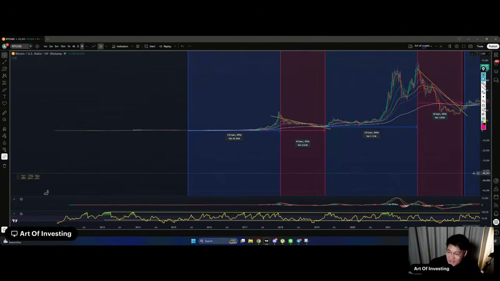

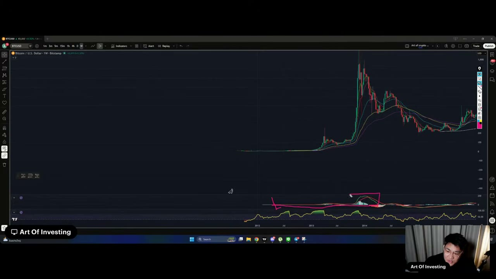

[00:32:22] เลยแล้วตอนลงก็แดีใต้ 0 เห็นมั้ยอย่างี้ เห็นมั้ยลงปุ๊บก็ยาวกลับมาขึ้นอีกทีก็ เหนือ 0 แล้วก็เหนือ 0 ยาวเลยจะย่อจะอะไร ก็แล้วแต่แมไม่เคยต่ำกว่า 0 เลยพอต่ำกว่า 0 ปุ๊บนะครับก็กลายเป็นขาลงยาวเลยนะครับ ฉะนั้นตอนเนี้ยออเดอร์ซื้อยังน้อยกว่าขาย อยู่ถูกมั้ยผมเลยบอกว่าเฮ้ยถ้าเป็น บitcoinอ่ะแล้วมันจะเกิดเป็นเทรนด์ด้วย แบบที่มันเป็นมาตลอดในทุกๆไซเคิลน่ะคือ MACD ใน week อ่ะมันควรต้องเหนือ 0 ก่อน เพราะมันเป็นแบบนี้มาแล้ว 3-4 ครั้งนะ ครับออเดอร์ซื้อมันต้องกลับมาเยอะกว่า ออเดอร์ขายแบบชัดเจน มันถึงจะเป็นเทรนด์นะครับอ่าก็คือข้อแรก ข้อ 2 ก็คือมันจะต้องเบรคพรีเมี่ม พรีเมี่มคือโซนที่คนในตลาดรู้สึกว่าแพงคน ในตลาดรู้สึกว่าเอ้ยแพงไปว่ะขายก่อนดี กว่านะครับออเดอร์ออเดอร์ขายเริ่มไปวาง หรือออเดอร์ขายเข้ามาใส่เพิ่มนะครับเราก็ จะเห็นว่าแต่ละครั้งแต่ละไซเคิลมันก็จะมี โซนที่เป็น discount คือโซนที่ตลาดมองว่า

[00:33:23] ถูกเฮ้ยได้ของลดราคาว่ะซื้อเพิ่มดีกว่า กับโซนที่ตลาดมองว่าแพงไปว่ะขายก่อนดี กว่างั้นพรีเมี่มเนี่ยมันคือตรงนี้ถูกป่ะ รอบเนี้ยรอบที่ผ่านมาก็คือตรงนี้เห็นมั้ย คือค่าเฉลี่ยที่เมื่อไปชนมักจะเกิดแรงขาย นะครับการที่เราต้องไปเทสตรงเนี้ยมันคือ การบ่งบอกว่าไอ้ออเดอร์ไม่ว่าจะเป็นฝั่ง option ที่มีผลต่อตลาดเพราะว่ามันเป็น สัญญาที่ settlement  future แล้วมันส่ง ผลต่อราคาจริงอะไรก็แล้วแต่นะครับเพราะ ว่ารายใหญ่ต้อง h สัญญาอชั Future ถูก หรือมันจะเป็นออเดอร์ในตลาดสปอต ถ้าเกิดไปถึงค่าเฉลี่ยที่มักจะมีการ เคลียร์สัญญาหรือการตั้งออเดอร์ขายขวาง ไว้แล้วเบรคไม่ได้มันแปลว่าตลาดยังไม่ได้ ตีความว่าสินทรัพย์เนี้ยไม่แพงแล้วเฮ้ย

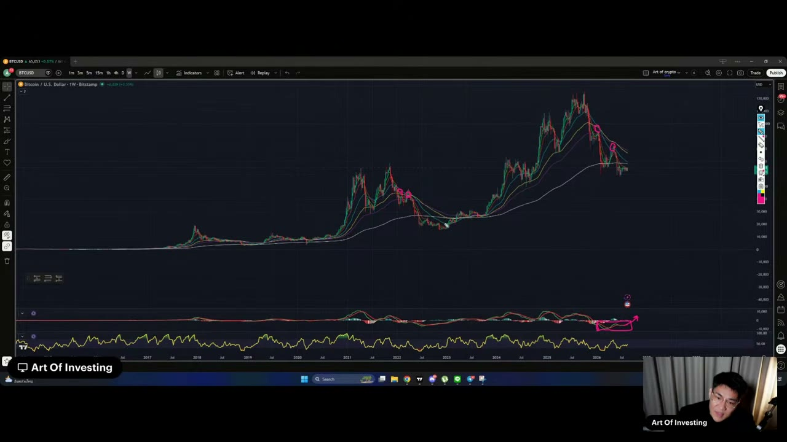

[00:34:24] จากที่เราเคยมองว่าแพงไม่แพงแล้วถูกแล้ว เว้ยเฮ้ยของถูกเว้ยนะครับมันก็เลยต้อง เบรคตรงนั้นให้ได้ก่อนนี่คือคitionชัแรก ที่ผมต้องการให้เกิด 2 คือคitionกับสิน ทรัพย์ที่โคตรเป็นวัฏจักรอย่าง อันเนี้ยซึมนะครับก็คืออย่างงี้นะครับ อย่างงี้[เสียงสูดหายใจ]งั้นกลับมาขึ้น ได้เห็นมั้ยจังหวะเดียวที่เบรคพรีเมี่มก็ เลยบ่งบอกว่าเฮ้ยออเดอร์ซื้อมันกลับมา เยอะกว่าขายแล้วนะในจังหวะที่ออเดอร์ที่ คอยตั้งขวางเนี่ยที่ค่าเฉลี่ยอันนั้น เนี่ยแพ้แล้วนะครับคือออเดอร์ซื้อมันเยอะ จนไม่สามารถแมตชแล้วสะท้อนลงมาได้แล้วมัน แมตชแล้วมันกลบไปเลยแล้ว 3 ก็คือโมเมนตัม มันเกิดคือ RSI  overbard ได้อันเนี้ยเรา เห็นะเห็นป่ะการเทสรอบก่อน RSI ไปเทส พีเมี่มอันเนี้ยที่ผมพูดไว้ในหลายรายการ แล้วก็ในหลายไลฟ์ที่ผมพูดตลอดว่าเอแบบผม เชื่อว่าวิ่งได้ไม่เกิน 88,000 โอกาสยาก ในในจังหวะแรกผมก็มองว่าเฮ้ยผมไม่รู้ว่า จะเกิดนิวโรต่ำกว่า 60,000 หรือเปล่าแต่ ถ้าต่ำผมมองว่าเป็นของที่ราคาเหมาะสมอ่ะ

[00:35:25] ใครที่ตามดูในหลายรายการมาหรือว่าที่ผม ไลฟ์ก็จะเห็นนะครับผมก็จะวิเคราะห์ประมาณ ประมาณนี้เสร็จแล้ว RSI เนี่ยมันมันทำไม ตอนนั้นผมถึงมองแบบนั้นเพราะว่าตรงเคือ Premium  Zone แล้วเป็นการเทรสprีemium zone รอบที่ 2 เองก็คือรอบที่ 1 รอบที่ 2 แล้ว MAD เนี่ยมันยังไกล 0 มากนะครับผมก็ เลยมองว่าถ้ามันไม่ขึ้นแบบกระฉูดอย่าง เงี้ยมันยากมากเลยอ่ะที่คุณจะทำให้ RSI overbard ได้พร้อมกับ Macd ขึ้นได้ด้วย ในตลาดที่พึ่งพาการเป็นเทรนด์กว้างๆหรือ เทรนด์ในระยะยาวผมก็เลยมองว่าจังหวะนั้น น่ะมันค่อนข้างข้างแอบยากเหมือนกันที่จะ เบรคไปได้[เสียงสูดหายใจ]ไกลนะครับ พอมันย่อลงมาแล้วเนี่ยสิ่งต่อมาคือเรา ต้องอย่าลืมนะครับว่าการที่มันย่อลงมาแม้ มันจะเกิดneโรเนี่ยแต่ระยะและความ aggressive ในการขายของตลาด มันเบากว่าเดิมถูกป่ะฉะนั้นค่าเฉลี่ย เนี่ยให้คุณคิดนะมันมี 2 ทาง

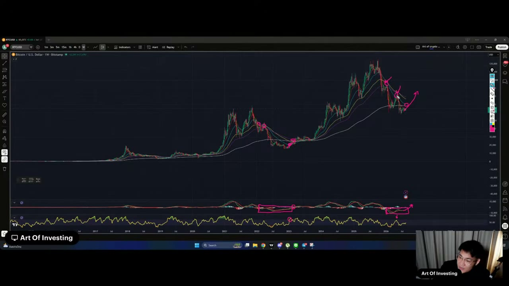

[00:36:30] อ่ะค่าเฉลี่ยเนี่ยมันมี 2 ทางที่จะทำให้ มันกลับมาเป็นบวกหรือเข้าใกล้ค่าตรงกลาง มากขึ้นทางแรกคือขึ้นเยอะๆ ทางที่ 2 คืออะไรSidewayย นานๆเพราะว่าค่าเฉลี่ยมันคำนวณจากจำนวน แท่งให้คุณนึกภาพออกมั้ยค่าเฉลี่ยมันจะ คำนวณจากจำนวนแท่งงั้นถ้าราคามันย่ำที่ เดิมไปเรื่อยๆจำนวนแท่งมันก็เพิ่มเพิ่ม เพิ่ๆๆงั้นค่าเฉลี่ยมันก็จะเข้าเข้าใกล้ ตรงกลางเองอ่ะ หรือที่เขา้าเรียกว่าเข้าหามีน อ่าเป็นคำนั้นเลยเป็นไงเริ่มประกอบกัน แล้วนะเริ่มเห็นภาพแล้วอ๋อมันประกอบกัน แบบนี้มันเป็นแบบนี้นี่แหละครับ [เสียงสูดหายใจ]คือคือหน้าตาของมันมันก็ จะเป็นเป็นประมาณนี้คือมันจะค่อยๆประกอบ เข้าหากันงั้นพอย์ต่อมานะครับ Bitcoin รอบเนี้ย

[00:37:32] อีก assumption นึงเดี๋ยวผมอธิบายตรงนี้ ยาวๆจบแล้วเดี๋ยวผมจะไปตอบคอมเมนต์แล้วก็ เดี๋ยวไปดู outcoin ให้เนาะแล้วก็ทองกับ น้ำมันที่เพื่อนๆถามมาเป็น outcoin บาง ตัวนะครับแล้วก็เดี๋ยวผมดูทองน้ำมันให้ เอาตรงนี้ก่อนนะครับอีก 1  assumption หรืออีก 1 สมมติฐานซึ่งเป็นแบบนั้นมาตลอด และไม่มีความจำเป็นที่จะต้องเป็นแบบเดิม นะแต่ว่ามันเป็นมา 3-4 รอบแล้วอ่ะเราจะ ไม่ใช้ความได้เปรียบจากมันเหรอเพราะเราก็ มองว่าเฮ้ย[เสียงสูดหายใจ]มันเกิดแบบแบบ นี้มาตลอดอ่ะก็คือระยะเวลาในการสะสมนะ ครับมันขึ้น 31 เดือนลง 15 เดือนแล้วผม กล้าพูดประกันวันนี้เลยนะว่าเดี๋ยววันนึง อ่ะมันจะหายไปเราแค่ไม่รู้ว่ามันจะหายไป ไซเคิลไหนหรือมันจะยังมีเป็นแบบไซเคิล อยู่มยอนาคตบitcoinมันจะขึ้นแบบไม่ไม่มี ไซเคิลแล้วหรือเปล่าก็คือแบบขึ้นพักย่อ เป็นเหมือน S&P  500 เป็นเหมือน NASDAQ อ่ะแต่ในวันเนี้ยวันที่มันยังเป็นสิน ทรัพย์ที่ตั้งไข่ใช้งานก็ยากโอนก็ต้อง ข้ามเนต้องอยู่บนchนบitcoinเท่านั้นจะโอน

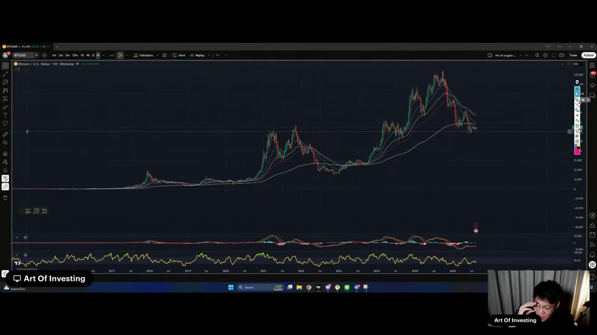

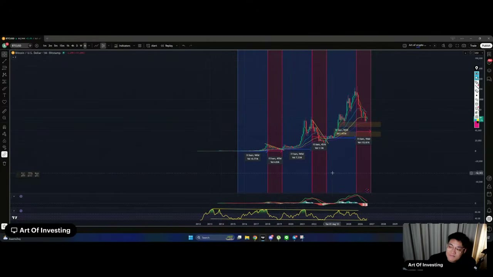

[00:38:33] เป็นSATชิคุณก็ต้องฝึกใช้ในรูปแบบ Lightning  Network อ่ะอะไรเงี้ยอ่ะมือ ใหม่เอาเงี้ยเรียกว่าคนทั่วไปอ่ะใช้ยาก มากๆอ่ะมันยังเป็นสินทรัพย์ที่ตั้งไข่คน ยังแบบเก็บก็ยากใช้ก็ยากฮาร์ดแวร์วอเล็et ก็โดนเจาะเอ้ยโคCทำไมไปอ่ะ ตอนเนี้ยมันยังพักตัวไม่ครบ 15 เดือนที่ มันพักมาตลอดในในทุกๆไซเคิล นะครับมันยังไม่ครบ 15 เดือนการที่มันจะ กลับมาถ้าอิงตามเวลาเดิมคือพฤศจิกายน งั้นตอนเนี้ยมันก็ยังไม่ใกล้ถึงนะครับถ้า เกิดมองด้วยศาสตร์ของโมเมนตัมผสมกับ Price Action เนี่ยตรงเนี้ยขึ้นไปเนี่ยมันก็มี โอกาสที่จะถ้าสมมุติว่าไม่ผ่านนะครับก็ คือติดแถวเนี้ย 66,000 แล้วมันก็มีโอกาส ที่จะปิดแซนวิชลงมาได้ถูกมั้ย ผมพูดทุกไลฟ์เลยเนี่ยเบื่อๆกัน่ะเนี่ย เบื่อเบื่อเนี่ยผมพูดเนื้อหาเดิมแต่ว่า ตอนแรกอ่ะผมผมคิดเรื่องนี้เยอะมากเลยนะ ว่าเฮ้ยเราสอนเรื่องเดิมๆเนี่ยแม้ว่าตลาด

[00:39:35] มันจะเปลี่ยนแต่เราก็จะอธิบายว่าพอ เปลี่ยนไปแล้วมันเหมือนเดิมในมุมไหนได้ บ้างเนี่ยเฮ้ยคนมันจะเบื่อป่าวะแต่ว่าผม ก็ดูไลฟ์จาน A ทุกวันใช่มั้ยจารย A  M Trดerผมก็เอ้ยแกก็พูดเรื่องเดิมทุกวันนะ OI มันต้องแบ่งค่าอย่างี้ IV เนี่ยมันมี สกิลกว่าสมมเราต้องแบ่งครึ่งโอกาสถ้ามัน ราคาเกินครึ่งมาแล้วเนี่ยมันจะวิ่งอยู่ อีกส่วนของท้องช้างเกิน 70 ผมเห็นแกพูด เช้าเย็นทุกวันมาหลายเดือนมากเออผมคิดว่า คนน่าจะไม่เบื่อเพราะคนก็น่าจะเรียนรู้ไป กับภาวะตลาดที่มันเปลี่ยนไปแม้ว่ามันจะ เป็นเรื่องเดิมๆเนาะอืที[เสียงสูดหายใจ] ถ้าเป็นภาพเนี้ยนะครับก็มีโอกาสที่ราคา เนี่ยเราก็จะได้เห็นช่วงแบบ 54,000 48,000 แล้วก็ค่อยวกมาขึ้นตอน เอิ่มปลายพฤศจิกายนธันวาคมนะครับแล้วก็ เกิดเป็นเทรนด์รอบใหม่แล้วถ้ายังเป็นเวลา แบบเดิมอีกก็คือ 31 เดือนนะครับโดย เรื่องนึงนะที่ผมอยากอยากให้ระวังไว้อ่ะ

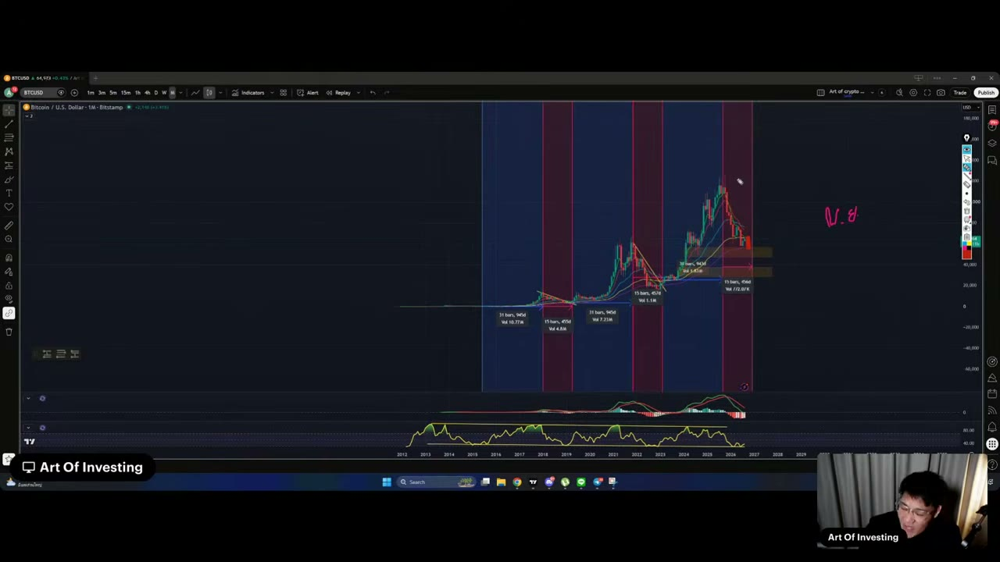

[00:40:36] คือบางคนน่ะจะไปยึดติดกับสมุติฐานแล้วก็ หลายๆคนน่ะพังเพราะว่าสมมุติฐาน มันเกิดขึ้นครั้งแรกบ่อยเกินไปอย่าง อันเนี้ยอย่างทองเงี้ยถ้าผมไม่ได้แบ่ง เงินไว้แล้วหรือว่าบitcoinที่ผมแบบแบ่ง เงินไว้แล้วว่าเอ้ยโอกาสที่มันจะเบรคตรง นี้ได้เนี่ยมีแค่กี่เปอร์เซ็นต์มันเกิด ขึ้นกี่ครั้งในที่ผ่านมาแนวโน้มวอลลุ่ม ต่อวันเท่าไหร่แล้วสมมุติว่าผมเชื่อ 100% เลยว่าเฮ้ยไม่เบรคแน่อย่างเงี้ยนะครับ แล้วคุณ all  in เข้าไปพอร์ตมันก็จะมี ปัญหาฉะนั้นอัน assumption เนี้ยผมอยาก ให้ระวังสมมุตินะว่ามันเ้าป้อนเข้าปากคุณ จริงๆหรือไอ้สมมุติฐานที่แต่ละคนที่ เป็นกูรูเนี่ยใน Twitter นะก็แล้วแต่เป็น อชนวิศาร์เป็นอะไรก็แล้วแต่เค้าพูดตลอด ว่าเอ้ยเวลามันจะเป็นอย่างี้เดี๋มันจะ ขึ้นเดือนนี้เดี๋ออเดอร์มันจะเริ่มมาแล้ว อะไรอย่างเงี้ยแล้วมันดันเป็นตอนขึ้นผม อยากให้คุณระวังไว้ตั้งแต่วันนี้เลยนะฟัง ผมดีๆนะสมมุติว่าอุ้ยคุณอาร์ตที่มันเป็น เวลามาตลอดเลยอันเนี้ยคนอื่นเขาก็พูดกัน ที่เรานับจำนวนเดือนใช่มั้ยเราดู MVRV

[00:41:38] ratio หรือดูอะไรสมมุตินะมันดันขึ้น พฤศจิกายนพอดีแล้วมันลงมาในกล่องด้วย สมมุตินะ คุณคิดว่าคนส่วนใหญ่อ่ะคิดว่ามันจะต้อง วิ่งกี่ ถูกป่ะ นี่คือพอยแรก พอย์ที่ 2 คุณคิดว่าคนที่เริ่มเห็น สมมุติฐานอะไรพวกเนี้ยมันเยอะขึ้นเรื่อยๆ ป่ะนั่นคือสาเหตุที่มันมีการยืนยันนะว่า ตลาดหมีแต่ละครั้งอ่ะมันลงถ้านับเป็น เปอร์เซ็นต์น่ะเริ่มแคบลงนะแล้วก็ตลาด บูเก็ตอ่ะถ้านับเป็นจำนวนเด้งเป็น เปอร์เซ็นต์ที่มันขึ้นน่ะก็น้อยลงเรื่อยๆ ในทุกๆบูรันนะแม้ว่ามันจะวิ่งเป็นระยะ เวลาเท่าเดิมแต่ความกว้างและความไกลที่ มันวิ่งเ่ะก็น้อยลงเรื่อยๆนะครับงั้นมัน มีสิทธิ์นะถ้าเกิดว่าไอ้ตรงเนี้ยมันดั้น พัก 15 เดือนแล้วมันขึ้นอาจจะไม่ถึง 31 นะมันเป็นไปได้หรือเปล่ามันเป็นไปได้หลาย

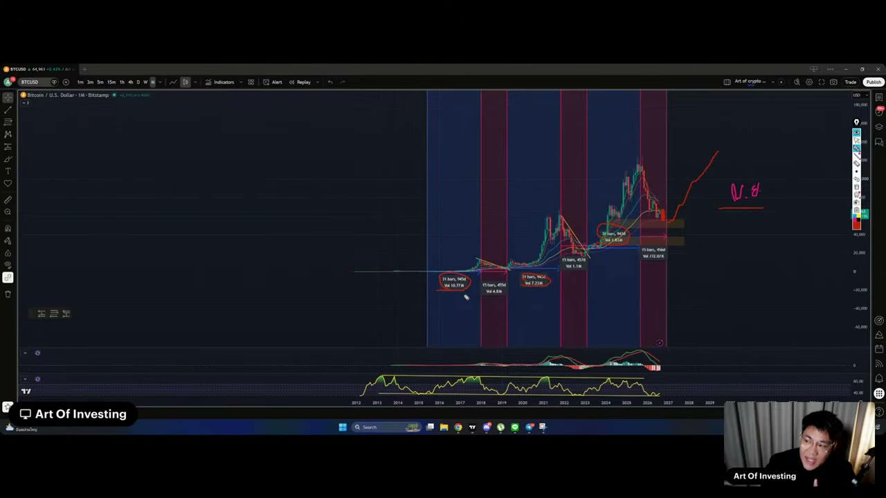

[00:42:40] มุมมากเลยผมเลยอยากให้คุณน่ะอย่า วิเคราะห์แค่สมมุติฐานเดียวแล้วก็เชื่อ ปักใจไปเลยนะครับอย่างอันเนี้ยเวลาที่ผม วางสมมุติฐานน่ะผมจะต้องวางความเป็นไปได้ ก่อนนะครับหรือว่า possibility นะครับว่า ถ้าเกิดอันนั้นน่ะมีแนวโน้มแค่อย่างอัน นี้มันเกิดมาตลอดงั้นโอเคผมก็เป็น สมมุติฐานที่ผมก็จะอยากใช้ละเพราะว่าถ้า เกิดมันผิดสมมุติฐานเนี่ยการ stop  loss ของผมตรงนั้นน่ะมันจะค่อนข้างมีความน่าจะ เป็นที่สูงว่าถ้าไม่โดน stop  loss อ่ะ มันน่าจะเกิดเทรนเพราะว่ามันเป็นแบบนั้น มาทุกครั้งถูกมั้ยฉะนั้นลงมาในนี้ปุ๊บอัน นี้ใน mon ใช่มั้ยแล้วใน week อ่ะเกิด 3 คitionพร้อมกันคือราคาเบรคพีemiมdเหนือ 0 RSI  Overbard อ่ะแปลว่าเทรนด์มันเกิดผม ก็จะรันขึ้นไปนะครับแล้วก็มันหลุดdiscน เมื่อไหร่อย่างเงี้ยอ่ะผมก็จะ take profit นะครับอย่างเงี้ยอ่ะก็จะ take profit ออก [เสียงสูดหายใจ]โดยที่ผมไม่สนด้วยว่ามัน จะวิ่งไปถึง 31 เดือนมั้ยมันจะวิ่งไปถึง high เดิมมั้ยมันจะย่อลึกกว่าเดิมมันจะ Healthy  Collection มากกว่าเดิมอะไร เพราะว่าผมจะ base  on สมมุติฐานที่มัน

[00:43:42] เคยเป็นแบบนั้นมาตลอด อ่ะตรงนี้อยากอยากให้อยากให้ระวังนะครับ ค่อยๆค่อยๆคำนวณกันนิดนึงนะครับอ่ะพอย์ ต่อมาเนี่ยเอ้ยคุณอาร์ตแล้วตรงนี้มี สิทธิ์มั้ยที่จะเป็นครั้งแรกที่ย่อไม่ถึง 15 เดือนแล้วกลับมาเป็นเทรนด์มีเป็นไป ได้ทำไมจะเป็นไปไม่ได้นะครับถูกป่ะสมมุติ ว่านี่เป็นครั้งแรกอ่ะแล้วขึ้นเลยได้มั้ย ได้ขึ้นตั้งแต่ตอนนี้เลยได้มั้ยเดือนนี้ ได้ฉะนั้นตรงเนี้ยเริ่มเพี้ยนละสมมุติใน ฐานตรงเนี้ยความได้เปรียบหรือ E ของมันก็ จะเริ่มหายไปอ้าวงั้นคุณจะรู้ได้ไงมันจะ วิ่งกี่เดือนงั้นงั้นมันจะลงกี่เดือนหรือ อันเนี้ยจะขึ้นเป็นระยะยาวเลยมยคือแบบ เอ้ยเป็นเทรนด์ระยะยาวเลยมั้ยหรือเป็น ระยะสั้นเลยมั้ยคุณเริ่มตอบไม่ได้และ ถูกมั้ยคุณเริ่มตอบไม่ได้และอันนั้นน่ะ ความได้เปรียบมันจะเริ่มลดลงทีเนี้ยพอ ความได้เปรียบเริ่มลดลงอ่ะคุณต้องระมัด ระวังในการสร้างจังหวะเข้าออกให้มากขึ้น นะครับถ้าในสะสมระยะยาวแล้วคุณจะ DCA อะไรเงี้ยเออผมไม่มีปัญหาอยู่แล้วเพราะ ว่าอย่างที่ผมพูดไปบนเวทีเลย DCA เป็น

[00:44:45] เรื่องดีแต่ว่าอย่า DCA แบบไม่สนใจอะไร เลยนะครับให้ DCA แล้วคุณยังต้องมีความ รู้คอยคอยประคับประคองไปด้วยศึกษาไปด้วย นะครับเพราะว่าถ้าคุณ DCA อย่างเดียวแล้ว แล้วคุณไม่ได้ทำความเข้าใจกับสินทรัพย์ ไม่ได้ทำความเข้าใจกับไซเคิลของมันผมได้ พูดถึงแค่บitcoinนะแม้ว่าจะเป็นตลาดหุ้น อเมริกาหรือว่าเป็นตลาด ไหนก็แล้วแต่บนโลกทรัพย์ Asset  Class ไหนก็แล้วแต่ตอนที่มันแค่ย่อเบาๆอย่าง สมมุติว่าย่อกระจึ๊กกระจ๊อยอ่ะให้นึกภาพ อ่ะย่อกระจึ๊กกระจ๊แล้วคุณได้ DCA อ่ะคุณ ก็จะโลดเต้นเฮ้ยได้ของถูกเว้ยมาเลยเดี๋ยว จะซื้อเพิ่มทุกอาทิตย์เลยซื้อเพิ่มทุก เดือนอุ้ย Enjoy ได้ของถูกเดี๋มันไปขึ้น เรื่อยๆแล้วก็สะสมขึ้นไปเรื่อยๆโอ้โห พอร์ตเราโตๆ แต่วันที่ มันแครชอย่าง S&P  500 เคยมีช่วงที่ลบ แล้วอยู่ในแดนลบติดกัน 10-15 ปีมาแล้ว 2 ในรอบ 100 ปีที่ผ่านมานะนะครับไปลองเช็ค ประวัติศาสตร์ย้อนหลังดูได้ S&P  500 นะ ครับผมเอาเรื่องนี้ไปพูดในตอนนี้ผมไป

[00:45:46] บรรยายให้มหาลัยเหมือนกันนะครับมันมีช่วง ลบยาวๆไอ้ช่วงนั้นน่ะถ้าความรู้และ ประสบการณ์คุณไม่มากพออ่ะคุณจะเขวเว้ยถ้า เกิดคุณทำแบบเดิมแบบเอ้ยฉันก็จะ DCA ของ ฉันน่ะฉันไม่สนใจอะไรอ่ะฉันจะ DCA แบบ วันที่มันแครชอ่ะคุณจะเขวเพราะคุณจะเห็น คนรอบตัวยอมกันหมดเฮ้ยไม่ DCA แล้วมั้ย มึงกำไรหายไปเกินครึ่งแล้วเอาไงดีวะ ตอนนี้กรรมขี้ยังดีกว่ากรรมตดนะเฮ้ยมึง เราหยุด DCA ตัวนี้มั้ยแล้วไป DCA ตัว อื่นแทนมันน่าจะฟื้นไวกว่าหรือเปล่ามัน น่าจะกลับมามั้ยหรือตลาดหุ้นมันจะไม่กลับ แล้วมันจะคำถามมันจะตีกันในหัวแบบไม่หยุด เลยครับ อ่ะผมเทียบง่ายๆเหมือนอย่างี้ก็ได้คุณนึก ภาพนะถ้าเป็นปีแรกที่ผมเข้าตลาดนะตอนผมขอ เงินที่บ้านมาก้อนแรกผมจำได้เลยผมขอมา 100,000 นะครับแป๊บเดียวหมดแต่ผมเอาไป เทรดหมดอ่ะมั่วเลยทีฟงTเฟกตอนนั้น สัญญาถูกด้วยคอนละ 3,000 กว่าบาทโอเละ

[00:46:47] เริ่มจาก 50,000 ก่อนเริ่มซื้อหุ้นซิ่ง เว้ยยู้าทูนิ GL เอาละมาแล้วมั่วและเอ้ย เริ่มไปเทรด Delivative  Warance  DW แล้วก็ไปTFกหมดเติมหมดนะครับแตกหมดฉะนั้น น่ะวันนั้นน่ะผมเครียดมากผมก็บอกที่บ้าน ด้วยความ ช้ำอ่ะถูกป่ะเจ็บช้ำน้ำใจอู้หูยนั่งแหขอ โทษนะแบบเออเฮ้ยคิดว่าทำได้แล้วคิด ว่าเข้าใจแล้วอะไรเงี้ยณวันนั้นยังเข้าใจ ว่ากราฟบอกอนาคตอยู่เลยผมก็คงไม่สามารถไป ทำงานต่อได้หรืออะไรต่อได้ไปเรียนต่อก็คง ยากเพราะเครียดถูกมั้ยกับในวันเนี้ยผม เพิ่งโดน 200,000 กว่าบาทแล้วผมมา ไลฟ์ต่อแบบenนerร์จีแบบเนี้ยเฮ้ยทุกคน ครับบitคinอย่างงี้คุณดูแม็กดีนะคุณดู อะไรทำไมทำไมเราถึงทำได้อ่ะเพราะเราสะสม ประสบการณ์แล้วเราเข้าใจแล้วว่าการติดลบ เป็นเรื่องปกติติดการอยู่ในแดนลบนานๆเป็น เรื่องที่เกิดขึ้นได้แล้วก็เดี๋ยวมันจะ

[00:47:48] กลับมาอยู่ในแดนบวกเนี่ยครับเวลาและ ประสบการณ์น่ะมันจะทำให้คน 2 กลุ่มอ่ะ ต่างกันแบบสิ้นเชิงเลยถูกป่ะคนกลุ่มนึง ที่มีประสบการณ์แล้วจะรู้สึกว่าเดี๋ยว เดี๋มันก็กลับมาบวกสินทรัพย์เนี้ยเนี่ย สมัยเนี้ยผมดูนะคนยอมแพ้กันหมดเดี๋ยวก็ บวกโอ้ยเนี่ยได้ของถูกเลยคือคนกลุ่มนึง และคนอีกกลุ่มนึงก็จะยอมเพราะลึกเกิน ตอนแรกในใจเขาอาจจะคิดว่า -4% เนี่ยโหย วัวตายควายล้มแล้วตลาดหุ้นบ้าอะไรลบ 40% ไม่มีหรอกเกิดมาลบ 60  65% ขึ้นมาเนี่ย ครับโอ้โหตลาดแดงเป็นแกงพแนงคุณเริ่มเห็น คนโพสต์หมดตัวกู้เงินมาซื้ออชัหวังว่าจะ ซื้อประกันแต่ไปเล่นแบบซิ่งเกินไปคิดว่า จะตลาดไม่น่าลงมาได้ขนาดนี้ไม่ได้ซื้อ ประกันฝั่งสิทธิ์ในการขายไว้เอ่อไปซื้อ ฟิวเจอร์หรือกู้มาซื้อหุ้นผ่าน ETF ที่ เป็น Levate ต่ำๆแล้วก็ยังโดน Force  Sal

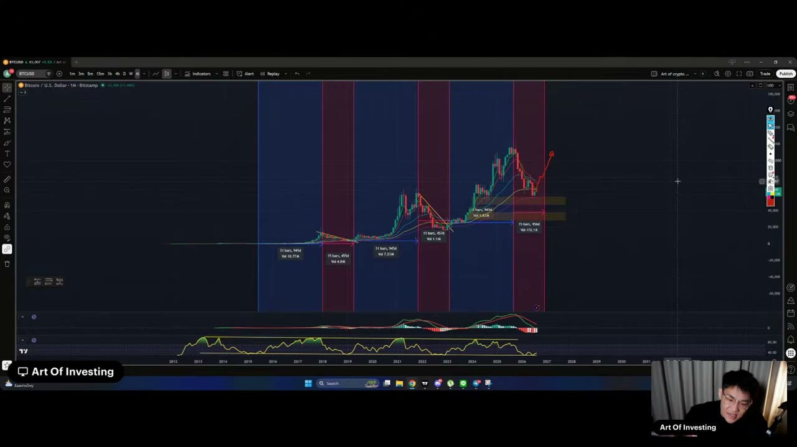

[00:48:50] โดนขายคุณจะเริ่มเห็นแบบนั้นน่ะเต็ม New FีEDเลยแล้วคุณก็จะสับสนเอาไงชีวิตตัวเอง ดีวะเอาไงดีวะเอองั้นน่ะผมอยากให้คุณคิด ตรงนี้เผื่อไว้ด้วยนะครับถ้าเกิดมันไม่ เป็นอย่างที่คิดถ้าเกิดมัน ดรอปแรงมากๆคุณยังจะอยาก DCA มันมั้ยคุณ จะยังจะไปต่อมามั้ยแล้วผมยืนยันอีกคนนึง นะวินัยอย่างเดียวไม่พอนะเว้ย โคตรไม่พอผมยันตรงนี้เลยไม่พอวินัย อย่างเดียวอ่ะนะสิ่งที่คุณต้องมีมากกว่า วินัยนะคือความเชื่อความเชื่อนี่ไม่ใช่ แบบก้มหน้าก้มตาเชื่อด้วยนะคือคุณต้องรู้ มากพอจนเชื่อเฮ้ยฉันรู้จักอสังหาเนี่ย เดี๋ยวมันลงแบบนี้นะแต่ตรงเทำเลทอง สมมุติว่าคุณเป็นเจ้าพ่ออสังหาแบบคุณ ปั้นดินเป็นทองมาไม่รู้กี่แผงแล้วอ่ะซื้อ มาค่อยแบบคุณตันอย่างเงี้ยค่อยๆโถมค่อยๆ เฮ้ยชวนเพื่อนมาลงทุนรอบๆก่อนมีห้องมี ห้างก่อนลงทุนถนนก่อนทำนิมมารอู้หูแกลง

[00:49:52] ทุนเป็นหลักพันล้านกว่าจะค่อยๆปั้นแผ่น ผืนดินตรงนั้นขึ้นมาได้ถูกมั้ยฉะนั้นคน พวกเนี้ยเาเข้าใจว่าทำไมสินทรัพย์อะไร ต้องอยู่แดนลบไปศึกษาตรงนี้ให้ดีนะครับ แล้วถ้าเกิดคุณรู้สึกว่าเอ้ยพอเริ่มคิด ภาพโอโหถ้าถ้าลงไปตรงนั้นไม่กล้า DCA เว้ยลงไปตรงนั้นหนักไปไว้ต้อง ถ่ายทิ้งแน่เลยอ่ะก็มีวิธีแก้ 2 วิธี 1 คือรู้จักให้มันรู้จักมันให้มากกว่าเดิม ศึกษาให้มันแน่นกว่านี้เฮ้ยมันมันเป็นยัง ไงวะมันคือยังไงในอดีตที่ผ่านมาตลาดหุ้น เคยติดลบมากสุดกี่เปอร์เซ็นต์แล้วมันจม อยู่ตรงนั้นนานแค่ไหนใช้เวลาเท่าไหร่ใน การฟื้นตัวอ่ะไปศึกษาตรงนั้นเพิ่มนะครับ แล้วก็ข้อ 2 คือลดขนาดไม้ที่ DCA หรือ อะไรก็แล้วแต่ลดไซส์ลง นะครับลดลดไซส์ลงพอคุณลดลงแล้วอ่ะคุณก็จะ รับรู้ความเจ็บป่วนเบาลงนะครับคุณก็จะ อยู่กับมันได้นานขึ้นเออมี 2 ทางอ่ะต่อ พาร์ทตรงนี้ต่อมาคือ

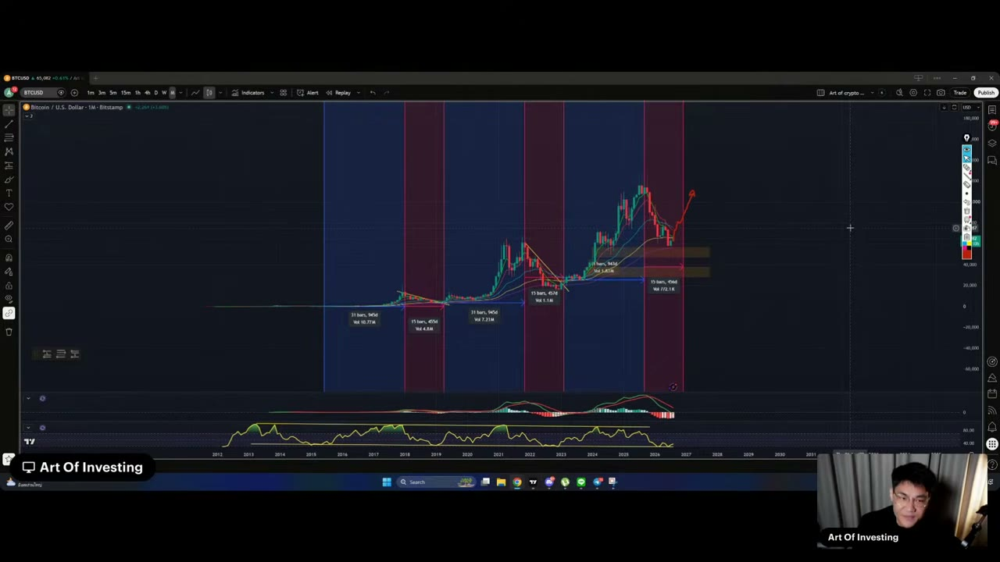

[00:50:54] นะครับจุดเนี้ยผมมองว่าทำไมผมถึงมองไว้ ตรงนี้ใช่มั้ครับก็คือเอ่อภาพตรงนี้นะ ครับมันเป็นจุดdisคาของกราฟไตรมาสนะครับ เป็นแบบนี้มาทุกไซเคิลก็คือตรงเนี้ยนะ ครับเห็นมั้ยค่าเฉลี่ย 25 ไตรมาสเนี่ย หรือกราฟ 3  mon เนี่ยมันจะไปdiscาซึ่ง ตรงเมันใกล้เคียงมากๆแล้วนะครับมันใกล้ เคียงมากๆแล้วมันใกล้เคียงมากๆแล้วนะครับ งั้นผมก็เลยมองว่าเออตรงเนี้ยมันก็เป็น ราคาที่ไม่ได้แย่ถ้ามันจะเกิดขึ้นไปครั้ง แรกที่แบบเอ่อเป็นโซนที่สะสมแล้วแล้วเกิด บูรันรอบใหม่ผมมองว่าไม่ได้แย่แต่ว่ามัน จะมีความได้เปรียบน้อยลงมากๆเลยเพราะว่า ปกติทุกไซเคิลนะครับมันจะย่อเนี่ยจากยอด สุดลงมาต่ำสุดนะครับประมาณเกือบๆ 80% ถูก เนี่ยย่อออกมาแบบลึกมากอย่างเงี้ยนะครับ ฉะนั้นรอบเนี้ยถ้าเกิดมันสุดแค่ตรงนี้ แล้วมันขึ้นแล้วอ่ะ มันก็จะเป็นครั้งแรกเลยที่ย่อแค่ 50% ถูก

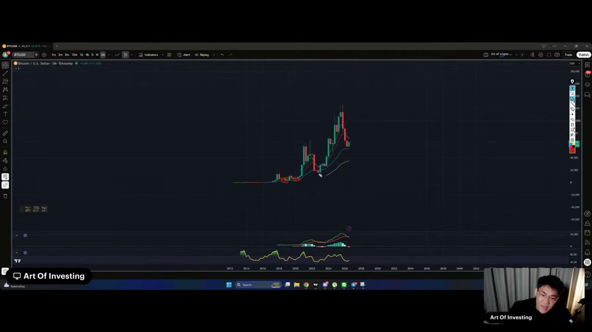

[00:51:55] มั้ยซึ่งปกติมันคือแบบโซนตรงนี้ด้วยซ้ำ นั่นคือสาเหตุที่ทำไมผมวางกล่องล่างเผื่อ ไว้ด้วยนะครับที่ผมวางกล่องล่างเผื่อไว้ แถว 20,000 ปลายๆ 30,000 กลางๆอ่ะเพราะ ว่าเออเผื่อมันเกิดเคสนี้ผมก็จะได้ไม่ ตื่นถึงตูมไม่ได้ตกใจอะไรมากนะครับว่า เฮ้ยมันจะฟ้าถล่มมืดครึ้มแล้วหรือว่าตลาด จะไม่ไปแล้วไม่ไม่เหลืออะไรแล้วหรือเปล่า นะครับอะไรเงี้ยนะครับอืผมก็เลยวางวางไว้ 2 เคสนะครับอยากให้ดูตรงนี้ด้วยแต่มุม มองของผมนะการที่จะลงมาตรงเนี้ยผมว่า ยากกว่าเดิมเยอะนะครับเยอะเพราะว่าคุณ ต้องอย่าลืมนะว่าเอ่อสินทรัพย์ตรงเนี้ย มันหันหลังกลับยากในในการที่แบบอเมริกาก็ ยอมรับเป็นคลังสำรองอ่ะแม้ว่าจะยังไม่ได้ เอาเงินของภาษีประชาชนมาซื้อก็ตามอ่ะนะ ครับมีรัฐบางรัฐเริ่มแบบใช้เงินของของรัฐ ตัวเองอย่าลืมว่าอเมริกาเเป็นประเทศที่ เ้าแบบแยกกันบริหารอ่ะนะครับคือรัฐแต่ละ รัฐก็จะมีกฎหมายของตัวเองถูกมั้ยเค้าแยก

[00:52:56] กันบริหารน่ะฉะนั้น ETF แบบถูกกฎหมายในเชิงสปอก็เกิดขึ้นใน เชิงFutจureก็เกิดขึ้นกองคลัง Treasury หลายๆรูปแบบก็เกิดขึ้นนะครับงั้นการที่จะ ดิฟขนาดนั้นน่ะผมว่ามันต้องเกิด Domino ครั้งใหญ่ไม่ฮาร์ดแวร์ Wallet โดนเจาะมาก กว่านี้แบบซีรียส์ดังๆที่แบบไม่ได้ใช้ ซอฟต์แวร์ใช้เป็นฮาร์ดแวร์หนักๆกว่านี้ โดนหรือบริษัทอย่าง Strategy เกิดปัญหา ภายในอะไรสักอย่างกองทุนหลายๆกองที่ใช้ Leverage พากันล้มแบบDomมิโนแบบรอบก่อน เออผมเลยมองว่ามันต้องต้องอยู่ในเลเวล นั้นน่ะมันถึงจะแครชลงมาในจุดต่ำขนาดนั้น ได้ซึ่งผมมองว่ามันค่อนข้างยากนะครับถึง ถึงยากมากๆที่มันจะลงมาได้ขนาดนั้นแต่ก็ ยังให้แนวโน้มนะว่าแบบก็มีโอกาสแบบสัก 10% 15% แล้วกันที่แบบเออมันจะลงมาได้ถึงโซน ตรงนั้นนะครับถ้าลงมาผมก็รอแหละถ้าเกิด โมเมนตัมก็อาจจะอาจจะเก็บนะครับแต่ว่าถ้า เกิดลงมาไม่ถึงอ่ะผมก็มองว่าเอ้ยโซนตรง

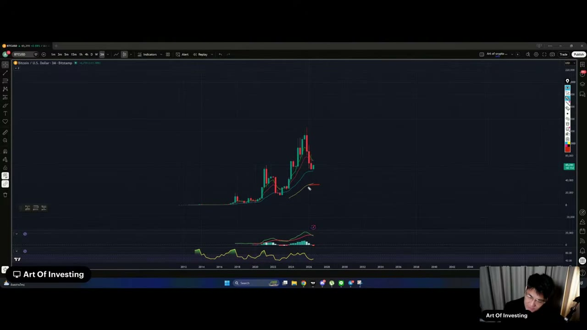

[00:53:57] เนี้ยโอเคละไม่ไม่แย่ละนะครับที่ที่จะ push ไปอ่ะเราพูดภาพระยะยาวไปละเรามาคุย ภาพระยะสั้นกันบ้าง โอเคภาพระยะสั้นนะครับ ยาวเลยวันนี้ตอนแรกนึกว่าจะไลฟ์ไม่นานนะ ครับอ่ะ weคเรารู้อยู่แล้วงั้นทำไมผมถึงบอกว่าจะ รันเทรนด์เนี่ยยังต้องมีแนวโน้มต้องระวัง เนาะก็อย่างที่บอกนะครับถ้าเทียบกับสถิติ ที่มันเคยเป็นมาตลอดซึ่งเราก็ไม่รู้ว่า มันจะยกเลิกสถิตินั้นเมื่อไหร่วันไหนตอน ไหนนะครับคือ MACD  WeE มันยังไม่สูงกว่า 0 มันยังไม่เหนือ 0 นะครับงั้นตอนเนี้ย WeEK อ่ะยังพูดได้ว่ายังกลับเป็นขาขึ้น ไม่ได้อ่ะไม่ต้องเรียกว่าขาลงก็ได้เรียก ว่าพยายามจะกลับมาเป็นขาขึ้นแต่ยังยังทำ ไม่สำเร็จแล้วกันทีเนี้ย พอมันเป็นแบบเนี้ยนะครับสิ่งที่สำคัญอีก พาร์ทนึงก็คือโมเมนตัมจาก Day เนี่ยมัน

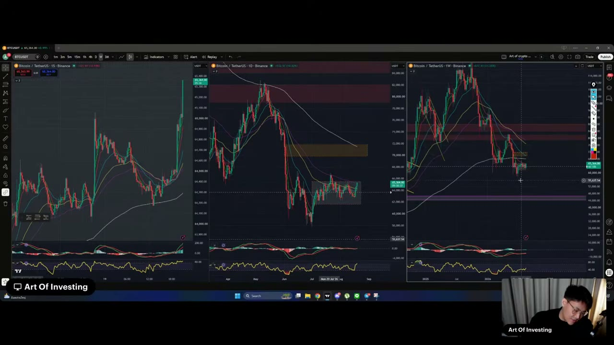

[00:54:58] กำลังจะเกิดและก็คือ Day เนี่ยครับมันมัน เบรคพรีเมี่มมาตั้งแต่ตรงนี้ละเห็นมั้ย มันมันมันเบรคพรีเมี่มมาตั้งแต่ตรงนี้ละ นะครับ มันเบรคพรีเมี่มมาตั้งแต่ตรงนี้นะครับพอ มันเบรคพรีเมี่มมาตั้งแต่ตรงนี้แล้วเนี่ย ภาพต่อไปที่เกิดก็คือ MACD เหนือ 0 แล้วรอบนึงแต่ RSI overbอ ไม่ได้ที่ผ่านมาoverบอไม่ได้เลยถูกป่ะรอบ บอได้และกำลังจะบอสได้แหละใกล้และนะครับ แล้วก็มันเบรกพรีเมี่มมาแล้วด้วยนะครับ งั้นงั้นตอนเนี้ยโมเมนัมใน day เนี่ย กำลังจะเกิดแต่โมเมนตัมของ day ที่กำลัง จะเกิดเนี่ยมันจะส่งให้ week สำเร็จมก็ คือ MACD เนี่ยมันยังห่างนะครับ RSI ก็ ยังห่างที่จะ overbard งั้นเทรนใน week เนี่ยคงไม่เกิดในจังหวะเดียวนะครับแนว โน้มตรงเนี้ยอย่างที่ผมบอกเลยภาพตอนเนี้ย มันก็คงต้องมองรองไปก่อนถ้าเกิดมันสามารถ เบรก 66,000 ได้นะครับสมมุติว่ามันเบรค ขึ้นมาอย่างเงี้ยเบรค 66,000 แล้วมันเกิด การย่อตรงเนี้ยอ่ะผมก็จะไปแอบละถ้าเกิด

[00:56:01] จำนวนตัวเลข option หรืออะไรก็แล้วแต่มัน มันเป็นบวกนะครับมันเริ่มขยับพุมาตรงนี้ เยอะๆก็คือเขากลัวว่าราคาจะลงทะลุตรงนี้ ไปอ่ะอ่ะสมมุติว่าพอมันเริ่มย่อมาแล้ว แล้วอtionัpุตรงแถวเมันเริ่มเยอะนะครับ มันก็มีแนวโน้มว่าราคามันจะไม่ทะลุลงไป และที่เราเรียกว่าpุ wall นะครับผมก็อาจ จะรอจังหวะรีทestเนี่ยแล้วก็แล้วก็เทรด กลับขึ้นไปในโซนที่มันจะต้องเทรสprีemium ในweคก็คือแถวนี้นะครับแถว 60,000 ปลายๆ ถึง 70,000 นะครับก็จะเป็นอีกโซนนึงนะ ครับที่ที่ค่อนข้างน่าสนใจสำหรับผมนะนะ ครับก็จะเป็นอีกโซนนึงก็แถวๆใกล้ๆ 70,000 ใกล้ๆ 70,000 เป็นโซนแถวนี้นะครับอืไปดู ไประวังกันด้วยนะครับอ่ะก็อาจจะเป็น อย่างี้ส่วนถ้าเกิดเบรคไม่ได้ก็คือขึ้นไป ตรงเนี้ยแล้วแล้วติดตรงนี้อีกนะครับถ้า ขึ้นไปตรงนี้แล้วเกิดแรงขายตรงนี้อีกหัก หัวลงเนี่ยนะครับอันเนี้ยผมก็จะใบแอดชอต

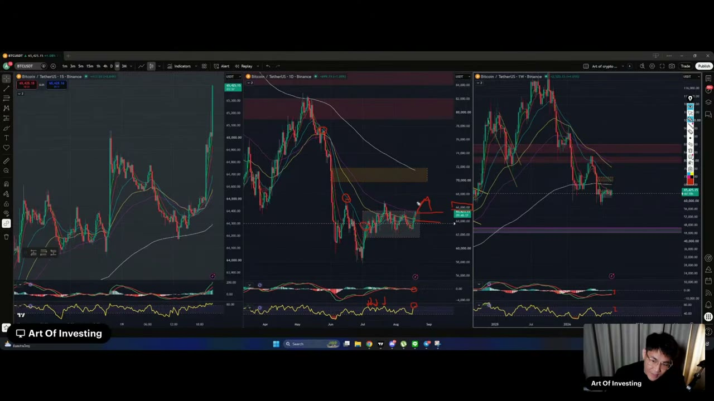

[00:57:04] เพราะว่าอันนี้ตามเทรนด์ด้วยนะครับโดยจุด แรกที่ช็อตแล้วมีแนวโน้มว่าราคาจะกลับมา เนี่ยนะครับก็คือจะเป็นตรงกลางถูกมยหรือ ที่เราเรียกกันว่าจุดequilิbriumนะครับ จุดจุดequilิbrium เพราะว่าออเดอร์เนี่ยมันก็จะตั้ง 2 ฝั่ง นะครับมันจะตั้ง 2 ฝั่งก็คือลงมาตรงเนี้ย ฉันก็อยากซื้อขึ้นมาตรงเนี้ยฉันก็อยากจะ ขายนะครับมันก็เลยทำให้ออเดอร์ที่มันกอง อยู่ตรงกลางเนี่ยเป็นสภาพห้องอยู่ตรงงั้น ถ้าผมช็อตลงมาเนี่ยที่แรกที่ผมจะระวัง แล้วเป็นจุดก็คือตรงกลางกล่องแล้วถ้าเบรก กลางกล่องได้ก็คือใกล้ๆกับขอบกล่องนะครับ อันนี้คือเคสที่เบรกไม่ได้ส่วนถ้าเบรกได้ นะครับผมก็อาจจะรอเล่นแบบรีทestนะครับผม ผมจะไม่ซื้อในจังหวะแรกที่มันเบรคขึ้นไป เนาะเพราะว่าเอ่อ list  reward มันไม่คุ้มนะครับผมก็จะรอ อย่างงี้ขึ้นไปอย่างงี้นะครับแล้วจุด TP ผมเอาอยู่เนี้ยนะครับเนี่ยแถวๆใกล้ๆ 70,000 เนี่ยคงคงคงคงไปละในจังหวะรีทest นะเพราะว่าอย่างที่บอกคือเทรนใน week มัน ยังไม่ใช่แล้วสมมุติว่ามันขึ้นเหนือ week

[00:58:06] ได้เมื่อไหร่อย่างเงี้ยอ่าโอเคผมไปแอดลอง ค่อนข้างหนักละประมาณ 70% ะที่ผมจะมองลอง ไปฝั่งด้านนั้นมากกว่าอ่ะเเป็นแบบนี้นะ ครับอ่ะโอเคตรงนี้น่าจะเห็นภาพกัน นะครับอ่ะประมาณนี้นะสำหรับบitcoinอ่ะ เดี๋ยวผมขอดูอธีเรียiมก่อน ส่วนอีเรiumเนี่ยคล้ายกันนะครับแล้ว อธีรiมเนี่ยผมว่ามันมันสวยกว่าบitcoinมา แต่ไหนตรายละนะครับสำหรับสำหรับตัวอีเรiม สำหรับผมนะเพราะว่าตรงเนี้ยนะครับเราจะ เห็นว่ากล่องของมันเนี่ยนะครับค่อนข้างมี ระยะที่สวยกว่าบitคinนะครับคือไม่ได้แบบ เดี๋ยวถึงบ้างเดี๋ยวไม่ถึงบ้างนะครับแล้ว ก็ตรงเนี้ยมันก็กำลังจะเกิดโมเมนตัมและ MAD ก็เหนือ 0 มารอแล้วนะครับแล้วในweค เนี่ยมันยังห่างก็จริงแต่จุดพรีเมี่ม เนี่ยมันก็ค่อนข้างใกล้นะครับฉะนั้น อธีเรiumเนี่ยถ้าเกิดมีของอ่ะเป็นผมนะผม ก็จะ stop  loss กลางกล่องเนี่ยถ้าเป็นผม นะอันนี้มุมมองส่วนตัวไม่ใช่คำแนะนำในการ ลงทุนนะ ผมก็จะ stop กลางกล่องเนี่ยนะครับแล้วก็ ผมก็จะรันลุ้นไปเลยเพราะว่าโมเมนตัมใน day

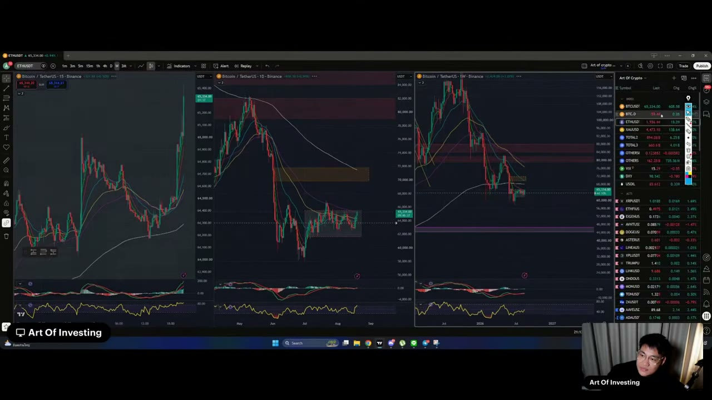

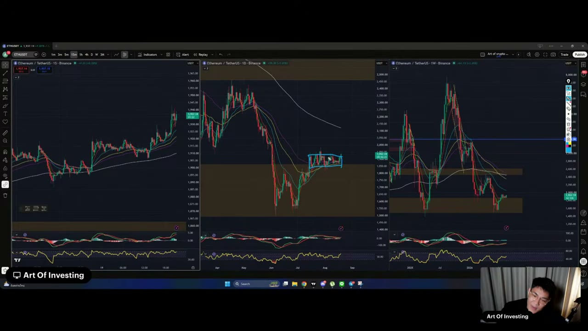

[00:59:06] มันมันค่อนข้างชัดกว่าบitcoinการบีบอัด ของมันสวยกว่าบitcoinนะครับแล้วก็พอย์แรก เนี่ยผมก็จะมองไม่เกินแถวนี้ก่อนใกล้ๆกับ Fip zซoneที่มันเป็นพรีเมี่มนะก็คือ 2050 โดยประมาณนะครับก็คือตรงเนี้ยเห็นมั้ยที่ มันมีฐานของมันที่กดลงมาจนเกิด Low ครั้ง ต่อไปนะครับตรงนี้นะครับผมก็เคยมองตรงนี้ ก่อนแถว 2050 ถ้าเกิดเบรคได้นะส่วนถ้า เบรคไม่ได้ผมก็จะมองเคสเคสเดียวกับ บitcoinนะครับผมมองเคสเดียวกับบitcoinก็ คือถ้าเบรคไม่ได้ตบประมาณแต่ผมเทรด บitcoinตัวเดียวนะครับในช่วงตลาดแบบนี้ อ่ะโอเค ต่อมานะครับก็ภาวะ Bitcoin  Dominance นะ ครับก็เอ่อตัวนี้นะครับก็ยังไม่ได้เงิน ยังไม่ได้ถูกกระจายไปที่ Outcoin เยอะ เท่าไหร่เนาะอย่างที่เราเห็นก็คือบitcoin ราคาขึ้น Bitcoin  Dominance ก็ขึ้นแปล ว่าสัดส่วนของ Bitcoin ก็เพิ่มมากขึ้นตาม เงินที่เคยอยู่ที่อื่นเช่นอาจจะอยู่ใน stable  Coin ก็ย้ายมาลงที่ Bitcoin โดย

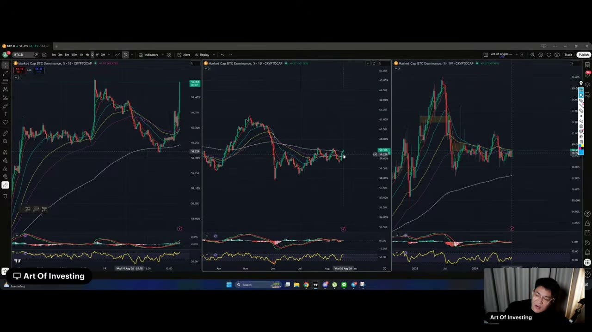

[01:00:08] ตรงมากขึ้นแล้วก็สัดส่วนของบitcoinสูง ขึ้นนะครับสูงขึ้นอ่ะเป็นอย่างี้ งั้นเงินเนี่ยมันก็เลยยังไม่ลงไปที่ Outcoin มากแต่ว่าเราจะเห็นบางตัวที่ กราฟเริ่มสวยนะครับอย่างอย่าอย่าง พรีเมี่มอย่างเงี้ยอ่ะในลิงก์เงี้ยเห็นมย มันเบรคพรีเมี่มและนะครับแต่ว่าโมเมนตัม ยังไม่เกิดเนาะก็คือตรงเนี้ยเห็นมันติดมา ตลอดเนี่ยมันมันเบรกมาละเหลือ MAD เหนือ 0 ยังไม่ได้ RSI ยังoverbอไม่ได้นะครับ ฉะนั้นตรงเนี้ยถ้าเกิดโมเมนตัมใน day มัน แรงมากเพราะโมเมนตัมมันเกิดแล้วถูกป่ะถ้า มันแรงมากแล้วมันชูตขึ้นไปเลยอ่ะอย่าง เงี้ยก็จะเกิดเทรนด์แต่ทีเนี้ยอย่างที่ผม บอกด้วยความที่สถิติในอดีตที่ผ่านมา เราเห็นอยู่แล้วว่า บูรันน่ะมันยังไม่เกิดในช่วงนี้เพราะว่า Weekคมันยังเป็นขาลงอยู่นะครับฉะนั้นตรง เนี้ยผมก็เลยยังถือหางข้างนึงนะครับว่า มันอาจจะวิ่งไม่ไกลหรือเปล่าในจังหวะ เนี้ยมันวิ่งมาเพราะว่า 1 คือการประกาศ

[01:01:09] Buy  back ของ ฝั่ง US  Treasury นะครับกับอีกเรื่องนึง คือ Tokenization นะครับเราต้องอย่าลืม ว่าถ้าเกิดเรื่อง Tokenization มันถูก สนับสนุนโดยรัฐบาลเต็มตัวเมื่อไหร่นะครับ สภาพคล่องของเม็ดเงินที่จะไหลเข้าไปสู่ ตลาดของอเมริกามันจะสูงมากเลยนะถ้าเรานึก ภาพอ่ะนะครับคือ ทุกวันเนี้ยเราเราติดพรมแดนหลายๆอย่างใน การลงทุนต่างประเทศเรานึกภาพแบบนี้นะ อย่างปัจจุบันเนี่ยถ้าเกิดคุณจะลงทุนหุ้น อเมริกาเนี่ยคุณก็จะต้องซื้อผ่าน Vbu หรือว่า SCBX หรือว่าแล้วแต่หลายๆที่นะ อ้ามันก็ได้ดิคุณอาร์ตก็ฝากเงินบาทเข้าไป ใช่แต่ฝากเงินบาทเข้าไปคุณต้องเทียบเป็น อัตราดอลลาร์ถูกมั้ยแล้วคุณก็ต้องเวลามัน เกิดกำไรแล้วเกิดคุณขายคุณอยากจะนำเงิน ที่เป็นกำไรของคุณเนี่ยกลับเข้ามาใน ประเทศเนี่ย มันต้องเสียภาษีอีกเป็นเหมือนกับการลงทุน ต่างประเทศอ่ามันยังมีพรมแดนตรงนี้อยู่

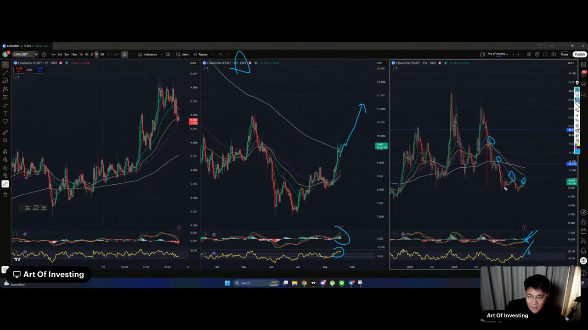

[01:02:11] แต่ทีเนี้ยถ้าเกิดมันเป็นในรูปแบบของ bl็ockchainเนี่ยเรามีกลุ่มคนที่มีเงิน ใช้คำนี้แล้วกันแล้วเค้าก็ไม่อยากจะเข้า ออกเป็นกลุ่มคนกลุ่มนึงที่มีเงินมากนะ แล้วก็อยากจะลงทุนหุ้นอเมริกาพอดีด้วยนะ ครับไม่รู้จะเข้าทางไหนดีตัวเองก็ถือ USDT อยู่เยอะอย่างเงี้ยมันก็จะ flow เข้าไป สภาพคล่องตลาดของอเมริกาก็มากไปเงินอยู่ ที่เขา้ามากขึ้นเพราะว่ากฎหมายที่ผมเห็น เขาร่างขึ้นมาเค้าก็ค่อนข้างเขียนไว้แล้ว ว่าตัวน่ะนะครับจะต้องถูกออกโดยฝั่ง รัฐบาลนะครับหรือฝั่งเอ่อหน่วยงานที่มี อำนาจควบคุมดูแลไม่ให้บริษัทเอกชนออกนะ ที่เป็นตัวหุ้นน่ะถ้าเกิดบริษัทอื่นออก โดยที่แบบไม่ใช่หน่วยงานที่เขาให้รับการ ยอมรับอ่ะนะครับก็ถือว่าผิดกฎหมายอะไร เงี้ยฉะนั้นเงินมันจะเข้าไปอยู่ในประเทศ เ้ามากขึ้นซึ่งเป็นผลดีเชอบแน่ๆนะครับ shelling เนี่ยก็เป็นหนึ่งในตัวหลักตัว ตั้งตัวตีด้วยเทคโนโลยี Oracle ถูกป่ะ เพราะมันเหมือนตัววุ้นแปลภาษาช่วยสมานทำ งานระหว่าง data  API บนโลกจริงกับบนโลก

[01:03:14] Blockchain น่ะฉะนั้นการตึงราคาหุ้นการ แสดงผลราคาหุ้นการทำสินทรัพย์สังเคราะห์ ที่มีมูลค่าเท่าๆกับหุ้นเนี่ยนะครับของ โลกจริงเนี่ยมันก็ต้องใช้chนลinkซึ่ง เทคโนโลยีอย่าง Oracle เนี่ยไม่ได้มี Shinลinkตัวเดียวแต่เชนลิเนี่ยมันกินส่วน แบ่งตลาดไป 70-80% แล้วเออมันก็เลยอาจจะ ได้กระแสตรงนี้มาผมเลยอยากให้ระวังนิดนึง นะครับโดยตรงเนี้ยถ้าถ้าเบรคไปผมก็ยังมอง แถว high เก่าก่อนเนาะก็คือแถวเนี้ยมันพอ ดีกับ flip zซoneเนาะก็คือแบบแถว 10 ดอน กว่าๆเนี่ย 10 ดอนกว่าๆแล้วถ้าเบรคโซนนี้ ได้เนี่ยโอเคมาถึง flip zซoneตรงนี้ที่พอ ดีกับ EMA  200 นะครับก็จะเป็น 12 นะครับแถวนี้นะผมมองไว้ 2 จุดนะครับก็ถ้า ถึงเนี่ยก็ 2 จิต 2 ใจเนาะก็คือจะกั้นทุน แล้วจะรันหรืออะไรแต่ว่าถ้าเป็นผมอ่ะด้วย ความที่อย่างที่ผมบอกเนาะภาพรวมตลาดมัน ยังไม่ได้เป็นกระทิงนะครับผมก็เลยยังคง ยังไม่ มองภาพรานยาวแต่ว่าแล้วแต่คนนะเดี๋ยวจะหา ว่าขัดลาบนะเพราะว่ามันอาจจะขึ้นแบบนี้ก็ ได้แบบสวนทุกอย่างแล้วขึ้นในจังหวะเดียว

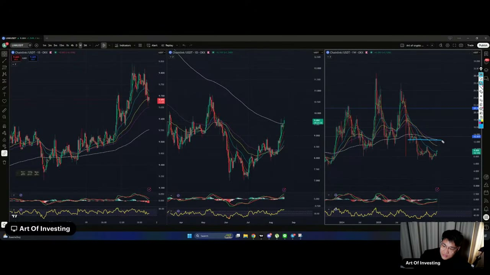

[01:04:15] ก็ได้เอ้ยบูรันรอบนี้มาเร็วกว่าที่เคยอ่ะ ก็เป็นไปได้ไม่มีใครรู้นะครับแต่ว่าอยาก ให้ผมยังถือหางอยู่ข้างนึงว่าweคมันยัง ไม่พร้อมขึ้นในระยะยาวเรานะครับอ่ะมี เพื่อนๆขอ XRP มาเดี๋ยวดู XRP ให้ก่อน XRP นี่ผมว่ายังจมนะเทียบกับเทียบกับตัว อื่นน่ะ[เสียงสูดหายใจ]แล้วจมค่อนข้างลึก ด้วยนะครับก็อย่างที่เห็นเนาะมันย่อลงมา จากจากยอดนู่น 3 ดอนกว่านะครับตอนนี้ เหลือดอนเดียวนะแล้วก็ยังไม่สามารถเบรค พรีเมี่มได้เนาเราเห็นพรีเมี่มอยู่ตรง เนี้ยนะครับแล้วค่อนข้างไกลโมเมนตัมยัง ไม่เกิดเลยนะครับฉะนั้นโมเมนตัมเนี่ยเรา ดูเอาเอาพรีเมี่มเริ่มล่าสุดของ Day เนาะ ก็คือ EMA  50 งั้น XRP เนี่ยจะเริ่มมี เทรนด์นะครับก็คือตรงเนี้ยต้องเบรคตรงนี้ ก่อนเห็นมั้ย เบรกพรีเมemiมก่อน MACD ขึ้นไปเหนือ 0 ได้ RSI  overbard ได้แล้วพอมันขลุกขลิกๆ ตรงเนี้ยอ่ะค่อยเป็นจุดเข้าของคุณแล้วก็ Stop  Loss เนี่ยก็อยู่ใต้ Low นะครับ ซึ่งอันเนี้ยผมผมเคยเก็บ data มาแล้ว เนี่ยมันเกิน 70% นะครับว่าถ้าเกิดมัน

[01:05:16] เกิดคitionครบกัน 3 ข้อในรูปแบบโมเมนตัม นะก็คือ MACD เหนือ 0  RSI  Overbard นะ ครับแล้วก็ราคาเบรคพรีเมี่มได้เนี่ยโอกาส เกิน 70% ที่มันจะไม่กลับมาทะลุโลเดิมนะ ครับไอ้ที่แบบทะลุไปเชี่ยวบ้างอะไรบ้าง เงี้ยคือมันยังไม่เบรคพรีเมี่มนะครับแต่ ว่าสถิติที่ผมเก็บเคือเป็นสถิติที่หลัง จากเบรคพรีเมี่มแล้วนะบนสินทรัพย์ time frame  day ขึ้นไปนะครับอ่ะก็ก็มุมนี้ ก่อนฉะนั้นตอนเผมมองว่าโมเมนตัมมันยังไม่ เกิดนะสำหรับ XRP ส่วน ADA เป็นไง นะครับ A เนี่ยเอ่อ โอ้โหไม่สวยว่ะในมุมมองผมนะไม่ค่อยสวยเลย นะครับเพราะว่าพรีเมี่มของ ADA เนี่ยอ่ะ เอาเอาแบบชัดๆที่สุดนะครับก็คือ EMA  75 ตรงนี้นะครับซึ่งมันยังไม่เบรคอ่ะเนาะนะ ครับก็คือเบรกไปละ MAD  10 แล้ว RS Overบอแล้วแต่ว่าweคอ่ะมันโคตรไม่พร้อม

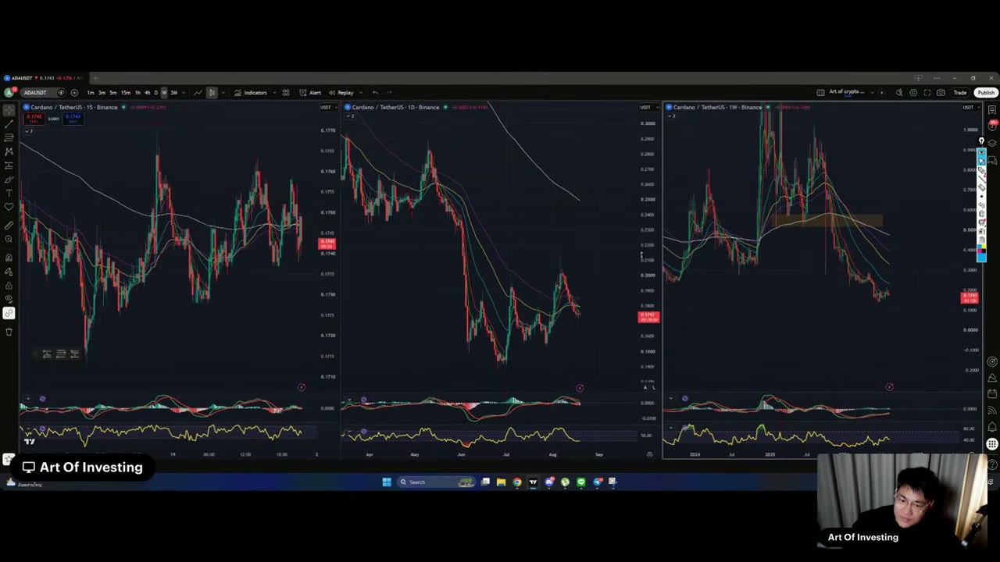

[01:06:17] เลยก็อย่างที่ผมบอกนะโมเมนตัมอ่ะมัน เหมือนแบบเอ่อ[เสียงถอนหายใจ] มันเหมือนแบบ การวิ่งผลัดอ่ะที่ที่เราจะต้องส่งไม้จาก นักวิ่งคนที่ 1 ไปถึงนักวิ่งคนถัดไปอ่ะนะ ครับผมก็เลยมองว่าถ้าเป็นภาพนั้นน่ะเอดา หม่อมตั้มค่อนข้างแย่มากแล้วแล้วล่าสุดผม เห็นตัวชาวทpkinสันแกออกมาพูดเนาะว่าเฮ้ย เรายังมีความหวังผมยังค่อนข้างกับโปรเจค แค่เราอาจจะต้องเปลี่ยนแนวทางแล้วด้วยเซน การเป็นนักลงทุนของผมเนี่ยที่ที่แบบเวลา ผมลงทุนอะไรที่แบบในระยะยาวแบบเนี้ยไม่ ว่าจะเป็นโปรเจคหลายอย่างที่ผมเห็นนะทั้ง startup ทั้ง SM หรือจะเป็นเกมค่ายIndี้ สิ่งนึงนะที่ผมเห็นแล้วมันเกิดขึ้นบ่อย มากๆอ่ะ คือสินทรัพย์หรือโปรเจคอะไรก็แล้วแต่ที่ คุณต้องลุ้นในการกระทำของผู้นำว่าเา้าจะ

[01:07:18] ต้องให้มันกลับมาดีให้ได้สินทรัพย์นั้น น่ะโอกาสไม่รอดโคตรสูงผมตี 90% เลยเช่นนะ ผมยกตัวอย่างให้สมมุติว่าคุณเล่นเกมนึงผม ไม่เอ่ยชื่อแล้วกันอ่ะสมัยก่อนคนไทยชอบ เล่นRคเนี่ยเปิดมาหลายค่ายมาก Asia  Soft EXE จน Gravity มาเปิดเองเป็น GT อ่ะ Gravity  Thailand แล้วคุณก็เริ่มเห็นว่าแบบเอ้ยการเอา กาชาปองมาขายแบบเนี้ยมันเยอะเกินไปนะการ แบรนด์ผู้เล่นแบบนี้เซิร์ฟกระตุกเงี้ย แล้วคุณจะต้องรอทุกสัปดาห์ไปลุ้นฟังการ อัปเดต patch ของทีมงานว่าเฮ้ยเขาจะแก้ เรื่องนี้มั้ยเขาจะยอมฟังเสียงผู้เล่นมาก ขึ้นมั้ยเมื่อไหร่เขาจะแก้ตรงนี้เฮ้ยเกม มันสนุกนะแต่บริหารไม่โอเคเลยเมื่อไหร่ เขาจะเปลี่ยนทิศทางในการบริหารโปรเจคแบบ เนี้ยส่วนใหญ่อ่ะอยู่ไม่ค่อยยืดหรือกลับ มาโตได้ยากนะครับฉะนั้นตอนเผมเลยมองว่า eda เนี่ยเนี่ยโอกาสกลับมามีมั้ยถ้าถ้า มันจะกลับมาขึ้นอะไรอย่างเงี้ยผมว่าก็

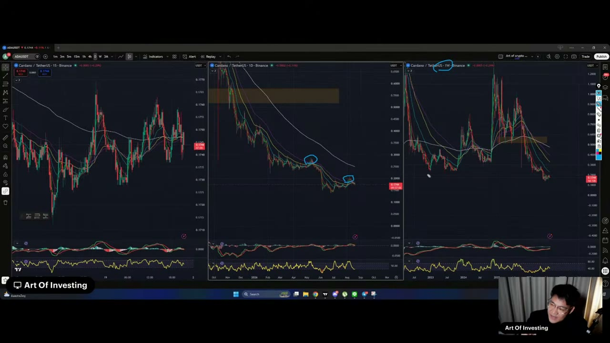

[01:08:20] โอเคแหละมันก็อาจจะอิงกระแสโมเมนตัมจาก ตลาดอ่ะเนาะแบบกลับมาเป็นบูรันอะไรอย่าง เงี้ยแต่ว่าถ้าเกิดมันจะกลับมาจนกลับไป ที่ราคาเดิมอ่ะโอโหผมบอกเลยโคตรยาก เลยว่ะคือ 3 ดอนน่ะ ขึ้นจากตรงเนี้ย 30 เด้งอ่ะเพราะว่าอย่าง เงี้ยคือเหมือนกับคุณรอโปรเจคอย่างPoดot เงี้ยเคยเป็นโปรเจคที่ผมโคตรชอบเลยนะผม เป็นคนที่ชอบ Poadot มากๆเลยอ่ะนะครับผม ผมเคยเป็นคนที่ชอบPoดotมากๆแต่ว่า พอเ้าเริ่มเปลี่ยนทิศทางเฮ้ยไม่ทำ multิchaะมันmultิchaนเป็นเทคโนโลยีที่ ไม่ได้รับความนิยมไม่ได้รับการใช้งานจริง เเริ่มไปทำ Data  Availability  Service เงี้ยแบบพอเปลี่ยนไปเปลี่ยนมาแล้วเราต้อง ลุ้นว่าแบบมันจะกลับมาดีมยอย่างเงี้ยผม เลยมองว่าโปรเจคพวกเนี้ยผมไม่ค่อยชอบนะ ครับไอ้โปรเจคเนี่ยแล้วคุณดูราคาเนี่ย ราคามันก็ฟ้องนะครับฉะนั้นไอ้โปรเจคที่ผม ชอบลงทุนระยะยาวเนาะคือเราไม่ต้องลุ้นเลย ว่าเค้าจะเปลี่ยนทิศทางการบริหาร แล้วมันจะดีขึ้นเมื่อไหร่คือเป็นโปรเจค

[01:09:21] ที่เรามองว่าต่อให้ล้มนะสักขานึง ยังไงก็รอดผมถึงชอบ Amazon มากไงเพราะ เค้าทำหลายอย่างแล้วเป็นหลายอย่างที่เขา ทำได้ดี ทำตลาดซื้อขายออนไลน์ทำขนส่งโลิสติกส์ เอ่อใช้คำว่านอกจากทำขนส่งโลจิสติกอีก แล้วเค้าทำรูปแบบเอ่อเดี๋ยวนะสมองมันไม่ รันนะครับ Entertainment มี Amazon  Prime นะครับแล้วก็มี Cloud นะครับ Amazon  Web Service นะครับทำ Data  Center ที่ใหญ่ มากๆอย่างเงี้ยสมมุตินะเค้าไปลงทุนอะไรก็ แล้วแต่เราไม่ต้องลุ้นให้เค้าเปลี่ยนวิธี การบริหารน่ะถูกป่ะสมมุติว่าเค้าไปลงทุน แบบเฮ้ย อยากทำเกมอ่ะซึ่งเขาก็ทำเกมออนไลน์ชื่อ New  World นะครับแล้วก็ไม่รอดประกาศ ยุติการอัปเดตไปและ อย่างเงี้ยเราไม่ต้องไปลุ้นแบบเอ้ยมันจะ กลับมาบริษัทจะเป็นบวมโอ้โหเค้าเหลือแบบ อีกบานเลยอ่ะที่มันไปได้ดีแล้วเค้าเป็น

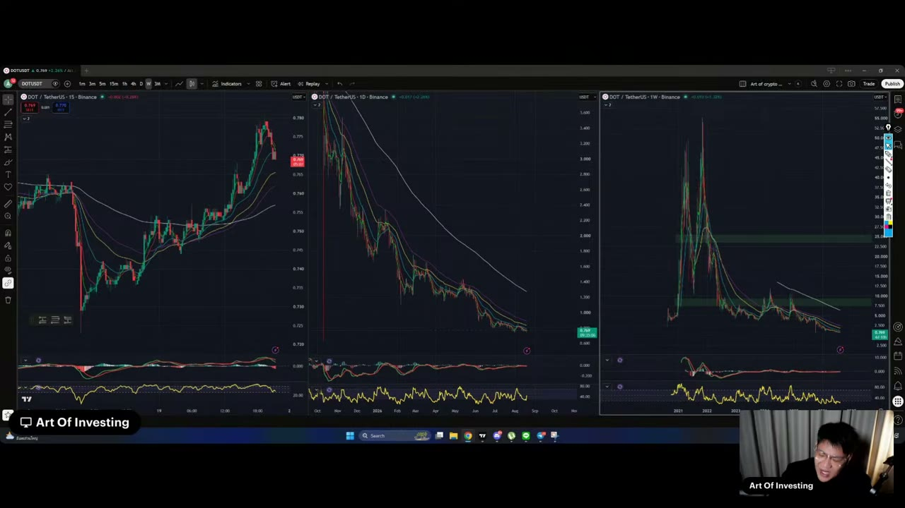

[01:10:21] อันดับต้นๆของโลกอ่ะเออผมอยากให้เราถ้าจะ ลงทุนอะไรในระยะยาวนะอยากให้มันเป็นแบบ นั้นอยากอยากให้มันเป็นสินทรัพย์แบบนั้น อย่างบitcoinอย่างเงี้ยเราก็ไม่ได้ต้อง พึ่งว่าแบบบริษัท Strategy จะต้องห้ามล้ม จะต้องอะไรอย่างเงี้ยคือทุกอย่างอ่ะมัน ยังมีนัยยะตัวไปของมันน่ะผมก็เลยมองว่า สำหรับผมอ่ะถ้าในตลาดคริปโตแล้วเก็บระยะ ยากยาวผมมองแค่บitcoinตัวเดียวนะครับ ผมมองแค่บitcoinตัวเดียว ประมาณนี้อ่ะ D เหรอ HPE ได้ครับอาจารย์ สอนดูเมทริของ OI  Change นิดนึง OI Chang ส่วนใหญ่ผมไม่ได้ใช้นะครับผมจะดู เป็น Snapsot ของ OI มากกว่านะครับใน เปอร์เซ็นต์การเปลี่ยนเนี่ยเพราะว่าอย่าง นึงนะครับที่ที่ผมไม่ค่อยได้ใช้อ่ะเพราะ ว่าใน data ทั้งบน CME และทั้งเอ่อบน CME ก่อนแล้วกันมันไม่ได้บอกว่ามัน Senttim ไปแล้วเมื่อไหร่เท่าไหร่บ้างอย่างเสาที่ เราเห็นน่ะราคามันไปชนแล้วสะท้อนไปแล้ว อ่ะมันไม่ได้ขึ้นอัปเดตมาให้เราอ่ะว่า เฮ้ยไอ้เสาตรงเนี้ยมันถูกแบ่งปิดไปแล้ว

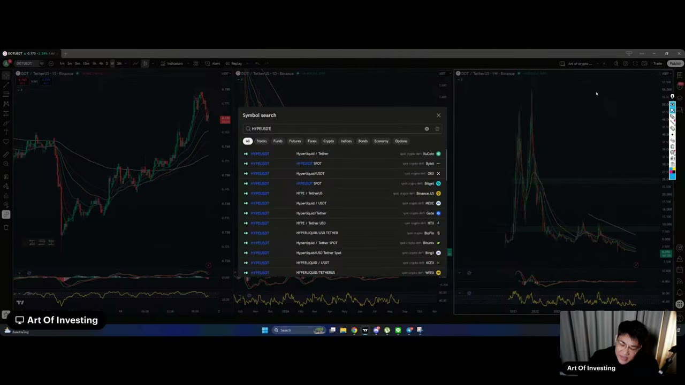

[01:11:21] เท่าไหร่เท่าไหร่บ้างไอ้ตัวเมริก OI Change ผมเลยไม่ไม่ค่อยได้ดูนะครับเท่าๆ ที่ผมมีความรู้นะเออผมเลยไม่ค่อยได้ใช้นะ ครับอ่ะดูคูคอยแล้วกันคุณโก้บอกว่า มีรางสังหรณว่าจะขึ้นหรอก็สวยนะถ้ามองตรง นี้นะครับก็มองเป็น Invert  Head  and Shoulder แบบนี้ได้นะก็สวยนะ เนี่ยอย่างเงี้ย นะครับอย่างงี้ ผมว่าก็สวยดีถ้าอย่างเงี้ยนะครับแล้ว MAD มันเหนือ 0  RSI มันoverbอเงี้ยผมก็คิด ว่ามันขึ้นได้นะครับก็แถวแรกก็แถวนี้ก่อน 645 นะครับเพราะว่าตรงเนี้ยใน week อ่ะ นะครับมันก็มาเทสdiscคแล้วเห็นป่ะแล้วมัน เด้งเห็นมั้ยอันเนี้ยคือการยืนยันว่าโซน discount อ่ะมันยังทำงานนะครับ discount มันยังทำงานก็คือฝั่งเนี้ยฝั่งเอ่อใน week เราก็จะเห็นชัดเจนนะครับก็ดูตรงนี้นะครับ แล้วก็ถ้าเกิดจะเสียโมเมนตัมนะใน day นะ ก็คือ low ตรงเต้องห้ามหลุดเพราะตรงนี้

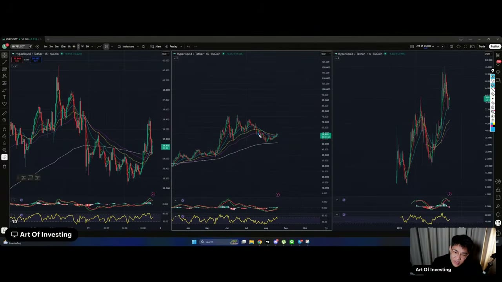

[01:12:22] มันมันเกือบครบและราคาเบรคพรีเมี่มได้ะ ถูกป่ะตรงนี้เบรคได้ละแล้วก็ MAD จะเหนือ 0 แล้ว RSI จะและนะครับให้ไปดูตรงนี้ โอเคนะครับอืไม่ไม่ควรหลุดตรงนี้ละนะครับ เพราะว่าตรงนี้เป็นทั้งdiscาแล้วก็เป็น เป็น low ที่กำลังจะส่งเกิดโมเมนตัมแล้ว ก็เป้าแรกถ้าขึ้นถึงเนี่ย 64  65 นะครับ ต่อมาก็คือ ตัวอะไรเอ่ย DGE เหรอโอเคเดี๋ยวดู Dodge ให้ก็ เอ่อก็ยังไม่สวยนะสำหรับผมนะอ่ะโอเคอ่ะ อย่างเงี้ยนะครับแสดงว่าแบบสภาพคล่องมัน ค่อนข้างต่ำแล้วก็คือขึ้นไปนิดเดียวก็ match ออเดอร์ลงมาลงไปนิดเดียวก็ match ออเดอรกลับขึ้นมาเงี้ยปุ๊กปๆ๊กๆๆๆเงี้ยนะ ครับสิ่งที่จะเกิดขึ้นก็คือให้เราดูนี่

[01:13:23] นะครับให้ให้เราดูตรงนี้ premium  do เนี่ยชัดมาก เห็นป่ะก็คือ EMA  25 ซึ่งตอนเกำลังจะ เบรคและแล้วก็จะเหนือ 0 แล้ว IO ทีเนี้ย ให้เราลองลองลองดูการเบรคครั้งนี้ก่อนว่า มันส่งโมเมนตัมออกมาได้แค่ไหนสมมุติว่า มันเบรคขึ้นมาแบบนี้ชืบแล้ว RI  over Bอ MD เหนือ 0 ได้นะครับแล้วย่อลงมาขุกขิกๆ เนี่ยแล้วถ้าไม่หลุดอ่ะเกิดแรงซื้ออ่ะผม ก็มองว่าโอเคได้ละแล้วคุณก็สามารถวาง Stop Loss ตรงนี้ได้นะครับไม่ใช่คำแนะนำคุณ ทุนนะอันนี้อธิบาย Trading  Model นะครับ เพราะมันแปลว่ามีแนวโน้มมองแล้วที่ โมเมนตัมมันจะเกิดนะครับนะ75%่ะที่ผมเก็บ มาประมาณนั้นนะครับเนี่ยมันก็ใน day ขึ้น ไปนะโมเมนตัมใน day ขึ้นไปนะนะครับอย่าง เงี้ยนะครับก็มีแนวโน้มที่มันจะขึ้นมาเทส 75 ก่อนแล้วก็เบรคได้ก็ขึ้นมาเทสตรงนี้ นะครับอย่างเงี้ยต้องรออย่างเคสนี้เกิด ขึ้นก่อนนะครับสำหรับผมถึงมองว่ามันจะสวย BNB เหรอครับอืมไหนขอดูหน่อย

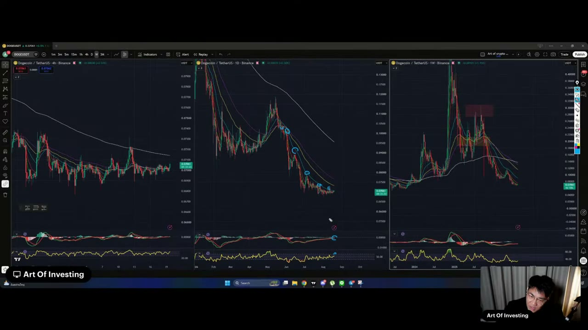

[01:14:26] นึกก็เต็งๆนะผมโดนทองไปนิดนิดนึงนะครับ 200,000 กว่าบาทนะรวมๆบitคinคัดไปด้วยนะ 200,000 กว่าบาทวันนี้ก็เอ้ยหงุดหงิดนิด นึงนะครับแต่ว่าก็โอเค ถึงถึงยังกำไรยังเหลือค่อนข้างแฮปปี้ก็ แต่ว่าทุกครั้งที่โดนก้อนใหญ่นะผมก็จะ เซ็งๆอ่ะในวันเดียวนะครับ โอเค BNB อืม BNB เริ่มดูดีแล้วครับเพราะ ว่าอ่ะอย่างเงี้ยอย่างที่ผมบอกนะก็คือแบบ เวลามันเบรกพรีเมี่มมาเห็นมั้ยอย่างเงี้ย มันติด 50 มาตลอดเห็นมั้ยพอมันเบรค 50 ได้แล้วมันขุกขิกๆๆตรงเนี้ยเนี่ยแล้วมัน เหนือศูนย์ overbard เนี่ยอย่างเงี้ยเรา สามารถเข้าได้โดยที่มอง low สุดเนี่ยเป็น Stop  Loss ก็ได้หรือถ้าใครแบบมีวิชามาก กว่านั้นเฮ้ยผมจะรีด Stop  Loss ผมวางแค่ ตรงนี้พอครับผมนู่นนี่นอ่านแล้วแต่ ทีนี้นะครับมันก็เบรคขึ้นมาแล้วตอนนี้ โมเมนตัมมันเกิดแล้วแต่ว่าอย่างที่รู้นะ ครับก็คือในweคนะในweคเนี่ย มันจะเป็นตรงนี้เห็นมั้ยจุดแรกที่ผมคิด ว่ามันจะไปเทสก็คือประมาณ 630 ถึง 635 ถ้าเกิดโมเมนตัมตรงนี้ไม่จบนะครับก็อยาก

[01:15:27] ให้ดูโมเมนตัมข้ามตรงนี้ไปด้วยนะครับ อ่ะตรงนี้นะสำหรับ BNB นะครับก็คือถ้า โมเมนตัม Day เนี่ยมันมันไม่จบแล้วมันส่ง ต่อได้เนี่ยก็คิดว่า 630 ประมาณนี้ 630-635 โดยประมาณ สอบถามครับถ้าภาพใหญ่เป็นขาขึ้นแต่ว่าภาพ เล็กเป็นดาวเทรนด์ต้องเทรดแบบไหนถ้า มันขึ้นอยู่กับว่าเราเทรดในรูปแบบสวิงแบบ ไหนมันเทรดได้ 2 แบบสมมุตินะว่าภาพเล็ก เป็นดาวเทรนด์ถูกมั้ยก็มันจะเป็นคล้ายๆ แบบนี้สมมุติว่าอ่ะเดี๋ยวผมหาภาพให้ดู อ่ะเอาตรงนี้แล้วกัน อ่ะโอเคนี่เลย อ่ะสมมุติอย่างเงี้ยนะครับWeekคเนี่ยมัน ยัง MAD เหนือ 0 เห็นป่ะWeekคเนี่ยมันยัง MAD เหนือ 0 แล้วมันเป็นขาขึ้นมาทุบแรง ก็จริงนะครับแต่มันยังอยู่บน discount ก็ คือ EMA  50 นะยังเกาะแกะอยู่กุ๊กกิ๊กๆ

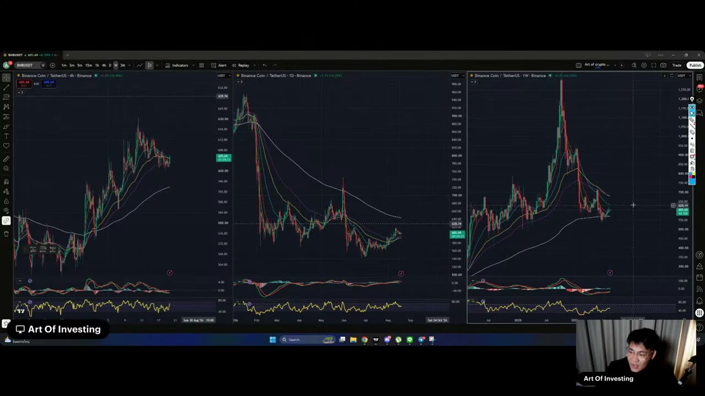

[01:16:29] กุ๊กิ๊กอยู่นะครับแล้ว MD เนี่ยยังเหนือ 0 นะครับ แล้ว Day เนี่ยเป็นขาลงแบบเละแล้วเห็นป่ะ แมีใต้ 0 ทุกอย่างโหลดจมหมดแล้วเงี้ย เนี่ยคือคำถามที่เราถามทีเนี้ยมันเทรดได้ 2 แบบ 1 คือรอกลับมาเป็นขาขึ้นแล้ว follow  day  trend  week ขึ้นไปก็คือ แบบนี้ day มันก็จะเริ่มกลับมาติด พรีเมี่มเห็นป่ะแล้วเบรกปึ้งขึ้นไป Magd 0  RSI  overb นะครับเนี่ยแล้ว week มัน เป็นขาขึ้นอยู่อันเนี้ยเราก็จะเทรด follow แล้วก็คือ day มันก็จะกลับมาขึ้นวิแล้ว กลับมาขึ้นก็คือมีการเทรดท่านี้นะครับท่า เจะง่ายสุดสำหรับผมนะที่ผมเป็นคนเป็นคน เทรดตามเทรนด์หรืออีกวิธีนึงก็คือถ้าเกิด เอ่อเรามองว่ามันจะดึงให้ week เนี่ยลง ด้วยนะครับก็คือไม่ทำ new  high เช่น สมมุติว่ามันรีบาวอีกครั้งนึงแล้วเริ่มไป ติดzซoneหรือติดอะไรก็แล้วแต่เงี้ยแล้ว เรามองว่า day มันทำลายโครงสร้างลงมาแล้ว แล้วภาวะตลาดโดยรวม economic ภาพรวมตลาด มีแนวโน้มจะลงต่ออะไรเงี้ยเราค่อยค่อยรอ จังหวะช็อตตอนที่ day มันพาweคขึ้นไปเทส

[01:17:29] แบบนี้ก็ได้เล่นได้ 2 จังหวะครับแบบนี้ เพิ่งมาบitคinไปหรือยังไปล่ะครับอันแรก เลยอ่ะเดี๋ยวก่อนแยกย้ายเป็นทองแล้วกันนะ ครับแหมเจ็บใจจริงๆนะครับ[เสียงสูดหายใจ] ขึ้นระเบิดระเบอรนะวันนี้โอ้โหว่ะแหนะ ครับไม่หยุดซะด้วย นี่โอ้โหนี่ถ้าบายตรงนี้นะท่วม มันไม่ขึ้นแบบนี้มานานแล้วนะครับเนี่ย เอ่อวันเดียวเท่าไหร่เ 150 ดอนเนี่ยนะ ครับเนี่ยล่าสุดนู้นอ๋อต้นเดือนมั้ยเออนะ ครับที่ขึ้นแบบบ้าบ้าบอแบบนี้นะครับ อ่ะทองนะผมมองแบบนี้อ่ะผมมองว่ามันเสีย โครงสร้างไปแล้วแหละนะครับอ่ะผมมองว่ามัน เสียโครงสร้างอ่ะเดี๋ยวผมเอาไอ้นี่ออก ก่อนเกะกะสายตาเหลือเกินแจ้งเตือนนะครับ ตอนแรกผมแจ้งเตือนไว้ว่าเออถ้ามันถึงลงมา ถึงผมจะ TP นะเพราะว่าตอนแรกผมเซลไว้แต่ ว่าผมโดน Stop  Los ไปเรียบร้อย อ่ะผมสopเรียบร้อยละอ่ะทีเนี้ย

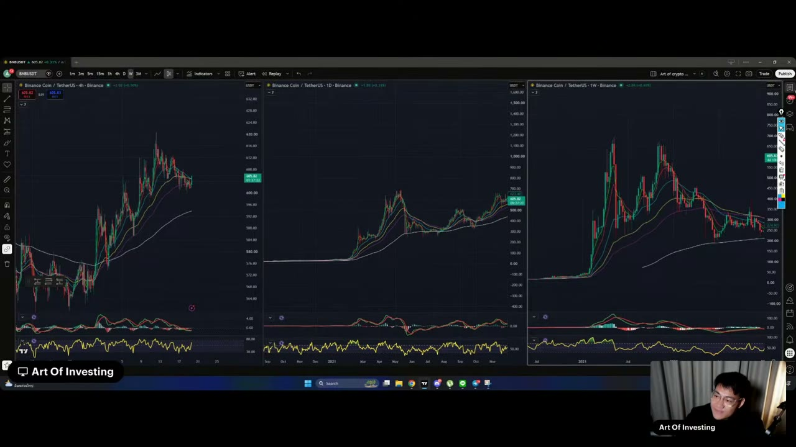

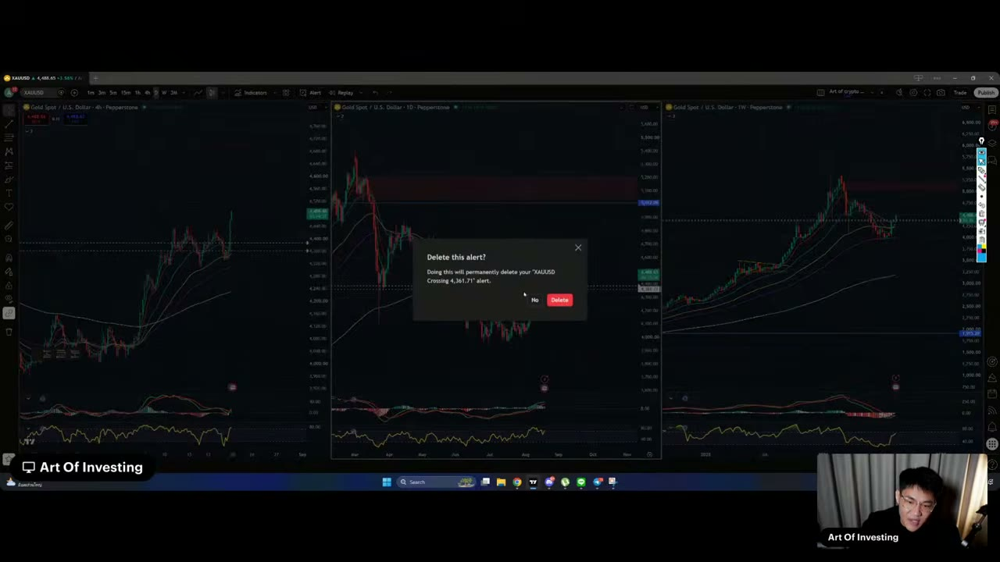

[01:18:32] พระตรงเนี้ยนะครับในทองคำเนี่ยก็คือตั้ง แต่ตรงนี้ลงมาเนี่ยเห็นมั้ยตั้งแต่ 2,000 น่ะนะครับ ในweคเนี่ยมันหลุดdiscาโซนมาแล้วก็คือโซน ที่ตลาดมักจะมองว่าถูกเอ้ยถูกได้ของลด ราคาได้ของลดราคาอยากซื้อเพิ่มจังเลย เนี่ยมันลงมาละนะครับโครงสร้างขาขึ้นใน weคเนี่ยมันเสียเราแน่นอนเราก็เห็นว่า MacD เนี่ยมันลงมาจมจนใต้ 0 เลยทีเนี้ย เราจะต้องดูแล้วว่าWeekคเนี่ยนะครับมันจะ กลับมามีโมเมนตัมขาขึ้นจนทำ New  High ได้เลยหรือเปล่าซึ่งจุดแรกเนี่ยผมมองว่า แถวเนี้ยเกิดการเทสแน่นอนนะครับเพราะว่า ตรงเนี้ยคือแรงที่ทำให้หลุด discount ลง ไปจนเกิด new  low นะครับแสดงว่าออเดอร์ ที่เคยเคลียร์สัญญาหรือ settlement เนี่ย หรือที่วางขวางเนี่ยตรงเนี้ยมันเยอะมันก็ เลยมีโอกาสที่จะต้องเทสก่อน แถวเนี้ยครับเนี่ย 4,500  -  4,700 เนี่ย ครับถ้าเกิดเบรคตรงนี้ไม่ได้เนี่ยผมคิด ว่าโมเมนมีโอกาสที่จะทำให้เนี่ยอาจจะแม็ก

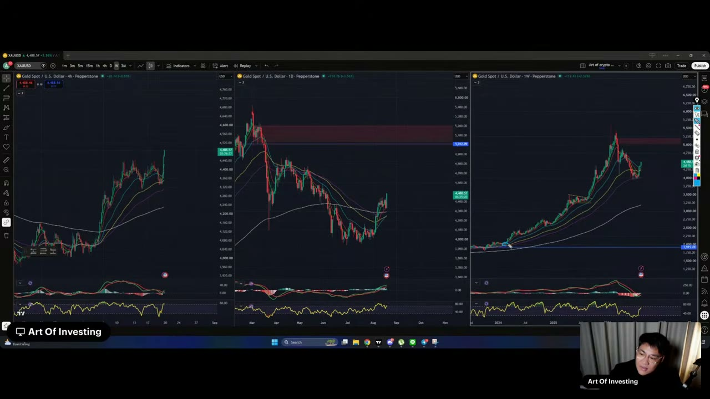

[01:19:33] ดีขึ้นเหนือ 0 ไม่ได้ได้ขึ้นมาเทสงี้ RSI overbอไม่ได้ขึ้นมาชนแล้วหักหัวลงก่อน อย่างเงี้ยก็อาจจะลงมาหา EMA  25  75 อีก รอบนึงนะครับหรือถ้าเบรคได้เนี่ยผมมองว่า ถ้าเบรคช็อตนี้ได้นะอาจจะได้เห็นทอง 5,000 อีกรอบนะครับอาจจะได้เห็นเห็นเห็นทอง 5,000 อีกรอบโดยส่วนตัวนะถ้าเกิดมันเข้า มาถึงโซนเนี้ยแล้ว OI มันไปติดคอวอรสูงๆ อ่ะผมก็ยังไม่ลังเลที่จะเซลนะถ้าเกิดมัน ขึ้นมาตรงเนี้ยแล้วแล้ว OI มันติดcallวอ สูงๆอ่ะผมก็จะเซลนะครับเพราะว่ามันได้ เปรียบกว่ามันเป็นโซนที่เมนmจะเกิด reีอคtionนะครับแล้วเราก็เก็บกำไรเอา เพราะเราไม่ได้ถือรันเทรนด์ถูกมั้ยนะครับ อ่ะยกเว้นว่าไปถึงตรงเนี้ยแล้วเราไม่ค่อย เห็นควallเลยแบบคนซื้อประกันฝั่งขาขึ้น น้อยอะไรเงี้ยแล้วมันจะทะลุไปอย่างเงี้ย นะครับอืทองผมมองแบบนี้นะเพราะมันเสีย โครงสร้างไปแล้วนะครับโดยตอนเนี้ย โมเมนตัมใน 4H เกิดแหละนะครับใน day เกิด แหละครบทุกอย่างเลยนะครับฉะนั้นก็ผมคิด ว่าเนี่ย 4,500 เนี่ยน่าจะถึงวันนี้เลยนะ

[01:20:34] ครับเนี่ยก็น่าจะถึงตรงนี้เนี่ย ไปรอแถวนี้นะครับอาจจะเกิดreีอคtionอ่ะ แล้วเราว่ากันแถวนั้น ถ้าเกิด เบรกไม่ได้นะครับจุดแรกที่จะสังเกตนะครับ ก็คืออย่างให้บอกweคเนี่ยมันจะต้องแบบนี้ ปักหัวลงมาอย่างงี้นะครับแมดีอย่างงี้ อันเนี้ยเป็นการคอนเฟิร์มและก็คือถ้าเกิด เราช็อตมาเงี้ยเออมีแนวโน้มที่จะถือได้นะ ครับแต่ว่าถ้าเกิดเรารันๆน่ะแล้วมันทะลุ ขึ้นไปอย่างเงี้ยอ่ะโอเคก็ตัดสินใจ stop ออกนะครับถ้าเกิดเป็นมุมมองขาเซลล์อย่าง ส่วนตัวผมที่ผมdayรดเนี่ยผมก็โดนไปและ เรียบร้อยตอนแรกนะครับผมมองแบบนี้อ่าอ่า ไอ้ตอนแรกที่ผมกำไรแล้วอ่ะก็คือผมเห็นมัน ติดพรีเมี่มนี่แล้วมันเป็นแถวๆ OI พอดี เลย 4375  4400 ในราคาฟิวเจอร์ใช่มั้ยผม เห็นมันติดพรีเมี่มผมก็เอ้ยแบบนี้น่า เซลล์ผมก็เซลล์นะครับแล้วมาถึงตรงเผมคิด ว่าเอ้ยน่าจะ new ได้เพราะว่าถ้า New

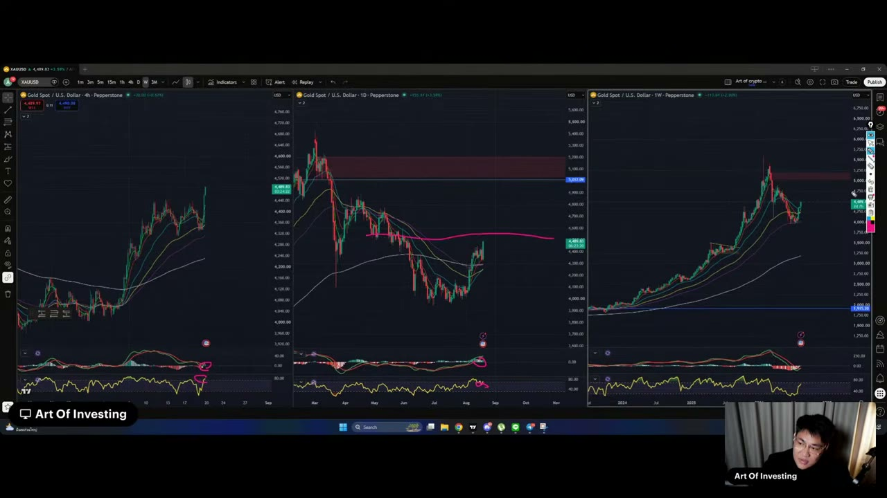

[01:21:36] เนี่ยเดมันก็จะลงมาเทสตรงนี้เท่าดีแล้ว ค่อยแล้วค่อยขึ้นนะครับผมก็เลยมองว่าเอ้ย ตรงนั้นน่ะถึงสรุปไม่ถึงนะครับผมก็เลยปิด ไปก่อนแล้วผมก็มาเซลตรงนี้อีก เพราะว่าคิดว่าเอ้ยคงอาจมีแนวโน้มที่ยัง จะไม่ผ่าน EMA  75 สุดท้ายมันทะลุผมโดน ก่อนไม้นึงแล้วก็มาโดนตอนข่าวเนี่ยครับ ลากปึ้งก็คือโดนหนักเลยเพราะว่าอัดไม้ Recovery นะครับจะเอ่อให้มัน recover ทุนนะครับก็เลยโดนไม้ใหญ่ไปนิดนึงก็ เดี๋ยวคิดว่าอาทิตย์ 2 อาทิตย์ก็น่าจะคืน นะครับยอดนี้ไม่ไม่น่าเหนือบ่าวกว่าแรง เท่าไหร่แค่เสียเวลาหน่อยอ่ะวันนี้ประมาณ นี้แล้วกันขอบคุณคนดูตอนพีคเนาต้อง 180 คนนะครับก็ดีใจนะครับที่ยังคิดถึงกันแล้ว ก็ทุกคนเข้ามาหวังว่าจะยัง enjoy กับ โมเมนตัมนะนะครับก็ไหนดูบitcoinซิเป็นไง เอ้ย 65,000 แล้ว่ะดิจะจะเทส 66,000 วัน นี้เลยหรือเปล่านะครับอ่ะเดี๋ยวผมอัปเดต แล้วกันนะครับก็ส่วนตัวนะอย่างที่บอกถ้า เกิดใครมีไม้อ่ะนะครับก็ ดูแถว 66,000 ไว้ 66,000 ถ้าเบรก 66,500 ไปได้เนี่ยอ่ะคุณเริ่มสบายใจได้ะถ้าเกิด

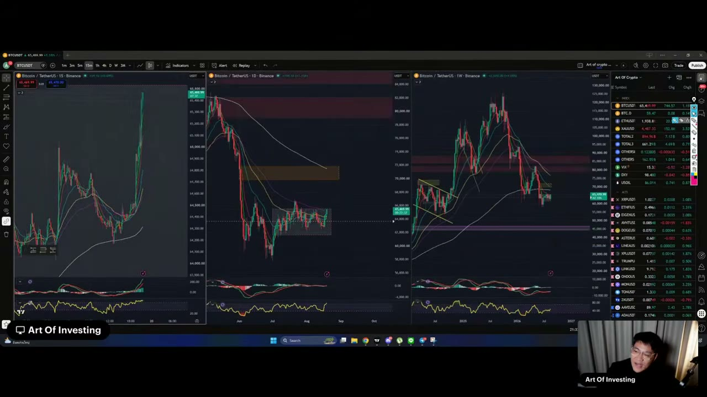

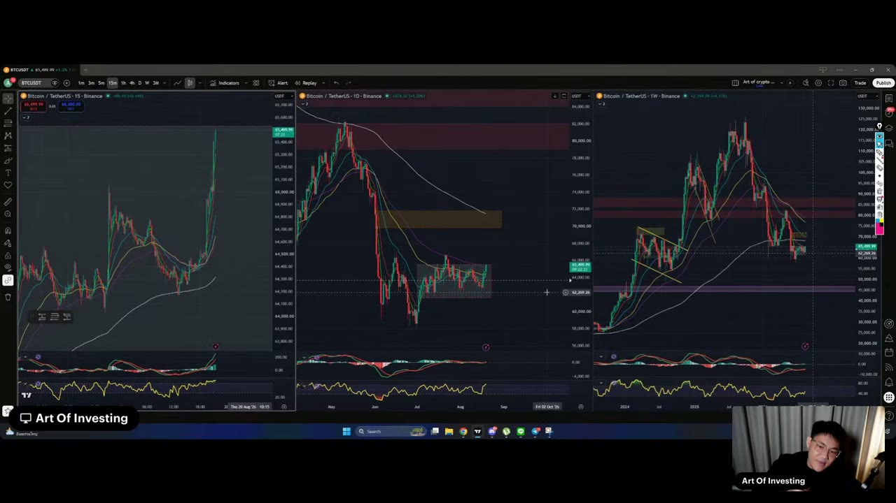

[01:22:39] มันเบรค 66,500 ไปได้แล้วมันไม่ตบกลับมา เหลือ 65,000 ปลายๆอ่ะนะครับผมว่าเออโอเค มีสิทธิ์ลุ้นรันขึ้นไป 68,000  69,000 แต่ถ้าเกิดไปถึงสัก 66,000  100 แล้วมัน ตบกลับมาอย่างเงี้ยกั้นหน้าทุนซะหน่อยซะ หน่อยนะครับอ่ะเจอกันครับในพุธหน้าอย่า ลืมไปติดตามเพจ Yeah.

