# BTC 80,000 กระทิงกลับมาเต็มตัวแล้ว?

- ช่อง: Art Of Investing
- ลิงก์: https://www.youtube.com/watch?v=-oMc9uAucug
- วันที่: 2026-08-26
- ความยาว: 1:35:20
- ที่มา: คำบรรยายอัตโนมัติ (auto-generated) ภาษาไทยของ YouTube — อาจมีคำสะกดผิด/คำผิดเสียง
- ภาพ: 40 ภาพจากวิดีโอช่วงที่เปิดกราฟแท่งเทียน (เลือกอัตโนมัติจากสีแท่งเทียน · ตัดภาพซ้ำ) อยู่ในโฟลเดอร์ frames/

---

[00:01:48] สวัสดีครับสวัสดีครับแหมเป็นไงกันบ้าง ครับตลาดมาวิ่งซะโอ้โหนะครับผมเป็น ประวัติการเลยนะนะฮะขึ้นมาแบบ 20 กว่า เปอร์เซ็นมั้ยเดี๋ยวเดี๋ยวผมเช็คแป๊บนึง นะว่าประมาณกี่เปอร์เซ็นต์นะครับใน 1 สัปดาห์ที่ผ่านมาเนาะก็ขึ้นมาประมาณแบบ 20 23% ประมาณ 23-24% นะครับแล้วก็เกินคาด ผมไปเยอะเยอะประมาณนึงเลยนะครับเดี๋ยวจะ อธิบายให้ฟังว่าทำไมมันถึงขึ้นเกินคาดผม นะครับแล้วก็อย่างที่ผมบอกในเพจไปอ่ะผม เป็นคนพูดตรงๆตลอดนะผมไม่ชอบแบบซ่อนเนี่ย ผมอ่ะเก็บสปอรตได้แค่ครึ่งเดียวของที่ ตั้งใจนะครับเพราะว่าด้วยมาโคร เศรษฐกิจทั้งหมดอ่ะผมวิเคราะห์แล้วว่ามัน อยู่ช่วงปลายของเม็ดเงินที่มันไหลเวียน อยู่ในแต่ละตลาดแล้วบitcoinเนี่ยมันมีแนว โน้มที่ถ้าเกิดตลาดเกิดคอrectionหรือเกิด การปรับตัวเนี่ยมันเป็นสินทรัพย์ที่คน

[00:02:48] เลือกที่จะขายได้ก่อนแรกๆในยุคปัจจุบันนะ เดี๋ยววันนี้ผมจะวาดภาพทั้งหมดให้ดูว่า เฮ้ยทำไมผมถึงเก็บสปอตได้แค่ครึ่งเดียว แล้วก็ไม่ได้อัดไปเต็มข้อทั้งๆที่ผมพูด ไว้หลายรายการมากๆว่าเฮ้ยต่ำกว่า 60,000 ดูดีแล้วนะต่ำกว่า 60,000 นี่โคตรดีเลยนะ ผมพูดตั้งแต่ตอนมันอยู่ 82,000 ก่อนมันลง ไป 59,000  58,000 นะครับโอเก็บมาผมก็บอก มาตลอดว่าเออแถวเนี้ยผมโอเคแต่ผมดันตกรถ ไม้ฟิวเจอร์สปอตผมก็ได้แค่ครึ่งเดียวเออ วันนี้เดี๋ยวผมจะมาวิเคราะห์ให้ฟังนะครับ แล้วมุมมองนั้นน่ะผมเกริ่นก่อนเลยนะผมยัง ถือมุมมองนั้นอยู่ว่ะผมยังไม่ได้มองว่า มันจะสมoทเหมือนทุกครั้งแล้วกันมันมีทั้ง ความเหมือนและความต่าง ผมอยากให้เห็นภาพรวมแล้วคุณตัดสินใจกัน เองแล้วกันว่าจะอโลateยังไงนะครับซึ่งภาพ รวมที่ผมกำลังจะอธิบายทั้งหมดวันเนี้ยนะ ผมจะเทียบเหตุการณ์เหตุผลแล้วก็ข้อควร

[00:03:50] เรื่องแรกที่ผมอยากจะคุยก่อนทุกเรื่องเลย อ่ะคือ ภาพรวมเศรษฐกิจรอบเนี้ยต่างจากทุกรอบนะ ครับต่างจากทุกรอบที่บitcoinเกิดบูรันนะ ครับแล้วก็ไม่จำเป็นที่จะต้องเกิด New Low แต่มีข้อควรระวังที่ผมอ่ะคันปากว่ะ อยากอธิบายละนะครับเดี๋ยวๆอธิบายยาวๆเลย ดีกว่านะครับสวัสดีเพื่อนๆคนดูทุกท่าน ด้วยนะครับโอเข้ากันมาเร็วมากเลยนะผม เพิ่งผมเพิ่งไลฟ์นะครับสวัสดีสวัสดีทุก ท่านเลยนะครับขอบคุณครับอุ้ยเพิ่งมาก็ ซเปอร์ชมาซะแล้วสวัสดีครับคุณฮาร์ดว ขอบคุณมากเลยนะครับสำหรับซเปอร์ Chat นะ ครับผมไลฟ์มาผมว่ามี 5 ปีอ่ะ สุคุณฮาร์ดวลตั้งแต่เริ่มตั้งแต่ช่องผม เปิดสร้างรายได้ได้อ่ะโอ้โหคุณฮาร์ดวลไม่ เคยขาดเลยนะครับทุกวันพุธเลยหรือขนาดผมมา วันเสาร์มาวันศุกร์ที่ผมไม่ว่างติดธุรกิจ ที่บ้านบ้างคุณฮาร์ดวลก็ยังแบบ ส่งซเปอร์ชด้วยกันนะครับขอบคุณมากครับ สำหรับกำลังใจนะครับผมไม่ได้บอกว่ามันจะ ไม่ขึ้นยาวๆนะมันมีแนวโน้มแต่ผมอ่ะจะ

[00:04:52] ระวังตัวมากกว่าเดิมถ้าเกิดผมจะเทรดอ่ะผม จะลด leverage ผมจะไม่อัดขนาดเท่าก่อน หน้านี้เท่าที่ผมเทรดลงเพจมาตลอดที่ผมลง Jจouralทุกเดือนนะครับแล้ว Outcoin cycิleเนี้ยจะเป็นไซเคิลแรกสำหรับผมที่ผม จะอateเงินน้อยกว่าปกติปกติพอร์ตโของผม อ่ะคือผมแบ่งพอร์ตทั้งหมดโดยรวมแล้วก้อน นึงถูกมั้ยแล้วผมก็จะมีพอร์ติปโตสมมุตินะ สมมุติสมมุติว่าพอร์ตผมมีคริปโต 30-40% ในนั้นน่ะผมก็จะเอาพอร์ตอ่ะมาจำแนกอีก ซึ่งปกติอ่ะผมจะมี outcoin คอยประมาณ 30% ถึง 35 ถ้าช่วงไหนมัน outcoin มันวิ่งแรง มากๆพอร์ตมันก็จะโตเป็น 50 ถูกมั้ยแบบ เช่นบางตัววิ่ง 2x หลายๆตัวอย่างเงี้ยแต่ รอบเนี้ยผมจะเอาเงินใน outcoin น้อยกว่า ทุกครั้งที่ผ่านมาไม่ใช่ว่ามันจะไม่ขึ้น แต่ผมรู้สึกว่าความสามารถในการ สร้างโมเดลให้ได้เปรียบรอบเนี้ยต่างจาก ทุกรอบอ่ะเดี๋ยวผมจะอธิบายก่อนว่าคืออะไร เราต้องเข้าใจก่อนนะว่าได้กำไรกับมีความ

[00:05:55] ได้เปรียบในการลงทุนเนี่ยไม่เหมือน กันไม่เหมือนนะเออเดี๋ยวๆเดี๋ฟังผมพูด แล้วเดี๋ยวเดี๋ยวจะเก็ทนะครับวันนี้ไม่ ได้มาขายความกลัวนะเว้ยว่าแบบเฮ้ยขายหมด ติดดอย S&P จะลงแล้วไม่ใช่เลยนะครับ เดี๋ยวอธิบายก่อนอ่ะเฮ้ยไลฟ์ผมค้างป่ะ ฮัลโหลทุกคนเฮ้ยเอาแล้วไลฟ์ผมยังอยู่มั้ย นะครับเดี๋ยวนะเฮ้ยผมเช็คก่อนทำไมมันขึ้น ว่าไลฟ์ผมมีปัญหาปัญหาวะเดี๋ยวก่อนนะครับ เฮ้ยเอาแล้ว

[00:06:40] อ้าวอยู่นี่ครับไลฟ์ผมอยู่นี่เออแสดงว่า เป็นที่รีสตรีมนะครับรีสตรีมมันแจ้งตึ๊กๆ ๆๆๆเลยว่าค้างขอบคุณครับขอบคุณครับใจหาย เลยนึกว่าค้างโอเคอ่ะเดี๋ยวตอบตอบ คอมเมนต์ก่อนนะครับสวัสดีครับอาจารย์ สวัสดีครับอาจารย์อาร์ตกระทิงแล้วยังหล่อ เหมือนเดิมก็กระทิงนะแต่ไม่รู้จะกระทิง ตัวใหญ่แค่ไหนนะครับแต่ว่าเดี๋ยวๆพูดภาพ รวมอย่างที่บอกผมมองขึ้นเหมือนกันไม่งั้น ผมไม่มีของมาบางส่วนหรอกนะครับแต่ว่าผม เก็บไม่ได้เต็มกระเป๋านะครับตกรถไปส่วน นึงเพิ่งโดนทองไปครับเครียดมากเห็นหลุด EMA แล้วโดนทองในที่นี้หมายถึงว่าเรามอง เซลล์ใช่มั้ยแล้วก็มันขึ้นไปก่อนแล้วค่อย ลงใช่มั้ยหรือว่ายังไงครับหรือว่าไปบาย วันนี้นะครับยังไงเอ่ยโอ้วันนี้ทองย่อ เนาะเมื่อกี้นี้ประกาศ PCE นะครับว่ามี ภาวะเงินเฟ้อในระบบเศรษฐกิจเนี่ยยังสูง กว่าคาดการณ์อยู่นะครับูหวัดดีครับหวัดดี ครับอาจารย์อาร์ตฝากดูเอเตอร์ได้ครับมี กระพริบตาด้วยใช่ครับเป็นที่ผมทำไว้เนาะ สวัสดีครับคุณวัชรพล สวัสดีครับรูปปกจันพิตาด้วยใช่ครับสวัสดี

[00:07:42] ครับอาจารย์อาร์ตสวัสดีครับคุณปูสวัสดี ครับคุณจูเนียร์ตลาดดีภาพหน้าปกพริ้มเลย นะครับกระพริบเตาเหมือนเดิมเหมือนเดิม สวัสดีครับอาจารย์คิดถึงสวัสดีครับคุณเอ้ คิดถึงเหมือนกันนะครับสวัสดีครับคุณ จตุรงค์หวัดดีคุณโกโก้ไม่ค้างยังอยู่อุ้ย คุณทัซื่อขอบคุณมากครับ 200 บาทขอบคุณมาก ๆเลยครับสำหรับกำลังใจตรงนี้ขอบคุณมากๆ ครับขอบคุณมากทุกครั้งที่ผมเหนื่อยนะเว้ย แล้วแบบผมเจอเอาจริงๆไม่ต้องถึงกับขั้น ซเปอร์ชนะแค่แบบเพื่อนๆเข้ามาพูดคุยกันผม ก็ดีใจมากๆแล้วอ่ะโอเคอธิบายตามนี้ก่อนไป เดี๋ยวเราไปกันทีละจุดเลยนะครับแชร์หน้า จอครับ โอเคนะครับเฮ้ยคุณอาร์ตอะไรนักหนาวว่า กลัวอะไรทำไมมองว่ามันจะขึ้นไม่ขึ้นมันจะ อะไรต่างอ่ะโอเคข้อแรกนะครับทุกครั้งที่ ตลาดเป็นบูรันน่ะเรารู้อยู่แล้วว่ามันไม่

[00:08:45] ได้มาจากแค่ demand น ของ Harving ถูกป่ะ คือทุกครั้งอ่ะคุณสังเกตตัวเองก็ได้ไม่ ไม่ต้องสังเกตตลาดหรือมาโครตลาดคุณนึกภาพ ง่ายๆทุกครั้งที่บitcoinจะเป็นบูรันน่ะ คุณรู้สึกว่าเฮ้ยเดี๋ยวมันจะขุดแล้วได้ น้อยลงครึ่งนึงเว้ยแบบเนี้ยเดี๋มันต้อง บูรันแน่เลยคุณรู้สึกแบบนี้หรือเปล่าคำ ตอบคือไม่ใช่ถูกป่ะเราหาอะไรในทุกไซเคิล เลยตั้งแต่ 2020 อ่ะเฮ้ยมันจะมีข่าวอะไร มาดันตลาดวะเฮ้ยมันจะมีการลดดอกเบี้ยมั้ วะเฮ้ยมันจะอัดฉีดเงินอีกมั้เห็นมั้ยถูก ป่ะฉะนั้นน่ะมันคือปัจจัยสภาพคล่องนอก ช่วยกระตุ้น แล้วผมรู้สึกนะอันนี้อันนี้ด้วยด้วยส่วน ผมว่ารอบเนี้ยคนพูดถึง haring  block น้อยกว่าทุกไซเคิลที่ผ่านนะในไทยในต่าง

[00:09:47] ประเทศส่วนนึงด้วยปกติเราจะพูดว่าอีกกี่ บล็อกเรานับถอยหลังกันเดี๋ยวใกล้เข้าใกล้ ช่วงที่มันจะฮารวิ่งแล้วเดี๋ยวผลตอบแทน ต่อการขุดบitคinจะน้อยลงครึ่งนึงแล้วนะผม รู้สึกว่าเราคุยเรื่องนี้กันน้อยลงมาก แล้วเราไปคุยเรื่องอะไรเอ่อ เราไปคุยเรื่อง Carity  Act Genous  Act อ่ะดูแค่ตรงนี้ก่อนนะครับดูแค่ตรงนี้ก่อน เฮ้ยถ้าตรงนี้ผ่านน่ะมันแปลว่า stable coin ได้รับการยอมรับนะโอ้โหมันจะดูด เม็ดเงินมหาศาลเข้ามานะเดี๋ยวผมจะอธิบาย ทีละจุดนะว่าทำไมอเมริกาก็อยากได้สภาพ คล่องข้างนอกตรงนี้เข้าไปแต่ว่าแบงค์ก็ ยังไม่เห็นด้วยอ่ะเดี๋ยวเราคุยกันทีละจุด ก่อนขั้นแรกคือการยืนยันว่าตลาดิปโto Cryptocurrency ทุกวันเนี้ยต้องการ ปัจจัยหนุนจากภายนอก นะครับ[เสียงสูดหายใจ] มากกว่าภายใน

[00:10:48] เราไม่ได้รู้สึกว่าวิ่งแล้วจะขึ้นเฮ้ย Act ผ่านเมื่อไหร่วันไหนจะกำหนดการโหวตเมื่อ ไหร่จะมีการคุยกันเรื่อง City  Act อีก ครั้งแล้วคุณดูชุดตรงนี้นะเดือนหน้านะเอา แค่วันศุกร์นี้ก่อนนะวันศุกร์เนี้ยมีแจ็ค โฮนะครับที่คุณเนี่ยเขาจะต้องขึ้นพูดคือ วันศุกร์ 21:00 น.เขาจะพูดถึงแนวทางดอก เบี้ยเฟดจะเคร่งครัดกับการดึงดูดดึงสภาพ คล่องออกอยู่อยู่เหมือนเดิมมยหรือการที่ เขาประกาศว่าจะเริ่มซื้อบอนเนี่ย buy back เนี่ย 4 บิลเลี่ยนUSดอลาร์เนี่ยมัน จะมีเพดานเพิ่มขึ้นสูงกว่านี้อีกได้มย เพราะว่า 4,000 บิลเลี่ยนเนี่ย 4 บิลเี่น เนี่ยมันก็ยังไม่ได้เยอะขนาดนั้นเทียบกับ เงินกองกลางที่อยู่ในระบบแล้ววันเนี้ย PCE ก็ออกมาสูงกว่าคาดนะครับตรงนี้เห็นมั้ย เทียบ Q  onq เนี่ยสูงกว่าคาดการ 0.2% มันก็แปลว่าในระบบเนี่ยมันยังเฟ้ออยู่ เล็กน้อยงั้นคนก็เริ่มกังวลแล้วว่าเฮ้ย แบบเนี้ย

[00:11:50] จะยังคงดอกหรือเปล่าหรือจะมีโอกาสขึ้นดอก มยเพราะว่าตรงเนี้ยเขาเรียกกันว่า stealth QE  Stealth  QE คือไม่ได้ QE ตรงๆแต่ มันไม่แปลกหรอกครับมันก็ต้องทำแบบนี้อยู่ แล้วเพราะว่าเงินเฟ้อมันยังปราบไม่ได้ เต็มตัวแล้วคุณจะมาอัดฉีดเงินเข้าตลาดตรง ๆเงี้ยผมว่ามันก็คงเป็นมาตรการที่แปลก แล้วรัฐบาลไม่น่าจะเลือกทำแน่นอนพอย์แรก คือตรงนี้ที่จะสร้างความผันผวนให้ตลาด ซึ่งตรงเนี้ยผมว่ายังไม่ใหญ่มาก ดูพอย์ตรงนี้นะต่อมานะเดือนหน้า 15  16 17  18 คุณรู้มั้ยว่ามีเหตุการณ์อะไร เกิดขึ้นบ้าง เดือนหน้านะ 1 นะ ประชุมนะครับโหวต Carity  Act รอบกันดา 2 ครับ C  Meeting ครับประกาศว่าดอก เบี้ยจะยังคงดอกมย นะครับหรือจะขึ้นนะครับ

[00:12:52] 3 ครับ BOJ  Meeting หรือ Bank  of Japan ครับ ยังไม่หมดนะครับมีไฮไลท์อีกตัวนึงครับ อันนี้ผมดอกจันทร์เลยนะ Antropic  IPO เนี่ยแล้วผมเห็นลิสต์ตรงนี้อยู่อ่ะเดือน หน้าผมก็เลยค่อนข้างเฮ้ยอย่างเงี้ยตลาด มันมีโอกาสกุ๊กกิ๊กกุ๊กิ๊ก reaccommodulation อีกสักรอบนึงแล้วค่อย ขึ้นนะครับผมก็เลยไม่ได้เก็บสปอรตจนเต็ม มือนะครับผมก็ได้มาแค่ครึ่งเดียวก็อย่าง ที่บอกเนาตกรถแถวตอนที่มันเบรก 72,000 ผม ผมก็ไม่ follow ละนะครับทีเนี้ยไอ้ภาพตรง เนี้ยมันยังมีความต้องระวังยังไงดูตรงนี้ Carity  Act เนี่ยนะครับเรารู้อยู่แล้ว ว่าคนอยากให้ผ่านแต่ถามว่าผ่านแล้วมันจะ ดึงเม็ดเงินเข้าตลาดทันทีมั้ยเป็นตัวฉุด กระชากทันทีมั้ยสำหรับผมอ่ะผมมองว่ามัน

[00:13:53] ยังไม่ใช่ภาพระยะสั้นแบบนี้แต่คุณคิดแบบ นี้นะถ้าเกิด City  Act  Genous  Act แล้วกดเริ่มดีขึ้นสนับสนุนมากขึ้นน่ะทุก วันเนี้ยคุณคิดว่ามันมีคนอยู่นอกอเมริกา หรือมีคนที่มีเงินแต่ไม่มีบัญชีหุ้น อเมริกาเนี่ยเยอะแค่ไหน ถูกป่ะหรือบางคนอยู่ต่างประเทศลงทุนเงิน อยู่ต่างประเทศเงี้ยยังไม่อยากเข้าประเทศ ตัวเองผมผมสมมุตินะอ่ะใครก็ได้เอ้ยเงิน อยู่ต่างประเทศโคตรเยอะเลยยังไม่อยากูฟ เข้าเลยว่ะเอ้ยทำไงดีวะจะลงทุนก็แบบโอ้โห มันต้องเข้ามาชี้แจงที่มาของเงินแต่คุณ นึกดูนะถ้าเกิดว่ามันสามารถมี Tokeniz หุ้นขึ้นไปบนระบบได้เม็ดเงินพวกเนี้ยจะ เข้าถึงอเมริกาได้อีกฉะนั้นน่ะตอนเที่เขา มีระบบอย่าง AI ที่เป็นผู้นำและผู้ที่มี อำนาจต่อรองสูงที่สุดในโลกผมจะใช้คำว่า อันดับต้นๆก็คงไม่ได้ผมใช้คำว่าอันดับต่อ รองสูงที่สุดในโลกแล้วอ่ะเค้ามีสภาพคล่อง

[00:14:55] สูงขนาดนี้แล้ว เค้ามีเม็ดเงินในตลาดหุ้นประเทศตัวเองสูง ขนาดนี้แล้วถ้าเกิดมันไร้พรมแดนขึ้นอีก อ่ะคือแบบคุณไม่ต้องแลกสกุลเงินไม่ต้อง แลกอะไรเลยคุณมี stable  coin คุณลงทุน ปั้ง tokenization หรือหุ้นที่อยู่มาใน ระบบ blockchain ได้เลยเพราะว่ากฎหมายตัว หลังๆหลังจาก clarity  act หลังจาก Genus Act มันมีอะไรรู้ป่ะมันมีกฎที่บอกว่าถ้า เกิดคุณจะออกationจะต้องถูกออกและกำกับ โดยหน่วยงานรัฐบาลของประเทศนั้นเท่านั้น ฉะนั้นคุณรู้ได้แล้วว่าไม่ใช่หุ้นมั่วที่ ใครๆก็ทำมั่วขึ้นมาได้สภาพคล้องมันเข้า โดยตรง นะครับสภาพข้องมันเข้าโดยลง เค้าอยากให้ผ่านอยู่แล้วเถึงบอกว่าจริงๆ เค้าไม่ได้สนับสนุนอีอง ETF อะไรหรอกเม็ด เงินที่เขาต้องการมากที่สุดอ่ะแล้วเขาคิด ว่านั่นน่ะคือจังหวะกรอบโกยกำไรที่สุดอ่ะ คือตรงนั้นคือสินทรัพย์หุ้น สังเคราะห์ซึ่งมันจะโอ้โหสร้างสภาพคล่องเ จะมีในมืออีกไม่รู้เท่าไหร่เรื่องแรก เรื่องที่ 2 นะครับก็คือ C  Meeting นะ

[00:15:58] ครับก็คือดอกเบี้ยจะประกาศคงดอกหรือขึ้น ดอกมั้ยซึ่งส่วนตัวนะผมมองว่าถ้าประกาศมา คงดอกอ่ะไม่ได้สร้างผลกระทบอะไรให้กับ ตลาดเยอะคนจะไม่ได้ตกใจคนจะไม่ได้พานิคจะ ไม่ได้คิดว่าเฮ้ยตลาดมันจะล่มแล้วตลาดมัน จะขึ้นต่อแล้วมันจะบินต่อมันจะอะไรคนจะ ไม่ได้กังวลอะไรเยอะถ้าเกิดมันคงดอกมันจะ สร้างแรงกระเพื่อมต่อเมื่อมันขึ้นดอกเท่า แล้วไอ้อันเนี้ยผมผมดอกจันทร์ 2 ข้อสุด ท้ายแล้วกันก็คือ Bank  of  Japan Meeting เรารู้มาตลอดครับว่าญี่ปุ่น เนี่ยเค้า มีการทำดอกเบี้ย 0% มานานแค่ไหนมันนานมาก แล้วถูกมั้ยครับเพราะว่าเขาต้องการให้ เศรษฐกิจประเทศของเขาอ่ะขยับขยายได้สะดวก จะกู้มาลงทุนจะกู้มาขยายสาขาธุรกิจจะกู้ มาทำอะไรก็ได้ให้ GDP ประเทศเขาอ่ะมันโต เพราะว่าดอกเบี้ยมันไม่มีหรือมันต่ำมากนะ ครับเราก็เลยจะเจอดุลสมเอ่อเค้าเรียกว่า ผมนึกศัพท์ภาษาไทยไม่ออกนะอ่ะพูดแบบนี้ แล้วกัน

[00:17:00] ประเทศที่มีค่าเงินถูกจะถูกมองว่าได้ เปรียบในการส่งออกถูกป่ะเพราะว่าค่าเงิน เค้าต่ำเราเอาเงินประเทศอื่นไปซื้อของ ประเทศเค้าเนี่ยได้เยอะกว่าททีเนี้ยมันจะ มีสมดุลทางการค้าอยู่เพราะว่าถ้าเกิด เม็ดเงินของเค้าเนี่ยต่ำที่สุดในละแวก อาเซียนเป็นเวลานานๆแบบต่ำลงไปกดเลยเนี่ย มันจะทำให้ประเทศอื่นเนี่ยต้องรีบทำให้ ค่าเงินของตัวเองเนี่ยอ่อนลงไปด้วยไม่ งั้นเขาจะเสียเปรียบทางการนำเข้าส่งออก ค่อนข้างมากแล้วนี่คือปัญหาแรกแล้วปัญหา ที่ 2 คือเย็นมันอ่อนไปเรื่อยๆจนอ่อนจน พยุงไม่อยู่รัฐบาลญี่ปุ่นเนี่ยก็พยายามจะ แทรกแซงเฮ้ยเข้าไปอุ้มเย็นเข้าไปอะไรก็ แล้วแต่นี่คือพอย์แรกพอย์ที่ 2 ที่สำคัญ ไม่แพ้กันคือการทำเยนแครี่เทรด คนรู้อยู่แล้วว่าญี่ปุ่นมีดอกเบี้ย 0% ฉะนั้นถ้าเขามีสินทรัพย์หรือไม่แล้วแต่ ที่เขาไปค้ำแล้วเขาสามารถกู้เงินเย็นออก

[00:18:00] มาได้แล้วเอาเงินเย็นไปลงทุนต่ออีกทอดนึง ที่เขาเรียกกันว่า carry  trade เค้า สามารถสร้างกำไรได้มหาศาลบนความเสี่ยงที่ เค้าควบคุมเองคือเค้า manage เองพวกนี้จะ คำเฮ้ยเรากู้เงินประเทศนี้ไปฝากประเทศนี้ กินดอกเบี้ยได้เท่าไหร่ส่วนต่างเท่าไหร่ หรือไปทำเหจ ประเทศนี้เอาไปค้ำประเทศนี้เอาไปฝากตรง นี้เอาไปลงทุนตรงนี้แล้วให้ความเสี่ยง เนี่ยมันต่ำมากๆแล้วผลตอบแทนน่ะอยู่ใน เลเวลที่รับได้พวกระดับกองทุนก็ทำกันอยู่ แล้วสำหรับ Yen  Carry Trด Bank  Japan  meeting ตรงเนี้ยมันจะเป็น หนึ่งในการตัดสินใจว่าเราจะกลับมาขึ้นดอก มั้ยเพราะว่าเราไม่สามารถพยุงค่าเงินของ เราได้แล้วนะครับแล้วถ้าปล่อยมันอ่อนไป เรื่อยๆมันจะเป็นผลเสียต่อทุกคนเลยที่ อยู่ในย่านเดียวกันไม่ใช่แค่ตัวญี่ปุ่น อย่างเดียวเพราะว่าสมดุลทางการค้ามันจะ เสียครับเราคนในประเทศและประเทศรอบๆจะถูก บีบให้ขายสินค้าที่ราคาต่ำกว่าต้นทุน เพราะค่าเงินมันอ่อนมากคุณนึกออกใช่มั้ย

[00:19:01] แล้วถ้าเค้าประกาศ เพิ่มดอกขึ้นมาที่แบบมันไม่มีนานมากแล้ว ของญี่ปุ่นกองที่ทำแครี่เทรดจะมีปัญหาพึบ ๆๆๆเลยแต่ถ้าปล่อยเงินอ่อนไปเรื่อยๆคนใน ประเทศก็จะมีปัญหาฉะนั้นตอนนี้ญี่ปุ่น ขยับทางไหนก็น่ากังวลสำหรับตัวเขาเองแล้ว ก็เป็นผลกระทบวงกว้างด้วยเพราะว่าทุกคนทำ เยนแครี่เทรดหมดอ่ะส่วนใหญ่แล้วกัน งั้น movement ตรงนี้ก็สำคัญ นะครับถ้าเขาประกาศขึ้นดอกขึ้นมาเนี่ยโอ้ ไม่เล็กเรื่องใหญ่นี่คือความน่ากังวลแล้ว ข้อที่ผมรู้สึกว่ามันใหญ่ที่สุดสำหรับผม เลยคือการ IPO ของหุ้นบริษัทที่มันเป็น AI จ๋าจังๆตัวแรกๆเค้ายังไม่ระบุวันที่แน่ นอนนะว่ามันจะเกิด IPO หรือลิสต์ขึ้นตลาด หุ้นเนี่ยวันไหนแต่เขาระบุว่าช่วงกันยายน ตุลาคมนี่แหละ

[00:20:02] ฉะนั้นเหตุการณ์ทั้งหมดเนี่ยครับมันเกิด เดือนหน้าหมดเลยครับ ถูกมั้ยมันเกิดเดือนหน้าหมดเลยครับ เฮ้ยคุณอาร์ตแล้ว antropic  IPO มันไม่ดี ตรงไหนอ่ะโอเคย้อนกลับมาที่ด้านซ้ายทุก ครั้งที่มันเกิดบูรันเนี่ยหลายๆครั้งที่ ผ่านมามันจะขึ้นพร้อมกับการพักตัวของตลาด อเมริกาหรือตลาดสินทรัพย์เสี่ยงแบบพร้อมๆ กันเราจำได้มว่าโควิดพูดหยาบๆนะ ชิบหายกันหมดหุ้นไทยเละหุ้นอเมริกาเละ หุ้นประเทศไหนก็เละแดงเป็นแกงพแนงอ่ะแล้ว พอประกาศ QE เฮ้ยตลาดโลกฟื้นเพราะว่า ตลาดที่ใหญ่ที่สุดในโลกฟื้นแล้ว ได้รับการอัดฉีดเงินเข้ามาแล้ว รอบต่อมาเราไปดูกราฟเลยปี 2023 เดือน มีนาคมตลาด S&P  500  Nasdaq  Dow  Jones ฟื้นพร้อมๆกับ ing ช่วงเดียวกับที่เป็น บูรันของบitcoinแต่รอบเนี้ยไม่ใช่

[00:21:05] รอบนี้ตลาดไม่ได้เกิดการพักตัวตลาดยังไม่ ได้เกิด tech  correction ตลาดยังไม่ได้ เกิดซอฟต์แวร์ correction ตลาดยังไม่ได้ เกิด AI  correction ฉะนั้นนะครับที่ หลายๆท่านมองว่าเม็ดเงินน่ะมันจะต้องจาก ตลาดนึงมาอีกตลาดนึงอยู่แล้วเพราะว่าอ่ะ พูดง่ายๆถ้าเราใครๆอยู่ในตลาดคริปโตผมพูด แบบนี้จะเห็นภาพคือบitคinขึ้นมาเยอะะถือ บitcoinไม่รวยละถือ outcoin ดีกว่าอ่ะแต่ ทีเนี้ยเา้ามองข้ามตลาดะว่าถ้าเกิดเม็ด เงินใน AI มันเฟ้อมากตลาดหุ้นอเมริกาเม็ด เงินมันอยู่เยอะเกินไปแล้วเนี่ย งั้นเม็ดเงินมันจะย้ายไปที่ตลาดไหนต่อ เค้าก็เลยบอกว่าเอ้ยบitcoinไงเฮ้ย Cryptocurrency ไงคำตอบคือใช่แล้วไอ้ Antropic  IPO เนี่ยมันสำคัญตรงไหนนะ ครับ Antropic  IPO เนี่ยมันสำคัญตรงไหน คำตอบคือ มันเป็นตัววัดเพราะคนทั้งตลาดตอนเนี้ย ครับเค้ากำลังโฟกัสว่าหรือมีการตีมูลค่า

[00:22:08] หุ้นถูกป่ะอู้หูยมันจะเป็น AI ที่เปลี่ยน โลกแทรมบริษัทที่ลงทุนในcrอสนะเว้ยบริษัท ที่สร้างcrอสขึ้นมาคุณนึกออกมั้ยอ่า สักครู่นะครับสักครู่นะครับ อ่ะโอเคทีนี้ครับ Antropic  IPO เนี่ยคือ ตลาดทั่วโลกเค้าก็ Valuation ะนึกออกป่ะ เฮ้ยโอโหเปลี่ยนโลก CR  COE มา เปลี่ยนทำให้โลกเรามันจะไม่กลับไปไม่ มี AI อีกแล้วทุกวันนี้ใครไม่มี Agent ของ CR บ้างวะมันไม่มีแล้วงั้นเงินตรง เนี้ยมันรอมันรอที่จะลงทุนใน AI คือทุกคน แบบ Shut  up  and  take  my  money อ่ะ นึกออกป่ะเฮ้ยโอ้โหเมื่อไหร่มึงจะิวะแชท JBT  Open  AI เมื่อไหร่มึงจะิวะ Gemini มึงมี Google แล้วแต่ไอ้ตัวที่มันเป็น AI โดยตรงเนี่ยที่ไม่ใช่บริษัทแม่เนี่ยเฮ้ย กูอยากลงทุนคุณว่าเม็ดเงินอยากไหล เข้าว่ะทีเนี้ยถ้า IPO แล้วราคามันไม่ได้ พุ่งอย่างที่เค้าตั้งมูลค่ากันไว้เนี่ย มันแปลว่ามันจะเป็น Domino ชิ้นชิ้นแรก

[00:23:09] ได้ที่มันจะทำให้เริ่มเกิดการคอเลกชของ AI ที่เป็นฟองสบู่อยู่มันไม่ได้มันไม่ได้ จำเป็นต้องแตกนะมันเป็นแค่หนึ่งในเหตุผล ที่เป็นไปได้ผมถึงบอกว่าเฮ้ยผมไม่ได้มอง ว่าตลาดมันจะไม่ขึ้นแต่ผมมองว่ารอบเนี้ย ผมจะใส่ยั้งมือกว่าตัวเองมากกว่าทุก ไซเคิลนะครับผมจะยั้งมือหน่อยเพราะเรื่อง นี้เพราะเวลาปัจจุบันเนี้ยที่บitcoinขึ้น มา 20 กว่าเปอร์น่ะตลาด S&P  500 ยังไม่ ได้เกิดการพักเลยครับยังไม่ได้เกิด คอrectionเลยแล้วกลางเดือนหน้ามันมีภาพ ทั้งหมดตรงนี้อีกนะครับฉะนั้นบitcoinมุม มองของผมเนี่ยถามว่ามันขึ้นได้มยผมมองว่า มันขึ้นได้ขึ้นต่อได้ด้วยจะขึ้นไป 85,000 หรือ 90,000 ผมก็มองว่าขึ้นได้แต่ถ้าเกิด มันย่อเล็กย่อเบาผมมองว่ายิ่งขึ้นสูงจะ ยิ่งมีความเสี่ยงเพราะสภาพคล่องในตลาดมัน คุณนึกออกป่ะว่าคนมาลงทุนอ่ะตอนเนี้ยคุณ ไปดูกราฟ S&P  500 ดิวิ่งอย่างเงี้ย

[00:24:09] ฟื๊ดอ่ะถูกป่ะแต่ทุกครั้งอ่ะมันจะย่อ อย่างเงี้ยอ่ะแล้วขึ้นพร้อมๆกันพร้อมๆกัน เว้ยแต่รอบเนี้ยครับเม็ดเงินมันอยู่ตรง นั้นหมดแล้วแล้วผมถามหน่อยว่าบitcoin เนี่ยเอาแบบ honest นะหรือแบบซื่อสัตย์ ต่อตัวเองนะวันนี้เพิ่งดูพcสคุณโจ้ LOC BKK ไง Life  of  CS นะครับคุยกับคุณ กีี้สักนาสักนานา นะครับเออผมเลยไปติดคำนี้มา Be  honest นะครับคือถ้าพูดโดยสัตว์จริงอ่ะเรานับว่า Bitcoin เป็น Stor  Value ของโลกหรือยัง ไม่ใช่ของเรานะบางคนอาจจะแบบเฮ้ยฉันฉัน เชื่อมั่นใน Bitcoin ฉันมองว่า Bitcoin เป็น Stop  value เก็บโอเคอันนั้นมุมมอง ส่วนตัวแต่ว่ามุมมองของสินทรัพย์ทั่วโลก มุมมองของทั่วโลกอ่ะเขามองว่า Bitcoin ยังไม่ใช่ Stop  value ถูกป่ะมันคือสิน ทรัพย์ที่มี potential จะเป็น store value ของโลกงั้นถ้าเกิดตลาดที่ใหญ่ที่ สุดอ่ะมันขึ้นมาไกลแล้วแล้วมันเริ่มเกิด การคอชนะครับบitcoinที่ขึ้นมาแล้วเนี่ยผม มองว่ามันจะเป็นสินทรัพย์ที่คอเลกชตามผม ยังนึกภาพไม่ออกเท่าไหร่ที่ตลาดหุ้น

[00:25:10] อเมริการ่วงหนักๆแล้วบitcoinขึ้นต่อ ในปี 2026 อ่ะใช้คำนี้แล้วกันในปี 2027- ผมก็คิดว่ายังนะครับมันจะต้องแบบ 5 ปีมาก กว่านั้นที่มันจะทำให้ตลาดcryptocurrนcy หรือสินทรัพย์ตรงเมันได้รับการยอมรับที่ ที่ใหญ่กว่านี้ฉะนั้นผมก็เลยกังวลตรงนี้ นะครับว่าถ้าเกิดมันเข้ามาแล้วเนี่ยเม็ด เงินเนี่ยมันไม่ได้ตาม valuation ที่ตลาดเค้าคาดการณ์ไว้อ่ะ มันจะเป็น Domin ตัวแรกได้ที่ทำให้ตลาด เนี่ยมันเริ่มพักตัวนะครับเนี่ยคือภาพที่ ผมกังวลอืมเห็นภาพกันมยแต่ผมมีแต่นะถ้า มันสามารถทำได้ก็คือแบบโอ้โหสูงกว่า อีกเปิด IPO แล้วราคาย่อนิดนึงแล้ว ขึ้นปึ๊กๆๆแล้วก็แบบยืนได้มันแปลว่า

[00:26:12] เฮ้ยมันยังมีเม็ดเงินข้างนอกตลาดอเมริกา ตอนนี้ที่ยังไม่ได้เข้ามาพร้อมจะเข้า อีกเยอะซึ่งเยอะมากพอที่ยังไม่ต้องเกิด คอเลกชในเร็วๆนี้แบบนี้บitcoinก็ขึ้นต่อ ได้เลยนะครับฉะนั้นตรงเนี้ยผมเลยมองว่า มันเป็นความกังวลอย่างที่ผมบอกว่าในมุม มองของ Port  GR นะหรือพอร์ต Alpha ที่ คุณคุณต้องการจะเทรดอ่ะต้องการจะเก็รง กำไรอ่ะหรือต้องการจะแบบกิน Capital  Ga น่ะไม่ไม่ได้แบบค่อยๆโตหรือลงทุนระยะยาว อ่ะผมก็เลยบอกว่าผมจะยั้งมือหน่อยส่วนถ้า มันเป็นพอร์ตแบบลงทุน ระยะสั้นน่ะเออขออภัยถ้าเป็นพอร์ตแบบ DCA แบบพอร์ตลงทุนระยะยาวเฮ้ยถ้าวันนึง บitcoinจะเป็น 500,000 ดอลลาร์ หรือเป็น 1 ล้านดอลลาร์ใน 20 ปี 30 ปี สมมุติที่เขาคุยกันน่ะเฮ้ยจะซื้อ 70,000 80,000  60,000  50,000 ก็เหมือนกัน ผมว่าอันนั้นไม่มีปัญหาถ้าคุณจะ DCA ใน มุมมองที่คุณเชื่อเนาะว่าภาพระยะยาวราคา มันจะไปตรงนั้นผมคิดว่าโอเคแต่ว่าพอร์ต ที่จะใช้ในการเทรดอ่ะที่แบบคุณอาจจะเคย

[00:27:13] อัด leverage คุณอาจจะเคยเมามันกับมันน่ะ เออ[เสียงสูดหายใจ]ผมอยากให้ยั้งมือหน่อย นะครับยั้งมือนิดนึงตรงเนี้ยยังมีภาพที่ น่ากังวล เห็นมั้ยเริ่มเห็นภาพตามผมแล้วใช่มั้ยเออ พยายามดูตรงนี้หน่อยผมเลยบอกว่าบitcoin อ่ะเดือนหน้าผมว่าผันผวนนะครับผันผวน เราไม่รู้ว่ามันจะออกแบบวิ่งขึ้นพรวดเลย มั้ยหรือย่อลงมากหรือน้อยยังไงซึ่งเดี๋ยว ผมจะวิเคราะห์กราฟให้ฟังแต่ละข้อนะครับ อ่ะเอาแค่ตรงนี้ก่อนเนี่ยเป็นไงเห็นภาพ มั้ยนะครับผมเลยต้องโยงทั้งหมดให้ฟังไง มันไม่ใช่แค่แบบระวังประกาศดอกเบี้ยนะอ้า ดอกเบี้ยแล้วยังไงวะเฮ้ยระวังนะแบงค์ ประชุม Bank  of  Japan ประชุมอ้าแล้วยัง ไงเฮ้ย Clarity  Act อ่ะแล้วยังไงเฮ้ยมัน มีเบื้องหลัง Clarity  Act ที่คนกำลังรอ อีกเฮ้ยแล้ว Antropic  IPO มันไม่ดีตรง ไหนอ่ะเนี่ยมันมันไม่ได้ไม่ดีแต่มันเป็น มันมาช่วงปลายถ้ามันมาช่วงที่แบบ Nvidia เพิ่งเริ่มขึ้นแบบฤทธิ์เข้าตลาดแล้วอะไร เงี้ยเออผมมองว่ามันมันจะยังไม่เกิดความ คาดหวังของตลาดสูงเท่าทุกวันนี้เพราะว่า เม็ดเงินมันลงทุนกับคุณคิดดูมันไปหุ้นตัว

[00:28:15] เล็กแล้วมันไปยันไมครอนน่ะถูกมั้ยคนมัน เริ่มมันไม่ได้อยู่แค่ Magni  Defent  7 หรือหุ้น 7 นาฟ้าแล้วอ่ะมันกมันถูกกระจาย เป็นหุ้นตัวเล็กแล้วนะคุณดูดีๆนะหุ้น วิ่งเหมือน out คอยปี 2021 อ่ะ บางตัวก้าวเด้งอ่ะใน 2-3 ปีอ่ะมันจะเป็น out คอยแล้วอ่ะฉะนั้นน่ะเม็ดเงินในตลาด อ่ะมันถูกกระจายประมาณนึงแล้วครับ แต่ผมย้ำนะมันไม่ได้น่ากังวลขนาดนั้นแค่ แค่อยากให้วางแผนเผื่อไว้หน่อยอ่ะทีนี้มา ดูกราฟบ้างนะครับ อ่ะมาดูกราฟบ้างนะ

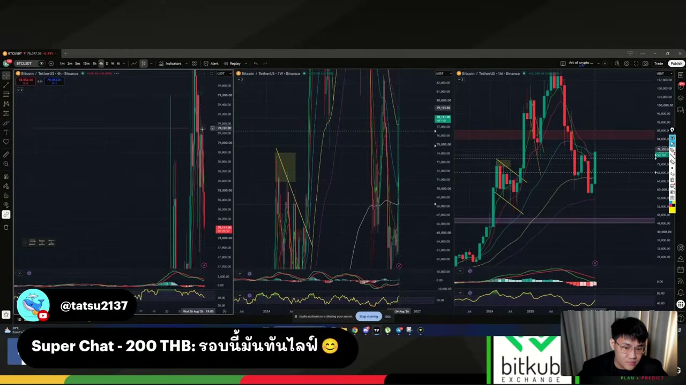

[00:29:16] สวัสดีครับขอได้ครับเดี๋ยววิเคราะห์พวก บitcoinพวกอะไรเสร็จเดี๋ยวไปดูกันเนาะนะ ครับอยู่ขอพวกนึงก่อนนะครับ โอเคมาต่อ โอ๊ยขอบคุณซอ์ช 55 บาทครับคุณอ๊อดขอบคุณ มากครับดีครับอาจารย์สวัสดีครับไม่ได้ เข้ามาทักเลยแต่ยังหล่อเหมือนเดิมสวัสดี ครับคุณุทธินันทนะครับสวัสดีครับจำกันได้ เสมอครับทีนี้กราฟเนี่ยแน่นอนมันปรับตัว ขึ้นมาแล้วครับก็คือเราดูจากตรงนี้ นะครับก็คือตรงนี้นะตอนแรกอ่ะผมมองว่ามัน มีพรีเมี่มใน week ถูกมั้ยก็คือไม่ผ่าน ไม่ผ่านแล้วผมก็เลยมองว่าโอ้โหยเดือน กันยายนเนี่ยมึงหนักๆเลยอ่ะถูกป่ะเมื่อ กี้ผมฤทธิ์ 3-4 ข้ออ่ะแบบอู้หูยแบบแดง เป็นแก๊งพแนงอ่ะแopิกำลังจะลิส IPO ญี่ปุ่นก็ตัดสินใจครั้งใหญ่อีกดอก เบี้ย 0% มาหลาย 10 ปีจะมีดอกเบี้ย ครั้งแรกหรือเปล่า Carity  Act ก็แบบ

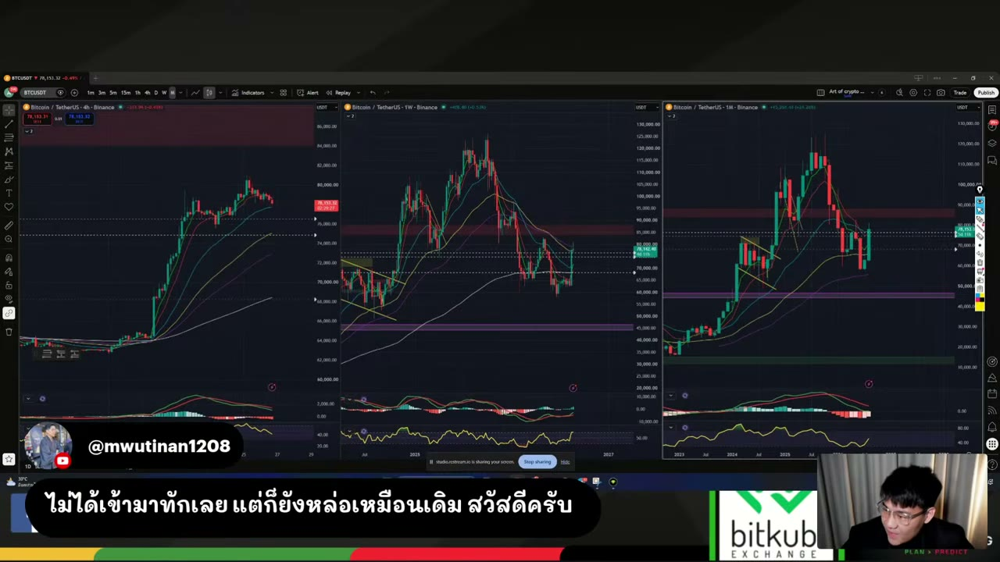

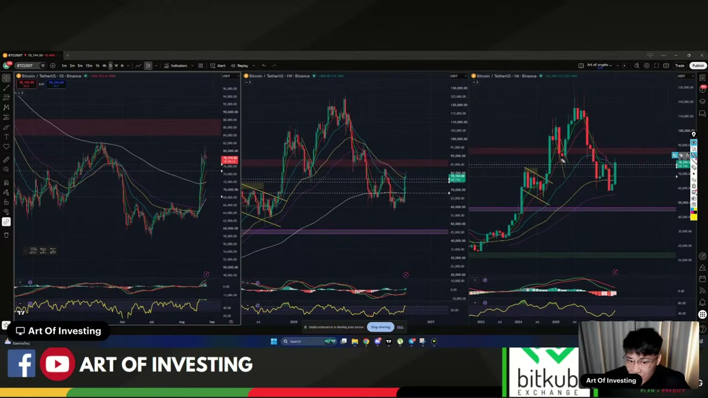

[00:30:17] โอ้โหจะสร้างเม็ดเงินให้ backrock หรือ พวกที่ทำเรื่อง Tokenization มหาศาลโอ้ย ผมอู้หูแล้วเราไปเทียบกับเวลาถูกป่ะเพราะ ที่ผ่านมาไซเคิลมันมีเวลาถูกป่ะมันมีตรง นี้ที่ผมเก็บมาเนี่ยผมก็แบบอู้หู มันเข้ากันตอนนั้นที่ผมเก็บมา data ถูก ป่ะผมบอกเอ้ยตอนเนี้ยมันเพิ่ง สิงหาคมเองแล้วโอโหเดือนเดือนหน้ามันมี มรสุมตั้ง 3-4 ข้อที่ผมอธิบายให้ฟังยาวๆ ไว้เมื่อกี้งั้นถ้ามันไม่ผ่านแถว 72,000 แล้วมันย่อมาแถวนี้แล้วขึ้นอู้หูครบ ทุกอย่างอ่าเห็นมั้ยฉะนั้นนั่นคือ เหตุผลที่ทำให้ผมอ่ะมีของแค่ครึ่งเดียวผม ก็ยังบอกในในกลุ่มของผมนะว่าแบบเอ้ยเออผม ยังรอมัน accumulation อีกหน่อยนะผมอยาก จะเติมของเพราะว่าตอนเผมได้ของประมาณนึง แล้วก็คือก็คือครึ่งนึงนะครับสรุปก็คือ มันวิ่งขึ้นไปเลยงั้นไอ้ทฤษฎีตรงเนี้ยมัน

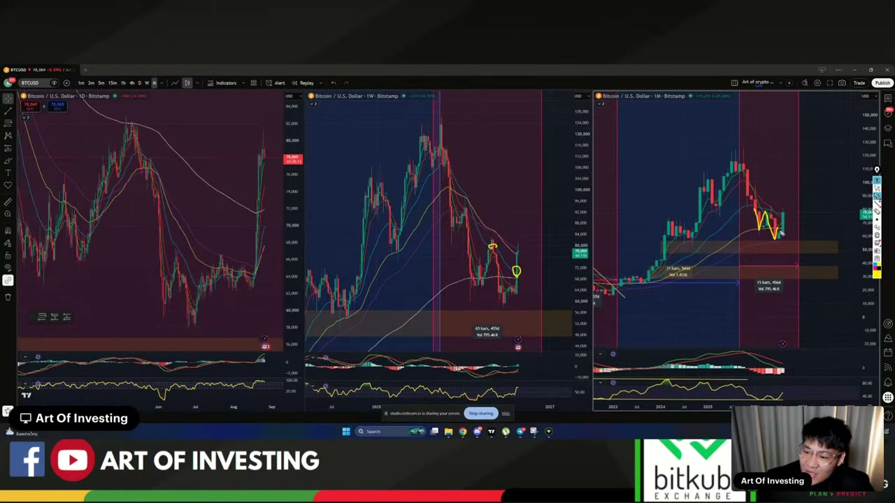

[00:31:19] ก็อาจจะใช้ไม่ได้แล้วหรือเปล่าหรือว่าถ้า เกิดย่อมาไม่ลึกอะไรอย่างเงี้ยก็อาจจะเรา อาจจะไม่ได้นับระยะ 31 เดือน 15 เดือนกัน แล้วเนาะทีเนี้ยอ่ะเห็นภาพและอ๋อนี่ไง ฉะนั้นตอนนั้นครับมันพอดีหมดเลยถ้าเกิด มันไม่ผ่าน 72,000 ผมก็เลยให้น้ำหนักสูง มากว่าแบบเอ้ยไม่น่าเบรคหรอก 72,000 73,000 เนี่ยโอ้โหยากสำหรับผมนะผมมองว่า โอ้โหแล้วมันจะสวยมากก็คือขึ้นมาและเกิด โฮปแล้วมีความหวังะแล้วก็แบบเดือน ดอกเบี้ยญี่ปุ่นโฟมซประกาศขึ้นดอกคงดอก act  antropic ลิสเข้าตลาดหุ้นครั้งแรก IPO อ่ะแล้วไม่ ผ่านแล้วยอมมาอ่ะมันก็จะเป็นอย่างี้แต่ที เนี้ยมันขึ้นไปก่อนแล้วงั้นมุมมองต่อไป อ่ะมันจะเป็นยังไงนะครับอ่ะมุมมองต่อไป เนี่ยที่ผมอยากให้ดูอ่ะก็คือตรงนี้ นะครับโมเมนตัมอ่ะมันเกิดใน day แล้วแต่ มันยังส่งไม่ถึง week นะครับเฮ้ยผมผม วิเคราะห์อันนี้ลงเพจด้วยนะแล้วมันก็เป็น อีก 1 เรื่องที่ทำให้ผมมั่นใจว่าตลาด

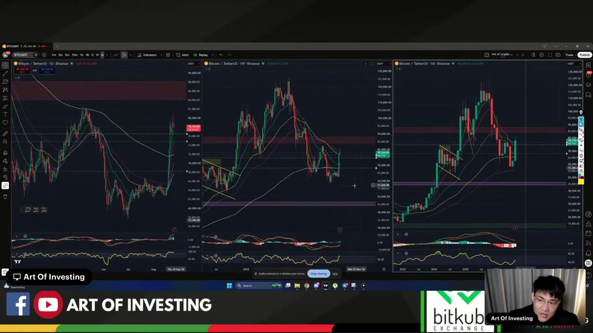

[00:32:20] กลับมาแล้วส่วนนึงนะคือผมทำเพจมา 5 ปี แล้วผมว่าผมไม่โดนแซะมาเกือบ 2 ปีอ่ะที่ ที่เป็นแบบแซะทั่วไปนะไม่ได้แซะแบบเจาะจง อ่ะเกือบ 2 ปีอ่ะอันเนี้มาแล้วะตอนผม เขียนว่าเอ้ยผมอ่ะมีสปอตแค่ครึ่งเดียวนะ แล้วก็ผมตกไม้longองฟิวเจอร์เพราะว่าตอน แรกอ่ะผมไปรอช็อตที่ 72,000 แต่มันไม่ หลุดdisดา ผมก็ Stop  Loss ไม้ช็อตไปนะครับแถว มีคนคอมเมนต์ว่าเอ้ย ใครตกรถตีเกมหมดโอผมก็โอเคเฮ้ยตลาด กลับมาแล้วจริงๆนะครับฉะนั้นไอ้คอมเมนต์ พวกเนี้ยที่ผมไม่เจอมานานน่ะทำให้ผม ดีใจนะว่าแบบไอ้ตลาดมันมาแล้วว่ะ แล้วผมก็เคยคิดว่าในยุคที่แบบมันมีแต่ AI อ่ะ AI มันดูดเม็ดเงินสภาพคล่องไปแล้วอ่ะ มันจะมีอะไรดึงความสนใจของคนในตลาดให้ กลับมาสนใจตลาดคริปโตได้อีกซึ่งสุดท้ายคำ ตอบง่ายมากคือราคา ราคากลับมาขึ้นทุกอย่างจบหมด ขอแค่ราคาขึ้นจบ attention กลับมาเลยคน

[00:33:21] จากไม่สนใจกลับมาสนใจเลยนะครับฉะนั้นตอน นี้ครับผมมองเหมือนเดิมก็คือตรงนี้เนาะ MACD เนี่ยมันยังอยู่ใต้ศูนย์อยู่ [เสียงสูดหายใจ]นะครับ MACD ยังอยู่ใต้ ศูนย์อยู่ของ WeEK นะ RSI เนี่ยจ่อจะ overbard และนะครับแล้วก็ day เนี่ยอ่ะ เรียบร้อย day มันเกิดโมเมนัมอยู่แล้วเรา รู้อยู่แล้วก็คือ Magn  0  RSI  overbard นะครับแล้วก็เบรกพีemiมเนาะขึ้นมาเปี้ยง เลยนะครับจากตรงนี้ติดๆนะครับเนี่ยติดๆ เนี่ยเบรคเปรี้ยงเลยฉะนั้นโมเมนตัมมัน เกิดลวดเดียวเลยก็คือวิ่งไม่พักเลย 4 วัน แต่ว่าเนี่ยมันยังส่งไม่ถึงweคนะครับแล้ว ตอนเนี้ยมันก็เริ่มเกิดการย่อและเบาๆไม่ ได้เกิดนัยยะสำคัญอะไรมากนะสำหรับผมเนี่ย [เสียงสูดหายใจ]ทีเนี้ยภาพต่อไปเนี่ยคือ เราจะจะต้องดูแล้วว่าไอ้ย่อตรงเนี้ยมันจะ ย่อลึกแค่ไหนนะครับเพราะวันศุกร์มีแจ็on H ใช่มั้ยแล้วก็กลางเดือนหน้าก็จะมีหลาย อีเวentนะครับภาพรวมตอนเนี้ยคือตั้งแต่ มันขึ้นมาโซนใกล้ๆ 80,000 อ่ะเราจะเห็น ว่าตลาดอ่ะวิ่งต่างจากสัปดาห์ที่แล้วเลย

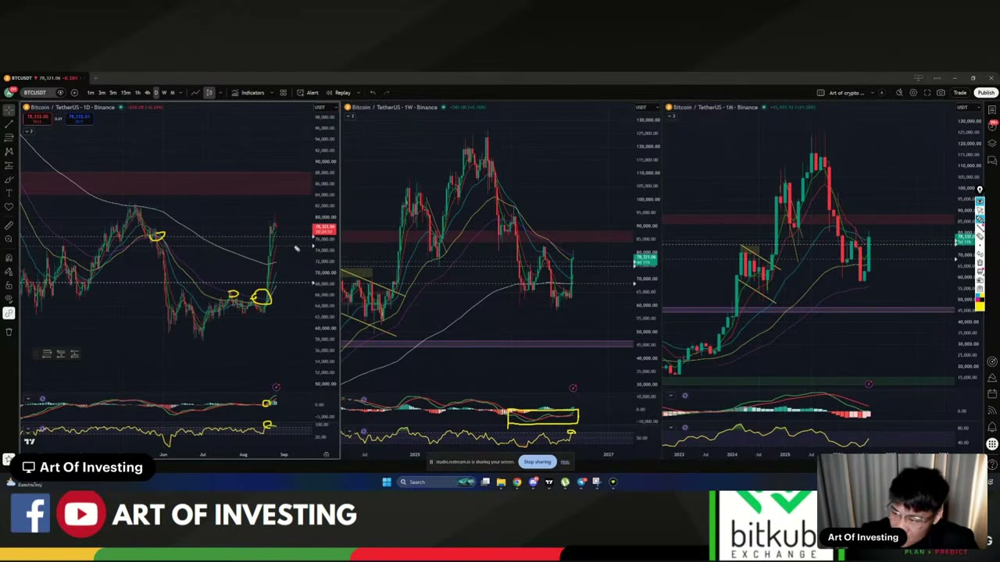

[00:34:23] คือมันวิ่งวิ่งไม่ขาด out คอยอย่างเงี้ย จะวิ่งอย่างเห็นในกลุ่มTelแกมผมมั้ยผมลอง เงี้ยผมตั้งเป้าวิ่งไม่ถึงผมต้องปลา ทิ้งผมจะช็อตก็ลงไม่ถึงผมก็ต้องปา ทิ้งคือตลาดมันเริ่มกลับเข้าสู่ภาวะ ไซด์เวย์แล้วก็คือวิ่งไม่ขาดฉะนั้นตอนเ ครับมันตัวมันรอตัวจุดชนวนที่จะทำให้ ออเดอร์ในตลาดมันทะลักไปทางใดทางหนึ่ง ต่อมาเนี่ยคนเขาจะชอบวัดfibonนซี่กันถูก มั้ยวัดว่าเอ้ยแบบเนี้ยมันจะย่อถึงเท่า ไหร่มันจะอยู่ใน golden  ratio มั้อ่ะเรา จะเคยเห็นมยว่าเลข fibonaci เนี่ยมันจะมี 30  8.2  50  61.8 อ่ะเดี๋ผมจะอธิบายว่า คืออะไรอ่ะสมมุติเราวัดสวิงนี้นะของ Day ที่แบบเพิ่งขึ้นไปเลยนะจาก Balance zซone อ่าอุ๊ยโอ้โหคุณอาร์ตย่อสวยมากเลยเนี่ย 3 3 เส้นตรงนี้เป็น Golden  Ratio อ่ะ เดี๋ยวผมจะอธิบายว่าทำไมผมมอง Fibo มัน จริงๆมันมันเป็นได้แค่ไม้บรรทัดแล้วอย่า ไปมองว่ามันเป็นเลขวิเศษเด็ดขาดเดี๋ยวผม จะพิสูจน์ทฤษฎีให้ฟัง

[00:35:24] พิโพเนี่ยมันเกิดมาจากเรขาคณิตที่คำนวณ กันแล้วออกมาเป็นสัดส่วนแบบก้นหอย นะครับแล้วก็มันมีโซนกลางของรูปที่เรา เรียกว่าสัดส่วนทองคำเนี่ยนะครับเราจะ เรียกตรงเว่า Golden  Ratio ไอ้ 0.618 0.5  0.382  382 เนี่ยมันไม่ใช่ตัวเลข พิเศษมันคือย่อมากี่เปอร์เซ็นต์ของสวิง ที่ขึ้นไป ถ้าตรงเนี้ยย่อมาตรงเนี้ยที่เขาบอกเห็น มั้ยผมก็เขียนในบทความว่าถ้าย่อไม่เกิน 74,000 แล้วขึ้นเลยอ่ะก็มีความน่ากังวล ถ้าขึ้นไม่ยาวเลยแบบไม่ขึ้นแรงต่อแบบลวดๆ เลยถ้าขึ้นแบบตะง่อยตะง่อยตะง่อยตะอย้ อย่าเงี้ยอ่ะจะน่ากังวลนะครับถ้าจะย่อ น้อยเนี่ยคนขึ้นไกลๆอ่ะอธิบายก่อนคืออะไร ตรงเคือย่อมาประมาณ 38% จากยอดตรงนี้ย่อมา 50% จากยอดแล้วตรง เนี้ยย่อมา 61.8%  18% จากยอดอ้าวแล้ว แล้วมันคืออะไรทำไมคุณอาร์ตถึงเรียกมัน ว่ามึงเป็นได้แค่ไม้บรรทัดมันคือ attent ของตลาดไงครับ อะฟิโบเนี่ย

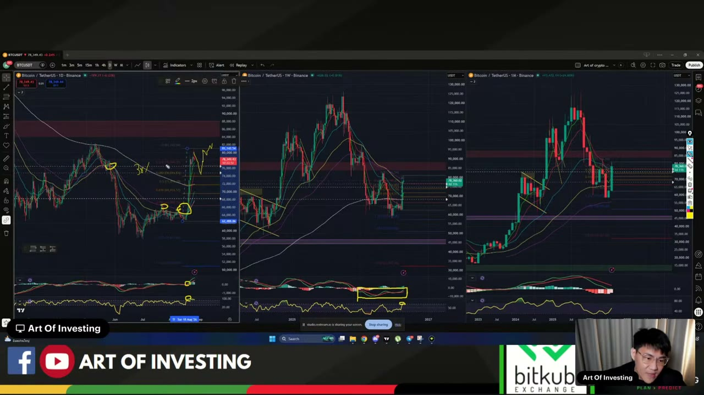

[00:36:27] หรือความสนใจของตลาด ถูกป่ะเพราะว่าถ้าเกิดมันย่อมาแค่ 38% แล้วขึ้นเลยแปลว่าคนในตลาดสนใจมันโคตรๆไง เค้าก็แบบเอ้ยย่อแล้วเว้ยรีบเลยใส่ปั๊กๆ บ้างๆโหถูกๆอยากได้อยากได้อยากได้ฉะนั้น มันแปลว่าความต้องการซื้ออ่ะมันมาเร็วมาก คือ 3 ย่อมาแค่ 30% กว่าๆเฮ้ยคนอยาก ได้ของแล้วส่วนถ้าเกิดย่อมา 50 เนี่ยก็ เป็นตัวเลขกำลังดีใช่มั้ยแบบครึ่งนึงของ สวิงเฮ้ยอู้หูย่อมาครึ่งนึงและจากที่มัน เด้งขึ้นไปจาก 20% เนี่ยย่อมา 10% อู้โห สวยเลยแบบนี้อยากได้ของพอดีหรือย่อมาที่ 68  61.8%  8% นะครับคนก็จะมองว่าอู้หู ย่อเกินครึ่งมาอีกแบบนี้ต้องเก็บของแล้ว ดิโอ้โหแบบนี้สบายลูกปากเลยอยากได้มานาน แล้วอ่ามันมันจะเป็นมันจะเป็นภาพแบบนั้น แทนนะครับที่ที่เกิดขึ้นณตอนนี้งั้นไอ้

[00:37:28] ตัวเลขตรงเนี้ยผมถึงบอกว่าอย่าไปยืดอย่า ไปมองว่าแบบเอ้ยเทรดต้องนั่งตี Fib เว้ยเราต้องเข้าใจหมดเลยเว้ยว่าระยะตรงเ ตรงไหนมันเป็นบวกเป็นขึ้นเดี๋มันจะย่อมา ที่FIโบเท่าไหร่ไม่ใช่แบบนั้นตรงเนี้ยมัน เป็นแค่ตัววัด attension ของตลาดนะครับที เนี้ยสิ่งที่เราเราต้องดูอ่ะว่าทำไมผมถึง ไม่อยากให้มันย่อตื้นๆนะครับทำไมผมถึง อยากให้มันย่อลึกๆหน่อยไม่อยากให้มันย่อ ตื้นๆหน่อยอ่ะอธิบายก่อนอ้าคุณอาร์ตแล้ว ถ้าย่อเกิน 60% ไม่ดีหรอทำไมทำไมเขาถึง นับ Golden  Ang ที่ลึกสุดที่ประมาณ 61.8% % เพราะว่าเขาบอกว่าโอโหถ้าย่อมา 60% แล้วอ่ะแล้วคนมันยังไม่สนใจอีกอ่ะก็แสดง ว่าความสนใจมันคงไม่เยอะขนาดนั้นมั้ง เพราะมันย่อมาเกินครึ่งแล้วอ่ะอ่ะแล้วก็ มันก็จะย่ออย่างี้ใช่ป่ะ โหย่อลึกจังเลยลึกแบบนี้ไม่น่าไปต่อแล้ว มั้งเค้าก็เลยมองว่าอันเนี้ยไม่ได้ขึ้น แบบ healthy เราก็เลยได้ 3 เลขตรงนี้มา ว่าอ๋อสัดส่วนทองคำซึ่งจริงๆไม่ใช่เป็น แค่ไม้บรรทัดแล้วเขาก็ตีความว่าเอ้ยถ้า

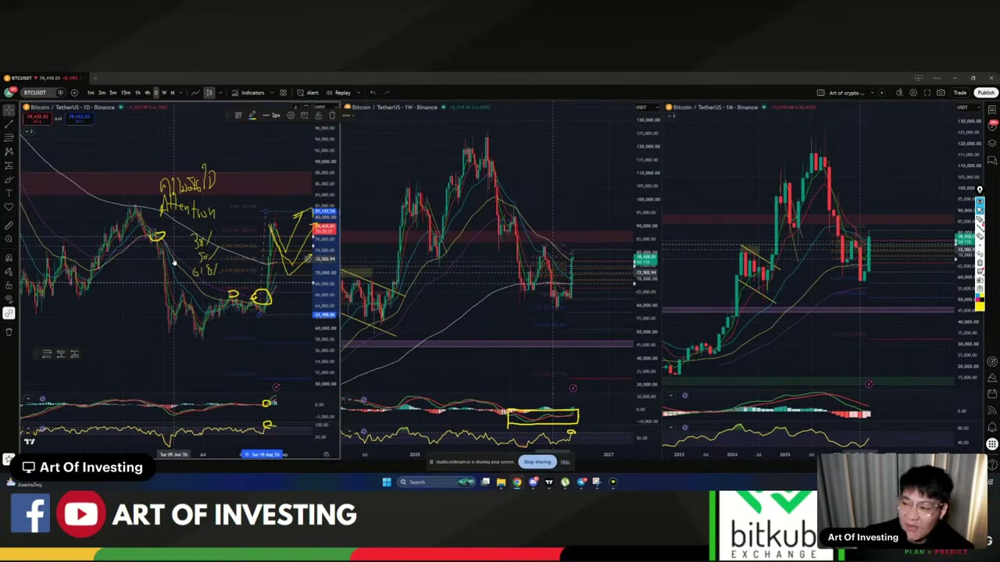

[00:38:30] มันย่อมาประมาณเนี้ยแล้วมันมีออเดอร์ซื้อ เข้ามาเร็วแปลว่าคนมาสนใจตลาดเร็วแค่นั้น เองงั้นภาพของผมอ่ะครับก็คือพอยตรงเนี้ย ผมก็จะไม่ซื้อสปอร์ตเพิ่มะถ้าเกิดมันไม่ ย่อพอร์ตเก็รงกำไรนะในพอร์ต GR นะในพอร์ต Alpha นะไม่ใช่พอร์ตแบบ DCA ระยะยาวนะ แยกๆก่อนนะผมพูดให้ชัดอีกครั้งนึงนะใน พอร์ตที่แบบผมต้องการซื้อเป็นเล่นรอบอ่ะ อ่ะไอ้พอร์ตลงทุนระยะยาวลงไปเลยครับถ้า ถ้าเกิดคุณเชื่อในแล้วแบ่งเงินไว้แล้ว เช่น 30% ของพอร์ตเป็นบitcoinอะไรเงี้ย อ่ะคุณจะ DCA โอเคผมว่ามันมันไม่ได้มี ปัญหาแต่ว่าในพอร์ตที่ต้องการเล่นรอบอ่ะ ถ้าเกิดมันไม่ย่ออ่ะผมคงไม่ไม่รีบเก็บ สปอร์ตเพิ่มนะครับด้วย 4 ข้อที่ผมพูดไป ต้นไลฟ์นะครับแล้วก็การย่อตรงเนี้ยนะครับ มันจะเป็นการส่งโมเมนตัมให้ week เนี่ย ขึ้นด้วยนะครับเพราะว่าตอนเนี้ย day เนี่ยมันถ้าเป็นโมเมนตัมอ่ะมันจะเหมือน การส่งไม้วิ่งผลัดมีมีนานักกีฬาวิ่งผลัด

[00:39:30] เรานึกออกใช่มั้ยฉะนั้นนักกีฬาไม้ที่ 1 เนี่ยเค้าวิ่งคว้าไม้มาแล้วแล้วเวิ่งถึง ไม้ที่ 2 แล้วแต่ไม้ที่ 2 มันยังไม่พร้อม รับไม้ต่อนะครับงั้นการย่อตรงเนี้ยมันก็ จะบ่งบอกว่ามันจะส่งถึงนักวิ่งคนต่อไปให้ เขาค้าออกตัวแล้ววิ่งต่อไปเลยได้มย ถ้าเกิดคำตอบมันคือได้เลยพร้อมเลยได้ไม้ แล้วสับสับวิ่งต่อเลยนะครับมันก็จะเป็น ภาพแบบนี้คือ อ่ะเดี๋ยวนะ อ่ะมันก็จะเป็นภาพแบบนี้คือย่อมาแถว 74,000 อย่างที่ผมบอกนะถ้าย่อมาตรงเต้อง เกิด new  high นะเราต้องวิ่งแรงด้วยนะ ครับเพราะว่าการย่อน้อยเนี่ยครับมันแปล ว่าการสะสมจำนวนออเดอร์เนี่ยมันมันไม่ได้ เข้าไปเพิ่มเยอะvolุeไม่ได้เยอะมากนะครับ แล้วขึ้นต่อตรงเนี้ยถ้าอยากจะขึ้นไกลอ่ะ ต้องขึ้นแรง นะครับเพราะว่าถ้าเกิดขึ้นแรงไม่ได้เนี่ย ในทางทฤษฎี Technical  Analysis อ่ะมันจะ บ่งบอกว่ามันเป็นแค่แค่รายย่อยกลุ่มใหญ่ๆ ที่ที่พยุงราคาต่อรายใหญ่มันไม่ได้เข้ามา

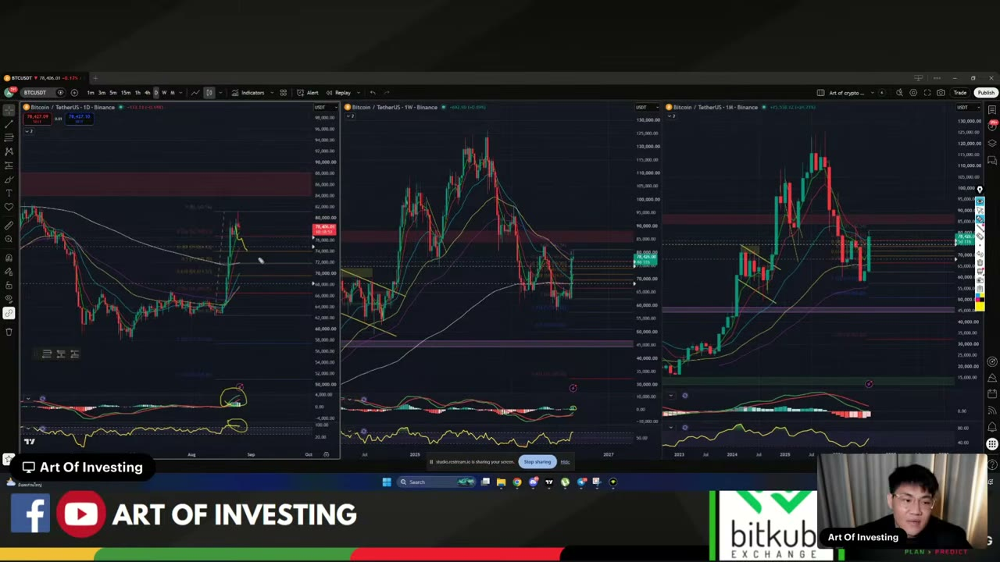

[00:40:34] แบกเทรนด์แต่อันนั้นเป็นแค่ทฤษฎีเนาะ อย่างที่ผมบอกว่าผมไม่อยากให้ไปมองว่าแบบ เฮ้ยลายใหญ่มาหลอกกินลายย่อยมาล่า Stop Loss อ่ะภาพรวมมันต่างกันนะครับงั้นย่อ ย่อเล็กน้อยเนี่ยถ้าเกิดมาเกิดโมเมนตัม เนี่ยก็ผมก็อาจจะเล่นไม้รองสั้นๆขึ้นไป เลยนะครับแล้วก็ดูโมเมนตัมว่าถ้าเกิดมัน มันดรอปอย่างเงี้ย ผมก็อาจจะอาจจะออกนะครับอ่ะ 2  2 พอย์นี้ นะที่ผมที่ผมมองว่าดีส่วนถ้าเกิดย่อมาที่ EMA  200 อันเนี้ผมจะชอบมากนะครับเพราะ ว่ามันเป็นการกลับมารีทestโซนที่ครึ่งนึง ของสวิงพอดีนะครับที่เอ่อมันเบรกขึ้นไป ซึ่งจะทำให้ตลาดเนี่ยได้วัดว่าความ ต้องการของออเดอร์ใหม่ๆที่ยังอยากจะซื้อ บitcoinเนี่ยมันเยอะแค่ไหนถ้าเกิดย่อมา ที่ครึ่งสวิงแล้วหลักการของผมนะครับก็คือ ผมจะเทียบ 2 timeม frame สมมุตินะอ่ะผม ให้ดูอย่างงี้ อ่ะเป็นอย่างงี้ก็ได้อ่ะนึกภาพนะสมมุติ ว่ามันย่อมาที่แถว 72,000 ใช่มั้ยมันก็จะ

[00:41:36] ลงมาที่อะไรประมาณประมาณ EMA  75 ของกราฟ 4 ชม.พอดีถูกมั้ยครับ กราฟมันก็จะเป็นอย่างงี้เลยตึกๆๆย่อลงมา งั้นพอผมเห็นว่าเอ้ยมันพอดีกับ EMA ที่ มันเป็นแนวแนวรับเนี่ยหรือว่าเป็นค่า เฉลี่ยแนวรับเนี่ยที่มันอยู่ในtimeมfrฟม ที่เล็กลงเนี่ยงั้นเราจะดูยังไงว่า โมเมนตัมมันเริ่มกลับมาแล้วนะครับคำตอบก็ คือผมก็จะไปดูtimeมfrฟมที่เล็กกว่านั้น อาจจะเป็น 1 ชั่วโมงก็ได้เพราะว่าถ้าเกิด ย่อลงมาเนี่ยมันจะเกิดอะไรคำตอบคือ พรีเมี่มถูกป่ะมันก็จะเกิดภาพอย่างเงี้ย อ่ะผมวาดให้ดูเผื่อใครนึกไม่ออก อย่างงี้ถูกป่ะ ตึงผ่านไม่ได้ตึ้งผ่านไม่ได้ตึ้งผ่านไม่ ได้ทีเนี้ยผมไม่รู้แล้วว่ามันจะย่อมาที่ 74,000 หรือ 72,000 ถ้าถึงส่วนถ้าไม่ถึง ผมก็คงไม่ยังไม่เล่นรอบเพิ่มเยอะนะครับก็ จะถือแค่สปอตเท่าที่มีอ่ะในพอร์ตเล่นรอบ นะก็จะถือแค่นั้นน่ะรอบนี้มันจะให้ผมเก็ง กำไรน้อยหน่อยผมก็ยอมน้อยหน่อยเพราะว่า ความเสี่ยงเดือนหน้าผมมองว่ามันยังผันผวน นะครับใครที่เล่นเลateเยอะๆก็อยากให้อยาก ให้ระวังตัวนิดนึงนะครับระวังระวังไว้นิด

[00:42:38] นึงนะฉะนั้นถ้ามันเบรคอย่างเงี้ยอ่าผมก็ อาจจะลองลอง follow ไปนะครับลองลอง follow ขึ้นไปอย่างเงี้เช่นอุ๊ย MacD ลงมาใต้ ศูนย์แล้วกลับมาเหนือ 0 แล้ว RSI กลับ มาบอแล้วอย่างเงี้ยอ่ะผมก็อาจจะ follow ไปถ้ามันเกิดการย่อนะครับที่โซนแบบ 7,000 72,000 ถ้าโมเมนตัมกลับมาอีกครั้งผมก็ มองว่าค่อนข้างสวยนะครับสำหรับการเล่น เล่นรอบเกณฑกำไรแต่เราไม่รู้อะไรยาวเป็น ไงเนาะส่วนเคสก็คือถ้าเกิดวิกฤตมันเกิด ขึ้นจริงๆ นะครับถ้าเกิดวิกฤตมันเกิดขึ้นจริงๆก็คือ เดือนหน้าเนี่ยไอ้ข้อ 3 ข้อ 4 มันดันเอา จริงก็คือญี่ปุ่นประกาศขึ้นดอกเบี้ย ครั้งแรกที่ไม่มีมาหลาย 10 ปีแล้วก็ antropic  list เข้าตลาด IPO แล้วเม็ด เงินที่เข้าต่ำกว่า valuation ค่อนข้าง มากแล้วมันทุบหนักเนี่ยผมมองว่าเคสนั้น น่ะเป็นผลดีต่อบitcoinนะครับในการเก็บ ระยะยาวก็คือเราจะได้ของถูกแล้วคนก็จะ

[00:43:38] กลัวด้วยถูกป่ะคำถามคือคือคือใครไม่กลัว บ้างอ่ะถ้าเกิดตลาดอเมริกาเริ่มแครชจาก antropic ที่ขึ้น IPO แล้วก็แบบเฮ้ยหุ้น อเมริกาที่เขาต้องการลงทุนกันเนี่ย valuation หรือประเมินค่าก่อนเข้าตลาด จริงเนี่ยโคตรสูงเลยแต่พอเข้าไปปุ๊บเม็ด เงินเข้า 40% หรือ 30% ของที่ประเมิน ค่าไว้เฮ้ยแบบนี้เม็ดเงินที่เหลือในตลาด มันไม่ได้เยอะขนาดนั้นแล้วนี่หว่าอ่ะเกิด การพักตัวลงมาทุกคนกลัวหมดญี่ปุ่นขึ้นดอก เบี้ยครั้งแรกก็ทุกคนกลัวหมดฉะนั้นนะครับ มันก็จะเป็นจังหวะที่คนคิดว่าโอ้โหแบบ เนี้ยหลอกะไม่สามารถขึ้นระยะยาวได้แล้ว แบบเนี้ยจบจบแล้วแน่ๆตลาดไม่สามารถฟื้น ได้แล้วภาพแบบนั้นมันก็จะเกิดผมก็เลยมอง ว่าถ้าเกิดมันเกิดอ่ะสมมุตินะก็คือ 2 เคส ตรงนี้ไปแล้วที่ที่ผมมองว่าเฮ้ยมันโอเค ที่ที่จะขึ้นไปแถวๆแถวตรงนั้นได้นะครับ แต่ว่าถ้ามันเกิดเคสแบบย่อย่อหนักจริงๆ เนี่ยซึ่งเราไม่รู้เลยว่ามันจะมาแบบ 64,000 กลับมาที่ flip zซoneตรงนี้เลย มั้ยหรือหลุด New ตรงนี้เลยมั้ยอย่าง

[00:44:39] เงี้ยผมมองว่าเคสเนี้ยมันจะทำให้มันมันจะ วนมารับคนที่ตกรถก็คือผมด้วยแล้วก็มันจะ เป็นการวนมารับตกรถที่คนไม่กล้าขึ้นผม อธิบายแบบนี้ก่อนเพราะแม่อย่างอย่างเอ่อ ข้อมูลที่ผมไปเรียนมาจากจาน A จาน M เนาะ ที่เขา้าเป็นระดับผู้บริหารกองทุนแบบ 10 หลัก 10 มั้ยเออ 10 นะครับหมายถึงว่าเงิน ในกองทุนนะนะครับหลักสิบหลักที่เขาดูแล กองทุนมา 9 ปีเนี่ยก็คือผมไปเรียนรู้ เรื่องอชัขั้นมาค่อนข้างเยอะแล้วก็ เครื่องมืออื่นๆแหละนะครับที่ที่มันเป็น ตัววัด Management  Money กลไกการอ่าน Open  Interest หรือว่าอ่าน สัญญา Option ที่มันยังคงค้างแล้วยังไม่ ปิดสำหรับทองคำอ่ะถ้าดูวันต่อวันด้วยระบบ DTE นะหรือ 0  DTE เนี่ยมันเกิดแชัค่อน ข้างชัดเช่นเอ้ยเค้าซื้อประกันไว้ตรงนี้ เค้าต้อง H ตรงนี้แล้วพอราคาไปถึงเสาตรง นั้นปุ๊บแล้วมันสะท้อนเลยอย่างเงี้ยแต่

[00:45:40] บitcoinอ่ะมันน้อยกว่านั้นีคtionที่มัน เกิดขึ้นน่ะมันน้อยกว่านั้นผมเลยมักจะใช้ เสาเนี่ยไม่ใช่ตัวเทรดสะท้อนแต่ผมจะเทรด เข้าขึ้นไปหาเสาแทนเหตุผลคือเม็ดเงินใน ตลาดทองคำอ่ะมันสูงมากพอเม็ดเงินในตลาด ทองคำมันสูงมากอ่ะครับรายใหญ่อ่ะเค้าเลย เข้ามาจับชนแล้วกินค่าน้ำได้ง่ายหรือใน ภาษาอชัเขาเรียกว่าค่าพรีเมี่มคือแบบเอ้ย โต๊ะนี้แทงค์เท่าไหร่โต๊ะนี้แทงค์เท่า ไหร่จับชนกันกินค่าน้ำแต่ตลาดบitcoinหรือ cryptocurrนcyเนี่ยมันน้อยกว่าเยอะผมไม่ รู้ว่ากี่เท่าแต่เยอะมากฉะนั้นน่ะครับราย ใหญ่ถ้าเค้าต้องเลือก 1 นะตลาดที่มีสิน ทรัพย์เยอะเป็นอันดับต้นๆของโลกคนทั่วโลก เข้าใจหมดว่าคืออะไรเม็ดเงินเยอะเป็น อันดับต้นๆของโลกต่อการเทรดต่อ 1 วัน อย่างทองคำกับบitcoinที่ยังไม่ได้เยอะ ขนาดนั้นแน่นอนครับตลาดเนี่ยเขาจะเลือกมา กี่กินค่าน้ำในทองคำมากกว่านึกภาพง่ายๆ

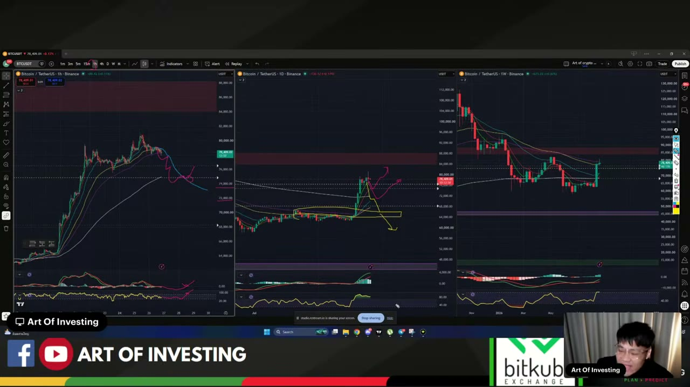

[00:46:42] ว่าโต๊ะนี่ยังเปิดแทงลิเวอร์พูลแมนยู โอ้โห YouTube จะแบนผมมั้เนี่ยเอ่อเป็น การเปรียบเทียบนะครับกับอีกโต๊ะนึงเปิด แค่ไทยลีกอย่างเดียวอ่ะไทยลีกอย่างเดียว ก็คือเป็นฟุตบอลประเทศไทยซึ่งตลาดมันคนละ เรื่องเนาะพรีเมียร์ลีกกับไทยลีกอ่ะ ฉะนั้นีคtionมันก็จะเกิดน้อยกว่าพอเกิด เนี่ยเราก็เลยตีความได้เลยว่าไอ้เม็ดเงิน ที่มันคงค้างอยู่บนสัญญา option เนี่ยมัน อาจจะไม่ได้เกิดการ settlement ทันทีมัน อาจจะไม่ได้เกิดการปิดแล้วก็เหจเพื่อกิน ค่าน้ำอย่างทันทีมันเป็นความสนใจของตลาด จริงๆแล้วเขาต้องเล่นกันด้วยสปอตมากกว่า สำหรับกองทุนที่ต้องการถือขึ้นไปแล้วไป ปล่อยของที่ปลายเทรนด์ฉะนั้นน่ะเขาต้อง เล่นด้วยสปอตมากกว่าแค่การ h แล้วกินค่า น้ำละพอเค้าเล่นด้วยสปอเนี่ยนั่นคือหนึ่ง ในทฤษฎีที่ตรงกับ eli  wave เอ่อวันก่อนก็มีเพื่อนแสดงว่าแบบเอ้ยฟัง ผมมานานหลายปีมากเลยถึงแบบจำประโยคนี้ได้ ผมก็ดีใจมากเลยนะครับคือคุณไวเนียมDมอ

[00:47:46] Diamond  Hand ถ้าผมจำชื่อไม่ผิดนะใน กลุ่ม Telgram เนาะเค้าก็บอกว่าผมเนี่ย เคยพูดไว้ว่าถ้าเกิดตลาดมันจะขึ้นจริงๆ อ่ะมันจะขึ้นเร็วและแรงเสมอเพราะว่ามันจะ ต้องไม่ต้องการให้รายย่อยเนี่ยขึ้นรถทัน เพราะอะไรรู้มั้ยคุณไปศึกษากราฟคุณไป ศึกษาTechคnical Analysis เนี่ยทำไมคุณ ถึงไม่สามารถหาต้นเทรนดเจอเลยแม้กระทั่ง จาน A ที่เป็นระดับเทรดเดอร์กองทุนน่ะ เขาค้าก็บอกว่าการหาจุดที่จะเกิดการพัก ตัวง่ายกว่าหาต้นเทรนด์เพราะ age หรือความได้เปรียบในการหาเนี่ยมันยากมาก นี่คือคำตอบครับเพราะว่าถ้าเกิดสินทรัพย์ นั้นน่ะเราจับได้ว่ารายใหญ่ต้องการถือ สปอตหรือรายใหญ่ต้องการเล่นกับสปอตมาก กว่าตัวสัญญา option ขึ้นมาหรือสัญญา เครื่องมือทางการเงินตัวอื่นเมื่อไหร่ สิ่งที่เกิดขึ้นคือ เค้าไม่ต้องการให้คนส่วนใหญ่ขึ้นรถทันคุณ นึกภาพนะสมมุติว่าทุกคนที่ฟังผมอยู่ตอน

[00:48:46] นี้ 200 กว่าท่านขอบคุณคนดูทุกท่านนะครับ ขึ้นรถทันที่ 58,000 หมดเลยอ่ะนึกภาพตาม ผมง่ายๆคุณขึ้นรถทันที่ 58,000 หมดเลยอ่ะ ผมถามว่าถ้าเกิดราคาขึ้นไปถึง 90,000 อ่ะ แล้วสมมุติว่าเค้าต้องการจะผ่อนละต้องการ จะปล่อยของต้องต้องการจะขายแล้วอ่ะ คุณจะอยากซื้อจะเป็นจะตายมั้ยสมมุติว่า คุณมีเงิน 10 ล้านคุณซื้อที่ 58,000 ไป 9 ล้านแล้วอ่ะคุณเหลืออีกล้านึงพอราคาขึ้น มา 90,000 คุณแบบคุณจะเป็นจะตายมั้ยเฮ้ย อู้หูยังซื้อไม่ครบ 10 ล้านเลยเว้ยโอ้โหย ซื้อไปแค่ 8 ล้านเองเอ้ยเอ้ยซื้อไป แค่ 9 ล้านเองต้องซื้อให้ครบ 10 ล้านให้ ได้เลยว่ะอีกล้านนึงต้องรีบเข้า 90,000 ตรงนี้ฉันจะซื้อไม่หรอกถูกป่ะคุณก็จะแบบ นั่งนับเงินแล้วอ่ะโอ้โหยกูเข้าไป 9 ล้าน นี่กี่เปอร์เซ็นต์แล้ววะเนี่ยโอ้โหเกือบ 100% เอ้ยเข้าไป 9 ล้านกำไรมาโอ้โห มีเงินในพอร์ตจะ 20 ล้านแล้วคุณก็แบบ นั่งจิบแชมเปญเปิดเบียร์กินแล้วถูกป่ะ

[00:49:48] ย่างกุ้งเรียกเพื่อนมานั่งกินเตา บาร์บีคิวแล้วพอเป็นแบบนั้นน่ะครับมันก็ เลยอธิบายเรื่องคลื่นปรับของ Wave โอ้โห วันนี้สอนเยอะอีกแล้วนะครับอ่ะคลื่นปรับ ของ Wave กับทฤษฎีไวคขอ โหลายมือขออภัยที่[เสียงหัวเราะ] ลายมืออายทุกทีเลยนี้ต้องเขียนนะครับอ่ะ คลื่นปรับ El  Wave เนี่ยเขาจะกล่าวไว้ใน ทฤษฎีว่าถ้าเกิดมันจมนานแล้วมันจะกลับมา ขึ้นในจังหวะแรกเนี่ยมันจะเร็วและแรงส่วน YC เนี่ยมันก็จะมีอะไร accumulation แล้วก็ distribution ถูกป่ะมันจะมี accribution เฮ้ยทำไมอ่ะคุณอาร์ตทำไมมันต้องมีแบบนั้น เพราะว่าเขาก็จะต้องมีโซนสะสมของสะสมของ อีกครั้งแล้วก็โซนปล่อยของไงมันจะต้องมี

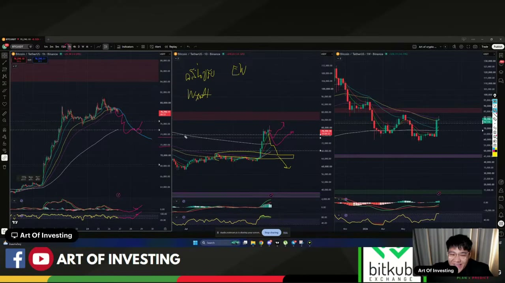

[00:50:51] แบบนี้มันก็เลยมีทฤษฎีไวคอสขึ้นมานะครับ ไอ้ไอ้โซนตรงเนี้ยมันก็เลยต้องเป็นโซนสุด ท้ายที่เขาจะค่อยๆให้ลายลายย่อยเนี่ยต้อง รับของจากเขาไปถ้าเกมที่เขาเล่นคือสปอร์ต ฟังผมดีๆนะถ้าเกมที่เค้าเล่นคือสปอมาก กว่าการใช้เครื่องมือเพื่อกินค่าน้ำซึ่งณ วันนี้มันยังเป็นอยู่แต่วันนึงที่ Bitcoin มันเป็น stock  value ของโลกแล้วอ่ะมันก็ จะไม่เป็นแบบนี้แล้วreีอคtionต่อวันมันก็ จะเยอะเท่าทองแหละ OI ยังใช้ได้ดีมากนะ ครับแต่ว่าผมมองว่าใช้ในการเทรดไปหาเสามี ผลเท่าที่ผมเก็บ data มานะยังไม่ยังไม่ 100%  60-65% ละ มีความได้เปรียบมากกว่าการเทรดสะท้อน แต่ว่าคุณต้องใช้ศาสตร์อื่นอย่างผมผมใช้ โมเมนตัมนะครับอ่ะอย่างเงี้ยโอเคกว่าแล้ว จำได้มที่ผมเขียนในเพจโอ้โหผมว่าผ่าน 72,000 ยากแต่ถ้าผ่านเนี่ยมันจะพรวดไป 75,000 แล้วพรวดจริงๆปรืดเดียวนะ เพราะว่า OI มันแหว่งอ่ะอย่างเงี้ยเห็น มั้ยแทนที่ผมจะไปรอช็อตที่ 75,000 หรือ อะไรอย่างเงี้ยเรามองช็อตเบรค out ดีกว่า อือันเนี้ยมันจะประยุกต์อ่ะเดี๋เอาทีละ

[00:51:53] เรื่องนะมันก็เลยเป็นทฤษฎีตรงนี้นะครับ ว่ามันจะต้องมีโซนเก็บสะสมของสะสมของอีก ครั้งแล้วก็โซนปล่อยปล่อยของหรือหรือ distribution เพราะว่าอันเนี้ยเค้าจะ ต้องโถมข่าวดีถูกป่ะแล้วก็คอยประคองซื้อ เช่นราคาลงมาเกิดเค้าเนี่ยแหละทำกำไรราคา ลงมาเค้าจะต้องช่วยซื้อขึ้นไปแล้วเค้าทำ กำไรลงมาแล้วเค้าก็จะต้องช่วยดันขึ้นไป เพื่อให้คนมันคิดว่าโอ้โหมันยังมีแนวรับ อยู่เฮ้ยรายใหญ่ยังอยู่กับพวกเราเว้ย รายใหญ่ซื้อเพิ่มใหญ่เลยมึงดูดิ ยังไม่หนีกูไปหรอกอ่ะทีเนี้ยพอเค้าขายของ จนเท่าที่เค้าคำนวณเสร็จแล้วว่าแบบอ่ะเรา รีบanceพอร์ตกองทุนของของเราเสร็จแล้ว หรือ H1 ของเราเสร็จะเดี๋ยวเราจะไปทำ Delta  Natural กับจุดนี้นะเดี๋เราจะไป รีบ Balance กับจุดนี้นะเดี๋ยวเราจะคำนวณ พอร์ตเบต้าของเราใหม่นะเราจะเกิดการค่อยๆ ทยอยซื้อตัวนี้พอเค้าคำนวณเสร็จแล้วอ่ะ ไอ้แรงซื้อตรงเนี้ยมันก็หายเอามันก็หมดไง ครับมันก็เลยจะไหลพรวดเลยฉะนั้นตอนขึ้น กับตอนลงจบรอบอ่ะมันเลยจะแรง

[00:52:53] นะครับมันเลยจะแรงเนี่ยเป็นที่มาของทฤษฎี ต่างๆนะครับงั้นการที่มันย่อน้อยเนี่ยมัน แปลว่าคนประคองเทรนด์เนี่ยมันไม่ใช่ราย ใหญ่ไงแล้วถ้าเกิดคุณอยากเห็นภาพว่า Healthy  Collection เป็นไงคุณดูนะว่า อ่ะเดี๋ยวเดี๋ดูสวัสดีครับคุณ T สวัสดี อ่ะคุณดูนะว่าตั้งแต่มันมีรายใหญ่ที่ เขา้าบอกว่ามันมันมี ETF อ่ะแล้วมันได้ รับการยอมรับอ่ะบitcoinมันวิ่งต่างจาก เดิมยังไงนะอ่ะคุณดูนะที่ผ่านมาอย่างเงี้ เห็นมั้ยเห็นมั้ย 2017 ขึ้นลวดเดียว ปื๊ดถึง 20,000 แล้วร่วงเห็นป่ะอันเนี้ย คือที่แบบอ่ะรายย่อยอ่ะคนทั่วไปอ่ะแล้ว คุณดูอีก ปื๊ดเดียวแล้วลงแล้วก็ปื๊ดเดียวแล้วก็จบ เลยเห็นมั้สิ่งที่สำคัญคือตรงนี้นะไอ้ จังหวะแรกที่ขึ้นอ่ะแล้วคุณดูรอบล่าสุดพอ มีสถาบันปุ๊บพอมี ETF ถูกกฎหมายปุ๊บพอ เม็ดเงินสามารถเข้าโดยเครื่องมือทางการ

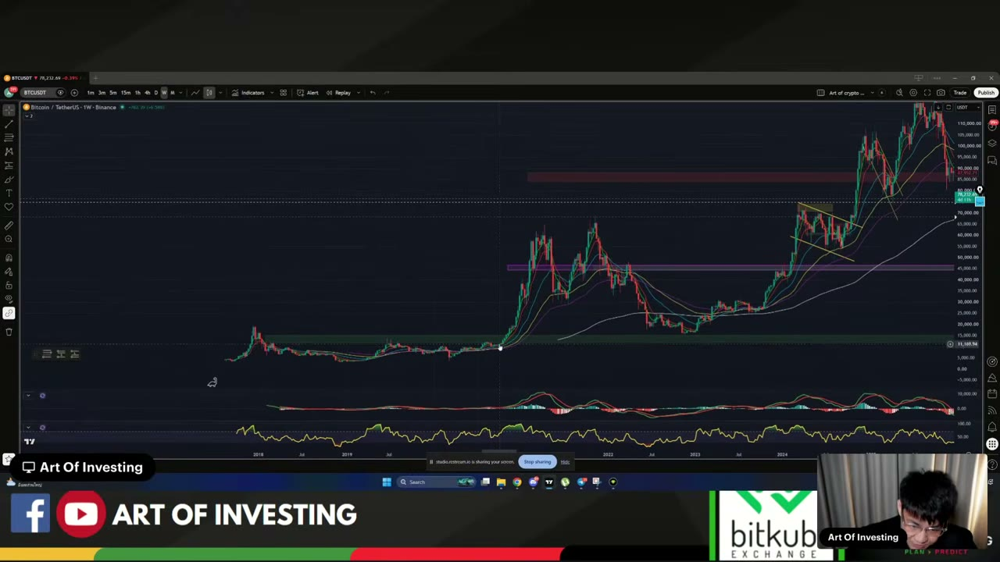

[00:53:54] เงินได้ปุ๊บคุณเห็น Healthy  Colorlection ป่ะลงมาปกติเคยถึงเหรอ EMA  50 อ่ะ EMA 25 ยังไม่ถึงเลยดู EMA เส้นแรกเลยเนี่ย สีแดงเห็นป่ะคือโฟโม่จัดขึ้นสุดลงสุดจบ แยกย้าย 4 ปีเจอกันเพื่อนตอกบัตรออกเลิก งานแต่นี่ไม่ใช่ขึ้นไปปุ๊บกุ๊กกิ๊กๆๆย่อ ขึ้นไปปุ๊บกุ๊กกิ๊กๆย่อขึ้นปุ๊บหลุดเห็น มั้ยมันมี Healthy คlectionที่มันลึกขึ้น ซึ่งอันเนี้ยมันเป็นรูปแบบการเข้าสะสมของ กองทุนน่ะที่ที่เค้าต้องทำแบบเนี้ยเพราะ เม็ดเงินเค้ามันเยอะมากนึกออกมั้ยครับคือ เม็ดเงินเค้ามันใหญ่เค้าไม่สามารถเข้าออก ได้ทันทีแบบทันท่วงทีตลอดเวลานะครับมันก็ เลยเป็นอย่างี้นะครับทีเนี้ยผมก็เลยมอง ว่าถ้าเกิดมันไม่มี Healthy  Collection แล้วมันขึ้นไปเลยอ่ะมันก็ยิ่งเป็นการยืน ยันว่าvolุeที่เข้ามามันไม่ได้เยอะขนาด นั้นแล้วมันก็ไม่ได้เป็นเงินใหม่ของตลาด มันอาจจะเป็นเงินของคนที่เพิ่งขายตรง

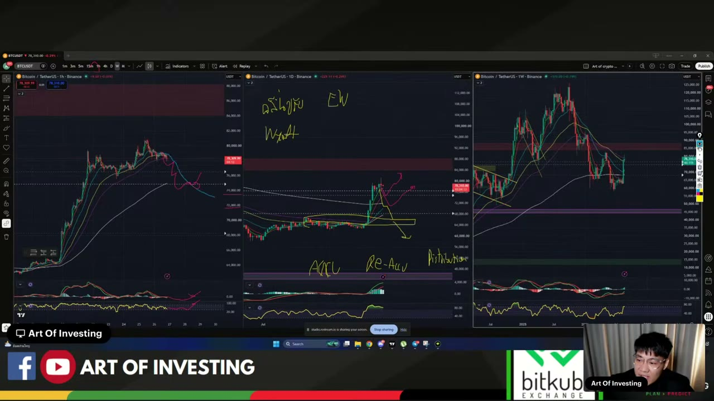

[00:54:56] แล้วกลับมาซื้อคุณดูเลยมันขึ้นมาที่เดิม นะเว้ยวอลุ่มพอๆกันนะมันออกลวดเดียว 3 สัปดาห์นี่ก็ 1 สัปดาห์ 2 สัปดาห์แค่ขึ้น มาที่เดิมวอลุ่มมันก็ยังไม่ได้เยอะเท่า ตอนขายออกจากตลาดด้วยซ้ำอ่ะนะครับฉะนั้น ภาพรวมตอนเนี้ยผมเลยบอกว่าเฮ้ยระวังเพิ่ม หน่อยไม่ได้บอกว่าจะไม่ขึ้นเล่นได้ตาม สบายคุณจะสะสมคุณจะมองว่าขึ้นแล้วรัดเข็ม ขัดเต็มที่ผมมองว่าโอเคแต่แค่เฮ้ยระวัง เพิ่มหน่อยอย่าเพิ่งไปแบบ all  in อัด เต็มที่แล้วคิดว่ามันจะต้องสมูทเหมือนรอบ ที่ผ่านมามันจะต้องเกิดความผันผวนกว่าทุก รอบหน่อยทีเนี้ยเราไม่รู้แล้วว่าไอ้ความ ผันผวนเดือนหน้ามันจะออกหน้าไหนถูกป่ะ เพราะว่า ถ้าเกิดอ่ะตรงนี้เพื่อนๆน่าจะเริ่มทันกัน แล้วผมไปต่อเลยนะอ่ะถ้าเกิดมันเป็นอย่าง เงี้ญี่ปุ่นขึ้นดอกเบี้ยครั้งแรก แอนทopicเป็น Domin ทำให้เม็ดเงินมัน ยืนยันแล้วว่าสภาพคล่องเงินที่เหลือใน ตลาดโลกอ่ะมันไม่ได้เยอะขนาดนั้นแล้วมัน ทุบมันเทตลาดอเมริกาเริ่มการปรับตัวไม่

[00:55:56] ต้องลงเยอะหรอกสัก 20-30% เนี่ยโอ้โหตลาด แตกแล้วครับงั้นมันก็อาจจะเห็นย่อลึก อย่างี้ก็ได้เงี้อ่ะเราไม่รู้ถูกป่ะลงมา sideway แล้วค่อยว่ากันอีกทีเป็นเคสนี้ ได้นะเดือนหน้าถูกมั้ยกันยายนแล้วค่อย กลับมาขึ้นตุลาคมได้แล้วถ้ากลับมาขึ้น ตุลาคมพฤศจิกายนอ้าวตรงทฤษฎีพรรค 15 เดือนค่อยขึ้นอีกเคสนี้ก็ได้หรือเราอาจจะ กลัวไปเองก็ได้มันอาจจะขึ้นแค่นี้ก็ได้ ย่อนิดเกี่ยวกูไปเลยโอ๊ยสรุปญี่ปุ่นยัง ไม่ขึ้นดอกเบี้ยครับแอนทopicเข้ามาอู้หูย เม็ดเงินสูงกว่า valuation อีกครับสบาย แล้วแบบนี้เม็ดเงินในตลาดยังเหลือมันก็ อาจจะพืมปื๊ดไปต่อเลยก็ได้ถูกป่ะฉะนั้น น่ะเราไม่รู้คำถามคือคุณรับได้มั้ยถ้า เกิดมันย่อกลับลงมาตรงนี้พอร์ตคุณรับได้ หรือเปล่าบางคนเล่นแบบ 20x  50x เนี่ยนะ ครับระวังนิดนึงอ่ะยังไม่พอนะถ้าเกิดมัน เกิดมากๆแบบหนักเลยแล้วมันจะไม่ขึ้นปลาย

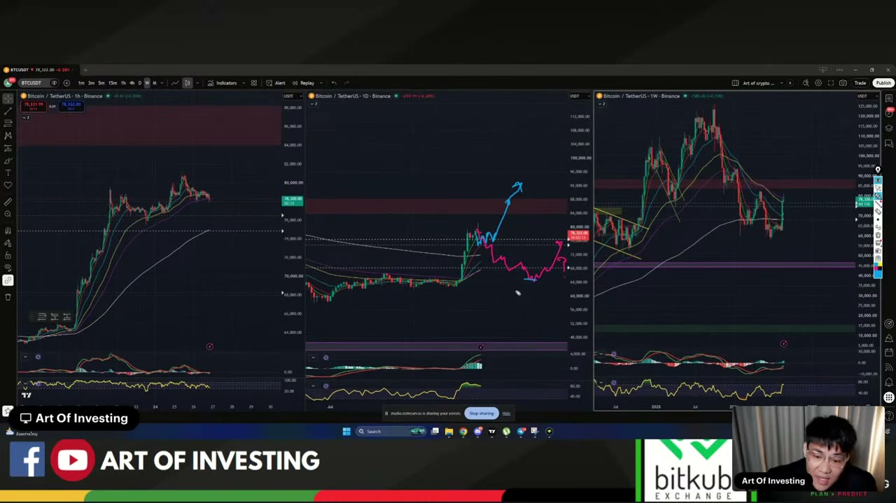

[00:56:56] ปีนี้แล้วมันจะไปขึ้นปีหน้าเลยก็คือแบบพอ ทุบอีกรอบปุ๊บเริ่มมีกองทุนโดนลิquidate หรือเริ่มมีบริษัทไหนก็ตามที่ทำuryเนี่ย เกิดปัญหาก็อาจจะเกิดนิวโรก็ได้แต่เคส นั้นผมให้ยากแล้วกันผมให้ 20% นะถ้าแบบ ย่อมาจนเกิดนิวโรลงไปอย่างเงี้ยนะผมให้ แค่ 20% อ่ะ อ่ะยากมากนะครับถ้าเกิดเคสเนี้ยผมก็คง เข้ามาใหญ่ทั้งพอร์ตเล่นรอบทั้งพอร์ตลง ทุนระยะยาวแต่ผมแค่มองว่ามันเป็นไปได้ยาก ยากนะมันเป็นไปได้ยากหน่อยถ้าเกิดมันไม่ ได้เกิดการล้มแบบdomมอีกแบบที่มันเคยเป็น มานะครับแบบตอนนั้นน่ะ Genesis ก็ล้มกอง ทุน Tree  AC ก็ล้มนะครับ Tre  Arrow Capital  STX ล้ม Luna ล้มอ่ะมันเป็น Domino เนาะแต่ว่ารอบเนี้ยอ่ะถ้าไม่ได้ แบบเอ้ยบริษัทอย่าง Strategy มีปัญหากลับ ไปขาดตัวแล้วตอนนี้เค้ากลับมากำไรแล้ว เห็นมั้ยเออผมก็เลยมองว่าเคสเนี้ยผมผมให้ ยากหน่อยแค่ 2 เคสเนี้ยสิ่งที่คุณต้อง ระวังอ่ะ นะครับไอ้อันเนี้ยผมก็ไม่รู้นะว่ามันมัน

[00:57:58] จะย่อถึงเท่าไหร่อ่ะอาจจะ 72,000 ก็ได้ 74,000 ก็ได้เราเราไม่รู้หรืออาจจะย่อ ตื้นมากแล้วไปเลยก็ได้ผมถึงบอกว่าถ้ามัน เกิดเคสเนี้ยผมผมคงไม่เข้าเพิ่มมากนักใน พอร์ตเก็งกำไรนะครับก็มีแค่นั้นก็ไปแค่ นั้นนะครับอ่ะแต่ถ้าย่อสวยว่ากัน คือรอบเนี้ยคุณสังเกต outcoin หน่อย แป๊บนึงครับแอร์เป่าหัว Outcoin เนี่ยวิ่งตลกมากเลยนะคุณดู แบบนี้แต่ละตัวคุณลองไปเปิดกราฟดูนะ เดี๋ยวๆผมเปิดให้ดูก็ได้เดี๋ยวผมเทียบเลย ก็ได้มันจะไหลอย่างเงี้ยสมมุติว่ามันวิ่ง ๆอยู่ เห็นมะอ่ะหลายตัวเลยหรือขึ้นไปอย่างงี้นะ อ่ะใครเห็นกราฟ outcoin  2-3 วันมาเนี่ย

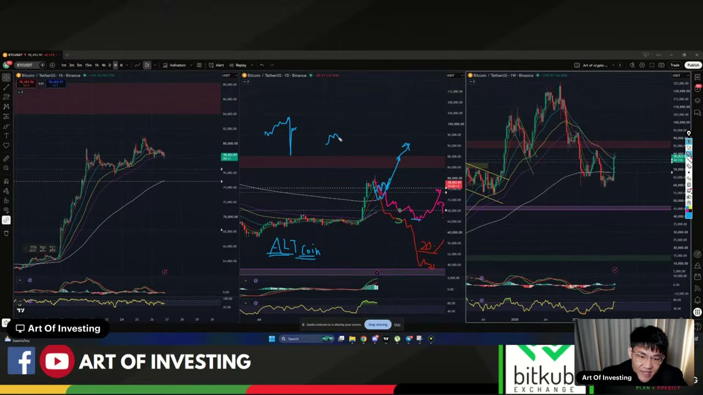

[00:58:59] อ่ะๆทั้งสัปดาห์มาเนี้ยเป็นอย่างี้บ้างกด กดเลข 0 มาให้ผมหน่อยนะครับเดี๋ยวผมจะ อธิบายให้ฟังว่าทำไมกดเลข 0 ให้ผมหน่อยกด ๆไลฟ์ไลฟ์ด้วยครับผมมันจะได้ขึ้น YouTube นะคนจะได้เจอเรามากขึ้นครับกดๆไลไลฟ์ไว้ หน่อยครับแล้วก็อ่ะใครเห็นกราฟ outcoin แบบเนี้ยในในสัปดาหที่ผ่านมากดๆเลข 0 มา ให้ผมหน่อยนะครับผมจะอธิบายให้ฟังว่าคือ อะไรคำตอบคือมันคือคำสั่ง falce liquidation ครับ อ่ะโอเคครับอ่ะเป็นอย่างงี้ ซึ่งการการ force  liquidation คืออะไร ครับแล้วทำไมมันลงแล้วมันถึงเด้งกลับที่ เดิมแปลว่าการที่มันขึ้นมามันขึ้นมาด้วย lever  rate ของ out นะหลายๆตัวนะ

[01:00:02] เพราะว่าแบบเนี้ยครับแปลว่าไม้รองแตก เพราะว่าการลองคืออะไรครับการลองคือคุณ กู้เงินเพื่อซื้อเหรียญตรงนั้นทีเนี้ยจุด หรือจุดล้างพอร์ตมันคือจุดที่ exchange บอกว่างั้นถ้าลงไปถึงตรงนั้นน่ะไอ้เงิน ที่ฉันให้นายกู้อ่ะฉันเอาคืนพร้อมเงินที่ นายค้ำไว้นะ เพราะว่า Exchange ไม่ต้องการเสี่ยง สมมุติว่าคุณเล่น 20X  Exchange ก็เอา เงินเค้าอ่ะซื้อเหรียญนั้นให้ก่อนอ่ะอัน นี้พูดในแบบเชิงอธิบายนะซื้อเหรียญนั้น ให้ก่อนแล้วก็บอกว่าอ่ะทีเนี้ยถ้าเกิดมัน ลงไป 5% เนี่ยฉันเอาเงินต้นทั้งหมดคืนนะแล้ว เอาเงินค้ำประกันของนายไว้ด้วยเพราะว่า เงินตรงเนี้ยนายใช้เงินของฉันในการซื้อ มันเลยมีการ liquidate นะครับงั้นพอมัน เกิดการ liquidate หรือถึงจุดจุดที่

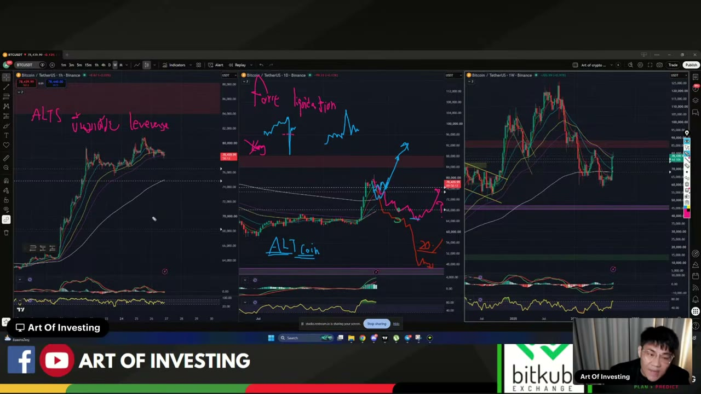

[01:01:03] Exchange ต้องเอาเงินคืนละเพราะว่าเงิน ค้ำประกันของเราอ่ะมันเป็นศูนย์ละมันเกิด คำสั่งบังคับขายไงครับ พอเกิดการบังคับขายมันก็จะทำให้ราคาตลาด ลงถูกป่ะเพราะว่าแบบอ้าสมมุติว่ามีเงิน ตรงเนี้ย 200 ล้านโดนบังคับขายมันก็ขาย ตลาดอ้าวเฮ้ยไม้รองกูไปละขายๆ Exchange เอาเงินคืนพอไปขายลงไปอีกเอ้ามันไปเจออีก ไอ้ตรงนี้ของคนอื่นอีก 400 ล้านถึงราคา ที่โดนบังคับขายแล้วมันก็ขายตลาดอีกตู้ม แล้วก็ไปถึงตรงนี้ไอ้ตรงนี้ตั้งไว้อีก 200 ล้านก็โดนอีกฉะนั้นนะครับมันจะเป็นการ บังคับขายของเงินก้อนนึงแล้วก็ลากลงไปถึง เงินอีกก้อนนึงแล้วก็ลากลงไปถึงเงินอีก ก้อนนึงจนโดนบังคับขายบังคับขายบังคับขาย บังคับขายรัวๆพอเป็นแบบนั้นน่ะอ้าวคุณ อาร์ตแล้วทำไมมันเด้งกลับที่เดิมอ่ะก็ เพราะว่าคำสั่งโดนบังคับขายมันหยุดไง มันหมดแล้วก็คือที่เขาบอกว่าล้างสะอาดอ่ะ

[01:02:04] พอมันไม่มีอะไรบังคับขายใส่ตลาดอ่ะมันก็ ฟื๊ดกลับสู่สมดุลผมเลยบอกว่าถ้าแบบเนี้ย ขึ้นไม่Healthตี้เพราะว่าขึ้นจาก leverage เพราะว่าถ้าเกิดมันขึ้นจากสปอตซะส่วนใหญ่ โดนบังคับขายรัวๆเนี่ยมันจะต้องไม่เกิด กราฟทรง JD แบบนี้อย่างมากก็แค่แบบตึ๊ด อะไรเงี้ยมันก็จะHealตyนึกออกป่ะแต่รูด ปื๊ดเลยแบบเนี้ยอ่ะนี่คืออีกหนึ่งสาเหตุ ที่ผมบอกว่าผมจะระวังการเล่น Outcoin มาก หน่อยในไซเคิล นะครับเนี่ยคือจุดที่ผมบอกว่าเออผมจะ ระวังการเล่น Outcoin มากหน่อยในไซเคิล นี้เพราะมันแปลก นะครับมันขึ้นมาด้วย leverage เยอะผมก็ เลยไม่รู้ว่าไอ้เงินที่มันขึ้นมาแค่ leverage เ่ะในใน outcoin อ่ะเค้ากังวล อะไรกันเค้ากังวลไอ้ไอ้ 4 เคสแรกที่ผมพูด ไว้ต้นไลฟ์หรือเปล่าที่มันเกิดกลาง กันยายนหมดเลยประชุม Carity  Act ญี่ปุ่น จะขึ้นหรือไม่ขึ้นดอกเบี้ยโมซจะขึ้นหรือ ไม่ขึ้นดอกเบี้ยแล้วก็ Antropic นะครับ นะครับตรงนี้[เสียงสูดหายใจ]นะครับเรา

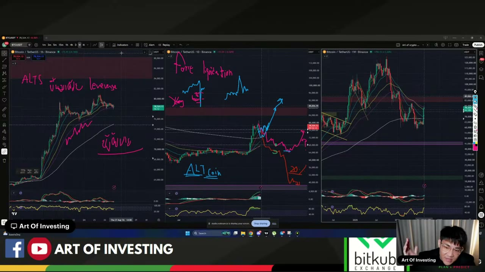

[01:03:05] ต้องดูตรงนั้นว่า เม้นต์เงินตรงเนี้ยมันกังวลอะไรแล้วพอเรา ไปดูกราฟ outcoin หลายๆตัวนะอ่ะเราไปดู กราฟ outcoin หลายๆตัวนะอย่างอ่ะตัวนึง เลยแล้วกันอย่างเงี้ย อ่ะอย่างเงี้ยผมก็มองว่าแบบเออมันก็พอดี เลยนะ[เสียงหัวเราะ] มันมาติดตรงเนี้ยแล้วมันย่อมาผมก็ตั้ง แจ้งเตือนไว้เห็นมยว่าถ้าเกิดมันลงมาแล้ว อ่ะแล้วมันเกิดโมเมนตัมขาขึ้นน่ะเออผมก็ ผมก็อยากจะขึ้นผมก็อยากจะเล่นนะครับแต่ ว่าถ้าเกิดมันมันไม่สามารถเกิดโมเมนตัมขา ขึ้นต่อได้มันจะก็จะเป็นทรงคล้ายๆกับตัว อื่นที่ผมเห็นอยู่แล้วผมค่อนข้างค่อนข้าง ไม่ชอบกราฟแล้วกันอ่ะพูดอย่างี้อ่ะเดี๋ เอาให้ดู เดี๋ยวผมหาตัวที่ยกตัวอย่างง่ายๆให้ฟัง

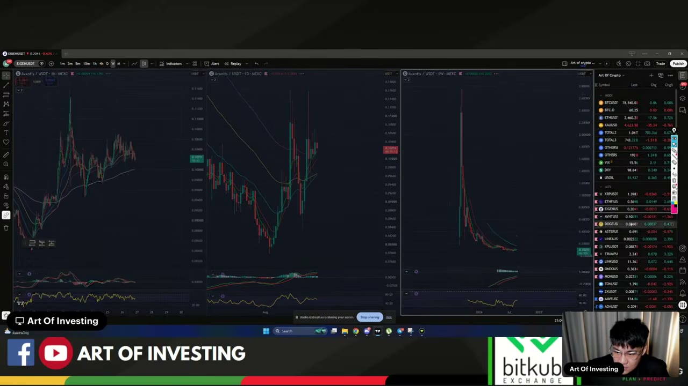

[01:04:18] อย่างเงี้ย เห็นมั้ยโคตรภาพซ้ำเลยผมก็เลยแบบเฮ้ย อย่างเงี้ยคอยวิ่งไม่จริงเลยอ่ะนะ ครับอย่างเงี้ยเนี่ยเห็นมั้ยคุณดูดิเนี่ย ภาพเดิมเลยอ่ะแบบติดแถวเดิมแล้วมันก็ มันก็ย่ออย่างเงี้ยหลายตัวเลยถ้าคุณไปไล่ ดูนะผมก็เลยมองว่าโอ้โห outcoin ไม่ ได้ขึ้นมาพร้อมตลาดว่ะขึ้นมาเพราะ narrative ที่ตลาดสร้างได้เฉยๆคือ บitcoinขึ้นแล้วโว้ยอ่ะมันไม่ได้ขึ้นมา เพราะแบบเอ้ยซื้อเหรียญซื้อเก็บหลายๆยาว มันมันคือ leverage อ่ะมันคือการเก็งกำไร อ่ะฉะนั้นนะครับผมเลยมองว่าถ้าเกิด Bitcoin คrectionเนี่ย outcoin ที่คุณ ถืออ่ะถ้าเกิดคุณไม่ได้ถือเป็นสปอตอ่ะ แล้วแล้วคุณตั้ง Stop  Loss หรือตั้งอะไร ไว้เนี่ยผมมองว่ามันมีโอกาสที่มันจะ เกี่ยวออเดอร์คุณสูงมากเลยมันอาจจะเกี่ยว ฟึ๊บมันอาจจะคว้าออเดอร์คุณได้แล้วแล้ว กลับไปขึ้นต่อหรืออาจจะทุบล้างลงไปเลย อะไรอย่างเงี้ยเออผมเลยอยากให้ระวังการ การเทรด outcoin ในไซเคิลนี้หน่อยนะผมอาจจะพลาด ก็ได้อ่ะสมมุตินะผมผมพูดอย่างี้เลยนะ

[01:05:19] เพราะว่าผมเป็นนักลงทุนเว้ย 12 ปีแล้ว แล้วการลงทุนน่ะหน้าที่ที่สำคัญที่สุดของ ผมอ่ะคือการพิจพิจารณาความคุ้มค่าจากการ เทคความเสี่ยงซึ่งผมมองว่าถ้าเกิด Outcoin ขึ้นมาด้วย Levage ขนาดเนี้ยไม่ ได้ขึ้นมาด้วยสปอตอ่ะถ้าผมไม่ได้เก็งกำไร มาด้วยสปอตหรือตัวที่ผมมองว่ามันมันได้ narrative จริงๆอ่ะผมไม่อยากเสี่ยงผมก็ เลยมองว่ารอบเนี้ยถ้ามันย่อมาผมผมain โฟกัสผมอยู่บitcoinดีกว่าอืนะครับแล้วถ้า เกิดบitcoinมันขึ้นไปสักพัก outcoin เริ่มย่อตาม loop  cycle ของมันเออผมค่อย วนมาเล่น outcoin หนักๆอีกทีนึงนะครับ งั้นในตอนเนี้ยเออก็ก็อยากให้ระวังหน่อย หน่อยเพราะว่า Outcoin เนี่ยผันผวนแน่ ยิ่งคุณไปเจอกลางเดือนหน้าเนี่ยนะครับ ยิ่งคุณไปเจอกลางเดือนหน้าเนี่ยผันผัวแน่ คือมันจะล้างลิquidateลงแบบฟืบเดียวอ่ะนะ ครับระวังนิดนึงนะครับระวังนิดนึงอ่ะมา ต่อที่บitคinนะก็ก็อย่างที่มองนะครับที นี้เป้าเนี่ยก็คือผมมองว่าหลักๆตอนนี้ก็ อยู่ที่ 82,000 กับ 85,000 นะครับที่ที่ เป็นเป้าเนาะ

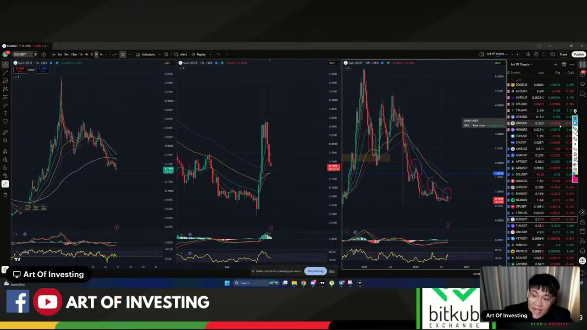

[01:06:21] นะครับถ้าเกิดมันขึ้นได้ซึ่งตอนเมันยัง ย่อไม่จบเราก็ไม่รู้ด้วยว่ามันจะย่อลึก ตื้นหนาบางแค่ไหนนะครับตอนนี้เงินเฟ้อก็ ยังยังดื้ออยู่นะครับแล้วก็เอ่อมีการ ประกาศ buy  back แต่ว่าก็ buy  back ยัง ไม่ได้เยอะเท่าไหร่ประมาณ 4 บิลเลี่ยนนะ ครับฉะนั้น อืมก็ต้องดูความผันผวนเดือนหน้านะครับอ่ะ ประมาณนี้ส่วนตอนเนี้ย OI ที่ไม่มีตั้ง หลังจากนั้นเลยอ่ะคือ 90,000 ผมไม่เห็น เลยนะครับก็คือ Open  Internet หลังจาก เนี้ยผมไม่เห็นละก็คือเขาไม่เล่นกันก็คือ ที่ 90,000 เป็นอย่างเงี้ยเลยที่เหลือแบบ ไม่มีละนะครับหลอมแหลมมากก็เลยคนมองว่า ราคาไม่น่าทะลุ 90,000 นะครับสวนใหญ่อ่ะ ผมก็เลยมองเป้าแถวนี้ก่อนถ้ามันจะขึ้นต่อ ทีเนี้ยโจทย์ต่อไปแค่ย่อละมันจะย่อลงมา ลึกพอที่แบบผมจะอยากเล่นมยหรือมันจะแบบ เอ้ยย่อแบบนี้ไม่สวยเลยไม่ healthy ผมจะ ถือเท่าที่มีแล้วก็ถ้าโมเมนตัมจบก็อาจจะ reบalanceพอร์ตอีกรอบนึงนะครับก็อยากให้ ดูตรงนี้หน่อยทีเนี้ยอ่ะพอย์สุดท้ายเลย ที่ผมจะเทียบบitcoinนะคือตรงนี้วันนี้ ละเอียดนิดนึงนะครับเพราะว่าอยากให้เห็น นะก็คือเราเราเทียบอย่างนี้ก็ได้เห็นมย

[01:07:23] แท่งเปิดงานอ่ะทีเนี้ยมาดูข่าวดีกันบ้าง มันเหมือนกันเลยก็คือขึ้นมาเร็วและแรง แล้วก็แบบไม่รอใครถูกป่ะแถวแถว 15,000 ปลายๆอ่ะ 15,000  900 มันไซด์เวย์นิด เดียวแล้วมันวิ่งพรวดขึ้นมาเลยแบบเนี้ย อ่ะแล้วมันผ่านไปเนี่ยประมาณเดือน 2 เดือนก็คือเดือนหน้าเราก็เราก็กำลังจะมี 4 ข่าวใหญ่เหมือนกันงั้นมันอาจจะเป็นแค่แบบ นี้ก็ได้คุณนึกออกป่ะเช่นสมมุติว่าเอ้ย ญี่ปุ่นประกาศขึ้นดอกเบี้ยแล้วแต่แบบหา ทางลงได้หรือว่าแอนทropicเข้ามาแล้วเม็ด เงินที่เข้าใน antropic ที่ ipo ไม่ได้ สูงตามที่ประเมินค่าไว้แต่ก็ไม่ได้แย่จน เกินไปมันอาจจะสะบัดแค่นี้ก็ได้ก็คือแบบ ปื๊บอาจจะแบบ 72,000 หรือลงมา 69,000 60,000  68,000 อย่างแย่แล้วขึ้นต่ออ่ะ มันอาจจะเป็นเคสดีอย่างนี้ก็ได้แล้วก็ ค่อยรันนะครับแต่ตรงเนี้ยถ้าเกิดมันย่อ อ่ะอู้หูย out คอยผมบอกเลยแดงเป็นแกง พแนงอ่ะนะครับเพราะว่า leverage มันสูง มากนะครับที่ขึ้นมารอบเนี้ยมันต่างจากรอบ อื่นนะครับ leverage มันเยอะไปอ่ะก็ก็ลอง

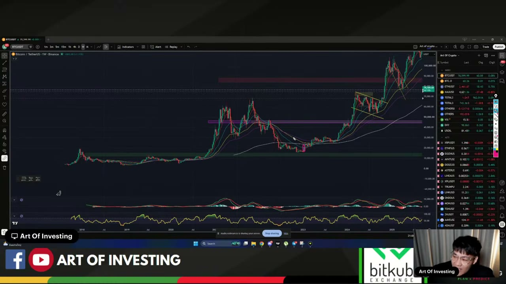

[01:08:24] ดูนะครับหรือว่าถ้ามันจะเกิดแบบ worst case อย่างที่เราคุยกันก็คือลงลงมาถึง ตรงนี้แล้วก็sidewayยอาจจะ new นิดนึง อะไรอย่างเงี้ยอ่ะคนก็จะกลัวะแล้วก็ค่อย กลับไปสะสมตอนเกิดโมเมนตัมอีกครั้งอัน นั้นอาจจะสวยมากเพราะว่าweคมันจะพร้อมนะ ครับให้เราดูตรงนี้เห็นป่ะเนี่ยที่ผมบอก ว่าweคยังไม่พร้อมเนี่ยรอบเนี้ยก็ขึ้นแบบ weคยังไม่พร้อมนะดูนะ MacD เหนือ 0 นะ เห็นป่ะมันก็เลยต้อง sideway อีกรอบนึง แล้วมาขึ้นเหนือศูนย์พร้อมกับoverบออีก รอบนึงเห็นป่ะoverบอแล้วเอ้ยโมเมนตัมเกิด แล้วแต่ออเดอร์ซื้อยังไม่เยอะกว่าขาย ว่ะก็ย่อนิดนึงแล้วขึ้นอ่ะอันเนี้ยถ้า เป็นเคสแบบออกดีหน่อยแบบแบบเสเนี่ยมันก็ จะออกแบบนี้ได้คือเขย่านิดเดียวนะครับแต่ ว่าถ้าเกิดมันจะเขย่าแรงก็อาจจะเป็นรอบ แบบอย่างเงี้ยใครจะรู้อ่ะอย่างงี้ก็ได้ อย่างี้ก็ได้ถ้าเป็นแบบรอบก่อนนะคือแบบ นี่ไงมึงไอ้โง่มึงพลาดของมึงตกรถกูตีเก๊ มึงเป็นนักลงทุนมา 12 ปีมึงยังไม่กล้า เข้าสปอร์ตไม้ใหญ่ในลวดเดียวมึงกูตีเก๊ มึงอ่ะสมมุตินะเป็นเคสเนี้ยอันเนี้ก็เข้า มือผมเลยไอ้อีกครึ่งนึงที่ผมเตรียมเป็น เงินสดไว้ที่ผมอยากได้ผมอาจจะซื้อเข้าไป

[01:09:26] ในในพอร์ตที่เป็นการเล่นรอบไม่ใช่พอร์ต DCA นะอย่างเงี้ยสมมุติว่าโอโหแครช แล้ว Act ไม่ผ่านญี่ปุ่นขึ้นดอกเบี้ยแต่ Anopic แค่ทำให้ตลาด Sideway แล้วกลับ ขึ้นอย่างเงี้ยโอเคสวยเลยเพราะว่ามันกลับ มาเกิดโมเมนัมอีกครั้งนึงเบรคAK break out อย่างเงี้ยแล้ว MACD เหนือ 0  RSI Overb เงี้ยอ่ะผมผมก็เอาเงินสดที่เหลือ ผมอาจจะallocอกateเพิ่มตรงนี้น่าจะเห็น ภาพกันเนาะนะครับวันนี้ก็เลยเอออยาก อธิบายยาวๆเพราะเพราะว่าตอนเเห็นมั้ยว่า โมเมนตัมมันเริ่มดรอปและนะมันเริ่มดรอป และถ้าเราดูตรงเก็คือหลุดdisคทั้ง 1 ชั่วโมงทั้ง 4 ชั่วโมงแล้วเห็นมั้ยเนี่ย 4 เนี่ยไม่เคยหลุดเส้นสีแดงหรือเส้นสีเขียว แล้วนี่ก็หลุดละนะครับฉะนั้นหลุดแล้ว เนี่ยขึ้นต่อ New  High แล้วเนี่ยนะครับ แสดงว่าแล้วมันขึ้นได้ไม่ไกลเห็นป่ะมัน เริ่มเกิดdiverอจนละ divergent เหมือน เดิมนะไม่ได้แปลว่าจะลงเลยนะไม่มีความ จำเป็นที่เกิดdiเverอรจนแล้วจะลงเลยนะ diเverอรจนบอกเรื่องเดียวคือแรงซื้อเริ่ม น้อยลงกว่ารอบก่อนไอ้ที่ขึ้นมารอบเนี้ย กับขึ้นมารอบเนี้ยรอบหลังอ่ะแรงซื้อมัน เริ่มเบาลงแล้วนะทีเนี้ยไอ้แรงซื้อที่มัน เบาลงเนี่ยมันอาจจะไม่ต้องย่อก็ได้มันอาจ

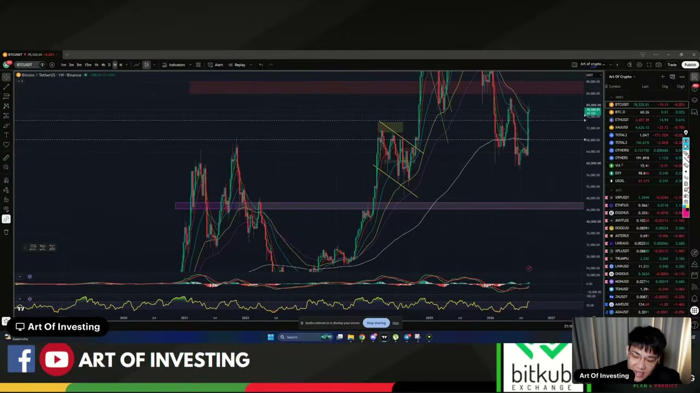

[01:10:26] จะแค่ตรงนี้อูอยากจะไปต่อก็ก็ไปได้แต่แค่ มันดรอปลงแล้วผมก็เลยมองว่าเฮ้ยในฐานะนัก ลงทุนน่ะผมไม่ใช่นักคาดการณ์น่ะผมไม่ใช่ นักเดาอ่ะว่าแบบเอ้ยเดี๋ยวจะขึ้นแล้วกู ซื้อเอ้ยเดี๋จะลงแล้วกูขาย ผมแค่มองว่ามันคุ้มค่าความเสี่ยงที่ผมจะ ในพอร์ตเกรงกำไรมยพอร์ตลงทุนเราเราแยก อยู่แล้วเราลงทุนระยะยาวอยู่แล้วถูกมั้ ครับฉะนั้นถ้าเกิดผมคำนวณแล้วอ่ะ มันไม่คุ้มค่าความเสี่ยงผมก็แค่ไม่เทคมัน ขึ้นผมก็ต้องก็ต้องยอมตกรถอ่ะเออก็มีของ ครึ่งเดียวก็มีของครึ่งเดียวผมแค่ทำแบบ นั้นน่ะวนไปเรื่อยๆแล้วถ้าระบบของคุณน่ะ มันมีความได้เปรียบหรือที่เขา้าเรียกกัน ว่าจริงๆอ่ะคุณวนอย่างเงี้ยในทุกตลาดอ่ะ 3-4 ไซเคิลน่ะพอร์ตคุณยังไงก็โตเว้ยแล้ว มันจะมีซักไซเคิลอยู่แล้วที่คุณได้ของ เต็มมือเพราะว่าระบบของคุณมันยืนยันว่า มันมีความได้เปรียบนะครับเวลาเขาทำ qu analysis เห็นมั้เค้าก็มีเช็คลิสว่าเฮ้ย สภาพคล่องในตลาดสูงพอมั้ยเฮ้ยระยะการวิ่ง ATR ตรงนี้มากพอมั้ยเค้าเต้องมี

[01:11:27] เช็คลิสต์มันถึงจะแยกได้ว่าเฮ้ยการชนะกับ การมีข้อได้เปรียบในการลงทุนไม่ เหมือนกันนะเว้ยคำว่าคุณมีข้อได้เปรียบ ไม่ได้แปลว่าคุณชนะนะคุณนึกภาพว่าคุณดู บาสอ่ะ ระหว่างทีมคุณมีmichเคิลจอร์แดนเนี่ยกับ อีกทีมมีุกกี้ที่เพิ่งเข้ามาใหม่ไม่ได้ เก่งมากอ่ะอย่างเงี้ยแล้วคำถามคือ michเคิลจอร์แดนน่ะเจอกับทีมนั้นน่ะ michเคลจอร์แดนต้องชนะทุกครั้งเลยป่ะเฮ้ย มีทั้งสกอตyพิenนะเว้ยมีเดนิmanนะเว้ยมี michเคิลจอร์แดนน่ะมึงต้องชนะ 100 ครั้ง เลยมั้ไม่มีทางถูกป่ะฉะนั้นบางแมตช์เนี่ย มันแข่งกันประมาณ 82 แมตช์ก่อนที่จะชิง แชมป์Play์อฟอ่ะเค้าไม่ได้วิ่ง 820-0 นะ เว้ยทั้งๆที่ทีมเขาชนะแบบแล้วมีสุดยอดนัก กีฬาเนี่ยคือคำว่าความได้เปรียบในการลง ทุนหรือ trading โมเดล ฉะนั้น Trading  Model คุณต้องหาก่อนว่า มันคือความได้เปรียบจริงๆถ้าเกิดคุณแยก ระหว่างความได้เปรียบกับชัยชนะไม่ออกนะก็

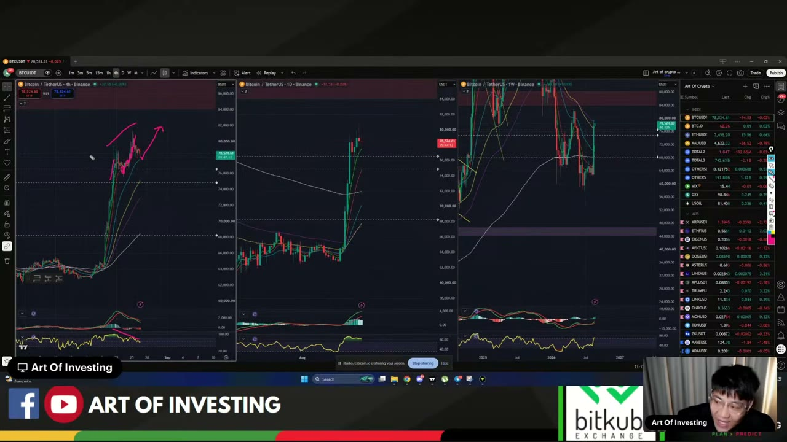

[01:12:27] แปลว่าอีกทีมที่เป็นทีมมือใหม่อ่ะที่มัน ฟลุ๊กชนะmichเคิลจอร์แดนน่ะคุณก็ไปตีความ ว่ามันเก่งซึ่งต่อไปเจอกันอีก 3 ครั้ง อาจจะแพ้ลวดก็ได้นะครับฉะนั้นน่ะถ้า เกิดคุณเจอความได้เปรียบของตลาดก็แค่ให้ อยู่[เสียงกระแอม]ฝั่งที่มันได้เปรียบของ ตลาดเสมองั้นคุณก็เบว่า Michel Jจอร์ดน จะต้องชนะ 20 เกมอ่ะต้องชนะสัก 12-15 เกมแล้ววะนั่นน่ะคือคำว่าความไม่ เปลี่ยนอ่านะครับเอองั้นถ้าไม่ย่อหรือย่อ ไม่ลึกแบบ 77,000 แล้วไปเลยเงี้ยผมไม่ เติมของละนะครับในพอร์ตเก็งกำไรไม่ไม่ขัด ลาภใครเนาะอันนี้เป็นแค่ความกังวลในตลาด ที่เดือนหน้ามันยังมีข่าวใหญ่มีความผัน ผวนที่อยากให้ทุกคนระวังแค่นั้นเองนะครับ ก็ใครอยากซื้ออะไรอัดผมไม่ค่าไม่ห้ามอยู่ แล้วมันเป็นเงินท่านเนาะแล้วก็มันคือ ประสบการณ์ของนักลงทุนคนนึงอ่ะที่ลงมา 12 ปีแล้วก็แค่อยากจะมาบอกว่าตลาดมันคุณคิด ว่าคุณอ่านตลาดตลาดออกอ่ะตลาดมันก็อ่าน คุณอยู่เหมือนกันน่ะนะครับอย่าอย่าพยายาม ไปคิดเหนือตลาดว่าแบบเนี่ยไอ้พวกโง่ตกรถ กันหมดแล้วเดี๋มันขึ้นหย่อยาอ่ะแล้วแต่ ไม่ขัดลาบใครแล้วกันนะครับก็แค่จำกัดความ

[01:13:29] เสี่ยงดีๆนะครับ Eat  F โอเคครับผมว่า East  F กราฟ โคตรสองเลยแต่ว่าแค่แค่ภาพเล็กไม่ไม่สวย นะครับ E กราฟโคตรสองเลยครับนถ้าถ้าถามผม นะเงี้ยแต่ว่าตรงเนี้ยมันมันก็เริ่มติด แล้วเห็นป่ะเนี่ยเหมือนอย่างเงี้ยอ่ะตอน เนี้ยก็เริ่มติดแล้วฉะนั้นตอนมันย่อมาตรง เครับเนี่เห็นมยเริ่มย่อมาอย่างงั้นน่ะ เราไม่รู้แล้วมันจะย่อมาแล้วเกิดภาพไหน แต่ว่าถ้าย่อมาแล้วเกิด disc เงี้ยแล้ว เกิดอีกครั้งเงี้ย อ่ะก็แปลว่าโมเมนตัมมาต่ออีกรอบคุณก็ดู ว่ามันจะแครี่ไปถึงไหนกราฟโอเคครับทำ เรื่องบัตรเครดิตทำเรื่องหลายอย่าง East F ครับผมผมคงก็ชอบนะครับตอนนั้นน่ะผมมี กลุ่ม Eosystem ของ Ei ค่อนข้างเยอะ East Fig  Pend นะครับแต่ว่ารอบนี้ก็ไม่ได้ เก็บเยอะเท่าเดิมนะรอบนี้ Narrative สำหรับผมนะผมจะไปเลือกตัวที่มันได้ผล ประโยชน์จาก City กับ Real  World  Asset มากๆเพราะว่า อย่างที่ผมบอกนะว่าเอิ่ม City  Act เนี่ยถ้ามันผ่านแล้วมันเกิด

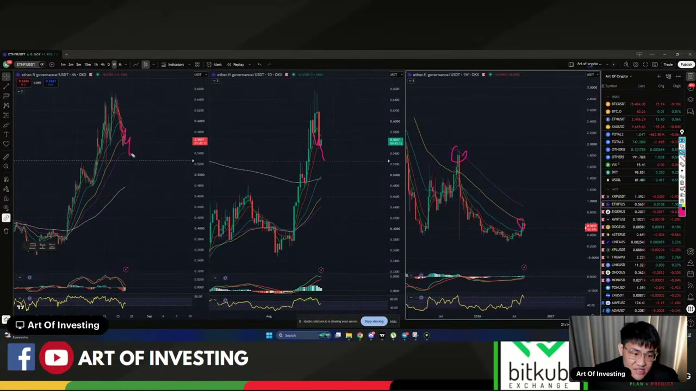

[01:14:31] ขึ้นมาได้จริงๆอ่ะก็คือแบบทำหุ้นหรือสิน ทรัพย์โลกจริงจำลองขึ้นไปบนโลก Blockchain น่ะที่เขาเรียกว่าสินทรัพย์สังเคราะห์อ่ะ ครับสภาพคล่องมันจะดูดเข้าสู่ตลาดอเมริกา มหาศาลแล้วประเทศเขาจะรวยกว่านี้อีกแล้ว ก็ถ้าเกิดมันต้องขึ้นไปเนี่ยผมแค่มองว่า ถ้าเกิดตรงนั้นวันนึงมันจะเกิดขึ้นจริงๆ อ่ะเหรียญอะไรมันได้มันได้ผลประโยชน์บ้าง คำตอบก็คือเหรียญแรกคือลิงก์หรือ chain link เพราะว่า Link เนี่ยมันเป็นตัวแปร ข้อมูลนอก Blockchain กับบน Blockchain ให้เชื่อมกันแล้วแปลงเหมือนแบบลงน้ำขึ้น บกอ่ะเป็นตัวกลางนะครับด้วยระบบของมันที่ เรียกว่า Oracle ตัวต่อมาก็คือ R เพราะเนี่ยมีการสามารถทำให้คุณเทรดingได้ หรือคุณสามารถแปลงสินทรัพย์ Real  World Asset เนี่ยไปทำในรูปแบบอื่นได้ฝากค้ำ กู้ยืมที่เขาค่อยๆค่อยๆพัฒนาอยู่นะก็จะมี พวก AV พวกลิงก์อย่างเงี้ยที่ผมคิดว่าเออ มันได้อดเนี่ยผมให้ลองลงมาด้วยซ้ำเพราะ ว่าอโดเนี่ยมันทำคล้ายๆกับผลตอบแทนแบบ

[01:15:33] พันธบัตรแต่ได้เป็นบนโลก Blockchain นะ ครับแต่ว่าเรื่อง Real  Verse เนี่ยมัน ไม่ได้กว้างเท่าพวก R พวกยูินะครับผมก็ เลยมองว่าอ่ะอันเนี่ยถ้าถ้า Outcoin อ่ะ ผมก็เลยมองว่ากลุ่มที่มันเกี่ยวกับ Stable Coin ก่อน Curve อย่างเงี้ยเนี่ยถ้าเกิด คุณต้องการ liquidity  pool ที่ใหญ่แบบเอ้ยอยากจะมี สภาพคล่องที่เป็น stable  coin ที่ใหญ่ อันดับต้นๆน่ะก็ไม่พ้นเคveฉะนั้นพวกเนี้ย ผมก็เลยมองในทิศทางของการเกรงกำไรเอ่อถ้า เกิด outcoin มันมา crit มันผ่านอ่ะผมก็ เลยมอง 4 ตัวนี้ก่อนนะครับเออส่วนทรัมป ทรัมปเป็นยังไงครับอาจารย์ เอ่อวันศุกร์ขึ้นพูดมีผลก่อต่อตลาดไหน บ้างทุกตลาดเลยครับเพราะว่าเค้าเต้องการ ดูว่าเฟซมองยังไงกับเงินเฟ้อที่มันยังไม่ ลงแล้วก็เดี๋ยวจะมีการค่อยๆทยอยซื้อบอล ระยะยาวคืนอีกจนถึงพฤศจิกายนเค้าก็กลัว เงินเฟ้อจะกลับมาดื้ออีกจะขึ้นดอกมั้ยจะ อะไรมั้ยก็มีผลต่อทุกตลาดเลยครับเอ่อ ทรัมปมันยังไงทรัมปมันเป็นเหรียญที่แบบผม ว่าเทรดยากอ่ะทรัมป์เป็นอีกเหรียญที่แบบ

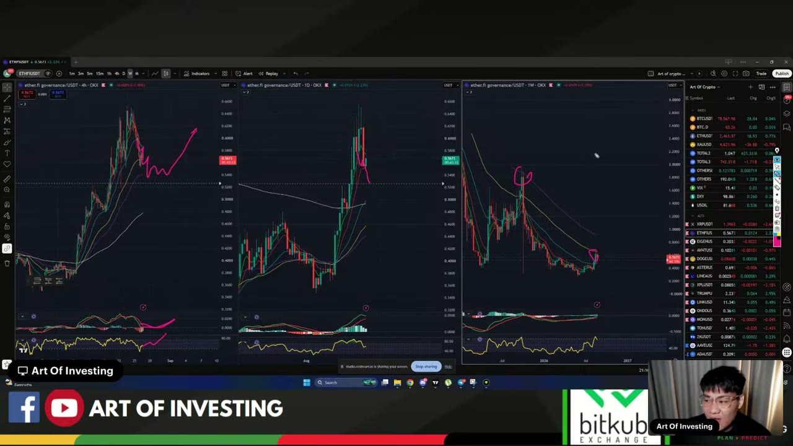

[01:16:33] เลวageสูงแล้วก็สภาพคล่องสภาพคล่องมัน กระจุกตัวนะครับอย่างเงี้ยเห็นมั้ยเนี่ย เนี่ยครับคุณ ชิดเอ่อมันเทรดยากเพราะว่าอะไรรู้ป่ะ เนี่ยเนี่ยคุณดูดิพรวดขึ้นพรวดลงทิ้งไส้ พรวดขึ้นพรวดลงทิ้งไส้พรวดขึ้นพรวดลงทิ้ง ไส้ทิ้งไส้ทิ้งไส้อย่างเงี้ยแบบมันยาวมาก ขึ้นก็ขึ้นโคตรแรงลงก็โอ้โหลงแรงจนไม่รู้ จะแรงไงทิ้งตัวซะแบบหนักหน่วงเวลาที่มัน เป็นอาการอย่างเงี้ยครับคือ แปลว่ามันกระจุกตัวคนขายก้อนเดียวคนซื้อ ก้อนก้อนเดียวมันแทรกยากก็คือมันไปลวด เดียวเลยครับผมก็เลยมองว่ามันค่อนข้าง insider tradดingสูงสำหรับเหรียญทรัมป์ เนี่ยผมก็ไม่ค่อยเทรดนะครับไม่ไม่ได้แตะ บ่อยเพราะว่าอย่างที่บอกครับขึ้นมาแล้วก็ แบบทิ้งไส้ยาวๆขึ้นก็ขึ้นลวดเดียวเลยเรา ไม่รู้ด้วยซ้ำว่ามันเป็นคนในไม่กี่คนหรือ ไม่กี่กลุ่มหรือเปล่าที่แบบ Take  Action

[01:17:35] พร้อมกันน่ะทีเนี้ยพอมันพร้อมกันน่ะมัน ไม่ได้เป็นเม้นต์เงินของทั้งตลาดครับเลย อ่านมันยาก จันอาร์ตคิดยังไงกับตลาด stable  ST  Coin ครับผมมองว่ามันคือ กิ๊กซอชิ้นสำคัญที่จะทำให้อเมริการวยกว่า เดิมครับถ้าเกิด Stable  Coin ได้รับการ ยอมรับแพร่หลายแล้วสามารถใช้ Stable  Coin ซื้อหุ้นที่เป็น Synetic  Asset ได้เมื่อ ไหร่อเมริกาจะรวยกว่าเดิมครับแล้วBackroอ หรือว่าทุกหน่วยงานทุกสถาบันที่มีอำนาจใน การออกหุ้นสังเคราะห์จะรวยกว่าเดิมแล้วเ อยากได้เม็ดเงินตรงนั้นมากๆครับแต่ว่าก็ ต้องไปเถียงกับธนาคารต่อเพราะแบงค์ก็บอก ว่าแล้วถ้าอันนั้นอยู่ต่างประเทศไม่ ต้องเอาเงินเข้าประเทศไม่ต้องตรวจสอบด้วย ว่าได้รับแหล่งเงินมาจากไหนมึงซื้อหุ้น อเมริกาได้อีกแถมมึงได้ยีลอีกได้ปันผลต่อ ปีอีกถ้า stable  coin มีปันผลได้แล้วมึง จะมีแบงค์ไว้ทำไมอ่ะกดมันก็เลยจะผ่านยาก หน่อยครับ ตอนนี้ Avax ถือว่าเป็น Real  War  asset มั้ยอาจารย์ดรอปกว่า 3-4 ตัวแรกที่ผมบอก มาอย่างที่บอกนะว่าตอนแรก AAX เาทำหลาย เรื่องนะครับตอนแรกเ้ามีทั้ง subnet  API

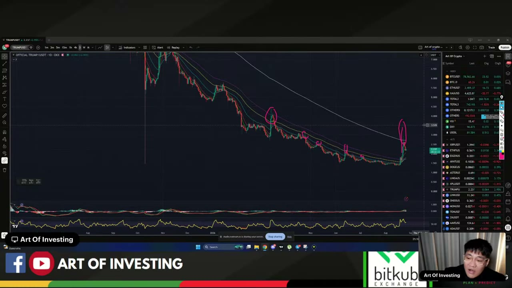

[01:18:37] เ้ามีทำเรื่อง Shopping.io นะครับแล้วก็ ทำเครื่องมือที่ทำให้คุณสามารถสร้างchนบน เาได้คล้ายๆกับ OP  base  rock นะครับแต่ ว่าเอ่อตัว Real  World เนี่ยมันจะไม่ชัด เท่ากับ 3-4 ตัวแรกที่ผมบอกแต่ถามว่าได้ อานิสงส์มย AAC ยังได้อยู่ประมาณนึงนะ ครับ A  AAC ยังได้อยู่ประมาณนึงแค่ไม่ เยอะเนี่ยโมเมนตัมก็ไม่แย่นะครับก็สมมุติ ว่าถ้ามันกลับมาตรงเนี้ยอ่ะแถวตรงเนี้ย แล้ว 1 ชม. 4 ชั่วโมงมันเกิดโมเมนตัม เนี่ยอ่ะก็ก็อาจจะน่าสนใจถ้าแบบเพื่อนๆ นึกไม่ออกว่าเฮ้ยหน้าตามันจะเป็นประมาณ ไหนก็ประมาณนี้ อ่ะเวลาเกิดโมเมนตัมนะ อันนี้สภาพคล่องมันต่ำมากเลยไม่ค่อยอยาก เอาให้ อ่ะอย่างเงี้ยอย่างเงี้ก็ได้อย่างเงี้ยนะ ครับสมมุติว่ามันย่อมาถึง EMA  25 ใน day หรืออะไรเงี้ยที่มันย่อมาลึกๆครับแล้วคุณ

[01:19:38] ไปเจอพรีเมี่มใน 1 ช่โมงอย่าเงี้ยแบบ โอ้โหยมันเท่าไหร่ก็ไม่ผ่านน่ะอ่ะ แล้วพอมันปิดแท่งผ่านได้อย่างเงี้ยแล้ว MACD  0  Overb อันเนี้ยอันเนี้ยก็เป็น จุดเริ่มต้นของโมเมนตัมใหม่คุณก็เข้านะ ครับแล้วก็ Stop  Loss ตรงนี้นะครับเนี่ย แล้วก็เราก็แทรคถามว่าทำไมผมวาง Stop Loss ตรงนี้เพราะว่าผมเก็บdata้ามานะ ครับ 82-85% ถ้าเกิดโมเมนตัมตรงนั้นเกิดขึ้นจริงๆแล้ว ส่งต่อถึงเทรนด์ครั้งต่อไปแล้ว มันจะวนมาไม่ทำ New  82-85% ผมก็เลยชอบ ใช้ตรงนี้เป็น Stop  Loss เนี่ยคือคำว่า age คือมันอาจจะลงมากวาดแล้วไปต่อก็ได้ นะแต่มันมีความน่าจะเป็นแค่ 10 กว่า เปอร์เซ็นฉะนั้นน่ะผมจะยอมเลยก็คือถ้า เกิดมันเกิดคอชที่ 10 กว่าเปอร์เช่น สมมุติว่ามากวาดเงี้ยฟิ้วแล้วไปต่อโอเค ยอมผม stop  loss ก็ได้แต่คือโอกาสมัน 85% แล้วอ่ะที่มาตรงเนี้ยแล้วมันจะไม่ย้อน ฉะนั้นถ้ามันย้อนน่ะคุณก็ต้องนึกภาพว่า มันเหลือแค่ 10 กว่าเปอร์เ็นน่ะที่ที่มัน

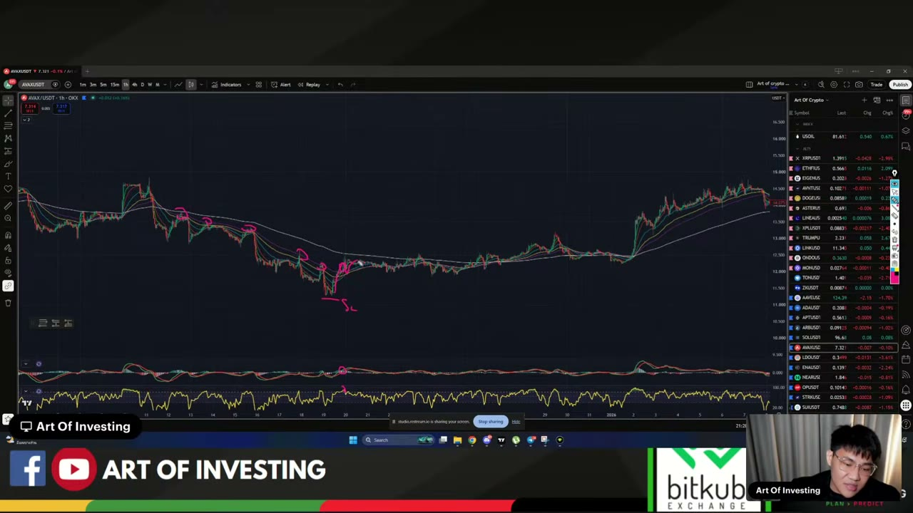

[01:20:39] จะไปต่อผมก็เลยใช้ตรงเนี้ยเป็น trading model นะครับก็ก็ดูตรงนี้ก็ได้ครับ สำหรับ AC อ่ะเมื่อกี้เกี้มีคนขอ AST กับ EDA นะ เดี๋ยวผมดูให้นะครับขอดูอธีก่อนแล้ว เดี๋ยวไปดู AST กับให้นะครับ East เนี่ย เอ่ออย่างที่ผมบอกเนาะมันแข็งแรงกว่า บitcoinอ่ะเทรนด์มันเบรคตู้มตามๆตามเลยนะ ครับแล้วก็ตอนนี้ก็ก็เริ่มติด Flip zซone แล้วเหมือนเดิมนะครับถ้าอเรียมย่อเนี่ยก็ คือถ้ามันจะย่อแบบโม่นะครับอ่ะอธิบายก่อน ก็คือแบบทุกครั้งที่อรียมมันขึ้นน่ะเห็น ป่ะมันก็จะขึ้นแบบอย่างเงี้ยแค่ EMA  10 ก็ไปเลยอย่างเงี้ยนะครับอย่างเงี้ยเห็น มั้ยอรี่มเนี่ยมันขึ้นค่อนข้างstrรองกว่า นะครับเพราะว่ามันเป็นก็ยังนับว่าเป็น outcoin ก็ได้นะครับเนี่ยเห็นมมันขึ้นโม แบบนี้ฉะนั้นน่ะถ้าเกิดคุณมีของอ่ะ ก็รอดูก่อนว่าตอนมันย่อมาที่ EMA  10 อย่างเงี้ยสำหรับเอเรียมนะมันย่อมาที่ EMA 10 อย่างเงี้ยมันหลุดมั้ยนะครับเงี้ยถ้า มันไม่หลุดเงี้ยอ่ะคุณก็มองแล้วว่าตรงเ คือdisคาถ้าเกิดวันไหนก็แล้วแต่ที่ มันเป็นกราฟ Day นะที่มันไม่ปิดต่ำกว่า

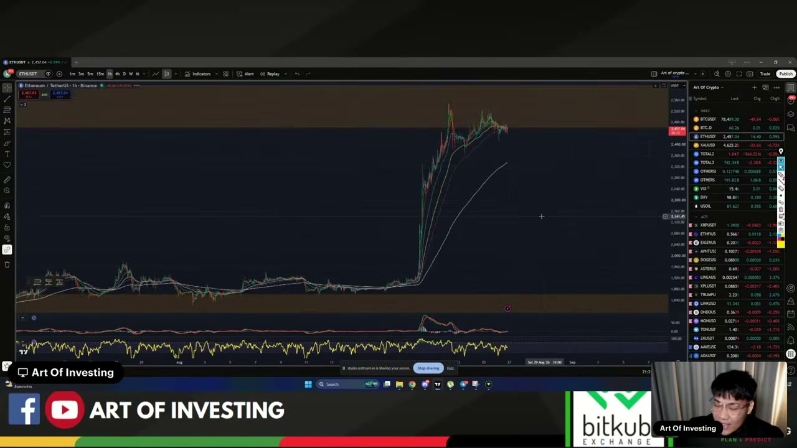

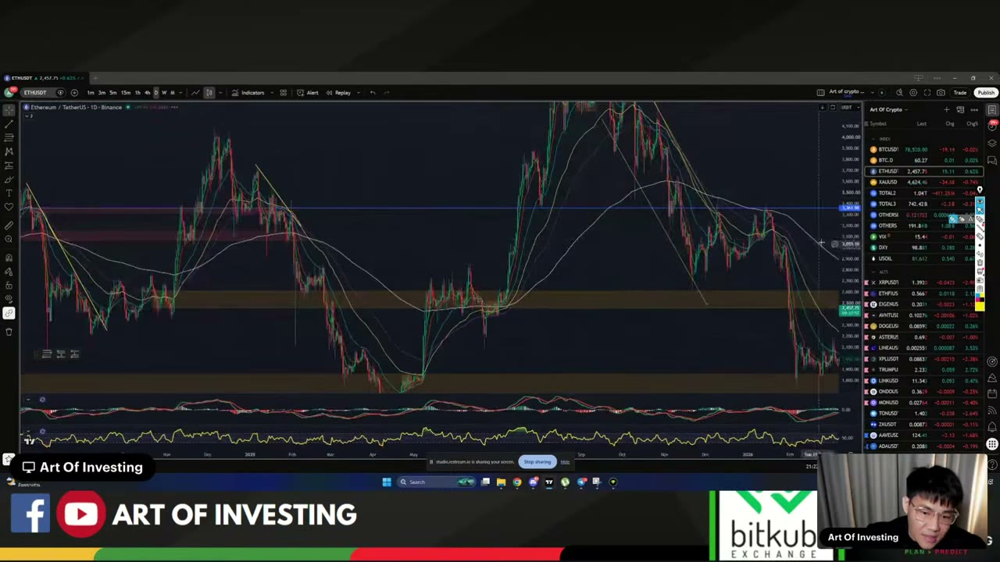

[01:21:39] EMA  10 อ่ะคุณก็อาจจะยังถือต่อไปได้ สำหรับอรiมอย่างเงี้อ่ะให้ดูก่อนว่ามันจะ เป็นdisคาได้มนะครับอย่างเงี้ยอ่ะ อย่างเงี้ยเรียกโมเมนตัมมั้ยเรียกดูนะติด พรีเมี่มถูกป่ะอ่ะคุณดูนะแล้ว Magdin  0 RSI  Overbard อย่างเงี้ยอ่ะเกิดละแล้ว โดน Stop มั้ยโดนแสดงว่าเทรนด์ไม่เกิดก็ Stop ไปอย่างเงี้ยนะครับเนี่ยคือคำว่า training  age แต่ว่าคุณก็ต้องดูหลาย timeม frame นะ day จะขึ้นได้ week พร้อม พา Day ขึ้นมั้อะไรเงี้ยก็ก็ค่อยๆเทียบนะ ครับอันนี้อธิบายให้ฟัง งี้ก็เหมือนกันเห็นมั้ อ่ะเนี่ยเบรคได้แล้วปิดแท่งเหนือแท่งอัน นี้เหนือ 0 ยังยังโอบอบอแล้วแต่ยังไม่ เหนือศูนย์อ่ะค่อยมาเหนือศูนย์ตรงนี้เห็น ปะแท่งนี้แล้วบออีกรอบอ่ะก็ stop ตรงนี้ นี่ก็ได้แต่คำถามคืออ้าวคุณอาร์ตก็เห็น นี่มาวิเคราะห์ย้อนหลังก็เห็นนี่แล้วทำไม คุณอาร์ตมีของครึ่งเดียวก็อย่างต้น ไลฟ์ที่ผมบอกว่าผมกังวลกลางเดือนหน้านะ ครับผมก็เลยตอนแรกตอนแรกคิดว่าจะไม่ผ่าน เราย่อลึกหน่อยแล้วเราได้เก็บของอีกรอบ แต่ก็ไม่เกิดขึ้นนะครับก็เลยมันวิ่งไปเลย อ่ะฉะนั้นตอนเนี้ยก็ก็เริ่มถึงเอ่อโซนที่

[01:22:42] มันมีการทิ้งของมาละแล้วแล้วตรงกลางแล้ว ก็เราเราก็จะเรียกตรงนี้ว่าอิม Imbalance นะครับก็มาถึงจุดequilิบumละก็อาจจะมีการ ย่อบ้างเล็กน้อยได้นะครับแต่ว่าอย่างที่ บอกก็คืออีเรiumเนี่ยเวลาขึ้นมันค่อนข้าง โalนะครับถ้ามันยังไม่ได้ปิดแท่งต่ำกว่า EMA10 เนี่ยก็ก็รันเทรนไปก่อนก็ได้ สำหรับเอเรiumอ่ะเดี๋ยวดูกับให้แล้วเดี๋ วันนี้จะไปแล้วนะครับอยู่นานมากเลยวันนี้ ผมว่าน่าจะได้ได้รู้หลายเรื่องมากเลยนะผม วิเคราะห์ทั้งระบบเศรษฐกิจโดยรวม มาครroeconomicให้ฟังนะครับแล้วก็ Outcoin กับ Bitcoin ทำไมแบบเออเดือนหน้ามันจะผัน ผวนหน่อยแล้วก็อยากให้ระวังนะครับก็โอเค กินน้ำก่อนสวัสดีครับ อ่ะโอเค เนี่ยครับก็เนี่ยเห็นมั้ยมันยังไม่สามารถ เบรคพีemiใน week ได้เห็นมั้ยตรงนี้นะ

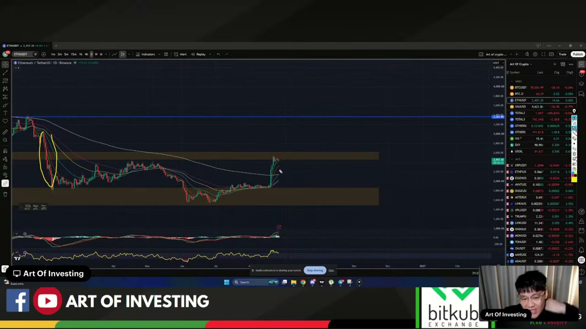

[01:23:43] ครับแล้วก็ magne  Week เนี่ยต่ำกว่า 0 แสดงว่าโมเมนตัมมันยังไม่เกิดในภาพนะครับ ส่วน day เนี่ยโมเมนตัมเกิดแล้วแต่โคตร น่ากลัวเลยเนี่ยผมโคตรเชียร์เลยนะถ้าจะ เทรดเทรดสปอตเหอะนะครับอย่าอย่าเทรด ฟิวเจอร์เลยนะครับเพราะว่าคุณดูกราฟดิคุณ เห็นป่ะกวาดแบบบนล่างแบบอู้หู คุณเห็นงี้มั้ยอย่างเงี้ยอย่างเงี้ย นะครับเงี้ยแล้วไส้บนล่างเยอะมาก อย่างเงี้ยผมก็เลยมองว่าเออเล leate บนบน ASR เนี่ยมันค่อนข้างเยอะนะครับถ้าจะ เล่นเนี่ยผมอยากอยากให้มันเป็นสปอตมาก กว่าไม่ไม่ค่อยเชียร์ให้ให้เทรด Future เท่าไหร่เพราะว่าตอนเก็ยังยังติดตรงนี้ อยู่เห็นมั้ยทีเนี้ยตัวเนี้ย เรียกว่าsupัlyายหลักเนี่ยเห็นป่ะเนี่ย คุณเนี่ยคือวิธีการดูกราฟในอดีตแล้วก็มอง ตลาดเนี่ยมันตีความสินทรัพย์นั้นยังไงนะ ก็คือให้คุณดูตรงนี้ถ้าเกิดราคามันผ่าน ขึ้นไปตั้งตรงเนี้ยแล้วปิดแท่งมีแต่ ไส้อ่ะคำตอบคืออะไรคำตอบคือออเดอร์ขายตรง

[01:24:44] เโคตรเยอะฉะนั้นไอ้ตรงเนี้ยเราเรียก กันว่า Real  Supply ทำไมถึงเรียกกันว่า Real  Supply เพราะ ว่าคุณนึกภาพนะว่าราคามันต้องขึ้นไปถึง ก่อนได้มันถึงจะทิ้งไส้ไว้ได้ถูกป่ะแต่ที เนี้ยพอขึ้นไปแล้วอ่ะมันเหมือนกับคุณโดด โหม่งกำแพงอ่ะคุณโหม่งกำแพงชั้นแรกแตกอ่ะ ช่างโยนกำแพงมาซ่อมเลยฟึ๊บฉาบปูน ฟับบคุณโหม่งแตกอีกช่างโยนกำแพงมาอีก ฉาบปูนทับเลยฟับบแสดงว่าออเดอร์ขาย ตรงเนี้ยโคตรโคตรเยอะไม่ว่าออเดอร์ ซื้อจะขึ้นมากี่ทีก็ match ออเดอร์ซื้อ Match ออเดอร์ซื้อ Match ออเดอร์ซื้อ Match ออเดอร์ซื้อ Match ออเดอร์ซื้อ Match ออเดอร์ซื้อ Match ออเดอร์ซื้อมัน เลยเบรคขึ้นไปไม่ได้พอพอมันเบรคขึ้นไปไม่ ได้ก็เลยตรงเนี้ยครับ มันก็เลย เอ่อเป็นภาพที่ยังเบรคไปได้ยากเพราะ ออเดอร์ขายตรงนั้นมันเยอะมากพอออเดอร์ขาย มันเยอะอ่ะครับมันก็จะเป็นภาพแบบนี้แหละ ที่ที่เราจะได้เห็นก็คือมันจะเกิดอะไรขาย ลงมาบ้างทีเนี้ยตรงเนี้ยเนี่ยมันก็เป็น จุดdiscาของ 1 ช่มงถูกมยถ้าเกิดมันเริ่ม

[01:25:46] ร่วงลงมาอย่างเงี้ยก็อาจจะเกิดการย่อได้ แล้วทีเนี้ยทำไมผมถึงบอกว่าเทรดสปอเถอะ โอโหคุณดูเวลามันล้าง leverage  trading ทีอ่ะมันลึกนะครับฉะนั้นเนี่ยมันอาจจะ ขึ้นต่อก็ได้แต่มันอาจจะกวาดเงี้ยแล้ว ขึ้นต่ออย่างเงี้ยเออผมก็เลยมองว่ายาก เอ่อเห็นต้องเห็นอาจารย์แล้วพวกคอยของ Solona  eosystem มีอะไรดีมั้ยต้อง สารภาพตามตรงนะcyเคิลเนี้ยผมไม่ได้ดูเจาะ ลงไปใน infrastructure แต่ละแต่ละตัวเท่า ไหร่คุณโกโก้เพราะว่าผมมองว่ามันจะไปที่ Tokenization กับ Stable  Coin ก่อนผมก็ เลยไม่ได้เจาะอย่างตอนก่อนผมก็เจาะใช่ มั้ยเจาะไปที่เอ่อเรมิ อะไรอย่างเงี้ยใน Solana ผมก็ไล่ดูทีละ ตัวแบบลึกลงไปเลยว่าเฮ้ยโปรโตคอลไหน มียอดผู้ใช้งานสูงบ้างยอดฝากเงิน TVL สูง บ้างในในไซเคิลก่อนๆแต่ไซเคิลเนี้ยผมผม มองว่ามันเป็นภาพใหญ่มากกว่าผมก็เลยเน้น เน้นเล่นตัวใหญ่มากกว่าครับคุณโก๊ะเห็น ดร.บิ๊กวิเคราะห์ไว้ว่าทรัมป์น่าจะหา เรื่องดันตลาดไปจนกว่าจะพ้นการเลือกตั้ง กลางเทอมปี 11 ข้อนี้เห็นด้วยข้อขข้อนี้ ไม่ไม่เห็นต่างกับคุณสกายเพราะว่าแบบนี้

[01:26:46] อธิบายอีกเรื่องอีกรอบนึงครับหลายคนอาจจะ ไม่เข้าใจคำว่า midterm  election คือ อะไร midterm  election คือการเลือกตั้ง กลางเทอมทีเนี้ยให้คุณนึกภาพว่าทำไม ทรัมป์โคตรไม่อยากแพ้ midterm สมมุตินะว่าคุณเป็นนักฟุตบอลแล้วคุณเป็น กัปตันทีมนะไอ้midเทมอกชัตอนเนี้ยคุณน่ะ จะยังเป็นกับตัดทีมต่อไปแน่ๆอีก 3 ปีแต่ อีก 10 คนที่เป็นสมาชิกของทีมคุณน่ะถ้า เกิดคุณแพ้การเลือกตั้งอ่ะจะเป็นอีก คุณนึกภาพว่าวันเนี้คุณเป็นกัปตันทีม แมนยูอยู่ถ้าเกิดคุณแพ้การเลือกตั้งอ่ะ คุณยังเป็นกัปตันทีมคาดปอกแขนเหมือนเดิม แต่อีก 10 คนจะเป็นนักเตะจากลิเวอร์พูล ทรัมป์ก็หงุดหงิดตายเลยคุณนึกออกป่ะ ถ้าเกิดว่าทรัมป์แพ้ midterm  election แล้วสมาชิกในรัฐบาลเป็นของอีกฝั่ง สั่งอ่ะที่ตอนก่อนมันเป็นฝ่ายค้านน่ะมาทำ งานแทนน่ะฉะนั้นน่ะคุณนึกภาพต่อไป ประธานธิบดีออกนโยบายอะไรก็แล้วแต่ รัฐบาลค้านหมดเช่นเฮ้ยประกาศขึ้นท้า

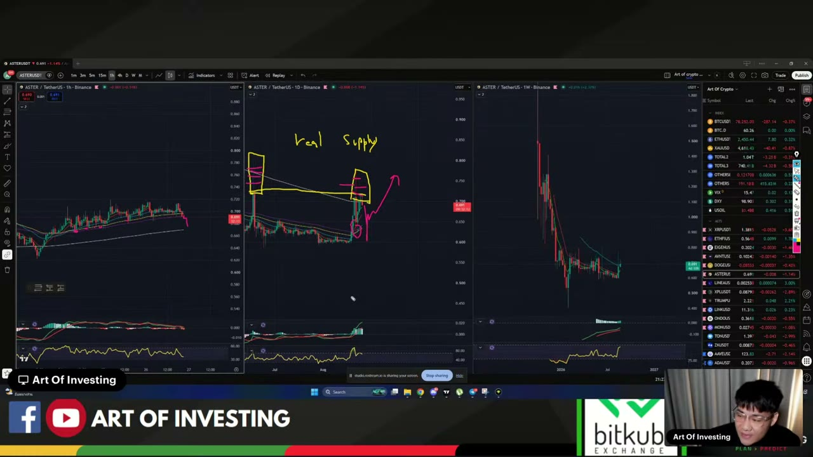

[01:27:50] ลิฟนู่นนี่นั่นนู่นนี่นั่นรัฐบาลบอกไม่ เห็นด้วยไม่เห็นด้วยไม่เห็นด้วยเขาจะทำ งานลำบากขึ้นครับเขาก็เลยไม่อยากแพ้ midterm  election ทีเนี้ยพอเขาไม่อยาก แพ้ midterm  election เนี่ยเขาก็ต้องการ ชื่อเสียง ต้องการภาพเชิงบวก งั้นคำถามคืออะไรจะบ่งบอกว่าเขาทำงานได้ ดีมากกว่าตลาดหุ้นเป็นบวกผมเลยบอกว่าเอ้ย ผมเห็นด้วยกับกับมุมมองนี้ของดร.บิ๊กนะผม เห็นด้วยเห็นด้วยมากๆเลยด้วยซ้ำเพราะว่า เนี่ยอ่ะเค้าก็พูดได้ว่าเค้าบอกว่าเขาจะ ทำให้อเมริกา great  again ดูสิตั้งแต่ เขาเลือกตั้งเอ่อชนะขึ้นมาเนี่ย S&P  500 ขึ้นไปเท่าไหร่เม็ดเงินเข้ามาในตลาด AI ต้องเท่าไหร่เค้าทำทั้งนั้นอ่ะเขาค้าก็ พูดได้ถูกมั้ยแล้วก็เนี่ยเออดีแล้วที่คุณ สกายพูดขึ้นมาผมจะได้พูดต่อคุณคิดดูนะถ้า เกิดว่า รอบเอ่อกลางกันยายนสร้างสภาพคล่อง ต้องเขย่าไว้รอบนึงแล้วสมมุติว่าย่อมา 72,000 หรือ 6  60,000 ปลายๆสมมุตินะ สมมุตินะแล้วมันขึ้นต่อไป New  High

[01:28:51] พฤติการเขย่าอีกรอบอีกเกิดเหตุเกิด อะไรก็ไม่รู้สมมุติว่าะมันไปได้หลายหน้า มากแหละผมก็เลยมองว่าเราไม่เคยเจอ ประธานธิบดีที่บ้าขนาดนี้มาก่อนรอบก่อน ที่ทรมดำรงตำแหน่งอ่ะผมรู้สึกว่าเขาไม่ ได้เท่านี้นะครับฉะนั้นความหันผวนรอบ เนี้ยผมมองว่าบitcoinเล่นยากกว่าเดิมถ้า เกิดคุณจะเก็งกำไรผมมองว่ามันไม่ใช่ สวรรค์ของนักเก็งกำไรแล้วนะครับเออถ้า เป็นนักลงทุนน่ะเออผมว่าการสะสมอ่ะมันก็ ยังทำได้เหมือนเดิมเออแต่การลงทุนน่ะเอ่อ ขออภัยการเกกำไรระวังหน่อย out คอยมันอาจ จะไม่ได้แบบอุ๊ยขึ้นอุ๊ยนั่งยิ้มบวกยาว 10 20 เด้งผมว่ามันแอบยากเหมือนกันที่ที่จะ เป็นแบบนั้นทั้งตลาดผมไม่ปฏิเสธนะว่ามัน อาจจะมีบางตัวที่ทำได้ แต่คุณจะไม่ได้จิ้มตัวไหนก็ขึ้นเหมือนแต่ ก่อนน่ะผมเชื่อว่าขึ้นทั้งตลาดแบบ 2021 น่าจะเกิดขึ้นได้ยากมากแล้วอ่ะแบบที่คุณ จิ้มตัวไหนก็ 10x  20x  30x อ่ะเพราะ ว่าตอนนั้นมันไม่ได้มีตัวเลือกอื่นที่ดี กว่านั้นเลยตอนนั้นคนมองอะไรตอนนั้นคนมอง

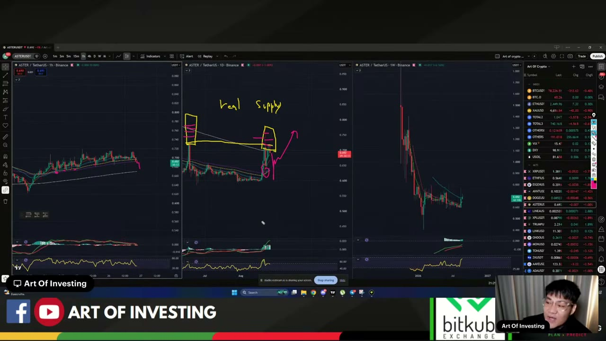

[01:29:52] ว่าคริปโตคือตลาดแห่งการเก็งกำไรถูกป่ะ ฉะนั้นน่ะณวันเนี้ยวันที่คุณมีหุ้นขึ้น 9 เด้งหุ้นขึ้น 5 เด้งในปีเดียวใน 5 เดือน ใน 6 เดือนเ่ะคุณยังจะมองว่าคริปโตเป็น ตลาดเก็งกำไรที่ดีที่สุดอยู่ป่ะคุณต้อง มองว่ากูลงทุนในหุ้นอเมริกาก็ได้บริษัท จับต้องได้ด้วยเออผมเลยมองว่าระวังเพิ่ม นิดนึงระวังเพิ่มนิดนึงถ้าจะเก็งกำไรอ่ะ เล่นฟิวเจอร์เบามือลงหน่อยเพเพิ่มเพิ่ม สัดส่วนไปเล่นสปอตมากขึ้นหน่อยผมว่า ไซเคิลนี้ไม่หมูมันขึ้นแหละแต่ ไม่หมูเขย่ามันแน่คุณเห็นทรัมป์แล้ว ว่ามันเล่นกับทองเล่นกับน้ำมันขนาดไหนอ่ะ คุณเปิดกราฟน้ำมันเหมือนคนเป็น อ่ะคุณดูอ่ะ เขย่าอย่างเงี้ยผมขำแห้งเลยอ่ะคุณดู ดิเอ้ยประกาศแล้วเรามีการเจรจากับโอมาน อ่านู่นนี่นั่นทุบฟึ๊บ ขึ้นเอ้ยเราดีแล้วเดี๋ยวกลับมายิงกันใหม่ ขึ้นฟึ๊บอย่างเงี้ยนะครับเนี่ยมัน aggressive มากสำหรับ movement ช่วงนี้ นะครับอ่ะ A ได้อีกตัวนึงนะครับแล้วเดี๋

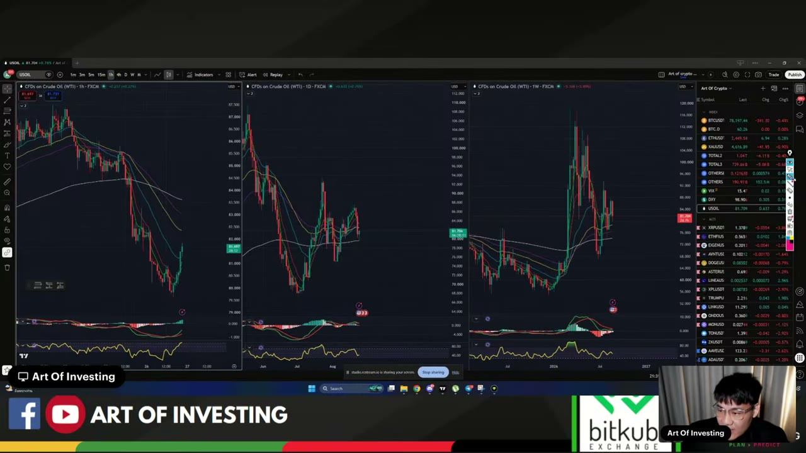

[01:30:52] ตอบคอมเมนต์แล้วเดี๋ยวผมจะไปเบรคละ โอเคed้ายังยังเบรคเบรกพรีเมี่มมาได้แล้ว นะครับในweคแค่ตอนเนี้ยก็คือแมกdยังใต้ สูตเนาะใน week ฉะนั้นเนี่ยครั้งต่อไป ครับสิ่งที่เราอยากจะเห็นนะครับก็คืออ่ะ ตอนเนี้ยนะครับมันเกิดการย่อและ ERA เนี่ยอาจอาจจะย่อมาที่ flip zซoneอย่างี้ ก็ได้อ่ะซึ่งสมมุติว่าตอนนี้มันถึงแล้ว งั้นคุณอาร์ตแล้วเมื่อไหร่โมเมนตัมที่ A ได้จะมาอีกคุณก็ดูตรงนี้ เห็นมยมันเริ่มเปลี่ยนละจาก disc มันจะ กลายเป็นพรีเมียมแทนงั้นมันก็จะเป็นเงี้ เบรคได้เมื่อไหร่ MacD กลับมาเหนือ 0 ได้ เมื่อไหร่ RSI  overbard อีกครั้งเมื่อ ไหร่ก็โมเมนตัมถึงจะเกิดครับใน 1 ช่โมง A ก็ให้ดูภาพตรงนี้ไว้ถ้ายังไม่เกิดก็ โมเมนตัมยังไม่มาถ้าโมเมนตัมมันเกิดอ่ะ มันถึงจะกลับขึ้นไปส่งต่อถึง Day ได้นะ ครับอ่ะก็ต้องวัดตรงนี้ตอนนี้มันเริ่มย่อ ะนะครับก็รอภาพนี้ถ้ายังไม่เกิดผมก็มอง ว่าโมเมนตัมมันจบไปแล้วนะครับในระยะสั้น

[01:31:54] เพราะตอนเนี้ย day อ่ะที่มันเกิดโมเมนตัม ไปแล้วมันส่งไม่ถึงweคเห็นป่ะขึ้นแล้วมัน เลยติดเลยฉะนั้น 1 ชั่วโมงก็ต้องเกิด โมเมนตัมอีกรอบเพื่อส่ง day แล้วก็เพื่อ ส่ง week ถ้าไม่ได้อีกก็ย่ออีกนะครับมัน จะเป็นอย่างงี้อ่ะ virtuual เหรออ่ะอีกตัวแล้วกันตัวสุด ทรัมปทรัมปเพิ่งวิเคราะห์ไปเลยครับคุณคุณ อาร์มเมื่อกี้เลยไม่ไม่เกิน 20 นาทีเพิ่ง ๆพูดถึงทรัมป์ไปครับย้อนๆ้อดูได้เลยนะ อุ๊ยสวยว่ะแต่ว่าเริ่มติดละนะครับก็ตรง นี้นะครับก็เอิ่ม ตรงนี้นะเริ่มละถึง discone ละมันก็เลย เอ้ยขออภัยพีemiโซนละนะครับมันเลยเริ่ม เกิดแรงขายบ้างนะครับฉะนั้นตอนเนี้เกิด การย่อแล้วซึ่งผมมองว่าโอเคมันย่อมาเนี่ย มันก็ยังเหนือกว่าตรงนี้ที่มันเป็น flip zซoneนะครับก็คือเฮ้ยราคามันไม่เคยเบรค เลยขึ้นไปปุ๊บเหมือนที่ผมพูดเมื่อกี้เอา หัวโหม่งกำแพงโหม่งแตกปุ๊บช่างฉาปูน โหม่งแตกปุ๊บช่างฉาบปูนอันเนี้ยช่าง

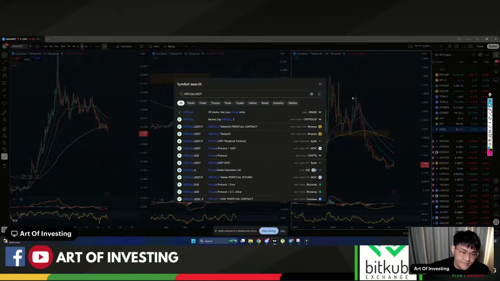

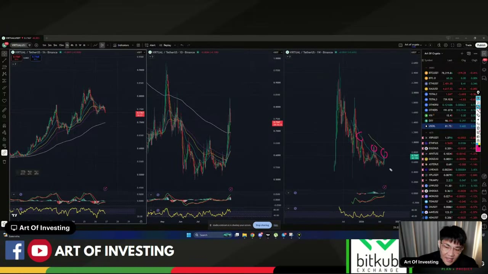

[01:32:54] ฉาบปูนไม่ทันแล้วแปลว่าออเดอร์ซื้อเนี่ย มันเข้ามาเยอะจริงเห็นมั้ย MAD มันกลับ ขึ้นมาเหนือ 0 ได้ RSI มันoverบอได้นะ ครับฉะนั้นการย่อครั้งต่อไปเนี่ยมันก็จะ เป็นอย่างี้แหละเห็นมั้ยให้คุณรอก่อนว่า จังหวะย่ออ่ะแล้วครั้งต่อไปที่มันกลับไป ขึ้นน่ะนะครับโมเมนตัมมันต้องเกิดแบบ เนี้ยเห็นป่ะ เนี่ยเกิดแล้วเห็นป่ะเฮ้ยติดว่ะติดว่ะติด ว่ะแล้วเบรคได้เอาเบรคได้แล้วโมเมนตัมมา ยัง magne เหนือ 0s แท่งนี้อ่ะคุณก็เข้า ตรงนี้แล้วก็ stop  loss ตรงนี้เพราะว่า อย่างที่ผมบอก 82-85% ถ้าโมเมนตัมเกิดแล้วส่งต่อให้timeมfrฟม ถัดไปได้มันจะไม่ย้อนกลับมาทำ new  low ในสวิงที่ทำให้เกิดโมเมนตัมอ่ะผมก็จะตั้ง stop  loss อย่างงี้ฉะนั้นถ้ามันลงมา อย่างเงี้ยแล้วมันเกิดอย่างเงี้ยแล้ว MACD มันกลับไปเหนือสูตได้ Over  B ได้แล้วคุณ มองว่ามันจะพังสงกหัวได้อ่ะเออก็ก็ค่อยรอ เล่นแบบนั้นซึ่งตอนนี้ยังไม่เกิดครับอ่ะ ประมาณนี้นะครับเฮ้ยอย่าลืมนะครับกดไลก์ กันหน่อยนะครับผมก็วันนี้ขอบคุณมากเลยคน ดูกลับมา 200 กว่าคนอีกแล้วนะครับก็ตื่น เต้นและดีใจทุกครั้งแหละที่ได้มาไลฟ์นะ

[01:33:55] ครับก็อันนี้นะครับก็จะเป็น QR coดนะครับในกลุ่มTelกramของผมสมาชิก จะ 4,000 คนละนะครับก็ผมก็จะอัปเดตแนวทาง ความคิดหรือวันไหนผมเทรดผมก็จะลง Trading Journal นะครับหรือบางทีผมก็จะลงทั้ง เดือนเป็นเรื่องปกติให้ดูเรื่อยๆนะครับก็ ผมจะอัปเดตเร็วที่สุดเพราะว่ามันเป็นห้อง แชทอ่ะผมคิดอะไรผมสามารถพิมพ์ได้เลยถูก มั้ยแล้วก็มีเพจ Facebook นะครับชื่อ เดียวกันคือ Art  of  Investing นะครับก็ ผมจะลงบทความค่อนข้างบ่อยประมาณอาทิตย์ละ 2-3 บทความนะครับที่ที่เขียนเกี่ยวกับ หลายๆเรื่องเนาะก็ทั้งวิเคราะห์ตลาดทั้ง วิเคราะห์มาครroeconomicเศรษฐกิจนะครับก็ ฝากไปตามกันด้วยเพจ Facebook  Book นะ ครับแล้วก็ YouTube นะครับจะมาไลฟ์ทุกวันพุธ 20:00 น.นะครับก็เจอกันได้วันนี้ขอบคุณทุกท่าน มากเลยนะครับ Art  of  Investing ฝากไว้ นะมองเหมือนเดิมคิดว่าขึ้นได้คิดว่าบวก แหละแต่ยากหน่อยนะไซเคิลเนี้ยผันผวนเอา เรื่องอยู่นะครับก็ระวังตัวขึ้นหน่อยลง ทุนได้เทรดได้เหมือนเดิมแค่รัดเข็มขัดให้

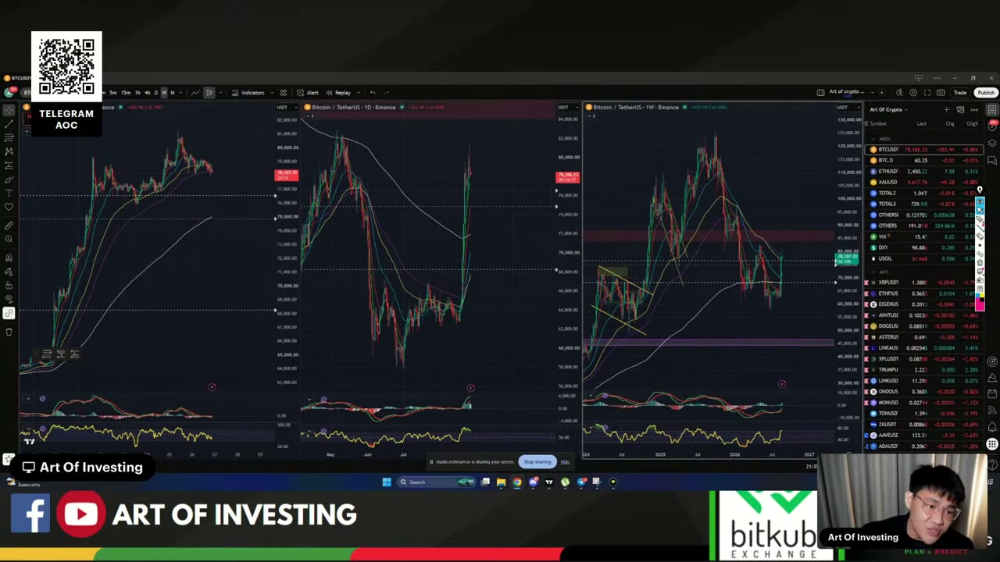

[01:34:56] แน่นกว่าเดิมหน่อยนะครับผมคิดว่ามันจะไม่ ขึ้นลวดเดียวอ่ะมันอาจจะมีการเขย่า กุ๊กกิ๊งๆิ๊งหน่อยนะครับเออคุณจะเดาทาง มันยากกว่าเดิมหน่อยระวังนิดนึงนะครับ เป็นความคิดส่วนตัวนะ นะครับอ่ะวันนี้ประมาณนี้แล้วกันนะครับ แล้วเดี๋ยวมาวิเคราะห์พาร์ทอื่นให้นะครับ เชิญครับขอให้ทุกท่านมีความสุขในการลงทุน ครับสวัสดีครับ

