# BTC ย่อคือโอกาส??

- ช่อง: Art Of Investing
- ลิงก์: https://www.youtube.com/watch?v=GPaOf1R6MgI
- วันที่: 2026-09-02
- ความยาว: 1:05:38
- ที่มา: คำบรรยายอัตโนมัติ (auto-generated) ภาษาไทยของ YouTube — อาจมีคำสะกดผิด/คำผิดเสียง
- ภาพ: 26 ภาพจากวิดีโอช่วงที่เปิดกราฟแท่งเทียน (เลือกอัตโนมัติจากสีแท่งเทียน · ตัดภาพซ้ำ) อยู่ในโฟลเดอร์ frames/

---

[00:00:11] [เพลง]อ สวัสดีครับแหเป็นไงนะครับเดี๋ยวนี้เป็นไง ต่อให้งานจะยุ่งแค่ไหนนะครับก็ยังมาเจอ แบบตรงเวลาเสมอนะครับก็คือเป็นวันวันอะไร นะวันนี้วันพุธวันพุธมั้ยเดี๋ยวผมเช็ค ก่อนเออใช่วันพุธนะครับแต่ว่าเออเราก็ไม่ รู้นะว่า YouTube มันแจ้งเตือนหรือเปล่า นะครับผมเพราะว่าalกอิึมมันแปลกๆนะช่วง นี้ผมว่าเหมือนเค้ากำลังพยายามจะปรับอะไร สักอย่างอยู่นะครับสำหรับalorิึม YouTube นะก็เดี๋ยวๆต้องดูว่ามันจะออกมาประมาณไหน นะครับเดี๋ยวขอเช็คนิดนึงขึ้นเนาะไลฟ์ผม

[00:01:13] น่าจะขึ้นเนาะ ขึ้นมั้ย เดี๋ยวเช็คก่อน โอเคผมคิดว่าน่าจะนิ่งและนะครับไม่น่ามี ปัญหาอะไรก็เดี๋ยววันนี้นะครับจะมา วิเคราะห์ภาพรวมตลาดให้ฟังนะแล้วก็ถึง โอกาสการย่อแล้วก็นะผมว่าคนที่ต้องการ เก็บของระยะยาวอ่ะน่าจะแฮปปี้กับโมเมนต์ นี้นะครับจะมีแค่คนที่เล่นระยะสั้นแบบผม นี่แหละครับที่มันจะเทรดยากนิดนึงเนาะแต่ ว่าเราก็แยกนะระหว่างพอร์ตสปอตนะครับกับ พอร์ตเอ่อ เทรดเก็งกำไรนะครับขออภัยวันนี้เพลียนิด นึงนะครับพอดีพาหมาไปออกกำลังกายมานะครับ แล้วก็วิ่งกับเา้าค่อนข้างเหนื่อยนิดนึง นะครับแล้วก็เออกลับมาก็เช็ดเท้าเช็ดอะไร ให้เค้าเนาะเลี้ยงหมาตัวนึงก็เหมือน เหมือนลูกอ่ะนะครับเหมือนเหมือนเลี้ยงลูก

[00:02:14] อ่ะเราก็ต้องดูเค้าให้ดีดูเค้าทุก อากักิริยานะครับแต่ก็มีความสุขดีครับอ่ะ เดี๋วันนี้มา วิเคราะห์กันโอ้วันนี้ผมรู้สึกผมเบลอมาก เลยนะครับโทษทีนิดนึงครับรู้สึกว่าพูดจา ช้าเหลือเกินอ่ะโอเคมาๆมา โอเค Let's  go สักครู่นะฮะรวบรวมพลังก่อนรู้สึกเพลียมาก โอเคมาสวัสดีครับอาจารย์อาร์ตเรากำลังติด บูทapหรือเปล่าเป็นไปได้ครับผมยังไม่ยก เคสนี้ออกอย่างที่เรารู้กันเนาะว่าผมเอ่อ

[00:03:16] พูดถึงเคสนี้มาตลอดตั้งแต่ 2-3 เดือนก่อน เลยแล้วก็ด้วยความที่ผมกังวลใน data สถิติในมือเนี่ยแหละเลยทำให้ผมตกรถสปอตไป ครึ่งนึงนะครับก็คือผมตั้งใจจะเก็บเต็ม ก้อนน่ะรอบเนี้ยก่อนมันจะเกิดบูรัใช่มั้ย แต่ว่าผมเก็บแค่ 50% เพราะว่าตอนแรกอ่ะ มุมมองผมยังคิดว่ามันน่าจะเกิดการ accumulation อีก 1 จังหวะก็คือลงไป new หน่อยก่อนจะวิ่งชุดใหญ่แต่ปรากฏว่ามันเจอ การทำกึ่งๆ steal  Q นะครับหรือว่าซื้อ พันธบัตรระยะยาวคืนนะครับมันก็เลยเบรคไป ก่อนนะครับทั้งบitcoinทั้งทองคำเลยก็ เดี๋ยววันนี้ผมจะอธิบาย narrative ของ มาโครให้ฟังนะว่าเออเฮ้ยแล้วทำไมเราก็ คำนวณไว้แล้วนี่ว่าภาพรวมต่างๆมันเป็นแบบ นี้แล้วทองคำทำไมมันถึงขึ้นพร้อมบit บitคinนะครับอ่ะเดี๋ยวเรามาวิเคราะห์กัน วันนี้สวัสดีครับแจ้งเตือนอยู่ครับเมื่อ กี้ผมขับรถอยู่ถึงรู้ว่ามาโอ้โอเคแสดงว่า YouTube ยังน่ารักอยู่นะครับสวัสดีครับ คุณโกโก้สวัสดีครับคุณปูBlackทestนะเป็น

[00:04:16] คู่หูคุณปูแฮสนะ สวัสดีครับคุณจูเนียร์สวัสดีครับคุณฮารุ สวัสดีครับคุณโบว์สวัสดีขอบคุณครับโอ้ ขอบคุณซอ์Cชat 200 บาทครับคุณตี้นะครับ ขอบคุณมากครับเอ่อขอบคุณขอบคุณครับ อาจารย์ติดตามฟิล์มมาหลายทีแล้วเป็นกำลัง ใจให้อาจารย์นะครับขอบคุณมากๆครับเป็น กำลังใจที่ดีมากๆเลยครับขอบคุณครับแค่ เข้ามารับชมผมก็ดีใจมากๆนะครับส่งซเปอร์ช มาก็ขอบคุณมากๆเลยครับสวัสดีครับอาจารย์ รายงานตัวครับสวัสดีครับคุณอ๊อด CRB Community  Index พุ่งปี๊ดเลยครับเงิน เฟ้อน่าจะดื้อแน่ๆใช่เมื่อกี้ Non nonฟารmก็ออกมาแล้วก็เป็น ADV nonฟารม เดี๋ยวอธิบายอย่างงี้ก่อนคนจะไม่เข้าใจ ว่า ADV nonฟารมกับnonฟารมต่างกันยังไงนะ ครับไอ้วันเนี้ยที่ประกาศอ่ะมันเป็นตัว เลขที่ภาคเอกชนเก็บฉะนั้นมันอาจจะไม่ครอบ คลุมนะครับตัวเลขที่เค้ายึดจริงๆอ่ะจะ เป็นวันศุกร์นะครับที่เป็นนอนฟาร์มจริงๆ ที่เป็นรัฐบาลเก็บนะครับก็วันศุกร์เนี้ย ผมคิดว่าผันผวนแล้วก็ 10  14  15  16  17 เนี่ยถึง 18 เนี่ยมันจะมี 4 อีเวentใหญ่ ที่ตลาดน่าจะผันผวนค่อนข้างหนักแล้วก็

[00:05:20] อาจจะทำให้หลายคนเนี่ยผิดแผนไว้ได้แต่ผม มองแบบนี้นะผมมองว่ามันเป็นโอกาสที่ดีมาก ๆนะครับในหลายจังหวะเพราะว่าคุณคิดว่าใน ชีวิตนึงอ่ะมันจะได้เจอการแครชของตลาดที่ ใหญ่ที่สุดในโลกสักกี่ครั้งถูกป่ะอย่าง ตอนต้มยำกุ้งคนที่ลงทุนในหุ้นไทยก็ร่ำรวย ขึ้นมาเพราะว่ามันเป็น GR เนาะเป็นหุ้น แบบเศรษฐกิจเราเพิ่งตั้งลำได้แล้วก็แบบ โอ้โหกำลังเติบโตอย่างยิ่งใหญ่นะครับหรือ ว่าคนที่ลงทุนในตลาดหุ้นสหรัฐอเมริกาใน ช่วง Brothers ปี 2008 นะครับถ้าถือก็ โอ้โหกำไรไม่รู้กี่เด้งนะครับฉะนั้นตอน เนี้ยเรากำลังมี FSebu.com ฟอร์มอีกก่อน หน้านั้นนะครับแล้วก็ตอนนี้เรากำลังจะ เผชิญกับฟองสบู่ AI นะครับฟองสบู่ AI ที่ เราไม่รู้ว่าจุดสูงสุดอยู่ที่เท่าไหร่ เพราะว่าตอนนี้มันเป็นความคาดหวังของตลาด มากกว่าราคาจริงๆราคาตัวมันจริงๆนะครับ ฉะนั้นเนี่ยเรารู้อยู่แล้วแหละว่าวันนึง มันต้องแครชเพราะว่า SMP  500 เนี่ยมัน ขึ้นมาแบบ 20 กว่าปีแล้วอ่ะน่าจะ 29 ปี

[00:06:22] มั้ถ้าผมเช็คไม่ปิดเผมเช็คก่อนนะครับที่ มันเป็นเทรนอัพเทรนอย่างเดียวแบบไม่มีการ ย้อนเลยนะครับอ่ะเนี่ยวันนี้ S&P  500 ก็ น่าจะเมื่อวานก็ปิดย่อตัวลงมานะวันนี้ผม ก็คิดว่าน่าจะดรอปลงมาอีกหน่อยผมเช็คก่อน ใช่ 20 ปีะนะครับตั้งแต่ปี Wikit  Lman Brother ครับก็ขึ้นเป็นขาขึ้นยาวมาตลอด ไม่มีพักตัวเลยฉะนั้นน่ะมันก็มีแนวโน้ม ที่จะเกิดการพักตัวหรือแครชได้ะทีเนี้ย มันจะเป็นภาพที่เราเรียกว่า Black  Sword นั่นแหละแล้วคนก็จะบอกว่าโอวิกฤตตลาดมัน น่ากลัววิกฤตนู่นนี่นี่นั่นให้ให้เรามอง แบบนี้นะครับทุกวิกฤตอ่ะมีคนหมดตัวกับมี คนกลายเป็นเศรษฐีจากคนธรรมดาแล้วผมก็ชอบ คำพูดนึงของคุณฮ้งสถาพรมากๆคุณฮ้งสถาพร เนี่ยจะชอบพูดว่าเอ่อ Black  S เนี่ยไม่ ได้แปลว่าวิกฤต Black  Swan เนี่ยสามารถแปลว่าโอกาสก็ ได้สำหรับคนที่เตรียมตัวนะครับฉะนั้น เดี๋ยววันเนี้ยมาดูภาพมาโครใหญ่ๆกัน สวัสดีครับคุณธนบดีสวัสดีครับคุณอ๊อด

[00:07:24] สวัสดีครับสวัสดีครับอาจารย์อาร์ตไว้ให้ กำลังใจขอบคุณครับน้องศุภกิจ ผมว่าทองขึ้นจากความน่าเชื่อถือใน USD เอ่อลดลงมั้ยครับส่วนนึงต้องต้องบอกแบบ นี้ครับทองภาพรวมมันน่ะคือSaฟ Heaven หรือพื้นที่แห่งความปลอดภัยนึกออกใช่มั้ย จะกักเก็บมูลค่าไม่ว่าอะไรเนี่ยเพราะว่า มันเป็นสินทรัพย์แลกเปลี่ยนกลางที่ทั่ว โลกใช้งานกันทั่วโลกยอมรับนะครับฉะนั้น เราเลยจะเรียกทองว่าSaฟ Heaven แต่ที เนี้ยเราก็จะเห็นว่าวันเนี้ยทองย่อตัวลง มาคำถามคือทำไม 1 นะครับอ่ะเดี๋ยวผมขึ้น หน้าข่าวก่อนดีกว่าว่ะผมกลัวมันจะเราเรา พอผมไม่ได้เขียนลงบนกระดานแล้วเราจะตาม กันไม่ทันเดี๋ยวผมแชร์หน้าจอก่อน ขอแชร์หน้าจอก่อน โอเคเดี๋ยวนะปึ๊บ

[00:08:25] โอเคแล้วเดี๋ยวเอาแชทแหลบปึ๊บตรงนี้ แล้วก็ เดี๋ยวนะครับ วันนี้ผมช้าๆนิดนึงนะครับพอดีล้าๆนะครับ อาจจะอึดๆนิดนึงนะโอเคเอาแชทหลบะอ่ะโอเค นะครับอ่ะอย่างเมื่อกี้เราก็เห็นเนาะออก มาแล้วะเป็นตัว ADP Nonฟารmนะครับเป็นตัว ADP nonฟารmซึ่ง ADP nonฟารมอย่างที่ผม บอกนะครับว่ามันเก็บจากภาคเอกชนตัวที่เขา ยึดจริงๆเนี่ยก็จะเป็นตัวที่รัฐบาลเเขา เก็บนะครับฉะนั้นเราจะต้องไปดูวันศุกร์นะ ครับวันศุกร์แล้วก็อีเวentที่ผมอยากให้ เราทำความเข้าใจแล้วก็ไล่ไปทีละสเต็ป เดี๋ยวผมจะเรียงอีเวentเลยนะว่ามันกำลัง จะเกิดอะไรขึ้นบ้างข้อแรกนะครับตอนเนี้ย Watch เนี่ยเค้าส่งท่าทีเข้มงวดต่อ มาตรการเงินเฟ้อเยอะ

[00:09:26] เมื่อเข้มงวดเท่ากับโอกาส ลดดอกแทบยังไม่มีในเร็วๆนี้นะครับจะมีแค่ คงดอกและ เริ่มมีแนวโน้มเป็นการขึ้นดอกแล้วด้วยซ้ำ นะครับอ่าเมื่อขึ้นดอกหรือคงดอกแปลว่า อะไรจะให้ผลตอบแทนสูงขึ้นคำตอบคือ พันธบัตรรัฐบาลนะครับหรือบอถูกมั้ย พันธบัตรรัฐบาลเนี่ยจะให้ผลตอบแทนที่สูง ฉะนั้นพอการเข้มงวดของเฟซออกมาเนี่ย ทองเลยมีการพักตัวเพราะคนก็รู้สึกว่าเอ้ย ถือทองอ่ะคุณไม่ได้ปันผลคุณไม่ได้อะไรถูก มั้ยแต่ถ้าคุณไปถือพันธบัตรรัฐสหรัฐเนี่ย คุณได้ต่อปีแน่ๆเนี่ย 4-5% แล้วเ้าไม่มี ทางเบี้ยวคุณด้วยเพราะว่าคุณเป็นเจ้าหนี้ ประเทศที่มีหนี้เยอะที่สุดในโลกอ่ะแล้ว loop  cycle ของเขาก็คือเขาก็ยืมเงินตัว เองในอนาคตมาจ่ายหนี้ปัจจุบันวนไปเรื่อยๆ นะครับฉะนั้นคุณกำลังจะได้กู้ในประเทศที่

[00:10:28] ไม่มีทางเบี้ยวหนี้คุณได้ เอ่อขอคุณเป็นเจ้าหนี้นะครับให้กู้กับ ประเทศที่ไม่มีทางเบี้ยวหนี้คุณได้งั้น ทองเนี่ยมันก็เลยปรับตัวลงว่าเฮ้ย แบบเนี้ยเงินมันต้องไหลเข้าพันธบัตรก่อน เงินเนี่ยมันมันจะต้องไปในที่ที่มีผลตอบ แทนก่อนทองเนี่ยถือเฉยๆมันไม่ได้อะไรมัน แค่เพิ่มมูลค่าด้วยตัวเองเพราะว่ามันไม่ สามารถหาเพิ่มได้มันมีจำนวนจำกัดแต่อย่าง อื่นเนี่ยไม่จำกัดอ่ะฉะนั้นเงินเนี่ยมัน ก็เลยไหลเข้าไปที่พันธบัตรก่อนในระยะสั้น นะครับทีเนี้ยตลาดเนี่ยเกิดความกังวลแล้ว งั้นวันศุกร์เนี่ยเกิดอะไรครับวันศุกร์ เนี่ยจะมีนอนฟาร์ม วันนี้จะอยู่ไม่นานนะครับผมผมมากแต่ว่าจะ พยายามตามรวบรวมพลังนะครับnonฟาร์มเนี่ย คือตัวเลขการจ้างงานนอกภาคการเกษตรให้คุณ นึกภาพว่าถ้าเกิดส่งสัญญาณว่าเข้มงวดแล้ว

[00:11:29] มีโอกาสจะขึ้นดอกเนี่ยแปลว่าเศรษฐกิจต้อง ลำบากถูกมั้ยเพราะว่าดอกเบี้ยยิ่งต่ำคนทำ ธุรกิจยิ่งหายใจคล่องเหมือนกับคุณไปกู้ แล้วคุณต้องจ่ายดอกถูกมากๆอ่ะสมมุติว่า คุณต้องจ่ายดอกเบี้ยปีละ 2% อย่างเงี้ย คุณก็แบบเอ้ยสบายบอกอุ๊ยอยากขยายสาขาว่ะ เดี๋ไปกู้เพิ่มเดี๋ยวตรงนี้รีไฟแนนซ์แบบ นี้เอาตรงนี้ไปค้ำแล้วคุณหมุนเงินมัน สะพัดเพราะดอกเบี้ยมันถูกมากคุณบอกว่า 2% เนี่ยโอ้โหคุณไปทำอสังหาซีซั้วอะไรก็แล้ว แต่เนี่ยได้แน่ๆแล้วเอาแบบทุเรศทุเรศเลย แล้วคุณบอกว่าเสียดอก 2% โอ้โหชั้นกำไร 4% อ่ะสมมุตินะมองๆในแง่นี้ฉะนั้นเศรษฐกิจ อ่ะมันก็จะคล่องแล้วเงินมันก็จะเฟ้อที เนี้ยครับพอต้องคงดอกเนี่ย กู้เงินลำบากและแล้วก็ถ้าเกิดเศรษฐกิจมัน ยิ่งตึงตัวนะครับคนที่เค้าต่อให้ไม่กู้ เพิ่มอ่ะแต่เขามีดอกเบี้ยต้องจ่ายอยู่ แล้วแล้วคนพวกเนี้ยครับบริษัทใหญ่ๆยักษ์

[00:12:31] เนี่ยเค้าไม่ใช้เงินสดเค้าเวลาเค้า ต้องการจะซื้ออะไรสักอย่างอ่ะเค้าจะเอา สินทรัพย์ที่เค้าถือเนี่ยเช่นพันธบัตร สหรัฐหรือหุ้นไปค้ำแล้วกู้เงินสดออกมา ซื้อแม้ว่าจะลงทุน ETF เค้าก็ยังจะใช้ เงินกู้ฉะนั้นถ้าเกิดดอกเบี้ยมันเริ่มสูง จนเริ่มจ่ายไม่ไหวเค้าจะต้องยอมขายสิน ทรัพย์ของเค้าออกมาเพื่อเอามาจ่ายดอก

[00:12:58] นะครับงั้นเรารู้แล้วว่าเศรษฐกิจเนี่ยมัน ไม่แข็งแรงตัวเลขตรงเนี้ยเลยจะเป็นตัวยืน ยันว่าเฮ้ยไอ้ที่ watch บอกจะเข้มงวดจะ เข้มงวดเนี่ยมีโอกาสจะขึ้นดอกอีกเนี่ยจะ จะอัดดอกเข้าไปอีกเนี่ยเศรษฐกิจมันไหว เปล่าพี่จะขึ้นดอกอ่ะพี่พี่ดูประชาชนก่อน พี่ดูคนในประเทศไหวมั้ยนะครับฉะนั้นถ้า เกิดวันศุกร์เงี้ยอย่างอันเนี้ยเค้าก็ เก็บตัวเลขมาเห็นมั้ยเค้าคาดการณ์ว่าจ้าง งานนอกภาคการเกษตรเนี่ยมันจะต้องสูงขึ้น ด้วยซ้ำเค้ามองไว้ที่ 47,000 ออกมาต่ำ กว่าคาดนะครับเป็น 38,000 งั้นวันศุกร์ช่วงประมาณ 1900 กว่าๆเนี่ย ภาพที่เราจะได้เห็นถ้าเกิดnonฟาร์มนะครับ ถ้าเกิดnonฟารม ออกมาต่ำกว่าคาดอ่ะภาพที่ผมผมจะได้เห็น ระยะสั้นกับกลางเนี่ยผมมองต่างกันนะ ถ้าเกิดต่ำกว่าคาดในช่วงสั้นๆผมคิดว่า 1-2

[00:14:02] ชมงเนี่ยเราอาจจะเห็นแรงดีดของบitcoin สั้นๆนะคำถามคือทำไมรู้มั้ยเพราะว่าระยะ สั้นเนี่ย ตลาดมองว่าอุ๊ยแบบนี้มึงขึ้นดอกไม่ได้ หรอกอ่าถูกป่ะ ระยะสั้นตลาดจะตีความอย่างงี้อุ้ยเนี่ย จ้างงานเละเทะหมดแล้ววันศุกร์ประกาศนอน ฟาร์มออกมายังจะขึ้นดอกอีกเหรอขึ้นดอกนี่ ไม่กลัวsอในประเทศตายหมดอ่ะเฮ้ยบริษัท เจ๊งหมดแบบนี้ขึ้นดอกไม่ได้หรอกอ่ะเราอาจ จะเห็นแรงซื้อวิ่งขึ้นไปก่อนเฮ้ยอยู่อยู่ บitคinเด้งสั้นๆทีเนี้ยสักพักมันจะต้อง ปรับตัวลง นะครับ คำถามคือเอ้าทำไมอ่ะก็นึกภาพง่ายๆครับ เศรษฐกิจก็แย่เงินเฟ้อก็เอาไม่อยู่ชิบหาย ถูกมั้ยเพราะว่าแปลว่าเศรษฐกิจไม่ไหว

[00:15:08] โอ้โหลายมือ เงินเ้อก็ยังปราบไม่เสร็จ อ่ะทีเนี้ยครับไอ้nonฟาร์มตรงเนี้ยมันจะ เป็นตัวเชื่อมกับช่วงกลางเดือนนี้เพราะ กลางเดือนเนี้ยครับจะมี การโหวต Clarity  Act อีกรอบนึง นะครับต่อมามีโม C  Meeting อันนี้ผมพูดไปแล้วไลฟ์ที่แล้วกับกับเขียน บทความนะแต่ว่าวันนี้ผมมาrecรีแคAPให้ฟัง เพราะว่าตัวเลขนอนฟาร์มมันเพิ่งออกนะครับ ก็คือประกาศอัตราดอกเบี้ยแล้วก็มีการ ประชุม Bank  of  Japan ที่ถ้าญี่ปุ่น ขึ้นดอกเยนแครี่เทรดก็ส่งปัญหาทั่วโลกใช้ คำว่าทั่วโลกนะไม่ไม่ใช่แค่ญี่ปุ่นนะครับ ทั่วโลกครับ แล้วก็มี antropic นะครับที่น่าจะ IPO ใน ช่วงเร็วเดียวนี้ใกล้ๆนี้เดือน 2 เดือน

[00:16:09] นี้นะครับงั้นถ้าเกิดnonฟาร์มออกมาต่ำ กว่าคาดเนี่ยแล้วเฟดยังเลือกที่จะขึ้นดอก เนี่ยครับผมเชื่อว่าเนี่ยจะปรับตัวลงค่อน ข้างแรง เพราะแบบเนี้ยเงินมันจะเข้าไปที่ US ดอลลารความต้องการUSดดอลลาร์เนี่ยมันจะ สูงขึ้นเงินจะไหลเข้าไปที่พันธบัตรมาก ขึ้นอันนี้อาจจะย่อแรงอีกชุดนึงผมเชื่อ ว่าหลายๆตลาดจะย่อตลาดสินทรัพย์เสี่ยงก็ น่าจะย่อนะครับเอ่อบitcoinเนี่ยผมคิดว่า ย่อแน่นอนทองคำระยะระยะสั้นอาจจะย่อก่อน นะครับเนื่องจากคนจะต้องเอาสภาพคล่องออก มานะครับเวลาบริษัทใหญ่หรือกองทุนใหญ่เขา ค้ำอะไรไว้อ่ะเค้าไม่ได้ค้ำแค่หุ้นไงนึก ออกมั้ยเค้าก็อาจจะมีทองมีอะไรค้ำไว้หลาย อย่างอันเนี้ยผมตอบให้เลยที่เมื่อกี้มีคน ถามผมว่าเอ่อทองขึ้นเพราะความต้องการ US ดอลลาร์มันน้อยลงหรือเปล่าอะไรเงี้ยให้ เรานึกภาพอย่างงี้ปกติเราจะเห็นว่าอ้าว ถ้าเกิดหุ้นลงทองก็ขึ้นสิเพราะว่าคนรุรู้ แล้วว่าสินทรัพย์เสี่ยงอ่ะเขาเรียกว่า

[00:17:10] ภาวะ risk  off นะครับตอนเนี้ยงั้นเรารู้ ว่าสินทรัพย์เสี่ยงนมันอยู่อยู่มันอยู่ใน ช่วงภาวะปรับตัวลดลงงั้นเราก็ไปสะสมสิน ทรัพย์ที่มีมูลค่ามากขึ้นมากขึ้นผ่านกาล เวลาอย่างทองคำถ้าเกิดมันเป็นคอเลกชเล็กๆ มันก็ยังจะเป็นแบบนั้นครับก็คือแบบอ่ะ เฮ้ยบริษัทใหญ่ๆหรือสถาบันใหญ่ๆเขาก็แค่ reบalanceพอร์ตตัวเองถูกมยเขาก็แค่อ้าว ช่วงนี้ลดหุ้นหน่อยหรือเปิดอtionัมองลง หน่อยนะครับแล้วก็ไป ซื้อทองเพิ่มแต่ทีเนี้ยถ้าตลาดมันแครช ใช้คำว่าแครชนะไม่ว่าจะเบากลางหรือหนัก เมื่อไหร่ก็ตามที่ตลาดมันแครชเนี่ยบริษัท ต่างๆที่เขา้าเอาทองไปค้ำไว้ด้วยเนี่ย เค้าจำเป็นต้องขายทองเพื่อเอาเงินสดออกมา ด้วยไงถูกป่ะเพราะว่า เพราะว่าเค้าต้องเอาไปจ่ายใส่ดอกแล้วถ้า ดอกมันขึ้นหุ้นที่ค้ำไว้ก็ลงงั้นสัดส่วน

[00:18:13] มันเพี้ยนละแบบนี้ต้องรีบไปคืนไม่งั้นมัน จะเป็นหนี้ที่สูงขึ้นเฮ้ยงั้นทำไงดีวะอ่ะ เฮ้ยฉันค้ำอะไรไว้ถอนออกมาเป็นเงินสดก่อน แล้วไปใช้นี่นะครับเราเลยอาจจะเห็นทอง ปรับตัวลงด้วยถ้าตลาดแครชแรงจริงๆแต่ถ้า ตลาดแค่คอเลกชเนี่ยทองอาจจะลงไม่หนักมาก นะครับแต่ในระยะยาวนะครับทองมันจะขึ้นนะ ในระยะยาวนะหลังจากที่ตลาดมันแครสรอะไร เสร็จทองมันจะค่อยๆฟื้นนะครับแล้วผมก็มอง ว่ามันมันก็เติบโตในระยะยาวของมันอยู่ แล้วแต่ระยะสั้นน่ะเราอาจจะเห็น movement นี้ที่ใกล้กันฉะนั้น 2 อย่างที่ผมอยากให้ โฟกัสมากๆอ่ะคือnonฟารมวันศุกร์กับโมซ Meeting กลางเดือน 2 ตัวเลขเนี้ย สัมพันธ์กันแล้วส่งผลกระทบแบบเห็นได้ชัด แน่ๆต่อตลาดนะครับอยากให้ระวังใครที่เทรด leverage สูงมากๆเบามือนิดนึงนะครับส่วน สายสปอตนี่ก็อาจจะเป็นจังหวะของคุณถ้า เกิดคุณวางไว้ว่าเฮ้ยอยากได้ของที่โซน ราคาต่ำๆอยากได้เอ่อของเพิ่มที่โซนไหนแต่ มันก็จะยังมีข้อควรระวังในบางมุมนะครับก็

[00:19:17] เราต้องดูว่าการแครชตรงเนี้ยมันหนักแค่ ไหนมันแค่กระชากแล้วจบเลยหรือเปล่านะครับ เพราะผมไม่ได้มองว่ามันแค่ย่อสมมุตินะ เหลือ 74,000 แล้วก็ขึ้นต่อได้เลยแบบไม่ มีทางต่ำกว่า 74,000 ผมไม่ได้มองแบบนั้น ผมยังมองว่าถ้าเกิดมันพร้อมกันน่ะคือไม่ ใช่แค่ขึ้นดอกกับเศรษฐกิจรับไม่ไหวอ่ะแต่ มันผนวก Carity  Act ยังไม่ผ่านแล้วโดน เลื่อนไปเป็นหลักปี Bank  of  Japan ก็ ประกาศขึ้นอัตราดอกเบี้ยงั้นแปลว่าสถาบัน การเงินที่ทำ Yen  Carry เทรดทั้งหมดต้อง reบalanceพอร์ตหมดเลยสัดส่วนเพี้ยนหมดเลย นะครับรวมถึง Antropic คนคาดหวังมากว่าเงินนอกตลาด AI ยังสูงมากนะครับเงินนอกนอกตลาดที่พร้อมจะ ลงทุน AI ยังเหลืออีกเยอะมากฉะนั้นถ้า IPO ไปแล้วแล้วหุ้นมันยังทำ New  High วิ่ง ขึ้นเรื่อยๆไม่มีปัญหาครับแต่ว่าถ้าเกิด เข้าไปแล้วไม่ได้ช่วยดึงตลาดสูงไกลขึ้น เท่าไหร่ก็อย่างที่ผมบอกอาทิตย์ที่แล้ว ครับ Domino มันจะเริ่มล้มฉะนั้นถ้าเกิด

[00:20:19] บitcoinมันลงมาแบบ worst  case นะอ่ะมอง มองภาพ worst  case ก่อน case ขึ้นดอก เอ่ออัตราจ้างงานนอกพรรคการเกษตรต่ำกว่า คาดมากๆหรืออาจจะติดลบโอ้โหเศรษฐกิจแรง งานก็รับไม่ไหวขึ้นดอกดอกอีกหรือคงดอก Bank  of  Japan ธนาคารญี่ปุ่น เอ่อประกาศขึ้นดอกเบี้ย antropic เม็ด เงินไม่ สูงตามที่คาดการณ์กัน อันเนี้ยอาจจะเห็นบitcoinทุบแรงมากๆ ผมมองว่าเป็นไปได้แต่ถ้าลงมาผมซื้อแล้ว แล้วช็อตเนี้ยผมผมน่าจะซื้อไม้ใหญ่นะครับ ผมผมยังมองไว้ว่ามันจะซื้อไม้ใหญ่แต่ที เนี้ยอย่าอย่าไปรอลึกเกินไปเพราะว่ามัน อาจจะไม่มาให้คุณก็ได้นะครับเราไม่รู้ หรอกว่าว่ามันจะมาถึงถึงโซนเท่าไหร่บ้าง นะครับฉะนั้นวันเนี้ยผมจะมองไว้ให้หลายๆ เคสแต่แค่ยังบอกว่าเออถ้าเกิดมันเกิด worst เคสอ่ะอย่าไปตกใจ

[00:21:19] มันเป็นโอกาสนะครับแต่อย่างเงี้ยอย่างผม อ่ะผมก็เล็งราคารอไว้ใช่มั้ยทีเนี้ยคน ส่วนใหญ่อาจจะไม่ได้รอเหมือนกันคนส่วน ใหญ่อาจจะกังวลอาจจะเจอแล้วขายทิ้งแล้วก็ ไปซื้อกลับที่แพงกว่าเดิมนะก็เลยเออ เดี๋ยววันนี้จะมาวิเคราะห์ภาพยระยะยาวให้ ฟังเพิ่มหน่อยอ่ะนี่คือมุมมองของผมนะครับ สวัสดีครับคุณคีฟนิก์สวัสดีครับคุณ ปิยาธิดาสวัสดีครับคุณอาริยาสวัสดีครับ คุณเอ้พีรพงษ์สวัสดีครับคุณคิตตี้สวัสดี ครับคุณ Secret  Room ขอเอด้าได้ครับ สวัสดีครับอาจารย์เซ็ตผมหล่อเลยวันนี้ไม่ ได้เซตครับวันนี้ธรรมดาเลยครับวันนี้สบาย ๆอ่ะโอเคป่ะเดี๋ยวเราไปต่อกัน อ่ะมาที่กราฟบ้างนะครับอมาๆๆ

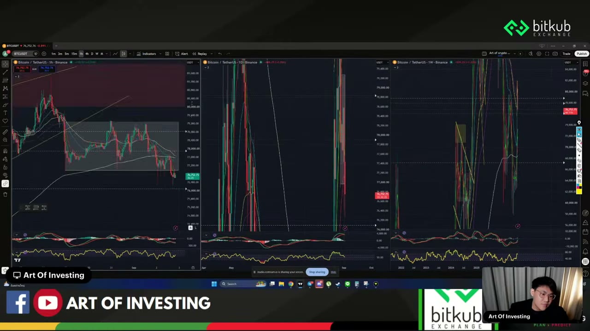

[00:22:30] อืเดี๋ยวผมเอาแจ้งเตือนออกนะมันจะได้ไม่ รกตาหลัก โอเคนะครับภาพรวมเนี่ยอ่ะอย่างที่ผมบอกไป ในบทความล่าสุดเนาะก็คือตั้งแต่มันขึ้นมา ตรงเนี้ยเราสังเกตอย่างนึงนะครับว่าเราจะ ดูยังไงว่า พื้นที่ตรงนั้นน่ะมันมีออเดอร์ขายขวาง อยู่ร่องรอของกราฟอ่ะมันจะบอกเสมออย่าง อันเนี้ยนะครับเราเห็นมั้ยว่าตั้งแต่ตรง นี้ขึ้นไปเนี่ยคือ 77  78,000 เลยเนี่ย ตั้งแต่ 77,000 ถึง 78,000 ขึ้นไปเนี่ยมี แต่ไส้ล้วนเลยใน week ไส้ล้วนเนี่ยบ่งบอกอะไรสมมุติว่ามันมี ก้อนออเดอร์ขายขวางอยู่ตรงนี้ตั้งไว้ขึ้น ไปมันก็ match แล้วก็กดลงมา match แล้วก็ กดลงมา match แล้วก็กดลงมาแล้วทำไมใน

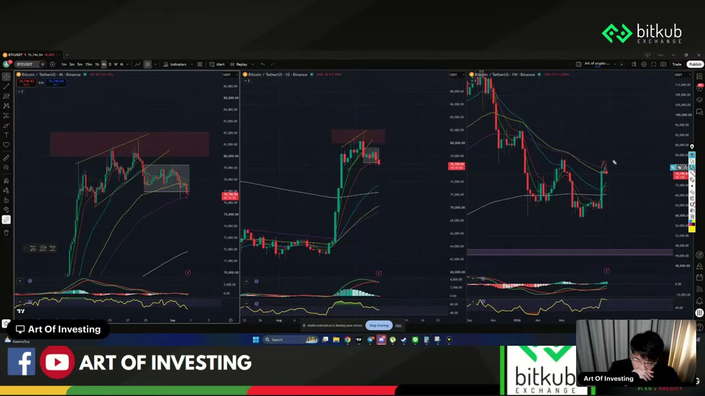

[00:23:33] ระดับคถึงมีนัยยะสำคัญมันแปลว่าออเดอร์ ขายตรงนั้นน่ะครับหนามากและถูกเติมเรื่อย ๆเฮ้ยรู้ได้ไงว่าหนาเฮ้ยรู้ได้ไงว่าถูก เติมเรื่อยๆนะครับเพราะว่าถ้าเกิดมันไม่ ได้หนามันก็จะทะลุกันไปแบบนี้ได้ไงเห็น มั้ยตรงนี้ที่มันมีแต่ไส้เนี่ยนะครับเห็น มั้ยชนรอบนี้รีเจคแต่รอบเนี้ยเบรคขึ้นไป ได้ก็คือถ้าออเดอร์ซื้อมันเยอะจริงๆมันก็ จะทะลุโซนขึ้นไปได้เลย แต่พอออเดอร์ซื้อมันไม่ได้เยอะขนาดนั้นนะ ครับแล้วยังโดนกดลงมาเนี่ยก็ทำให้เรารู้ เลยว่าภาพรวมเนี่ยออเดอร์ขายมันยังเยอะ อยู่มันยังเยอะกว่าซื้อจริงๆก็ยังเห็นว่า MACD เนี่ยยังขึ้นเหนือศูนย์ไม่ได้ด้วย นะครับเนี่ยเนี่ยคือกลไกโมเมนตัมนะครับ ซึ่งถามว่าผมรู้อยู่แล้วมั้ว่าบitcoinจะ ย่อผมรู้แล้วนั่นน่ะคือสาเหตุที่ผมคิดว่า อย่างแรงอ่ะไม่เกิน 72,000 อย่างแย่ไม่ เกิน 75,000 ตอนแรกที่ผมมองไว้นะเพราะผม มองไว้แล้วว่า MAD อ่ะมันต่ำกว่า 0 ตั้ง แต่ก่อนขึ้นผมคิดว่าเอ้ยขึ้นได้น่าจะมา ติดพรีเมี่มตรงนี้อ่าแล้วก็ย่อลงมา

[00:24:35] accumulation แล้วค่อยขึ้นอ่ะจังหวะนี้ มันจะสวยนะครับแต่เค้าประกาศกลยุทธ์ซื้อ พันธบัตรระยะยาวคืนก่อนมันก็เลยช่วย push สภาพคล่องตลาดดีดขึ้นไปก่อนพอสภาพคล่องใน ตลาดมันดีดขึ้นไปเนี่ยครับตอนนี้ก็เลย ต้องรอจังหวะรีทรครั้งต่อไปะอ่ะเราเห็น แล้วว่ามันมีซัพพlyายสูงมากเลยตั้งแต่ 77,000  -78,000 ขึ้นไปงั้นภาพรวมต่อมา เราเห็นอะไรในกราฟบ้างนะครับก็คือเราจะ เห็นว่าตัว 4 ช่โมงเนี่ยครับก็เป็น แพทเทิร์นที่เราเรียกว่า ascending  wage ถูกมั้ย Ascending  wage เนี่ยก็คือที่ มันเป็นสามเหลี่ยมบีบเข้าอย่างี้นะครับ มันแปลว่าออเดอร์เนี่ยถูกบีบอัดอ่ะเราดู ว่าขึ้นไปชนปุ๊บเกิดรีเจectชนล่างเกิด รีเจคขึ้นไปชนปุ๊บเกิดรีเจคชนล่างเกิด รีเจคนะครับแสดงว่าออเดอร์เนี่ยมัน ถูกแอดเข้ามาตามค่าเฉลี่ยจนบีบเข้ามาใกล้ กันเรื่อยๆนะครับทีนี้เมื่อหลุดมาแล้ว อ้าวก็ยังไม่เกิดreีอคtionที่รุนแรงยัง

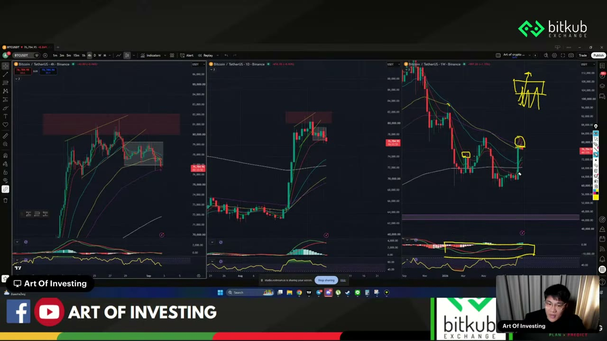

[00:25:38] ไม่ได้เกิดการ ทะลุยอดลงมารุนแรงก็sidewayยเป็น balance zซoneอ้าเฮ้ยแล้ว balance zซoneคืออะไร แล้วทำไมถึงsidewayยหน้าตาเป็นแบบ balance zซoneนะก็ให้ดูตรงนี้เราจะรู้ได้ไงว่ามัน เป็น balance  zone ไส้ reject ไส้ reject ไส้ reject ไส้ reject แล้วก็ตรงนี้เบรกทีนึงไส้รีเจคนะ ครับเคสแบบเนี้ยก่อนก่อนวันนี้นะวันเนี้ย ทะลุมาแล้วเดี๋ยววันนี้จะอธิบายให้ฟัง ก่อนวันเนี้ยเป็นอย่างงี้นะก่อนวัน [เสียงสูดหายใจ]เนี้ยเป็นอย่างงี้ แล้วให้เรามาดูที่ RSI มันจะ overbard  oversow ไม่ได้ แล้วจังหวะที่มันoverbอ oversow ไม่ได้ เนี่ยมันก็จะติดขอบพอดีเห็นมั้ยชนปุ๊บติด ขอบชนปุ๊บติดขอบบนอย่างเงี้ยนะครับตรง เนี้ยมันสื่อว่าโมเมนตัมมันเกิดไม่ได้ อ้าวแล้วแล้วทำไมโมเมนตัมมันถึงเกิดไม่ ได้มันก็จะเป็นภาพเดียวกับแบบเนี้ยครับ ที่มันมีออเดอร์ขวางไว้จนมันเหลือไว้ได้ แค่ไส้อ่ะมันก็จะเป็นภาพแบบนี้เหมือนกัน

[00:26:40] อย่างงี้ เห็นมั้ยทีเนี้ยออเดอร์มันขวางอยู่อย่าง เงี้ยเราเลยเรียกมันว่าผมเลยเรียกมันว่า balance zซoneหรือโซนที่ออเดอร์ซื้อแล้ว ก็ออเดอร์ขายเนี่ยมันสมดุลกันภาพรวมอะไร เป็นอย่างี้แต่เมื่อวานนะครับหลังจากที่ เกิดสงครามด้วยเนาะนะครับเราก็จะเห็นว่า น้ำมันพุ่งขึ้นไปสูงมากนะครับจากภาวะ สงครามตรงเนี้ยมันมันก็ push ให้ราคาน้ำ มันสูงขึ้นเพราะว่า มันเกี่ยวกับช่องแคบถูกมั้ยทีเนี้ยพอน้ำ มันมันพุ่งสูงขึ้นเนี่ยเงินมันก็เลยถูก ดูดออกจากทองกับสินทรัพย์เสี่ยงแล้วก็ เห็นว่า S&P  500 ก็ปิดติดลบบitcoinก็ปิด ย่อลงมาอ่ะตอนเนี้ยมันทะลุOverอมาละอ้า อย่างเงี้ยครับมันแปลว่าโมเมนตัมเนี่ย เริ่มมีโอกาสแนวโน้มที่จะเกิดในทิศทางลง เพราะว่าผมเขียนไว้ในบทความถูกมั้ย มันมีโอกาสที่จะย่อนะครับถ้าเกิดมัน สามารถได้ใน 4 ชมงแล้วมัน oversow ลงมา และใน 4 ช่มงแบบนี้

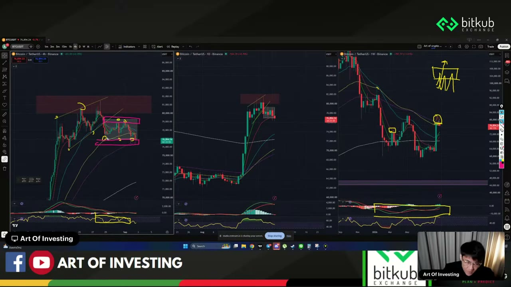

[00:27:43] ทีเนี้ยถ้าเกิดมันวิ่งไม่สามารถทะลุกลาง กล่องได้หรือตรงนี้พอดีเลยเนี่ยคือ equคิลิเบียมเนี่ยคือประมาณ 78,000 ถ้าขึ้นมารีทestไม่เกิน 78,000 เผมมองว่า มีแนวโน้มที่จะย่อ นะครับมีมีแนวโน้มที่จะย่อละก็คือ รีบาวขึ้นมาหรือจะลงเลยก็ได้นะหรือถ้าอ่ะ ยังไงก็ได้อ่ะ ถ้าไม่เกินประมาณ 78,000  +  -  200 ดอน เนี่ยอ 78,000  200  7700 อะไรอย่างเงี้ย คร่าวๆอยู่โซนประมาณเนี้ยก็มีแนวโน้มที่ จะย่อมากกว่าล่ะนะครับเพราะว่าโมเมนตัม มันเกิดขาลงแล้วแต่ถ้าเกิดว่านะครับถ้า เกิดว่ามันขึ้นทะลุตรงนี้ได้เนี่ยก็แสดง ว่าตรงเนี้ยเป็น forward  break นะครับก็ คือเบรกหลอกแล้วเวลาที่ผมเทรดด้วย โมเมนตัมเนี่ยผมแก้ปัญหาเรื่อง for เบรค ยังไงรู้มั้ยคำตอบคือผมไม่แก้ผมเข้าเลย ตามเหตุผลแล้วถ้ามันจะเป็น fall เบรกมัน

[00:28:45] จะทุบผมปล่อยมันทุบเลยผมผมปล่อยมันเลยผม ก็ stop  loss แล้วผมก็ค่อยไปรอจังหวะ เข้าใหม่นะครับเพราะว่าเราจะต้องเทียบ สถิติก่อนว่าถ้าเกิดเราเทรดด้วยศาสตร์ของ เราอ่ะแล้วแล้วเราไปเจอ Force เบรกแล้ว อ่ะมันเกิดขึ้นบ่อยแค่ไหนมันมันเกิดขึ้น บ่อยจนที่เราจะต้องหลีกเลี่ยงมันมยแต่สุด ท้ายแล้วถ้าเกิดเราเก็บสถิติมาแล้วว่า false  rak บ่อยขนาดนั้นใน 10 ครั้งอาจ จะเกิด 3 หรือเกิด 2 นะครับอย่างเงี้ยเรา ก็ไม่มีความจำเป็นที่จะต้องหลีกเลี่ยงมัน งั้นผมก็ไปแอดอย่างนี้แล้วว่าถ้ารestขึ้น มาไม่เกิน 78,000 เนี่ยบวก -200 ดอนนะ ครับก็น่าจะมีแนวโน้มย่อดลงนะโดยโซนแรกผม ก็คงมองไปที่ใกล้ๆ EMA  25 ก่อนก็ประมาณ 74,500 นะครับบวก -  200 ดอนเหมือนกันก็ คือประมาณนี้ อ่ะจะเป็นจะเป็นประมาณนี้นะครับก็สำหรับ บitcoinที่ผมมองนะเออผมก็เห็นเห็นภาพ

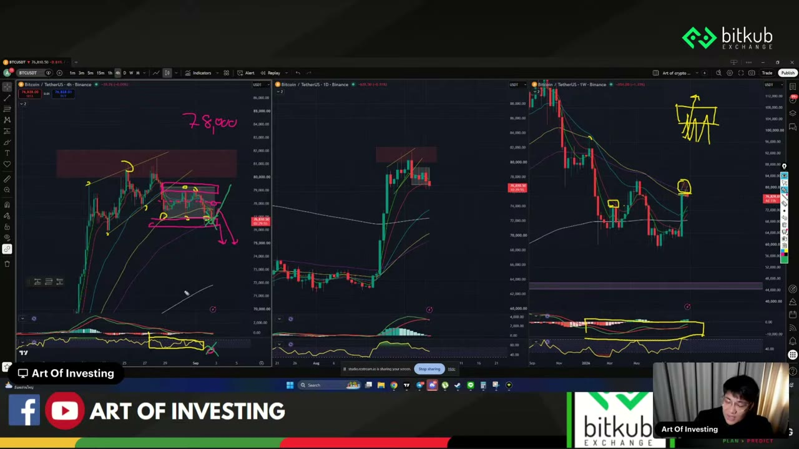

[00:29:45] ประมาณนี้ว่ามีแนวโน้มมีแนวโน้มที่จะลงมา ถึงประมาณเนี้ย 7  7  4  500 บวกลบ 200 เห็นมั้ยเพราะว่าเมื่อวานในบทความ อ่ะผมเขียนไว้ที่แรก 76,000 มันถึงแล้วนะ ถูกป่ะมันถึง 76,000 แล้วนะฉะนั้นโซนต่อ ไปเนี่ยผมก็เลยมองตรงนี้ทีเนี้ยตรงเครับ มันจะเป็นจุดวัดใจละว่าไซเคิลเนี้ยอยากจะ ขึ้นเลยเปล่าหรือว่าอยากจะทุบอย่างรุนแรง แล้วค่อยสร้างโมเมนตัมใหม่ผมว่าผมว่าตรง เนี้ยหลายคนน่าจะตามทันถ้าเกิดเอ่อตามผม มานานนานแบบแบบเอ่อเราเราดูไลฟ์ผมมานานนะ เวลาที่ราคามันย่อดออกมาเนี่ยผมจินตนาการ ภาพให้คุณดูก่อนถ้าเกิดว่ามันจะเป็นการ พักตัวที่เบาและบางนะครับก็คือมันจะย่อมา ที่ประมาณ 70,000 ตรงนี้ใช่มั้ย

[00:30:48] 74,000 แล้วขึ้นต่อเลยอ่ะมันก็จะเป็นภาพ นี้ก็คือย่อมาแท่งนี้อาจจะปิดแถวนี้ อ่าอะไรอย่างงี้แล้วถ้าแท่งต่อไปพุ่ง อย่างรุนแรงมันก็วิ่งขึ้นเลยอย่างงี้ นี่นะครับอันเนี้ยก็คือถ้าเกิดเค้าเลือก เคสที่อยากจะขึ้นเลยนะครับอย่างรุนแรงก็ คืออันเนี้ยผมคิดว่าคงไม่ย้อนและย้อนยากะ นะครับถ้าถ้ามันมาแรงขนาดนี้นะครับก็ก็ น่าจะมีแนวโน้มที่จะขึ้นต่อค่อนข้างมากนะ ครับถ้าถ้ามันย่อแค่นี้แต่ทีเนี้ย ผมให้น้ำหนักเคสเไม่เยอะผมให้ 30% นะครับที่ที่จะขึ้นเลยผมให้ผมให้น้ำหนัก แค่ 30% คำถามคือเพราะอะไรผมว่าใครที่ อยู่ในตลาดทุนมานานน่ะคงไม่ได้เห็นตลาด

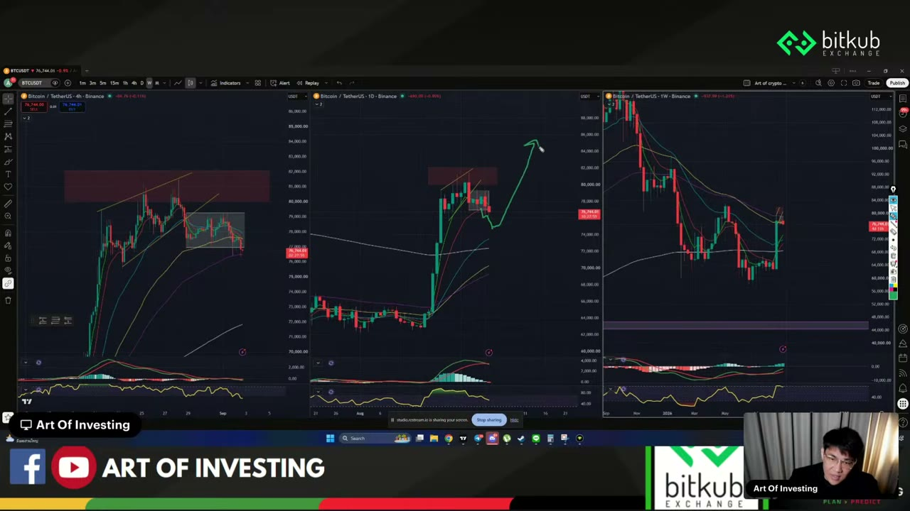

[00:31:48] ที่หวือหวาแล้วปรับนโยบายไปมาบ่อยเท่ายุค ทรัมป์ผมเป็นคนนึงที่อยู่ในตลาดมา 12 ปี กว่าผมว่าเนี่ยเป็นช่วงที่ดูวุ่นวายที่ สุดแล้วในในภาวะตลาดทุนของผมนะคือคำว่า วุ่นวายอ่ะมันไม่ได้ลงหนักมันไม่ได้ขึ้น แบบสุดยอดแต่มันมั่วคือวันเนี้ยเปลี่ยน นโยบายแบบนี้มีทาริฟแท็กเฮ้ยโดนแย้งเว้ย ผิดกฎอัยการแบบนี้ต้องรื้อใช้ได้แค่ 150 วันปรับเป็นแบบนี้บอกสงครามจะจบยังไม่จบ ไปยิงเงี้ยผมเลยมองว่าช่วงเนี้ย 1 ความ สินทรัพย์ที่มักจะวิ่งเป็นไซเคิลถูกเร่ง ระยะเวลาขึ้นมา 2 บitcoinในไซเคิลก่อนๆ มักจะเคลื่อนที่ขึ้นพร้อมๆกับรอบของตลาด เหมือนกับสภาพคล่องของโลกอ่ะมันถูกดูดไป ที่ใดที่นึงนึกออกมั้ยเช่นอุ๊ยสินทรัพย์

[00:32:49] เสี่ยงแย่แล้วเว้ยอ้าดูดไปไหนไปพักในเงิน กับเอ้ยไม่ใช่พักเงินสดขออภัยไปอยู่ในเซฟ Heavenวenไปอยู่ในทองคำไปอยู่ในอะไรก็ แล้วแต่มันไปพักอยู่ในนั้น แล้วพอเฮ้ยอัดฉีด QE สงครามจบหรือทุก อย่างเริ่ม เป็นโรคสีชมพูละเงินมันก็จะ flow เข้ามา ในแต่ละที่เป็นสินทรัพย์เสี่ยงแล้วมันก็ จะขึ้นไซเคิลที่มันพันๆมามันเป็นแบบนั้น ยิ่ง 2021 เราเห็นชัดเลย QE เนี่ยได้ผล พร้อมกับหลายๆตลาดแต่รอบเนี้ยต่างไปคือ บitcoinมาช้าสุดคือแลกingสินทรัพย์อื่น วิ่งมานานแล้วหุ้นวิ่งมานานแล้วนะครับทอง คำวิ่งมานานแล้วน้ำมันขึ้นมานานแล้วตั้ง แต่ก่อนมีสงครามด้วยซ้ำ งั้นมันแปลว่าเราไม่รู้ว่าเม็ดเงินที่ยัง อยู่นอกตลาดอ่ะมันเยอะพอที่จะไตลาดไปต่อ แค่ไหนคือสมมุติว่าโลกเนี้ยมีเงิน 100

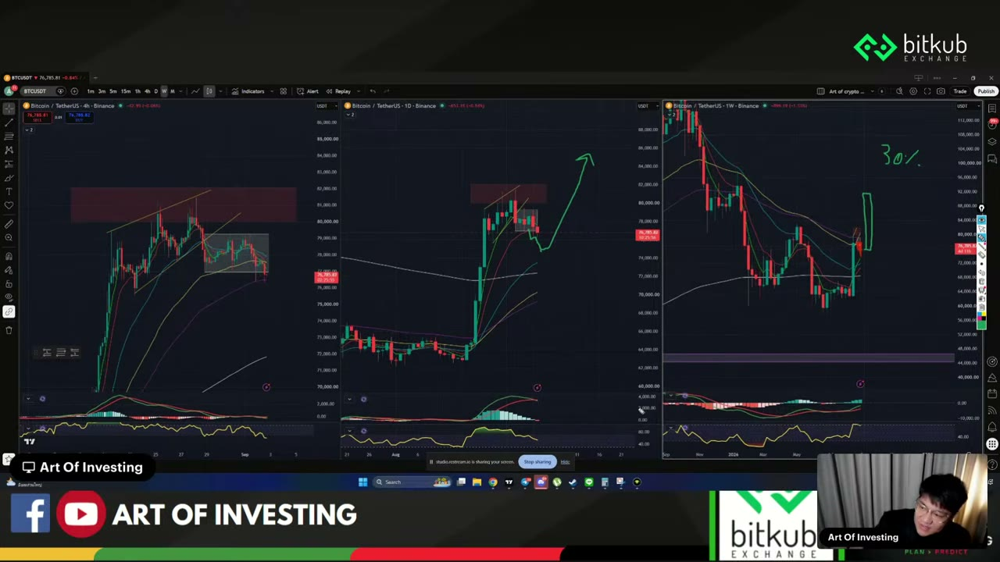

[00:33:55] มันอยู่ในสินทรัพย์เสี่ยงไปซัก 60-70 ละ ถ้าถ้าให้พูดแบบให้เห็นภาพง่ายๆนะทีเนี้ย เราก็ไม่รู้ว่าเฮ้ยอีก 30% น่ะมันจะ push ราคาบitคinไปได้มากแค่ไหนเพราะว่า 30 มัน ก็ไม่ได้บ่งบอกว่ามันจะขึ้นแค่มันมันจะ เข้ามาที่บitคinเต็มๆถูกป่ะเพราะมันก็ ต้องกระจายเข้าไปในหลายๆตลาดพร้อมๆกันภาพ ที่ยากเลยเป็นตรงนี้ เราไม่รู้เลยงั้นไอ้กลางเดือนเนี้ยมันเลย เป็นตัววัดแล้วก็นักวิเคราะห์หลายคนน่ะ เลยให้น้ำหนักกับการเข้า IPO ของ Antropic มากๆเพราะว่าเค้าก็ลุ้นตรงเนี้ยมันจะมี ตรงนึงที่เราเรียกว่า Global  Liquidity หรือสภาพคล่องของโลกเค้าก็ตอบกันไม่ได้ ว่ามันเหลืออีกเยอะแค่ไหนแต่ด้วยเมทริก ที่เขาวัดมาอยู่ในขาลงแล้ว ฉะนั้นถ้าคุณจะฉีกหน้าประวัติศาสตร์อ่ะ เค้าก็เลยบอกว่าแทรกงั้น IPO อ่ะมึงต้อง push ให้มูลค่ารวมตลาดอ่ะสูงปี๊ดขึ้นไป อีกเราจะได้เห็นว่าเฮ้ยสภาพคล่องของโลก

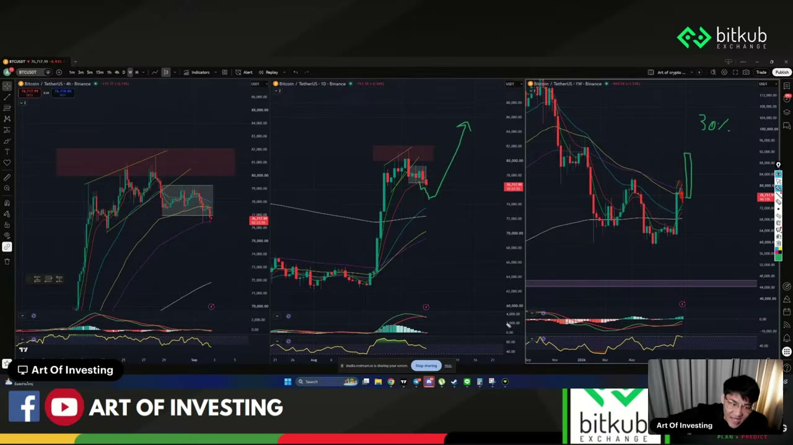

[00:34:56] เหลือเยอะมากอ่ะมันก็เลยต้องต้องเป็น เคสนั้นที่ตลาดมันจะขึ้นต่อได้เลยอย่าง รุนแรงนะครับทีเนี้ยเราเรามาดูเคสที่ถ้า เกิดมันพักตัวเนาะเราจะสร้าง setup หรือ ว่าวาง setup ยังไงกับมันอ่ะเดี๋ยวผมยก ตัวอย่างให้ฟังแบบนี้อ่ะเราให้เราดูก่อน ว่าเวลามันจะเกิดเทรนด์นะครับเวลามันย่อ แต่ละครั้งอ่ะมันจะเกิดโมเมนตัมนะครับก็ คือแบบนี้สมมุติสมมุตินะว่า อ่าตลาดมันย่อเดี๋ยวผมเอาตรงไหนให้ดูดีจะ ได้เห็นภาพเอาตรงนี้แล้วกัน อ่ะ[เสียงสูดหายใจ]ตรงนี้ก็ได้เนี่ยนะ ครับเวลาที่มันย่อมาอย่างรุนแรงหลังจาก ที่มันขึ้นไปเทส 8,000 แล้วครับทุบปึ้งลง มาเลยอย่างี้ใช่มั้ยภาพต่อมาเนี่ยคือตรง ติดๆ แล้วก็เบรกเส้นที่ไม่เคยเบรกได้นะครับ พร้อมกับ MAD เหนือ 0  RSI  overbard นะ ครับมันก็จะเกิดโมเมนตัมขึ้นไปแต่นี้มัน ยังติด balance  zone อยู่ฉะนั้นรอบต่อไป ที่มันกำลังย่อลงมาเนี่ยผมต้องการภาพนี้

[00:35:57] เห็นมั้ยติดติด สมมุติว่าย่อลงมาอย่างี้อ่ะเราไม่รู้เรา ไม่รู้ว่าตรงนี้จะถึงเท่าไหร่นะผมมองว่า 74  500 ถ้าเกิดถ้าเกิดขึ้นไม่เกิน บวกลบนะครับ แล้วพอมันเบรคตรงเนี้ยอ่ะแล้ว MACD ขึ้น เหนือ 0  RSI กลับมาoverบออ่ะอย่างเงี้ย อ่ะแปลว่าโมเมนตัมจากการพักตัวเนี่ยเกิด ขึ้นและนะครับถ้าเป็นอย่างงั้นน่ะผมก็น่า จะเข้าไปเกรงกำไรแล้วอาจจะเก็บสปอตเพิ่ม ติดมือไปซะหน่อยอาจจะสัก 10% อย่างที่ผม บอกว่าผมผมถือสปอตอ่ะผมได้ของมาแค่ครึ่ง เดียวเนาะงั้นน่ะผมอาจจะเก็บตรงนี้อีก 10 มันก็จะกลายเป็น 60 แล้วก็ผมจะเหลือที่ เหลือไว้ติดมือหน่อยที่เป็นเงินสดว่าถ้า เกิดว่ามันแครชจริงๆแล้วมันค่อยไปขึ้นอีก ทีจริงๆปลายปีหรือต้นปี 5 ผมจะได้ยังมี เงินสดซึ่งถ้าไม่มีผมก็โอเคที่ผมอาจจะได้ ของแค่ 60% นะครับเทียบกับความเสี่ยงของ ตลาดที่มันจะเกิดขึ้น ขอบคุณ Superchat จากคุณฮาร์ดวลนะครับ

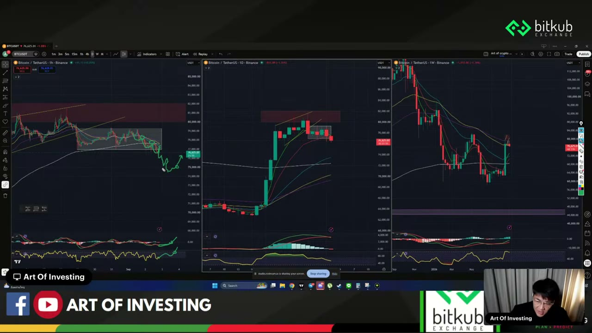

[00:36:58] ขอบคุณมากครับ 179 บาทขอบคุณมากเลยครับอื ผมก็เลยมองภาพนี้นะครับงั้นต่อมาก็คือถ้า เกิดย่อแรงแหละอ่าโอเคย่อถึงตรงไหนได้ บ้างก็ย่อแรงก็ถึงตรงนี้ถูกมั้ย 70,000-72,000 เพราะว่ามาเทสโซนที่มัน กลับด้านอย่างถ้าใครเรียน Supply เนี่ย มันก็จะมี flip  zone แต่เนี่ยมันเป็นโซน flip ของค่าเฉลี่ยเหมือนกันแค่เปลี่ยน ด้านจากที่เรา flip ด้วยแท่งเทียนใช่มั้ย อันเนี้ยมันมาเป็นการฟliิด้วยค่าเฉลี่ยก็ คือจากค่าเฉลี่ยตรงเนี้ยที่มันเป็น พรีเมี่มมาตลอดเลยอย่างเงี้ยมันเบรคขึ้น ไปได้แล้วมันก็อาจจะเป็นแนวรับนะครับก็ผม ก็มองไปที่ 70,000-72,000 อ่ะตรงนี้ก็ เป็นอีกจุดแนวโน้มที่อาจจะเกิดการย่อพัก ตัวแล้วก็ขึ้นต่อได้แบบนี้ ซึ่งเคสเนี้ยผมให้น้ำหนักค่อนข้างมากกว่า เคสแรกประมาณนึงนะครับผมให้ 40-50% แล้วกันนะครับผมผมให้ 40 ถึง 50% แล้วกัน เพราะว่ามันจะไปคล้ายกับเคสปีก่อนๆก็คือ

[00:37:59] ตรงนู้น เห็นตรงนี้มั้ยเนี่ยมันจะเป็นภาพอย่างงี้ เนี่ยถ้าผมซูมนะโคตรเหมือนปัจจุบันเลยอ่ะ สมมุตินะอุ๊ยอยู่ๆอะไรก็ไม่รู้โมเมนตัมแd ยังใต้ 0 อยู่เลยเบรกพวดขึ้นมาเลยปั้ง เงี้ยครับแล้วก็เหมือนจะขึ้นยอกแยกยอกแยก แล้วก็ลงมากวาดสัก 1 ทีอ่าเหมือนตอนปี 2023 เห็นมั้ยอ่ะอย่างเงี้ยถ้าเกิดไอ้ ข่าวร้ายที่ผมร่างไว้เนี่ยอีเวentใหญ่ที่ ทั่วโลกจับตาเนี่ยมันไม่ได้เลวร้ายหนักจน ทำให้ตลาดอเมริกาแครชเนี่ยนะครับก็อาจจะ เห็นแค่สweepแบบนี้นะครับลงมากวาดปื๊ด แล้วก็ขึ้นต่อผมก็เลยมองว่าอ่ะถ้าแถวนั้น น่ะโอเคผมให้น้ำหนักซัก 40-50% นะครับใน โซน 70,000-72,000 อ่ะอย่างเงี้ยสมมุตินะ ว่าผมผมเก็บของที่ 74,000 ไปแล้วสมมุตินะ สมมุตินะอีก 10% แล้วมันยังลงต่ออีกมาที่ 70,000-7,000 ผมก็จะเก็บอีก 15 เท่ากับ ผมมีของ 75% ะนะครับเพราะผมมองว่าราคาตรง เนี้ยไม่ได้แย่มากแล้วก็ที่เหลืออีก 25%

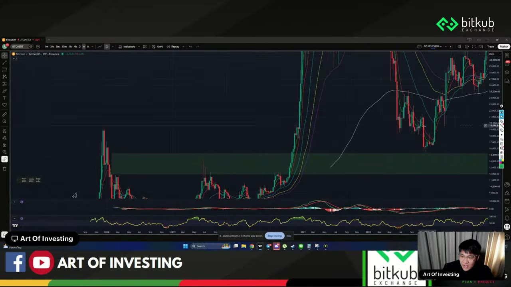

[00:39:01] สุดท้ายเนี่ยอย่างที่บอกช่วงแรกผมเก็บ ราคาต่ำกว่า 60,000 ผมเคยพูดในรายการสยาม blบockchainเนาะตอนที่มันขึ้นไป 82,000 แล้วลงไป 58,000 อ่ะว่าต่ำกว่า 60,000 เป็นราคาที่ไม่น่าเกลียดผมเก็บไว้เคสสุด คือแนวโน้ม 20% ที่ที่ตลาดจะแย่มากนะครับ ก็คือ Worst  Case ที่ผมพูดเมื่อกี้ ขึ้นดอกอัตราแจ้งงานแย่บริษัทใหญ่Layอ ธนาคารญี่ปุ่นประกาศขึ้นดอกเบี้ยเยนแครี่ เทรดพังคนต้องปรับสมการสินทรัพย์อะไรที่ ค้ำไว้ต้องกู้ออกมาขายเป็นเงินสดแล้วเอา ไปใช้ดอก ถ้าภาพนั้นเกิดขึ้น ไว้แล้วไปได้ไม่ถึงไม่ถึงแม้แต่ครึ่งนึง อ่ะโอเคเกิดcasสตูมตามโอโหแย่แล้วเฟก็ เข้มงวดดอกเบี้ยเศรษฐกิจก็รับไม่ไหว อเมริกาตลาดเริ่มพักตัวคอรัปกชัหนักๆผม ว่า 64,000 จะได้เห็นนะครับก็ผมยังให้เคส นี้ไว้แล้วกัน

[00:40:02] ตืมลงมาอย่างเงี้ยแต่ถ้าลงมาตรงนี้นะแล้ว มันเกิดโมเมนตัมใน day นะอ่ะสมมุติผมผม ว่าให้เห็นนะผมกดเต็มข้อเลย แล้วแต่แต่ตั้ง Loss นะแม้ว่าจะเป็นพอร์ต เอ่อเก็งกำไรผมก็จะตั้ง Stop  Loss เสมอ นะผมเป็นคนแบบนั้นผมไม่จะไม่ปล่อยปล่อย มันรันไปนะครับสมมุติว่ามันย่อมาอย่าง เงี้ยฟื๊ดลงมาถึงตรงนี้เลยที่ EMA  75 เนี่ยครับเห็นมั้ยที่มันเคยเป็น Flip zซoneเนี่ยสมมุติว่าเกิดโอ้โหวิกฤตมาตึ้ม อย่างงี้แล้วเกิดโมเมนตัมรอบใหม่อันเนี้ย ผมผมหวดเลยอีก 25% ที่เหลือผมจะใส่ตรงนี้ เลยนะครับก็คือถ้าเกิดสมมุติว่ามันมาติด พรีเมี่มอย่างี้นะ นี่สมมุตินะมันเกิดงี้นะโอ้โหผมซัดแบบ

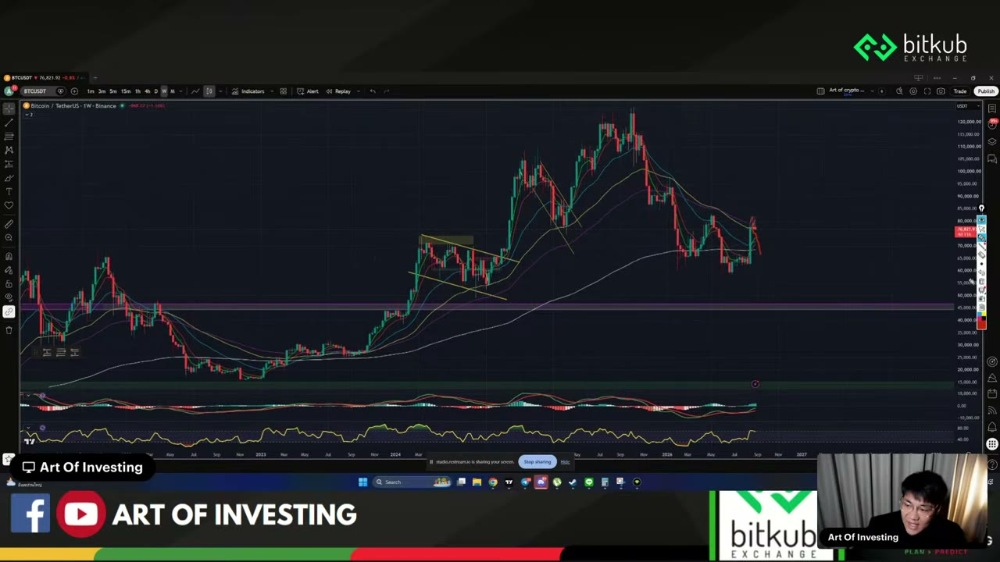

[00:41:03] บึ้มบั้ำอ่ะนะครับก็น่าจะกดกดไม้ใหญ่อัด เข้าไปเพิ่มอยู่นะครับโซนตรงเนี้ยผมผมก็ อยากอยากได้นะถ้ามันเกิดมาแต่ว่าผมอย่าง ที่ผมบอกว่าเออมันก็ยากแต่ผมไม่ทิ้งแล้ว กันผมให้ 20% อืนะครับมันก็ยากแต่ผมก็ไม่ ทิ้งแล้วกันเพราะผมมองว่าตลาดรอบเนี้ยจะ จะเล่นยากนิดนึงนะครับมันมี ปัจจัยมาภายนอกตลาดเยอะค่อนข้างเยอะไปหมด นะครับก็เลยจะเล่นยากนิดนึงอยากให้ระวัง กันนะครับอ่ะเนี่ยเด้งขึ้นมาละนะก็อย่าง ที่ผมมองนะถ้าเกิดว่า ไม่ไม่ปิดแท่งขึ้นไปเกินกลางกล่องอ่ะนะ ครับไม่ได้แบบฟิ้วขึ้นไปอย่างเงี้ยผมก็ มองว่ามีโอกาสพักตัวและยกเว้นว่าตรงนี้ จะกลายเป็น falce เบรกก็คือเบรกเงี้ แล้วแล้วขึ้นไปต่อที่ 82,000 แล้วค่อยลง เงี้ยนะครับก็จะยิ่งยิ่งเล่นยากกว่าเดิม นะครับฉะนั้นช่วงเนี้ยรอเก็บสปอตเพิ่มอ่ะ จะจะได้เปรียบที่สุดนะครับเล่นสั้นจะยาก ขึ้นมากๆนะครับยากขึ้นมากๆอ่ะหรอ

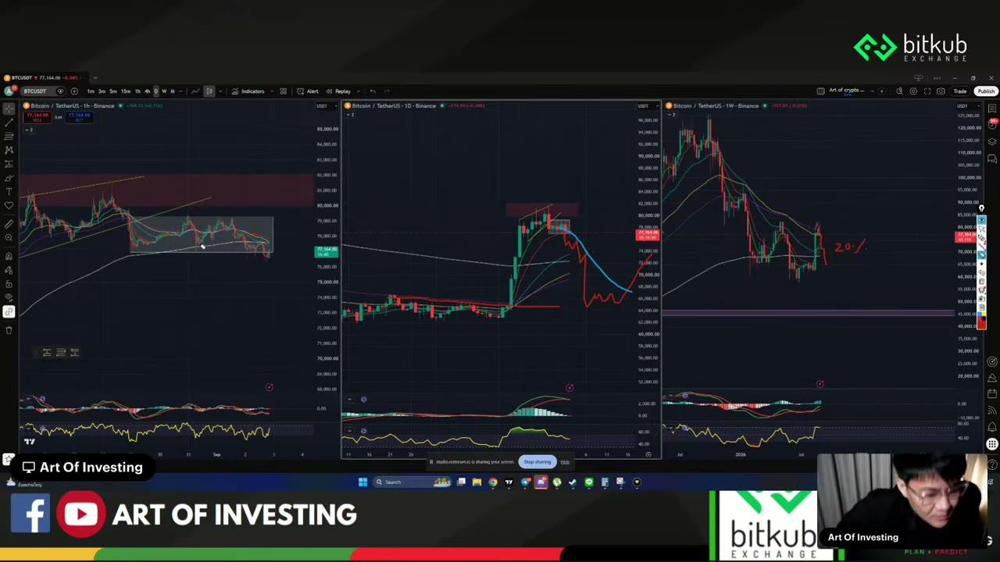

[00:42:09] ทีนี้ภาพรวมต่อมาแล้ว ถ้าเกิดตลาดมันเกิดนิวโรโอ้โหอันเนี้ยก็ จะเป็นครั้งแรกเลยเพราะผมมองว่าสมมุตินะ สมมุตินะว่าว่าถ้าเกิดนิวโรเนี่ยผมว่า อันเนี้ยโคตรยากและนะครับ ถ้าสมมุติว่ามันเกิด New จริงนะนี่จะเป็น ครั้งแรกเลยที่มันไม่ได้ขึ้นแบบ 4  Year Circle อ่ะก็คือไม่ได้ขึ้นปลายปีมันจะ เป็นครั้งแรกเลยที่มันมันวิ่งพรวดขึ้นไป เลยนะครับเอ้ยขออภัยที่มันลงไปเลยอย่าง เงี้ยมีโอกาสจะไปขึ้นปีหน้าหลังช่วงหลัง ไตรมาสแรกด้วยซ้ำนะครับอาจจะแบบมีนาคม เมษายนแต่ผมมองว่ายากแล้วที่ที่ขึ้นมาแรง ขนาดนี้แล้วแล้วจะเกิดนิวโรอ่ะนะครับผมก็ เลยมองว่าค่อนข้างยากแล้วผมให้น้ำหนักตรง นั้นน่ะนะ 64,000 ก็ต่ำแล้วแต่ว่าถ้าเกิด ลงมาจริงๆเนี่ยก็ต้องซื้อนะครับถ้าถ้าถ้า คุณเชื่อมั่นในบitcoinนะก็ก็เป็นโซนที่ น่าลงทุนนะครับถ้าเกิดคุณเชื่อมั่นแบ่ง

[00:43:10] เงินไว้แล้วอะไรอย่างเงี้ยว่าพอร์ตของคุณ อะไรอย่างเงี้ยเออเดี๋ผมแค่มองว่าเคสนั้น เกิดได้ยากนะครับก็เน้นสปอร์ตนะช่วงนี้นะ ครับเทรดสั้นก็ระวังนิดนึงนะครับระวังระว กันหน่อยนะครับ โอเคนะครับน่าเห็นภาพอ่ะดีดขึ้นมาละ เดี๋ยวผมรอดูกลางกล่องนะว่าจะเป็นยังไง ต่อมานะครับไปดูอธอเรียมกันบ้างอีiมเป็น E  is  e นะครับอ้อก็หน้าตาโคตรคล้าย บitcoinเลยนะครับหน้าตาเหมือนเหมือ บitcoinมากนะครับฉะนั้นก็อีเรiมผมมองตรง นี้เหมือนกันนะครับว่าเนี่ยไม่ผ่านประมาณ 2,440  2,450 เนี่ยนะครับก็ก็ยังมีแนว โน้มที่จะลงแต่ว่าถ้าเกิดมันขึ้นทะลุกลาง กล่องตรงเนี้ยนะครับเนี่ย 2450  2460 เนี่ยถ้าเกิดมันทะลุขึ้นมาได้เนี่ยก็มี โอกาสจะ false เบรกที่จะขึ้นไปก่อนถ้า เกิดขึ้นไปก่อนก็มันก็จะไปเทสตรงเนี้ย นะครับเพราะว่าขึ้นไปมีแต่ไส้เห็นมั้ยก็

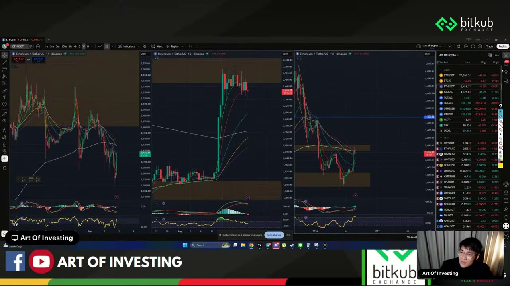

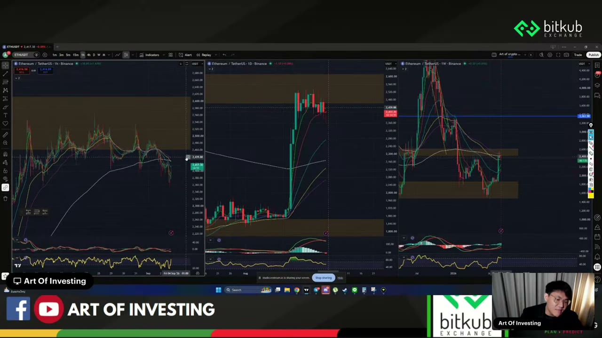

[00:44:12] คือถ้าพี่แกเลือกอยากจะขึ้นนะครับมันก็จะ ขึ้นพวดขึ้นไปตรงนี้อ่ะแล้วก็ไปเทสก็อาจ จะมีโอกาสย่อหลังจากนั้นนะครับเนี่ย อธอเรียมผมผมมองแบบนี้นะส่วนโซนอธอเรียม ที่น่าสนใจก็ต่ำกว่า 2,200 ถ้าย่อไม่ลึก นะครับย่อไม่ลึกแถว 2,200 ก็น่าเก็บแล้ว ส่วนถ้าย่อลึกเนี่ยก็แถวเอ่อ 1,60 แต่ผม มองว่าจะลงมาถึงตรงเนี้ยอาจจะยากนิดนึงนะ ครับอาจจะยากนิดนึง ส่วนอีกตัวนึงที่ผมโคตรอยากให้โฟกัสเลยนะ ครับคือ Wix  Wix เนี่ยมันจะเป็น Volatity Index นะครับของ SP  500 แล้วเราพูดกัน ง่ายๆอ่ะเค้าจะชอบไปตีความว่ามันคือความ กังวลของตลาดถูกป่ะเขาจะชอบตีความว่าเฮ้ย ตลาดกังวลหรือยังตลาดกล้าหรือยังตลาด พร้อมหรือยังซึ่งเราไม่ได้อยากมองแบบนั้น เราพูดง่ายๆก็คือรายใหญ่อ่ะเาเริ่มระมัด ระวังมากขึ้นหรือยังอ่าใช้คำเนี้ยเห็นภาพ กว่าก็คือการเปิดOptionัเพื่อซื้อประกัน พอร์ตเริ่มสูงขึ้นหรือยังเช่นรายใหญ่ที่

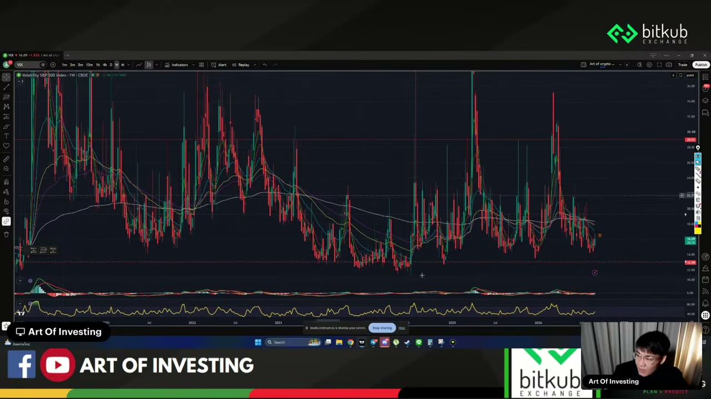

[00:45:13] เขาเก็บของมาเป็นสปอตหรือว่าเป็นเป็นตัว หุ้นอ่ะผมพูดแบบนี้ให้เห็นภาพนะแล้วเ้า รู้สึกว่าเฮ้ยตลาดมีแนวโน้มจะย่อว่ะ ถ้าเกิดตลาดเริ่มมีแนวโน้มจะย่อเนี่ยครับ เค้าก็จะเปิด อtionัประกันกันมากขึ้นเห็นมั้ยแล้วแล้ว จุดที่มักจะเกิดการพีคของความกลัวเนี่ยก็ คือที่ 30 เห็นมั้ยไอ้ไอ้ที่ทะลุไปไกลๆส่วนใหญ่เป็น วิกฤตนะครับโควิดบ้างสงครามบ้างอะไรบ้าง ที่แบบความกังวลของตลาดมันพีคแต่ทีเนี้ย กลับด้านกันถ้ามันลงมาใกล้ 10 ถึง 12 มาก ๆเนี่ยมันแปลว่าความสบายใจของตลาดมันก็จะ เริ่มพีคเหมือนกันเฮ้ยความสบายใจของตลาด พีคเป็นไงวะก็อย่างี้ไงอูยสบายทุกอย่าง เป็นบวกทุ่ง lavender เฮ้ยตลาดขึ้นชันฉัน มีความสุขจังเลยอื้อหือมันหอมหวานฉันอยาก จะถือสินทรัพย์นี้ไปอีกนานๆอ่ะถ้าเกิดมัน เป็นภาพนั้นนะครับอย่างเงี้ยมันก็เริ่ม รีเจคแล้วเห็นป่ะตรงเนี้ยมันก็ใกล้โซนละ

[00:46:15] ฉะนั้นผมเลยมองว่าถ้าจะเอาให้ทุกอย่างมัน สอดคล้องกันน่ะแล้วแล้วดูเป็นไปอย่างใช้ คำว่า สัมพันธ์กันถ้าเกิดว่าหลังจากnonฟาร์มนี้ ไปแล้วมันขึ้นรัวๆเนี่ยนะครับก็มันก็จะไป พอดีเลยกับที่บitคinและสินทรัพย์เสี่ยง น่าจะย่อเพราะว่าเราจะเห็นแล้วว่าสถาบัน เนี่ยเขาเริ่มเปิดอtionัเพื่อซื้อประกัน hort ตัวเองเพิ่มคือเขารู้ว่ามันจะลงอ่ะ แล้วแล้วคุณนึกภาพว่าเงินในสถาบันน่ะมัน เยอะมากจะกว่าคุณจะค่อยๆซื้อหุ้นจนมันได้ เยอะขนาดนั้นน่ะมันใช้เวลาเยอะมากเพราะ คุณต้องค่อยๆทยอยซื้อถูกป่ะฉะนั้นคุณจะ ขายแล้วซื้อใหม่อ่ะมันยากมากเค้าก็ใช้ option เนี่ยเป็นหนึ่งในเครื่องมือในการ รักษาาสภาวะของพอร์ตอ้าเฮ้ยคิดว่ามันมี แนวโน้มจะลงทำไงดีวะก็ซื้อประกันสิแทงว่า มันจะลงพอแทงว่ามันจะลงได้กำไรทำไงก็เอา กำไรกลับมาซื้อหุ้นเพิ่มอ่ะฉะนั้นถ้าเกิด ความกลัวมันเริ่มพีคขึ้นมาที่ 20

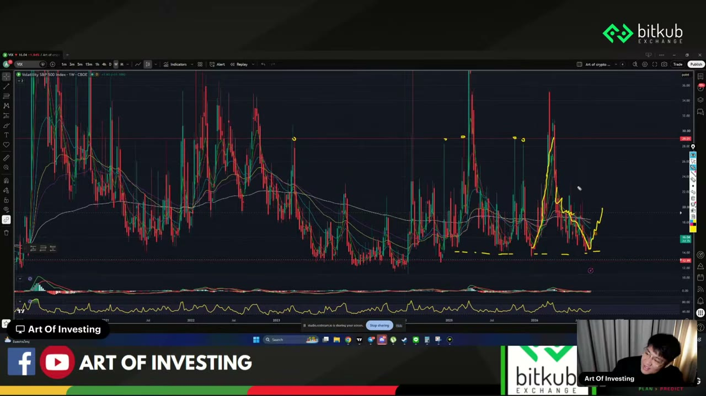

[00:47:16] หรือพีคมากๆเนี่ยก็คือใกล้ๆ 30 เนี่ยแล้ว มันไปตรงกับ แนวรับที่เรารอพอดีผมมองว่านั่นน่ะเป็น หนึ่งในโซนที่น่าสนใจแล้วเพราะว่าความ กังวลของตลาดก็จะพีคแล้วพออย่างเงี้นะ ครับความสบายใจพีคตลาดก็มักจะเริ่มย่อ ความกังวลพีคตลาดก็มักจะเริ่มรีบาวอ่ะผม ก็เลยรอดูตรงนี้ว่าเฮ้ยมันจะขึ้นจริงมั้ย ผมก็บอกในกลุ่มนักเรียนผมมาแล้วะเออจริง ผมสอนมา 5 ปีแล้วนะแต่มีปีเนี้ยผมยุ่ง เรื่องธุรกิจเลยไม่ได้เปิดสอนเลยนะครับ เออผมขออภัยมากๆเลยนะหลายคนที่แบบทักมาใน inbox แบบเมื่อไหร่จะเปิดสอนอยากเรียน เงี้ยเฮ้ยผมไม่ลืมนะครับถ้าเปิดเมื่อไหร่ ผมจะติดต่อ inbox กลับไปนะครับตอนนี้ทุก ยุทธมันยุ่งจริงอ่ะเมื่อวานผมบอกว่าเฮ้ย ดูตรงนี้หน่อย มันเริ่มรีบาวมาละผมอยากเห็นมันวิ่งขึ้น ต่อไปเรื่อยๆนะครับถ้าเกิดมันวิ่งขึ้นต่อ เนี่ยมันจะเทรดง่ายเพราะว่ากราฟมันเริ่ม ส่งสัญญาณอ่อนแรงแล้วถ้ามึงย่อๆๆๆมาสบาย ถูกป่ะถ้าคุณย่อมาก็โอ้โหเราก็เห็นชัดอ่ะ

[00:48:20] เราจะไปพีคที่ไหนอ่ะ 20 สมมุติว่า 20 แถว 74,000 มั้ยหรือ 72,000 อ่ะผมก็เก็บหรือ 30 เลยแถว 72,000  64,000 เอาผมก็ว่ามอง ว่ายิ่งสวยเลยอ่ะนะฉะนั้นดูค่าประกอบนิด นึงนะครับอยากอยากให้โฟกัสตรงนี้นะครับ เป็นอีกหนึ่งเครื่องมือที่มันจะช่วยคุณ ได้มากๆเลยอ่ะคุณดูจังหวะที่มันพีคแต่ละ ครั้งนะแล้วเดี๋ยวผมไปเทียบให้ดูนะอย่าง อันนี้พีคเดือนมีนาคมอ่ะคุณดูนะว่าว่า มีนาคมนะครับอ่ะเอาตอนที่มันเริ่มกลับตัว อะไรนะ คุณดูนะธันวาคมปีที่แล้วอ่ะคุณก็มาดู ธันวาคมปีที่แล้วเฮ้ยเป็นไงวะธันวาคมปี ที่แล้ว เห็นมั้ยก็ลงต่อบitcoinอาจจะย่อย่อเร็ว กว่านิดนึงเพราะว่าไปเกิดไอ้ 10 ตุลาคมนะ ครับเนี่ยธันวาคมอ่ะแล้วเรากลับมาดูอีกที ว่าแล้วตอนที่มันพีคอะไรคือมีนาคมอ่ะเรา ก็มาดูซิเฮ้ยแล้วบitคinตอนมีนาคมเป็นไง บ้างเห็นมั้ยมีนาคมปุ๊บ

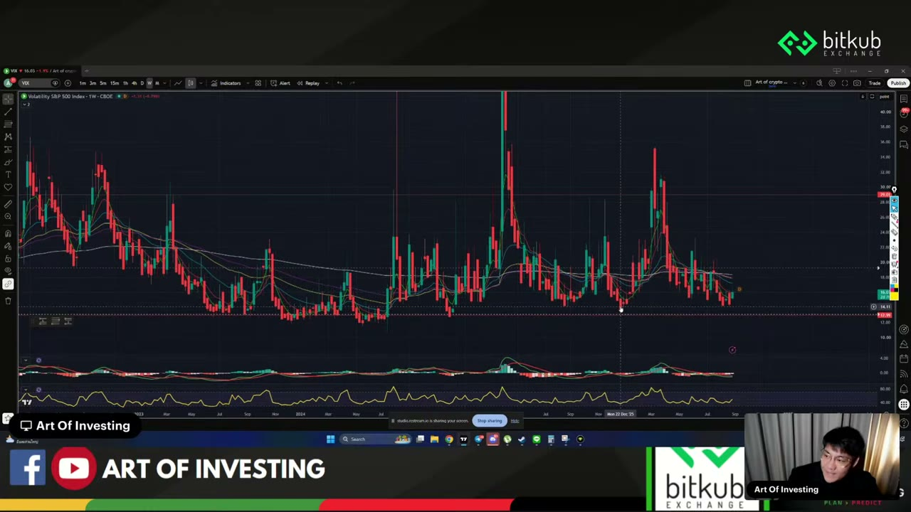

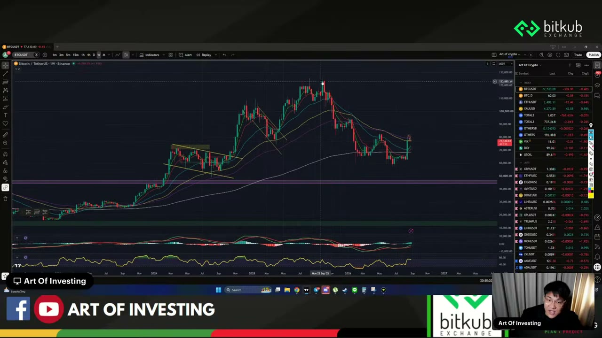

[00:49:21] รีบาวเลย เนี่ยไอ้ตัวเนี้ยเป็นอีกหนึ่งตัวที่ผมชอบ ดูนะครับเพราะว่าผมจะได้สังเกตว่าเฮ้ยราย ใหญ่เปิดอชักันมากน้อยแค่ไหนเนี่ย เห็นมั้ยครับเนี่ยครับอันนี้ย่อขออภัยผม พูดผิดอ่ะนี่ตรงนี้มีนาเห็นมั้ยความกลัว ของตลาดพีคความกังวลพีคพอกังวลพีคมันก็จะ คลายกังวลคลายกังวลเสียทรัพย์เสียงก็จะ เริ่มวิ่งฉะนั้นตอนเนี้ยมันเข้าใกล้โซน ที่ความกังวลจะพีคะเอ้ยความสบายใจจะพีค แล้วโหผมพูดวนไปวนมาแล้วเนี่ยนะครับขอ อภัยนะข้อมูลมันลิ้นมันคำมันพูดติดกันนะ ครับเนี่ยมันก็เลยใกล้โซนที่ความสบายใจจะ พีคและฉะนั้นพอสบายใจพีคเนี่ยมันจะต้อง เริ่มกลับมากังวลเหมือนคนหายใจเข้าหายใจ ออกอ่ะนะครับฉะนั้นตรงเนี้ยถ้าเกิดคุณ เปิดกราฟดูกราฟ day ก็ได้ไม่ต้องกราฟ week นะเปิดเปิดดูกราฟ day อ่ะแล้วมันวิ่งขึ้น ต่ำๆอ่ะเออระวังนะครับนะครับก็ให้รู้เลย ว่าเอ้ยย่อละงั้นโซนแรกที่เราจะเริ่มสนใจ อ่ะคือ 20 กับอีกทีคือใกล้ๆ 30 นะครับถ้า

[00:50:25] เกิดมันขึ้นต่อนะถ้ามันลงมาตรงนี้อ่าก็ คือแสดงว่าตลาดยังไม่อยากย่อแหละตลาดก็จะ ขึ้นต่อคุณก็จะเห็นบitคinปรับตัวขึ้นอีก หน่อยตลาดหุ้นอเมริกาปรับตัวขึ้นอีกหน่อย แต่ถ้ามันอยากจะย่อก็คือตรงเนี้ยมันต้อง ขึ้นแล้วฝึบๆๆนะครับซึ่งผมว่าศุกร์เนี้ย ถ้าตัวเลขแย่ขึ้นแน่ก็รอดูแถวนี้อาจจะ เป็นโซนที่เรารอแถวแนวรับพอดีนะโอ้ย หวัดดีขอบคุณคนดู 192 ท่านครับขอบคุณมาก ครับเฮ้ยคนดูเยอะนะวันนี้ถือว่าเยอะนะ ครับใครที่เข้ามาครั้งแรกก็นะครับอย่าลืม กดไลค์กด Subscribe กันไว้นะครับก็ผมไลฟ์ ทุกวันพุธเลยแล้วก็เขียนบทความมา 4-5 ปี แล้วนะครับเป็นนักลงทุนมา 12 ปีเนาะก็ถ้า เป็นประโยชน์ก็กดไล์กด Subscribe ไว้นะ ครับเราจะได้เจอกันอีกมีทั้งเพจ Facebook ทั้ง YouTube นะครับชื่อเดียวกันเลย อ่ะประมาณนี้นะครับวันนี้น่าจะได้เห็นภาพ ประมาณนี้แหละผม DCA ตามสูตรคุณอาร์ตอน นี้กำไร +  20% อุ้ยดีใจครับดีใจด้วยครับ แล้วก็ดีใจด้วยที่ความรู้ผมเป็นประโยชน์ ครับขอบคุณครับตอนขึ้น 80K ผมพักก่อนแต่

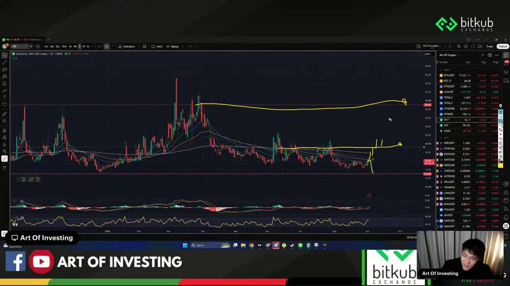

[00:51:26] ตอนนี้ ECA ต่อได้เลยมั้ยครับ ได้ครับได้พอร์ต DCA ใช่มั้ยคุณแมว DCA ชัวร์นะถ้าเป็นพอร์ต DC ระยะยาวถามว่า เริ่มต่อได้ยังเริ่มได้ะเพราะว่ามันเริ่ม ย่อะถูกป่ะยิ่งถ้าเกิดมันขึ้นต่ออย่าง เงี้ยคุณแมวจะดีใจมากเลยเพราะคุณแมวจะได้ DCA แล้วของมันจะถูกลงเรื่อยๆเลยนะครับ ได้แล้วครับถ้าถ้าจะเริ่ม DCA ก็เริ่มได้ แล้วครับเพราะว่าผมไม่อยากให้เราไป คือผมต้องบอกแบบนี้ DCA อ่ะมันจะต่างจาก เล่นรอบนิดนึงเพราะว่าคุณกำลังจะไปทำลาย ความได้เปรียบของมันนะถ้าเกิดคุณจะเอา คอitionเยอะๆเข้าไปใส่มันจนจนเยอะเกินไป ให้ใส่แบบกำลังพอดีอย่าอย่าเอาคอition เยอะเกินไปเพราะว่าข้อดีและความได้เปรียบ ของ DCA อ่ะคือคุณได้ถั่วเฉลี่ยต้นทุนทุก ไปเรื่อยๆถูกป่ะคุณคุณได้ถั่วเฉลี่ยทุก ต้นสภาวะไปเรื่อยๆ แต่ทีเนี้ยถ้าเกิดคุณจากคitionว่าเฮ้ยตรง

[00:52:27] นี้พีคแล้วตรงนั้นต้องหยุดเอ้ยตรงนี้ต้อง ใส่ไม้ใหญ่ขึ้นเนี่ยไอ้ความได้เปรียบที่ มันสามารถทำได้ทุกช่วงตลาดอ่ะมันจะหายไป แล้วพอร์ต DCA กับพอร์ตเล่นรอบของคุณน่ะ มันจะเข้าใกล้กันมากขึ้นมันกลายเป็นว่า มันจะไม่ได้เปรียบซัพพอร์ตเลยนะครับ ฉะนั้นถ้าจะเอาอ่ะเอาง่ายๆก็ได้เช่น สมมุติว่าคุณเอ่อเห็นว่าความสบายใจมัน เริ่มพีคอย่างเงี้ยอ่ะเงี้ยมันเริ่มใกล้ อย่างเงี้ยอ่ะก็เริ่ม DA น้อยลงส่วนถ้า เกิดมันความกังวลพีคมากๆอย่างเงี้ยแสดง ว่ามันย่อมาลึกแล้วมันยิ่งใกล้กลับตัว แล้วงั้นระหว่างทางเนี่ยก็ DCA ยิ่งมัน เลยอ่ะก็ใช้ตัวนี้ได้นะครับประกอบกับ โมเมนตัมก็ดูคู่กันไป ไม่เคยหยุดหล่อก็ช่องนี้แหละสวัสดีครับ โอ้ยคุณวุฒินันทมาแซวกันอีกแล้วนะครับ ขอบคุณนะครับที่ยังแวะมาทักทายกันตลอดนะ ครับคิดถึงนะครับเอ่อ DCA สูตรไหนครับขอ หน่อยส่วนใหญ่ผมก็จะแนะนำด้วยโมเมนตัม เนี่ยแหละครับคุณเอกนะครับผมก็แนะนำด้วย โมเมนตัมแหละก็คือราคาดรอปเกินมากว่าโซน ไหนควร DCA  A ถี่ขึ้นราคาเริ่มขึ้นไปโซน

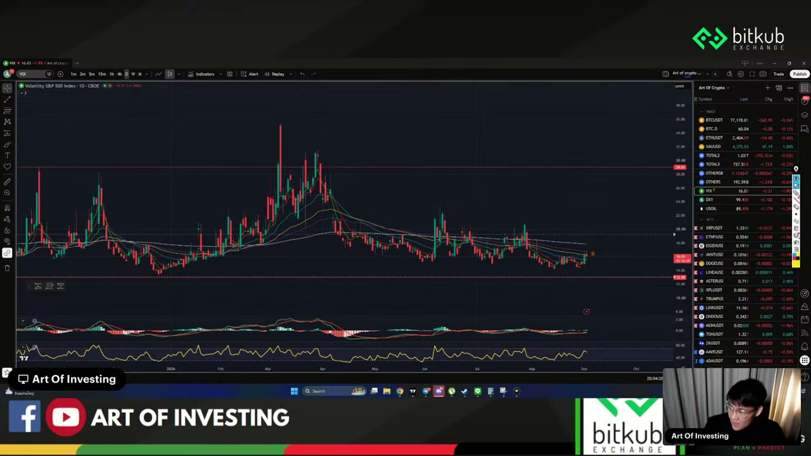

[00:53:29] ไหนคน DCA ถี่น้อยลงผมจะวิเคราะห์ตรงนั้น ด้วยโมเมนตัมแต่อย่าลืมที่ผมบอกสำคัญมากๆ ถ้าเกิดคุณจะ DC แล้วอย่าคitionเยอะเกิน ไปเช่นเส้นนี้ต้องตัดกันโมเมนัมต้องเป็น อย่างงี้ data  OI  Gamma  Exposure ต้อง เป็นอย่างี้ค่า GX ต้องเป็นอย่างงี้ Volume ต้องเป็นประมาณนั้นเพราะว่าความ ได้เปรียบมันจะหายไปถ้าเกิดคุณอยากจะได้ E ของระบบที่มันกว้างแบบนั้นน่ะไปทำในพอร์ต เล่นรอบดีกว่านะครับอ่ะเดี๋ยวดูทองให้ หน่อยทองเนี่ยเห็นมั้ยรีบาวoundที่ EMA 200 เนาะแล้วก็แล้วก็ตรงนี้เป็น Flip zซoneนะครับฉะนั้นทองตอนเนี้ยถ้าเกิดมัน ยังเป็นภาพนี้นะก็คือ ใช้คำว่า เข้มงวดดอกเบี้ยยังไม่ลงง่ายๆเงินต้อง เข้าไปที่พันธบัตรก่อนแล้วก็เศรษฐกิจไม่ แข็งแรงนะครับ แต่แต่ดอกก็ยังจะต้องปรับปรับขึ้นนะครับ ผมว่าทองก็อาจจะมีการปรับตัวลงนะครับอาจ จะขึ้นมาแล้วถ้าไม่เบรค 4,500 สมมุตินะ

[00:54:33] สมมุติว่ารีบาวขึ้นมาเนี่ยไม่เบรค 4,500 เนี่ยก็อาจจะได้เห็นนิวลงไปหน่อยนะครับ แถว 4,100  4,200 แล้วอาจจะไปไsideซวย์ แล้วค่อยขึ้นอีกรอบก็ได้นะครับอ่ะผมมอง แบบนี้งี้หรือถ้าเบรคขึ้นไปเลยก็จะเป็น อย่างนี้นะครับก็รอดูแถว 4,500 ไว้เพราะ ว่าทองคำอย่างที่บอกช่วงแรกอ่ะครับมันได้ รับผลกระทบจากบอลยิเยอะก็คือแล้วก็อัตรา ดอกเบี้ยเยอะที่ผมพูดไว้ต้นไลฟ์อ่ะก็ถือ ทองไม่ได้อะไรต่อปีแต่ว่าถ้าเกิดคุณไปถือ พันธบัตรรัฐบาลแล้วเควินแสดงท่าทีว่ามี โอกาสขึ้นดอกอย่างเงี้ยคุณก็ไปถือ พันธบัตรดีกว่าอ่ะเงินมันก็เลยไหลออกจาก ทองนิดหน่อยทีเนี้ยตราบใดก็ตามที่เงิน เฟ้อมันยังไม่จบสถานการณ์มันก็ยังแย่นะ ครับก็ทองก็อาจจะมี selling  pressure คอยกดไว้หน่อยนะครับแต่ภาพรวมระยะยาวหลัง จากที่ตลาดแครชทองมันอาจจะร่วงก่อนเราไม่ รู้ด้วยนะว่าแครชเมื่อไหร่แต่ แต่ว่าอ๋อ DCA  1 ส่วนล่ำซำ 1 ส่วนผมจำ ได้แล้วก็คือเอากำไรหรือรายได้ทุกเดือน

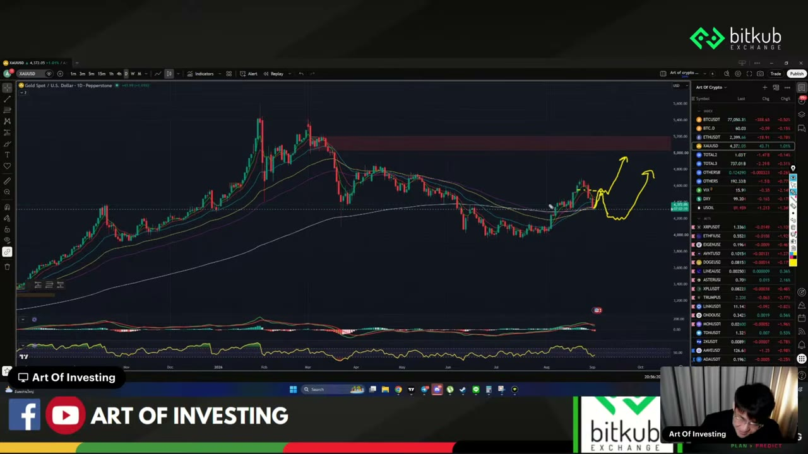

[00:55:35] ครึ่งนึง DCA ครึ่งนึงล่ำซ้ำโอเคดีใจด้วย ครับคุณแมวอ่ะทีนี้ เวลาทองลงหนักๆพร้อมตลาดแครชอย่าตกใจ เพราะว่ามันจะเป็น Force  Liquidate ถ้า ถ้าเกิดเค้าไม่เอาเงินออกเค้ามีทองถูก มั้ยเค้ามีพันธบัตร เค้ามีหุ้น เค้าก็เอาตรงเนี้ยไปค้ำ เพื่อกู้เงินออกมาลงทุน อ่ะสภาวะตลาดปกติจะเป็นอย่างี้แล้วเดี๋ยว ผมจะพูดให้เห็นภาพเลยคือผมจะพูดย้อนกลับ งั้นพอดอกเบี้ยสูงเฮ้ยเค้าเค้าค้ำไว้แล้ว เค้ากู้ออกมาใช่มั้ยงั้นเค้าต้องกู้ออกมา ได้อัตราที่น้อยลงเพราะว่าดอกเบี้ยมันสูง ขึ้นไม่เค้าใช้ดอกไม่ไหวเค้าก็จะต้อง เริ่มเอาเงินไปคืนทีเนี้ยบริษัทแต่ละ บริษัทอ่ะไม่มีบริษัทไหนถือแต่หุ้นไม่มี

[00:56:35] บริษัทไหนถือแต่พันธบัตรส่วนใหญ่มันก็จะ คละๆกันพวกบริษัทยักษ์ใหญ่นะรวมถึงสถาบัน งั้นถ้าเกิดว่ามันเกิดวิกฤตแล้วตลาดหุ้น ร่วงเงี้ยปักๆที่เค้าลงทุนเงี้ยกู้ลง ทุนเนี่ยหรือ leverage อ่ะร่วงๆงั้นทำไง ดีวะให้เงินที่ค้ำไว้มันไม่โดนยึดเค้าก็ ต้องขายขาย เพื่อเอาออกมาก่อนงั้นช่วงแรกอ่ะครับเฟส แรกทองอ่ะมันอาจจะทุบพร้อมกับ สินทรัพย์เสี่ยงถ้าเกิดตลาดมันแครชนะก็ อย่าไปตกใจแล้วสักพักเนี่ยมันก็จะกลับมา ฟื้นเองด้วยมูลค่าในตัวมันเองนะครับไม่ ต้องไปกังวลมากช่วงนี้ซองก็อาจจะมีท้องก็ อาจจะมี selling  pressure นิดหน่อยแต่ ระยะยาวคงคงคิดว่ายังยังเป็นขาขึ้นของเขา อยู่นะครับประมาณประมาณนี้นะสำหรับทองผม มองอย่างงี้นะ[เสียงสูดหายใจ] อ่ะตัวต่อไปนะครับก็จะมีน้ำมันเนาะส่วน น้ำมันเนี่ยตรงเนี้ยผมคิดว่าถ้าเกิดเอ่อ

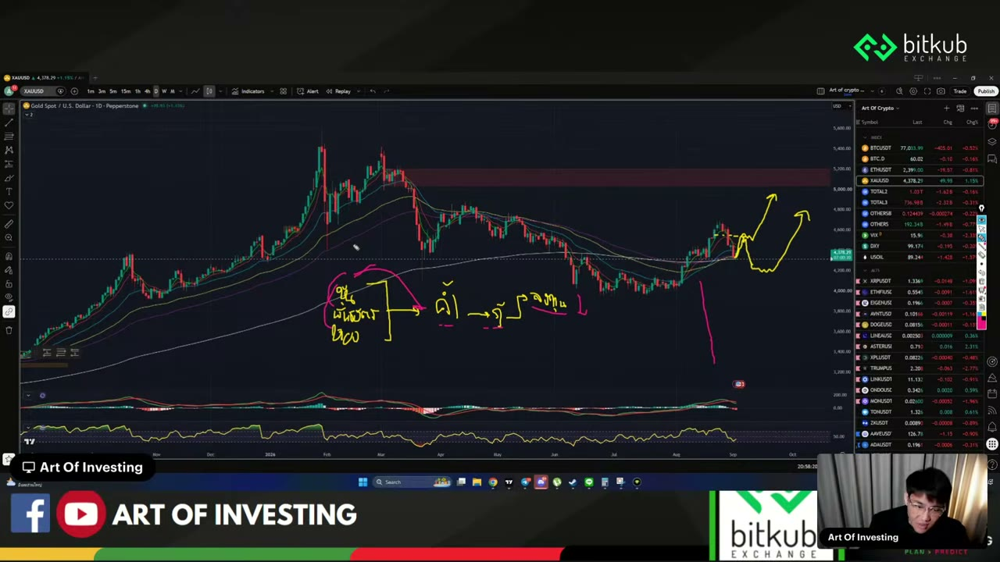

[00:57:36] เทรนด์มันยังเป็นอย่างี้นะครับผมก็เลยมอง ว่าตราบใดก็ตามที่น้ำมันไม่ต่ำกว่า 77 เนี่ยแล้วสงครามยังเกิดขึ้นเรื่อยๆเนี่ย 100 นอาจจะถึงได้แต่ผมคิดว่าคงไม่สูง กว่านั้นมากเพราะว่าเราอย่าลืมนะครับว่า น้ำมันเป็นต้นทุนของแทบจะทุกอย่างบนโลก โรงงงโรงงานใช้น้ำมันหมดนะครับในการผลิต ของต่างๆในการขนส่งในการอะไรมันจะทำให้ เศรษฐกิจทั้งโลกมีปัญหาถ้าเกิดเป็นเคส นั้นนะครับฉะนั้นผมคิดว่าถ้าต่อให้มัน เกิน 100 ก็อยู่เกินได้ไม่นานไม่นานนะ ครับงั้นจุดพีคเนี่ยผมก็คงให้ 90 ไปปลายๆ ถึง 100 สำหรับน้ำมันนะถ้าเกิดสงครามมัน ยังบึงบังๆๆอยู่เรื่อยๆนะครับแต่อย่าลืม นะครับน้ำมันจะสูงได้ไม่นานเพราะว่าราคา น้ำมันต่ำเกินหรือสูงเกินไม่ใช่ผลดีต่อ เศรษฐกิจโลกครับเพราะต้นทุนทุกอย่างสูง ขึ้นแล้วเนี่ยคืออีกหนึ่งเหตุผลที่ทำให้ เงินเฟ้อมันน่ากลัวแล้วแล้วเควิน watch

[00:58:37] ก็ยังมีมาตรการที่ค่อนข้างเข้มงวดเพราะ ว่าน้ำมันเป็นต้นทุนของทุกอย่างถูกมั้ย งั้นเงินเฟ้อมันจะลงได้ไงอ่ะในเมื่อน้ำ มันมันแพงขึ้นเรื่อยๆถ้าสงครามยังไม่จบ เงินเฟ้อก็ยังปราบไม่เสร็จนะครับเศรษฐกิจ ก็ยังแย่อยู่ด้วยอ่ามันก็มีหลายด่านและนะ ครับตรงเนี้ยก็เลยต้องไปดูกันว่ามันจะออก มาหน้าตาแบบไหน อ่ะวันนี้ผมคิดว่าประมาณนี้นะครับ 1 ชม. พอดีน่าจะได้เห็นอะไรหลายๆอย่างนะครับ แล้วก็หลายๆตลาดอ่ะเมื่อกี้เป็นคนขอผมดู ให้ตัวนึงแล้วกันนะครับก่อนๆไป อ้อโอ้โหติดพอดีเลยเว้ยed้าที่weคนะครับ ก็ถ้าเกิดed้าอย่างที่ผมบอกเนาะก็คือ MAD มันยังต่ำกว่า 0 อยู่อ่ะนะครับฉะนั้นตอน เนี้ยต้องต้องบอกนะว่ามันดีเรื่องนึงนะก็ คือมันเบรคพรีเมี่มของมันมาได้แล้วนะก็ คือพรีเมี่มของed้าใน Day เนี่ยคือ EMA 75 ถูกป่ะก็คือตรงนี้กับเส้น 50 ใช่ ฉะนั้นมันเบรคมาแล้วเนี่ย RSI  overbard แล้ว MAD เหนือ 0 แล้วก็คือ day มันเกิด โมเมนัมและแค่มันยังส่งไม่ถึง week นะ

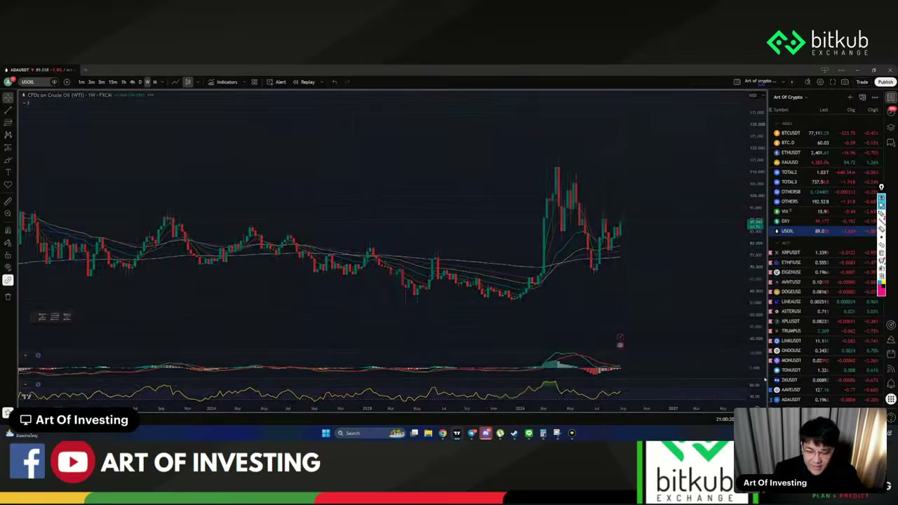

[00:59:39] ครับ week เนี่ย MACD มันยังใต้ศูนย์อยู่ ฉะนั้นผมว่าตัวเก็ย่อโอเคเฉพาะกราฟตัว เดียวนะฟังผมอธิบายอย่างงี้ก่อนมันย่อ โอเคครับเพราะมันย่อมาที่ flip zซoneตรง นี้ฉะนั้นถ้าเกิดตรงเนี้ย magne มันกลับ ไปตัดขึ้น RSI มัน overbard มันก็อาจจะ ขึ้นอีกรอบได้นะครับแล้วก็ไปเทสอีกทีคือ High เดิมก่อนแถว EMA  25 คือ 0.3  3 ถ้าทะลุได้ก็วิ่งไปที่ 0.28  28 แต่ว่า อย่างที่เรารู้คือถ้าบitcoinมันเลือกลงผม เชื่อว่า Outcoin ก็ยังจะเทต่องั้นตรง เนี้ยมันก็อาจจะรับไม่อยู่หรือเปล่าผมก็ เลยมองว่า Outcoin จะเล่นยากเห็นมั้ยตอน แรกที่ผมเขียนบทความว่าคอยเล่นยากตอนนี้ กราฟเริ่มมีแล้วมีคนมาแซะผมด้วยนะนั่นน่ะ ที่ผมยังแบบบอกเฮ้ยตลาดกลับมาแล้ว จริงๆเพราะผมไม่โดนแซะมา 2 ปีพอโดนแซะ เนี่ยแสดงว่าเฮ้ยตลาดมันดึงความสนใจกับคน ทั่วไปกลับมาบนคริปโตอีกครั้งนึงนะครับ งั้นถ้าเกิดมันเทเเนี่ยมันก็อาจจะเล่นยาก แล้วคุณดู Outcoin หลายตัวดิอ่ะเนี่ยที่ ผมบอกว่าทำไมผมไม่ค่อยเล่น out คอยอ่ะอ่ะ

[01:00:41] ยกเว้นอย่าง SRP นะ SRP ก็คือก็คือก็คือ ขึ้นแรงถูกป่ะย่อมาก็ยังย่อไม่เยอะถ้ามัน ขึ้นแต่ถ้าเกิดคุณไปซื้อของแถวเนี้ยคุณก็ ดอยหนักอ่ะนะครับเนี่ยแล้วคุณดูบางตัวแบบ อ่ะแอรก็ขึ้นดีขึ้นโคตรแข็งแรงนะครับ เนี่ยมีกวาดตรงนี้หน่อย Force  Liquidate นะครับแล้วก็ขึ้นโคตรแข็งแรงเลยสำหรับ นะครับอ่ะลิงก์อย่างเงี้ยลิงก์ก็แข็งแรง ย่อย่อเบานะครับออนโดเนี่ยก็ไม่ค่อยสวย และนะครับตอนแรกผมมองว่าถ้าเบรกตรงนี้ ขึ้นไปได้อย่างเงี้ยปิดเหนือตรงเนี้ยสวย เบรคยังไม่ได้ออนโดก็เริ่มไม่ค่อยสวยและ นะครับเอ่อโซก็เป็นอีกตัวนึงที่ผมมองว่า โมเมนตัมยังค่อนข้างดีนะครับฉะนั้นเนี่ย ผมก็ตั้งแจ้งเตือนไว้เห็นมั้ยถ้าเกิดโซ มันย่อลงมาแล้วพร้อมๆกับบitcoinก็เป็นอีก ตัวนึงที่ผมอยากได้เพราะว่าถ้ามันเบรคตรง นี้ขึ้นไปได้เนี่ยก็อัพไซตมันค่อนข้าง โล่งมันมันวิ่งขึ้นต่อได้ไกลนะครับก็เลย เป็นอีกตัวที่ผมเล็งๆนะรอบนี้ที่ผมสนใจนะ ก็จะมีไม่ได้บอกหวยนะครับแต่ว่าบอกมุมมอง แล้วกันก็คือเป็นเหรียญโปรตคอลที่อยู่มา

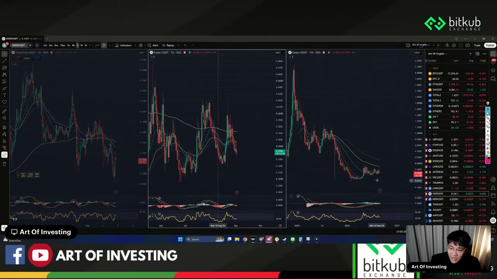

[01:01:42] หลายปีแล้วแล้วยังไม่โดนทิ้งแล้วยอดฝาก ยังสูงขึ้นเรื่อยๆมีโปรเจคใหม่ใหญ่ขึ้น เรื่อยๆที่ทำร่วมกับสถาบันผมก็จะมองว่ามี โมี AW นะครับมีอoมี link เพราะว่า Real World  Asset มันก็จะต้องใช้เทคโนโลยี Oracle ของ Chain Link ที่เป็น API ในการดึงข้อมูลนอก Blockchain ขึ้นไปบน Blockchain เชื่อม ข้อมูลระหว่างบนBบlockchainกับโลก traditional หรือหรือโลกภายนอก AV ก็มี ฝากค้ำกู้ยืม Real  World  Asset ในอนาคต อะไรอย่างเงี้ยนะครับฉะนั้นตรงเนี้ยผมไม่ ได้มองว่ามันจะขึ้นยาวแบบข้ามไซเคิลกลาย เป็น Out  Coin  Top  10 ตัวใหม่แต่ว่าผม แค่มองว่าถ้า Clarity  Act มันผ่านตลาด มันเป็นบูรันสถาบันไม่ได้ต้องการกระแส อะไรมากเท่า to  Tokenization อีกแล้ว เพราะว่าอย่างที่ผมบอกอเมริกาชอบให้เงิน อยู่ในประเทศเค้าทำไมเค้าจะไม่ชอบถูกมั้ย ครับเค้าต้องอยากให้เงินอยู่ในประเทศเค้า มากๆแต่ทีเนี้ย

[01:02:44] ทุกวันเนี้ยประเทศโลกที่ 3 หรือประเทศที่ ไม่ได้เจริญทางระบบการเงินขนาดนั้นน่ะจะ เข้าไปลงทุนก็ยากอย่างของเรามันยังเริ่ม มีบูมีอะไรหลากหลายมากขึ้นใช่มั้ยให้ให้ เป็นตัวเลือกแต่ประเทศอื่นมันยากแต่ถ้า มันเป็นbl็ockchainมันไร้พรมแดนงั้น สมมุติว่าคุณอยากซื้อหุ้นอเมริกาคุณซื้อ USDT  USDC แล้วคุณซื้อได้เลยเพราะว่า มันเป็นationเนั่นน่ะมันจะทำให้ตลาด อเมริกามีสภาพคล่องสูงมากแล้วผมมอง ว่าเนี่ยคืออีกหนึ่งสาเหตุที่ระดับ Black Roอกับ JP  Morgan น่ะเาเข้ามาลงในสนาม คริปโตเาไม่ได้สนใจคริปโตหรอกเ้าไม่ได้สน ใจนวัตกรรม Infrastructure ขนาดนั้นสิ่ง ที่เขาสนใจหลักที่สุดอ่ะกูรวยแน่มึง คิดดูดิเงินทั้งโลกจะมาซื้อหุ้น ประเทศกูเว้ยแล้วซื้อเข้าออกได้ 24 ชมง อ่านั่นแหละผมมองว่านั่นน่ะคือพอย์หลัก งั้นมันก็เลยจะเป็นธีมอย่างี้อย่างที่เรา เห็นว่าเวลาตลาดcryptoocurrนcyครับมัน ขึ้นแต่ละ cycle อ่ะ outcoin มันก็จะมี ขึ้นด้วยธีมอย่าง 2021 มันก็จะเป็นีม dayf

[01:03:47] ถูกมั้ยโอ้โหการเงินรูปแบบใหม่ได้ดอก เบี้ยสูงดีกว่าฝากธนาคารโคตรแบบนี้รวยและ ทุกอย่างเป็นโค้ดหมดอ่าหรือ infrastructure พอมาเป็น 2023 มันก็ เปลี่ยนธีมไปเป็นรูปแบบการเล่นกับเงินท่า ต่างๆนะครับมีช่วงนั้นที่ผมเล่นอยู่ก็จะ เป็นพวก เอ่อค่อนข้างเยอะนะครับในในธีมปีล่าสุดผม ก็จะมี East  Fig นะครับอ่ะมันก็จะเป็น ธีมของรอบก่อนแต่รอบเนี้อย่างที่ผมบอกว่า มันก็คงเป็นีม Stable  Coin นะครับเป็น ธีม Stable  Coin  Curve ก็อาจจะเป็นอีก ตัวที่ผมอาจจะไปเก็งกำไรนะครับอ่ะประมาณ นี้นะครับประมาณนี้อ่ะโอเควันนี้ประมาณ นี้ขอบคุณที่ที่มารับชมเช่นกันครับคุณ อารยาครับคุณปัธยาเอ่อทองเด้ง MA  200 พอ ดี 4H อ่าใช่ครับมันก็จะมีบางจังหวะที่ มันพอดีกับเส้นค่าเฉลี่ยแบบนั้นแหละนะ ครับออนโดสวยอยู่นะครับเด้งกรอบสาม เหลี่ยมอืมผมมองว่ามันย่อไม่ค่อยสวยเท่า ไหร่ครับอ่าอย่างตรงเนี้ยมันมันเป็น บาanceโซนที่แบบมันไม่ผ่านสักทีอ่ะครับ อย่างเงี้ยผมเลยมองว่าไม่ค่อยสวยเท่าไหร่

[01:04:48] แล้วแล้วตลาดเริ่มมีโอกาสที่จะแบบย่อตัว ใช่มั้ผมก็เลยมองว่าถ้าหลุดตรงเนี้ยไม่ สวยและมันก็จะต้องสะสมโมเมนตัมใหม่นี่เลย ซึ่งถ้ามันเป็นอย่างงั้นน่ะแล้วเหรียญ เหรียญอื่นโมเมนตัมมันแข็งแรงกว่าอย่าง ลิงอย่างเงี้ยอย่างเงี้ยโมเมนตัมมันยัง แข็งแรงอยู่เลยผมก็เลยมองว่า เอ่ออโดย่อไม่ค่อยสวยเทียบกับตัวอื่นนะ อ่ะประมาณนี้แล้วกันวันนี้นะครับก็อย่า ลืม Follow เพจ Facebook ของผมไว้ได้นะ ครับผมก็ชื่อเดียวกัน Art  Investing นะ ผมก็จะลง Joural การเทรดหรือว่ามุมมองของ ตลาดบนนั้นค่อนข้างบ่อยนะครับก็ไปย้อนดู กันได้นะครับวันนี้ก็ขอบคุณทุกท่านมากๆ ที่เข้ามาพูดคุยกันสนุกมากเลยครับแล้วเจอ กันพุธหน้า 20:00 น.เจอครับผมสวัสดีครับ อย่าลืมกดไล์กด subscribe นะ

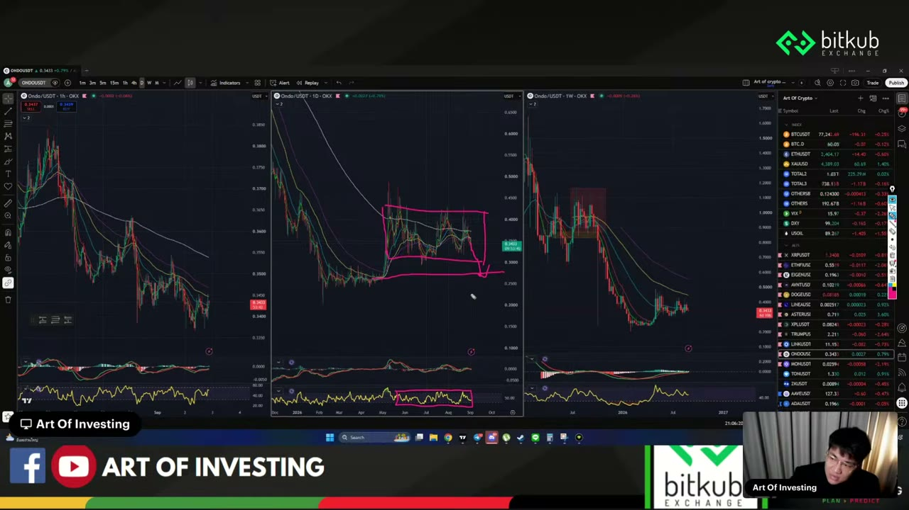

