# BTC จะย่อลงมาให้เติมของไหม?

- ช่อง: Art Of Investing
- ลิงก์: https://www.youtube.com/watch?v=HCnictiKaKM
- วันที่: 2026-09-09
- ความยาว: 1:33:23
- ที่มา: คำบรรยายอัตโนมัติ (auto-generated) ภาษาไทยของ YouTube — อาจมีคำสะกดผิด/คำผิดเสียง
- ภาพ: 53 ภาพจากวิดีโอช่วงที่เปิดกราฟแท่งเทียน (เลือกอัตโนมัติจากสีแท่งเทียน · ตัดภาพซ้ำ) อยู่ในโฟลเดอร์ frames/

---

[00:00:00] ครับเฮ้ยไลฟ์ติดหรือเปล่านะครับเดี๋ยวผม ขอเช็คก่อนนะไลฟ์มันติดมั้ยเอ่ยเดี๋ยวสัก ครู่นะครับ ตึ๊บๆๆติดมั้หว่า โอเคนะครับหน้าน่าจะขึ้นะผมเห็นว่าทุกคน มาละนะครับขึ้นะสวัสดีเพื่อนๆด้วยนะครับ ก็ไม่เจอกัน 1 สัปดาห์ถึงมั้ยพอดีเนาะ เพราะว่าเราไลฟ์กันทุกวันพุธก็ช่วงนี้ไม่ ได้ติดภารกิจอะไรก็เลยมาทุกพุธเลยนะครับ ก็แต่จริงๆมันมีโปรเจคใหญ่ที่ผมทำอยู่นะ เออผมทำกับที่บ้านอยู่แล้วก็เออผมจะชวน คุยเล็กน้อยแล้วกันเพราะว่าผมผมมองว่ามัน เป็นเรื่องเกี่ยวกับครอบครัวเนาะครอบครัว แล้วผมก็รู้สึกว่าเออเฮ้ยผมไม่เคยเห็นมุม นี้ของตัวเองแล้วก็คนในครอบครัวกลัวมา ก่อนนะครับก็คือผมทำโปรเจคอย่างนึงแล้ว

[00:01:02] กันเกี่ยวกับคุณแม่คุณยายนะครับก็ ทำให้จะต้องอยู่คนละที่ประมาณ 2 เดือนนะ ครับต้องต้องอยู่คนละที่ประมาณ 2 เดือนก็ คือตอนเนี้ยที่บ้านเนี้ยที่ผมอยู่อ่ะก็จะ มีแค่ผมกับหมูกรอบนะครับมีแค่มีแค่ผมกับ หมูกรอบเลยนะครับอยู่อย่างเงี้ยมา 4 วันะ แล้วก็คุณแม่กับคุณยายผมเนี่ยน่าจะต้อง อยู่อีกที่เนี่ยอีก 2 เดือนถึงจะได้แบบ เออกลับมาอยู่ด้วยกันนะเพราะว่าทำภารกิจ โปรเจคใหญ่ด้วยกันอยู่อย่างนึงผมก็มา สังเกตอย่างนึงเว้ยว่า 4 วันเนี้ยผมว่าผม เหงาที่สุดในชีวิตผมเลยนะครับทั้งๆที่ เพื่อนๆน่าจะเห็นว่าผมเป็นคนอารมณ์ดีมาก ใช่มั้ยแบบเล่นมุกดูก๊อกแก๊ก๊แก๊กดู อารมณ์ดีดูหัวเราะอะไรตลอดเวลาแล้วผมก็ เอ้ยเออบ้านมันเงียบเงียบมากเลยเพราะว่า ตั้งแต่เกิดอ่ะผมว่าผมไม่เคยอยู่ในบ้าน ที่ไม่มีแม่กับยายเลยยกเว้นว่าตอนผมนอนหอ มหาลัยอย่างเดียวนะครับตอนนี้ก็อายุ 30 กว่าแล้วเนาะเออแล้วพอมันเริ่มห่างกันน่ะ

[00:02:05] มันทำให้เห็นเลยว่าครอบครัวที่เขาบอกกัน ว่าห่างกันสักนิดจะดีอ่ะเฮ้ยดีจริงๆ นะครับเพราะว่าตอนที่อยู่ด้วยกันทุกวัน น่ะมันทะเลาะกันบ่อยแม้ว่าแบบเออเราจะรัก กันดูแลกันดีนะแต่ว่ามันจะมีแบบกระจุ๊ก กระจิ๊กขัดใจกันบ้างคนนั้นวางของตรงนี้คน นั้นหยิบของของเราไปวางไว้ตรงไหนก็ไม่รู้ คนนี้กินข้าวแล้วไม่เก็บจานไปล้างอะไร เงี้ยเราเราก็จะมีคอนฟลิกในครอบครัวบ้าง บ้างใช่มั้ยแต่ว่าพอเริ่มห่างกันน่ะเออ มันจะนึกถึงแต่เรื่องดีๆแบบเออตอนเค้า อยู่มันอย่างี้เนาะมันดีอ่ะเดี๋ยวขอปรับ กล้องนิดนึงนะครับเออมันดีอย่างี้เนาะเออ มุมนี้จะมีเค้าอยู่ปกติยายจะทำกับข้าวให้ กินทุกวันอะไรเงี้ยเออมันทำให้คิดถึงกัน มากขึ้นแล้วพอพอคิดถึงกันมากขึ้นนะครับก็ ผมก็จะโทรคุยโทรศัพท์กับคนในบ้านทุกวัน ใช่มั้ยมันทำให้รู้สึกว่าเรามีแต่คำพูดดี ๆให้กันอย่างเดียวเพราะว่าเราคิดถึงกันนะ ครับแต่อยู่ด้วยกันเนี่ยจะนานๆจะคุยคุย กันดีๆนอกนั้นก็จะแบบไม่กี่คำอ่ะแล้วก็ เอ่อกินข้าวด้วยกันอะไรด้วยการยิ้มแย้ม แต่แบบเออไม่ได้คุยกันดีขนาดนี้ก็ผมก็เลย แบบเฮ้ยจริงนะครับก็เออลองลองดูนะถ้า

[00:03:07] ใครที่แบบรู้สึกว่าอยู่ในบ้านแล้ว อุณหภูมิมันไม่อุ่นน่ะนะครับมันเป็น เหมือนแบบมันเผาอ่ะมันร้อนแรงแต่ละคนมัน กระแทกกระทั้นกันหรือว่ามันเหน็บแนมกัน บ้างพูดไม่เข้าหูกันบ้างอ่ะเออผมลองแนะนำ เลยนะลองลองห่างกันสักระยะเลเวลนึง 2 เลเวลอ่ะแล้วมันจะทำให้ครอบครัวมันกลับมา อุ่นอีกครั้งนะครับเออผมรู้สึกดีมากอ่ะ ชวนคุยประมาณนี้นะครับก็เป็นเป็นเรื่อง ครอบครัวผมก็เลยรู้สึกอยากจะคุยนะครับ แล้วก็ผมแทบไม่ได้เปิดปากเลยเพราะว่าผม อยู่กับหมาตัวนึงถูกมั้ฮะแล้วว่างานผมอ่ะ ผมก็คียหน้าคอมนะทุกวันเลยแล้วผมก็อยู่ กับหมาอยู่ตัวนึงนะครับก็เออพอได้มาไลฟ์ คุยกับทุกคนก็สดชื่นขึ้นนะครับตอนนี้ก็สด ชื่นสดชื่นขึ้นค่อนข้างเยอะอ่ะเราไปคุย กันเลยดีกว่าเนาะ วันนี้มีหลายเรื่องที่อยากจะพูดคุยแต่ว่า ไม่ใช่เรื่องซับซ้อนแล้วก็เรื่องเรื่อง ยากนะครับเดี๋ยวจะอธิบายทุกอย่างให้ฟัง เลยแล้วก็เราจะไปดูกราฟกันแล้ววันเนี้ผม

[00:04:07] ก็จะเน้น outcoin ให้ด้วยนะครับเพราะว่า ผมรู้ว่าหลายคนก็อยากอยากจะรู้ว่า Outcoin ได้หรือยัง Outcoin ยังน่าสนใจอยู่มั้ย ส่วนตัวผมมี Outcoin และ 3 ตัวนะครับที่ เข้ามาเพราะว่ากราฟมันสวยจริงๆอ่ะไม่ใช่ ตัวที่ผมอยากได้ที่สุดด้วยอ่ะเดี๋ยวผม เล่าให้ฟังนะว่าวันเนี้ยผมจะพูดพูดคุยกับ เรื่องที่มันมีโอกาสมั้ยที่ Outcoin มัน จะวิ่งเป็นoutซีasonเหมือนปี 2021 เพราะ ว่าตอนปี 202324 อ่ะมันไม่ได้มีoutซีซั แบบยิ่งใหญ่ถูกมั้ยเพราะว่าตอน 2021 อ่ะตัวชูโรงของตลาดอ่ะมันไม่ใช่แค่ Bitcoin มันมีเทคโนโลยีที่เรียกว่า Dayf ด้วยเป็น Decentraliz  Finance ซึ่งจริงๆ มันก็มีมาตั้งแต่ 2017 แล้วแหละแต่ว่ามัน เริ่มพัฒนา Smart  Contract อะไรหลาย อย่างจนมันใช้งานได้อย่างเต็มที่จริงๆ เนี่ยก็คือช่วง 2021 แบบธนาคารไร้ศูนย์กลางเฮ้ยฝากเงิน ดีกว่าฝากธนาคารได้ยีด้วยถอนเข้าถอนออก ดอกเบี้ยแยกขายตอนไหนก็ได้ด้วยนะครับที เนี้ยมันก็เลยทำให้เกิด day  summer อะไร

[00:05:08] ก็ตามที่เกี่ยวข้องกับ day boบูมไปหมดเลย นะครับผมทั้ง Infra  Structure  Layer  1 ทั้งพวกตัวแพลตฟอร์มDayfลโดยตรงเองอย่าง เค้ก Sushi  Uni โอ้โหเติบโตมากนะครับ หรือว่าแพลตฟอร์มที่ทำเกี่ยวกับ Stable Coin  Harve  Curve  Finance นะครับโต มากแต่ว่าอยู่ นะครับภาพตอนปี 2024 ที่เราเห็นเลยเนี่ย อ่ะเดี๋ยวผมขอปรับ position นิดนึง นะ TP เลยดีมั้วะอุ๊ยไปแล้วไปละไงดี แป๊บนึงนะแหม ตึ๊บๆ อ่ะโอเคพูดต่อนะครับมันมีภาพที่ชัดที่สุด คือ Bitcoin  ETF ถูกมั้ยตอนนั้นน่ะผม

[00:06:09] ไลฟ์กับพี่สีอยู่ก็จะมีคนเข้ามาดูแบบรอดู ข่าวบitcoin ETF อย่างเดียวว่าแบบเฮ้ย ข่าวนี้มันจะเปลี่ยนหน้าประวัติศาสตร์ บitcoinจะไม่ใช่เหรียญสแกมแล้วเพราะ ว่าอเมริกาจะกลายเป็นหนึ่งในคลังสำรองคือ เป็นresรีveของอเมริกาแล้วเฮ้ยแบบเนี้ย มันจะต้องเป็นเหรียญที่ใช้งานได้จริงมัน จะต้องโตกว่านี้พุ่งกระฉูดอ่ะมันกลายเป็น ภาพนั้นแล้วก็เงินจากสถาบันมันไหลเข้ามา ใหญ่ขึ้นจริงๆทำให้ธีมของ outcoin ที่มัน ขึ้นมาในรอบไซเคิลที่แล้วเนี่ยไม่ได้เยอะ ซึ่งผมได้กำไรจาก outcoin เนี่ยน้อยแล้ว ก็มีช่วงที่ผมโดน 10 ตุลาคมที่กำไรผมหาย ไป 25 ล้านในวันเดียวก็ก็มีฉะนั้นกำไรจาก Outcoin  cycle ที่แล้วอ่ะผมน้อยแต่ ไซเคิลเนี้ยมันมีความคล้ายกับ 2021 อยู่ 1 มันมี Real  World  Asset แล้วไอ้ Real World  Asset นี่แหละคือเป้าหลักของ Backrock ที่เขาเข้ามาทำ ETF เกี่ยวกับ Bitcoin ตั้งแต่แรกเขาไม่ได้สนใจ Bitcoin

[00:07:10] เป็นอันดับ 1 แต่เขามองว่าสิ่งที่จะสร้าง กำไรให้เขามากที่สุดอันดับ 1 อ่ะมันคือ Tokenization หรือรูปแบบเหรียญที่เอา ขึ้นไปอยู่บนโลก Blockchain นะครับเอาสิน ทรัพย์จริงขึ้นไปอยู่โลก Blockchain ทั้ง เป็นหุ้นจำลองแบบ Synthetic  Asset หุ้น สังเคราะห์ที่ออกโดยสถาบันที่ได้รับการ ยอมรับเท่านั้นหรือว่าการเทรด Real  World Asset เพราะว่ามันจะไร้พรมแดนให้คุณนึก ภาพนะว่าสมมุติว่าคุณเป็นตลาดอ่ะแต่ตลาด คุณน่ะมันคนเดินได้แค่เขตนั้นเราเรียก ตลาดนี้ว่าอเมริกาแล้วกันแล้วคนที่จะเข้า มาเดินตลาดจะมาซื้อปลาดุกย่างจะมาซื้อไก่ ทอดที่บ้านคุณได้เนี่ยมันจะต้องเป็นคนใน ประเทศคุณเท่านั้นคืออเมริกาแต่ถ้าเกิด มัน tokenization ขึ้นไปอยู่บนโลก Blockchain ซึ่งมันไร้พรมแดนเราไม่รู้ ด้วยซ้ำว่าเงินตรงนั้นน่ะมันอาจจะเป็น เงินที่อยากเข้ามาในอเมริกาตั้งแต่แรก แล้วแต่ว่าคนเหล่านั้นน่ะไม่สามารถเปิด Interactive  Broker ของอเมริกาได้ที่ สามารถเทรดหุ้นอเมริกาโดยตรงได้เขาก็ต้อง

[00:08:11] ซื้อผ่านประเทศเขาซึ่งบางทีเขารู้สึกไม่ สะดวกรู้สึกจะต้องเสียภาษีนู่นนี่นั่นถูก มั้ยงั้นมันมีเม็ดเงินน่ะที่มันอยากจะ เข้าไปที่ตลาดนั้นน่ะเยอะมากๆแต่มันเข้า ไม่ได้เพราะว่ามันติดปัญหาเรื่องพรมแดน เฮ้ยจะเข้าไปแล้วก็ติดตรงนั้นติดตรงนี้ คือทานั้นพอมันขึ้นไปปุ๊บอ่ะสภาพคล่องจะ อยู่ในมือเมหาศาลมากแล้วเขาจะเป็นเจ้าของ ตลาดที่เขาจะรวยขึ้นมีเงินอยู่ในมือมาก ขึ้นเคอนโทรลหลายๆอย่างได้มากขึ้นแล้วเรา ก็เห็นแล้วว่ากลุ่ม Real  Royal  Aset อะไรก็ตามที่มันเกี่ยวข้องกับ Real  Royal Asset อ่ะมันเริ่มวิ่ง อ่ะเดี๋ยวเดี๋ผมเปิดหน้าจอไปด้วยแล้วกัน นะครับผมเห็นหน้าตัวเองแล้วผมกลัวว่าคน อื่นเปิดเข้ามาแล้วจะนึกว่าแบบเป็นพcส อะไรอย่างงี้นะครับอ่ะเดี๋ยวผมขยายเป็น หน้าผมก่อนแล้วกัน เอ้ยลืมเปิดเสียงชัดมั้ครับผมลืมเปิด โปรแกรมทำเสียงไมค์นะครับมันจะมีโปรแกรม ไมค์เดี๋ยวผมเปิดก่อนนะครับให้เสียงมัน นิ่งก่อน

[00:09:16] สักครู่นะ อ่ะระหว่างเปิดโปรแกรมเดี๋ทักทายเพื่อน ก่อนสวัสดีครับอาจารย์สวัสดีครับคุณ ธนพงษ์สวัสดีครับคุณเมสซี่สวัสดีครับคุณ จตุรงค์สวัสดีครับสูกินโทห่างหายจาก บitคอยสักพักดีมั้ไม่ดีครับอยู่กับมัน เถอะนะครับอ่าสวัสดีครับคุณเปรมศรีเออ คราวที่แล้วไปงานบิดคupแล้วไม่เจอผมใช่ มั้ยผมผมไม่ได้ไปนะครับงานนั้นพอดีผมติด ภารกิจพอดีนะครับสวัสดีครับคุณกัญยพาร์ อาจารย์มองแต่มอง clarity แผ่านมั้ครับ สัปดาห์หน้าถ้าไม่ผ่านราคาร่วมมั้ครับ หรือ price  in ไปแล้วครับผมมองว่าปัจจัย ตอนนี้โอกาสผ่านไม่รู้สิผมให้ 50 เลยอ่ะ ใจผมลึกๆอ่ะมองว่าไม่น่าผ่านด้วยซ้ำอ่ะ เพราะว่ามันเลื่อนแล้วเลื่อนอีกเลื่อน แล้วเลื่อนอีกแต่แต่ไม่แน่นะเค้าอาจจะ เซอร์ไพรส์เราก็ได้นะก็คือแบบอยู่ๆก็ป๊อก ผ่านขึ้นมาเลยก็ได้อะไรอย่างเงี้ยเราเรา ก็ไม่รู้ถูกมั้คุณเมสซี่ผมจะอธิบายแบบนี้ คือถ้ามันถ้ามันจะผ่านน่ะตอนเนี้ยมันอยู่ ในขั้น flw ก็คือถ้าสว.ผมพูดเป็นภาษาไทย เลยนะไม่ไม่เรียกเป็นวุฒิสภาวิทยาลัย

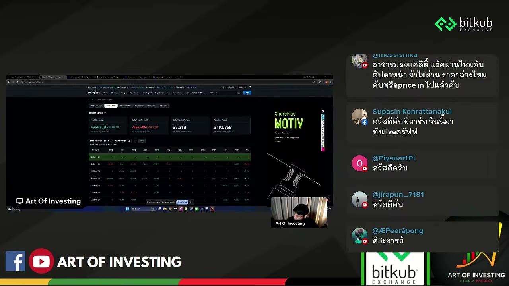

[00:10:17] เรียกสว.สส.เลยนะขั้นสว.ถ้าเค้าเห็นว่า เฮ้ยมัน โอเคละร่างกฎหมายเนี้ยเหรือเค้าต้องการ แต่งเติมอะไรเพิ่มเช่นเฮ้ยขอเพิ่มกฎข้อ นี้หน่อยขอเสริมข้อย่อยข้อนี้เข้าไปหน่อย อ่ะถ้าเค้า approve และแล้วเพิ่มเสร็จ แล้วมันก็ต้องส่งกลับไปที่ส.ส.นะครับแล้ว 2 ฝั่ง approve เสร็จก็ยื่นประธานีร่าง ออกมาซึ่งมันติดอยู่ขั้นเนี้ยมันโดน เลื่อนแล้วเลื่อนอีกก่อนหน้าเนี้ยเราก็มี การคาดหวังกันไปทีนึงแล้วว่าเฮ้ยอย่าง น้อยอ่ะก่อนซัมเมมันมันน่าจะไม่เลื่อน เว้ยเพราะว่า ถ้าเกิดมันทันในช่วงเดือนที่แล้วเนี่ยมัน จะยังไม่ไปโดนการปิดช่วงเบรคของการทำงาน ของคนในรัฐบาลน่ะทีเนี้ยไม่ทันอีกก็เลย โดนเลื่อนมารอบนี้อีกปัญหาหาคือถ้าเกิด รอบนี้ยังโดนเลื่อนอีกอ่ะครับมันจะใกล้ การเลือกตั้งกลางเทอมมากขึ้นเรื่อยๆเลือก ตั้งกลางเทอมคือช่วงพฤศจิกายนซึ่งทรัมป์ อ่ะกำลังทำทุกอย่างให้ตัวเองชนะการเลือก

[00:11:19] ตั้งตรงนั้นแล้วถ้าเกิด มันยังไม่ผ่านรอบนี้โดนเลื่อนไปอีกแล้ว เลือกตั้งกลางเทอมทรัมป์แพ้ขึ้นมาอย่าง เงี้ยโอกาสมันค่อนข้างสูงเลยที่มันจะถูก เก็บไปแล้วอาจจะโดนได้กลับมาพิจารณาอีกที แบบ 2-3 ปีข้างหน้าที่ที่เขา้าออกมาพูด ว่า 2030 นะครับผมก็เลยมองว่าณปัจจุบัน 5050 แล้วผมก็รู้สึกว่าไม่อยากจะให้ไป คาดหวังเยอะว่ามันจะผ่านแล้วมันจะต้อง วิ่งขึ้นมหาศาลหรือว่าอะไรเพราะว่าเรา ต้องอย่าลืมตอนที่ Bitcoin  ETF ผ่านเรา จำได้ป่ะตอนที่คนทั่วโลกรอข่าว Bitcoin  ETF อ่ะเฮ้ย Bitcoin  ETF จะ ผ่านแล้วจะ Approve แล้วจะ Official แล้ว แบบทุกคนกำลังตื่นตื่นเต้นพอผ่านปุ๊บราคา ลงแต่ลงไม่เยอะประมาณ 4-5% นะครับแล้วก็ อีกอาทิตย์นึงกว่าจะเริ่มวิ่งเพราะว่า ช่วงแรกมัน price  in ไปแล้วทีเนี้ยครับ คุณซี่ปัจจัยอ่ะมันไม่ได้มีแค่ Act ไงมัน

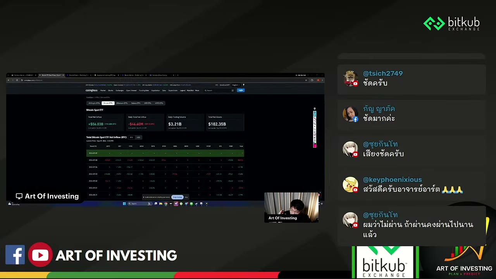

[00:12:20] มีตัวเลขพรุ่งนี้อีก 2 วันก่อนคือ CPI กับ PPI มันจะบอกอัตราเงินเฟ้อทั้งฝั่ง ผู้บริโภคกับฝั่งผู้ผลิตทีเนี้ยnonฟาร์ม คราวที่แล้วเนี่ยมันออกมาสูงกว่าคาดมากๆ ใช้คำว่าโคตรๆก็ได้พอฟาร์มออกมาสูงกว่า คาดเนี่ยครับสิ่งที่เกิดขึ้น คือตลาดมองว่าเฮ้ยแบบเนี้ยเฟซจะตีความว่า การจ้างงานมันยังเยอะนี่หว่างั้นตลาดมัน ยังแข็งแกร่งเศรษฐกิจยังพอไหวงั้นแบบ เนี้ยขึ้นดอกได้งั้นตัวเลขต่อมาเนี่ยคือ เราจะต้องดูเงินเฟ้อ ฝั่ง CPI คือดัชนีฝั่งผู้บริโภค PPI อีก นะครับผู้ผลิตว่ามันดื้อหรือเปล่าสิ่งนึง ที่คนกังวลเพราะว่าราคาน้ำมันสูงมากแล้ว ราคาน้ำมันเนี่ยเนี่ยมันเป็นต้นทุนของทุก อย่างของทุกธุรกิจถูกป่ะขนส่งเดินเรืออ่า เป็นซpัพายในโรงงานมันแบบมันเป็นต้นทุน ของทุกอย่างเลย ทีเนี้ยมันก็เลยทำให้คนกังวลเยอะถ้าเกิด

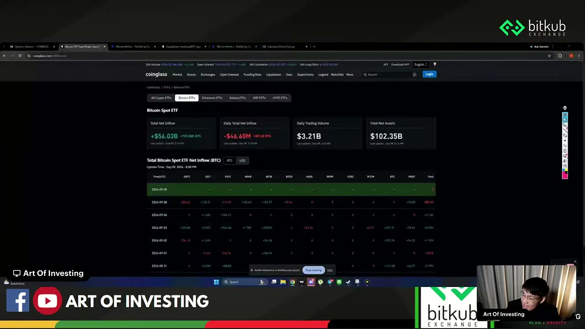

[00:13:22] เงินเฟ้อออกมาดื้อเนี่ยมันจะมีโอกาสขึ้น ดอกค่อนข้างสูงคุณเมสซี่นึกนึกภาพทันมั้ย เพราะว่าแบบอ้าวจ้างงานเยอะเหรอเอ้าเอา เศรษฐกิจดีนี่หว่าเอาเศรษฐกิจดีหรอเอ้า เงินเฟ้อเอ้ยยังดื้ออยู่นี่หว่าเฮ้ยแบบ เนี้ยเราควรขึ้นดอกนะอ่ามันก็จะทำให้ตลาด เนี่ยกังวลนะครับก็อาจจะเกิดการเขย่าได้ ใน 2 วันนี้พฤหัสบดกับศุกร์นะครับแล้วก็ อาทิตย์หน้าโคตรอีวentเลยครับมีโมซ Meeting คือการประกาศอัตราดอกเบี้ยมีผล โหวต Carity Actุม Bank  of  JA ว่าธนาคารญี่ปุ่นรัฐบาล ญี่ปุ่นจะขึ้นดอกเบี้ยหรือเปล่า แล้วก็ 1-2 เดือนนี้คือกันยายนถึงตุลาคม จะมีการ IPO  antropic อันนี้ผมเขียนไป 2 รอบ แล้วแต่ว่าก็ก็พูดให้เห็นภาพอ่ะเนาะคือ ก่อนหน้าเนี้ย AI อ่ะมันดึงสภาพคล่องที่ เขาเรียกกันว่า Global  Liquidity หรือ เงินสภาพคล่องที่รอลงทุนในสินทรัพย์ต่างๆ

[00:14:24] ของโลกเนี่ยมันเข้าไปที่ตลาดอื่นก่อนแล้ว ทองคำวิ่งไปก่อนแล้วเรารู้แล้วรอบเนี้ย ทองคำวิ่งวิ่งตัวแรกเลยหุ้นตลาดหุ้นเงิน เข้าพูดด้วย AI ไปมหาศาลน้ำมันซัพพlyช เงินเข้าจากภาวะสงครามนะครับฉะนั้นน่ะมัน เหลือถึงบitcoinอ่ะเค้ากังวลว่าจะไม่เยอะ ก็คือมันเป็นช่วงปลายของ global liquidity พอมันเป็นช่วงปลายอ่ะครับการ IPO ตัวเนี้ยทำไมเขาถึงอยากดูนักอยากดู หนาว่าแบบเฮ้ยเงินมันจะเยอะจริงมั้ยวะ เพราะว่าเค้าอ่ะลุ้นว่าเงินที่มันอยู่ใน สภาพคล่องที่มันเค้าอาจจะคิดไม่ถึงหรือ ยังมองไม่เห็นว่ามันมีเงินก้อนนั้นอยู่ อ่ะถ้ามันยัง flow เข้ามาแบบท่วมอ่ะแบบ เอ้ย antropic บริษัทที่ไปStartอให้crอส เข้าตลาดหุ้นอเมริกาแล้วแล้วเงินมันไหล เข้ามาปู๊ดดัชนีมันวิ่งขึ้นอีกเงี้ยเค้า ก็แบบเฮ้ยโอเคอย่างี้ยังพอมีเพดานพื้นที่ ให้วิ่งขึ้นต่อด้านบนแต่ถ้าไม่อ่ะมันก็ เลยจะทำให้ตลาดเนี่ยเอ่อตีความแล้วว่ามัน

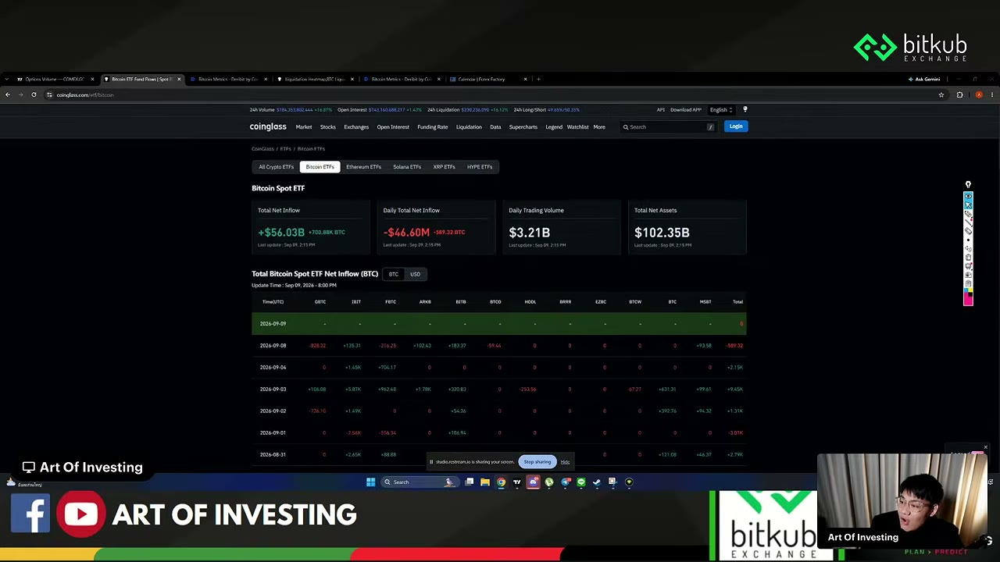

[00:15:24] มันถึงจุดพีคะก็คือไม่ได้แปลว่าตลาดต้อง แครชต้องทุบนะแต่ว่ามันเป็นจุดพีคของสภาพ คล่อง global  liquidity แล้วมันอาจจะ เกิดการย่อตัวก่อนนะครับแล้วก็หลังจาก นั้นเนี่ยผันผวนเดือนนี้เสร็จอ่ะมันจะไป ผันผวนอีกทีนึงคือพฤศจิกายนเพราะ พฤศจิกายนมีเลือกตั้งกลางเทอม อันเนี้ยผมบอกเลยว่าเรื่องใหญ่นะครับ เลือกเลือกตั้งกลางเทอมนะครับเรื่องใหญ่ มากบางคนจะไม่เข้าใจว่าเลือกตั้งกลางเทอม คืออะไรคือสมมุติว่าทรัมป์เนี่ยยังไงอ่ะ เค้าเชนะการเลือกตั้งประธานาธิบดีมาถูก มั้เค้าดำรงตำแหน่งต่ออยู่และแต่ว่า รัฐบาลภายใต้เค้าอ่ะถ้าเกิดแพ้มันจะเป็น อีกฝั่งมันเหมือนผมเปรียบเทียบให้เห็นภาพ คือเอาฝ่ายค้านมาทำงานเป็นรัฐบาลอะไร อย่างเงี้ยฉะนั้นน่ะเวลาตัวประธานธิบดี อย่างทรัมป์เา้าออกนโยบายอะไรก็ตามครับ รัฐบาลมันจะปัดตกได้ซึ่งเช่นคุณออกเอ้ย นโยบายตรงนี้จะออกทาริแทเขาก็ค้านมัน เหมือนลูกน้องตัวเองค้านหัวหน้านะครับมัน ก็จะทำงานยากแน่นอนมันมีกฎหมายที่ ประธานธิบดีสามารถบังคับใช้ได้แต่มันก็ทำ

[00:16:26] ได้แค่ 150 วันเขาจะทำงานยากขึ้นช่วง เนี้ยเค้าก็เลยพยายามดันเรื่องสงครามให้ จบเร็วโชว์โให้เห็นว่าตลาดหุ้นมันยังไป ต่อได้ โชว์Powerาของอเมริกาอำนาจในการต่อรอง เพื่อให้คนยังแบบช่วยโหวตเลือกตั้งกลาง เทอมให้กับฝั่งเขาชนะด้วยมันก็เลยจะเกิด ความผันผวนมากผมถึงบอกว่าบitคinรอบเนี้ย ผมตอบไม่ได้หรอกแล้วผมก็เชื่อว่าไม่มีใคร ตอบได้หรอกว่ามันจะลงอีกมั้ยมันจะขึ้นอีก มั้ยผมถึงบอกว่าผมยังเหลือเงินสดอีก ประมาณนึงนะครับอาจไม่ไม่ไม่ได้ไม่ได้ถึง ครึ่งแล้วแต่ว่าก็เหลืออยู่ประมาณนึง เพราะว่าผมว่ารอบเนี้ยสิ่งนึงที่ยืนยัน ได้มากกว่ารอบก่อนๆคือความผันผวนนะครับ เพราะว่าอีเวentมันใหญ่กว่ามากนะครับ อเวentมันใหญ่กว่าไซเคิลก่อนๆมากเพราะว่า มันเป็นระดับโลกมันไม่ใช่แค่ระดับแบบแค่ ตลาดเดียว ก็วันเนี้เดี๋จะมาเบรคดาวนให้ฟังสวัสดี ครับคุณกัญยพัก์สวัสดีครับพี่อาร์ตสวัสดี ครับสวัสดีครับคุณปิยานาถสวัสดีครับคุณ จิรพันธ์สวัสดีครับคุณเอ้พีรพงษ์สวัสดี ครับคุณซุกินโทสวัสดีครับคุณธันพงษ์ดี ครับอาจารย์เสียงแดงฟังใจอ้าวทำไมเหมือน

[00:17:27] แชทมันรันย้อนหลังมั้ยผมว่าไม่ผ่านถ้า ผ่านคงผ่านไปนานแล้วก็มีสิทธิ์ครับผมก็ มองแบบนั้นนะก็อาจจะเหมือนดร.บิ๊กเนาะ เมื่อเช้าผมก็ฟังดร.บิ๊กเหมือนกันนะครับ ตอนทำงานนะครับเอ่อสวัสดีครับจารย์อาร์ต สวัสดีครับคุณคีฟenิก์สอนดู o หน่อยครับ ผมโหลด Daily มาแล้วดูไม่เป็นได้ครับถ้า ถ้าเป็น OI นะได้ๆครับเดี๋ยวเดี๋อาจจะ เชิญจานเอ็มมาเปิดหัวเรื่อง OI  Bitcoin ด้วยอันนี้แงมๆไว้ก่อนเดี๋ยวอาจจะเชิญ เอ้ยทองไปแล้วไปแล้ว ไปแล้วไปกูไปละใครอยู่กูอยู่กูปิดะไปโล่ง ไปไลฟ์ต่อครับผม อารมณ์ดีแล้วเดิviวแจ้งเตือนติ๊งๆเนี่ย เมื่อกี้ที่แบบเห็นผมมองโทรศัพท์มองกราฟ อยู่เนี่ยผมรออยู่เอ้ยจริงๆจริงๆผมมองว่า มันไปต่อได้อีกหน่อยนะแต่ว่าผมพอแล้ว เดี๋ยวผมไลฟ์แล้วไม่มีสมาธินะครับา ปิงปืก นะครับเฮ้อ นะครับเฮ้ยผมว่าไปต่อได้จริงๆนะเนี่ยน่า

[00:18:29] จะได้อีกประมาณ6-7อนน่ะนะครับเพราะมัน เบรกoverบอมา ไม่เป็นไรไม่เป็นไรไลฟ์ดีกว่าไลฟ์ดีกว่า อ่ะเดี๋ยวๆวันนี้จะอธิบาย o เพิ่มให้ คร่าวๆแล้วกันครับคุณพิชยุทธจริงๆผม อธิบายไว้หลายไลฟ์แล้วนะแต่ว่าเดี๋ยวผม เสริมให้สวัสดีครับคุณอริยาสวัสดีครับ เอ่อมาครับคุณแบงค์อ่ะสวัสดีคุณบีอ่ะพูด ต่อทีนี้เราอธิบายเรื่องอีเวน์ใหญ่ไปแล้ว เนาะอ่ะพูดจบไปแล้วเรื่องอีเวน์ใหญ่ต่อมา เรื่องของ out  season นะ อ่ะผมมองว่าตอนปี 2021 อ่ะนะครับกับตอนปี 2024 แล้วกันนะครับแล้วก็อันเนี้ยมันจะ เป็น Dayf  Summer เนาะ นะครับแล้วก็ 2024 อ่ะมันกลายเป็นตัวที่ แบบชูตลาดอ่ะมันคือ Bitcoin  ETF นะครับ นะครับ โอผมไม่ได้มองไกลขนาดนั้นคุณกันกพัก C470 อาจจะไกลไปนิดนึงแต่ภาพรวมตอนนี้หรอ

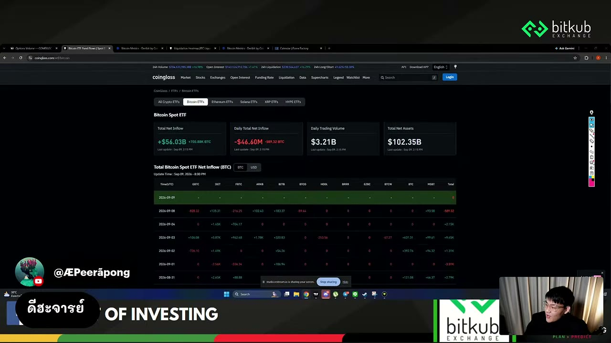

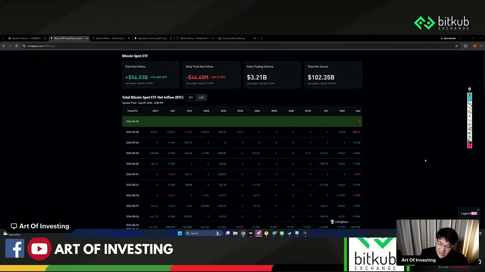

[00:19:32] เดี๋ยวผมวิเคราะห์ให้ฟังหลังจากวิเคราะห์ คริปโตเสร็จแล้วกันนะครับ[เสียงสูดหายใจ] แล้วก็ปีเนี้ยอ่ะไซเคิลที่กำลังจะถึง เนี่ยผมว่า 2000 ผมใช้คำว่า 2027 แล้วกัน นะเพราะว่านับๆตามรอบหน้าผมมองว่ามันจะ เป็น RWA ที่เป็นตัวชูโรงนะครับฉะนั้นเนี่ย outcoin หลายตัวเริ่มออกตัวแบบรุนแรงมากๆะนะครับ ออกตัวแบบ[เสียงสูดหายใจ]วิ่งมาค่อนข้าง แรงละทีเนี้ยคำถามคือทำไมล่ะอ่ะผมก็ อธิบายตอนต้นไลฟ์ไปแล้วเนาะว่า Real World  Aset มันทำอะไรได้บ้างแล้วทำไม Backdrอกถึงมองตรงเนี้ยว่าแบบอันนี้แหละ กำไรเป็นกรอบเป็นกร ETF  Bitcoin เพราะ ว่าเค้าจะเป็นผู้กำหนดควบคุมสภาพคล่องใน มือจากเม็ดเงินมหาศาลที่มันไร้โพรมแดน เข้ามาแบบอยู่ในตลาดอเมริกามากขึ้นน่ะนะ ครับฉะนั้นไม่ว่าจะเป็นหุ้น นะครับอสังหา สินทรัพย์อะไรก็แล้วแต่ที่มันอยู่ในโลก จริงอ่ะที่เขา้าบอกว่า real  world อ่ะก็

[00:20:32] คือโลกจริงนะครับแล้วก็ asset ก็คือสิน ทรัพย์ที่อยู่บนโลกจริงพอมันขึ้นมาบน Blockchain เนี่ยครับ Outcoin ที่ได้กลุ่มพวกเนี้ยก็คือกลุ่ม RW อ่ะผมจะยกตัวอย่างพูดง่ายๆแล้วกันอ่ะ อย่างตัวนึงที่จารย M จะพูดถึงบ่อยก็คือ ยูินะครับอย่างยูิอ่ะมันได้ 2 มุมมุมแรก เนี่ยมันแทบจะเป็นแพลตฟอร์ม ที่ใช้คำว่าทำเรื่องเอ่อ Dex สมัยแรกที่ เป็น Decentralized  Exchange ที่ใช้คำ ว่า Swap เหรียญเนี่ยเป็น OG นะครับอยู่ บน Etherium แล้วก็ข้อ 2 คือมันสามารถ เทรด Real  World  Asset ได้ด้วยนะครับ เวลาที่มีแพลตฟอร์มไหนก็แล้วแต่ขึ้นไปผูก บนนั้นนะครับฉะนั้นอันเนี้ยเราก็มองเป็น ว่ามันเทรด RWA ได้เนาะ ส่วน RW เนี่ย กู้ค้ำนะครับหรืออาจจะฟาร์ม RWA ได้เห็น มั้ยอ่ะ 2 อันเนี้ยก็ได้ได้กระแสไปแล้ว จากธีม RWA นะครับแล้วก็ตัวที่ผมมองว่า

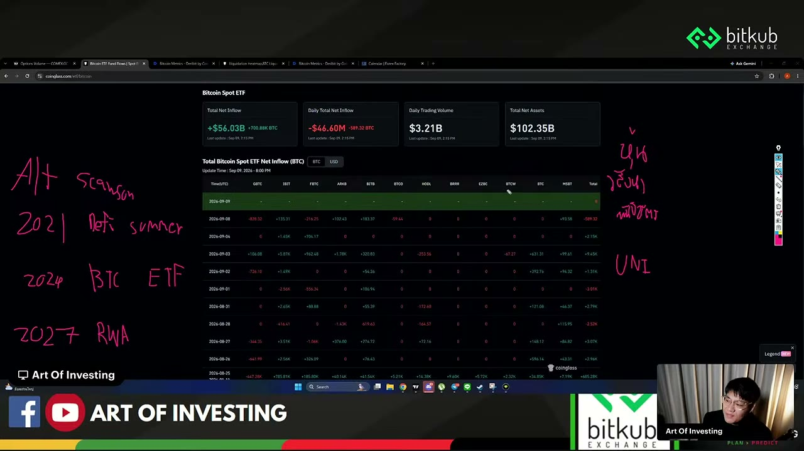

[00:21:35] มันขาดไม่ได้เลยอ่ะสำหรับผม่ะผมชอบไอ้ตัว นี้มาตั้งแต่ 2021 แล้วแค่ราคามันไม่ค่อย perform คือลิง[เสียงสูดหายใจ] Link เนี่ยครับมันคือโปรโตคอลที่ทำ เทคโนโลยี Oracle ซึ่งจะบอกว่า Oracle เนี่ยไม่ได้มีแค่เค้าที่ทำนะแต่ว่าผม เปรียบเทียบอย่างี้ โอ้โหวิ่งถึงเป้าผมจริงๆด้วยว่ะทอง เดี๋ไม่เป็นไรครับผมผมแฮปปี้ละตอนแรกก็ กังวลอยู่ไลฟ์แล้วกลัวไม่มีสมาธินะครับ เออไม่เป็นไรจะวิ่งต่อก็แล้วแต่พี่เค้า เลยนะครับผมโอเคละอ่ะ นะครับ Oracle เนี่ยมันเป็นตัวเหมือนพูด ง่ายๆ ดึงข้อมูลจากโลกธรรมดาขึ้นสู่โลก blบockchainแปลงข้อมูลจากโลกblบockinออก มาสู่โลกธรรมดานะครับก็นึกภาพตึงราคาหุ้น ก็ได้ถ้าเอาแบบภาษาบ้านๆเข้าใจง่ายสุดอ่ะ ก็ตึงราคาหุ้นก็ได้ฉะนั้นถ้าหุ้น M Tทสla Mwitter หรืออะไรพวกนี้ขึ้นมา

[00:22:36] นะครับก็มันใช้เทคโนโลยีของChainลinkแต่ ทีเนี้ยครับเอ่อเทคโนโลยีของChainลink เนี่ยมันเป็น เทคโนโลยีที่มีหลายเหรียญทำมากๆแล้วเคยมี โปรดักของคนไทยทำด้วยถ้าผมจำไม่ผิดนะครับ ชื่อเหรียญแบรนด์มั้งแบรนด์โปรโตคอแต่ว่า เขาขายสิทธิบัตรต่อให้กับชาวต่างชาติไป แล้วแต่ผมจำได้คร่าวๆนะเออว่าคนไทยทำนะ ครับแล้วก็ขายต่อไปและเอ่อหรือยุบทีมน่ะ ผมจำไม่ได้ขออภัยด้วยนะครับแต่ว่าเชลิง อ่ะมันมีผู้ใช้งานเนี่ยเป็น 70% ของตลาด แล้วนะครับเหมือนกับมีหลายแบรนด์ทำไก่ทอด อ่ะไก่ย่าง 5 ดาวก็ทำ McDonald ก็ทำแต่ สุดท้ายแล้วแบรนด์ที่มันแพร่หลายที่สุด แล้วคนจำได้ถ้าพูดว่าไก่ทอดอ่ะคือ KFC  4 นะครับฉะนั้นมันใหญ่ที่สุดแล้ว Market Cap มันใหญ่สุดโปโปรตคอลที่ใช้ก็เยอะที่ สุดนะครับก็มันก็เลยเป็นอีกหนึ่งตัวที่ผม มองว่าไอ้ตัวเนี้ยน่าสนใจในระยะยาวนะครับ ผมผมค่อนข้างชอบChนลink

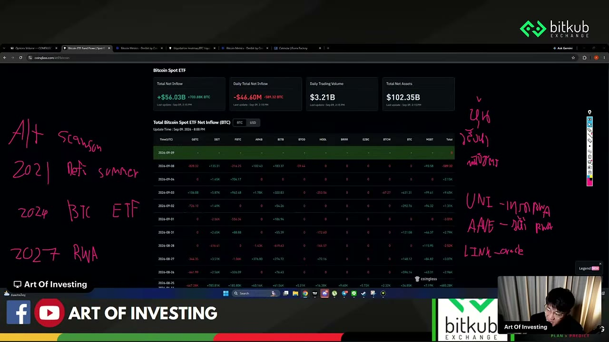

[00:23:39] มากระดับนึงเลยนะครับแล้วนอกจากนั้นมันก็ จะลองลงมาแล้วนะครับพวกพวกตัวที่มัน สามารถลิได้อ่ะก็คือมีอีกตัวนึงก็คือ Solona เนาะที่เขามีแพลตฟอร์ม Infra ที่ ที่ตัวเขา้าอ่ะก็สามารถเทรดหรือลิส Ra บน Change ได้เหมือนกันอ่ะผมก็มองว่าโซก็ ค่อนข้างโอเคนะครับโอ้โหทองแหมขายหมูว่ะ ผมหมูไปประมาณ 1,000 กว่าดอนได้แต่ไม่ เป็นไรครับ ตึ๊บๆอ่ะ แถวเนี้ยถึงเป้าผมะนะครับ 4427 อ่ะแล้วก็อีกตัวนึงผมมองว่าเหรียญของ Exchange อ่ะน่าจะขึ้น มุมมองนี้ผมให้เครดิตรายการ Alpha  Mind ของจารย M แล้วกันนะครับก็จริงๆอ่ะผมก็ มองว่าเหรียญ Exchange มันได้รับผล ประโยชน์อยู่ะแต่ว่าเออผมว่าถ้าจะอธิบาย แบบจาน M อ่ะมันเห็นภาพง่ายดีก็คือถ้า

[00:24:40] เกิด Rail  R  asset มันถูกลิสขึ้นมา ฉะนั้นน่ะพื้นที่ตรงไหนก็ตามที่เทรด Rail Asset ได้อ่ะสภาพคล่องมันสูงขึ้นงั้นค่า ธรรมเนียมก็ต้องได้มากขึ้นมันไม่จำเป็น ต้องราคาขึ้นเพราะว่าได้ค่าทำเียมากขึ้น หรือโปรตคอลหรือแพลตฟอร์มได้ตังค์มากขึ้น ก็ได้นะครับแต่ว่ามันขึ้นเพราะกระแสขึ้น เพราะSectตorมันเป็นธีมนะครับก็เป็นแบบ นี้ผมเลยมองว่าเหรียญกลุ่มเนี้ยได้แล้วก็ Perf  Dex ก็ได้ก็ได้อานิสงส์ไปด้วย เพราะว่า Per  Dex ก็สามารถเทรดได้เนาะใน บางผมก็เลยมองว่าเออๆตัวชูรงรอบเนี้ยถ้า เกิดเทียบ 2021 มันเป็น Dayf  Summer รอบ เนี้ยผมก็เลยมองว่ามันเป็น Real  World Asset กับ Stable  Coin แล้วกันนะครับ อืซึ่งผมก็หยอดไปบ้างและแต่ว่ามันย่อมา ไม่เยอะก็เลยยังไม่ได้ได้ของเยอะนะครับ มันมันยังมันยังย่อมาไม่เยอะก็เสียดาย เหมือนกันนะครับก็อยากอยากได้ของเพิ่มยัง ไม่ค่อยเต็มมือเท่าไหร่นะสำหรับ Outcoin นะครับอ่ะประมาณนี้มุมมองที่ผมมองเนาะก็ คือ RER น่าจะเป็นตัวชูโรงแล้วก็

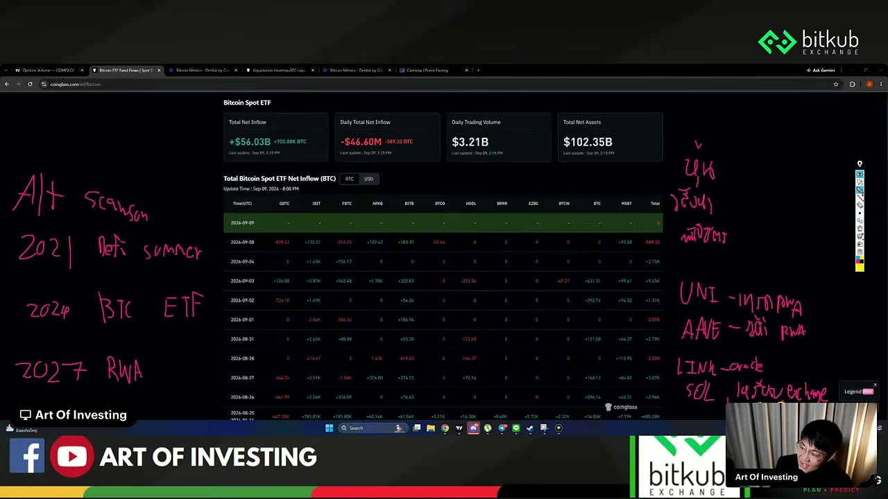

[00:25:41] เรื่องเนี้ยมันทำงานตลอดเลยนะไอ้ทฤษฎีที่ คนชอบแซวคุณพิชัยจาวล้าแต่มันใช้งานได้ จริงก็คือเป็นมุมมองของทฤษฎีผลประโยชน์ คุณจำได้มั้ยว่า 21 อ่ะทุกคนท่องเลยว่า แบบรอoutซีซัเดี๋ยวรวยoutซีซัเหรียญนึง วิ่ง 30 เด้งวิ่ง 20 เด้งโซโน่าจากไม่ถึง ดอนวิ่งไป 200 ดอนอยากรวยต้องรอoutซีซั อ่ะมันเป็นภาพนั้นถูกมั้ยพอมา 2024 คนก็ จะต้องรอoutซีซัอีกเฮ้ย infra ยังต้องมา เว้ยเฮ้ยบitcoin EGF ผ่านแล้วแบบนี้มัน ต้องพาทั้งตลาดคริปโตวิ่งเลยใช่มั้ยแบบโต มหาศาลสุดท้ายไม่มา วิ่งมากสุดคือบitcoinที่แบบperformอร์มใน ตลาดแล้วดูดีที่สุด 202 อ่ะคนก็อาจจะคิด ว่าเอ้ยคริปตโตเนี่ยอ่ะลองเราลองมองภาพ กลับดิ คนก็จะมองว่าเฮ้ยคริปโตอ่ะมันตายแล้ว out คอยอ่ะโปรเจคเนี่ย สร้างมามันเหมือน Startup อ่ะเงินเ้าไปลง AI หมดแล้วเราดูดิOutcoinัอย่างเงี้ยอ่ะ ขึ้นมาเพราะอะไรเพราะRobinฮoodถูกป่ะ แล้วRobinฮoodอ่ะมันใช้

[00:26:43] เทคโนโลยีของในการสร้างChaนเป็น On etherium  Mainnet อีกทีนึงbitัก็เลยได้ กระแสวิ่งขึ้นมาเด้งกว่าละนะครับยูิอย่าง เงี้ยก็เด้งกว่าละนะครับเออผมเลยมองว่า มันก็จะเป็นอย่างเงี้ยพอคนคิดว่า Outcoin ตายแล้วรอบนี้รอโฟกัสแค่บitคinดีกว่า outcoin ก็เลยจะวิ่งนะครับมันจะสลับ อย่างเงี้ย กลิ่นของเงินเนี่ยครับมันจะไปสู่ส่วนน้อย ของตลาดเสมอผมก็เลยมองว่า รอบเนี้ยเอา Outcoin คอยกลับมาน่าสนใจอีก ครั้งสำหรับผมนะแต่ว่าผมจะลงน้อยหน่อยนะ ครับผมผมอาจจะไม่ได้ลงหนักเท่ากับไซเคิล กันก่อนๆเพราะว่าผมกังวล สภาพคล่องของตลาดในในรอบเนี้ยผมอาจจะเป็น นักลงทุนใจปอตก็ได้นะครับเพราะว่าผมลง หนักสุดคือบitคinเพราะว่าผมรู้สึกว่า อีเวน์มันใหญ่ไปแล้วก็เราเจอประธานธิบดี ที่ผมว่าบ้าที่สุดในประวัติศาสตร์คนนึงนะ ครับเป็นคนแบบเปลี่ยนคำพูดไปมาได้มากที่ สุดคนนึงแล้วกันนะครับอีเวentใหญ่เดือน

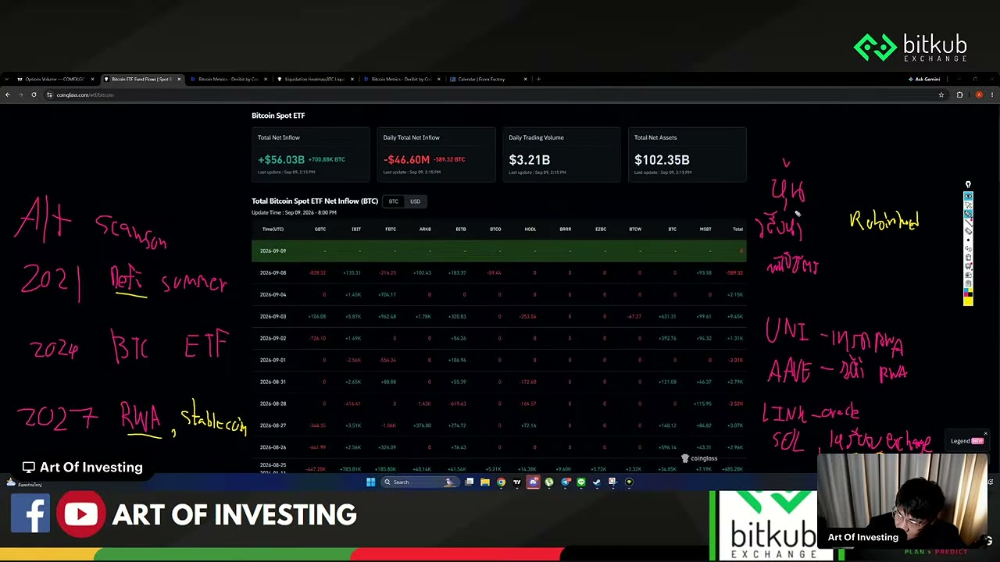

[00:27:46] เนี้ยแล้วก็เลือกตั้งกลางเทอมไปจนถึงต้น ปีหน้าหรือไตรมาสแรกอ่ะผมก็เลยมองว่าตลาด อ่ะมันความผันผวนมันน่าจะสูงบitcoinอ่ะ เราเห็นระยะกรอบการวิ่งอยู่แล้วอ่ะมันก็ เลยวางแผนไม่ยากแต่ว่า Outcoin อ่ะครับ เรารู้อยู่แล้วว่าถ้าเกิดเงินมันไหลออก จากตลาดทีนึงอ่ะมันหนักมากแล้วยิ่งตลาด มันขึ้นมาเร็วเราเห็นมั้ยว่าช่วงแรกอ่ะ ที่ตลาดมันวิ่งจาก 64,000 ขึ้นมา 79,000 อ่ะช็อตแรกที่มันย่อจาก 79,000 ไป 76,000 อ่ะนะครับคอยบางตัวลงแบบ 10 กว่าเปอ์ 20% เพราะว่ามัน leverage เยอะครับแล้วมันโดน คำสั่ง liquidate อ่ะทีเนี้ยเนี่ยผมจะ อธิบายให้ทุกคนฟังว่าทำไมเค้าไอ้พวกนัก วิเคราะห์ที่ชอบพูดกันเนี่ยว่าเอ่อ liquidate แล้วเกิด force  buy liquidate แล้วเกิด force  sal liquidate แล้วทำไมเปิดไป reject อ่ะ เดี๋ผมจะอธิบายให้ฟังนะครับว่าการ liquidate คืออะไรทีเนี้ยครับสมมุติว่า เอ่อคุณเปิดรองถูกป่ะมันก็เหมือนกับคุณไป กู้ exchange เพื่อมาใช้เงินเพิ่มในการ ซื้อสินทรัพย์นั้นนะครับทีเนี้ยมันก็จะมี

[00:28:47] stop  loss อยู่ถ้าเกิดคุณเทรด future ถูกนะ งั้นพอราคาครับมันดิ่งลงมาถูกป่ะ ปึ้งมันก็จะไป trigger  stop  loss ของ 1 คนซึ่งไอ้ 1 คนนั้นน่ะมันก็จะโดนบังคับ ขายถูกมั้ยคือเเรากู้มาเนี่ยเรามองว่า ราคามันจะขึ้นแต่ว่ามันถึงจุดที่โดน บังคับขายแล้วมันก็เลยจะต้องขายตลาดพอขาย ตลาดราคามันก็ลงอีกมันก็ไปโดน Stop  Loss ของคนต่อไปอีกก็โดนโดนๆโดนอีกครับทีเนี้ย ไอ้คอยอ่ะมันเลยลงอย่างงี้ฟืดแล้วเด้ง กลับที่เดิมผมถึงบอกว่าฮะถ้าเจอภาพแบบ เนี้ยแบบที่ผมอธิบายไปคราวที่แล้วแต่ อันนี้ยผมอยากอธิบายให้เห็นภาพมากขึ้นถ้า เจอภาพแบบเนี้ยให้ทำความเข้าใจเลยว่า เนี่ยคือการโดน Force  buy เอ่อขออภัย ForceซนะครับการโดนForceซล ตรงนี้ ทีเนี้ยถ้าเกิดคุณเล่นฝั่งช็อต

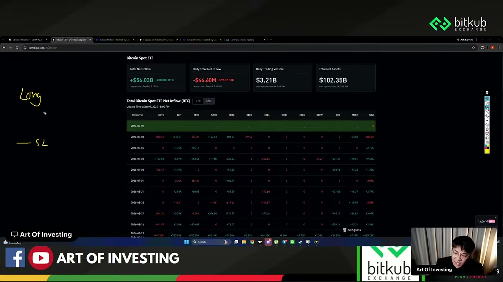

[00:29:50] ช็อตเนี่ยมันเหมือนกับคุณขายก่อนแล้วซื้อ คืนทีหลังพูดแบบนี้อาจจะงงอ่ะสมมุตินะผม อ่ะเอ่อ มองว่าเดี๋ยวราคาน่าจะลงสมมุติว่าผมมี รีโมทแอร์ผมแล้วกันอ่ะรีโมทแอร์ผมอันนี้ ตอนเนี้ยมันราคา 10,000 บาทผมมองว่าอีก 3 วันเนี่ยมันน่าจะเหลือ 7,000 ผมก็เลยเอา อันเนี้ยไปขายก่อนที่ 10,000 แต่ว่าผมให้ เป็นสัญญาก่อนว่าผมขายแล้วผมบอกว่าเดี๋ยว ผมไปหาของก่อนเดี๋ยวอีก 3 วันผมเอารีโมท แอร์มาให้เพราะว่าผมมองว่ารีโมทแอร์มันจะ ลงตามทันมั้ยก็คือแบบอ่ะสมมุติว่าคุณคุย กับผมอ่ะ คุณคุยกับผมอ่ะเอ้ยอาจารย์อาร์ตผมว่า รีโมทแอร์เนี่ยราคาน่าจะลงว่ะผมเซ็น สัญญาขายกับอาจารย์ก่อนนะเดี๋ยวผมไปวิ่ง หารีโมทแอร์มาให้ตอนราคาลงเดี๋ยวผมซื้อ เมื่อคืนฉะนั้นถ้าเกิดราคามันลงจริงไปที่ 7,000 ผมก็ไปซื้อรีโมทแอร์มาแล้วก็เอา เอาของมาให้อ่ะเนี่ยให้แล้วผมกำไรเท่า

[00:30:52] ไหร่ผมไปซื้อมา 7,000 แต่ผมเซ็นสัญญาไป แล้วผมขาย 10,000 นึงผมกำไร 3,000 งั้น มันเลยทำให้เวลาที่มันเด้งขึ้นไปอ่ะเรา เลยเรียกว่า Force  buy อ่าถูกมยเพราะว่า Stop  Loss เขาจะต้องอยู่ตรงนี้เพราะว่า เค้าค[เสียงสูดหายใจ] มองว่าราคามันจะต้องลงแล้วเขาค่อยไปซื้อ เอาของจริงๆอ่ะมาคืนนะนะครับคือเราใช้ เงิน Exchange ขายก่อนแล้วเดี๋ยวเฮ้ย Binance  OKX  Buy  Bit อะไรก็แล้วแต่ Bit  Cup อ่ะสมมุตินะเทรด Future ได้ะ เดี๋ยวเหรียญตรงเนี้ยราคาน่าจะลงยืมเงิน มาขายหน่อยแล้วเดี๋ยวไปซื้อคืนให้ตอนราคา มันลงนะครับถ้าราคามันลงไปอ่ะแล้วเราปิด ก็เท่ากับว่าเราได้ราคานี้ได้ของตรงนี้มา ขายที่ราคาด้านบนโอเคไม้ช็อตคุณกำไรแต่ ถ้าเกิดมันไปtriกอ stop  loss นะครับ ช็อตมันคือต้องรอรอซื้อถูกป่ะช็อตมันคือ ต้องรอซื้อถูกป่ะทีเนี้ยซื้อไม่ได้แล้ว เพราะมันถึงจุดสัญญาแล้วว่าเฮ้ยแต่ถ้า

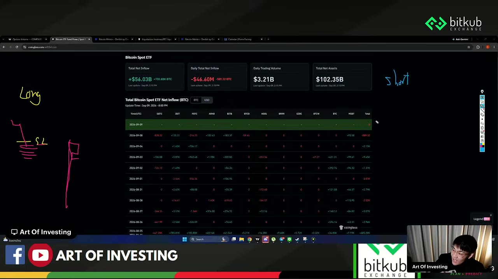

[00:31:54] ราคามันขึ้นเกินตรงเนี้ยมึงต้องขายนะมัน ก็เลยเกิดคำสั่ง Force  buy พอคนนึงโดน Force  buy  Force  buy คือ อะไรมึงบอกมึงจะซื้อไงอ่ะเนี่ยมันขึ้นมา 12,000 ะสัญญามันหมดสิทธิ์ละมึงต้องซื้อ เลยที่ 12,000 ก็เท่ากับผมขาดทุน 2,000 ถูกป่ะผมก็ดูโดนบังคับซื้อที่ 12,000 ขึ้นไปชน Stop  Loss คนต่อไปอีกก็ 12,000  10,000  13,000  14,000 มันก็ ขึ้นไปเงี้ยฟิ้วแล้วแท่งออกมากดลงมาอย่าง งี้อันเนี้ยคือคำสั่งที่เราเรียกว่า Force by นี่คือการ liquidate ครับที่ทำไม ลิquidateฝั่งรองราคาถึงลงก่อนแล้ว ดีดกลับที่เดิมเฮ้ยแล้วทำไมฝั่งช่อย กลับลงมาที่เดิมเค้าถึงเรียกว่า long squeeze กับ short  squeeze เห็นภาพมั้ย อ่ะใครใครเก็กด 1 หน่อยครับใครใครไม่ทัน ก็ว่าอ่ะเก็ทมั้ยผมพยายามจะอธิบายให้มัน

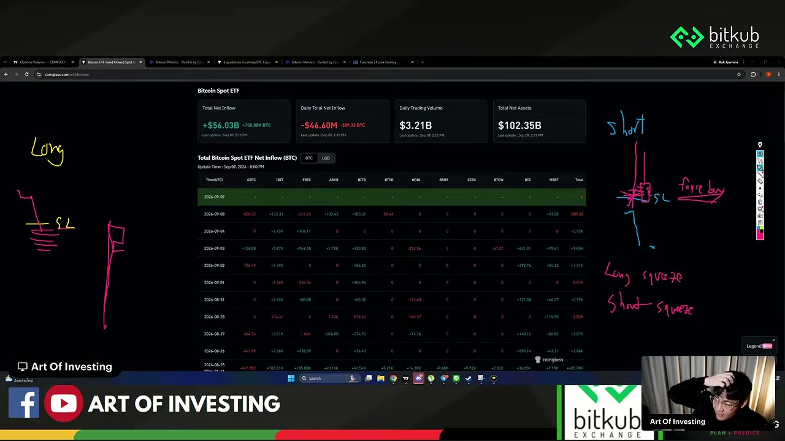

[00:32:56] เข้าใจง่ายที่สุดนะครับ ใครใครเก็ทกด 1 หน่อย

[00:33:18] ยูิสวยจริงใช่ครับ off  of  salary สวัสดีครับทรัสวัสดีครับ 42 มีเวอร์ชั่น อาจารย์ว่ารอดมั้ครับโอ้อย่าดีกว่าครับ มันมันโวสูงงั้นน่ะไปรอ 3d เลยดีกว่าครับ ไม่งั้นเดี๋เจอแฟทเทลนะนะครับ อธิบายไม้ทองได้ครับแต่ว่าเดี๋ยวผมให้ อาจารย์ให้เครดิตจาน M นะจาน M จาน A นะ ว่าผมเอาศาสตร์นี้มาจากเค้า 2 คน เอ่อทีนี้พอเราไปดูกราฟจริงอ่ะอ่ะเดี๋ยว ผมผมจะเปิดกราฟจริงให้ดู อย่างตอนนั้นน่ะผมดูอยู่ตัวนึงคือไบโอ นะครับมันเป็นอย่างี้เลย เนี่ยเห็นป่ะเนี่ยเนี่ยเนี่ยตอนนั้นน่ะผม นั่งดูอยู่เลยมันน่าจะประมาณเที่ยงๆเนี่ย เห็นมั้ย 11:00 น.ผมจำเวลาได้เลยเนี่ยคุณ ดูดิว่ามันลงเท่าไหร่ เนี่ยคุณดูดิ 18% น่ะนะครับแล้วมันเด้ง กลับที่เดิมอ่ะเรามาดูtimeมfrฟมเล็กๆผมจำ ภาพได้แม่นเลยวันนั้นน่ะเพราะว่าผมกำลัง จะออกไปหารุ่นพี่คนนึงนะครับไปดูโปรเจค

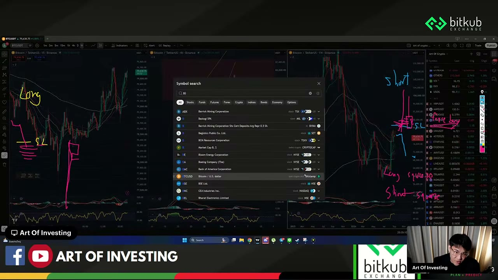

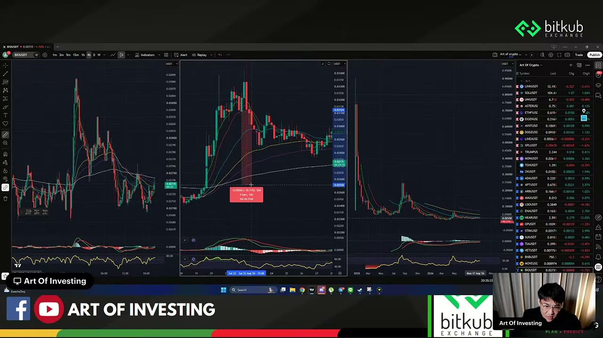

[00:34:19] กันชื่อพี่เต้นะครับพี่เต้ช่องสีสยามนี่ แหละอ่ะเดี๋ยวๆนี่ๆๆๆๆนี่ๆๆเห็นมั้ยเห็น นี่เนี่ยคือภาพของการโดนForceซลนะครับคือ ไม้รอง force  sal ปื๊ดเอ้ยคุณอาร์ตแล้ว มันลงมาขนาดนี้แล้วอ่ะแล้วแล้วทำไมมันถึง ต้องเด้งกลับขึ้นไปแรงๆด้วยก่อนถึงจะลง ต่ออ่ะทีนี้มันเป็นอย่างี้ครับพอตลาด เนี่ยมันโดนไอ้ตรงเนี้ยคือคนมันไม่ได้ อยากขายจริงๆแต่มันโดนบังคับขายเพราะมัน ทริกเกอร์ถูกมั้ฉะนั้นมันเป็นการบังคับ บังคับบังคับบังคับบังคับบังคับบังคับ บังคับบังคับพอมันบังคับจนคำสั่งที่มัน สามารถโดนบังคับขายได้หมดอ่ะมันก็เลยไม่ มีคำสั่งกดตลาดแล้วมันก็เลยรีบาวขึ้นมา ก่อนทีเนี้ยอย่างที่ผมบอกอย่างนักเรียนผม อ่ะผมมักจะพูดว่าถ้าเกิดตลาดเทรนด์มัน เป็นทางไหนอ่ะ มันมักจะลงไปหาไส้นะบางคนจะคิดตีความว่า ไส้อ่ะคือการรีเจคถูกป่ะอย่างเงี้ยเอ้ย เดี๋มันจะต้องวิ่งขึ้นทางเดิมที่เค้าที่ เค้าสอนกันน่ะเฮ้ยเนี่ย Price  action

[00:35:21] เราเรียก pin  barmer เราเรียก Morning Star เราเรียกอะไรก็แล้วแต่นะครับ Double Piercing  Twin  Rails อ่ะชื่อหลากหลาย เราต้องแยกก่อนว่าไอ้ไอ้ price  action ตรงนั้นน่ะมันเกิดมาเพราะอะไรถ้าเกิดมัน เกิดมาเพราะว่า โดน force  sal แบบเนี้ยครับผมมองว่าผมผม ไม่ผมไม่นับมันว่ามันคือแรงซื้อถูกป่ะมัน ไม่ใช่แรงซื้อนะแต่มันคือคนโดนบังคับขาย อ่ะมันหมดแล้วมันเลยกลับมาเหลือแต่คนที่ มีของจริงๆเท่านั้นเฉยๆมันเลยมันเลยกลับ มาที่เดิมฉะนั้นอันเนี้ยเราตีความว่าแรง ซื้อไม่ได้ เห็นป่ะเราตีความว่าแรงซื้อไม่ได้ มันเป็นแรงที่คนโดน Stop  Loss มันหมด แล้วเฉยๆมันก็เลยดีดกลับที่เดิม แต่กลับกันถ้าเกิดมันขึ้นมาอย่างงี้ปึ๊ก แล้วปิดลงมาอย่างงี้อ้าวเฮ้ยอันนี้ทำไม เทรดได้ถ้าเกิดเราไปใช้ในทองหรือโซน Bitcoin ที่มันมี option เยอะๆอ๋อราย

[00:36:23] ใหญ่มัน settlement เพราะ OI เนี่ยคือ Open  Interest หรือ เห็นมั้ถ้าแปลตรงตัวเปิดความสนใจอ่ะถ้า แปลตรงตัวนะเปิดความสนใจก็คือแต่ถ้าจริงๆ แล้วอ่ะมันคือสัญญาที่ยังไม่ถูกคิดเงินนะ มันคือสัญญาที่ยังไม่ถูกคิดเงินพอมันเป็น สัญญาที่ยังไม่ถูกคิดเงินน่ะเมื่อราคามัน ไปถึง strike  price ตรงนั้นที่เค้ากำไร อ่าสำหรับคนที่มองคอค buy สมมุตินะคนที่ มองว่าราคาจะขึ้นไม่ถึงเค้ากำไรแล้วเค้า อยากจะ settlement หรือรายใหญ่ที่เค้า H อยู่มันเริ่มเป็นสัญญาณปิดเค้าก็ปิด Settle พร้อมกันแบบเนี้ยมันคือแรงขายที่ เรียกว่านหรือSupัlyที่เกิดบนตลาดของจริง เพราะไปถึงโซนที่คนวางอtionัไว้เยอะเฮ้ย ถึงละกำไรละปิดทำกำไรดีกว่าแล้วมันดีดลง มางี้อันเนี้ยเราถึงนับว่ามันเป็นรีเจค

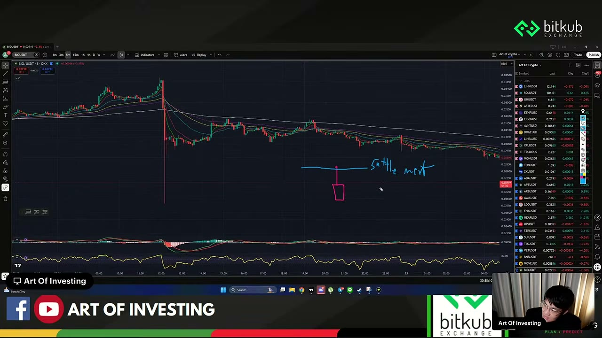

[00:37:26] นะครับเราถึงนับว่ามันเป็นรีเจect แต่อันเนี้ยไม่ใช่ อันเนี้ยมันคือการโดน Force  liquidate หรือ force  sal นะครับแล้วเราเราเลยต้อง แยกด้วย ทีเนี้ยเกิดคำถามะคุณอาร์ตแล้วจะดูยังไง นั่นคือเหตุผลที่หลังๆอ่ะผมชอบ OI ไง เพราะว่าฟิวเจอร์คุณตอบได้หรอว่าอันเนี้ย เค้าเปิดทำกำไรเค้าแทงลงเค้าแทงขึ้นหรือ เขาโดน Stop  Loss เราตอบไม่ได้เราดูได้ แค่ Liquidation  Heat  Map แล้วก็เดาถูก ป่ะแต่โอ OI อ่ะมันเห็นว่ามันมีสัญญาตรง นั้นฉะนั้นถ้ามันไปเกิด Price  Action พอ ดีกับที่สัญญาเราตีความได้ว่าไอ้ price action ตรงเนี้อ๋อมันไม่ใช่โดน liquidate แต่เขาปิดทำกำไร หรือปิด H ถูกมั้ยฉะนั้นน่ะ ผมเลยชอบ OI แล้วล่าสุดอ่ะ OI มันเยอะสุด เยอะสุดที่ 8,000 ตรงเนี้ยมันก็เลยจะมีโอกาสที่จะพุ่งนะ ครับถ้าเกิดเบรคได้แล้วโอกาสเบรคได้ก็

[00:38:28] น้อยโอกาสเบรคได้น้อยกว่าเบรกไม่ได้นะ ครับอ่ะเดี๋ยวจะอธิบายให้ฟังว่าทำไมนะ ครับ[เสียงสูดหายใจ]อ่ะนี่ก็เด้งขึ้นมา แล้วะเอ่อไหนๆดูไบโอแล้วขอมองด้วยเดี๋ยวๆ วิเคราะห์บitcoinก่อนครับเดี๋ยวผมขอ วิเคราะหบitคinก่อนเนาะฉะนั้นเนี่ยเรา อธิบายยาวๆไปอย่างนี้แล้วเนี่ยไม่รู้ เพื่อนๆชอบแล้วนะไม่รู้ว่าคนช่องนี้ชอบ ฟังอะไรยากๆ[เสียงหัวเราะ]หรือเปล่านะ ครับอาจจะแบบเอ้ยไอ้ตี๋ใส่แว่นมึงมาถึง มึงวิเคราะห์ราคาดิวะกูอยากรู้แนวรับแนว ต้านมึงจะอธิบายพวกนี้ให้กูฟังทำไมมึง เริ่มได้แล้วหรือว่าชอบกันผมก็ไม่รู้นะ เออถ้าชอบก็พิมพ์บอกผมหน่อยนะครับเพราะ ว่าผมก็อยากรู้นะว่าแบบเฮ้ยไอ้คนที่มัน ฟังผมอยู่เนี่ย 170 คนเนี่ยมันชอบหรือ เปล่าวะหรือมันแค่อยากมาดูเฮ้ยตี๋มึง วิเคราะห์ดิแนวรับแนวต้านอยู่ไหนอะไร อย่างเงี้ยอ่ะทีนี้อธิบายต่อ มาที่ตรงนี้นะครับคืองั้นเราก็เลยเห็นไง ผมก็เลยบอกว่างั้น 8,000 อ่ะมันเป็นโซน

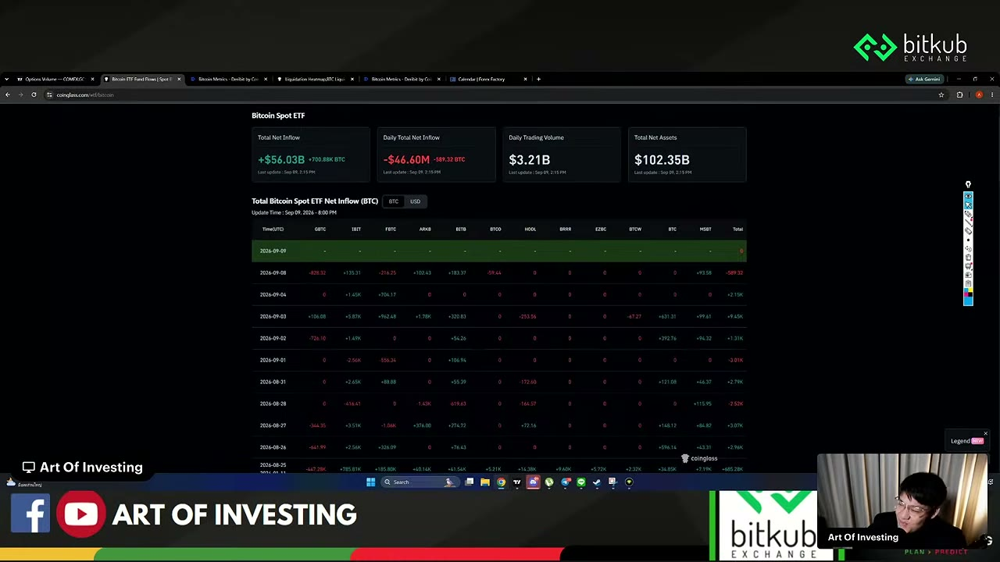

[00:39:28] ที่มีคน 2 กลุ่มนะครับคือรายใหญ่เนี่ย เค้าจะต้องแทงสวนอยู่แล้วไม่ใช่ว่าเค้า เท่แต่พอเค้าเงินเยอะมันง่ายกว่าสมมุติ ว่ามีคนมองว่าราคาเนี่ยนะครับสมมุติว่ามี คนมองว่าราคาเนี่ยมัน น่าจะถึง 8,000 ทีเนี้ยครับเวลาสมมุติว่าเราจะมองมุมมอง ฝั่งขึ้นของ option ใช่ป่ะมันจะต้องมี ฝั่ง call กับคซล นะครับ เพราะว่ามันมันจะต้องมีคนไปขายมันเหมือน กับคุณแทงกับผมอ่ะอ่ะสมมุตินะว่าคุณ กัญยพัก์อ่ะอ่านชื่อพอดีขอยืมมายกตัว อย่างหน่อยคุณกัญญพัก์บอกว่าเอ้ยคุณอาร์ต ถึงแน่ 8,000 ทะลุแน่ผมบอกเอ้ยไม่ไม่ทะลุ หรอกมั้งแต่ว่าถ้าเราพูดปากๆมันไม่ได้ อะไรใช่มั้อ่ะงั้นวางเงินไงนะเอางี้คุณ กันให้ผม

[00:40:30] 100 อ่ะไม่ใช่คุณกันให้ผมค่าสัญญา คุณกันให้ผม 20 บาทแล้วเดี๋ยวถ้ามันทะลุ จริงๆอ่ะเดี๋ยวผมให้ 20 บาทพวกเนี้ยบวก กำไรคุณกันน่ะทบคืนด้วยอ้าฉะนั้นน่ะผมอ่ะ คือฝั่งที่คอเซลละผมบอกว่าเอ้ยไม่ถึงหรอก แต่ว่าไอ้ฝั่งเนี้ยมันจะได้เงินจากคบาย ทันทีเราเรียกว่าค่าพรีเมี่ม ก็คือค่าเปิดสัญญา นึกออกมั้ครับเป็นเป็นค่าเปิดสัญญาเข้า กระเป๋าผมแล้ว 20 บาททีเนี้ยคุณคิดว่าราย ใหญ่อ่ะเค้าชอบความชัวร์หรือเขาชอบกำไร แบบเยอะๆอ่ะคุณนึกภาพง่ายๆลายใหญ่เนี่ย มีโคตรเครื่องมือมี ซุเปอร์คอมพิวเตอร์แล้วตั้งอยู่ใกล้ Silิิคอนวอลย์กันหมดเพราะว่าเขาใช้ระบบ HFT เดี๋ยวอธิบายให้ฟังต่อ High Frequency  Trading ที่รายย่อยไม่มีทาง ทำได้เพราะต้นทุนหลายร้อยล้านนะครับ พวกเา้ากินแบบเศษเปอร์เซ็นต์น่ะแต่เขากิน

[00:41:31] ถี่แล้วกินบ่อยแล้วเขาก็เอาไปปันผล ให้กับลูกค้าแล้วเขาก็กินส่วนต่างถูกมั้ย ฉะนั้นน่ะเขาไม่ได้ต้องการแทงขึ้นแทงลง ให้ชัวร์เค้าต้องการ make ชัวร์ว่าค่า พรีเมี่มเนี้ยยังจะอยู่ในกระเป๋าเค้าเค้า ก็เลยต้องอันเนี้ยจริงๆผมเคยสอนไปแล้ว เดี๋ยวอธิบายให้ฟังเพิ่มเค้าก็เลยต้อง นะครับเพื่อที่จะ make ชัวร์ว่า 20 บาท เนี้ยต้องอยู่กับผมงั้นสมมุติว่าผมพนัง กับคุณกัญยพไปละว่าเฮ้ยผมว่าไม่เบรคหรอก 8,000 ผมได้ 20 บาทละผมก็ไปสมมุติว่าคุณ บอยเนี่ยแจกเป็นตั๋วอ่ะใครว่าบitคinขึ้น ซื้อตั๋วได้เลย 20 บาทนะครับซื้อตั๋วได้ เลย 20 บาท ผมก็ไปซื้อตั๋วกับคุณบอยเพิ่มผมก็คำนวณ แล้วว่าถ้าเกิดหักหักล้างกันระหว่างสัญญา ที่ผมทำกับคุณบอยอยู่กับคุณกัญยพัก์อยู่ หักล้างกันแล้วผมจะเหลือ 20 บาทที่เป็น ค่าพรีเมี่มเหมือนเดิมซึ่งไอ้สัญญาที่ผม กำลังไปซื้อกับคุณบอยเพิ่มอ่ะคือสิ่งที่ เรียกว่า Future

[00:42:34] งั้นผมค Sale  Option แล้วผมลองฟิวเจอร์ อ้าเพื่อให้ผมเนี่ยได้กิน 20 บาทชัวร์ เฮ้ยถ้ามันทะลุ 8,000 ผมก็เอากำไรให้คุณ กัญพ์ไปดิผมก็เสียแล้วแต่ว่าผมก็ได้เหต จากตรงนี้ทดแทนนะครับอ่ะขออภัยมันจะมี ทั้ง long กับ short  future นะครับถ้าใน ภาษา forx จะเรียก buy กับเซลล์ถูกป่ะอ่ะ ประมาณนี้งั้นสิ่งที่จะเกิดขึ้นน่ะคือถ้า เกิดราคานะครับทำไมถ้าเบรค 8,000 แล้วมัน มีโอกาสจะพรวด ซึ่งมันเกิดมาแล้วตอน 72,000 แล้วมันพรวด ไป 75,000 เลยผมเขียนบทความไว้ในเพจจำได้ มั้ยนะครับตอน 7,000  000 แล้วพวดไป 75,000 เพราะมันเป็นแบบเนี้ยครับเสาที่ 72,000 มันสูงมากแล้วเสาหลังจากนั้นน่ะ มันโพล้เพ นะครับเพราะว่ารายใหญ่อ่ะมันเหจตรงนี้ไว้ เยอะแล้วคุณนึกภาพว่าถ้าเกิดว่าเค้าวาง

[00:43:34] สมการไว้แล้วว่ากำไรจากคนนี้ขาดทุนจากคน นี้หักล้างกันเหลือ 20 บาทถ้าทะลุไปอ่ะ มันไม่มันไม่เป็นสมการที่หักล้างกันแล้ว เหลือ 0 แล้วเค้าจะต้องไปรีบซื้อหรือขาย ฟิวเจอร์เพิ่มเพื่อให้พอร์ตกลับมามีค่า เท่า 0 งั้นผมจะรีบโทรหาคุณบอยเลยเฮ้ยคุณบอยบอย ผมซื้อเพิ่มหน่อยซื้อสัญญาเพิ่มหน่อยนั่น คือสิ่งที่เรียกว่า Gamma  Squ อะไรไว้สอนแล้ว[เสียงหัวเราะ] นะครับนั่นคือสิ่งที่เรียกว่าแกมma Squ นึกออกมั้ยพอมันทะลุ 8,000 เนี่ยรายใหญ่ ทุกคนที่เหจอยู่อ่ะก็จะต้องเฮ้ย ร้องลองๆทุกคนแย่งกันลองราคามันก็เลยจะ พวดครับแต่ว่าถ้าเกิดมันไม่สามารถทะลุได้ ก็คือคุณกพักบอกเอ้ยพอใจละ 8,000 เลย หน่อยๆปิดอชัทำกำไรก่อนนะครับรายใหญ่อ้าว มันเหตุอยู่นี่งั้นฝั่งนี้ปิดฝั่งนี้ก็ ปิดนะครับมันก็เลยจะสะท้อนกลับมันก็เลยจะ

[00:44:34] เป็นอย่างี้สำหรับเสาตัวของ OI  Bitcoin เราเอามาดูแบบนี้ได้ประมาณนึงนะครับว่า ถ้าเกิด เอ่อถ้าเกิดมัน ไม่ทะลุ 8,000 ก็น่าจะสะท้อนกลับมาอยู่ใน กรอบแต่ว่าถ้าทะลุเนี่ยก็มีโอกาสพรวดนะ ครับพรวดไปเลยนะครับก็อาจจะวิ่ง 1000 2,000 ดอนน่ะนะครับทะลุไปนะครับถ้าสัญญา หมดจะเป็นยังไงต่อเลยล่ะครับบังคับบังคับ settim ครับคุณพิชยุทธ นะครับบังคับ settim ครับ ก็คือราคาอยู่ไหนไม่รู้มันบังคับตรงนั้น เลยคุณกำไรหรือขาดทุนมันบังคับปิดตรงนั้น เลยไอ้ตรงนั้นน่ะมันคือ สัญญาหมดอายุหรือ expiry นะครับ โหแม่นจัดร่วงแล้วออไม่หรอครับคุณแบงค์ผม ก็คำนวณคร่าวๆนะครับผมยังถือไม่ถึงเลยผม ปิดตั้งแต่ 4417  4418 แล้วเมื่อกี้เพราะ ว่าผมไลฟ์ไปด้วยไงผมก็ไม่กล้าเฝ้าไปไลฟ์ ไปนะครับผมกะแล้วว่ามันมีลุ้นวิ่งไปถึง

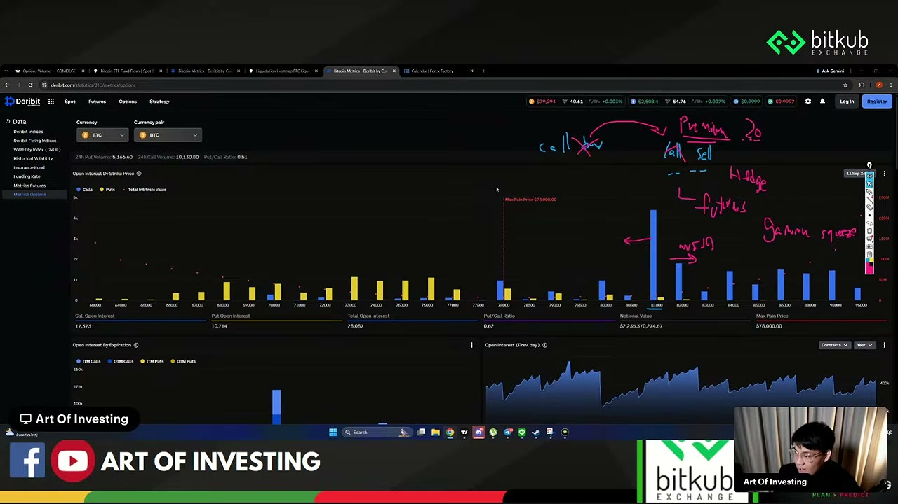

[00:45:38] ซัก 45  4427  4426 เออมันมันไปถึง 4433 3 [เสียงสูดหายใจ] สิ่งที่อาจารย์อาร์ตไม่ชอบตอนเทรด Deltive Warance กับ Option ในตลาดหุ้นไทยอันนี้ พูดตรงๆเลยเนาะคุณวรรณโชค 1  Deltive Warance มี Time  DK ซึ่งเยอะแล้วก็ Gearing แต่ละตัวไม่เท่ากันอย่างสมมุติ ว่าผมมีเครื่องมือที่เรียกว่า Futures อ่ะผมสามารถลองกับช็อตได้เลยอ่าที่ณราคา นั้นเลยแต่ว่าถ้าเกิดผมจะเทรด DW Derctive  Warrant ในหุ้นไทยผมต้องไปกาง Warant  Trable ว่าซื้อตัวไหนมีอัตราทด เท่าไหร่ซื้อตัวไหนได้เกียร์แรงคือคูณ เยอะซื้อตัวไหนมี Time หนักตัวไหนหมดอายุ วันไหนผมต้องดูเยอะนี่คือข้อแรกที่ผมไม่ ชอบแล้วหลังจากนั้นเขาก็มีระบบ Single Stock เพิ่มขึ้นมา 2 อtionัในตลาดหุ้น ไทยที่ผมอาจจะไม่ได้สันทัดแล้วกันผมมอง ว่าสภาพคล่องมันน้อย นะครับเทียบกับตลาดหุ้นอเมริกาแล้วเป็นคำ

[00:46:38] ถามที่ดีมากคุณโชคแล้วนี่คืออีกหนึ่งเหตุ เหตุผลที่เสาอาจจะไม่เป๊ะ เพราะว่าถ้าให้คุณเลือกคุณเป็นรายใหญ่นะ ตอนเนี้ย เอ่อผมให้เทียบอย่างงี้สมมุติว่าทองคำคือ บอลโลก นะครับ แล้วตลาดบitคinเนี่ยคือพรีเมียร์ลีกมัน ใหญ่ไปมั้ลาลีก้าแล้วกันลีก้าแล้วกันนะ ครับสมมุติว่าทองคำอ่ะมันคือฟุตบอลโลกเลย แต่ว่าบitcoinอ่ะคือลีก้าถ้าเกิดคุณเป็น รายใหญ่ที่คุณไม่ได้สนใจว่าตัวไหนจะขึ้น แรงเท่าไหร่คุณสนใจแค่ว่าคนที่อยู่ แทงขึ้นแทงลงอ่ะ จะเยอะแค่ไหนเพราะคุณจะได้จับชนกันง่าย นึกออกมั้ยงั้นรายใหญ่ทุกวันเนี้ยเค้ายัง

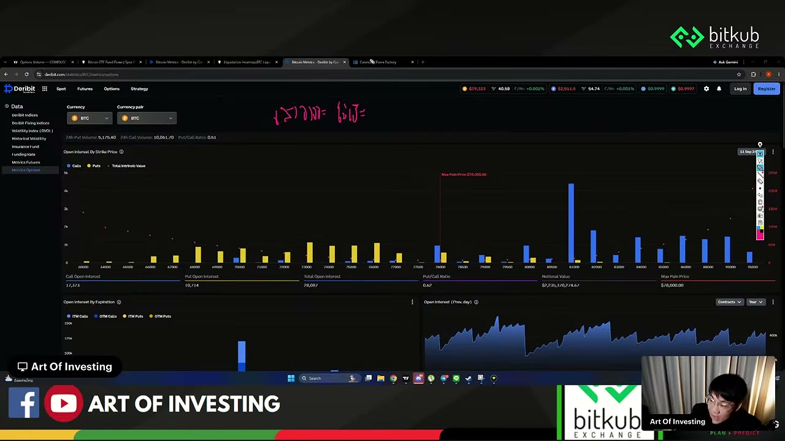

[00:47:39] เลือกเหตแล้วกินค่าพรีเมี่มในทองคำมาก กว่าอยู่ครับในบitcoinอ่ะผมเลยมองว่าเท่า ๆที่เก็บ data มาแล้วทำ data  science นะ ครับคร่าวๆเนาะเพราะว่าผมก็ไม่ได้จบ Financial  Engineering มาโดยตรงนะผมจบ Computer  Engineering มานะครับ มันยังมีคนที่ใช้อtionัในการเก็งกำไรมาก กว่ารายใหญ่ที่ใช้เพื่อการเทอยู่ฉะนั้นใน ทองคำอ่ะมันอาจจะเป๊ะมากแบบใครเทรด OI แบบเห็นจาน A จาน M ไลฟ์ทุกวันน่ะMจMดอร์ อ่ะจะเห็นแล้วแบบชนปุ๊บมันปึ้งมัน settim มันเด้งปึ้งๆๆเลยเพราะว่าลายใหญ่มันเยอะ แต่นี้ได้ครับบitcoinอ่ะมันอาจจะไม่ได้ แบบชน 81 แล้วแบบปึ้งโอเคกูช็อตได้เลย อะไรอย่างเงี้ยมันไม่สามารถใช้ได้แบบนั้น เพราะว่า มันจะมีรายย่อยที่เก็งกำไรอยู่ด้วย นะครับบริษัทเป็นสัตว์ส่วนนึงในอนาคตถ้า เกิดบitคinมันใหญ่มากๆขึ้นมาอันดับ 3 อันดับ 4 อะไรเงี้ยของของสินทรัพย์โลก เงี้ยนะครับหรือมันแบบใกล้เคียงกับทองคำ

[00:48:40] มากกว่าเนี้ยแอtionัมันอาจจะเป๊ะกว่านี้ นะครับงั้นมันก็เลยอาจจะต้องใช้ผนวกกับ โมเมนตัมก็คือ สมมุตินะว่ามันไปที่ 8,000 อะไรอย่าง เงี้ยผมก็จะไม่ได้แบบหลับหูหลับตาเฮ้ยกู ดู OI มากูกูช็อตทันทีเลยเว้ยแบบไม่ต้อง ลุ้นอะไรอย่างงี้มันมันใช้แบบนั้นไม่ได้ เดี๋ยวผมอธิบายก่อนอ่ะเห็นมั้ยไบโอมันก็ ลงมาหาไส้จริงๆเห็นป่ะเนี่ยไอ้ท่าเนี้ยผม ชอบมากเลยนะครับไอ้เวลา liquidate แล้ว ดีดกลับที่เดิมอ่ะผมจะชอบลงไปหาไส้นะครับ ผมก็จะช็อตลงไปหาไส้เหมือนเดิม อธิบายอย่างงี้เมื่อกี้พูดเรื่องอะไรอีก เฮ้ยลืมจริง หายไปในอากาศอะไรเดี๋ยวนะเมื่อกี้ผมพูด เรื่องอะไรอยู่เอ้ยเฮ้ยลืม[เสียงหัวเราะ] สมองผมวึ๊บไปเลยอ่ะเออจำไม่ได้นะครับเออ เมื่อกี้เดี๋ยวๆๆเมื่อกี้ผมพูดเรื่องอะไร อ๋อโอเคจำได้แล้วถ้ามันไป 8,000 ใช่มั้ย

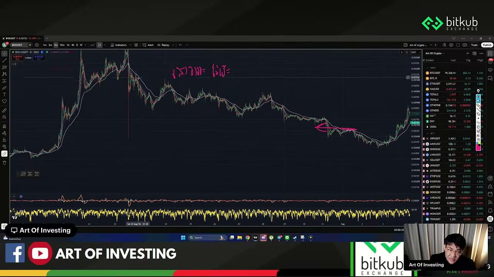

[00:49:44] โอ้โหเทเลยว่ะอ่ะเนี่ยคือภาพที่ผมอยาก เห็นนะครับภาพที่ผมอยากเห็นสมมุติว่ามัน ไป 8,000 เนี่ย พรุ่งนี้นะ 2 วันเนี้ย CPI  CPI มันอาจจะ ทะลุขึ้นไปใช่มั้ย[เสียงสูดหายใจ]นะครับ มันก็จะทำให้เอ่อ ผมอยากเห็นภาพแบบนี้ก่อนก็คือแบบเกิด แtionแบบทำ New  High ไม่ได้ขึ้นมาบออีก ทีไม่ได้อะไรเงี้ยอ่ะผมอาจจะค่อยพิจารณา ช็อตลงไปผมจะไม่เล่นจังหวะหนึ่งนะครับ เพราะว่าถ้าเกิดว่ามันไม่ได้มีรายใหญ่ Settlement มากพออย่างเงี้ยแล้วแล้วให้ เรานึกภาพคนที่เก็งกำไรอ่ะ Option นะครับ กำไรฝั่งถูกทางมันไม่จำกัดนะสมมุติว่าคุณ วาง Strike  Price ไว้ที่ 8,000 ใช่ป่ะ ยิ่งมันไปไกลกว่านั้นคุณก็ยิ่งได้กำไรนะ มันไม่ใช่นับแค่ถูกกับผิดเหมือนเหมือนแทง IQ  option  binary นะไอ้แบบนับถอยหลัง 1 นาที 5 นาทีคือคุณเสียแค่ค่าพรีเมี่มใน การเปิดสัญญาแต่ว่าถ้ามันถูกทางแล้วเลยไป อ่ะยิ่งเลยไปไกลคุณก็ยิ่งได้กำไรนะครับ

[00:50:48] เออผมเลยผมเลยอยากเห็นตรงนี้ก่อนเอ้ย สวัสดีครับขอบคุณซเปอร์ชนะครับจากคุณอ๊อด แล้วก็คุณฮาร์ดวลหาดใใหญ่ขอบคุณมากๆเลย ครับขอบคุณมากๆครับขอบคุณที่คอยสนับสนุน กันทุกไลฟ์เลยจริงๆนะครับขอบคุณมากครับ อ่ะก็คือภาพแบบนี้ผมก็อาจจะแบบเออพิจารณา ว่ามันน่าจะเด้งลงมาหาตรงกลางของของกรอบ และนะครับผมดูตรงนี้อยู่ภาพแบบนี้นะครับ อ่ะเนี่ยผมก็จะใช้แบบเนี้ยเส้นเช่นผม สมมุติว่าผมเห็นกรอบตอนนี้มันก็ยังไม่ ค่อยมีPวallเนาะนะครับฉะนั้นเนี่ยถ้าเกิด มันมีPวallคือราคามันย่อหนักๆมาที่เท่า ไหร่แล้วสมมุติว่าเสามันงอกอ่ะสมมุติ 76,000 เงี้ยอ่ะผมก็อาจจะดูแล้วว่าเรา เล่นได้หลายท่ามากเลยถูกป่ะเพราะว่าถ้า เกิดมันมีโมเมนตัมให้ช็อตอ่ะงั้น ผมก็สามารถมองมันไปจุด TP เฮ้ยใกล้ๆ 76,000 กูปิดก่อนเว้ยแถวนั้นในกราฟมีมาน อะไรป่าวะอ่ะเฮ้ยสัก 77  7,000  500 ชิง หนีออกก่อนแล้วอะไรอย่างเงี้ยหรือผมก็ดู ได้ว่าถ้าเสาร์นี้มันมันแฟบแล้วมันไปงอก

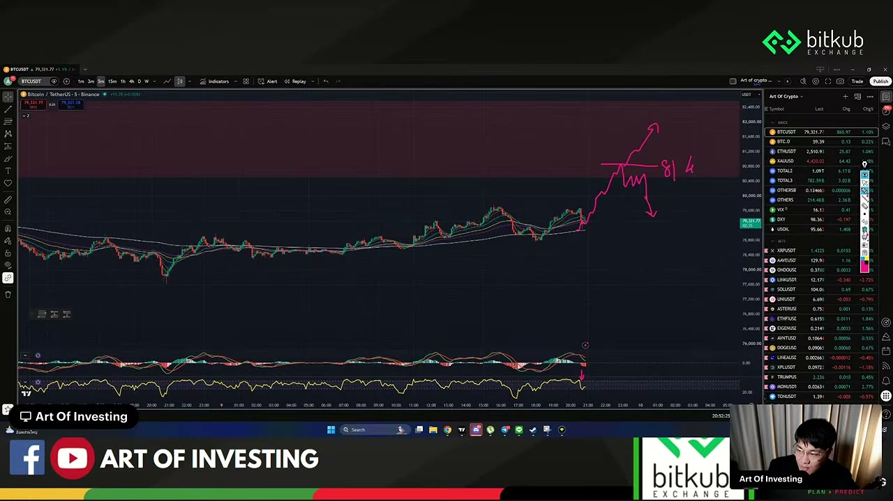

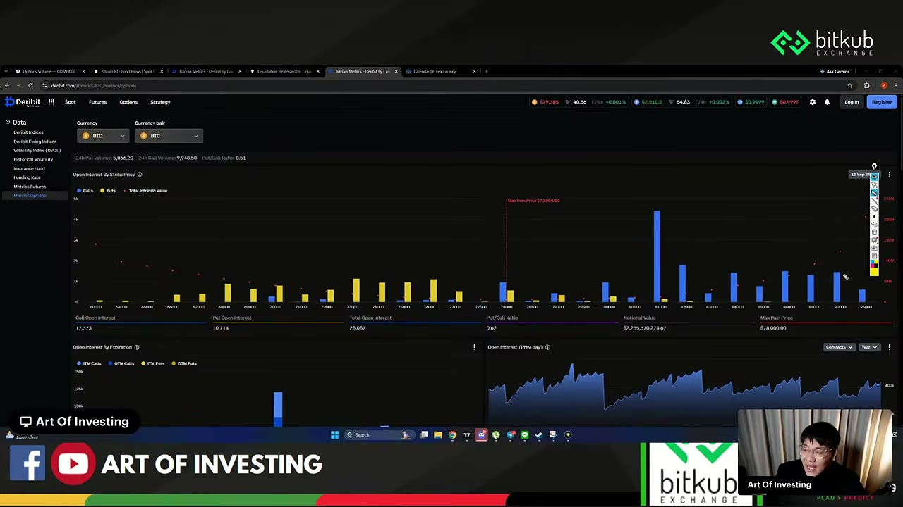

[00:51:50] อีกทีนู่นน่ะผมก็บอกเอ้ยงั้นผมกั้นเทing ตรงนี้เว้ยแล้วถ้ามันทะลุไปอ่ะพรวด เลยนะเนี่ยอะไรเงี้ยแบบตลาดแตกอ่ะนะครับ อะไรเงี้ย เราก็ใช้ตรงเนี้ย ประกอบได้นะครับแต่อย่าลืมนะมันไม่เป๊ะ เท่าทองอันเนี้ยผมผมย้ำแบบโคตร dislaimer เลยนะมันจะยังไม่เป๊ะเหมือนทองนะเว้ยทอง คือคุณเห็นปุ๊บมันจะโป๊กปั๊กๆปั๊เลยอ่ะ เพราะว่าเงินมันเยอะมากนะครับแต่ว่า บitคinอ่ะอย่างที่บอกเทียบบอลโลกกับลิ้า นะครับลิ้ามันยังคนที่ไปอยู่ในนั้นน่ะมัน อาจจะยังไม่เยอะเท่านะครับเราอาจจะต้องดู price  action เยอะกว่าทองคำนิดนึงอย่าง ทองอ่ะเทรดแบบแทบจะไม่ต้องรอ price action เลยนะครับอ่ะอย่างยกก่อนจะไป วิเคราะห์บitคinนะครับก็เดี๋ยวเอาทองให้ ดูแล้วกันอย่าง ไม้เมื่อกี้นะครับก็ต้องบอกก่อนว่าผมอ่ะ โดน Stop  Loss ไปก่อนไม่ใช่ดิผมผมโดน หน้าทุนไปตอนเช้านะครับตอนเช้าเนี่ยผม

[00:52:50] เห็นละว่ามันติด EM  50 กับ 75 นะครับก็ คือแถวๆตรงนี้นะครับอ่ะเส้นตรงนี้มัน เลื่อนปึ๊บอ่ะผมเห็นละ มันติดตรงนั้นแล้วพอดีกับ 4  350 เลยแต่ ผมอ่ะไม่ได้เข้าตรงนี้ผมตื่นไม่ทันมัน 7:00 น.กว่าแล้วทีเนี้ยผมดูโมเมนตัมใช่ มั้ยคุณดูดิมันติดตรงนี้ติดตรงนี้ติดตรง นี้ติดตรงนี้ใช่มั้ยงั้นเสาอ่ะมันอยู่แถว 44  44  25  4450 ถูกมั้ยกับเสาอีกที เนี่ยผมก็เลยมองว่าแล้วมันเบรคโมเมนตัม ขึ้นมาได้เนี่ยผมก็เลยคิดว่าเอ้ยมันน่าจะ ขึ้นไปหาข้างบนนะครับผมก็คิดว่ามันน่าจะ ขึ้นไปหาข้างบนผมก็เลยบายมาทีเนี้ยพอผม บายมาแล้วอ่ะเอ่อ มันย่อก่อนผมก็เลยปาตรงนี้ทิ้งเพราะผมคิด ว่ามันจะไม่ผ่าน 75 แต่มันดันผ่านอ่ะไม้ เนี่ยผมก็เลย ตกรถใช้คำว่าตกรถได้มั้ยใช้ว่าไปไม่ถึง ฝั่งแล้วกันผมโดดลงก่อนก่อนป้ายนะครับผม

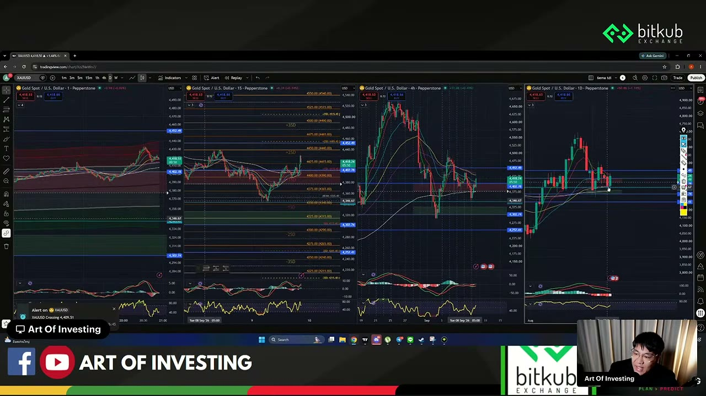

[00:53:51] ก็เลยไม่ได้ของแล้วผมก็คิดว่าอ่ะงั้น มันอาจจะไม่ผ่านตรงนี้นะครับผมก็เลยรอรอ จะเซลล์ก็ไม่ได้จังหวะเซลอีกสุดท้ายไอ้ ไม้เมื่อกี้ช่วงที่ผมไลฟ์อ่ะผมจานเอแก อยู่ตรงนี้ใช่มั้ผมอ่ะมาเข้าตรงนี้ผมมาผม มาเข้าตั้งแต่ประมาณ ช่วงเนี้ย 16:00 น.นะครับเพราะว่าผมเห็น แล้วว่าตรงเนี้ยรีเจครอบแรกอ่ะพูดแล้วมัน อาจจะรายละเอียดเยอะหน่อยนะเพราะว่าผมใช้ โมเมนตัมด้วยนะครับคือผมเห็นแล้วว่ามันมี ติดพรีเมี่มอยู่ก็คือ 25 แล้วชนรอบแรกไม่ ผ่านแต่มันไม่เกิด ne ผมก็เลยว่าเสาอ่ะ มันหนามากที่ตรงนี้ ถูกป่ะเสาอ่ะมันมันหนามากเลยที่ตรงเนี้ย ผมก็เลยมาว่างั้นอ่ะมึงเบรกตรงนี้ขึ้นมา ได้โมเมนตัมขึ้นมาได้งั้นถ้าจะขึ้นต่อ แล้วไปหาเสาได้เนี่ยชน EMA  25 รอบแรกไป แล้วแล้วไม่เกิดนิวโรเนี่ยอ่ะมันมีแนว

[00:54:51] โน้มแล้วที่ 25 มันจะเอาไม่อยู่งั้นมันจะ ขึ้นไปหาเส้นอะไรคำตอบคือ 75 แล้ว 75 พอ ดีกับเสาผมก็เลยบายขึ้นมาแต่ทีเนี้ยนะ ครับขึ้นมาตรงนี้ ผมไม่ได้ TP อีกนะครับเพราะว่าคิดว่ายัง ไงก็เบรคลงย้อนกลับมาอีกผมก็แบบเอ้ย เริ่มหงุดหงิดปิดละก่อนจะไลฟ์เนี่ยนแหละ ผมแบบเอ้ยเอ้ยเดี๋ยวผมจะนั่งเฝ้า มอนิเตอร์ก็ไม่สะดวกนะครับแล้วก็เมื่อกี้ แล้วไลฟ์อยู่เหมือนวิ่งขึ้นมาตรงนี้ผมก็ เลยอ่ะปิดก่อนแล้วกันเดี๋ยวเดี๋ยวไม่มี สมาธิไลฟ์นะครับก็เลยก็เลย TP ตรงนี้ไป อ่ะก็วิ่งหาเสาอันเนี้ยครับคือไม้ที่มีคน ถามว่าผมเทรดอะไรเนาะก็คือตอนแรกจาน A อ่ะแกเซลล์ตรงนี้ผมไม่ได้เซลล์เนาะเพราะ ว่าผมติดไม้บายตรงนี้อยู่ตั้งแต่ 16:00 นะครับเฮ้ยใครสนใจ OI อ่ะไปช่อง MADER ได้เลยนะเพราะว่าผมก็ศึกษามาจากที่นี่ เหมือนกันตอนนี้ก็คุยโปรเจคกับจาน M อยู่ แกแง้มๆมาแล้วว่าอาจจะสิ้นเดือนนี้นะครับ ใครที่ถามผมว่ารอคอร์สอยู่อ่ะสิ้นปีสิ้น

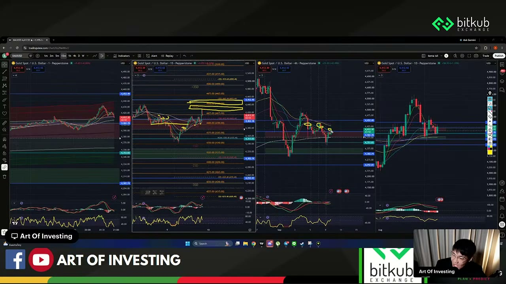

[00:55:51] ปีทำเนื้อหากันอยู่นะครับ เนี่ยเออไปลองเพจนี้นะครับก็พี่เอ่อพี่ เอ็มเนี่ยเป็นผู้บริหารกองทุนมา 9 ปีแล้ว กองทุนในไทยนะครับไม่ใช่กองทุนแบบสอบ FTMO แล้วเทรดแล้วแบ่งเงินกับเว็บนะไม่ใช่นะ กองทุนบรจ.ในไทยนะครับแบบกองทุน 10 หลัก เออเค้าเบริหารมา 9 ปีแล้วนะครับฉะนั้น น่ะผมก็เรียนรู้พวกเนี้ยมาจากแกแหละนะ ครับก็ใครสนใจไปลองดูก็จะเป็นฝาแฝดพี่ชาย แกไลฟ์ทุกวันตัวแกมาไลฟ์เทรดอย่างนี้ไม่ ได้นะเพราะว่ามันมันติดสัญญาบรจ.เค้าเป็น ฝาแฝดกันมั้ยจาน A กับจาน M ก็ไปดูได้จาน A นะครับแกจะไลฟ์ทุกเช้าเย็นนะเมื่อกี้ แกเพิ่งไลฟ์นะครับอ่ะทองจบไปไม้ที่กำไร เดี๋ยวผมมาโหวันนี้ว่าจะพูดบitคinชั่วโมง นึงแล้วขออภัยครับยังไม่ได้ถึงบitcoinสัก ทีเลยอ่ะเดี๋ยวขึ้นบitcoinเลยดีกว่านะ โทษทีนะโทษทีนะเออแบบเพื่อนๆที่แบบเฮ้ย ไม่วิเคราะห์บitcoinสักทีวะชั่วโมงนึงเออ ผมก็เพลินนะครับไปอธิบายเรื่องอtionั

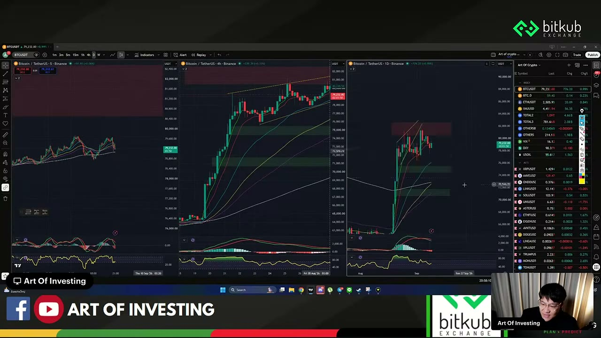

[00:56:53] เพลินอ่ะงั้นผมมองแบบนี้ขออภัยขออภัยช้า ไปหน่อย[เสียงสูดหายใจ] เรื่องแรกก่อนนะครับอ่ะเดี๋ยวเรามาไล่กัน เลยนะครับเราดูไปละว่า 8,000 เนี่ยตลาดสน ใจค่อนข้างเยอะนะครับฉะนั้นเรื่องต่อมา เนี่ยก็คือพรุ่งนี้นะครับก็จะมี PPI นะ ครับแล้วก็มีตรงนี้ด้วยก็คือ CPI ด้วยนะ ครับ CPI กับ PPI งั้นไอ้ 2 ตัวเนี้ยถ้า เป็นไปได้ผมอาจจะไม่เทรดเลยนะครับพรุ่ง นี้ 2 วันพฤหัสบศุกร์ผมอาจจะงดเทรดก็คือ ถ้าผมตื่นมาทันเทรดทองแถว 7-800 น.ผมก็ อาจจะเทรดแค่นั้นแล้วแล้วเลิกเลยผมจะไม่ เทรดอีกเลยนะเพราะว่าวันที่มีข่าวอ่ะมัน เยอะแล้วแล้วมันแบบมันวิ่งสะบัดแรงไกล ครับผมก็ไม่ค่อยชอบเท่าไหร่นะครับมันเทรด โดนสเปรดเยอะนะครับอืฉะนั้น 2 วันเนี้ย ทั้งบitcoinทั้งทองอ่ะน่าจะผันผวนเพราะ ว่าการขึ้นดอกลดดอกมีผลต่อทั้ง 2 สิน ทรัพย์นี้ยิ่ง Bitcoin เนี่ย sensitive กว่าทองอีกนะครับต่อมาคือation

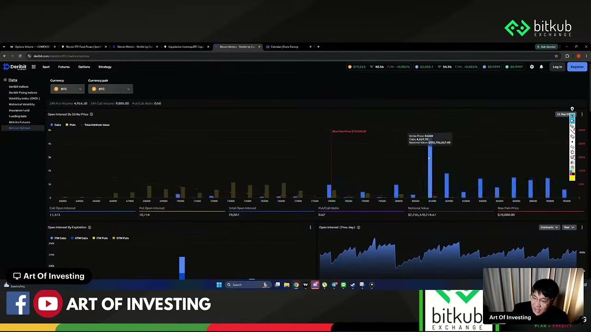

[00:57:54] liquidation  heat  map นะครับอ่ะให้ดู ตรงนี้นะครับก็ฝั่งบนน่ะหายไปเยอะแล้ว เนาะเพราะว่า ก่อนหน้าเนี้ยอยู่แถว 79,000 ค่อนข้าง เยอะอันเนี้ยก็ก็โดนช็อต squ ไปละฉะนั้น ตรงเนี้ยครับผมก็คิดว่าเดี๋ยว 2 วันเนี้ย น่าจะมีเติมนะครับแถวแถวตรงนี้แหละที่มัน เป็น liquidation  Heat  Map ฉะนั้นถ้า เกิดว่าอเดer Stop  Loss ตรงนี้มันเยอะ อ่ะเนาะแถว 80,000 อ่ะมันก็มีแนวโน้มนะ ครับที่จะขึ้นไปแล้ว ทะลุนะครับเพราะว่าโดนคำสั่งอะไร Force buy นะครับแล้วก็ดีดกลับลงมาตรงเนี้ยผม ถึงบอกว่าเอ้ย 8,000 ไม่ใช่ช็อตเลยนะดู ก่อนว่ามันจะไม่ผ่านจริงเปล่าถ้ามันไม่ ผ่านน่ะมันต้องทำโครงสร้างว่าไม่ผ่านก่อน นะครับแล้วก็ข้างล่างเนาะก็จะมี recognition  h  map ที่ตรงนี้ประมาณ 78,000  500 นะครับก็ผมก็เลยมองตรงนี้ ว่าเออเฮ้ยมันก็มีโอกาสที่จะแบบย่อลงมานะ ครับถ้าเกิดไม่ผ่าน 8,000 ขึ้นไปกวาด liquidation  Heat  Map นะครับเอ่อแล้ว ก็พอดีกับ OI เนาะแต่ว่าอันเนี้ยมันคือ

[00:58:57] ของวันที่ 11 นะครับซึ่ง OI  Bitcoin อ่ะ ดูได้แล้วแล้วมีนัยยะสำคัญเนี่ยมีแค่วัน ศุกร์กับวันสิ้นเดือนเท่านั้นนะครับก็คือ วันที่มันมีจำนวนสัญญาเยอะหน่อยอ่ะอย่าง อันเนี้ยมันหลอมแหลมอ่ะนึกออกป่ะมันก็ไม่ เยอะพอที่เราจะเอามาตีค่านะครับฉะนั้นมัน เหลืออีก 2 วันเสาร์ในเนี้ยมันยังไม่ final ไฟถูกป่ะมันอาจจะงอกก็ได้ให้คุณดู 19:00 น.ก่อนจะเป็นอีกวันนึงอันนี้เท่า ที่เก็บข้อมูลมาเนาะให้คุณดู 19:00 น. เช่นถ้าเกิด 11 เนี่ยมันวันศุกร์ใช่ป่ะ ให้คุณดูเสาร์ตอนพฤหัสบดี 19:00 น.แล้ว ยึดตรงนั้นน่ะเป็นหลักแนวโน้มว่าจะเป็น ตามตรงนั้นน่ะค่อนข้างสูงนะครับให้ดูตอน พฤหัสบดี 19:00 น. เราไม่แน่ไงเพราะว่าเอ่อพรุ่งนี้พฤหัส 19:30 น.มันจะมี CPI ออกฉะนั้นช่วง 20:00-  21:00 น.เนี่ยเสามันจะเริ่มงอก นะครับเสาเสามันจะเริ่มงอกและเราก็รอดู

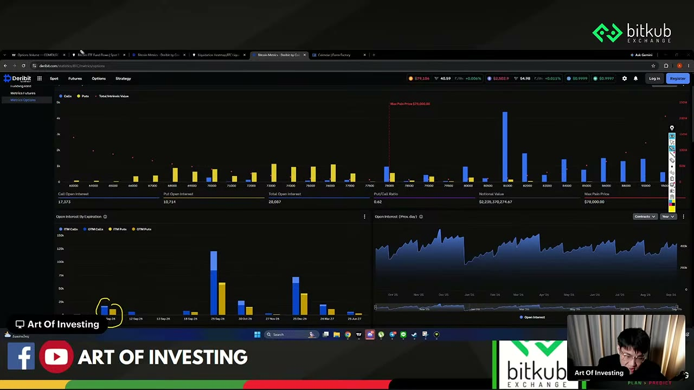

[00:59:57] ตรงนั้นนะครับแล้ววันแล้ววันศุกร์เนี่ย มันหมดอายุนะครับ 15:00 น.ประเทศไทยอืมนะ ครับก็ให้ดูตรงนั้นถ้าเกิดว่าเสาฝั่งนี้ เริ่มงอกอ่ะก็เอาละแนวโน้มก็น่าจะน่าจะ น่าจะขึ้นนะครับแต่ว่าอาจจะไม่ได้ขึ้นไกล เพราะว่าถึงตรงเนี้ยมันก็เริ่มมีด่าน ตำรวจเยอะแล้วก็น่าจะเกิดเซentแมนสะท้อน กลับนะครับแต่ว่าถ้าเกิดเสามันบวมที่ฝั่ง ไหนก็มีแนวโน้มว่าราคามันก็จะไหลไปฝั่ง นั้นแต่ว่าถ้าเป็นอย่างงี้กลายเป็นว่าเสา นี้หนากว่าเดิมอีกแล้วที่เรือลอมแหลมเลย ก็จะตีความว่าผ่านยากนะครับก็ให้ไปดูเนาะ พฤหัสบดี 19:00 น.นะครับอ่ะทีนี้เรามาดู เรื่องเอ่อ inflow ของ ETF นะครับ inflow ของ ETF เนี่ยก็จะมี เอ่อเงินไหลเข้านะครับก็เพิ่งมีไหลออกปิด แดงก็คือเมื่อวานนี้เองนะครับแต่ว่าก็ยัง ซื้ออยู่นะก็บวกมาหลายพันต่อเนื่องกัน แล้วก็มีช็อตใหญ่ๆที่ขายออกบ้างนะครับ ส่วนตัวถ้ามองด้วยกราฟอ่ะเราก็ต้องเข้าใจ แหละว่ามันก็เป็นขาขึ้นนั่นแหละนะครับมัน

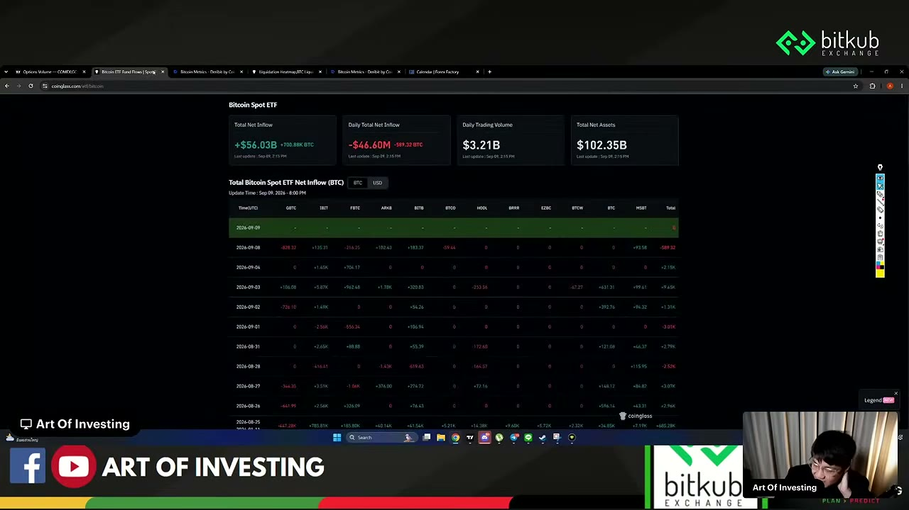

[01:00:57] มันเป็นขาขึ้นนั่นแหละถ้าให้มองอ่ะเนาะ เนาะแต่ทีเนี้ย มันยังจะมีเคสนี้นะครับก็คือไอ้ 4 อีเวentใหญ่อ่ะเราตอบไม่ได้เลยว่าจะเกิด เคสไหนถูกป่ะเฮ้ยลงเว้ยมาดิมาดิอยากได้ ของเพิ่มอยู่นะครับอ่ะทีเนี้ยมันหลุด assing  wage มาแล้วถูกมยแล้วก็ตรงเนี้ย เราเห็นตรงนี้มั้ย อ่ะที่เขา้าเรียกกันว่า divergent เนี่ย มันไม่ได้บอกว่ามันเป็นจุดกลับตัวนะครับ แต่ว่า divergence เนี่ยมันเป็นการบ่งบอก ว่าแรงซื้อเริ่มดรอปแรงซื้อเริ่มน้อยลงนะ ครับแรงซื้อมันเริ่มน้อย เราไม่รู้นะว่าหน้าตามันจะย่อมาจังหวะไหน บ้างเพราะว่าสมมุตินะถ้าเกิดว่า CPI  PPI ออกมาเฮ้ยเงินเฟ้อไม่ดื้อสมมุตินะเงิน เฟ้อไม่ดื้อแบบเนี้ยเฟก็อาจจะตลาดก็ตี

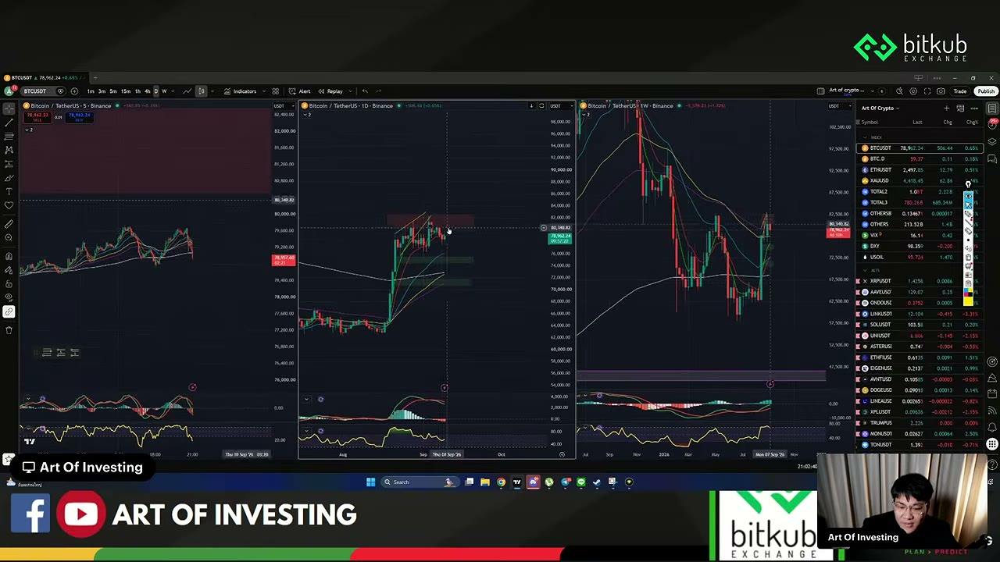

[01:01:58] ความว่าเฟไม่น่าจะขึ้นดอกละมันอาจจะขึ้น ปื๊ดไปเลยก็ได้นะหรือออกมาทรงๆ แกมแย่นะครับน้ำมันก็ขึ้นเนี่ยเอคุณกอล์ฟ ก็ได้กำไรไปจะ 20 ล้านนะยินดีกับพี่กอล์ฟ ลองลงทุนด้วยนะครับแกลองน้ำมันมาตั้งแต่ 80 นะครับก็ใจใหญ่นะครับก็ต้องได้รางได้ รางวัลใหญ่อย่างผมพอร์ตไม่ไซส์เท่าแกไงแก 9 หลักผม 8 หลักไซส์เทรดผมก็จะเป็นหลัก แสนหรือหลักล้านต้นๆแต่แกจะเป็นแบบหลักสบ ล้านแล้วเวลาแกเทรดไม้นึงนะครับก็คนละ ไซส์นะครับผมยังเป็นเด็กน้อยเดี๋ค่อยๆตาม พี่กอล์ฟไปนะครับก็เทรดคนละสไตล์เนาะพี่ กอล์ฟจะเป็นสวิงเทรดส่วนผมจะเป็น day trader นะครับอ่ะก็จะมี data พวกนี้แหละ มาช่วยผมตัดสินใจมันก็ทำให้เราเข้าคมขึ้น ทีเนี้ยครับผมก็เลยมองไว้ 2 โซนต้องบอก แบบนี้ก่อนให้เราเทียบก่อนนะว่า เวลาที่ตลาดมันขึ้นน่ะครับ ถ้ามันเป็นจุดเริ่มต้นของไซเคิลจริงๆอ่ะ มันจะขึ้นเร็วและแรงแล้วมันจะไม่รอรับคน

[01:03:00] นะครับมันจะไปตรงกับทฤษฎีคลื่นปรับของ อ่ะผมอธิบายก่อนอย่างเงี้ยเห็นมั้เฮ้ยย่อ มาอย่าเข้าย่อมาอย่าเข้ามันขึ้นปึ้งๆๆเลย แล้วค่อยมาเขย่าตุ้มอีกทีแล้วค่อยไปต่อนะ ครับฉะนั้นตอนเนี้ยถ้าถ้าเกิดมองเคสว่า เป็นต้นรอบอ่ะมันจะต้องขึ้นเร็วและแรงคำ ถามคือทำไมเพราะว่ารายใหญ่ไม่ต้องการให้ ลายย่อยได้ของดี ไม่ใช่ว่าเค้าเป็น W  line นะแต่คุณต้อง นึกภาพว่ารายใหญ่ที่เป็น Growth  funds อ่ะที่ไม่ใช่ HGE  funds หรือใครก็ตามที่ ได้ผลประโยชน์จากการที่บitcoinขึ้นแล้ว วันนึงก็ต้องถ่ายเพื่อขายเพื่อทำกำไร ถ้าเกิดว่ารายย่อยได้ของที่ราคาต่ำหมด เช่นสมมุตินะขึ้นย่อมารีเทสค่อยขึ้นต่อ อย่างี้โอ้โหรายย่อยได้ของเยอะถูกป่ะพอไป ถึงปลายทางไกลๆอ่ะมันจะไม่ค่อยอยากซื้อ เพราะว่าเขาได้ของมาเยอะแล้วสมมุติว่าคุณ ตั้งใจจะซื้อ 10 ล้านคุณได้ของตรงนี้เป็น

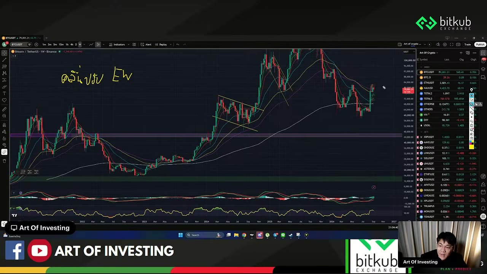

[01:04:00] 8 ล้านน่ะ ตรงเนี้ยคุณเหลือเงินอีก 2 ล้านที่เป็น เงินสดคุณไม่กระวนกระวายแล้วว่าแบบอุ๊ยจะ ต้องซื้อให้ได้เฮ้ยอยากจะได้ของอุ้ยอยาก จะซื้อเพิ่มคุณจะไม่รู้สึกแบบนั้นนึกออก มั้ยเพราะว่าคุณมีของที่ถูกแล้วแต่กลับ กันถ้าเกิดว่าคุณได้ของมาแค่ล้านเดียว อย่างเงี้ยเพราะว่าราคามันขึ้นเร็วคุณรอ ย่อแล้วมันไม่ย่ออาจจะเป็นเหมือนผมก็ได้ ผมได้ของไม่ครบนะครับตอนนี้เพิ่งได้มา 50-60% เองที่ที่ตั้งใจไว้สำหรับพอร์ต เล่นรอบนะผมผมได้ไม้แรกอ่ะต่ำ 60,000 นะ ครับก็ตรงนี้ที่ผมพูดไว้ในสยามbl็chainก็ คือตรงนี้เนาะที่ผมไปออกรายการสยาม blockchain ใครก็ไปย้อนดูได้นะครับพิมพ์ ไปว่าสยาม Blockchain  Art  of  Investing ก็จะเจอผมวิเคราะห์ช็อตนี้อยู่แล้วผมก็ บอกในรายการว่าเออต่ำ 60,000 น่ะผมสนใจนะ ครับผมก็เลยพอร์ตเล่นรอบนะไม่ใช่พอร์ต เล่นแบบสะสมระยะยาวนะพอร์ตเล่นรอบอ่ะผมก็ เลยได้ไม้นี้ไม้แรกไปนะครับแล้วก็มี Follow ไป 2 ไม้เติมอีกหน่อยนะครับส่วน ตรงเนี้ย

[01:05:00] เอ่อผมยังรอย่อนะครับสมมุติว่าคุณได้ไป แค่ 1 ล้านแล้วคุณตั้งใจจะซื้อ 10 ล้าน คุณเหลืออีก 9 ล้านอ่ะคุณก็จะหาทาง ระหว่างทางซื้อให้ได้นึกออกป่ะทีเนี้ยพอ มันขึ้นไปเยอะๆอ่ะเค้าโถมข่าวดี คนก็จะแบบโอ้โอ้ยราคาไปต่อแน่เลยเว้ย โอ้โหเหลือในมืออีกตั้ง 9 ล้านอ่ะเฮ้ย ซื้อเพิ่มน่าจะไปต่อพอคุณตั้งซื้อเพิ่ม อ่ะเขาก็ขายได้แล้วมันก็เลยจะจบรอบได้นะ ครับฉะนั้นทฤษฎีคลื่นปรับของอี Wave อ่ะ มาจากแนวคิดตรงนี้ว่ามันต้องขึ้นเร็วและ แรงจน ไม่สามารถทำให้รายย่อยเนี่ยเข้าได้ทันนะ ครับงั้นตรงเนี้ยถ้าเกิดว่ามันเป็นต้นรอบ จริงๆอ่ะมันมันถูกสูตรแล้วก็คือมันจะต้อง ขึ้นเร็วและแรงแบบนี้นะครับมันจะต้องพรวด พรวดไปเลยแล้วก็มันมีสิทธิ์นะที่จะขึ้นไป เลยก็ได้นะครับสมมุติว่าตัวเลขมันดีจัด อ่ะมันจะวิ่งขึ้นไปเลยอ่ะผมก็ตกรถละผมก็ ได้แค่ 60% แล้วก็เดี๋ยวอาจจะไปรอมันย่อ จังหวะพฤศจิกายนที่มันเป็น midterm election เดี๋ยวผมไปรอเข้าเพิ่มก็ได้แต่

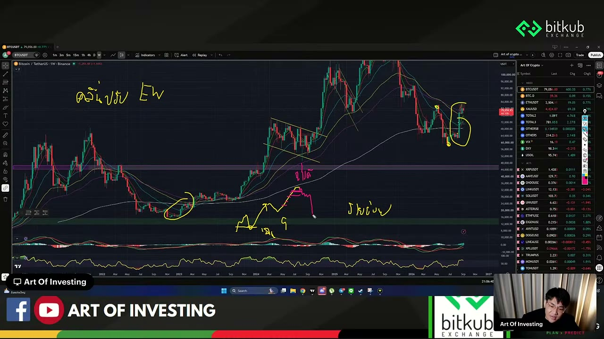

[01:06:01] ถ้าเกิดว่ามันไม่เกิดเคสนี้สมมุติว่าไอ้ 8,000 เนี่ยจนวันพฤหัสบดี 1  19  1 น. เนี่ยมันก็ยังเป็นเสาที่สูงที่สุดอยู่มัน ก็มีแนวโน้ม 68-70% แล้วะที่จะไม่ผ่านถ้าดูด้วยตัวเลข OI กับ สูตรคำนวณ Standard  deviation นะครับ พอมันเป็นแบบนั้นน่ะถ้าเกิดว่ามันย่อ เนี่ยเหมือนเดิมถ้าเรามองว่ามันเป็นคลื่น ปรับอ่ะครับมันจะย่อไม่ลึกเพราะว่าถ้าย่อ ลึกคนมันจะได้อยากได้ของมันจะกล้าซื้อกัน นะครับก็ผมก็เลยมองไว้ 2 โซนนะครับโซนแรก เนี่ยผมก็มองไว้แถวเนี้ย 74,000  500 ถึง ถึงประมาณ 75,000  76,000 นะครับก็คือถ้า ลงมาเนี่ยผมก็จะซื้อของเพิ่มไปแล้วก็อาจ จะไซด์วยแล้วแล้วเด้งขึ้นต่อนะครับซึ่ง ช็อตเนี้ยผมก็มองว่า อ่ะขึ้นได้อธิบายทีละช็อตแล้วกันผมมองว่า ขึ้นได้นะครับผมมองว่าขึ้นได้อย่างงี้ หรือถ้าเค้าย่อลึกหน่อยแต่ไม่อยากให้เสีย โมเมนตัมนะไม่อยากให้เสียโมเมนตัมนะครับ

[01:07:04] ก็คือผมก็มองว่าเนี่ยแถว 7,000  -  7,000 เนี่ยไม่ควรหลุดขึ้นมาตรงเนี้ยผมอาจจะ อยากได้ของแล้วก็ซื้อนะครับก็อาจจะเป็น อีก 2 โซนที่ผมผมรออยู่ที่ผมอยากจะได้ ราคาเพิ่มเพราะว่าจะเห็นว่า day เนี่ยมัน overbบอไปแล้วแต่ week เนี่ยแdมันเหนือ 0 ไม่ได้อันเนี้ยแปลว่าโมเมนตัมส่งไม่ สำเร็จก็คือคนนึง Panic  buy แล้วอีกคน นึงยังออเดอร์ขายยังเยอะกว่าซื้ออยู่เลย ในในภาพรวมนะครับระดับweคฉะนั้นมันก็ต้อง ลงมาสะสมแรงเออผมก็เลยมองว่าถ้างั้นน่ะ เอ่อมันมันไม่ควรย่อลึกถ้าเกิดเป็นต้นรอบ นะครับเพื่อให้รายย่อยเข้าไม่ทันแล้วไป เข้าอีกทีปลายรอบให้เค้าขายของใส่มันจะ ต้องเป็นแบบนั้นนะครับก็เลยมองว่าไม่ควร หลุดตรงนี้ก็คือโมเมนตัมจะไม่จบยกเว้นว่า อ่ะสมมุตินะว่ามันทุบมาอาจจะไม่ใช่เพราะ ว่า CPI  PPI พวกนี้แต่อาจจะเป็น 4  event ใหญ่สัปดาห์หน้า Quality  Act ประกาศ อัตราดอกเบี้ยโฟมซประกาศอัตราดอกเบี้ย ญี่ปุ่นเงินเย็น Bank  of  Japan นะครับ ก็น่ากังวลถ้าเกิดมันไปทุบแรงๆน่ะผมก็อาจ

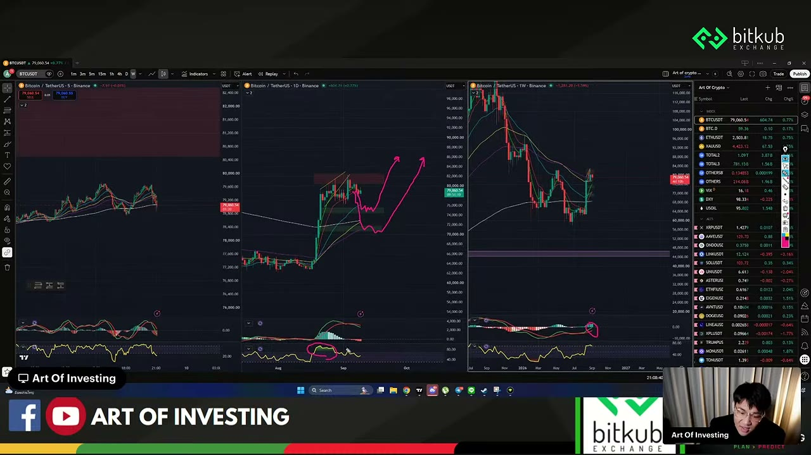

[01:08:08] จะมอง FCE เบรกอาจจะเป็นเคสแบบนี้ก็คือ สมมุติว่าอันนี้เป็นกราฟ day ถูกป่ะมัน อาจจะวิ่งอย่างงี้ ฟุมแล้วขึ้นถ้างั้นตรงเนี้ยผมผมเข้าเยอะ เลยนะผมอาจจะเข้า 30% นะครับไม้ใหญ่เลย แล้วก็ผมก็วาง stop  loss โรงเนี่ย นะครับถ้าเกิดมันมันเกิดการเขย่าตรงนั้น นะครับเพราะว่ามันจะเป็นเหมือนครั้งนี้ เลยนะครับก็คือเกิดเอ่อตรงนี้นะครับที่ มันกวาดสภาพคล่องอ่ะผมก็ยังถือหางเคสนี้ อยู่นะว่าถ้ามันมาตรงนั้นน่ะเพราะว่าคน มันจะเสียขวัญหมดะนะครับว่าอู้หูลงแบบนี้ นิวโลแน่นอนพังแน่นอนนะครับเออผมก็เลยมอง มองเคสมันไว้ซึ่งไอ้ตรงเนี้ยไม่รู้ไม่รู้ มันจะลงมาจริงหรือเปล่านะแต่ว่าถ้ามองตาม อ่ะใช่ครับคุณธีรวัฒถ้ามองตาม Global Liquidity ที่เราคุยกันมาตั้งแต่ต้นไลฟ์ อ่ะมันมีแนวโน้มที่จะขึ้นจริงปีหน้าอยู่ นะซึ่งซึก็ไม่มีใครตอบได้ถูกป่ะเพราะว่า

[01:09:10] ผมก็เลยบอกว่าผมจะไม่เข้า 100% แน่นอนน่ะ อย่างมากอ่ะผมจะเก็บให้ได้ 70-80 แล้วผม จะเหลือเงินสดไว้ 20% เผื่อมันเกิด worst case เพราะว่าเคสที่ผมยังถือหางอยู่อ่ะ นะครับมันจะเป็นภาพที่ อาจจะขึ้นไปเลยแต่ว่าไม่ทะลุแสนแล้วก็ เกิดความผันผวนหนักมากเกี่ยวกับmidเทม อกชัของทรัมป์ปลายพฤศจิกายนว่าแบบเอ้ยแพ้ การเลือกตั้งหรือชนะหรืออะไรที่แบบมันส่ง ผลต่อตลาดมันเข่าเขย่าตลาดแรงมากณณเวลา นั้นน่ะครับแล้วเราก็ไม่รู้มันอาจจะเกิด นิวโรจริงๆก็ได้แล้วก็เข้าสู่ loop  4 year  cycle จริงๆแบบเฮ้ยย่อ 70%  80% แล้วก็ไปขึ้นอีกทีออย่างเงี้ยผมก็จะเหลือ เงิน 20% ไว้สำหรับเคสนี้นึกออกมั้ครับ ฉะนั้นเราไม่รู้ว่ามันอาจจะแบบเฮ้ยตรง เนี้ยขึ้นจริงะแล้วค่อยไปย่อข้างบนอะไร เงี้ยเราเราตอบไม่ได้ถูกมั้ยฉะนั้นน่ะผม

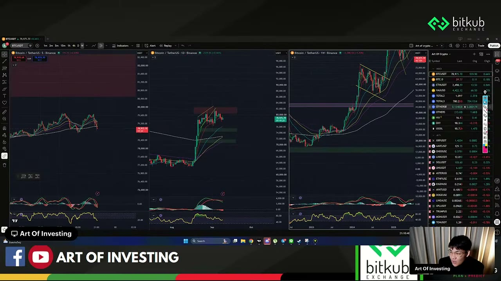

[01:10:10] ก็เลยวางแผนแบบนี้ถ้าใครอยากไปอ่านบทความ เต็มๆก็อ่านใน Facebook ได้นะครับผมก็เลย วางแผนแบบนี้ว่าตอนเผมมีของมาแล้วอ่ะวัน ก่อนผมก็ลงในนี้ไปแล้วเดี๋ยวเอาให้ดู เดี๋ยวหาว่าพูดแล้วมั่วอีกนะครับเนี่ย เอ้ยไม่ใช่อันนี้อันนี้มันไม้เทรด อ่านี่เห็นมั้ยเนี่ยผมก็มีของไปแล้วแถวๆ ต่ำ 60,000 น่ะเห็นป่ะอย่างเงี้ยผมก็ เริ่มเข้าไปแล้วก็อันเนี้ยเข้าไปไม้เล็ก นะครับฉะนั้นไอ้ไม้เนี้ยผมเข้าไป 50% เลย นะของของพอร์ตเกรงกำไรนะฉะนั้นน่ะไอ้ตอน เนี้ยผมก็คือรอจังหวะ Follow เพิ่มอยู่ผม ตั้งใจจะเก็บให้ได้ 70-80% แล้วอีก 20% เ่ะผมจะเผื่อเงินสดไว้สำหรับ Worst  Case ถ้ามันไม่เกิดก็เดี๋ยวผม ค่อยหาจังหวะเติมเพิ่มนะครับเอ่อตอนเนี้ย ผมก็เลยมองอย่างงี้นะครับถ้าเกิด CPI  PPI พรุ่งนี้หรือ 4 อีวentใหญ่สัปดาห์หน้า สร้างความผแล้วกดตลาดลงมาผ่าน 8,000 ไม่ ได้บวกลบนะบวก -  1,000 ดอน 8,000  8,000

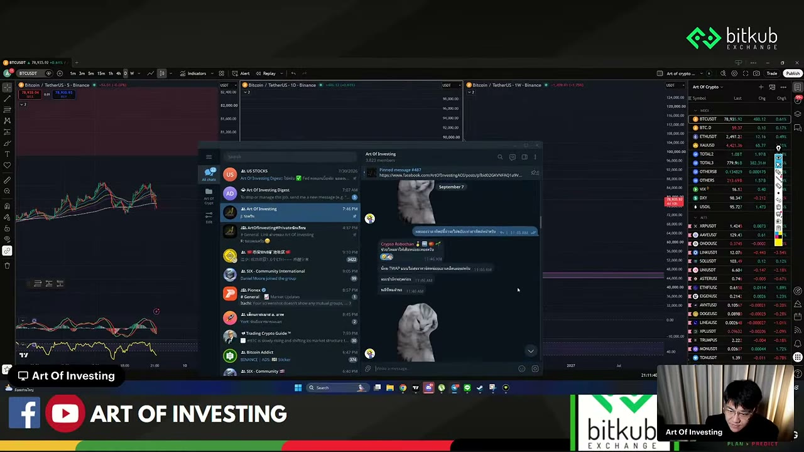

[01:11:13] เงี้ยย่อมา 2 ตัวเนี้ยผมจะเก็บเพิ่มนะ ครับอีก 20% ให้พอร์ตมันมี 70 นะครับแต่ว่าถ้ามันขึ้นไปเลยอ่ะก็เดี๋ยว ผมอาจจะต้องหาจังหวะ follow หลังจากนั้น ซึ่งมันจะมีความผันผวนแน่นอนก็คือเดือน พฤศจิกายนนะครับก็เดี๋ยวจังหวะนั้นเราจะ ไป follow กันผมมองเคสไว้แบบนี้นะฉะนั้น เตรียมเงินสดหน่อยผมว่ารอบเนี้ยผันผวน หนักเพราะว่าเราอย่าลืมนะว่าอ่ะถ้าเอ้ย คุณอาร์ต Global  Liquidity ที่คุณอาร์ต พูดผมไม่เห็นภาพเลยว่ะอ่ะคุณก็ดูนะ น้ำมันขึ้นมาก่อนถูกป่ะปื๊ดดูดเงินมา ตั้งแต่ปลายปีที่แล้วอ่ะแล้วคุณก็ดูว่า ทองคำอ่ะขึ้นมาแบบตั้งแต่ 2024 อ่ะ ฉะนั้นเงินก็อยู่ในทองเยอะแล้วหุ้น นะครับมันก็ขึ้นมาตลอดฉะนั้นน่ะเงินอ่า นี้ไปเห็นไอ้นี้ผมละเดี๋ยวลบก่อนอ่ะ ฉะนั้นน่ะมันมันก็ขึ้นมาค่อนข้างนะครับ ไกลมากเงินมันเข้าไปที่ตลาดพวกนี้หมดแล้ว แต่บitคinเนี่ยมันมาหลังสุดเลยมันเพิ่งมา

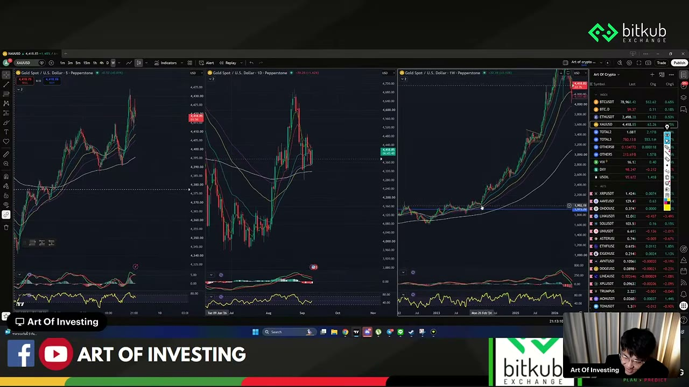

[01:12:15] เดือนที่แล้วนะครับฉะนั้นมันมีแนวโน้มว่า สภาพคล่องอ่ะมันเข้าไปอยู่ตลาดอื่นหมด แล้วแล้วมันเป็นช่วงขาลงช่วงย่อมันก็ยัง มีแนวโน้มว่าแบบอ่ะมันอาจจะทุบอีก 1 จังหวะมั้ยปลายปีหรือเดือนนี้แหละแล้ว ค่อยไปขึ้นจริงปีหน้าหรือทุบเดือนนี้ เลย 4 อีเวน์ใหญ่แล้วก็ขึ้นยาวเราก็ไม่ รู้ฉะนั้นน่ะผมอยากให้เพื่อนๆน่ะเตรียม ไว้สำหรับ 2 เคสด้วยอย่าไปมองว่าแบบเฮ้ย ตลาดหมีจบไปแล้วอินเลยเปลี่ยนชีวิตนะครับ ก็เอ่อผมผมแบบผมพูดแบบนี้นะผมไม่ห้ามแล้ว กันสำหรับคนที่อยากอินเดี๋จะหาว่าขัดลาภ แต่ว่าหลักการคิดคือให้คุณคิดว่าคุณยอม รับความล้มเหลวจากมันได้มั้ยเช่นถ้าคุณ ผิดอ่ะคุณรับไหวหรือเปล่าสมมุติว่าเงิน ก้อนนั้นน่ะคุณบอกว่าไม่เป็นไรปีนึงคุณหา ใหม่ได้โอเคอาจจะไม่ทำร้ายคุณมากคุณจะอิน ก็โอเคตามใจแต่ถ้าเงินนั้นคุณ all อินไป แล้วอ่ะ แล้วมันพลาดขึ้นมากลายเป็นว่าชีวิตคุณ ต้องเปลี่ยนไปอ่ะเช่นจากกินข้าวไม่ต้องดู ราคาเมนูไม่ต้องดูราคาบนเมนูถ้าเกิดคุณ พลาดช็อตนั้นคุณจะต้องกลับมาดูราคาบนเมนู

[01:13:16] อีกรอบอันนี้ชีวิตเปลี่ยนนะเช่นจากคุณ สามารถสั่งอาหารหมาได้โดยที่แบบเลือกเกรด ดีๆได้จะลองถ้าเกิดคุณพลาดไม้นั้นไปจะ ต้องเริ่มหาแบบลดราคางั้นแสดงว่าเงินที่ คุณเบี่ยก้อนใหญ่ไปนะครับให้เผื่อการพลาด ไปด้วยแล้วก็ดูว่าเม็ดเงินตรงนั้นน่ะถ้า เกิดคุณพลาดอ่ะคุณรับความเสียหายจากมัน ได้มั้ยนะครับเออผมก็เลยมองมอง 2 โซนตรง นี้ก่อนเหมือนตามที่เขียนบทความนะครับว่า ถ้าย่อมาผมอยากได้ของเพิ่มนะครับแล้วก็ มันน่าจะขึ้นไปด้านบน นะครับเออผมก็เลยมองว่า มันไม่ค่อย healthy แหละไอ้ไอเทรนด์ตรง เนี้ยมันควรจะมีดิฟแต่คำถามคือไม่มี ใครตอบได้ว่าดิฟจะเกิดเมื่อไหร่และเท่า ไหร่ถูกป่ะมันผันผวนมากทั้งสงครามทั้ง เงินเฟ้อที่แก้มาเรื้อรังนะครับเลือกตั้ง กลางเทอมนะครับอ่ะผมก็มองว่าถ้าแบบวิก หนักๆนะแถว 60,000 ปลายๆยังเป็นไปได้แบบ ตู้บเดียวแล้วลากกลับอ่ะนะครับก็ผมก็จะ เตรียมเงินสดไว้เคสนั้นแต่ว่าถ้าย่อแบบ

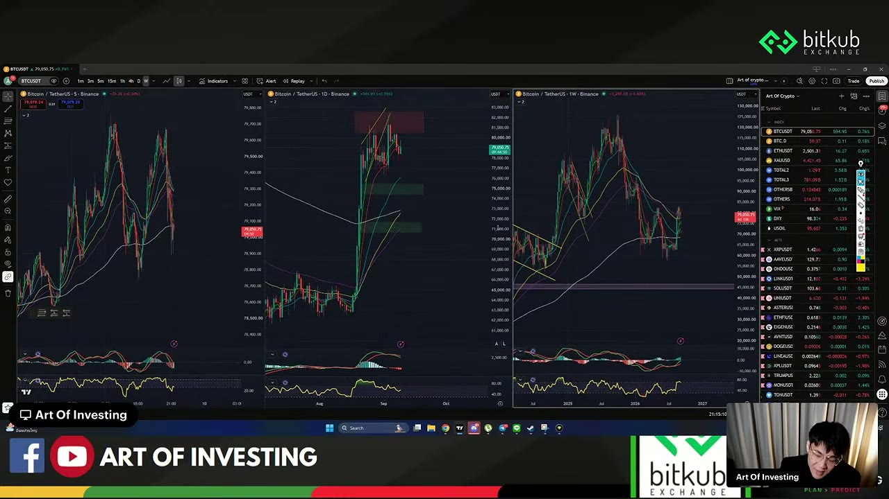

[01:14:18] เบาๆแล้วขึ้นต่อเลยให้ลายย่อยไม่ทันน่ะก็ 2 โซนนี้ผมก็จะเติมของนะครับอ่ะก็ดูนี้ ก่อนสำหรับ Bitcoin รวมนะครับโมเมนตัมก็ เนี่ยเห็นมั้ยมันoverบอไปแล้วแต่ week magd มันยังใต้สูตรนะครับฉะนั้นเนี่ยถ้า มันย่อมาอย่างี้ใช่มั้ยแล้วก็กลับขึ้นอีก รอบoverbออีกรอบ MacD  week อ่ะมันก็จะ ขึ้นเหนือ 0 ละ RSI  overb อ่ะมันก็แบบ เนี้ย Day ส่งโมเมนตัมถึง Week สำเร็จนะ ครับมันก็จะพอดีกับศาสตรนี้ไงก็ต้องรอดู ว่ามันจะเป็นยังไงนะครับส่วนอ่ะอธีเรียม พอกันนะครับก็ก็เหมือนกันเนี่ยถึงถึงโซน ตรงนี้แล้วนะครับฉะนั้นอธีเรียมเนี่ยถ้า ย่อนะผมมองว่าแถว 2,250 เนี่ยสวยถ้าลงมา ถึงนะแต่ผมไม่รู้จะถึงหรือเปล่าถ้าลงมา 2250 น่ะผมว่าสวยนะครับก็ประมาณตรงนี้ เนาะเนี่ย hiden  demand นะครับพอดีกับ EMA  50 เนี่ยนะครับเพราะว่า Week เนี่ย ก็ยังไม่เหนือ 0 เหมือนกันนะครับฉะนั้น ถ้าย่ออีกรอบเนี่ยอาจจะตรงนี้ก็ได้หรือ ตรงนี้ก็ได้อย่างเงี้ยอธอเรiมเนี่ยสวยละ นะครับแล้วก็

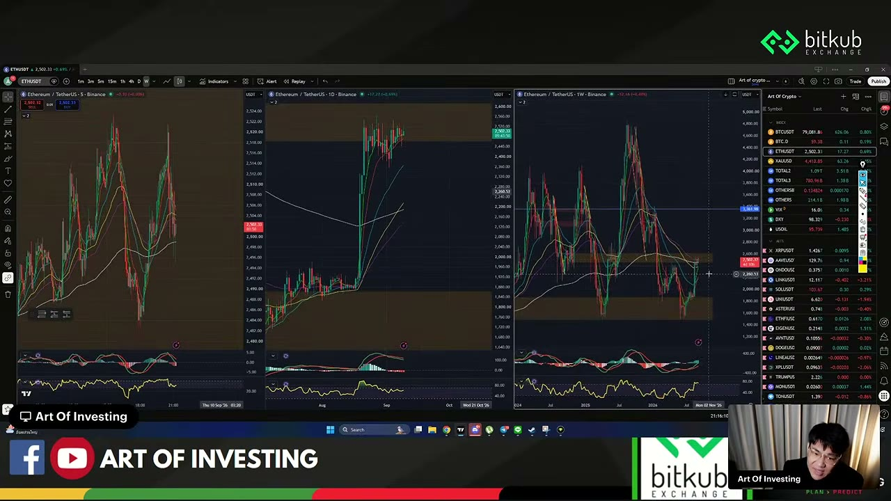

[01:15:18] outcoin เนาะนะครับ Outcoin เนี่ยเอ่อผม มองแบบนี้ ผมมองแบบนี้ เราจะเห็นว่า Bitcoin Dominance่ะมัน เริ่มลงแล้วแล้วเงินน่ะมันเข้าไปที่ outcoin แทนเห็นมั้ยนะครับคือ Bitcoin Dominance ลงแล้ว Total  3 ขึ้นแบบนี้มันชัดเจนนะครับว่า เม็ดเงินน่ะมันอยู่ใน alcoin มากขึ้นอ่ะ เราก็มาดูตัวที่ที่ผมสนใจอย่างเงี้ยที่ผม เซ็งอ่ะเพราะว่าปกติครับถ้าใครเป็นนัก เรียนผมอ่ะจะรู้ว่าไอ้เนี่ยคือท่าประจำผม แต่ผมจะได้ของตลอดอย่างคราวที่แล้วอ่ะ ไซเคิลที่แล้วผมได้ไenตั้งแต่ก้นเลยนะ ครับเพราะว่าผมเล่นท่า นู่นน่ะนี่ๆนี่ผมเล่นท่านี้นะครับเนี่ยผม ได้ของตรงนี้แล้วผมก็ Stop  Loss ตรงนี้ นะครับเกือบๆเลยก็คือมันติดพรีเมี่มมา ตลอดอย่างเงี้ยแล้วเบรคได้ครั้งแรกเงี้ย เหนือศูนย์overออย่างเงี้ยนะครับผมก็ได้ ของจังหวะเนี้ยแล้วผม stop  loss นี้

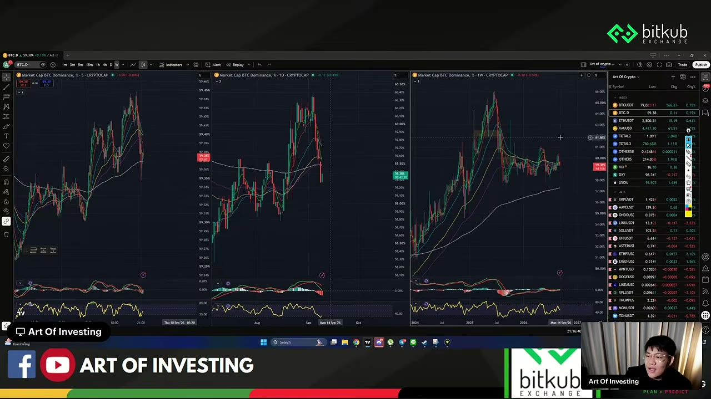

[01:16:19] เกือบมาถึงแล้วผมได้นะครับแต่ทีเนี้ย cyเคิลเนี้ยด้วยความที่มันวิ่งเร็วเกิน กว่า 4  year  cycle นะครับที่มันเป็น harving  cycle ของมันน่ะทำให้แบบมัน เบรกพรีเมี่มไปแล้วแล้วผมไม่ได้ของก็คือ เนี่ยมันเบรคตรงนี้แล้วเห็นป่ะเนี่ยติด 75 แล้วเบรคปึ้งเหนือ 0 โอบอแล้วมันแล้วมัน ไปเลยนะครับเพราะว่าถ้าด้วยตามหูปเวลามัน ควรจะย่ออีกครั้งนึงแต่มันไม่ย่อก็เลยไป เลยทีเนี้ยผมก็เลยต้องรอดูแล้วว่า มันจะย่อมาที่โซนไหนอย่างนะผมมองว่า ซัพพายหลักสุดเลยอ่ะอยู่ที่แถวเนี้ยคือ EMA  200 นะเพราะว่ามันไปตรงกับ ซpัlyตรงนี้พอดีคำถามคือแล้วแล้วกราฟ เนี่ยเราดูซัพพlyตรงเเราดูเพื่ออะไรนะ ครับต้องบอกก่อนว่าตรงเนี้ยมันบอกได้ 2 เรื่อง 1 นะครับออเดอร์ขายตรงนี้เยอะ เพราะขึ้นไปแล้วเหลือแต่ไส้แสดงว่ามัน ขึ้นไปออเดอร์ซื้อขึ้นไปมันแมชแล้วมัน รีเจคลงมาอย่างเดียวรีเจคลงมารีเจคลงมา รีเจคลงมาแล้วก็เกิด new  low แสดงว่า ออเดอร์ขายตรงนี้เยอะก็เลยมองว่าเป็นต้าน แรกนะครับส่วนเนี่ยก็คือตรงนี้เป็นก้อน

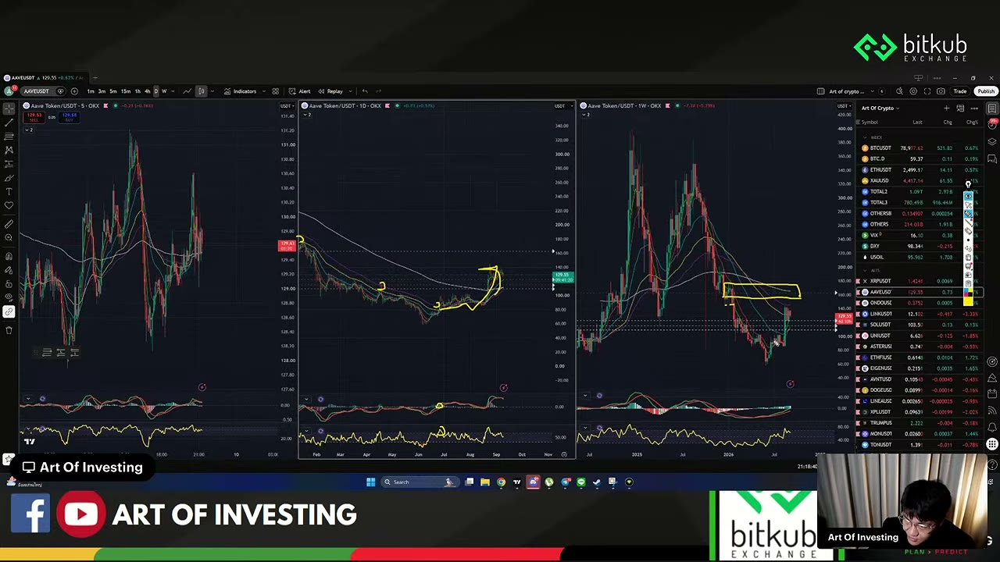

[01:17:23] นี้ที่เป็นนเพราะว่าส่งให้เบรคโครงสร้าง 2 อันนี้ขึ้นไปได้แสดงว่าออเดอร์ซื้อตรง เนี้ยต้องก้อนใหญ่ฉะนั้นตรงกลางเนี่ย เหมาะที่สุดนะครับที่จะเป็นจุดเริ่มดูว่า เป็นจุดพักตัวโมเมนตัมที่เหมาะสมนะเพราะ ว่าเนี่ยน้อยครับที่มันจะลงมาขนาดนี้ เนี่ยภาพใหญ่นึกออกใช่มั้ยฉะนั้นแรงส่ง ที่มันชนะโครงสร้างขาลงมาได้แสดงว่า ออเดอร์ขายที่มันขวางอยู่ตลอดทางอ่ะมัน เริ่มแพ้ละมันออเดอร์ซื้อมันก้อนใหญ่งั้น ผมก็เลยมองว่าเออถ้ามันลงมาตรงเนี้ยพอดี เลย EMA  10  EMA  25 นะครับงั้นภาพรวม มันก็จะเป็นอย่างงี้สมมุตินะว่าอ่ะผมก็จะ ไปดูใน 1 ชั่วโมงใช่ป่ะป่ะ เนี่ยสมมุตินะว่าว่ามันย่อลงมามันก็จะ เป็นอย่างเงี้ย แล้วมันถึงเป้าที่ผมอยากได้ปั๊บอ่ะก็แถว เนี้ยผมไม่รู้หรอกว่ามันจะถึงมั้นะครับ 113 เนี่ยอ่ะสมมุตินะ[เสียงสูดหายใจ] แล้วการ์ดมันเป็นอย่างงี้ เงี้ยแล้วมันขึ้นเหนือ 0 ได้ MAD เหนือ 0 overbอเงี้เออผมก็อาจจะได้ได้เก็บของอีก

[01:18:25] รอบนึงนะครับก็ต้องก็ต้องรอรอดูว่ามันจะ ย่อลงมาให้ผมเก็บหรือเปล่านะครับเนี่ยถ้า ย่อลงมาแล้วเกิดโมเมนตัมอ่ะผมก็น่าจะซัด นะครับเนี่ยตัวพวกเนี้ยผมผมชอบนะอันนี้ ไม่ใช่คำแนะนำการลงทุนนะนะครับผมว่า วิเคราะห์ให้ฟัง[เสียงสูดหายใจ]อย่างโซ อย่างงี้ก็เหมือนกันนะครับเนี่ย นะครับเนี่ยก็เกิดเกิด divergent ละ MAD ไอ้นี้ละแต่ว่าผมว่าโซนเนี่ยย่อได้ไม่ลึก นะครับว่าเดี๋ยวผมเอาแถวนี้แล้วกันเนี่ย แถว 93  94 เนี่ยถ้าย่อมาผมก็อยากได้และ แต่ว่าไม่รู้ว่าจะถึงหรือเปล่านะแต่ย่อมา เนี่ยผมเป็นคนเข้าจังหวะ 2 นะต้องบอกก่อน ผมไม่ใช่คนเข้าจังหวะ 1 ผมไม่เคยได้ก้น แล้วไปขายยอดเลยผมจะได้ช้ากว่าชาวบ้าน ตลอดเช่นสมมุติว่ามันมีอย่างเงี้ยแล้วมัน Fall เบรกถูกป่ะอันเนี้ยนับว่า Fall เบรกเพราะว่า overbard เหนือ 0 แต่ว่า เกิด New ก็โดน Stop  Loss ไปแล้วอีกรอบ นึงเอาใหม่ เหนือ 0  overbard อย่างเงี้ยแล้วเรา Stop Loss อยู่นี่ใช่มั้อ่ะมันเกิดเทรนด์ละ อ่ะฉะนั้นอย่างเงี้ยนะครับคือหลักการเทรด โมเมนตัมงั้นถ้าเกิดโซมันไหลลงมาอย่าง

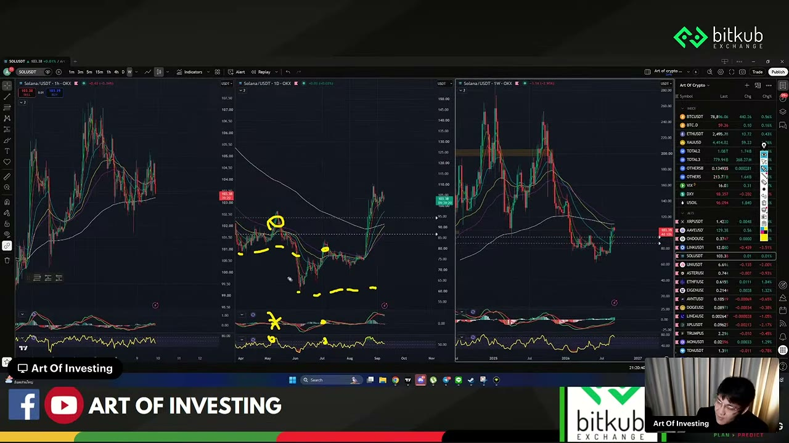

[01:19:26] เงี้ยผมก็จะไปดู 1H ละให้ 1H เกิดภาพนี้ 1H มันก็จะเป็นยังไงมันก็จะเป็นอย่างงี้ ตึ๊กๆๆๆแล้วก็เบรคฉะนั้นถ้าตรงเนี้ยเหนือ 0  RSI  overbard นะครับแล้วก็ผมก็จะวาง stop เนี่ยแล้วผมก็จะเก็บของเพิ่มไปนะ ครับก็ต้องรอดูว่ามันจะถึงมเพราะว่าตรง นี้มันเป็น fip  zone แล้วอ่ะมันก็ถ้าเรา มองเป็นภาพใหญ่ผมก็ได้ว่าได้ถูกป่ะ QL ก็ ได้ Inver  Head  and  Shoulder ก็ได้ก็ ต้องรอดูว่ามันจะมาสุดที่ตรงไหนนะครับ แล้วก็เราต้องดู Bitcoin เป็นหลัก ว่ามันจะทุบลึกแค่ ถ้าเกิดบitcoin 60,000  67,000  66,000 แบบดิฟอ่ะ outcoin คุณได้ซื้อทุกตัวแหละ นะครับเพราะว่ามัน sensitive มันก็น่าจะ แบบไหลดีไม่ดีบางตัว new อ่ะอันนั้นน่ะผม จะยิ้มเลยผมยิ้มแป้นแน่นอนถ้ามันเกิดเคส นั้นนะครับเพราะว่าผมรู้เลยว่าต้นปีหน้า เนี่ยเราเราจะได้เก็บของ outcoin ราคาถูก แต่ว่าก็โอกาสน้อยเนาะที่มันจะเกิดแบบ นั้นถ้าเกิดผมก็อยากได้นะครับผมมองแบบนี้ นะครับส่วนยูนี้เนี่ยมันมันไปไกลแล้ว อันเนี้ยนะครับเห็นมั้ยมันไปแล้วเนี่ยตอน

[01:20:26] มันเบรคเนี่ยเห็นมั้เนี่ยนะครับใน day อ่ะโมเมนตัมมันไปตั้งแต่ตรงนี้ละนะครับ เห็นมั้ยดูนะติด 75 ติด 75 ติด 75  F เบรกโดน Stop  Loss  1 จังหวะถ้าใครเล่น โมเมนตัมแบบไม่สนข่าวไม่สน้าตัวเลขอะไร เลยนะแบบเห็นกราฟเบรกกูเข้าอ่ะสมมุตินะ คุณก็จะต้องโดน Stop  Loss เพราะ Fall เบรกตรงนี้ไปละเพราะว่ามัน overbard magdin  0 แล้วคุณก็จะต้องมาเข้าใหม่ตรง Magdin  0  B แล้ว Stop  Loss ตรงนี้อ่ะ รอบนี้ไม่โดนรอบนี้ได้เนเกิดแล้วฉะนั้น จุดย่อผมก็มองว่าถ้ามองด้วย Fibo เนาะ อ่ะระยะแต่ผมมองว่าตรงนี้มันตื้นไปวะผม อยากได้ของแถวนี้นะครับเนี่ยที่มันเป็น hiden เนาะก็คือแถว 5.3  3 ก็คือถ้าเกิด มันย่อมาอย่างี้มันก็จะเป็นแซนวิชที่สวย งี้ใช่มั้ยเพื่อมารีทestแล้วก็ขึ้นอีกที เป็นแซนวิชปิดขึ้นไปอีกเทอ่ะอย่างเงี้ย อ่ะผมอยากได้ของตรงนี้เพิ่มก็คือถ้ามัน ย่อมาอย่างเงี้ยผมก็จะเข้าด้วยภาพเล็กอ่ะ

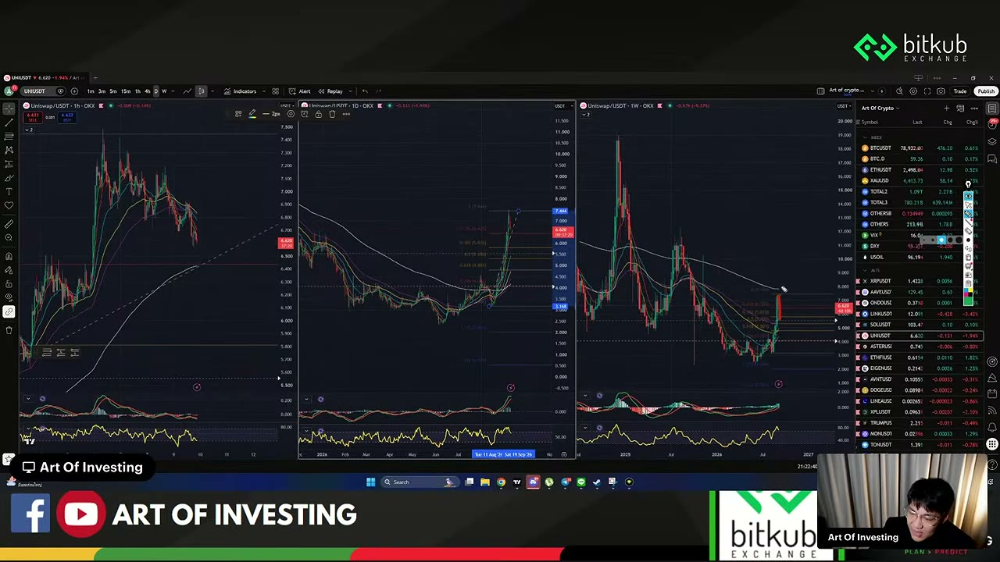

[01:21:30] อย่างสมมุติผมไปดู 1 ชั่วโมงอย่างเงี้ย เวลาภาพใหญ่ย่อนะ อ่ะเวลาภาพใหญ่ย่อนะ เนี่ยมันจะเป็นภาพอย่างงี้ เนี่ยเห็นมั้ยเนี่ยเห็นป่ะภาพใหญ่ย่อย่อ มาหาสมมุติว่าตรงนี้เรามองเป็นอย่างี้นะ แต่เราไม่รู้ว่าเฮ้ยมันรับอยู่ไม่อยู่ดู ตรงนี้จบเลยครับเฮ้ยติดอะไรติด 25 เบรคยัง MAD ก็ต่ำกว่า 0  R overบอเอ้ย เบรคแล้วเว้ยเหนือ 0 overบออ่ะ Stop  Loss อยู่นี่อ่ะเกิดเทรนละเนี่ยคือวิธี เข้าด้วย time  frame เล็กเนี่ยคือเนี่ย คือการหาโมเมนตัมด้วยด้วย higher  time frame แล้วเข้าด้วย lower  time  frame แล้วถ้ามี Bitcoin อีกมี OI อีกไงผม ก็เลยยิ่งชอบทีนี้ให้คุณนึกภาพดิว่าถ้า เกิดมันเป็นแนวรับ OI  Bitcoin แล้วมัน เกิดเงี้ยเราก็กล้าเข้าไงนึกออกมั้เอ้ย ใช่ละ Settlement เดี๋ยวโมเมนตัม

[01:22:32] มันต้องกลับเข้าหาตรงกลางกล่องก่อนอะไร อย่างเงี้ยนะครับอ่ะ BNB เดี๋ดู BNB ให้ โอ้โหสวยว่ะ เบรกตรงนี้ไปแล้วเนาะถ้าถ้าเกิดจะย่อก็มี ทางเดียวอ่ะก็คือให้มันเป็น invvert  Head and  shoulder นะครับต้องลุ้นให้มันลงมา เนาะงั้น BNB เนี่ยผมไม่คิดว่ามันจะลงมา ได้ลึกขนาดนั้นนะโซนแรกก็คือแถวเนี้ย 690 นะครับถ้าลงมาตรงเนี้ยปึกมันควรจะขึ้นดอก ได้เลยนะครับก็คือมันติดตรงเนี้ยมันก็จะ เป็นท่าแบบนี้นึกภาพออกมั้ยเนี่ยๆภาพภาพ แบบนี้เลยนะครับก็คือขึ้นไปละแล้วย่อกลับ มาที่ EMA แบบโม่นะครับก็คือตรงเนี้ยงั้น ก็ย่อมาอย่างเงี้ยแถว 690 อ่ะไม่ควรเกิน แล้วถ้าจะขึ้นแบบเร็วๆแรงๆแต่ว่าถ้าจะ ขึ้นแบบพักตัวแบบย่อหน่อยซึ่งผมว่ายาก แล้วกันก็คือแถวเนี้ยเราจะต้องดูแถว inverse  Head  and  Shoulder ตรงนี้นะ ครับแล้วเกิดโมเมนตัมใน time  frame เล็ก ประมาณนี้เนียเหรออ่ะเดี๋ยวดูเนียซิ

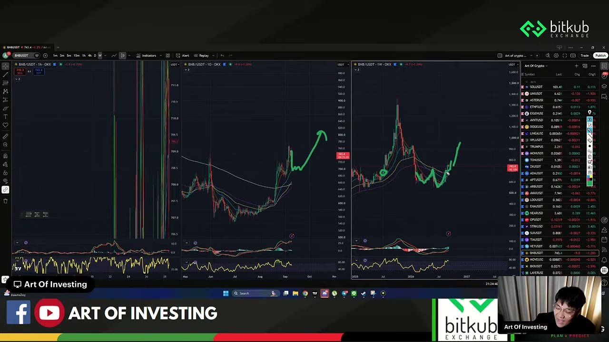

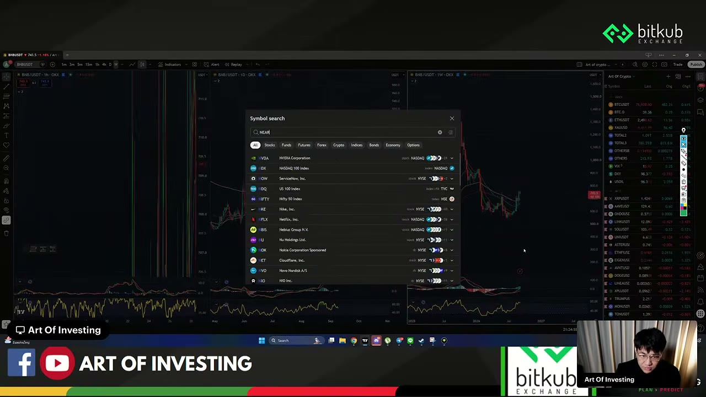

[01:23:41] หูสวยโคตรอ้า แบบนี้ไม่น่าย่อครับน่าไป E  200 ก่อนผม ว่าเนียน่าจะไปถึงตรงนี้ นะครับเนียเนี่ยน่าน่าจะขึ้นไปถึงตรงนี้ ก่อน 3.18  18 อืมีแนวโน้มนะครับเพราะว่า เนียเนี่ยมันไปแล้วโมเมนตัมมันไปแล้วนะ ครับฉะนั้นถ้าใครเข้าเนียก็ stop  loss ตรงเนี้ยถ้าหลุดต้องออกนะนะครับ ถ้าถ้าหลุดต้องออกนะเพราะว่าโมเมนตัมส่ง ถึงแล้วตัวอื่นยังส่งไม่ถึงแต่เนียถึง แล้วนะก็คือ near เนี่ย Bitcoin เอ้ย day เนี่ยoverbอ md เหนือ 0  week ก็เหนือ 0 overบอแล้วฉะนั้นน่ะเนียมีสิทธิ์วิ่งถึง ตรงนี้ก่อนนะครับ 3.18  18 คำถามคือทำไมทำไมถึงดูตรงนั้นนะครับเพราะ ว่าเอ่อเราจะเห็นว่าตรงนั้นน่ะขึ้นไปได้ มีแค่ไส้แสดงว่าตรงนั้นน่ะครับซpัพyly เยอะก็เป็นจุดแรกที่น่าจะเกิดreีอคtionนะ ครับก็ให้ดูตรงนั้นก่อนแล้วก็ stop  loss วางตรงนี้เลยนะครับโมเมนตัมอย่างเงี้ย

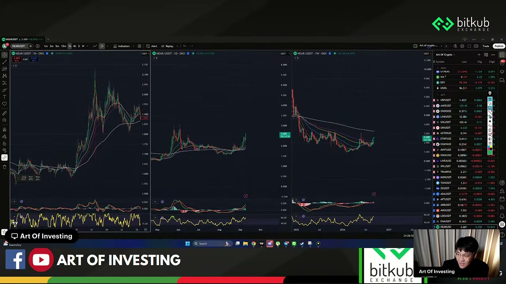

[01:24:42] เพราะว่าถ้าเกิดมันเกิดรอบใหญ่อ่ะมันก็จะ เป็นอย่างี้แหละ อบิัมิัมันวิ่งไปแล้วครับมันได้กระแส โรบินฮู้ดก็ผมตั้งแจ้งเตือนอยู่เห็นมั้ย ผมผมเป็นคนบ้าจังหวะ 2 มาก East  F สวย East ไฟสวยอ่ะถามว่าทำไมผม บ้าจังหวะ 2 นะเพราะว่าวันผมเทรดอ่ะผมจะ ชอบเทรดท่าแบบนี้เห็นป่ะอ่ะสมมุติมอง อย่างเงี้ยอุ๊ยเบรคไปแล้วอ่ะเมื่อไหร่จะ ย่ออ่ะผมก็จะรอแล้วถ้าเกิดมันย่อมาตรง เนี้ยมันทำ Balance โซนนะครับแล้วมันเบรค อีกรอบด้วยTimeม Frame เล็กเงี้ยมันจะ เป็นจุดเข้าเราฉะนั้นน่ะถ้าเราไม่ทัน จังหวะแรกอ่ะผมอ่ะชอบจังหวะ 2 ก็คืองั้น มึงติดตรงไหนมาตลอดกูจะรอมึงที่เดิมนะก็ คือมันติดgปตรงนี้มาถูกป่ะงั้นผมก็จะรอ มันเบรคไปละงั้นกลับมาที่เดิมเงี้ย sideway แล้วขึ้นต่อเป็นsซนวิช เป้าต่อไปคือ EMA  75 ใน week แถว 0.25 นะครับถ้าเกิดมันย่อลงมานะแถว เนี่ย 0.14  0.15  15 เนี่ยผมผมเริ่ม

[01:25:42] เริ่มสนใจละจะไปดูเฟรมเล็กละนะครับถ้าถ้า เกิดถ้าเกิดมันย่อนะครับแล้วก็ขึ้นอีกที ถ้าเกิดมันย่อมาตรงเนี้ยแล้วขึ้นอีกทีนึง อ่ะโมเมนตัมเกิดละเราก็วาง stop นี่นะ ครับแล้วรันเทรนด์ถ้าเบรคตรงนี้ก็วิ่งยาว ถ้าไม่ถ้าไม่เบรคผมขายนะนะครับมันจะเป็น จุดจุดออกนะครับถ้าไม่เบรคอ่ะ East  F อ่ะเดี๋ดูให้อีกตัวนึงแล้วกัน ก่อนผมลง อ่ะโอเค ตอนเนี้ยครับ East  F ลุ้นและถ้าเกิดว่า ปิดเบรคตรงนี้นะครับเป็นแซนวิชเหนือขึ้น ได้เนี่ยแนวโน้มจะขึ้นไปหา EMA  75 ได้ก็ คือเอ่อ 0.89 แต่ถ้าเกิดเริ่ม ไส้ไส้ไส้แบบเนี้ยมีโอกาสย่อครับมันก็จะ ย่อมาเทสที่ตรงนี้แถว 0.4  4 ต้องดูนะว่า มันจะเกิดไส้ๆอย่างี้เยอะหรือเปล่านะครับ ถ้าเกิดไส้ๆเนี่ยแปลว่าแถวเนี้ยออเดอร์ ขายมันหนาถูกป่ะเพราะว่าออเดอร์ซื้อขึ้น ไปแมชทิ้งหมดเลยอ่ะแมตชแล้วกดลงแม แล้วกดลงแบบเก็มีโอกาสจะย่อแต่ถ้ามันปิด

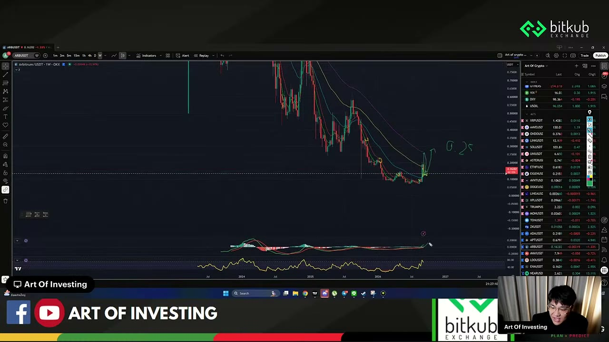

[01:26:44] เป็นแซนวิชอย่างงี้คำถามคือทำไมเรียกว่า แซนวิชก็คือระหว่างทางเนี่ยมันมีแรงขาย แล้วมันปิดกลับด้วยขนมปังทางเดิมมันแปล ว่าระหว่างทางกูก็ขายนะแต่ว่าขายเท่าไหร่ เทรนด์ก็ยังไม่เสียงั้นมันแปลว่าออเดอร์ ซื้อที่มันตั้งซื้อตามมามันไล่ขึ้นมาตาม สูงขึ้นเรือเรื่อยๆนะครับแนวโน้มก็มี โอกาสจะขึ้นไปถึงด้านบนก็คือ 0.89  89 นะ ครับก็ให้ดูตรงนี้ปิด week นี้สำคัญนะ ครับสำหรับ East  F iOS ผมว่าเหรียญมันไม่ได้มีประเด็นอะไร เท่าไหร่แล้วครับเพราะว่า IOST ตอนนั้น มันดังเพราะว่ามันเป็น proof  ofity นะ ครับแล้วก็มันเป็นช่วงที่หลายตัวอย่าง เป็น Etherium  Killer นะครับช่วงปี 2021 อ่ะพวกเหรียญ Infra มันจะดังเพราะว่าเออ แบบเอ้ยEทeriumสำเร็จว่ะคือเอา Smart Contract ออกมาใช้แล้วสามารถสร้างเป็น Dayf ไฟล์สร้างเป็นอะไรหลายๆอย่างได้คือ มีสัญญาอัจฉริยะอย่าง Smart  Contract แล้วหลากหลายตัวก็อยากเป็น Infrastructure แต่มันต่างไปแล้วครับรอบเนี้ยผมมองว่ามัน เป็นที่ตัว product และแพลตฟอร์มมากกว่า

[01:27:44] Chaนนะครับฉะนั้นตัวไหนก็ตามที่มันเกี่ยว กับการใช้งานด้วย Real  World  Assess จริงๆอ่ะน่าจะได้กระแสมากกว่า Infra Infra ตัวรองผมมองแค่ AVAX กับ Solana เพราะว่ามันรองรับการขึ้นเป็นลิสของ Real World  Asset ด้วยนะครับ แต่ก็ถ้าเป็นเพผมก็ดู Aster กับกับ HP แหละแต่ผมไม่ชอบกราฟแบบ AS มันเยอะเกินคุณดูกราฟ Day ดิเนี่ยคุณดูดิ อย่างเงี้ยมันเทรดยากมากเลยนะถ้าเกิดคุณ เทรดFutจureอ่ะนะครับยากมากเลยนะคือมัน ทุบไส้อั่วไส้กิวเลยอ่ะนะครับคือเลateมัน เยอะเนี่ยชีสตลอดนะครับผมก็เลยมองว่าถ้า คุณจะเทรด AS อ่ะต้องสปอเท่านั้น อ่ะวันนี้ประมาณนี้แล้วกันนะครับก็หวัง ว่าจะเห็นภาพเรื่องเอ่อ OI กันมากขึ้นนะ ครับฉะนั้นตอนเนี้ยผมว่ามันจะกุ๊กกิ๊กๆิ๊ ไปก่อนแล้วก็ไปรอตัวเลขพรุ่งนี้คือ CBI ระวังนะแล้วก็ผมบอกเลยว่าพฤศุขผมจะไม่ เทรดนะครับใครจะว่าป๊อตเอ้ยมึง day

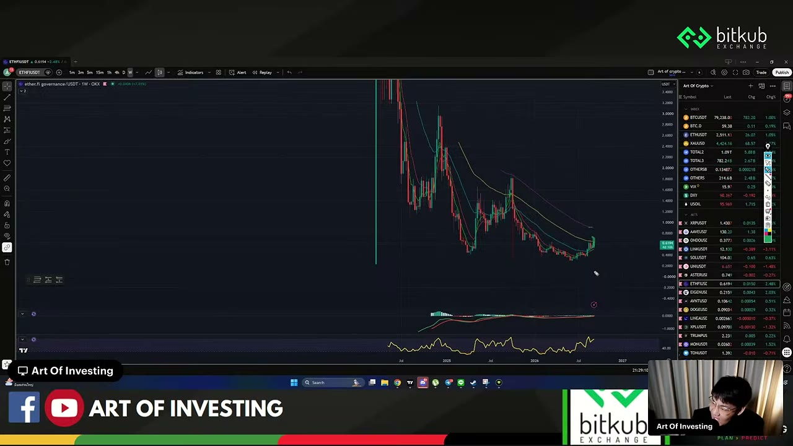

[01:28:46] เทรดเดอรอะไรวะมึงพักเทรดเออผมไม่เทรด ตังค์ผมครับดีกว่าเอาไปโยนให้ข่าวนะครับ ฉะนั้นผมรู้แน่ๆว่าผันผวนน่ะนะครับ ยันอาทิตย์หน้าถ้ากราฟไม่ชัดจริงผมจะไม่ แตะเลยกับการเทรดพักอาทิตย์นึงดีกว่าต้อง มาตามทุนบางคนไม่คิดแบบนี้นะผมผมจะบอกแบบ ว่าบางคนน่ะจะชอบคิดว่าเฮ้ยหาเงินไว้ก่อน ได้น้อยหน่อยไม่เป็นไรสมมุติว่าคุณกำไรมา 300,000 คุณไปเสียให้กับการเทรดข่าว 200,000 กลายเป็นว่าจากที่คุณจะอยู่เฉยๆ แล้วรวยเท่าเดิมกลายเป็นว่าคุณต้องมาตาม ทุนเหนื่อยกว่านั้นอีกฉะนั้นน่ะผมผมจะไม่ แตะเลยข่าวอ่ะเรามีพอร์ตระยะยาวอยู่แล้ว ก็ให้พอร์ตระยะยาวมันทำงานไปนะครับเทรด มันไม่ต้องเทรดทุกวันก็ได้เราเทรดอยากได้ กำไรเราไม่ได้อยากเทรดเพราะเราชอบนะครับ ถ้าให้เลือกไม่มีใครชอบเทรดหรอกคุณว่าป่ะ บ้าเป่าใครมันจะมานั่งเฮ้ยจ้องกราฟแล้ว แบบโอ้โหโดพามีนหลั่งว่ะโอ้โหมี ความสุขว่ะได้กดซื้อขายได้ได้ลุ้นว่าจะ เสียตังค์หรือเปล่ามันมันฟินเหลือเกินมัน ไม่มีใครเป็นแบบนั้นหรอกนอกจากเป็นโรคจิต

[01:29:48] นึกออกมั้ยเออเราไม่ได้ชอบเทรดเราชอบได้ ตังค์ฉะนั้นถ้าคุณเริ่มรู้แล้วว่าโอกาสจะ ได้ตังค์เนี่ยอ้าเงี้ยเหมือนกับคุณจะไป แทงโต๊ะบอลน่ะแต่ว่าคุณรู้ว่าไอ้เจ้ามือ คนเนี้ยมันเหลี่ยมเยอะอ่ะคุณก็รอรอก่อน ว่าเฮ้ยเดี๋ยวไปแทงอาทิตย์หน้าก็ได้ที่ เจ้าเป็นรายเดิมที่เราคุ้นเคยอ่ะนะ ครับเออฉะนั้นน่ะ 2 วันเนี้ยพระราชศุกร์ อ่ะผมน่าจะไม่แตะวันเนี้ยผมผมเทรดไปแล้ว ผมพอละ เออใช่ครับเราต้องรู้ช่วงในนี้บ้างแต่แต่ ไม่ว่ากันนะถ้าเกิดใครชอบdayเทรดแล้วแบบ หัวใจมันสูบฉีดดีก็เอาเลยครับ เออเมื่อกี้มีอ่ะ PY  TI  Shop อันผมจำ ได้ไงเพราะว่าเค้าดูช่องผมตั้งแต่ 2021 นะครับแล้วเบอกว่าคิดถึงเออเค้าหายไปนาน จริงเอ้ยผมจำได้นะเพราะว่าตอนก่อนคุณ PY Thai  Shop อ่ะมาทักทายผมทุกไลฟ์แล้วก็ มาเม้นต์แล้วก็ไม่เคยเปลี่ยนชื่อช่อง YouTube ผมก็เลยจำได้นะครับเออจะบอกว่า ใครที่มาทักผมบ่อยๆอ่ะผมผมจำได้นะผมจำได้

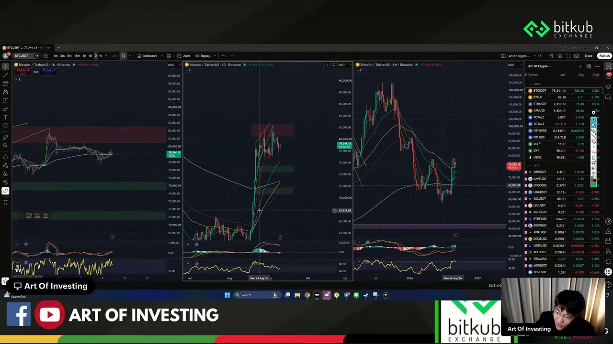

[01:30:50] ก็ดีใจที่ยังย้อนกลับมาหากันนะครับ ขอบคุณมากยินดีครับคุณแบคทีเรียลนะครับ ทองภาพรวมหรออ่ะถ้าภาพรวมอ่ะมันเป็นแบบ นี้นะครับก็คือเอ่อแถวตรงเนี้ยมันเป็น discานะครับถูกมยแล้วมันหลุดแล้วผมก็เลย ตีตรงนี้ไว้ว่าถ้าเกิดว่ามันไม่สามารถ เบรคโซนตรงนี้ได้อ่ะมันน่าจะลงไปพักโซน ด้านล่างนะครับซึ่งตอนเนี้ย ISI มัน overb ไม่ได้นะครับภาพรวมคือให้ดูว่า WeEK เนี่ยจะสามารถปิดขึ้นไปเป็นแซนวิชแบบนี้ ได้เมื่อไหร่ถ้าแบบเนี้ยมันจะมีโอกาสขึ้น ไปเทส 5,000 แต่ถ้าไม่นะครับแล้วเกิดแรงขายลงมาแบบนี้ ทองคำนะ อ่ะสมมุติว่า อ่ะขึ้นไปตรงนี้แล้วไม่ผ่านแถว 4,600 นะ ครับผมก็มองว่ามีแนวโน้มจะลงมาทำdoubleิ bottom ที่ EM75 อีกรอบนึงก็คือแถวนี้นะ

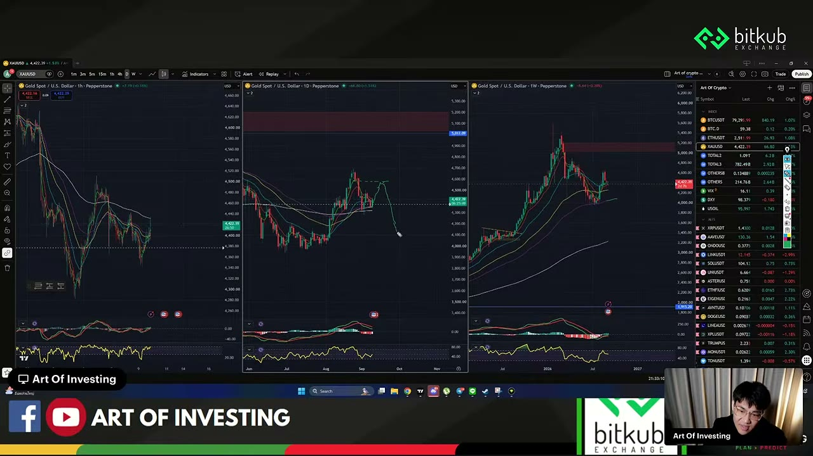

[01:31:52] ครับแถว 4,1 เงี้ยอ่ะตรงเนี้ยอาจจะเป็น จุดายที่ดีแล้วค่อยขึ้นไปให้มันเทสด้านบน นะครับต้องดูเหมือนโมเมนตัมเป็นยังไง เพราะว่าตรงเนี้ยคีย์หลักเลยอ่ะคือดอก เบี้ยโคตรสำคัญนะครับถ้าเกิดเอ่อสงคราม ยังไม่จบเลือกตั้งมิดเทมทุกอย่างมีปัญหา เม็ดเงินหลุดออกจากตลาดหุ้นอะไรอย่าง เงี้ยมันจะเกิดการดิฟแล้วทองจะขึ้นรอบ ใหญ่ได้อีกครั้งนึงก็มีแนวโน้มนะครับ ฉะนั้นให้สำคัญคือดูตอนเนี้ยดูตอนมันเทส 4,600 อีกรอบนะครับถ้าเกิดมันเบรคแล้ว ปิดเต็มแท่งไปเลยอ่ะโอเคแนวโน้มมันจะขึ้น ไปเทสด้านบนก็มีสูงะแต่ถ้ามันปิดเต็มแท่ง ไม่ได้ก็มีแนวโน้มะที่มันจะลงมาทำdouบิ bottom ที่ตรงนี้แล้วค่อยขึ้นงี้นะครับ แบบนี้สั่งจงเจริญมาลองดมแล้วครับอุ๊ย ขอบคุณที่อุดหนุนกันครับจงเจริญไป ซัพพอร์ตพี่ต้ากับทนายไข่มุกแล้วเรียบ ร้อยเนาะนะครับอ่ะวันนี้ประมาณนี้ะกัน ขอบคุณทุกคนมากเลยนะครับที่มาติดตามกัน ทุกไลฟ์เลยจริงๆนะครับก็ดีใจครับเราก็เจอ กันอีกทีเนาะก็คือพุธหน้านะครับก็เจอกัน เหมือนเดิมที่เอ่อ YouTube นะครับแล้วก็

[01:32:54] Facebook นะครับผมเวลา 20:00 น.นะครับ อ่ะวันนี้ขอให้ทุกท่านมีความสุขในการลง ทุนครับก็ระมัดระวังนะครับ 2 วันนี้ พฤหัสบศุกร์แล้วก็อาทิตย์หน้าทั้งอาทิตย์ นะครับสะบัดต่อไม่รอเรานะผมว่าผันผวนหนัก แน่ๆนะครับก็ใครไม่คันมือก็ไม่ต้องเทรดนะ ครับพักเหอะถ้าDayเทรดอ่ะนะครับไปรอพอร์ต สปอรมันทำงานนะครับเออผมว่ามันน่ากลัว เกินอ่ะโอเคเจอกันพุธหน้าครับสวัสดีครับ

