# ทำไมดอกเบี้ยขึ้นแต่ Bitcoin ไม่ลง?

- ช่อง: Art Of Investing
- ลิงก์: https://www.youtube.com/watch?v=31S9ZL32WKM
- วันที่: 2026-09-17
- ความยาว: 1:39:43
- ที่มา: คำบรรยายอัตโนมัติ (auto-generated) ภาษาไทยของ YouTube — อาจมีคำสะกดผิด/คำผิดเสียง
- ภาพ: 62 ภาพจากวิดีโอช่วงที่เปิดกราฟแท่งเทียน (เลือกอัตโนมัติจากสีแท่งเทียน · ตัดภาพซ้ำ) อยู่ในโฟลเดอร์ frames/

---

[00:00:37] อ่ะเป็นไงครับสวัสดีทุกคนนะฮะเอ้ยเดี๋ยว ผมไม่ได้เอา แชทขึ้นมั้ยเอ่ยอ่ะโอเคนะครับน่าจะติดละ เดี๋ยวผมขอเช็คไมค์กับเสียงสักครู่นะว่า มันติดหรือเปล่านะครับ เดี๋ยวนะสักครู่ถูก ตึ๊บๆ โอโอเคคิดว่าไลฟ์น่าจะปกติแล้วนะครับไม่ น่ามีปัญหาอะไรเนาะ โอเคนะครับอ้าสวัสดีทุกคนครับสวัสดีครับ สวัสดีครับอาจารย์สุดหล่อสวัสดีครับคุณ

[00:01:38] สุกินโทแหมเราเจอกันทุกไลฟ์เลยนะขอบคุณ ที่เป็นแบบแฟนคลับเหนียวแน่นนะครับผม สวัสดีครับคุณโกโก้สวัสดีครับคุณจตุรงค์ แล้วเมื่อวานนะก็พยายามรีบละนะครับแต่ว่า ก็เออกลับจากการทำงานธุรกิจไม่ทันนะครับ แล้วก็ช่วงนี้ก็จะวุ่นๆหน่อยเนาะแต่ว่าผม ว่าตลาดไม่ได้มีอะไรหวือหวาแล้วก็ผมอยาก เปิดภาพให้ดูเราจะได้แบบสบายใจกันเพราะผม ก็รู้สึกว่ามันก็เป็นตามแผนทุกอย่างเลย ไม่รู้ว่าจะกังวลอะไรกันนะครับแต่ว่าผมจะ อธิบายก่อนนะครับสิ่งนึงที่สำคัญนะแล้วก็ ผมรู้สึกว่า มันไม่ควรนั่งเคลมอ่ะคือเราต้องอธิบายให้ ได้ด้วยว่ารอบเนี้ยทำไมมันถึงเกิด แอคtionัตามที่เรามองไว้แล้วก็มันยังมี โอกาสเกิดเคสอื่นๆอีกหรือเปล่านะครับก็ เดี๋ยวผมพาดูทีละเคสแล้วกันนะครับ เคเดี๋ยวนะแชร์หน้าจอก่อน ปึ๊บได้มั้ยโอเคได้เนาะปึบเฮ้ยผมแปะ QR

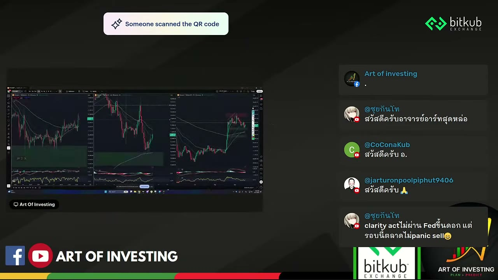

[00:02:42] Code อะไรแล้วหรอทำไมมันขึ้นว่า someone scan  QR  Code นะครับเดี๋ยวก่อน อันเนี้ยอันเนี้ย QR  Code  Telegram ผม นะครับอ่ะโอเค สวัสดีครับ แไม่ผ่านเฟซขึ้นดอกแต่รอบนี้ตลาดไม่ผ่าน อีกเซลเออมันมันเป็นเรื่องที่ผมจะอธิบาย ให้ฟังวันนี้เลยเป็นเรื่องแรกเลยแหละคุณ สุกินโทนะครับก็เดี๋จะอธิบายให้ฟังนะครับ สวัสดีครับคุณอ่ะภาพรวมอธิบายง่ายๆนะว่า ตลาดกับนักลงทุนน่ะเค้าไม่ชอบอะไรนะครับ คำตอบก็คือเขาไม่ชอบความไม่แน่นอนถูกป่ะ ทีเนี้ยเนี่ย เรื่องแรกคือเค้าไม่รู้ว่า Kevin  Watch อ่ะเค้าจะ take  action ยังไงกับเงินเฟ้อ เพราะทรัมป์เนี่ยเป็นคนเรียกว่าเลือกขึ้น มาอ่ะเป็นหนึ่งในแคนดidateเลือกขึ้นมา แล้วกันแล้วทรัมป์เนี่ยเขาก็ย้ำนักย้ำหนา ว่าเอ้ยเขาอยากจะให้รถดอกแล้วก็Jโรมโพเวล เนี่ยโดนทรัมป์ด่าตลอดถ้าเราเห็นเนาะเฮ้ย

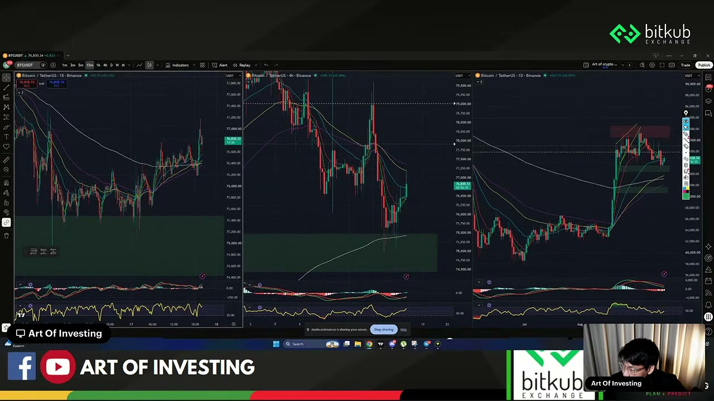

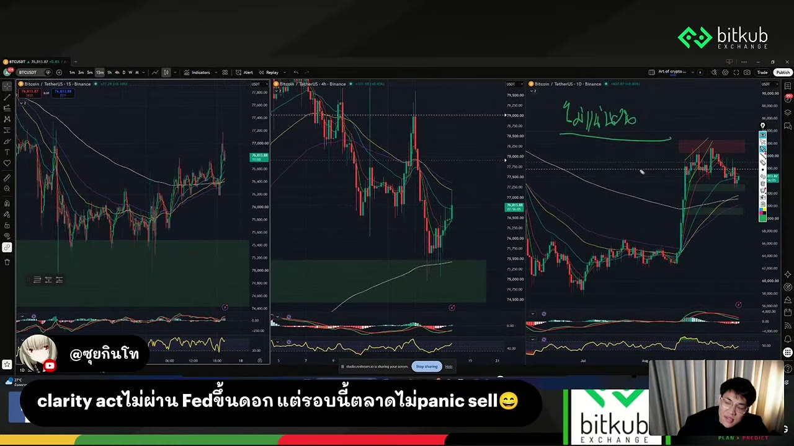

[00:03:44] ทรัมป์มันแก่หงำเอ่อโพเวลมันแก่ไปแล้วมัน ช้าไปสำหรับโลกยุคเศรษฐกิจยุคนี้แล้วเอ่อ เอ่อมันต้องลดดอกเบี้ยเราต้องกระตุ้น เศรษฐกิจได้แล้วอเมริกาจะเป็นหับที่มี อำนาจการต่อรองที่สูงกว่านี้ GDP เราจะโต กว่านี้เรากำลังกดขี่ประสิทธิภาพของ ประเทศเราที่ทำได้ออะไรก็แล้วแต่นะครับ ฉะนั้นคนก็เลยมอง Watch ว่าเฮ้ย Watch เนี่ยจะเป็นคนที่กลืนน้ำลายตัวเองมั้ย เพราะว่าแนวทางของเขาอ่ะเา้าเป็นคนสาย hอกageมาตลอดคำว่าhฮอกก็คือเป็นคนที่ค่อน ข้างไม่อัดฉีดเงินเข้าสู่ระบบแล้วกันนะ ครับเป็นคนเข้มงวดมาตรการเนี่ยจะออกแนว เอาแบบ h คือติดลบหน่อยๆนะครับผมพูดให้ เข้าใจง่ายนะเป็นภาษาง่ายๆนะครับหาก เพื่อนๆอยากได้ภาษาadวanceกว่านี้ก็ไป ศึกษาต่อได้แต่ผมว่าผมอยากจะพูดให้มือ ใหม่เก็ตง่ายๆนะครับทีเนี้ยตลาดเนี่ย เกลียดความไม่แน่นอนนั่นคือสาเหตุที่ทุก ครั้งที่คุณดูตลาดเซตหรือ Stock  Exchange Thailand น่ะตลาดหุ้นไทยอ่ะช่วงก่อน เลือกตั้งกับหลังเลือกตั้งอ่ะตลาดมันเลย

[00:04:44] มักจะวิ่งเป็นเทรนด์สังเกตมั้ยย่อก็ย่อ เป็นเทรนด์ขึ้นก็ขึ้นเป็นเทรนด์เพราะว่า คนมันรู้สึกว่าเอ้ยมันแน่นอนละอ่ะโอเค โอเคตอนแรกคุณจะบอกว่ามันไม่โปร่งใสไม่ อะไรแต่สุดท้ายแล้วพอมันหยุดมีการประท้วง หยุดมีการขอตรวจสอบเนี่ยตลาดก็เริ่มวิ่ง เป็นเทรนด์งั้นความไม่แน่นอนในที่เนี้ย มันประกอบด้วยตัวเลขอะไรบ้างคำตอบก็คือ มันก็จะมีnonฟาร์มถูกมั้ยที่ออกมาเฮ้ย ดูเศรษฐกิจก็ยังแข็งแรงนี่หว่าแต่ดู CPI กับ PPI ก็ไม่ได้ดูดีขนาดนั้นนะดูกลางๆ เอ้ย Kevin  Watch เอาไงแล้วTrัปเนี่ย เค้าก็ออกมาเคลเตรมก่อนหน้านั้นเลยใช่ มั้ยว่าแบบเฮ้ยเนี่ยคุณดูดิเราทำให้เงิน เฟ้อเนี่ยเอ่อมันลงได้ขันนี้แล้วเศรษฐกิจ มันยังดีขออภัยเราทำให้เศรษฐกิจมันดีได้ ขนาดเนี้ยแบบเนี้ยเฟรจะพิจารณาลดดอกเบี้ย ได้แล้วเพราะว่าเศรษฐกิจมันดีแล้วอ่ะ ปรากฏว่าเมื่อคืนน่ะมันหักหลายอย่างที่คน คาดหวังไว้เลยหรือคาดการณ์ไว้เลยนะครับคน

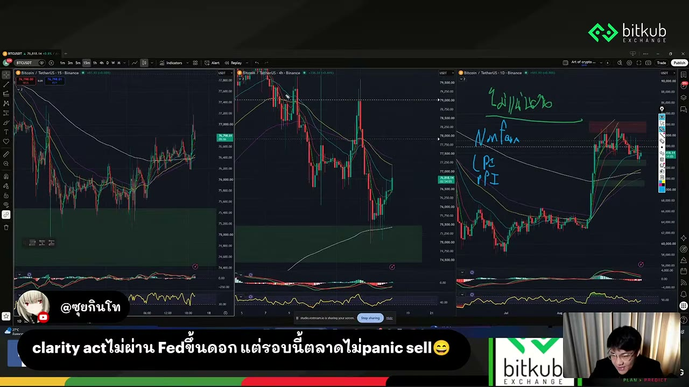

[00:05:46] คาดการณ์ว่าเฟดเนี่ยถ้าเกิด watch เขาจะ ตามทรัมป์เนาะถ้าถ้าเา้าจะตามใจทรัมป์ เนี่ยเค้าก็ต้องลดดอกถูกป่ะ อ่ะอันเนี้ยคือภาพที่ทรัมป์ต้องการผมใช้ คำพูดนี้แล้วกันแต่กลายเป็นว่าเฟซเลือก ที่จะขึ้นดอก แล้วมันสำคัญที่ การตอบคำถามครับการตอบคำถามเนี่ยคนโลกกับ โจรโพเวลเลยผมไม่รู้ว่าเพื่อนๆน่ะได้ไปดู ไลฟ์สดหรือเปล่านะหรือว่าดูย้อนหลังหรือ เปล่านะแต่ว่าตอนที่เค้าอภิปรายเนี่ยตอน นั้นที่ผมแปลสดกับพี่ศรีเเนี่ยประมาณ 3 ปีก่อน 4 ปีก่อนเนี่ยประมาณ 40 นาทีอ่ะ กว่าจะจบถูกป่ะแต่อันเนี้ยเค้ายึดมั่นใน อุดมการณ์ตัวเองมากแล้วตอบทุกอย่างโคตร กระชับเลยอ่ะผมจะยกตัวอย่างให้ฟังนะเควช มานักข่าวถามเงี้ยเอ่อคุณขึ้นดอกเบี้ย ครั้งนี้แล้วครั้งต่อไปเนี่ยมาในแผน

[00:06:48] เนี่ยคุณวางแผนว่ายังไงบ้างยังคิดว่าปี นี้จะขึ้นอีก 2 ครั้งมั้ยหรือจะขึ้นอีก ครั้งเดียวหรือคุณคิดว่าอันนี้มันสูงไป แล้วเตอบแบบเอ้ยผมไม่พิจารณาล่วงหน้าแล้ว ผมคิดว่าการให้มาตรการความคิดของเฟออกไป ล่วงหน้าหรือที่เขาเรียกว่า forward guidance เนี่ยไม่ดีต่อตลาดเท่าไหร่ผมผม ไม่มีสิทธิ์ที่จะพูดตรงนั้นเนี่ยมัน กระชับมากเอ่อแล้วคุณคิดยังไงที่ขึ้นดอก เบี้ยตรงนี้มองว่าเศรษฐกิจจะยังรับไหว มั้ยเค้าบอกว่าก็ทรัมป์เค้าบอกว่าเ้าทำ เศรษฐกิจให้ดีแล้วงั้นหน้าที่ของผมก็คือ ต้องต่อสู้กับเงินเฟ้อเค้าก็ทำหน้าที่ เา้าได้ดีแล้วนี่โอ้ยประธานีเราทำให้ เศรษฐกิจกลับมาดีได้งั้นผมก็ต้องขึ้นเงิน ขึ้นดอก[เสียงกระแอม]เบี้ยสิเพราะว่าเงิน เฟ้อยังกำลาบไม่สำเร็จเลยยังไม่ลงไป 2% เลยแล้วอีกอย่างนะเขาย้ำคำนี้นะคำนี้ค่อน ข้างสำคัญ เขาบอกว่าดอกเบี้ยเท่าเนี้ยยังกระตุ้น เศรษฐกิจได้ด้วยซ้ำสำหรับเค้าอ่ะฉะนั้นใน มุมมองของ Watch อ่ะดอกเบี้ยตอนเถือว่า

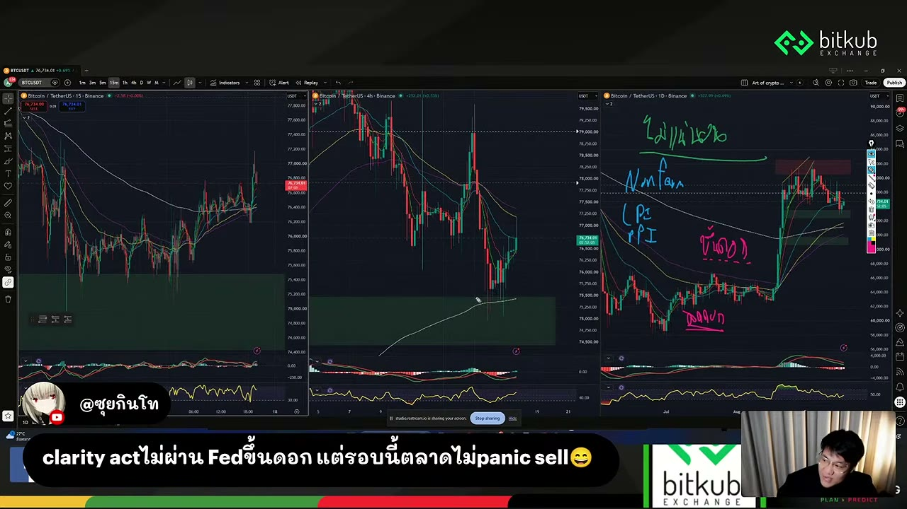

[00:07:50] อ่ะนะครับในมุมมองของ Kevin  Watch อ่ะ ดอกเบี้ยสำหรับเค้าอ่ะต่ำด้วยซ้ำเอ้ย ขึ้นกว่านี้ก็ได้นี่โหนี่ผมใจดีนะตัวเลข อย่างงี้กระตุ้นเศรษฐกิจด้วยซ้ำนะครับพอ เป็นแบบเนี้ยคนก็เลย absorอหรือดูดทรัพย์แล้วว่าคนเนี้ยแน่นอน คนเนี้ยมั่นคงกับนโยบายงั้นทุกครั้งที่จะ เกิดโฟมซหรือทุกครั้งที่จะเกิดคำอภิปราย จากเขาอ่ะคนไม่ต้องลุ้นเฮ้ยมันจะเปลี่ยน ป่าวะเฮ้ยมันจะขึ้นมั้วะเฮ้ยมันจะปรับดอก อะไรนะครับตลาดก็เลยตอบรับกลัวความแน่นอน ตรงนี้นี่คือพาร์ทแรกพาร์ทที่ 2 คือจำได้ มยว่าผมโพสต์ในเพจ Facebook เลยนะครับ ทั้งไอ้โซนเก็บของตรงนี้ที่ผมโพสต์ในเพจ Facebook แล้วก็ 92% ของตลาด ที่มองว่าเฮ้ยน่าจะขึ้นดอกครับ

[00:08:51] เหมือนกับคุณนั่งอยู่ในห้องเรียนน่ะแล้ว ก็วันนี้อาจารย์กำลังจะเข้ามาทีเนี้ย อาจารย์เเกริ่นๆไว้ก่อนะคราวที่แล้วว่า เออรอบเนี้น่าจะมีควิสแล้วในห้องเรามี 100 คนน่ะ 92 คนก็คิดเหมือนกันว่าวันเนี้มัน น่าจะมีควิสฉะนั้นพออาจารย์คนนั้นเดิน เข้ามาแล้วบอกว่าเฮ้ยวันเนี้ยควิสนะมัน ไม่มีความแตกตื่นนึกออกมั้ยเพราะว่าตลาด มันตีความ 92% แต่ว่าถ้าเกิดคุณไปดู Watch 2 อ่ะแล้วตลาดมันตีความแบบโอกาส 40% จะ ขึ้นดอก 50% เงี้ยอ่ะอย่างเงี้ยมันเกิด พิกิคมัน drive  liquidity ในตลาดแน่นอน แบบเฮ้ยมาแล้วะสภาพคล่องอัดฉีดทุบลงลาก ขึ้นเอ้ยยังไงเี่กระสับกระส่ายแล้วเพราะ ว่าเขาคาดการณ์ว่าครึ่งๆแต่อันเนี้ไม่ใช่ อันนี้มันเอกฉันฉะนั้น 92% เนี่ยมันไม่ ได้เกินความคาดหมายมันตามคาดว่า ว่าขึ้น พอมันตามคาดตลาดก็ตอบรับแบบตามคาดไงก็แค่ เนี้ยก็ก็อยู่ในกรอบเอ้ยก็ก็รู้แล้วว่า มันน่าจะขึ้นงั้นงั้นมันก็น่าจะขึ้นแหละ

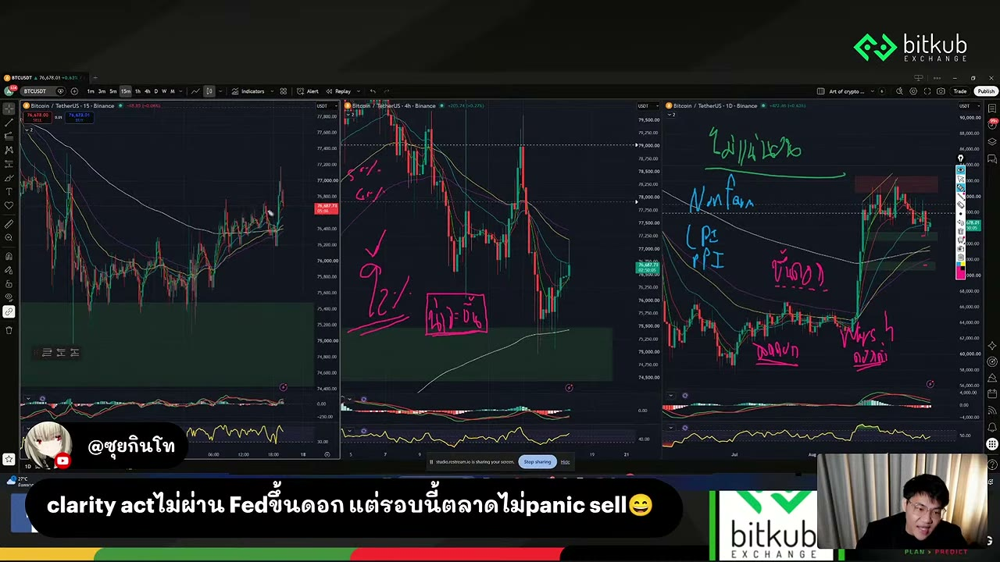

[00:09:53] ก็ขึ้นจริงๆเออโอเคโอเคก็ก็ขึ้นตามที่ เค้าวางแผนไว้นะอ่ะทีนี้มาถึงพาร์ทต่อไป ละงั้นแบบเนี้ยบitcoinมันจะขึ้นยาวเลย หรือเปล่าแบบนี้มันจะไม่ย่ออีกแล้วหรือ เปล่าอ่ะโอเคฟังมาถึงตรงนี้แล้วเพื่อนๆ ฟังผมดีๆนะผมจะพูดให้เก็ทง่ายที่สุดนะ แล้วผมจะเปรียบเทียบกับเคสก่อนหน้าฟังผม ดีๆนะ ผมจะพูดไม่ยืดเยื้อมากนะครับจะได้ไม่ไม่ เปลืองเวลาเพื่อนๆนะอ่ะมันมีสิ่งที่เรียก ว่า delay  dump นะครับด้วยโดยผมจะเปรียบ เทียบกับเคสนี้เราจำได้มว่าเคสเนี้ยคือ เคส ETF ของ Bitcoin ที่เป็น spot ถูกมั้ยตอนแรกทุกคนคิดว่าอู้หูยมันมัน ต้องไปมันต้องโตแบบระเบิดระเบิดนี่แหละ ไอ้เหรียญที่มึงบอกว่าเหรียญอัชยากรไอ้ เหรียญที่ใช้ในตลาดมืดเหรียญที่มันเป็น

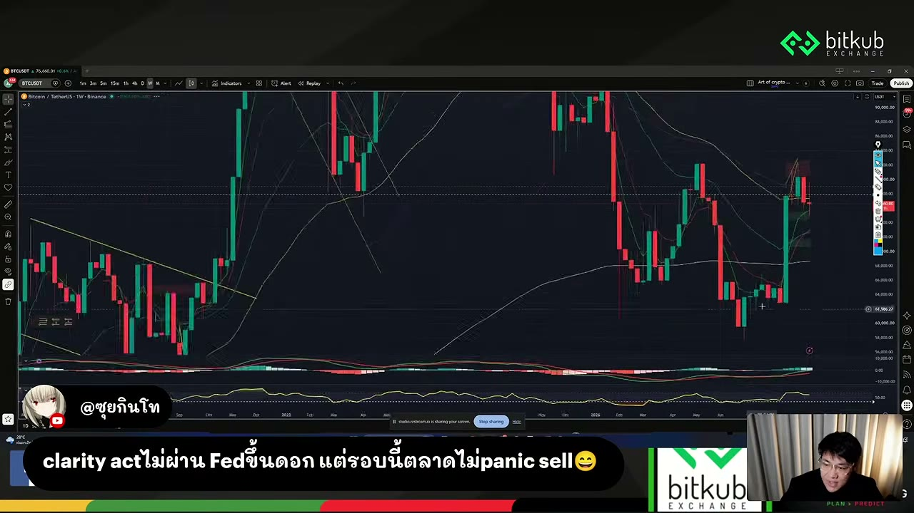

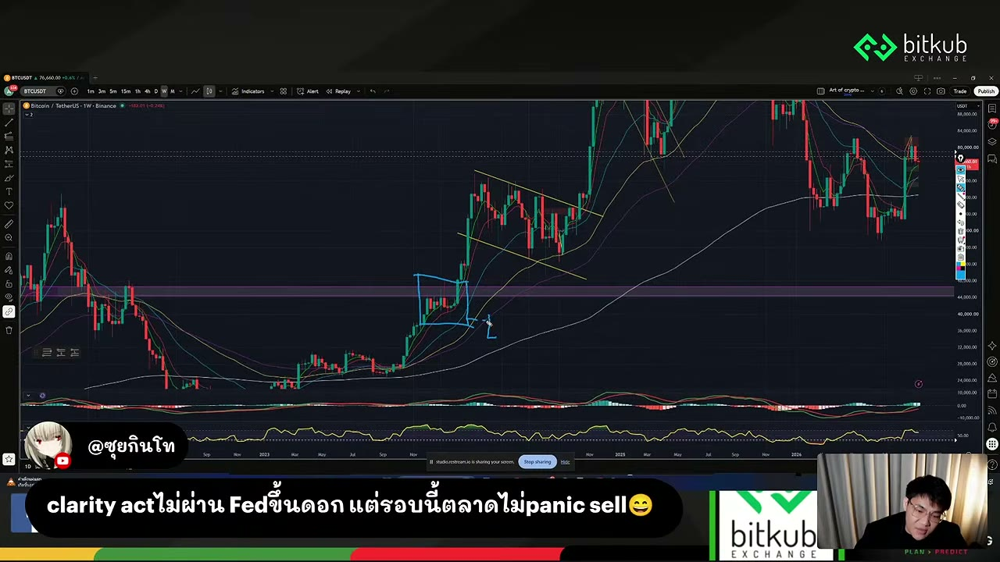

[00:10:54] แค่ชุดตัวเลขเป็นแค่โค้ดตัวหนังสือมันจะ มีค่าจริงได้วันนี้มันมี Exchange Trading  Funds หรือมันมี Reserve แบบ ถูกกฎหมายเอไม่ใช่ reserve มันมี ETF แบบ ถูกกฎหมายแล้วเป็นแบบสปออ่าทุกคนคิดแบบ นั้นแล้วสรุปราคาไม่วิ่งเลย 7 วันนะครับ อาทิตย์นึงตอนนั้นราคาก็ไม่ได้ขยับเลย แล้วก็เกิดการดัม 1 รอบเบาๆลงมาเทสแต่ก็ อย่างที่เรารู้ไม่หลุด EMA ที่มันโฟโม่ เนาะก็คือ EMA  10 สีแดงนะครับ 5 กับ 10 เนี่ยเส้น 5 กับเส้นเขียวเนี่ยผมจะบอก ตลอดว่าผมใช้ดูระยะโฟมของมันนะครับหรือ ว่า Fel  Missing  Out คนจะกลัวตกรถหรือ เปล่าแล้วทีนี้มันไม่หลุดแล้วมันก็ค่อย Push ขึ้นไปหลังจากนั้นนะครับเพราะว่า อย่างที่บอกมันอยู่ในความคาดหวังคนคิด อยู่แล้วว่าว่ามันน่าจะผ่านมันมันน่าจะไป นะเอ้ย ETF มันน่ามันน่าจะได้แหละเพราะ ว่ามันหลายปีแล้วที่ยื่นขอกันมานะครับ แล้วก็มันไปตรงกับไม่ตรงสิมันขึ้นก่อน Harving  Cycle ระยะนึงนะครับเพราะด้วย เรื่อง ETF นี่แหละแล้วมันก็มี delay pump นะครับ

[00:11:59] ทีนี้เมื่อกี้ผมพูดไปแค่ครึ่งเดียวถูกป่ะ ก็คือครึ่งที่ตลาดอ่ะมันรับกับความแน่นอน ได้แต่มันมีครึ่งนึงที่ตลาดรับกับเอฟเฟค ตรงนั้นด้วยก็คือตรงนี้ นะครับมันมีอีกครึ่งนึงที่โอ๊ตทองเป็นไง บ้างวะเนี่ยผมขอดูทองแป๊บนึงนะปึ๊บ เท่าไหร่อ่ะ 81 สวยนะตอนนี้ติดแถวนี้อ่ะโอเคเดี๋ยวผมดู บitคinต่อนะครับทีนี้เนี่ย อยากให้ให้ดูตรงนี้มันมีตลาดนึงที่ก็ชัด เจนนะว่าแม้ว่าจะไม่เกินค่าจะย่อตัวคำตอบ คือ S&P  500 นะครับหรือว่าตลาดหุ้น อเมริกานั่นแหละ ถูกป่ะ ตรงนี้บอกอะไรเราได้บ้าง อ่ะตรงนี้บอกอะไรเราได้บ้าง

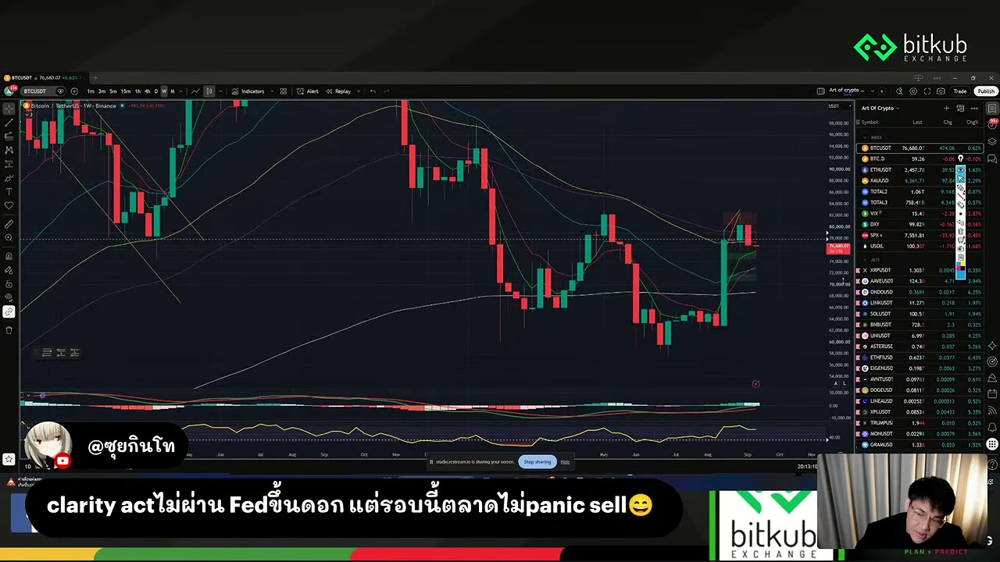

[00:13:03] แป๊บนึงนะ โอเคนะครับ ตลาดไม่ทุบลง แค่เพราะว่ามันตามขึ้นดอดขึ้นดอกตามคาด ดอกจันท 2 ดอก ตลาดยังไม่ได้รับรู้และคำนวณในมุมมองของ สภาพคล่องโลกนะครับหรือเม็ดเงินการ flow ของเม็ดเงินเพราะว่าตอนเนี้ยสิ่งที่คุณจะ ต้องรอดูอาทิตย์หน้านะครับ 1 นะนะครับ ตลาดหุ้นอเมริกาเป็นยังไงตลาดอเมริกา 2 บอน

[00:14:05] 2 ปี 10 ปี เพราะว่าสิ่งที่คุณไม่อยากจะเห็นคือผลตอบ แทนจากบอลระยะยาวและกลางสูงขึ้นเรื่อยๆ อ่ะฉะนั้นมันบอกอะไรเรานะครับในการที่บอ ตรงเนี้ยมันสูงขึ้นเรื่อย คำตอบก็คือถ้าผลตอบแทนสินทรัพย์ที่แทบไม่ มีความเสี่ยงนะครับอย่างพันธบัตรรัฐบาล เนี่ยมันให้เกิน 5% สมมุตินะตอนนี้มัน อยู่ประมาณ 4.9 นะครับถ้าถ้าผมเพิ่งดูนะ ก็คืออยู่ประมาณ 4.9  9 บอล 10 ปีอาทิตย์ หน้าสิ่งที่เราอยากเห็นคือผลตอบแทนจากบอล ระยะยาวเนี่ยมันควรต้องเริ่มลงนะครับ เริ่มลง แล้วก็ตลาดหุ้นอเมริกาไม่แครชนะครับไม่ ไม่ย่อตัวไม่หลุดซัพพอร์ตมันก็จะบ่งบอก ว่าเฮ้ยเอ่อเงินเนี่ยก็ไม่ได้ flow เข้า ไหลเข้าพันธบัตรอย่างมากนักนะครับแล้ว ตลาดก็ยังพยุงรับอยู่แต่ถ้าเกิดมันกลับ

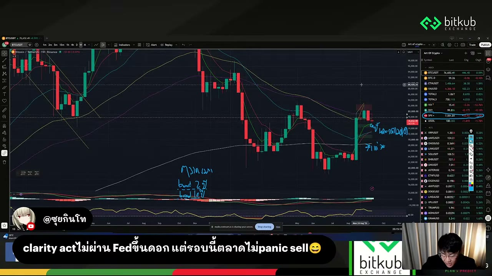

[00:15:07] ด้านนะครับเราจะมีอีกข่าวใหญ่ข่าวนึงก็ คือพรุ่งนี้ประมาณประมาณ 10:00 น.หรือ ประมาณช่วงเที่ยงๆกลางวันเนี่ยก็คือการ ขึ้นดอกอ่ะผมพูดไปแล้วว่าขึ้นดอกก็มุมมอง ผมคิดว่าน่าจะขึ้นนะไม่ไม่น่าจะคงดอกนะ ครับก็คือเงินเยนนั่นเอง เงินเยนเนี่ยคนก็คาดการณ์อยู่แล้วว่า ญี่ปุ่นต้อง take  action อะไรสักอย่าง แต่ว่าสิ่งที่เขาคาดหวังกันก็คือไม่อยาก ให้ขึ้นจนสมการการทำเยน carry เทรดมัน ต้องแก้นะครับต้องปรับทุกอย่าง งั้นอาทิตย์หน้านะครับมันมีโอกาสเกิด delay  dump ได้เมื่อกี้เราเปรียบเทียบ delay  pump ของ ETF ไว้ละตอนเ delay dump คืออาทิตย์หน้ากูรอดูเลยผลตอบแทน จากบอเนี่ยนะครับเริ่มลงมั้ย นะครับแล้วก็ตลาดอเมริกาเนี่ยลงหรือเปล่า ถ้าเกิดเอ่อขออภัยตลาดอเมริกาถ้าไม่ลง เนาะอ้าไม่ลงเอาเป็นลูกศรขึ้นแล้วกันจะ ได้ไม่งงนะครับอันเนี้ยมันก็แปลว่าเงิน มันก็ยังอยู่ในสินทรัพย์เสี่ยงนะครับเงิน ยังไม่ได้หนีออกไปเยอะฉะนั้นเนี่ยมันก็มี

[00:16:09] โอกาสที่บitคinเนี่ยจะsideซวยก๊อกๆแก๊กๆก ๆๆแกที่ผมดูตัวเลข oi นะครับก็ถ้าเป็นเคส นี้นะก็คือตลาดอเมริกาไม่ย่อผลตอบแทนบอล เริ่มเริ่มลดลงนะครับก็ เราจะได้เห็นไม่น่าต่ำกว่าแถว 75-74 นะครับอยู่ในกรอบนี้นะครับส่วนถ้าเกิด เป็นอีกด้านนึงนะครับก็คือเฮ้ยพรุ่งนี้ Bank  of  Japan ประกาศขึ้นดอกมาแล้วะ แล้วอาทิตย์หน้ากลายกลายเป็นว่าตลาด อเมริกาเนี่ยที่มันตอบรับไปแล้วอ่ะนะครับ มันกลับด้านอีกด้านนึงก็คือเฮ้ยมันย่อต่อ นะครับแล้วก็ผลตอบแทนจากบอเนี่ยเริ่มสูง ขึ้นนะครับก็มีโอกาสจะได้เห็นช่วงที่ดัม กว่านั้นก็คือโซนด้านล่างเลยนะครับที่ที่ ผมวางไว้ซึ่งอันเนี้ยหากใครตามในเพจอ่ะจะ เห็นว่าผมวางไว้อาทิตย์เกินอาทิตย์แล้วนะ ครับแล้วผมไม่ย้ายเลยเนี่ยคือเหตุผลเพราะ ว่ามันมีโอกาสที่จะเกิด delay  dump แล้ว ผมบอกตลอดว่าคีย์สำคัญที่สุดที่จะทำให้ คุณเป็นนักลงทุนได้ที่ดีนะคือเมื่อคุณ

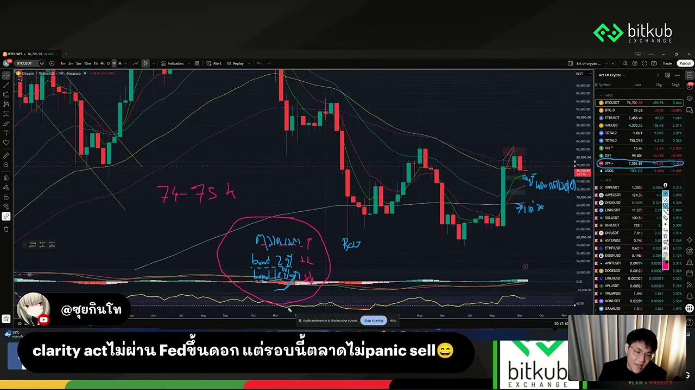

[00:17:13] เลิกคาดการณ์ได้แต่ให้คุณวางแผนแทนนะครับ เมื่อคุณ สามารถวางแผนได้ว่าถ้าเกิดเคสนี้คุณยังจะ ยังมีเงินสดมั้ยถ้าไม่เกิดเคสนี้คุณจะ take  action ยังไงถ้าเกิดเคสนี้คุณไม่ เหลืออะไรในมือแล้วคุณเข้าออกก็ไม่ได้ งั้นก็จะเป็นปัญหานะครับอ่ะถ้าเคสแรกผมก็ มองว่าโซนเนี้ยไม่น่าหลุดนะครับแล้วก็ ขึ้นได้ถึงเนี่ยก็อยู่ประมาณ 79-80,000 นะครับเดี๋ยวผมจะเปิดผมจะเปิดตัว OI ให้ ดูด้วยเนาะแต่ว่าตอนเนี้ยมันกำลังชัดเจน ก็เลยไม่ไม่อยากจะรีบสิเดี๋ยวสมาธิมันจะ หลุดนะครับแล้วก็ถ้าเกิดเป็นอีกฝั่งนึงนะ ครับก็คือถ้าเกิดหลุด 75 นะครับมีโอกาสที่เราจะได้เห็น 72 ก็คือ พรวดลงมานะครับซึ่งตรงเนี้ยมันก็จะตรงกับ โซนรอเก็บของของผมพอดีอ่ะถึงตรงนี้แล้วนะ ครับผมเห็นคอมเมนต์แล้วนะเป็นนักเรียนผม ที่ไม่ได้คุยกันนานแล้วเดี๋ยวๆผมทักทายนะ เดี๋ยวผมขอพูดตรงนี้สอนตรงนี้ก่อนนิดนึง นะครับเดี๋ยวเดี๋มันจะลืมนะครับ

[00:18:17] ก็จะย่อมาที่โซนที่ 2 พอดีอ่ะทีนี้ไอ้ตัว เลขตรงเนี้ยผมได้มาจากไหนแล้วทำไมผมถึง มองแบบนั้นอ่ะโอเคเดี๋ยวเราไปดูกันนะครับ เราก็ต้องไปดูที่ตัวของ OI แล้วกันอ่ะ โอเคนะครับนี่ โดยที่เราจะดูวันพรุ่งนี้ก่อนนะก็คือ อันเนี้ยที่หมดอายุวันพรุ่งนี้แล้วก็คือ ผมก็มองว่าผ่าน 79,000 ยากนะครับเห็นเสา อย่างเงี้ยนะครับแล้วก็ราคาปัจจุบันมัน อยู่แถวประมาณนี้เนาะแถว 77,000 นะครับก็ ถ้าคำนวณ SD อ่ะก็คือ 15% อ่ะที่ที่จะ ต้องไปถึงตรงนี้แล้วแล้วหลุดไปนะครับ ฉะนั้นค่อนข้างยากภายในพรุ่งนี้ 15:00 น. นะครับ 15:00 น.ตรงเนี่ยก็คิดว่ายังไม่ น่าจะหลุดทะลุไป 79,000  80,000 เนี่ยอ่ะ หลังหลังจากเนี้ยคิดว่าเป็นไปได้ยากและนะ ครับส่วนถ้าเกิดดัมลงมาหลุดเนี่ยช่วง 75,000  74,000 เนี่ยนะครับก็น่าจะได้ เห็น 72,000 ซึ่งเราจะต้องดู OI ตอนปิด เดือนเนี่ยเป็นตัวประกอบนะครับแล้วก็พไป ดูตรงนั้นก่อนพาร์ทต่อมาเนี่ยก็คือตรงนี้

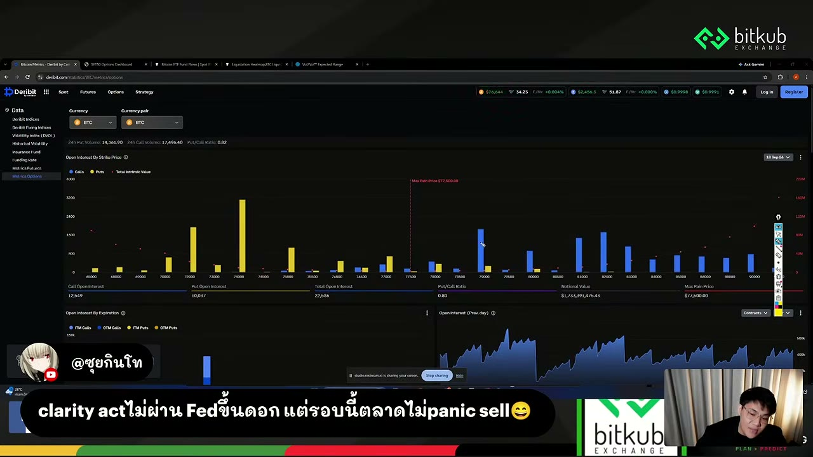

[00:19:19] อ่ะผิดๆวันผิดวัน 25 นะครับอืก็คือตรงนี้ สิ่งนึงที่อยากให้สังเกตเลยเนี่ยคือ OI เนี่ยมันกองอยู่ฝั่งขวาค่อนข้างเยอะนะ ครับแล้วก็มี PO อยู่ที่ตรงนี้ เห็นมั้ยค่อนข้างสูงมาก นะครับฉะนั้นตรงเนี้ยถ้าเกิดลงมาแล้ว เนี่ยนะครับมันจะเข้าใกล้โซนที่คนมองลง หรือเล่นพุเนี่ยกำไรแล้วก็มีโอกาส Settlement นะครับหรือว่า ปิดสัญญาณนะครับมันก็จะมีโอกาสสะท้อนออก ได้นะครับแล้วที่เหลือเนี่ยมันจะกองๆกัน ตรงนี้นะครับฉะนั้นเนี่ยถ้าเราพูดแบบ เนี้ยแบบมองคร่าวๆเลยนะมองมองด้วยตาเปล่า อ่ะก็คือคนมองว่าหลุด 70,000 ยากภายใน สิ้นเดือนนะก็คือเราเรียกว่าmaมinซัพพอร์ คือ 70,000 อ่ะคนคิดว่าหลุดยากนะครับแล้ว

[00:20:20] ผ่าน 80,000-82,000 ยากอ่ะอย่างเงี้ย อ่ะนะครับภายในสิ้นเดือนเนาะก็คืออยู่ตรง นี้อยู่ตรงนี้ก่อนนะครับแต่ว่าไอ้ตรง เนี้ยมันจะเกิด gramma  squ เกิดขึ้นแบบนั้นเท่าไหร่เนาะที่เราจะเจอ ข่าวอะไรก็แล้วแต่ที่มา push ให้ราคามัน พุ่งพรวดอ่ะก็คือถ้าอ่าน[เสียงกระแอม]ตาม data้าตอนนี้เลยนะแล้วอาทิตย์หน้าไม่ได้ มีการเปลี่ยนมือสัญญาย้ายราคาสักเท่าไหร่ อ่ะคือถ้าเบรก 85,000 ได้อ่ะมันจะพรวดไป 90,000 เลยนะครับมันจะเหมือนตอนนั้นที่ เบรค 72,000 แล้วพรวดเดียวไป 75,000 ภาย ในชั่วโมง 2 ชั่วโมงหรือแบบ 15 นาทีปึ๊ดๆ ๆๆนะครับเพราะว่ามันเกิดสิ่งที่เรียกว่า Gamma  Squeeze นะครับก็คือลายใหญ่เนี่ย เค้า Hort ของเขาไว้แล้วสัญญาณตรงเนี้ย มันเยอะแล้วตรงเนี้มันไม่ค่อยมีนะครับ ฉะนั้นพอราคามันทะลุไปแล้วเนี่ยพอร์ตเค้า มันจะไม่ได้หักล้างกันแล้วเายังได้ค่า พรีเมี่มแล้วก็คือแบบจับชนกัน 2 โต๊ะบอล แล้วแล้วค่าน้ำไม่สมดุลน่ะฉะนั้นน่ะเขาจะ

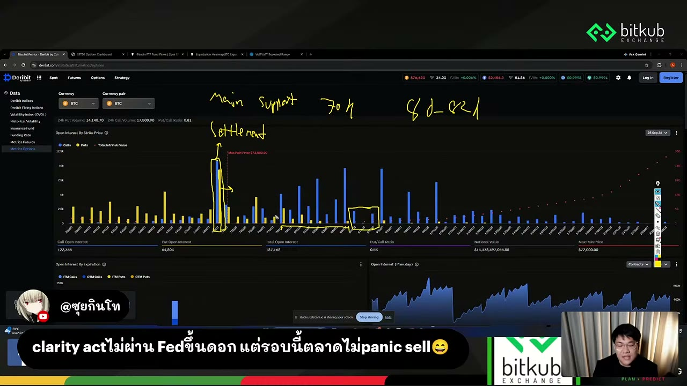

[00:21:21] ต้องรีบเปิดฟิวเจอร์เพิ่มเพื่อเพื่อ Hort ของเค้าเพิ่มทีเนี้ยรายใหญ่ทุกคนมันก็จะ ต้องแย่งกัน h เนาะพอแย่งกัน H เนี่ยราคา มันก็จะพุ่งพรวดนะครับเราจะเรียกตรงเว่า Gamma  Squma  Squeeze ไม่ใช่การเด้ง กลับนะครับ GMA Squeลโซนที่มันไม่ค่อยมี สัญญาแต่ตรงเผมยังมองว่าเกิดได้ยากผมผม ยังมองว่าเกิดได้ยากนะส่วนตัวผมมองว่ามัน ยังอยู่ใน range เนี้ยsidewayยแล้วก็ด้วย การเก็บสถิติสายโมเมนตัมของผมนะอ่ะอันนี้ เราเราเห็นตัวเลขด้าน OI ไปละต่อมาผมพามาดู Bitcoin Liquidation  Heat  Map บ้างนะก็จะเห็น ตรงเนี้ยนะครับก็คือ Stop  Loss ของราย ย่อยนะครับแต่ว่าผมเนี่ยจะเป็นคนชอบใช้ Data  Option มากกว่า Liquidation Hitmap นะครับเพราะว่า Option น่ะคุณวาง ๆยกๆไม่ได้นึกออกมั้ยคือคุณวางแล้วคุณ เสียค่าน้ำแล้วอ่ะอ่ะเหมือนคุณไปกาบอล เนี่ยพูดแบบนี้จะโดน YouTube แบนมั้วะแต่ ไม่เป็นไรครับอ่ะผมพูดรายได้เลยนะเพื่อนๆ คิดว่าผมทำ YouTube มา 4-5 ปีเนี่ยเอาราย

[00:22:22] ได้จากยอดวิวนะผมได้กี่บาท 4-5 ปีนะผมได้ ประมาณ 700 ดอน YouTube นะเออนะครับ ฉะนั้นผมไม่ซีเรียสหรอกว่ามันจะเฮ้ยคลิป นี้พูดเกี่ยวกับbtingติ้คลิปนี้ติดเหลือง ติดแดงนะครับเออผมไม่ได้มองว่ารายได้ YouTube ตรงเมันเป็นรายได้หลักเนาะก็ เนี่ยยังมีเพื่อนๆเนี่ยขอบคุณมากครับคุณ ขอบคุณฮาร์ดวครับ 179 บาทซเปอร์ชกำลังใจ กันครับอ่ะ ฉะนั้นไม่ต้องซีเรียสหรอกครับว่าคำพูด แล้วพูดแล้ว YouTube มันจะแบนหรือติด เหลืองหรือเปล่าเอาให้เราเข้าใจอ่ะ คือมันเสียค่าน้ำแล้วเหมือนคุณไปกาบอล แล้วอ่ะคุณคุณกาเสร็จแล้วนะอ่าเขาบอก 500 คุณแทงไป 7 คู่เอาเหมือนสมัยก่อนเลยยุค ยุค 90 เนี่ยแล้วคุณก็ยื่นไปที่โต๊ะสัก พักนึง ครึ่งชั่วโมงนะครับครึ่งชั่วโมงคุณโทรออก ไปพี่ผมไม่กาแล้วว่ะคุณคิดว่าเขาจะคืน 500 คุณมั้ยมันคืนไม่ได้นะครับถ้าอชัน่ะมัน เป็นแบบนั้นแต่ว่า future ไม่ใช่ future

[00:23:24] เนี่ยสมมุติว่าคุณวางของแล้วอ่ะแล้วคุณ ตั้ง Stop  Loss ตรงเนี้ย แล้วเกิดเอ้ยมันจะผ่านหรือเปล่าวะเฮ้ยดู ราคามันแข็งแรงจังวะเฮ้ยทำไมมันทำไมมัน ขึ้นแบบนั้นวะคุณยกออกได้ ถูกป่ะมันยกออกได้นะครับมันวางๆยกๆวางๆยก ๆได้ฉะนั้นน่ะมันจะเป็นแบบนี้นะครับนั่น คือสาเหตุที่พวกกองทุนน่ะเาค้าเจะใช้หรือ ว่าพวกเทรดเดอร์มืออาชีพที่พอร์ตใหญ่เขา จะชอบเทรด Option มากกว่าเพราะว่ามัน จำกัดความเสี่ยงก็ง่ายกว่าแล้วมันอ่านค่า แล้วเนี่ยคนมันวางๆยกๆไม่ได้ฉะนั้นตอนนี้ เอาค่าที่แบบสมมุติว่าเค้าไม่ยกกันออก เนาะสมมุติว่าเค้าไม่ยกกันออกเนี่ยก็จะ อยู่ที่ประมาณ 77,000 นะครับ 77,000  400 ซึ่งเวลาที่มันหนามากจนเป็นสีเหลืองอย่าง เงี้ยให้คุณรู้เลยว่ามันจะเกิด Force  buy เพราะว่าคนที่มันเซลล์ตรงเนี้ยนะครับหรือ ว่ามองช็อตเนี่ยเค้าจะมี stop  loss อยู่

[00:24:25] ตรงนี้งั้นถ้ามันชน Stop  Loss เนี่ยมัน แปลว่าเขาจะโดนบังคับซื้อพอโดนบังคับซื้อ เนี่ยราคามันก็จะแฉลบฟึบอ่านะครับซึ่งมัน ก็จะพอดีแถวเนี้ยเห็นมั้ยแล้วมันใกล้ เคียงกับ OI คือ 79,000 ผ่านยาก นะครับก็มันอาจจะเด้งเงี้ยฟื๊ดแล้วคำสั่ง force  buy หมดก็ลงมาวิ่งในกรอบนะครับก็ คือ 79,000 ถึง 75,000 เนี่ยผมว่ามันจะ อยู่อย่างเงี้ยนะครับมันก็จะยังอยู่ในนี้ ก่อนเพราะว่าตอนเนี้ยโมเมนตัมมันยังส่ง ไม่ถึงweคแล้วก็เท่าที่ผมเก็บสถิติมาด้วย ด้วยการเทรดของผมทั้งหมดเนาะแล้วก็ผม ดาวน์โหลดหนังสือทุกเล่มที่ผมอ่านแล้วก็ โมเดลการเทรดของผมเนี่ยใส่ AI ลงไปนะครับ แล้วก็ให้มันเอาแค่ข้อมูลตรงนั้นน่ะมาทำ back  test นะครับผมก็โยน data แท่ง เทียนน่ะนะครับลงไปให้มันเป็น open  high low  close ครับ OHLC  C แล้วทำ back test มาทั้งหมดอ่ะโมเมนัมเวลาส่งถึง week แล้วอ่ะมีโอกาส 75%

[00:25:27] ที่จะขึ้นต่อเลย แล้วเป็นเทรนด์ 75% เลยนะฉะนั้นโมเมนัมใน weคเนี่ยมีโอกาสแค่ 25% ที่คุณจะแพ้ นั่นคือสาเหตุที่ทำไมผมชอบเก็บของภาพใหญ่ ในweคแบบที่ผมพูดอ่ะเฮ้ยเบรกเส้นพรีเมี่ม นะ EMA เสร็จ RSI  overbard นะ madd เหนือ 0 นะเพราะว่ามันมีโอกาสแค่ 25% ที่ คุณจะแพ้แต่ผมอ่ะวิเคราะห์ด้วยตัวเองผมก็ วิเคราะห์ว่าตอนเโมเมนตัมในweคอ่ะมันยัง ไม่เกิดแล้วผมก็เอาโมเดลทั้งหมดเนใช่มั้ย เอาข้อมูลใส่ให้มันใส่ให้มันใส่ให้มันใส่ ให้มัน่ะผมก็แคปให้นักเรียนดู AI ก็ มองเหมือนผมอ่ะว่าโมเมนตัมใน week อ่ะมัน ยังไม่เกิดฉะนั้นน่ะมันมีโอกาสว่ามันจะ sideway อีกรอบแล้วค่อยเกิดโมเมนตัมใน weคหรือมันจะย่อหนักแล้วค่อยขึ้นอีกรอบ มันมี 2 ข้อฉะนั้นนั่นคือที่มาที่ผมวาง 2 ตรงนั้นอ่ะเห็นมั้ยผมผมต่อจิ๊กซอในหัวคุณ ได้และนะครับอ่ะ

[00:26:29] เดี๋ยวผมให้ดูนะครับบทความว่าทำไมการที่ คุณวางแผนล่วงหน้าแล้วอ่ะมันจะทำให้คุณ ใช้ชีวิตได้ง่ายขึ้นนะครับเดี๋ขอนี้ก่อน อ่ะนี่ อ่ะดูตรงนี้นะครับ เนี่ยนะครับวางไว้ตั้งแต่วันที่ 8 โอ้ 9 วันที่แล้วนะครับเนี่ย 9 วันที่แล้วะนะ 9 วันที่แล้ว เนี่ยนะครับผมเขียนไว้ละเอียดแล้วไม่มี Edit เห็นมั้ยฉะนั้นน่ะครับมันเป็นรูป ที่ไม่มี Edit มันไม่ได้จะเป็นการเคลมว่า แม่นถ้าแม่นผมไม่วาด 2 โซนหรอกนึกออกมั้ย คือผมอ่ะเบื่อแล้วที่แบบนั่งขายฝันกันน่ะ เฮ้ยคุณรู้ศาสตร์นี้แล้วคุณจะรู้ทุก อย่างถ้าแม่นน่ะมึงวางโซนเดียวเลยแล้วมึง อินน่ะมึงรวยแป๊บเดียวถูกมั้ยฉะนั้นน่ะ

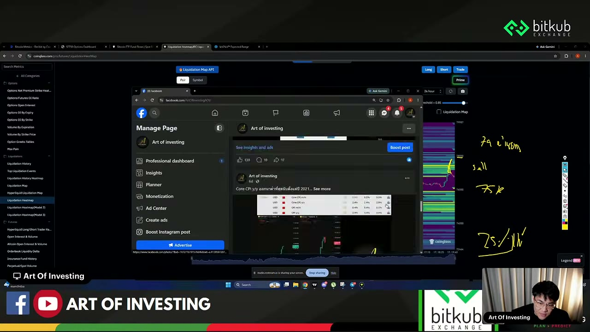

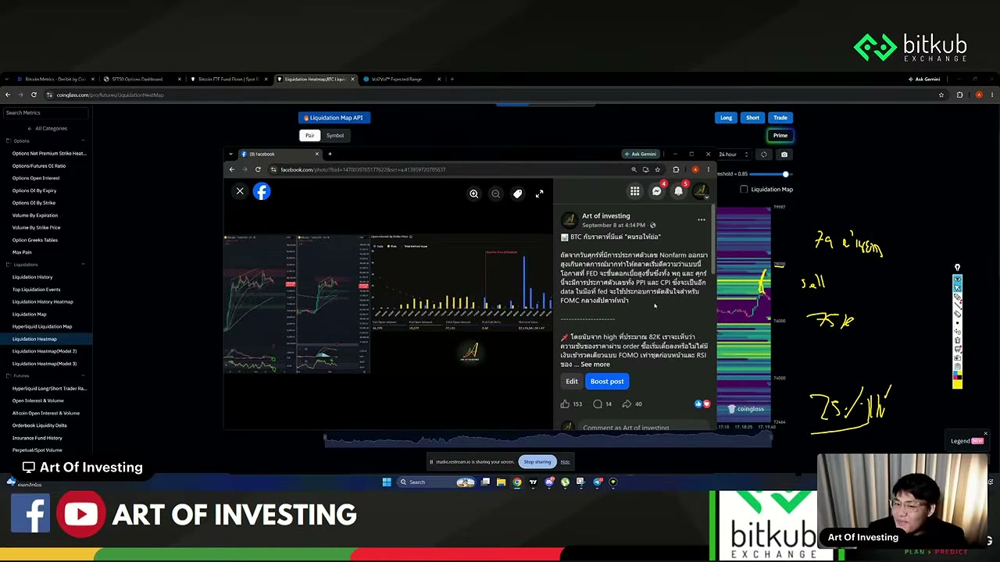

[00:27:30] ทำไมผมถึงวาง 2 โซนนี่ไงเรารู้แล้วว่า เฮ้ยตรงเนี้ยเดี๋ยวจะมี 4 อีเวentผมเขียน ล่วงหน้าเดือนนึงไอ้ ม City BOJ  Bank  of  Japan แล้วก็ IPO หุ้นนะ ครับว่าเฮ้ยมันน่าจะเกิดความผันผวนฉะนั้น ถ้าลงมาตรงเนี้ยเออผมอยากได้ของสปอร์ต เพิ่มเพราะของผมยังไม่พอแล้วก็ใน week เนี่ยโมเมนตัมมันยังรับไม่ได้ถึงไม่ โมเมนตัมในweคเนี่ยมันยังไม่เกิดพอ โมเมนตัมในweคมันยังไม่เกิดเนี่ยเห็นมั้ย OI ตอนนั้นก็บอกว่าผ่าน 8,000 ยากมันก็ ไม่มันก็ไม่ขึ้นไปอีกเลยมันก็ลงมาหาที่ โซนเลยนะครับฉะนั้นตอนเนี้ยถ้าอ่าน data OI อ่ะหรือ Option  interest อ่ะว่า สัญญาOptionัเนี่ยเขาสนใจกันที่ราคาไหนก็ ผ่าน 79,000 กับ 80,000 ยากผมก็เลยมองว่า อ่ะงั้นมันมันน่าจะลงมาแล้วพอลงมาแล้ว ต้องทำไงก็เก็บ ไม่ต้องคิดเพราะว่าเรารู้แล้วว่าถ้าเกิด เราได้ของในระยะยาวอ่ะโซนตรงเนี้ยมันมี โอกาสที่จะเกิดขึ้นต่อมาเนี่ยเฮ้ยตอนแรก ผมก็คิดว่าโซนที่ 2 เนี่ยมันน่าจะถึงเลยณ

[00:28:31] วันนั้นนะไปย้อนอ่านได้ผมไม่มานั่งเทียน แล้วแบบเอ้ยเดี๋ยวตลาดมันจะตอบรับได้ดี ครับเดี๋ยวตลาดจะรู้เลยนะว่าว่าเฟซเนี่ย จะขึ้นดอกแน่นอนวันณวันนั้นเราก็ไม่รู้ผม คิดไปเองด้วยซ้ำว่าประกาศดอกเบี้ยเนี่ย น่าจะกดมาถึงโซน 2 เลยสรุปไม่กดไม่ลงมัน ลงมาแค่โซน 1 อ่ะงั้นแสดงว่าเคสข้อ 2 เนี่ยที่ที่จะลงมาถึงแล้วผมจะมีโอกาสได้ เก็บสปอรเพิ่มเนี่ยครับก็คือ จะต้องเกิดdelดีลayดัในอาทิตย์หน้าก็คือ อาทิตย์เนี้ยคนเฮโรกันไปละคนในตลาดแบบ เอ้ยขึ้นดอกเว้ยแต่มันดีต่อตลาดหุ้นเว้ย เพราะว่าประธานเฟซเราเอาแน่เอานอนเราเอา ใจไปฝากเค้าได้เว้ยเค้าสนใจเรื่อง GDP เค้าสนใจเรื่องเงินเฟ้อเ้าไม่เป็นเด็ก ข้างไข่ทรัมป์เค้ายึดมั่นในอุดมการณ์ตัว เองแบบนี้เอ้ย TP ป่าวะ อ่ะ TP  TP  TP ไม้ช็อตบitcoinนะครับเฮ้ย แน่อ่ะเดี๋ยวๆเปิดให้ดูก่อนเดี๋ยวเดี๋หา

[00:29:32] ว่าโม้อีกนะครับ นี่เปิดๆเปิดให้ดูก่อนเปิดให้ดู ให้ดูไงวะ โม้ดิผมเทรดได้ผมก็ต้องโม้นะครับเพราะว่า ตอนผมโดนน่ะผมก็ยังโม้ลงเพจเลยนะครับโดน ดีโดนเป็นล้านร้านเลยนะครับ เวลาได้ก็ให้ผมดีใจบ้างนะครับก็นี่นะครับ ช็อตลงมาเห็นมั้วะ อ่าโม้ก่อนโม้ก่อนได้ก็โม้เสียก็โม้นะ ครับนี่โม้ก่อนโม้ก่อนไหนวะนี่เห็นมั้ย เนี่ยเฮ้ยเอาจอออกไปดิเอาจอออกไปนะครับ ก็ช่างมันเหอะนะครับเดี๋ยวผมแคปให้ดูในใน

[00:30:32] กลุ่ม Telegram แล้ว[เสียงหัวเราะ] อ่ะนะครับเดี๋ยวแล้วเดี๋ค่อยไปอธิบายอบาย มั้ยเมื่อกี้นะว่าทำไมผมถึงผมถึงช็อตนะ ตรงนี้นะครับ เพราะว่า เฟเนี่ยอ่ะตลาดรับได้แล้วแล้วต่อมา อาทิตย์หน้าพูดต่อจากเมื่อกี้ที่ค้างไว้ ก็คือเฮ้ยแต่ว่าสุดท้ายแล้วพันธบัตรก็ยัง ให้ผลตอบแทนดีว่ะคนก็แบบอ้าแล้วถ้า พันธบัตรมันให้ผลตอบแทนดีแล้วคุณจะรีบไป ซื้อหุ้นเพิ่มทำไมวะหุ้นตอนนี้ก็แพงนะ ครับงั้นเฮ้ยเดี๋ยวโยกเงินเข้าพันธบัตร เพิ่มก่อนอ่ะ มันก็จะเป็นแบบนั้นฉะนั้นเรารู้อยู่แล้ว ว่า Bitcoin เนี่ยนับเป็นสินทรัพย์ที่ sensitive ที่สุดในทุกทรัพย์เลยนะครับ เพราะว่าคนเราเนี่ยยังไม่ได้เชื่อมั่นใน ตัวบitคinแล้วนั่นแปลว่าคุณมีโอกาสเพราะ ว่าวันไหนก็ตามที่คนทุกคนเชื่อมั่นใน บitคinราคามันไม่วิ่งขึ้นไปไกลแล้วครับ มันมันถึงทางตันของมันแล้วะพอมันเป็นเคส แบบนั้นน่ะถ้าเกิดตลาดหุ้นอเมริกามันย่อ เมื่อไหร่นะครับเอาซักไม่ต้องหลุดไกลอ่ะ หลุดสัก 7,300 เงี้ยตอนนี้มัน 7,500 ใช่

[00:31:34] มั้ยย่อมาจาก 7,6 เงี้ยหลุดสัก 7,300 เงี้ยบitcoinก็น่าจะเกิดรสละนะครับย่อตาม Bitcoin บางช่วงจะวิ่งคล้ายกับทองคำบาง ช่วงจะวิ่งคล้ายกับหุ้นหรือ NASDA นะครับ งั้นถ้ามี delay ดำเนี่ยผมก็คิดว่าโซน 2 ของผมเนี่ยน่าจะทำงานนะครับน่าจะทำงานอ่า เดี๋ยวแปะรูปในTelแกมก่อน นะครับเทรดไม้เดียวกำไรเกินทำ YouTube มา 5 ปีโอ้โหพูดแล้วเจ็บใจว่ะย่ง กูทำช่องทำไมวะเนี่ย นะเออทำช่องทำไมวะเออใช่เทรดไม้เดียวกำไร เกินะเกินเกินเลยแหละ อ่ะนะครับ ได้ครับถ้ามีโอกาสนะน้องออมสินอุ๊ยขอบคุณ คุณโบมีนครับซเปอร์ชุมากครับอ่ะเดี๋ยวผม ขึ้นไปไล่ตอบคอมเมนต์นะจะจบบitคinะอยาก วิเคราะห์บitcoinให้จบแล้วเดี๋ยวจะไป

[00:32:35] วิเคราะห์ Outcoin คร่าวๆให้ฟังอ่ะเอาตรง นี้เก็ตแล้วเนาะตรงนี้ตรงนี้ตรงนี้ตรงนี้ เห็นอาจารย์เปิด 75% นั้นให้ดูคนละอันกัน นะคุณจิรพันธ์อันนั้น 75% เป็นของ OI แต่ ว่าของผมอ่ะเป็นโมเมนตัมในweคนะครับของ อาจารย์ A ไม่น่าใช่ไม่น่าใช่ 75 นะถ้า เกิดเป็น 2  SD  2  SD ของทองคำน่าจะเป็น 68  68% อื 68 นะครับเฮ้ยแล้วผมบอกเลยนะว่ายุคเนี้ยมัน ดีมากนะการที่คุณมี AI อ่ะคือแต่ก่อนน่ะ คุณจะ back  test ใช่ป่ะคุณต้องเขียน Python น่ะแล้วคุณก็จะต้องแบบทำทุกอย่าง ด้วยตัวเองอ่ะนะครับซึ่งมันวุ่นวายมาก ต้องรันโค้ดต้องอะไรแต่เดี๋ยวเนี้ยคุณโยน ให้ AI แต่มันอาจจะกิน Token หน่อยนะครับ ทีนี้อ่ะมาละถึงพระเอกของเราละเห็นไปหมด แล้วผ่าน 79  80,000 ยากนะครับผ่านผ่าน 79 80,000 ยากหลุด 75,000 น่าจะเห็น 72,000 นี่คือ data ที่ option ไว้มูลค่าแบบหลาย

[00:33:38] ร้านดอนเสาราคานึงก็ 4-500 ล้านดอนะนะ ครับที่เมื่อกี้ผมเปิดให้ดูบน bit เนาะ งั้นมันจะผนวกยังไงกับโมเมนตัมของ Week บ้างคitionของ Week นะครับ เฮ้ยคุณอาร์ตโอ้โหวิลต้อง 75% อย่างี้รวย แย่เลยดิเอ้ยข้อเสียมันก็มี 1 มันเกิด โคตรไม่บ่อยเลยปี 2 ปีเกิดทีนึงนะ ครับฉะนั้นเนี่ยถ้าเกิดคุณ stop  loss ไป ครั้งนึงอ่ะแล้วคุณเทรดโมเดลเดียวหรือว่า คุณลงทุนโมเดลเดียวคุณรอเหงือกแห้งเลยอ่ะ นะคุณรอคุณรอเหงือกแห้งเลยว่าเมื่อไหร่ มันจะกลับมาเป็นจังหวะที่คitionนี้เกิด อีกรอบนะครับฉะนั้นคอitionที่เกิดแต่ละ ครั้งเนี่ยอ่ะให้ดูนะมันจะเป็นอย่างี้ก็ คือราคาเนี่ยมันจะต้องติดพรีเมี่มนะครับ ซัก 1 ค่าเฉลี่ย แล้วถ้าใครบอกว่า EMA ไร้สาระนะ คุณรู้จัก Fabio ป่ะ Fabio คือคนที่เทรด ระดับโลกแล้วได้ที่ 1  2 รอบมั้งถ้าผมใน

[00:34:40] จากการแข่ง 3 ครั้งนะครับเา้าเป็น trader scalping นะครับแล้วเขาไม่ได้เทรดด้วย แบบ SMC  ICT หรือ Technical นะเเทรดด้วย Volume  Foodprint  Volume  Footprint นะครับหรือเขาจะดูเลยว่าวิเเนี้ยออเดอร์ มันเข้าเท่าไหร่ออกเท่าไหร่เขาดู Heat Map ดูอะไรแบบ Real  Time แบบจ่ายแล้วเ ทำแพลตฟอร์ม Deep  EP ของเขาด้วยเค้ายัง บอกเลยนะว่า EMA  A อ่ะ rigid แต่คุณ ต้องรู้นะว่าใช้ยังไงคำว่ารู้นะว่าต้อง ใช้ยังไงเนี่ยตีความให้ถูกนะไม่ได้แปลว่า อุ๊ยมันต้องมีความลับในการใช้ในอะไรเฮ้ย EMA ต้องสุดยอดไม่ใช่คำว่ารู้ว่า ต้องใช้ยังไงอ่ะคือรู้ว่าขอบเขตทำได้ แค่นั้นเหมือนถ้ามันเป็นจักรยานน่ะคุณไม่ ต้องเอามันไปปั่นแข่งกับมอเตอร์ไซค์ ชนะไม่ได้หรอกคุณไม่ต้องเอามันไปปั่นแข่ง กับรถยนต์ชนะไม่ได้หรอกเฮ้ยแต่ว่า ปั่นในซอยเวิร์คเว้ยเฮ้ยปั่นแบบไป ซื้อของหน้าปากซอยไปตัดผมแล้วปั่นกลับอ่า แบบเด็กๆอายุ 10 ขวบเงี้ยเฮ้ยจักรยาน เวิร์คคำว่ารู้ว่าใช้ยังไงอ่ะ Fabio ยัง จัด EMA ว่าเป็นหนึ่งในอินดิเคเตอร์ที่

[00:35:43] จิตเพราะเค้าบอกว่าถ้าคุณรู้ว่ามันทำยัง งานยังไงอ่ะมันใช้ได้จริงแต่มันไม่ได้สุด ยอดเลยคุณดูนะหลักการของมันก็คือค่า เฉลี่ยไหนก็ตามที่คนในตลาดตีความว่าแพง เกินไปเราจะเรียกมันว่าพรีเมี่มอันนี้ก็ คือในศาสตร์ในศาสตร์โมเมนตัมนะในศาสตร์ โมเมนตัมนะครับงั้นค่าเฉลี่ยนั้นน่ะเวลา มันขึ้นขึ้นมาแล้วชนน่ะนะครับสิ่งที่เกิด ขึ้นให้เห็นน่ะคือ มันจะเกิดแรงขายเสมอแล้วกดลงไป New นั่น นั่นเป็นการยืนยันว่าตลาดมองว่าเฮ้ยแพงนะ ครับเราเลวELพรีเมี่มงั้นครั้งแรกที่มัน เบรคขึ้นมาเนี่ยก็คือเบรกทะลุโซนที่ตลาด เคยมองว่าแพงมาตลอดได้แล้ว MAD เหนือ 0 ก็คือเฮ้ยออเดอร์ซื้อมันกลับมาเยอะกว่า ออเดอร์ขายแล้วนะเว้ยออเดอร์ซื้อกลับมา เยอะกว่าออเดอร์ขายแล้วนะเว้ยแล้วก็ RSI เฮ้ยลืมๆขอบคุณที่เตือนคุณแออกคุณเอก ขอบคุณขอบคุณขอบคุณขอบคุณขอโทษขอโทษขอโทษ ขอโทษขอโทษขอโทษ

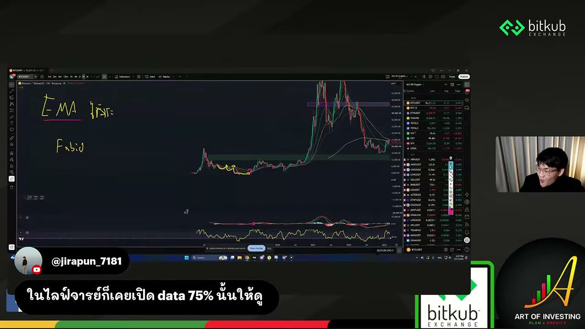

[00:36:43] ขอโทษขอโทษนะครับ อ่ะแล้วก็ RSI  overbard ก็แปลว่า โมเมนตัมมันเกิดนะครับหรือเกิด panic  by ฉะนั้นเวลาเกิดเงี้ยมันถึงจะนับว่า โมเมนตัมในweคอ่ะเกิด อ่ะแล้วก็รอบต่อมานะครับหลังจากมันเกิด ขึ้นไปแล้วรอบ 2021 ต่อมาก็รอบนี้ต่อนะ ครับก็คือติดๆติดเส้นเดิมเลยเห็นมั้ยเบรค ได้ยังเบรคได้แล้วแต่อะไรยังไม่เหนือ 0 overบอแล้วขาดไป 1 คitionนี่คือภาพที่เรา อยู่ปัจจุบัน นะครับคือโมเมนตัมในweคยังไม่เกิดนี่คือ ภาพที่เราอยู่ในปัจจุบันนะครับแล้วมันก็ sideway เห็นมั้ยมี we  candle  1 ครั้ง แล้วก็ขึ้นอีกครั้งนึงอ่ะแท่งแท่งเนี่ย แท่งเครบละก็คือเบรก premium  magd0 overbard นะครับอันเนี้ยก็คือเกิดแล้วนะ ครับแล้วก็ถ้าเกิดคุณวาง stop  loss ที่ low ล่าสุดก่อนเกิดโมเมนัมในweคโอกาส 75% ที่คุณจะชนะ RR อย่างต่ำ 1:2 ถึง 1:3

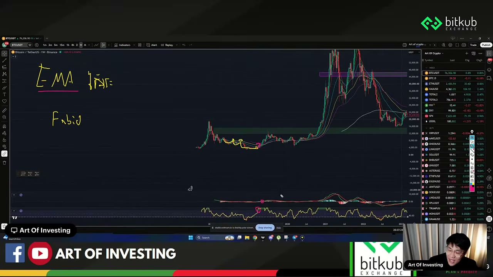

[00:37:48] นะครับเฉพาะบitcoinนะถ้าเกิดไปใช้ในหุ้น เหลือ 60 กว่านะครับเพราะว่าหุ้นไม่ได้ วิ่งเป็นไซเคิลเท่าหุ้นอเมริกาไม่ได้วิ่ง เป็นไซเคิลหนักเท่าบitcoinจำไว้เลยนะครับ ว่าโมเมนตัมในweคอ่ะจะวินดีมากเฉพาะสิน ทรัพย์ที่วิ่งมันวิ่งแรงเป็นไซเคิลเท่า อ่ะนะครับฉะนั้นตอนเนี้ยเห็นภาพชัดยังนะ ครับเห็นภาพชัดยังว่า RSI overbอนะเบรกพรีเมี่มนะช็อตเนี้ยผม โดนไม้ช็อตจำได้มั้ยที่ผมลงเพจว่าผมช็อต อ่ะเพราะผมมองว่าคอitionมันยังไม่ครบเฮ้ย มันน่าจะย่อกว่ารอบนึงแล้วค่อยขึ้นปลายปี คือพฤศจิกายนอ่ะนั่นคือสาเหตุที่ผมโดนตรง ผมโดนไม้ช็อตตรงนี้นะผม Stop  Loss นะ ครับเสร็จแล้วมันก็เบรคขึ้นมาโอเคเบรคก็ ก็ต้องยอมเบรคอ่ะทีเนี้ยเราก็ต้องมารอ เก็บของนะครับในโซนต่อมาโซนที่เรารอเก็บ ของเนี่ยเราได้ของแล้วโซนนึงเพราะเราไม่ รู้ว่ามันจะย่อแค่นี้กึ๊กๆๆ 1 ทีแล้วขึ้น

[00:38:51] เลยเหมือนปี 2023 มยอันเนี้ยก็จะคุณก็จะ ได้ 2 โซนนี้แล้วก็โมเมนตัมเกิดขึ้นไปเลย ถูกป่ะนี่คือ best  case ก็คือเคสดีหรืออาจจะได้ของตรงนี้แล้วขึ้น ไปเลยไม่รู้ Nobody  knows ถูกมั้ยไม่มี ใครรู้หรือถ้าเกิดเฮ้ยอ่ะเฮ้ยผมเนี่ยไม่ เคยคุยกับพี่หาญแบบตรงๆเนาะแต่ผมมองว่า คลิปล่าสุดใน Bitcoin  Addic มากอยากให้ ทุกคนไปลองดูนะครับคลิปที่เขาอธิบาย เรื่อง Global  Liquidity อ่ะแล้วอธิบาย เรื่อง Shadow  Banking อ่ะคลิปประมาณ เกือบชั่วโมงเฮ้ยไปลองดูผมผมคิดว่าคลิป นี้โคตรดีนะครับอธิบายภาษายากเกินไปด้วย มีภาพประกอบด้วยเ้าอธิบายหลักการของสภาพ ข้องของเงินโลกอ่ะนะครับว่ามันเหมือนกับ คุณเอาเงินไปฝากในแบงค์แล้วแล้วแบงค์ก็ ปล่อยกู้แต่เนี้ยทิศทางมันต่างกันนะครับ มันเป็นการค้ำประกันในระดับสถาบันแล้ว แล้วผู้ที่ดูแลตรงนั้นน่ะไม่ใช่แบงค์นะ ครับมันคือการกู้หนี้ยืมสินในระดับประเทศ นะครับสถาบันการเงินระดับโลก Global

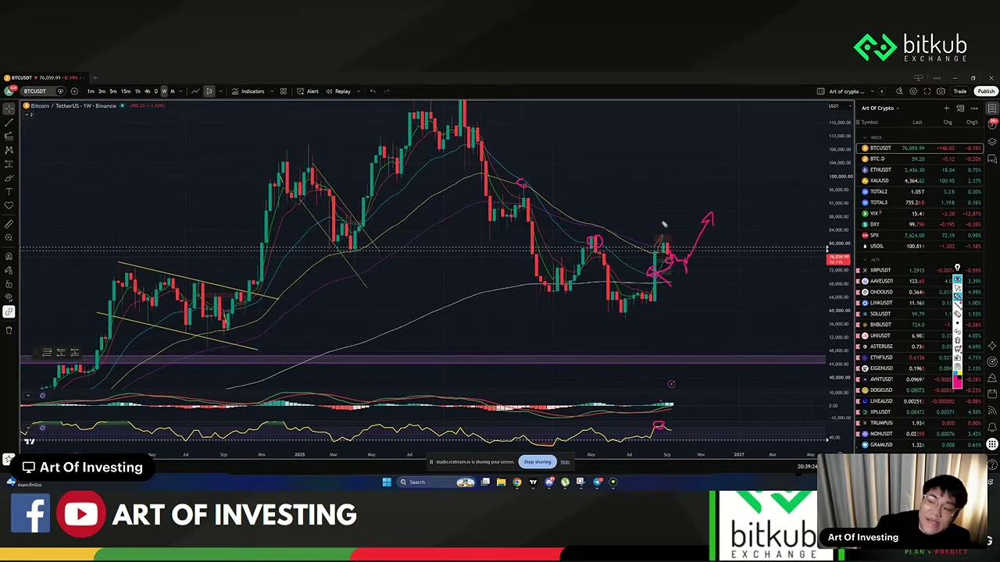

[00:39:53] Security อ่ะมันกำลังอยู่ในช่วงเจือจาง นะครับหรือในช่วงขาลงแล้วเพราะว่าบitcoin อ่ะมาตอนปลาย หุ้นอเมริกาวิ่งไปแล้วเอิ่มน้ำมันวิ่งไป แล้วทองคำวิ่งไปแล้วตั้งแต่ 2,000 ขึ้นมา 4,000 นะครับถูกมั้ยงั้นตอนเนี้ยมัน เหมือนกับเม็ดเงินตรงกลางของโลกสภาพคล่อง อ่ะมันอยู่ในสินทรัพย์อื่นไปเยอะแล้วเรา ไม่รู้ว่ามันเหลือเยอะแค่ไหนให้เพียงพอ สำหรับบitคinนะครับงั้นถ้าเกิดว่ามันจะไป ตรงตาม 4  year  cycle ที่มันเคยมีมาตลอดนะครับ อ่ะก็คือถ้ามันจะเกิด worst  case นะครับ ก็คือมันอาจจะขึ้นไปได้ไม่ไกลมากแล้วลงนะ ครับหรือตรงนี้แล้วลงเลยแล้วค่อยขึ้นอีก ทีปีหน้า เพราะว่าอะไรสภาพคล่องหมดนะครับแล้ว คุณนัทผมนึกไม่ออกเลยอ่ะว่ามันจะมีข่าว ร้ายอะไรขนาดนั้นที่ทำให้ตลาดตกใจเฮ้ย

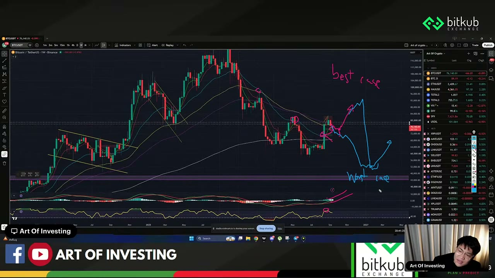

[00:40:56] เดี๋ยวเดี๋พอพอมันเกิดขึ้นน่ะเดี๋คุณก็ เจอเองอ่ะเดี๋ยวตลาดมันหาข่าวมาให้คุณได้ เองนะครับมันหาเหตุผลมาให้ทีหลังทีหลัง movement ของมันเสมอ ถ้าภาพใกล้ตัวสุดนะเลือกตั้งกลางเทอม พฤศจิกายนพอดีเลยนะครับแล้วต้นปีเนี่ยมัน ก็จะมีการปรับเปลี่ยนนโยบายจากรัฐบาลแน่ นอนเพราะมีการเลือกตั้งกลางเทอมถูกป่ะ ฉะนั้นถ้าเกิดเลือกตั้งกลางเทอมพฤศจิกายน มกราคมกุมภาพันธ์มี ธนาคารจะปล่อยให้รัฐบาลกู้ได้ยากขึ้น เพราะว่ามีการปรับเปลี่ยนนโยบายเขาก็ต้อง ตรวจสอบงั้นเคสเนี้ยคุณก็ต้องมีเงินสดพอ อ่ะหรือถ้าเกิดคุณแบบ all อินไว้แล้วอ่ะ คุณก็ต้องเตรียมปรับกับพอร์ตอ่ะผมถึง เขียนในบทความว่าเฮ้ยทำไมผมถึงยังเหลือ เงินอีก 20% เผื่อมันเกิดเคสนี้นะแล้วไอ้ 2 โซนเนี้ยถ้าเกิดผมได้ 2 โซนนี้อีกนะผม มี 80% แล้วนะครับฉะนั้นถ้าเกิดมันลงมา ตรงเนี้ยผมก็จะได้ของเพิ่มเป็น 100% แล้ว ผมก็จะเปิด leverage นะครับอ่ะก็อัดไปถ้า โดนก็ stop ไปนะครับแต่ถ้าถ้าไม่โดนก็จุด

[00:41:59] จัพอร์ตอีกจุดนึงนะครับก็ต้องรอดูว่าตลาด จะใจดีหรือเปล่านะครับก็เป็นเป็นเคสนี้ ที่มีโอกาสเกิดขึ้นได้ถ้าเกิดมันดึง ไซด์เวย์แล้วก็ขึ้นได้ไม่เกินแสนไปจน พฤศจิกายนแล้วก็เกิดเลือกตั้งกลางเทอม แล้วมีปัญหาความผันผวนสูงแล้วก็อย่างที่ ผมบอกมกราคมกุมภาพันธ์มีนาคม ธนาคารกลางปล่อยให้รัฐบาลกู้ยากขึ้นนะ ครับสภาพข้องต่ำก็ค่อยไปฟื้นช่วง quวarเตอร์ 2 อันนั้นก็จะขึ้นยาวๆเป็น เทรนด์นะแล้วแบบเนี้ยมันก็ทั้ง 2 ข้อ เนี้ยมันจะพอดีกับโมเมนตัมในweคฉะนั้นคุณ ก็วางแผนดีๆนะครับอย่างที่ผมบอกว่ามันมัน แล้วแต่คุณนะคุณอาจจะไปเปิดอtionัแทงพุก็ ได้ว่าแบนซื้อประกันไว้ว่าถ้าเกิดราคามัน ลงคุณได้กำไรเพิ่มแล้วพอคุณก็เอากำไรตรง นั้นไปซื้อเพิ่มก็ได้หรือคุณจะช็อต hge ไว้ก็ได้แต่ผมเตือนแบบนี้ มันไม่ได้ง่ายเหมือนที่ทฤษฎีมันพูดนะเว้ย ผมผมเตือนอย่างนึงนะเว้ยไม่ผมลงทุนมา 12 ปีกว่าผมยังมีช็อตโง่ๆที่แบบโดนแล้วโดน

[00:43:00] อีกแบบโดนแล้วไม่เข้าใจว่าทำไมตัวเองถึง ยังโดนน่ะผมก็ยังมีประจำนะครับสิ่งที่มัน ไม่เหมือนในทฤษฎีเนี่ยคือเขาจะชอบพูดแบบ นี้แล้วเราก็จะมองว่ามันง่ายเช่นเฮ้ยรู้ นะว่าเดี๋ยวราคาจะลงก็ช็อตไว้ดิช็อตเหจ ไว้เลยเหกับสปอ ช็อตเหตุไว้แล้วพอมันลงใช่มั้ยคุณก็ได้ กำไรจากไม้ช็อตคุณก็ TP ไม้ช็อตแล้วเอา กำไรอะไรตรงนั้นน่ะรวมกว่าเงินที่คุณรอ ไว้อ่ะมาซื้อเพิ่มโอโหแบบนี้ได้บitคin เพิ่มทฤษฎีดูโคตรหวานหวานเลยโอ้โหฟัง แล้วมันละมุนหูโอ้โหช็อตปุ๊บได้กำไรจาก ช็อตไม่พอเอากำไรมาซื้อสปอร์ตอีกอู้หูย แบบนี้เปิดคอย M  leverage ขาขึ้นพอร์น่ะ ถูกทฤษฎีมันสวยหรูแต่กลับกันพอคุณไปทำ จริงอ่ะ ช็อตปุ๊บเออๆๆเอ้ยๆๆยังไงเนี่ยกลาย เป็นว่าจากที่คุณจะได้กำไรพอร์ตสปอต ก็ไม่กำไรเพราะติดลบไม้ช็อตอยู่พอ ขึ้นไปตึ๊ดๆเอ้ยๆเอ้ยยังไงวะเนี่ยช็อตๆ

[00:44:01] ไว้ไหนบอกว่าเหตุไงบอกไหนบอกว่าเดี๋ยว เดี๋ยวราคาจะลงไงลงแล้วเราจะได้เอากำไร ไม้ช็อตไปซื้อสปอรตไงเออเงี้ยแล้วคุณโอคง ไม่เกินแสนหรอกเดี๋ยวเดี๋ยวเกินแสน Stop Loss แล้วกันเกินปุ๊บอ่าเรียบร้อยคุณ Stop  Loss ไม้ช็อตถูกป่ะแล้วราคาลง หลังจากนั้น Fiel สรุปเงินสดไม่เหลือเหกำไรชอตไม่ได้ เข้าเนื้ออีกสรุปมีบitคinน้อยกว่าเดิมอีก เนี่ยยากผมถึงบอกว่าเฮ้ยบาง บางทีอ่ะทฤษฎีมันดูเก๋มากเลยมันดูเจ๋งมัน ดูแบบอู้หูยนี่ไงแบบนี้มึงอ่านเกมมึงอ่าน ตลาดแบบนี้ดินี่เทคแtionอย่างงี้โบ๊ะๆ เดี๋ยวรวยมันยากหรือถ้าเกิด option แล้ว คุณคำนวณไม่เป็น เกิดปัญหานะไปนั่งคำนวณ Cover  Core Cover  Short เอ้ยซื้อประกันดิ ผมบอกเลยว่ามันเป็นเครื่องมือที่โคตรดี แต่คุณต้องศึกษามันเข้าใจจริงๆนะเว้ย เพราะว่าอะไรสมมุติเค้าบอกว่าเนี่ยคุณ ซื้อประกันดิถ้าราคาลงคุณได้กำไรแต่ถ้า

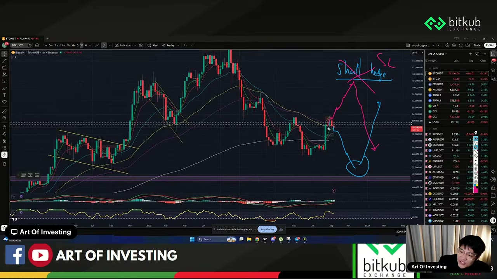

[00:45:04] ราคาไม่ลงคุณจ่ายประกันเดือนละไม่กี่ เปอร์เซ็นต์เองสมมุตินะเดือนละ 2% บางช่วงนะมันเป็นประมาณนั้นจริงๆคุณต้อง ไปคำนวณค่าsprรดค่าprรีemium in  the money  at  the  money  out  of  the money ใน option น่ะทีเนี้ยพอพอคุณคำนวณ น่ะคุณอย่าลืมดิถ้าเกิด 3 เดือนน่ะ คุณโดน 6% แล้วนะแบบเอ้ยไหนบอกจะลงไงวะ ไม่ลงแล้วพอคุณหยุดซื้อเสีย 6% พีฟรี 4 เดือน 8% แล้วฉะนั้นนะครับ ไม่มีอะไรง่ายถามว่าทำได้มั้ยได้ถามว่าดี มั้ยดีแต่ต้องรู้จริงๆถ้าไม่รู้จริงๆอ่ะ อย่าเพิ่งใช้เครื่องมือพวกนี้ทำแบบนี้มัน จะเสียหายกว่าเดิมอันเนี้เติมว่าความหวัง ดีเพราะอะไรรู้มั้ยโดนมาแล้วอีโก้จัดแบบ เฮ้ยเก่งกูปั้นพอร์ตขนาดนี้อายุเท่านี้กู พอร์ตแบบ 8 หลักเอ้ยเดี๋ก็ 9 หลักไม่ ยากเลยกูทำนู่นเละผมเป็นมาก่อนคือช่วงที่ เราเสียหายที่สุดอ่ะผมพูดบนเวทีบ่อยมาก ล่าสุดผมก็ไปพูดงานที่บิดครับผมก็พูด

[00:46:05] เรื่องนี้คนจะชอบคิดว่ามือใหม่อ่ะเสีย ตังค์เยอะสุดไม่ใช่ มือปานกลางผมไม่รู้เขาใช้คำว่าอะไรแบบยัง ไม่ถึงขั้นมืออาชีพแต่แบบเลยพาร์ทมือใหม่ มาเริ่มมีกำไรเริ่มอยู่ในตลาดได้ระยะระยะ นึงนั่นน่ะเสียหายหนักที่สุดเพราะผมเสีย หายหนักที่สุดคือ 6 ปีแรกผมโดนเป็นขี้เลย เพราะเราจากที่ตอนมือใหม่เราจะใช้เงิน ไซส์เล็กถูกป่ะเราจะไม่เล่นท่ายากเยอะเรา จะไม่เอาเครื่องมืออะไรก็แล้วแต่มาใส่ หน้าจอเราเยอะ เราก็จะโดนเล็กๆน้อยๆแล้วเราก็เรียนรู้ไป พอเรียนรู้ไปเฮ้ยเริ่มเริ่มีความรู้หน่อย นึงพอเริ่มมีความรู้หน่อยนึงเอาแล้วเว้ย เฮ้ยกูเก่งเหมือนกันนี่หว่าเริ่มใช้ไซส์ ใหญ่ขึ้นเริ่มใช้ leverage เยอะขึ้นพอใช้ เยอะขึ้นพอร์ตโตๆกำไรเอาแล้วกูเนี่ย จุดสูงสุดของโลกกูเก่งมากแบบนี้ยากมากที่ กูจะกลับไปมีพอร์ตเล็กเท่าเดิมยากมากที่

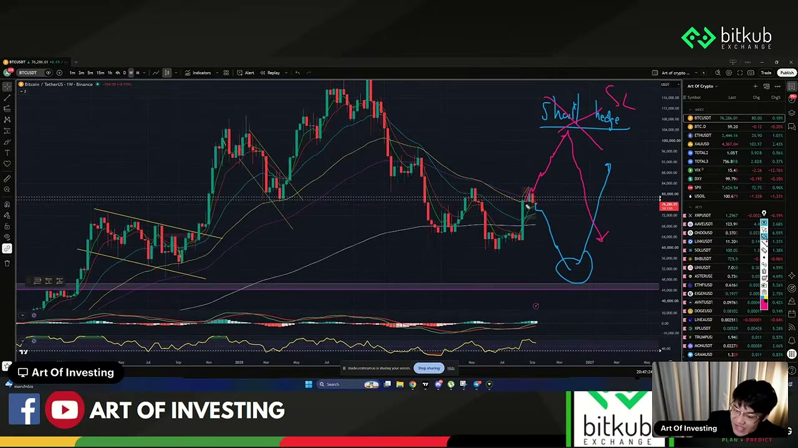

[00:47:06] กูจะต้องกลับไปลำบากกูเทรดแบบนี้นะลงทุน แบบนี้นะเดี๋ยวดู buffet นี่เฮ้ยเค้าดูแล กองทุนเ้าเลยต้องเซฟนี่กูไม่ต้องนี่กู พอร์ตส่วนตัวเละ เละจุดนั้นน่ะเละนะครับถ้าคุณไป คนที่เทรดมานานๆน่ะคุณจะเลยจะเริ่มเข้าใจ ว่าทำไมเขาแบบค่อนข้างเข้มงวดกับ เปอร์เซ็นต์ของพอร์ตเ้ามากแบบเอ้ยอันนี้ โดนเท่านี้ต้องเบรคเฮ้ยอันนี้เสี่ยงได้ ไม่เกินเท่านี้นะครับเพราะมันจะมีช็อตตรง กลางที่ทุกคนโดนหนักมาก่อนช่วงที่เราคิด ว่าเอาอยู่ทุกอย่างฉะนั้นน่ะผมเลยเตือน ตรงนี้นะครับเพราะว่าเดี๋ยวมันจะมีกูรู เยอะมากนะครับทุกวันนี้เนาะมันยิ่งมันไม่ มีกฎหมายควบคุมแบบเต็มๆอ่ะทำแบบนี้ได้ของ เพิ่มแบบนั้นเฮ้ยพอร์ตคุณจะเสียหายแล้ว แล้วมันจะสโนว์บอลความเสียหายเช่นคุณโดน ไปแล้วอ่ะสมมุติคุณโดนไป 15% อย่าเงี้ย คุณก็หงุดหงิดแล้วเฮ้ยอยากได้คืนทำไงดี คุณก็ไปอัด leverage คุณก็ไปอัดทุกอย่าง สุดท้ายมันกลับมาแย่กว่าเดิมนะครับฉะนั้น เคสเนี้ยผมเตือนไว้เลยนะอย่าอย่าไปทำแบบ นั้นบ่อยอย่าไปเห็นแบบคนนั้นคนนี้เล่นท่า

[00:48:08] ยากชว โแล้วก็แบบเออนั่นแหละนะครับ ดูก่อนว่าว่าเราเข้าใจในเลเวลนั้นหรือ เปล่าอย่างส่วนตัวผมก็ยังไม่ได้ใช้อชั เยอะขนาดนั้นนะครับกดเหล็กสำหรับผมนะก็ คือถ้าเกิดผมจะเริ่มซื้อประกันoptionัน่ะ นะครับผมผมจะเริ่มซื้อประกันอtionัน่ะต่อ เมื่อหุ้นหรือสินทรัพย์นั้นน่ะผมกำไรสปอต นะหรือกำไรตัวสินทรัพย์แท้ๆ 30-35% ขึ้นไปผมถึงพิจารณาเพราะว่าถ้าเกิดว่าผม โดนมันยื้อตลาดยื้อหลายเดือนน่ะผมยังมั่น ใจว่าผมยัง in  profit แล้วมันคุ้มค่าใน การซื้อประกันแต่ไม่ใช่ว่าแบบคุณเพิ่ง กำไร 5% คุณซื้อประกันแล้วอ่ะสมมุติว่า คุณคำนวณพรีเมี่มแล้วเดือนละ 2  2.2% น่ะ 2% 2.2%  2% แล้วคุณเพิ่งกำไร 5% ใช่มั้ สมมุติว่าตลาดไซด์เวย์อ่ะอีก 2 อีก 2 เดือนน่ะหมดแล้วกำไรคุณน่ะโดนโดนค่า พรีเมี่มกินเออมันจะเป็นแบบนั้น

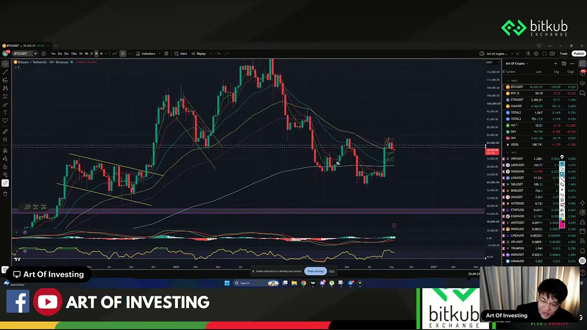

[00:49:11] ผมเรียนfinแซ้าก็สอนเรื่องอtionัว่าเป็น การซื้อประกันแต่จากใจคนในตลาดจริงๆผมยัง มองว่าเฮ้ยมันไม่ได้ง่ายขนาดนั้นใช่โอ้โห คุณลองโยนหนังสือดิอะไรวะแกมเตθ้าหาค่า แฟ่าตอนนี้มันสามารถคำนวณได้มั้ยสเปรด ว่างพอมั้โอโอ้โหหัวแตกนะครับฉะนั้นน่ะผม อยู่มา 12 ปีอ่ะผมถึงบอกว่าผมยังไม่ได้ ใช้เครื่องมือพวกนั้นน่ะเยอะมากผมใช้แค่ บางจังหวะแล้วจังหวะใหญ่จริงๆนะครับคือ ถ้าเกิดเอ้ยมองว่าหุ้นจะแครชเว้ยอย่าง เงี้ยกำไรตัวนั้นน่ะต้องถึง 30-35% ก่อน ผมถึงจะเริ่มพิจารณาว่าแบบเออมันมันน่าจะ คลุ้มพรีเมี่มแต่นี้มุมมองส่วนตัวนะนะ ครับคุณก็ต้องไปศึกษาเองแล้วแต่คนเนาะ อย่างถ้าใครเรียนไฟแนนซ์อ่ะคุณก็จะรู้ เพราะอชัน่ะมันสอนอ่ะอย่างเงี้ยน้อง ออมสินเรียนไฟแนนซ์น่ะมันสอนในมหาลัย อย่างงั้นนะเออแล้วเห็นมั้ยผมไปเรียนอชั เพิ่มมาจากจาน M จาน A อย่างเงี้ยทำไมผม เอาอชัมาวิเคราะห์คุณนึกง่ายๆถ้ามันเป็น ทฤษฎีที่สอนในมหาลัยอ่ะมันต้องไม่ใช่ ทฤษฎีแบบสมคบคิดแบบเอ้ยนาย A นาย B นาย C

[00:50:16] คิดแบบนี้เหมือนกันแบบนั้นน่ะเค้าเรียก ว่าทฤษฎีสคบคิดครับไอ้ concept ที่เรา เทรดกันเป็นกราฟเนี่ยผมเลยหยิบแต่ไอ้ที่ มันสอนในมหาลัยโมเมนตัมอย่างเงี้ยมันระยะ ยาวนะครับมันเป็นค่าเฉลี่ยอย่างเงี้ยเออ มันมันคำนวณได้นะครับแต่ว่าไอ้คอนเซปตการ กวาด stop  loss  stop  hunt พวกเนี้ย อย่าลืมนะมันคือทฤษฎีสวมครบคิดนะเออเรา เราต้องดูก่อนนะครับว่าเราจะใช้แบบไหนแต่ บางคนบอกเอ้ยทฤษฎีสมคบคิดมันยังหาเงินได้ เลยได้มันหาเงินได้แต่ว่าคุณจะคำนวณ ในระยะยาวกับพอร์ตคุณน่ะเออมันมันก็ต้อง มองในอีกมุมนึงเนาะถ้าเกิดคุณเป็นนัก บริหารเงินแล้วอ่ะนะครับอ่ะสวัสดีครับ น้องมิกสวัสดีครับ อ่ะประมาณนี้นะครับไม่ไม่ได้จะลงไลฟ์นะ แต่ประมาณนี้บitคin เพิ่งวิเคราะห์บitคinเสร็จนะครับอ่ะมอง เคสไว้อย่างงี้ก็คือผมมองว่าหลุด 75,000 มีสิทธิ์พรวดถึง 72,000 แต่ถ้าไม่หลุดก็ อยู่ในกรอบเนี้ย 75,000-79,000

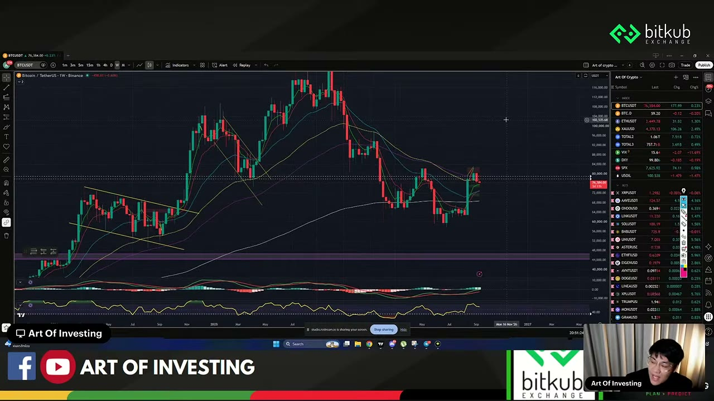

[00:51:16] จะไซด์เวย์ก่อนจะพรวดฝั่งบนนะครับอ่ะฝั่ง บนก็คือหลุดหลุด 82,000 เนี่ยก็คือพวดไป 85,000 ได้นะครับแล้วก็หลุด 75,000 พวดลงมา 72,000 ได้อันนี้คือของ 25 เซฟนะ กับ 18  18 ก็คือพรุ่งนี้ละไม่ต้องพูดถึง มากอ่ะประมาณนี้นะครับที่ที่มองนะก็คือ น่าจะอยู่ในกรอบนี้ก่อนนะครับก็จะไซด์ย กรอบนี้ประมาณนี้ อtionัที่จะเอาเงินส่วนไหนจากการแบ่ง พอร์ตต้องใช้เงินสดครับน้องคุณจูเนียร์ อ่ะเดี๋ยวแวะแวตอบคอมเมนต์ก่อนเนาะเดี๋ยว ผมไปวิเคราะห์อธีรiมแล้วก็ outco ให้นะ ครับนี่เลยเมื่อกี้ผม ชอตตรงนี้นะครับตรงนี้ อ่ะเดี๋ยวอธิบายให้ฟังแล้วกันแล้วก็ผม Stop  Loss ตรงนี้เนาะแล้วก็ผม TP อ่ะ ไม่ใช่เดี๋ยวผมชอตตรงนี้อ่ะดูในรูปใน

[00:52:18] Telgram แล้วกันมันเห็นมยอ่ะนี่ๆนะครับ นี่นะเออผมช็อตตรงนี้เห็นมย แล้วผมก็มา TP ตรงนี้แถว 76445 นะครับ เดี๋ยวผมจะอธิบายให้ฟังใครอยากดูJจoural ที่ผมลงเป็นเดือนๆ 3 เดือนติดกันก็ดูใน เพจได้นะครับผมปักหมุดไว้ 2-3 ปักหมุดเลย สาเหตุที่ผมชอตตรงนี้นะครับก็อย่างที่บอก โมเมนตัมใน week มันยังไม่พร้อมเนาะแล้ว ผมก็ย่อยมาดูโมเมนตัมใน day นะครับก็คือมันติดตรงนี้พอดีที่ EMA10 แล้วเราจะเห็นว่าทุกครั้งที่เลยไปเป็นไง เป็นไงเกิดแรงขายถูกมงั้นค่าเฉลี่ยตรง เนี้ยตลาดตีความว่าเป็นพรีเมี่มฉะนั้นพอ ขึ้นมาถึงโซนที่ตลาดมองว่าเป็นพรีเมี่ม แล้วเมื่อวานน่ะมันเป็น relief  b ขึ้น ด้วยความโล่งใจเฉยๆอย่าเงี้ยผมก็เลยมอง ว่าถ้าเกิดตรงเเกิดแรงขายเนี่ยมีแนวโน้ม ที่จะย่อลงมาหาค่าเฉลี่ยตรงกลางก่อนนะก็ คือแถวตรงนี้เป็นกรอบ balance โซนถูกป่ะ ก็คือขึ้นไปแล้วแล้วยังต้องย่อกลับลงมาหา ถามว่าทำไมมองแบบนั้นเพราะว่าแกdยังอยู่

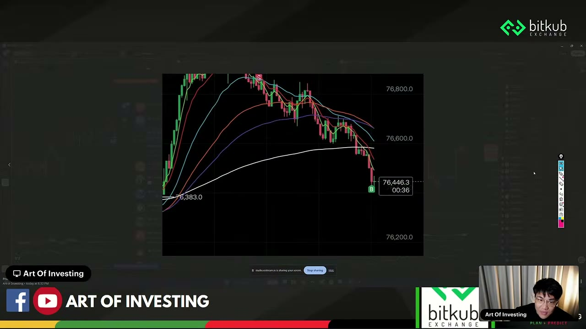

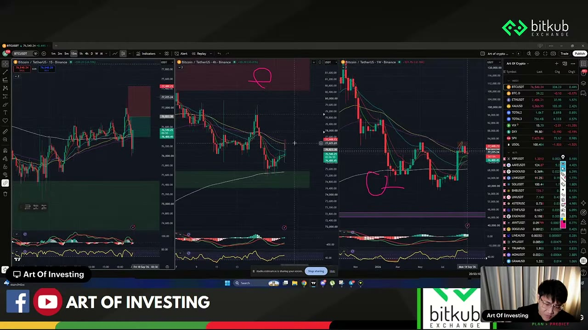

[00:53:20] ใต้ศูนย์อยู่เลยเห็นมยเนี่ยขึ้นไปได้ก็ เส้นเดียวอีกเส้นนึงขึ้นไม่ไหวเนี่ยอยู่ ใต้ 0 ฉะนั้นเวลาที่เป็นเทรนด์เนี่ยครับ MACD มันจะขึ้นไปเหนือ 0 ไปเลยหรือใต้ ศูนย์ไปเลยคำถามคือทำไมถึงเป็นแบบนั้น MAD เนี่ยคุณไปใช้เทรดแบบตัดขึ้นตัดลงเนี่ย คุณเสียมุยตู้เลยนะถ้าคุณถ้าคุณเทรดTimeม Frame เล็กอ่ะเพราะอะไรรู้ป่ะเพราะว่า มันช้าอันเนี้ยเห็นมั้ยคือการที่คุณจะใช้ คุณต้องรู้ข้อเสียมันก่อน MCD โคตร ช้าเลยถ้าใครบอกเฮ้ยเทรด SMC  ICT ดีกว่า MACD ช้าโคตรถูกมากช้าแล้วมัน ช้ามากทีนี้ต้องบอกก่อนว่า แล้วเราเอามาดูอะไรฉะนั้นผมไม่ได้แบบเอ้ย ตัดขึ้นจะขึ้นไปใช่ป่ะเรามองแค่ว่าตอน เนี้ยอ่ะเราดูนะตอนที่มันขึ้นมายาวๆอ่ะ คุณเห็นแม็กมันป่ะ แสดงว่าออเดอร์ซื้ออ่ะมันเยอะกว่าออเดอร์ ขายงั้นตอนเนี้ยมันอยู่ใต้ศูนย์มันแปลว่า อะไรมันแปลว่าออเดอร์ขายมันเยอะกว่าซื้อ

[00:54:23] อ่ะถูกป่ะงั้นราคาถึงโซนอะไรอ่ะโซนที่ ตลาดมองว่าแพงหรือพรีเมี่ม นะครับแล้วก็ แล้วก็ อตายละสมองชัดดาวน์ อ่ะ MACD ยังอยู่ใต้ศูนย์อยู่สำหรับ 4 ชม.งั้นแสดงว่าออเดอร์ซื้อเนี่ยยังเยอะ ไม่พอออเดอร์ขายมันยังปกคลุมแล้วต่อมาแถว 77,000 เมื่อกี้มีเสาอะไร OI ถูกมั้ย แล้วเกิดแบบนี้มีโอกาสจะเกิดการ settlement งั้นมันเลยมีโอก 7  77  500 มีแนวโน้มและที่จะวิ่งลงมาหา Balance โซน ก่อนนะครับก็คือประมาณ 7,6500 นะครับก็ เลยช็อตลงมาสั้นๆ 1 ไม้ประมาณนี้เนี่ยคือ เราต้องเข้าใจก่อนมันคือการตีความdata้า ครับมันมันไม่ใช่ว่าแบบเอ้ยอันนี้กวาด stop  loss ตรงนี้อ่ะมันมันก็มองแบบนั้น ได้ถ้าคุณมองในรูปแบบทฤษฎีสมคบคิดเนาะแต่ ว่าถ้าเกิดคุณมองว่าเงินในตลาดอ่ะมัน

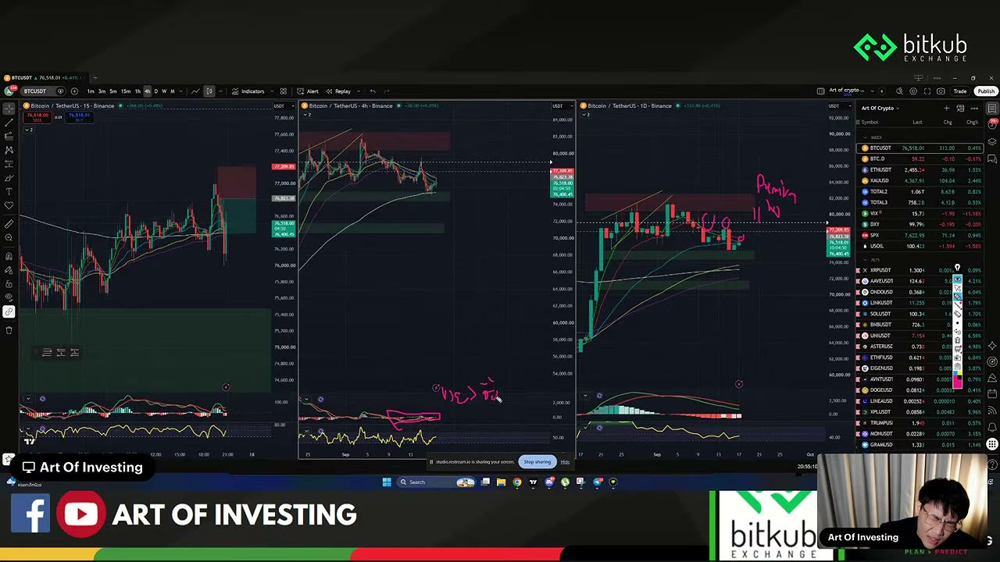

[00:55:24] กำลังเกิดอะไรขึ้นอย่างเงี้ยอ่ะคุณก็อ่ะ อย่างสมมุติว่า delbit คุณก็ดู Real  Time ได้เลยอ่ะผมเปิดให้ดูนะวิธีดูแบบ Real Time นะเนี่ยอย่างเงี้ยใช่มั้ยคุณกดไป ที่ Option นะแล้วคุณก็ดูวันหมดอายุเลย อ้าว Dibit เล่นผมเสร็จแล้วอย่าเพิ่งดิจะ โชว์เค้าในไลฟ์เนี่ยเอออย่างเงี้ยคุณดู ได้เลย Real  Time นะครับเนี่ย IV เท่า ไหร่เนี่ย 31.9%  9% ไอ้ตรงเนี้ยมันบอก คร่าวๆได้เลยนะว่าวันเนี้ยมันจะบวกลบ เนี่ยจากราคาปัจจุบันเนี่ยเนี่ยมันคำนวณ เร time อยู่เห็นป่ะไม่เกินกี่จุดนะครับ งั้นจากวันเนี้ยจากสัญญาที่จะหมด 18 เนี่ยด้วย IV หรือ volume  imply volatility ในตลาดเฮ้ยบวกลบไม่น่าเกิน ประมาณ 1,000 ดอนเอ้าพอดีเลย ถูกมเพราะว่าเรามองว่าผ่าน 79,000 ยาก หลุด 75,000 ยากงั้นถ้ามันเกิดใกล้โซนบน เราก็กดกลับลงมาเพราะว่าวันเนี้ยมันบวกไป กี่พันแล้วอ่ะ เห็นมั้ยเนี่ยวันนี้บวกไปเท่าไหร่ละจาก ราคาเปิดตรงนี้อ่ะเนี่ยก็1,000ึงพอดีเปิด

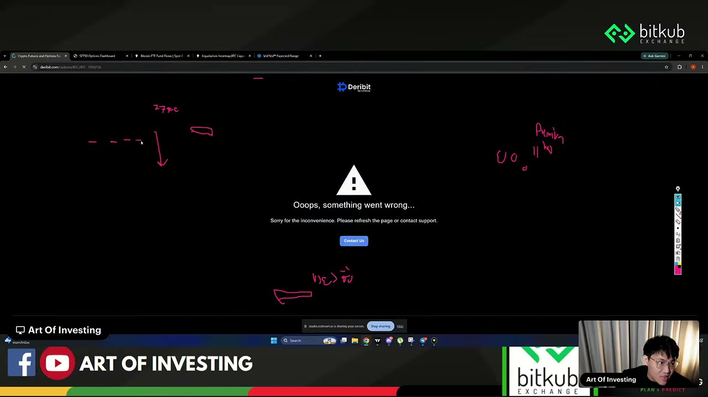

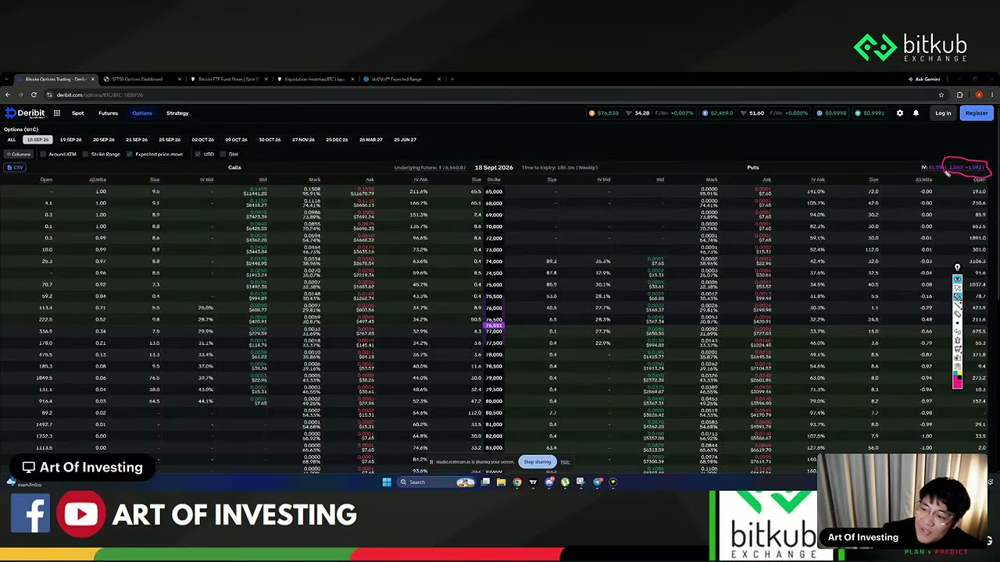

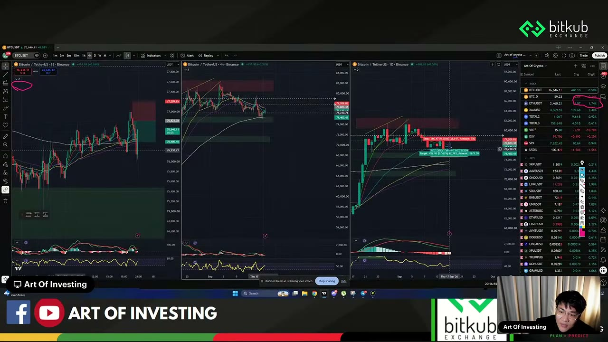

[00:56:28] 76  200 เมื่อกี้ 77,000 อ้าวเนี่ยคือ การตีความ data นะครับมันมองได้หลายรูป แบบนะครับแต่ IV เนี่ยคุณต้อง fix นะ เพราะว่ามันขยับทั้งวันถ้าไม่งั้นอ้าตอน นี้ 76,000  +  -1,000 ก็ไป 78,000 อ่ะขึ้นไป 78,000 บวก -  1,000 ก็ 79,000 นะครับฉะนั้นคุณต้องยึดเวลาด้วยคร่าวๆที่ ผมยึดนะผมยึดตอน 19:00 น. นะครับอ่ะเดี๋ยวไว้ว่างๆมีโอกาสเดี๋ยวจะ มาสอนเรื่องเรื่องพวกนี้เพิ่มนะครับไม่ รู้จะอยากฟังกันเปล่านะมันอาจจะไม่เล้าใจ ดิใช่ป่ะแบบเฮ้ยอันนี้เดี๋ยวมากวาด Stop loss นะเดี๋มันต้องขึ้นอันนี้เข้าเลย ครับทุกคนลองตอนนี้ชอตอนนี้แบบนั้นมัน เร้าใจใช่ป่ะแต่แบบมานั่งแบบเอ้ยดูdata้า ตัวลงตัวเลขมึงวางโซนอะไรเนี่ยมึงแม่น จริงเป่าเนี่ยมึงรู้เรื่องจริงป่ะเนี่ย มึงวางหลายโซนจังเลยอะไรเงี้ยเออมัน อาจจะไม่เร้าใจไงนะครับแต่ก็นะเดี๋ยวผมก็ คิดว่าเป็นประโยชน์แหละถ้ามีคนอยากฟังฟัง ก็เดี๋ยวไว้ผมมาแชร์ให้ฟังนะครับก็ประมาณ นี้เนี่ยตรงเนี้ยเนี่ยมันชั่วเยอะมากเลย นะครับเนี่ยเนี่ยแล้วเค้าบอกสูตรหมดเลยนะ square  root อะไรอย่างเงี้ยถ้าเกิดมัน เป็นเรื่อง option มันจะมีเรื่อง dte อีก

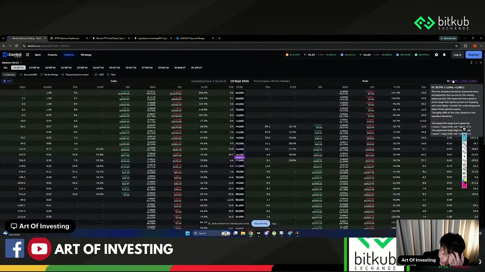

[00:57:30] นะครับ อ่ะเดี๋ยวทักทายคอมเมนต์ก่อน สวัสดีค่ะอาจารย์เอ้ยเป็นไงบ้างคุณแกปไม่ เห็นเป็นปีเลยนะครับสบายดีมั้ย BJ พรุ่ง นี้เอาไงดีผมว่าน่าจะขึ้นครับในม่วงส่วน ตัวนะ จานไป A จาน A แล้วใช่ๆครับ YouTube ปล่อยเค้าไปครับปล่อยเค้าไป YouTube อ่ะ อกอิธึมไม่รักเราอยู่แล้ว เวลามันเบรค ISI  oversow  overbd ตัดตัด สูตรแล้วอาจารย์เข้าเลยหรือว่ารอมันย่อ ก่อนหรือไม่เครับดูเนก่อนครับสมมุติว่า มันเป็นจุด turn  around ในweคอ่ะอ่ะเช่น มันเป็นจุดสะสมของ cycle แล้วเรามองว่า มันมีโอกาสกลับตัวอย่างเงี้ยฉะนั้นถ้า เกิดครบ 3 คอitionน่ะผมเข้าเลยในweคหรือ ถ้าเกิดคุณมองตรงกลางสมมุตินะว่าคุณมอง ว่าโมเมนตัมมันเกิดใน 1 ช่มงผมก็ดูก่อน ว่า day กับ week อ่ะเป็นยังไงสมมุติว่า day เป็นขาขึ้นเป็นขาขึ้นแล้ว 1 ชมงย่อ

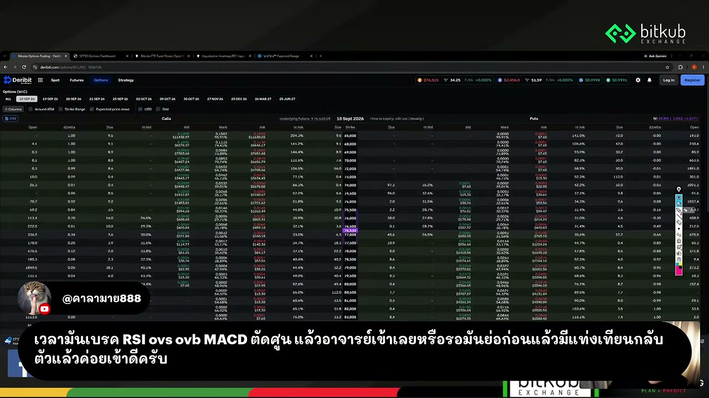

[00:58:32] 1 ช่มงย่อแรงมากแล้ว 1 ช่โมงเกิด โมเมนตัมอ่ะอย่างเงี้ยผมก็เข้าเพราะว่า อะไรเพราะว่าถ้า 1 ช่มงเบรคแล้วมันก็ขึ้น ต่อตาม Day กับ week ไงแต่ว่าถ้าเกิด Day กับ Week เป็นขาลงแล้ว 1 ช่มงเกิด โมเมนตัมผมก็ไม่เข้าเพราะว่าโมเมนตัมเกิด ไปก็ส่งไม่ถึงไม่ถึง day กับ week อยู่ดี นะครับผมลุ้มให้เกิดแบบนี้อ่ะใช่ครับก็ก็ ต้องรอดูว่าเกิดยังไงผมก็เลยยังเตรียม เงินสดไงผมถึงบอกว่าถ้าแม่นจริงๆอ่ะผม กด 100x แล้วเข้าเลยไม้ละ 10 ล้านคุณทบต้นเนี่ยแป๊บเดียวคุณ1ันล้าน แล้วถ้าเกิดคุณรู้อนาคตจริงถูกมั้ยใช่ มั้ยแบบเฮ้ยถ้าแม่นจริงๆอ่ะมึงก็เนี่ย 10 ล้าน 100x ปึกๆแป๊บเดียวก็1ันล้านแล้ววัน 2 วันแต่ทีเนี้ยบนโลกแห่งความจริงอ่ะเรา ไม่รู้นั่งเทียนยังไม่รู้เลยผมก็เลย บอกว่าเฮ้ยมันเกิดได้หลายเคสนะแทนที่คุณ จะไปคำทำนายอ่ะคุณลองดูก่อนว่าตลาดอ่ะ เค้าให้ค่าแต่ละโซนน่ะกี่เปอร์เซ็นต์เงิน มันอยู่ตรงนั้นเยอะมั้ยอ่ะถ้ามันอยู่เยอะ ก็แปลว่าแนวโน้มสูงหน่อยอ่ะถูกป่ะ 68% 75% มี 2 ทฤษฎีคุณเลือกเอาอะไรถ้าเอา

[00:59:32] Standard  de หรือ impreity  IV บอก อยู่ 68% อ่ะเนี่ยเห็นมั้ยผมเอาเมาส์ไป ชี้ให้นะคุณดูตรงที่เขาดอกจันทร์น่ะมุม ขวา Rly  86  68%  of  the  time  based on  one  standard  deviation เนี่ยคือ 68% ของทุกช่วงเวลา จะอยู่ในกรอบนี้ถ้านับตาม 1  SD เนี่ย เห็นมั้ยคุณก็เฮ้ย 68% จะอยู่ในกรอบ นี้ว่ะคุณก็ manage เงินที่คิดว่าเฮ้ย วิลจกูตีหยาบๆ 70 อ่ะที่มันจะหลุดโซนนี้ ถ้าไม่หลุดกูได้ถ้าหลุดกูโดนอ่ะเป็นแบบ นั้นนะครับแต่อย่าลืมนะ อันนี้ option นะไม่ใช่futจureนะต่างกัน ต่างกันยังไงนะต่างกันตรงที่ option นะ ครับเลยไปอ่ะมันไม่ได้ Stop  Loss นะเฮ้ย เลยไปอ่ะมันไม่มันไม่ได้แบบบังคับขาย บังคับปิดนะอชัมันนับเวลาถ้าไม่หมดอายุ

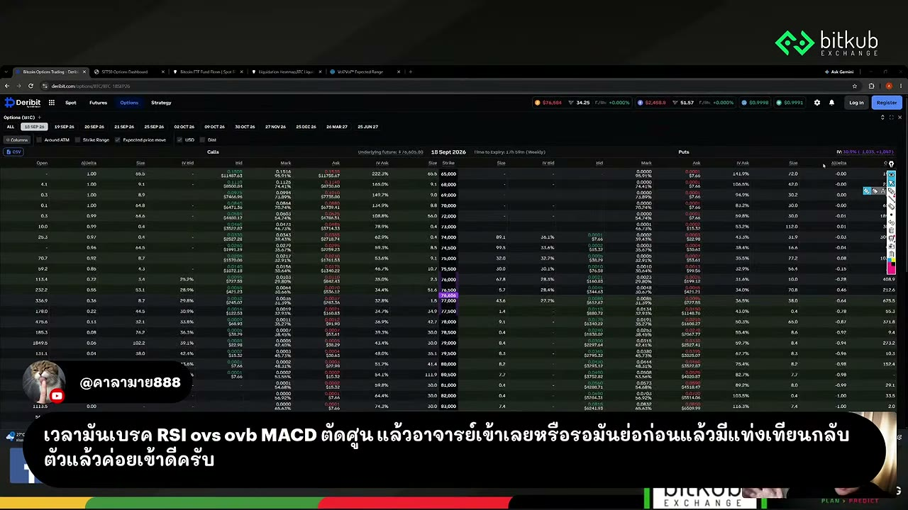

[01:00:34] แล้วมันย้อนกลับมามันก็นับว่ายังอยู่ใน กรอบงั้นไอ้ตรงเนี้ยที่เขาบอกว่า 68% น่ะ ตอนหมดอายุอ่ะมันกลับลงมาอันเนี้ยคือคำ ว่า 68% ของ option ฉะนั้นถ้าเกิดราคามัน วิ่งปึ้งๆเงี้ยคุณเทรด future อ่ะคุณจะ โดน Stop  Loss และแต่ option ไม่โดนผม เลยบอกว่างั้นอย่างเงี้ยคุณต้องเอาไป วิเคราะห์คู่กับอย่างอื่นคุณต้อง วิเคราะห์คู่กับศาสตร์อื่นแนวรับแนวต้าน ดูมันด้วยนะครับว่ามันบอกคุณมั้ยว่า โซนเนี้ยเนี่ยมันมันไปตรงกับพรีเมี่มพอดี อะไรพอดีอะไรอย่างเงี้ยเออแล้วคุณวาง Stop Loss อ่ะอ่ะมันมีแนวโน้มและที่มันจะเกิด รีเจคนะครับประมาณนี้อ่ะขอได้ครับเดี๋ยว ไปดูอธีเรียมให้ก่อนเนาะ ประมาณนี้ อ่ะอธเรียมหรออธอเรียมอธีเรียมก็สวยนะมุม มองผมนะครับแต่ว่าพารทรวมอธเรียมเนี่ยมอง เหมือนกันก็คือweคเนี่ยมันยังไม่เกิด

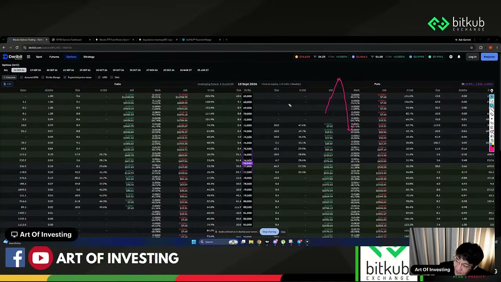

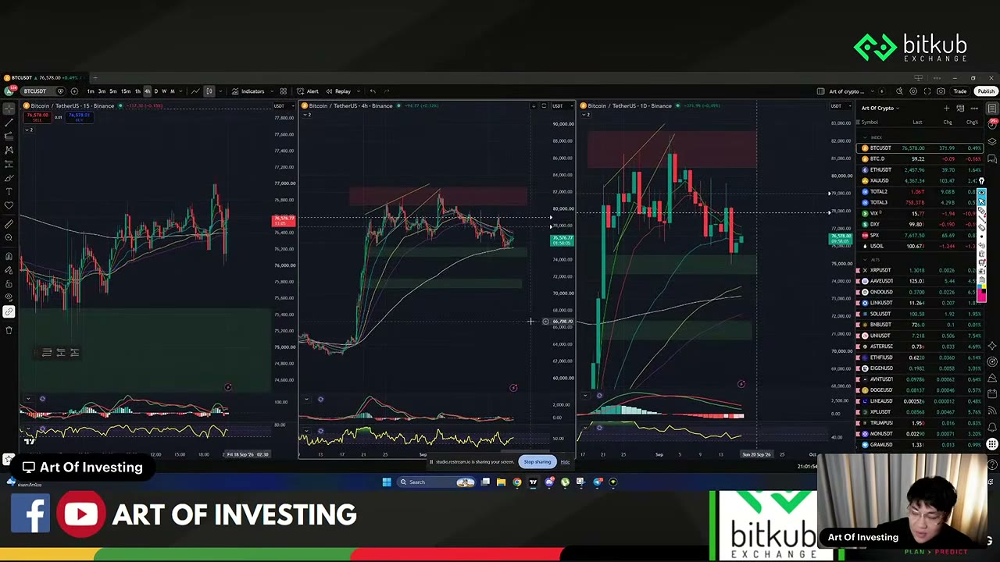

[01:01:35] โมเมนตัมเนาะฉะนั้นอธีมตอนเนี้ยมันติด ซpัพัlyละจากที่เราเห็นว่าขึ้นไปด้านบน เนี่ยมีแต่ไส้นะครับฉะนั้นอธีเรียมเนี่ย ถ้าเกิดจะวิ่งขึ้นต่อเนี่ยต้องเกิดแท่ง แบบนี้เท่านั้นอ่ะอันเนี้ยนี่คืออีกหนึ่ง สาเหตุที่ผมชอบโมเมนตัมนะเพราะว่ามันจะ เกิดภาพซ้ำๆแล้วเราอาจจะอธิบายได้ว่าเคส ไหนจะเกิดอะไรขึ้นเวลาที่คุณเจออย่าง เงี้ยให้คุณจำภาพไปเลยนะผมจะอธิบายว่ามัน คืออะไรนะครับอย่าไปมองว่าเอ้ยแบบนี้ Stop Loss แบบนี้ TP เดี๋ยวๆเราเราตีความจาก มันก่อน ถ้าแบบเนี้ยเราเห็นแต่ไส้ด้านบนอย่าง เดียวมันบ่งบอกถึงอะไรถ้าถ้าเกิดเราเห็น แต่ไส้ด้านบนสิ่งที่มันบ่งบอกคือออเดอร์ ขายมันขวางเยอะเพราะว่าขึ้นไปปุ๊บเนี่ย คุณดูใน week ถ้าเกิดว่ามันจะปล่อยให้ผ่านน่ะคุณมีเวลา เติมออเดอร์ซื้อต้อง 27 ต้องต้อง 7 วัน ถูกป่ะถ้าเกิดคุณบอกว่าคุณจะปล่อยให้ผ่าน น่ะคุณมีเวลาตั้ง 7 วันคุณจะเติมออเดอร์ คุณเติมไปดิแต่เนี้ยตั้ง 7 วันน่ะมันยัง กดลงมาแล้วมีแต่ไส้ๆแล้วเนื้อขึ้นไปไม่

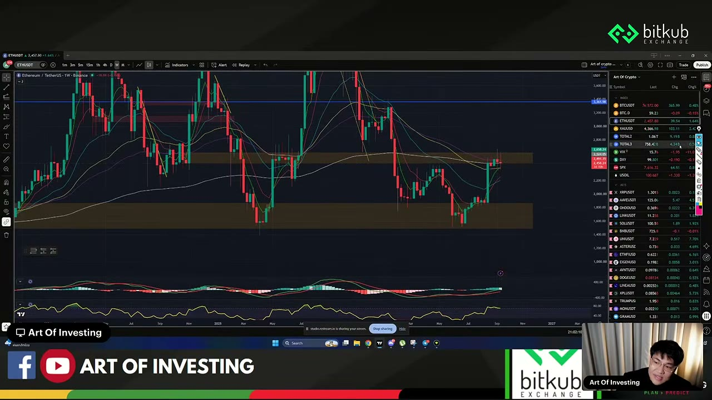

[01:02:38] ได้เลยแสดงเพราะออเดอร์ขวางตรงเนี้ยมัน เยอะงั้นการที่คุณจะทะลุโซนตรงนี้ไปได้ มันจะต้องปิดเนื้อเทียนเต็มแท่งไงเพื่อ บ่งบอกว่าออเดอร์ขายตรงเนี้ยมันสู้จำนวน แรงซื้อไม่ได้แล้วเนี่ยมันก็จะเป็น อย่างี้เห็นป่ะฉะนั้นน่ะมันต้องมีแท่งแบบ นี้มันถึงจะส่งต่อโมเมนตัมไปต่อได้งั้น อธีเรiมครับถ้าเกิดในweคนะยังไม่มีปิด เต็มแท่งเกิน 2,700 หรือ 80 ก็จะไซเวย์อยู่อย่างเงี้ย นะครับต้องมีแท่งแบบนี้นะครับเพราะว่าตอน เมันติดsupัlyzซoneแล้วทีเนี้ยถ้าจะย่อลง มาเราก็ดูครึ่งนึงของของ imbalance candle ไอ้ตรงเนี้ยเราจะเรียกว่า imbalance  candle นะครับ imbalance candle คือมันไม่สมดุลคือออเดอร์ฝั่งใด ฝั่งหนึ่งมันมันเยอะกว่าอย่างชัดเจนอย่าง เนี้ยออเดอร์ขายเยอะกว่าชัดเจนอันนี้ ออเดอร์ซื้อเยอะกว่าชัดเจนนะครับฉะนั้น จังหวะที่โอกาสจะย่อลงมาแล้วมารีทestว่า แรงส่งที่ขึ้นไปเนี่ยเยอะจริงมั้เนี่ยนะ ครับก็จะมีโซนตรงนี้ผมมองว่าแถว 2002  2 แล้วก็ 1,900 น่าสนใจเนาะก็คือถ้าเกิดมัน

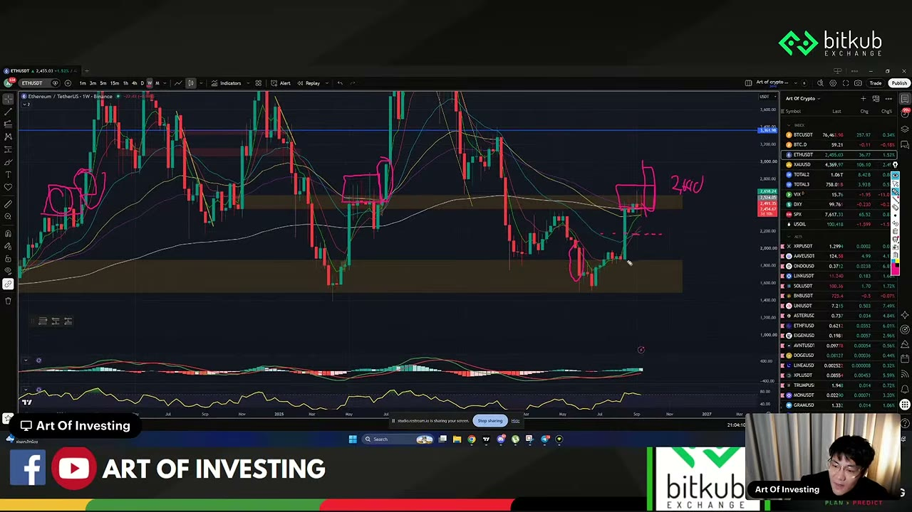

[01:03:40] ย่อมาแถวนี้หรือย่อมาแถวนี้แล้วไซด์เวย์ แล้วค่อยเบรคอีกรอบเนี่ยอย่างเงี้ยนะครับ เงี้ยอธีเรียมก็ก็จะสวยนะครับหรือถ้าจะ แบบคุณรันแล้วอยากจะรันต่อไปเลยต้องต้อง ให้มันปิดเหนือ 2,680 อืมนะครับอ่ะเมื่อกี้มีเพื่อนขอกับitrรัม นะครับเดี๋ยวๆผมดูพวก outcoin ให้นะครับ อ่ะนะก่อนไปตรงนั้นขอน้ำมันนิดนึงน้ำมัน ผมมองว่าเท่าที่ดู OI นะก็คือ โซนตอนเนี้ยมันยังมีหนักหนักคออยู่นะครับ แล้วก็มีฝั่งพุทธเนี่ยผมดูซีรียส์จบเดือน มานะก็คือถ้าสงครามยังไม่คลี่คลายอ่ะ น่าจะยังอยู่ในกรอบนี้นะครับ สิ้นเดือนนี้นะ ถ้าเกิดสงครามยังไม่คลี่คลายอ่ะน้ำมันน่า จะอยู่เร็งเร็ range เนี้ยเท่าที่ผมดู OI มานะครับก็คือ 92-110 ส่วนทองคำเนาะถ้า

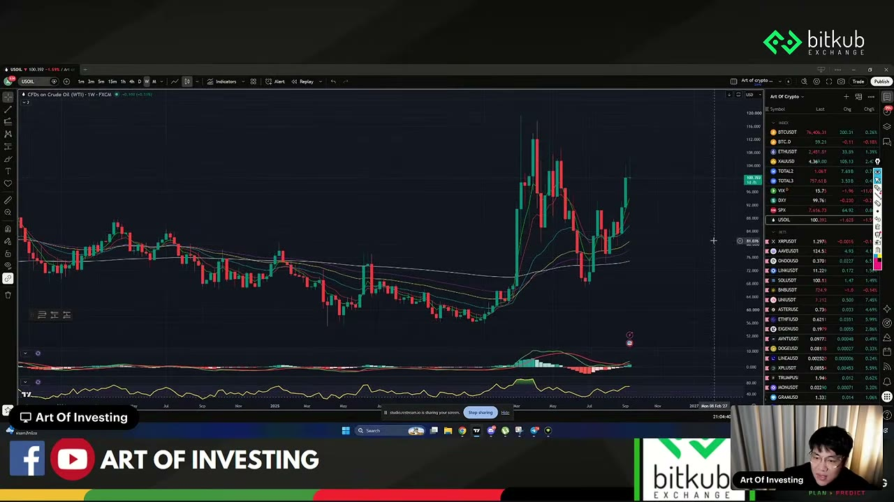

[01:04:41] เกิดบอลขึ้นอะไรขึ้นเนี่ยก็มันก็มีโอกาส จะต้องพักตัวถูกมั้ยแต่ทีเนี้ยผมมองว่า พักตัวเนี่ยจะเป็นจังหวะที่ดีของมันเพราะ ว่าถ้าเกิดเงินมันเริ่มไหลออกจากสิน ทรัพย์เสี่ยงแล้วไปย่อปลายปีกันจริงๆอ่ะ แบบเคสนั้นน่ะทองคำมันจะต้องขึ้นถูกป่ะ ฉะนั้นทองคำเนี่ยมันจะต้องย่อก่อนแล้ว ค่อยขึ้นทีหลังถ้าเกิดเป็น worst  case ที่เราคุยกันใครตามไม่ทันย้อนดูนะครับ งั้นผมก็เลยมองว่าตอนเนี้ยครับซัพพlyาย ทองคำคือตรงนี้เห็นมั้ยเหมือนกับ อธeriเรiumที่ผมบอกอ่ะงั้นถ้าเกิดทองคำจะ ขึ้นต่อยาวๆอ่ะมันจะต้องมีแท่งเปิดสูง กว่า 4,800 ฉะนั้นนะครับถ้าเกิดมันเกิด ไม่ได้ผมก็เลยมองว่าโซนตรงเนี้ยจะน่าสนใจ ะ 4,100 นะครับ 4,100 ถึง 3,000 นะครับ ก็จะเป็นโซนที่น่าสนใจะถ้าเกิดว่ามันจะ เกิดการย่อนะช่วงปลายปีสำหรับสินทรัพย์

[01:05:43] เสี่ยงนะครับก็ทองมันจะต้องย่อมาก่อนถูก มั้เพราะว่าเงินมันจะต้องถูกดูดเข้าไป อาทิตย์หน้าคุณจะต้องดูอีกเรื่องนึงก็คือ นะครับนอกจากทองแล้วว่าถ้าไม่ทะลุ 4,8 เนี่ยผมมองว่าไซเวย์นะครับยังไม่น่าจะแบบ ปึ้งๆ 5  5,600  6,000 คิดว่ายากนะครับ ตราบใดก็ตามที่ยังทะลุ 4,800 ไม่ได้แล้ว ก็ DXY นะครับอยากให้ตลาดสินทรัพย์เสี่ยง ยังขึ้นต่อเรื่อยๆ DXY ต้องกดลงนะครับ DXY ต้องกดลงเรายังเราต้องเห็น DXY เนี่ยไหล ลงบึ๊กๆๆๆแบบนี้นะครับถ้าเกิดคุณเปิด สัปดาห์หน้าแล้วขึ้นอย่างี้นะย่อน้อง ไม่ต้องลุ้นย่อน้องนะครับย่อน้องเจอกับ น้องอย่างงี้นะครับ อ่ะดีครับจารย์จารยว่าสาวอายุมากกว่า 35 ยังดูดีอยู่มั้ครับ 40 ก็ดีครับนะครับแต่ ผมไม่ใช่โค้ช ดอนฮวนสอนจีบสาวนะนะครับสวยหมดครับคุณโชค นะครับ เอด้าบิัอ่ะมาเดี๋ดูเอด้าก่อน

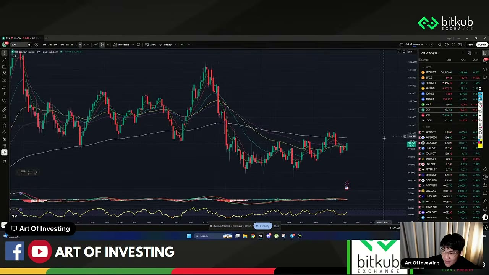

[01:06:48] แป๊บนะครับเมื่อยะ[เสียงหัวเราะ] แป๊บนึงเอ้ยเริ่มแก่แล้วไม่เหมือน เด็กๆเลยนะเอ้อโอเค อ่ะมา[เสียงสูดหายใจ] เดี๋ยวปรับ frame ก่อน ติดตรงนี้ครับก็คือ MAD มันยังใต้สุดเนาะ แล้ว RSI ก็ชัดเจนเลยนะครับว่ายังไม่ ฉะนั้น MACD ใน week ยังไม่เกิดก็แปลว่า โมเมนตัมของ Week ในใน ed ยังไม่เกิดนะ ครับโมเมนตัมของWeekคยังไม่เกิด งั้นต่อมานะครับต่อมา ให้ดูแบบนี้นะครับเนี่ยเวลาโมเมนตัมเกิด มันจะเป็นอย่างงี้เห็นมั้ยอันเนี้ยก็ขึ้น ครั้งแรกเห็นป่ะอุ๊ยเบรคแล้วนี่คุณอาร์ต ใช่แต่ MAD เหนือ 0 ไม่ได้ RSI มาได้งั้น ขาดข้อนึงแล้วมันมาอีกรอบนึงอ่ะรอบเครบ 3

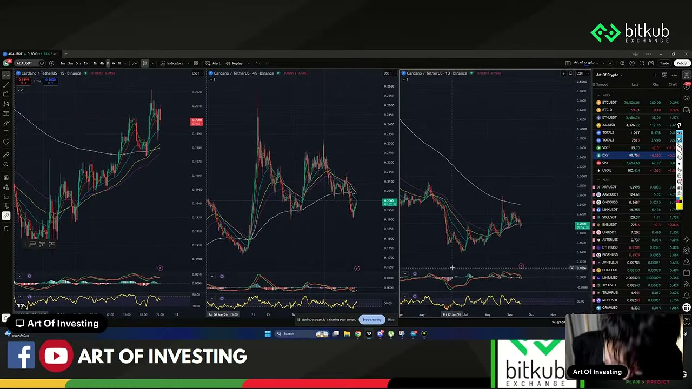

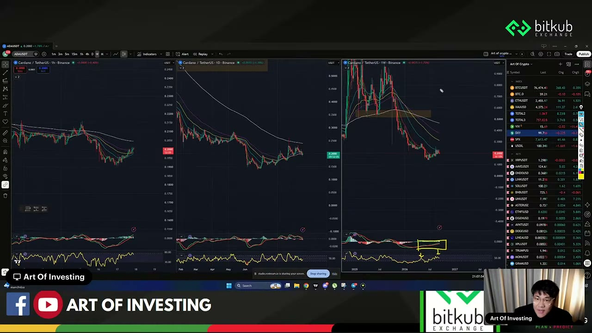

[01:07:49] ข้อโมเมนตัมเกิดเห็นมั้ยวิ่งขึ้นไปก็หลัก สูตรโมเมนตัมก็คือถ้าคุณวาง Stop  100 ไป ที่ low อย่างเงี้ยก็ 1:  2 อ่ะ 75% นะ ครับ 75% แล้วถ้างั้นคุณจะไปแบบเฮ้ยผมเข้าด้วย Timeม Frame เล็กผมรีด Stop  Loss ได้ผม เข้าได้ตั้งแต่นี้อะไรก็แล้วแต่นะครับแต่ ว่าด้วยหลักโมเมนตัมภาพใหญ่อ่ะเดี๋ยวผมจะ อธิบายให้ฟังด้วยนะว่าทำไมถ้าเกิดจะสะสม ของระยะยาวอ่ะให้ดูภาพใหญ่เข้าไว้เดี๋ยว ผมจะอธิบายให้ฟังด้วยนะเงี้ยฉะนั้นตอน เนี้ยโมเมนตัมมันยังไม่เกิดครับก็จะเห็น ว่ามันชัดเจนเงี้งอ่ะเห็นมั้ยใครบอก EMA ไร้สาระอ้าวอ่ะคุณว่าไร้สาระมั้ย ล่ะเนี่ยมันอย่างเงี้ยขึ้นไปปุ๊บมีแต่ไส้ อย่างเงี้ยเนี่ยแสดงว่ามันIDตลาดกำลัง เคารพอยู่นะครับฉะนั้นต่อมาเนี่ยก็คือ โมเมนตัมที่เกิดขึ้นที่ balance zซoneตรง นี้นะครับผมมองว่าถ้าเกิดย่อมานะราคาที่ ผมสนใจเลยนะคือเนี่ยแถว 0.17 นะครับแถว 0.17 เนี่ยถ้าเกิดมาแล้วรับอยู่นะครับ แล้วขึ้นอีกรอบนึงโดยที่ปิดเต็มแท่งเหนือ ไส้ตรงนี้ได้นะก็คือประมาณ 0. จุดเท่า

[01:08:50] ไหร่ 0.246  246 นะครับอย่างเงี้ย ปึ๊บๆอย่างเงี้ยอ่ะก็อาจจะมีโอกาสวิ่งต่อ ได้อีกหน่อยนะครับวิ่งต่อได้อีกหน่อยแบบ นี้นะครับก็จะวิ่งไปขึ้นไปเทสได้ถึง ประมาณตรงนี้ไม่ไกลมากก่อนนะครับประมาณ 0.29 นะครับ 0.3 เดี๋ยวนะกล้องบัง 0.32 นะครับ 0.29  0.32  32 เพราะว่า โมเมนตัมในweคเนี่ยมันยังไม่เกิดเนาะ ฉะนั้นเราจะไม่รู้ว่ามันจะขึ้นอย่างี้ แล้วก็โอเคโมเมนตัมเกิดเลยลวดเดียวหรือจะ sidewayยแล้วค่อยขึ้นนะครับฉะนั้นตอน เนี้ยอ่ะผมก็สำหรับใครที่อยากทยอยซื้อผม ก็คิดว่าตรงเนี้ยโอเคสำหรับคนที่อยากเก็บ คอยนะแต่ว่าส่วนตัวผมจะยังไม่เก็บคอยจน กว่าโมเมนตัมใน week จะเกิดแล้วแต่แผนใคร แผนมันนะครับความเสี่ยงเพราะว่าคุณต้อง คุยกับตัวเองก่อนว่าถ้าเกิดคุณพลาดรถมัน ออกตัวไปแล้วมันมันวิ่งขึ้นไปแล้วอ่ะคุณ คุณรับได้หรือเปล่าถ้าเกิดคุณรับได้คุณก็

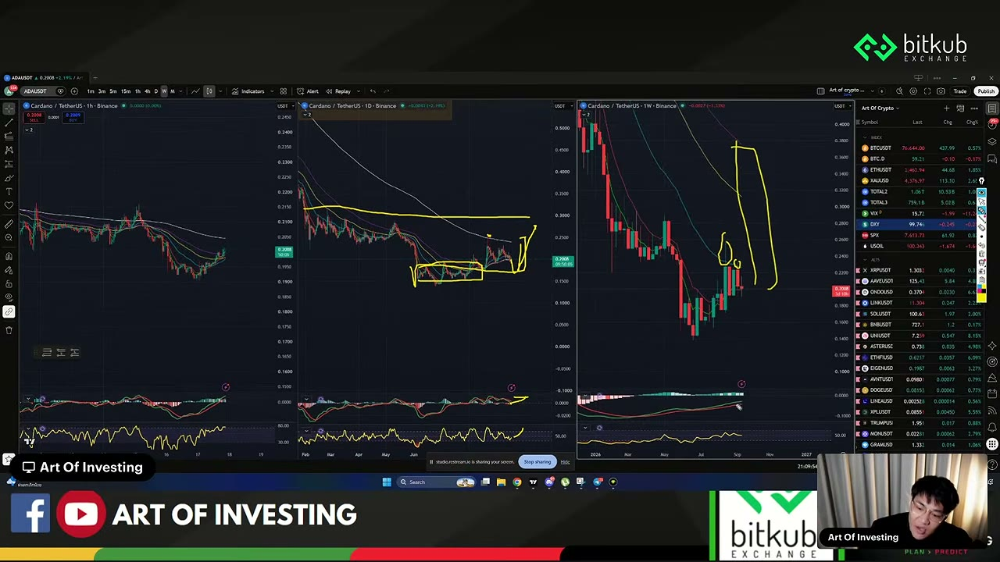

[01:09:53] อยู่กับโมเดลนั้นได้ Trading  Model ที่ มันเกิดความเสี่ยงนะครับแต่ว่าถ้าเกิดไม่ ได้คุณก็ต้องดูแล้วว่าคุณจะต้องใช้ Trading  Model อะไรอย่างของผมเนี่ยมี ข้อเสียคือวิลageมันดีจริงแต่ระยะ TP สั้นก็คือแบบ RR  1:2  1:3 ในในระดับ week นะยกเว้นว่าคุณจะเข้าตั้งแต่อ่ะแบบ นั้นคุณจะเข้าได้ไวหน่อยแล้วก็ข้อเสียอีก ข้อนึงคือถ้าเกิดคุณตกรถอ่ะจะไปยาว เลยก็คือรอบนั้นคุณจะไม่ทันแล้วแต่ว่าผม รับได้เพราะว่ามันหล่อเลี้ยงใจเวลาโดนมัน โดนไม่บ่อยนะครับก็แล้วแต่คน อ่ะก็ถ้าใครอยาก Follow ก็รอปิดเหนือนี่ ก่อนนะครับเต็มแท่งให้มันชนะตรงเนี้ยแล้ว แมdเหนือ 0 กลับมานะครับ BitัumArbitัใช่ครับได้กระแสจากRobinฮood ค่อนข้างเยอะอันเนี้ก็ย่อสวยอันเนี้ยผม มองว่ามันคือ Textbook sซนวิชเลยอ่ะก็คือ แบบเนี้ยครับเวลาที่มันจะย่อตัวเนาะมันจะ ย่ออย่างเงี้ยแล้วก็ถ้าปิดอย่างี้ขึ้นได้ เนี่ยมันก็มีโอกาสขึ้นไปหา EMA  75 นี่ แหละนะก็คือประมาณเส้นสีม่วงคือ EMA  75

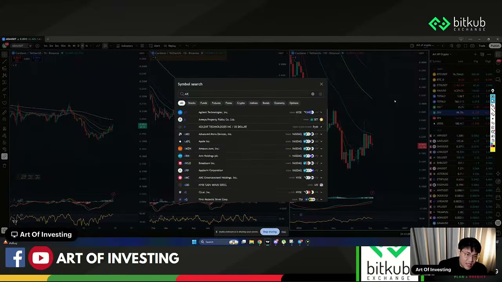

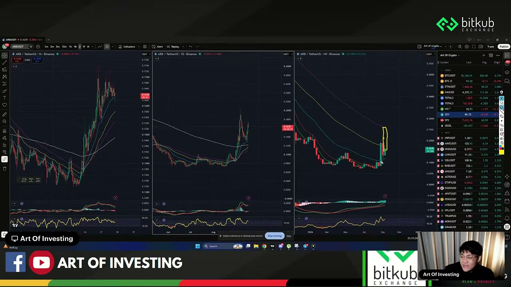

[01:10:56] นะครับทีเนี้ยอ่ะตอนเมื่อวานน่ะมันย่อสวย แล้วอ่ะคุณดูดิเห็นป่ะพอดีเป๊ะ EMA 25 นะครับ EMA  25 เป๊ะเลยแล้วก็เกิด โมเมนตัมใน time frฟมเล็กอ่ะเนี่ยผมจะสอน ให้คุณดูนะว่าเฮ้ยคุณอาร์ตดูยังไงว่าส่ง ต่อโมเมนตัมยังไงอ่ะคุณดูพร้อมผมนะ day เนี่ย เป็นขาขึ้นละถูกป่ะเบรกขึ้นมาได้ MA  0 Ar  B นะครับแล้วก็ขึ้นมาขนาดนี้ฉะนั้น Day เนี่ยเป็นขาขึ้นนะครับแล้วคุณเห็น Day มันย่อมาที่ EMA  25 ซึ่งคราวก่อน รับอยู่ซะด้วยอ่ะประมาณ 2550 อ่ะนะ ครับงั้นคุณก็ต้องไปดูและถ้าเกิดโมเมนตัม มันจะเกิดอ่ะอย่างเงี้ยเฮ้ยพรีเมียมมัน อยู่ไหนวะ 75 เบรกได้แล้ว Magdin  0  RSI  over  B อ่ะ คุณก็อย่างเงี้ย 1:2 อ่ะอ่ะได้และ นะครับเก็ยัง

[01:11:59] นะครับเกยังเนี่ยคือโมเมนตัมนะครับงั้น ต่อมาคุณเห็นแล้วว่าdiscากับพรีเมี่มของ เท่าไหร่ฉะนั้นตอนเครับถ้าเป็นเทรนด์ระยะ สั้นเก็คือถ้าไม่หลุด 25 ใน 1 ช่มงเนี่ย ก็จะยังเป็น discount ไปเรื่อยๆแล้วก็ ขึ้นไปได้เรื่อยๆอันนี้คือเทรนด์ระยะสั้น ส่วนถ้าจะลงมาสิ่งนึงที่ผมอยากให้คุณ คcerิร์นนะตรงเนี้ยค่อนข้างสำคัญละมัน กำลังจะ declare ว่า 25 หรือเส้นสีฟ้า เนี่ยมันจะเป็นdisคาได้หรือเปล่า นะครับdiscาได้หรือเปล่าถ้าเกิดสินทรัพย์ ไหนหรือว่า EMA เส้นไหนมันจะเป็น discount หรือว่าพรีเมี่มนะครับจำไว้ว่าชนแล้วจะ ต้องเกิด new  high หรือ new  low ถ้า เกิดว่าเส้นนี้ใน day ขึ้นอย่างนี้ได้เรา ปิดเต็มแท่งนะคุณก็จะเข้าใจเลยว่าโอเค งั้น EA  25 ใน day อ่ะคือdiscาละ งั้นย่อต่อมาอย่างเงี้ยอ่ะไม่หลุดใน day เนี่ยก็คือ Run  trend ได้มันคือdiscาแต่ ถ้าเกิดตรงเนี้ยมันขึ้นแล้วเนี่ยมันไม่

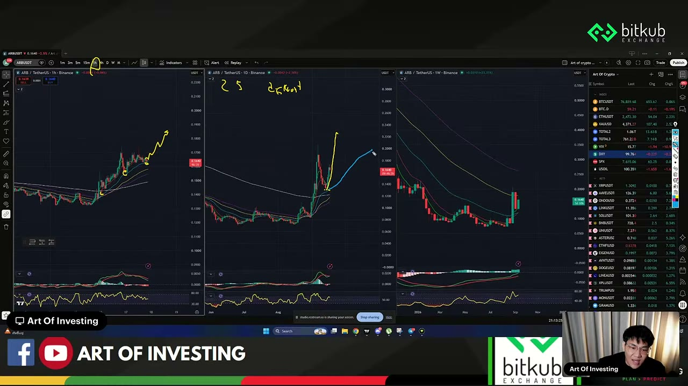

[01:12:59] เกิด new  high มันจะต้องลงมาหาที่เดิม ครับคือเส้น 50 กับ 75 นะครับก็คุณก็ต้อง ไปดูตรงนี้อีกทีแล้วพอมันย่อดลงมาถ้าคุณ ยังมองว่าตลาดจะขึ้นต่อคุณดูไงนี่ไง เนี่ยโมเมนตัมมันจะไหลอย่างเงี้ยนะครับ มันมันจะไหลอย่างเงี้ยนะครับ ฉะนั้นเนี่ยก็ดูตรงนี้นะครับคือตอนเนี้ มันขึ้นมาแล้วพอย์แรกเลยก็คือถ้ามันวิ่ง แรงๆเลยนะก็คือเกิด New  High นะผมมองว่า มันขึ้นได้ถึงเนี่ย 0.25  25 ไม่ไม่เกิน เลยเท่าไหร่นะครับเพราะว่าปกติเนี่ยมันจะ ขึ้นได้ประมาณเนี้ย EMA  75 เนี่ยนะครับ แล้วก็ย่อโดยประมาณนี้เห็นมั้ยมันเป็น พรีเมี่มอยู่งั้นก็ถ้าเกิดมันจะเทสขึ้นมา อย่างเงี้ยแบบวิ่งแรงๆเผมก็มองว่าที่แรก 0.25  25 ก่อนส่วน 2 เคสว่ามันจะส่งต่อ โมเมนตัมหรือเปล่าก็ตามนี้ เห็นมั้ยเป็นไง TP แล้วขึ้นเลย Bitcoin แหเรานี่มันเก่งจริงๆ ขอดู East  F อ่ะได้ครับเดี๋ยวดูโก่อน

[01:14:01] แล้วกัน ก็หน้าตาคล้ายอิัมนะผมมองว่าโสวยนะนะครับ ตอนนี้ก็คือโเนี่ยอ่ะมันขึ้นตรงนี้มาแล้ว ถูกป่ะอ่ะอันเนี้ยย่อย่อมาแล้วนะครับแล้ว ก็เบรค 1 ช่โมงโมเมนตัมเกิดถูกมั้ยก็คือ magdin  0  RSI  overbard นะครับอย่าง งี้ก็อย่างงี้ก็ได้เนี่ยอย่างเงี้ย 1:2 เนี่ยแล้วพอถึง 1:1 ก็กั้นหน้าทุนก็แล้ว แต่เลยว่าคุณจะcareยังไงเพราะว่าตอนเนี้ย Sou กำลังจะไปติดภาพเดียวกับ Bitcoin ะ ก็คือ Suply นะครับฉะนั้นตรงเนี้ยเราจะดู แล้วว่า gap ตรงเนี้ยมันจะกลายเป็น discount ได้หรือเปล่าถ้าเกิดมันจะกลาย เป็น discount ได้หรือเปล่าตรงนี้ต้อง เกิด new เห็นนะครับเป้าโซนะใกล้สุดก่อน ก็คือตรงนี้ก่อน 112  115 โซนะครับถ้าเกิดถ้าเกิดเบรคได้ ถึงจะนับว่าสวยนะครับ 112-115 แล้วถ้าเบรก 112-115 ได้เนี่ยเป้าอีกที นึงก็คือ 137  135 ประมาณนี้นะครับโ 2

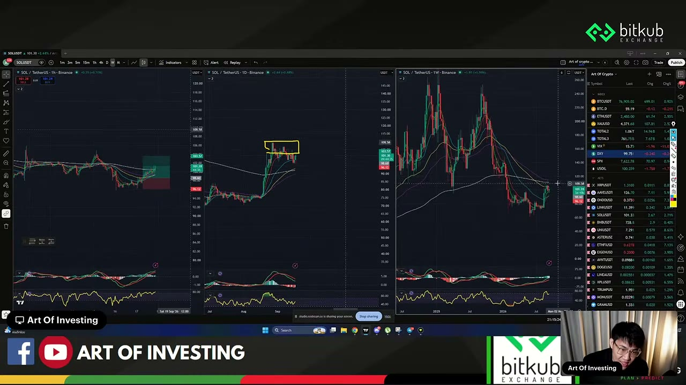

[01:15:04] เป้านี้ส่วนถ้าเกิดมันขึ้นไม่ได้ไม่ new high แล้วมันจะต้องย่อมาที่ตรงไหนก็คือ ตรงนี้เราก็จะเห็นตรงนี้อ่ะเนี่ยตรงเนี้ย มันใช้ได้หลายอย่างมากสมมุติว่าถ้าคุณ อยากใช้volุeโปรไฟล์คุณก็ใช้ได้ อ่ะคุณดูนะสมมุติว่าไม่ใช่ fix  rength ดิเดี๋ยว เอ่อตัวไหนนะที่มันลากได้อ่ะผมจำไม่ได้ เดี๋นะ ไอ้ที่มันลากได้มันอยู่ตรงไหนวะ เออผมก็ลืมเมื่อกี้เพิ่งใช้อยู่ใน โทรศัพท์นะแต่ว่าพอพอไม่ได้อยู่บน โทรศัพท์แล้วลืมนะครับอันนี้น่าจะ custom range อันนี้มั้ยอ่ะอ่ะๆๆ อ่ะนี่ งี้นะครับออไม่ใช่ตัวนี้อีกอ่ะเดี๋ยวผมไป หาให้แล้วกันตัวไหนก็คือเราดูvolุeมันน่ะ ครับแล้วแล้วถ้าตัวvolุeprofลเนี่ยคุณจะ เห็นว่าอ่ะผมสอนเลยะกันไม่ต้องเปิดให้ดู นะครับเดี๋ยวเสียเวลาก็คือครึ่งนึงของ ระยะมันเนี่ยก็คือตรงนี้ถูกมั้ยตรงเนี้ย มันจะเป็นชุดที่เราเรียกว่า imbalance

[01:16:07] ก็คือออเดอร์ซื้อเนี่ยมันเยอะกว่าออเดอร์ ขายแบบชัดเจนฉะนั้นถ้าเกิดจะย่อเนี่ยต่ำๆ ก็คือเครื่องนึงซึ่งครึ่งนึงดันพอดีกับ EMA  75 นะครับฉะนั้นถ้าโ่อแล้วมองว่า เฮ้ยตรงเนี้ยคุณอาร์ต 1:2 แล้วผม TP เลย แล้วก็ถ้ารอย่อรอตรงไหนดีก็ดูตรงนี้ก่อน ครึ่งครึ่ง imbalance zซoneนะครับแล้วพอ มันลงมา คุณก็เล่นท่าเนี้ยสมมุตินะลงมาตึ๊กๆๆอีก อย่างเงี้ยเบรคได้เงี้ยคุณก็ดูเกิด 3 คิitionเงี้ยก็ก็รันขึ้นไปก็ดูก่อนว่ามัน จะเกิดหรือเปล่านะครับส่วนเปาก็เนี่ย 112 115  135 ฮะ ใช่[เสียงสูดหายใจ]มั้ยยังดูเสกใช่มั้ย อ่ะเดี๋ยวไปไวหน่อยนะอู้โหตายแล้วแบบนี้ ไม่ต้องทำอะไรแล้วครับเข้าไม่ได้ถ้าถ้า เกิดถ้าเกิดไม่มีของนะในศาสตร์โมเมนตัม เข้าไม่ได้แล้วก็คือมันไปแล้วส่วนถ้าคุณ ฮัแบ่งขายไงดีนี่เลยโมเมนตัมช่วยคุณได้ ครับคุณดูนะ

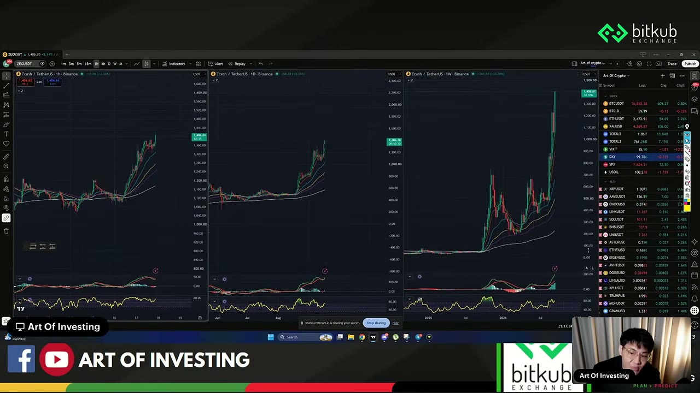

[01:17:10] แปลว่าเส้นสีแดงแรงคือ discount งั้นหลุด EMA  10  day เมื่อไหร่นะครับควรแบ่งขาย นะครับอันนี้คือโมเมนตัมระยะสั้นเอ้ยคุณ นัทอยากรู้ไอ้นี่ว่ะอยากรู้แบบถ้าเกิดมัน มันย่อแล้วเป้ามันจะเป็นเท่าไหร่อ่ะคุณ ใช้ Fibo  extension ก็ได้ถ้างี้ อ่าเนี่ยอ่ะเป้ากาวๆเลยนะ 1,600 อืส่วน ตรงเนี้ยมันถึงจุด Peak  attention ไป แล้วนะครับฉะนั้น TP ตรงเนี้ยไม่เสียหาย ละเวลาผมเจออย่างเงี้ยโอ้โหถ้าสอน ยาวอีกว่ะอ่ะพูดง่ายๆFibบมันเหมือน ไม้บรรทัดไอ้ 1.618 เนี่ยมันคือ 161.8% ของสวิงก่อนหน้างั้นถ้าเกิดมันขึ้นมา 161.8%  8% ของสวินก่อนหน้าสิ่งนึงที่ เกิดขึ้นเลยความสนใจของตลาดพอความสนใจ เยอะสภาพคล่องเยอะมันเลยมักจะเป็นจุด TP หรือจุดปลายทางเพราะว่าความสนใจมันเยอะ แล้วเฮ้ยคนสนใจเยอะงั้นออเดอร์ซื้อก็เยอะ งั้นก็ขายได้นะครับฉะนั้นมันก็เลยจะเป็น

[01:18:11] Fibon  Level ขึ้นไปงั้นถ้าเกิดมันทะลุ 1.618  618 แล้วเนี่ยคุณก็รันด้วย discount ขึ้นไปจนกว่าจะถึงเป้าอีกก็ได้ อย่างเคสเนี้ยก็คือถ้าไม่หลุด EMA  10 ก็ คือไม่ปิดแท่งต่ำกว่า EMA  10  day อ่ะ รันถึง 1,600 อ่ะแบบนี้ก็ได้ถ้าหลุดก่อน ก็แบ่งออกก่อนสำหรับเสนี้ก็ได้ครับเนี่ย โมเมนตัมเป็นอย่างงี้ผมก็อยากกลับมาสอน โมเมนตัมนะแต่ว่าเออผมยังหาเวลาไม่ได้เลย เนี่ยผมอ่ะสัญญามีคนประมาณหลายคนน่ะทักใน เพจตั้งแต่ต้นปีกลางปีผมก็สัญญาเขาไวว่า ปลายปลายปีจะสอนปลายปีจะสอนแต่ผมก็ดันไป ยุ่งธุรกิจอะไรอีกนะครับก็ไม่รู้นะว่าว่า กลับมาสอนเนี่ยเพื่อนๆยังรอเรียนกันอยู่ หรือเปล่าแต่ว่าผมสอนสดเท่านั้นนะผมไม่ ชอบสอนวีดีโอนะครับเพราะว่ามันต้องถามตอบ ผมต้องตรวจการบ้าน so วิเคราะห์ไปแล้วไปแล้ว e  f อ่ะโอเค eat  f

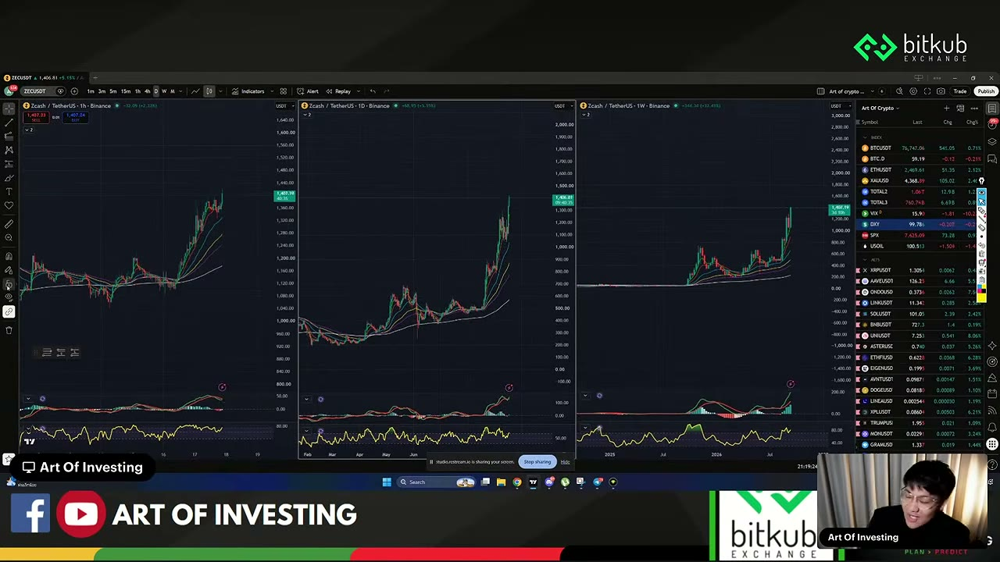

[01:19:13] เนี่ยเกิดโมเมนตัมดีเลยแล้วก็ EMA  25 เป็น discount นะครับเพราะว่าอะไรมันเฉลย แล้วมันเกิด New  High ถูกมั้ยฉะนั้นตรง เนี้ยเป็น discount แล้วก็คือตรงเนี้ย เกิดโมเมนตัมยังดูนะติดๆติดๆเบรกเหนือ 0 overbอนะครับฉะนั้นเข้าตรงนี้ Stop  Loss ตรงนี้นะครับอ่ะอย่างเงี้ยงั้นเราก็ต้อง ดูแล้วว่ามันถึง 1:2 มั้ยนะครับส่วนตรง เนี้ยให้ระวังละนะครับเพราะว่ามันติดกับ balance  zone อ่ะผมมองแบบนี้เลยก็คือ ถ้าเกิด มันวิ่งจน New  High นะผมมองมองที่เดิม ก่อนที่ยังเป็นพรีเมี่มในภาพใหญ่นะครับ คือ A75 ถ้าเกิดโมเมนตัมตรงนี้ขึ้นต่อนะ ถ้าเกิดโมเมนตัมตรงนี้ขึ้นต่อผมมองที่ เดิมก่อนก็คือ 0.87 ไม่เกินตรงนี้ก่อนนะ ครับ 0.87  87 ผมมองว่าไม่เกินถ้าเกิด เบรกเบรกขึ้นไปได้แต่ถ้าเกิด New  High ไม่ไหวนะครับขึ้นมาตรงนี้แล้วย่องี้ก็คือ RSI กลับไปอีกไม่ได้อ่ะก็คือชน 70 แล้ว หัวปักลงมาอย่างงี้ครับหัวปักลงมาอย่าง

[01:20:14] งี้เลยนะอย่างเงี้ยก็มีแนโนมแล้วว่ามันจะ ย่อกลับมาหาที่เอ่อ Flip zซoneตรงนี้ก่อน ก็คือช่วง imbalance นะครับก็มีโอกาสย่อ ลงมาได้ถึง 0.49  0.41 อ่ะนะครับก็ 2 เคส ถ้าไปก็ผมมอง 0.87 คือ 87 ก่อนแต่ผมส่วน ตัวผมยังไม่เทรด outcoin นะครับ ตอนนี้อ่ะอโดะเดี๋ดูอโดให้อีกตัวแล้วกัน นะครับอโดเนี่ยเอาจริงๆนะผมโคตรเข็ดกับ มันเลยนะ 2 รอบแล้วนะที่มันเกิดเวจแบบ เนี่ยตรงเนี้ยนะครับเกิดบลาซน แล้วไม่ไปนะครับรอบนี้เหมือนกันเลยนะครับ ผมหลุดเวageไปรอบนึงแล้วนะครับก็อ่ะผมมอง ว่าอโดเนี่ยมันก็เจาะแล้วถูกป่ะอ่ะอันนี้ สอนโมเมนตัมอีกเรื่องนึงตรงนี้ครับเป็น โมเมนตัมแบบ balance  zone นะครับก็จะ เห็นว่า RSI เนี่ย overbard ก็ไม่ได้ก็ ไม่ได้นะครับแบบเนี้ยมันแปลว่าอยู่ในกรอบ ซึ่งพอมาดูราคาปุ๊บเอออยู่ในกรอบจริง นะครับฉะนั้นเนี่ยถ้าเกิดจะเกิดโมเมนตัม เนี่ยก็คือต้องปิดออกตรงเนี้ยพร้อมกับแกd หรือส่วน overbard นะครับแล้วจะวิ่งก่อน จุดเทสจุดแรกเลยของอโดADเนี่ยก็คือ 0.43

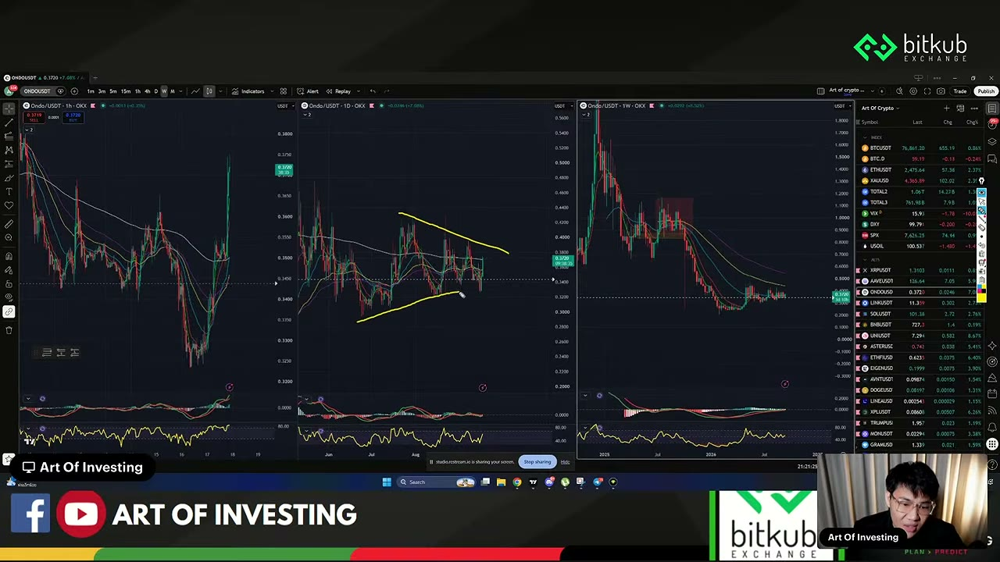

[01:21:17] นะครับแล้วก็ถ้าเบรคได้ 0.54  54 นะครับถ้าถ้าเบรคตรงนี้ได้นะแล้วก็ราคา ไม่ควรหลุดตรงนี้แล้วก็คือ 0.32 ถ้าเกิด ปิด day  0.32  32 แล้ว RSI  oversold นะ ครับก็ลิเกเลิกนะครับแยกย้ายก่อนนะครับ เพราะว่ามันมีโอกาสย่อมันจะลงแบบนี้ครับ ตอนนี้ผมเจอปัญหา loss หลังจากพลาด setup ที่ถูกทางไปแบบว่ามอง direction ไว้แต่ ไม่ได้เข้าพอเข้าหลังจากราคามันบินไปแล้ว เกิด setup ผมก็เลยเข้ากลายเป็น loss พอ จะมีวิธีแก้มั้ครับพี่อาร์ตรู้สึกมิ่งแย่ มันขึ้นอยู่กับว่าแต่ละคนแก้ปัญหายังไงนะ ส่วนตัวผมอ่ะถ้าไม่ทันน่ะผมจะข้ามเลย เพราะว่ามันไม่ใช่จุดที่ศาสตร์ผมได้ เปรียบแล้วถ้าจะเข้าก็ต้องก็ต้องใช้ ศาสตร์อื่นอาจจะไปรอเทรดมี reversion อาจ จะไปเทรดด้วยเอ่อระยะ balance zซoneหรืออะไรก็แล้วแต่แต่ว่า ถ้าเกิดโมเมนตัมมันเกิดไปแล้วอ่ะผมจะยอม

[01:22:17] ตกรถเลยอย่างเปิดกราฟเสกเงี้ยผมตกรถเข้า ไม่ได้ผมก็จะไปหาตัวอื่นที่มันยังไม่ไป อย่างอนโดเงี้ยก็ยังไม่ไปสุ่ยก็ยังไม่ไป ก็ยังไม่ไปอย่างเงี้ยโมเมนตัมก็ยังไม่ เกิดอย่างเงี้ยนะครับผมก็จะไปรอตัวที่มัน ยังไม่เกิดแทนกันเวลาที่ตัวไหนวิ่งไปแล้ว อ่ะวิธีแก้แต่ละคนต่างกันแต่ผมอ่ะผมจะไม่ EMA ที่มีนัยยะต้องเท่าไหร่บ้างเอ่อ EMA ที่มีนัยยะนะครับหลักการไม่ใช่ว่าค่าเท่า ไหร่นัยยะจะเกิดต่อเมื่อ price มันโชว์ แล้วว่ามันติดตรงนั้นเช่นอย่างเงี้ยมัน ไม่ใช่ว่าเส้นสีฟ้านี่มีนัยยะเพราะว่ามัน คือเส้น 25 ไม่ใช่แต่ว่าราคามันแสดงให้ เห็นว่าทน 25 นาทีรายเกิดนิวโรตลอดเลย งั้นมันก็เลยบอกว่าตรงเคือพรีเมี่มนะครับ พอเบรกได้ Overbard  MD เหนือ 0 ก็เนี่ย Stop ตรงนี้ 1:2 มันก็ไปแล้วถูกมยฉะนั้น มันไม่ใช่ว่าเส้นเท่าไหร่เส้นสีอะไรแต่

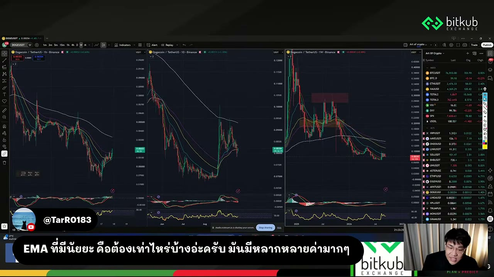

[01:23:18] ราคาต้องทำให้เห็นก่อน 1-2 ครั้งเราถึงจะ มองว่าโอเคอันเนี้นะโอเคอันนี้พรีเมี่มนะ แล้วถ้าเกิดตรงนี้เห็นมั้ยอ่ะผมสอนเรื่อง volุeโปรไฟล์ตรงนี้มากลางกลางโซนแล้วเกิด อะไรติดๆเบรคได้อ่ะเนี่ยคุณก็เห็นป่ะอัน นี้ไม่ใช่คำแนะนำในการลงทุนนะเว้ยเฮ้ยคุณ อาร์ตเข้าได้ป่ะไม่ได้เพราะอะไร RSI  over ไม่ได้ MAD เหนือ 0 ไม่ได้ก็ เข้าไม่ได้งั้นมันเพิ่งมาได้ตรงนี้ยัง RSI ก็ยังoverบอไม่ได้ก็ยังเข้าไม่ได้งั้นตอน เโมเมนตัมมันยังไม่เกิดในภาพเล็กนะครับ เนี่ยคือพอเข้าใจโมเมนตัมมันจะเทรดเซย โอเซยกับเซยกับตัวเมื่อกี้เหมือนกัน เลยว่ะเซยกับนะครับก็ก็คือตอนนี้เอิ่ม อ่ะโอเคโมเมนตัมเกิดะนะครับสำสำหรับเซยเ เนาะแต่ว่าภาพรวมยังติดตรงนี้นะครับ

[01:24:21] ฉะนั้นถ้าเกิดขึ้นได้เนี่ยโอ้โหด่านตำรวจ เป่าเยอะมากเลยเอาเป็นว่าแนวต้านใหญ่ที่ สุดนะของเซยอ่ะคือเนี่ย 0.049  -  0.052 นะครับ 0.049  -  0.052 เนี่ยก็คือต้อง ต้องปิดเหนือตรงนี้ให้ได้ถึงจะมีโมเมนตัม ที่ส่งต่อขาขึ้นได้นะครับไม่ไม่งั้นขึ้น ไม่ไหวก็จะเป็นเคสตรงนี้แทนเนาะส่วนตรง นี้ย่อมาก็ถือว่าย่อมาสวยนะครับย่อมาที่ Hidden  Hidden  Demand ถ้าเกิดเบรคตรงนี้ได้เป้าก็คงเทสเนี่ยมัน จะเหมือน ADA เลยครับ 0.058  058 ตัวเนี้ยจะเหมือนถ้าเกิดขึ้นไปก็จะติดกับ ed้าแต่ว่าพวกตัวต่ำขนาดเนี้ยให้ระวังนิด นึงนะครับคือสภาพคล่องมันมันต่ำอ่ะถ้า เกิดตลาดย่อนิดนึงอ่ะจากที่มันควรจะย่อ แค่นิดเดียวมันจะไหลนิวโรนะครับก็ก็ให้ ระวังนิดนึงถ้าเทรดตัวเล็ก ไคอผมไม่เก่งคุณคามต้องบอกแบบนี้ไคอเนี่ย มันเป็นทฤษฎีการมันเกิดขึ้นแบบนี้ไวคอ

[01:25:21] เนี่ยเนี่ยYCค logic เนี่ย อ้าตัว K อ่ะโอ้โหลายมือ ไคเนี่ยมันเกิดมาจากรูปแบบของสถาบันสมัย ก่อนที่เขา้าเรียกกันว่า accumulation reaccumulation แล้วก็ distribution คือ เวลาสถาบันจะเข้าอ่ะมันจะต้องทยอยเข้าใช่ มั้ยสมัยก่อน มันก็เลยเกิดเป็น C  logic ว่าแบบเออ เนี่ยมันจะต้องมาย่อมาหาตรงนี้ก่อนแล้ว เบรคก็ยังเอาแนวแนวต้านมาขวางก่อนเพื่อ ให้ได้ซื้อของเพิ่มซื้อของเพิ่มเสร็จได้ เติมของแล้วค่อยเบรคไปทีเดียวอ่ะมันเลย เกิดเป็นไคogicแต่ 5 ปีที่ผ่านมา เทคโนโลยีมันเติบโตมากครับแล้วมันกลาย เป็นว่ากองทุนน่ะเริ่มจะเข้าแบบ HST หรือ High  Frequency High  Frequency  Trading นะครับพวก เนี้ยเาเข้าแบบไม่ต้องรอ pending แล้วคือ มันสามารถ front  run อordเดอร์ในตลาดได้

[01:26:21] เลยก็คือเค้าสามารถเห็นว่ามีคนตั้ง ออเดอร์ขายตรงเนี้ยคนตั้งออเดอร์ซื้อตรง เนี้ยเค้าสามารถซื้อออเดอร์คนเนี้ยไปขาย คนนี้ได้เลยแล้วกินส่วนต่างเล็กน้อยนะ ครับมันจะมีการเซ็นสัญญาเลยนะพวกกองทุน H Fund ที่ทำ High  Frequency  Trading อ่ะเซ็นสัญญาว่าเขาจะได้เห็นออเดอร์จาก กองทุนก่อนเขาสามารถเข้าได้ด้วยความเร็ว แบบมิลลิซคอนแล้วคุณลองไปอ่ะนั่นคือคำตอบ ว่าทำไมกองทุนน่ะไปตั้งอยู่แต่ Silิคอนwallลเพราะว่ามันเชื่อมกันครับ แล้วต้นทุนกว่าเขาจะทำ High  Frequency Trading ได้อ่ะมัน 200-300 ล้านบาทพอมัน เป็นเลเวลนั้นแล้วอ่ะ นิสัยการเข้าของกองทุนน่ะเลยเปลี่ยน นึกออกป่ะเลยเปลี่ยนเพราะเดี๋ยวนี้ เครื่องมือไฮเทคแล้วอ่ะแต่ก่อนน่ะคุณ จะเข้ามันก็เลยเกิดเป็นแบบแพทเทิร์น invert  Head  and  Shoulder หรือ W  C ผมไม่ได้บอกว่ามันใช้ไม่ได้นะฟังผมดีๆ ก่อนแต่คุณจะจับไต๋เค้าอ่ะยากขึ้นเพราะ ว่าเขาไม่ต้องเข้าแบบทยอยเข้าแล้วเค้าใช้ AI คนคำนวณเลยว่าเฮ้ยต้องการของที่โซน

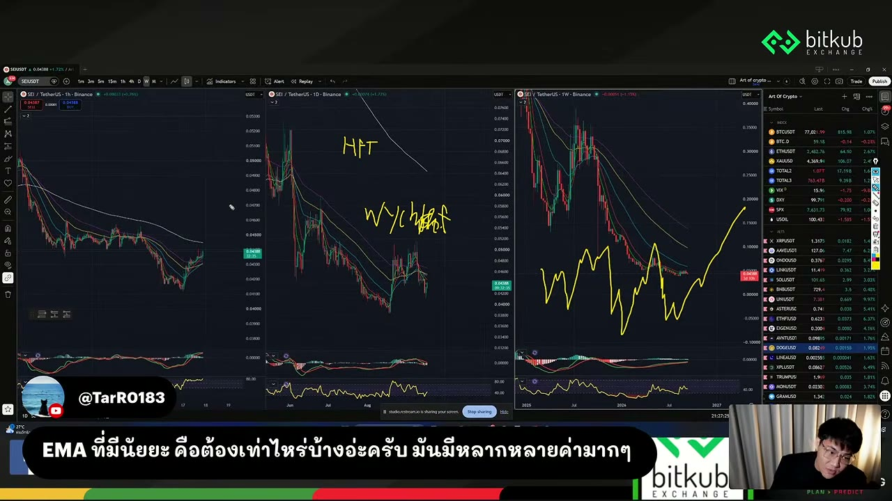

[01:27:24] เนี้ยจะต้องปรับ position  sizing เท่า ไหร่ซื้อด้วย time  stamp เท่าไหร่ใช้ ระยะเวลาเท่าไหร่มันเร็วมากมันเลยก่อ กำเนิดศาสตร์แบบ volume  Food Brนขึ้นมา ก็คือแบบเฮ้ย data ผ่านแท่งเทียน เริ่มไม่พอ order  flow เริ่มเกิด food  print เริ่มเกิด อ่าผมเอาให้ อ่ะคลิปนี้กัน นะครับอ่ะผมเอาให้ดู

[01:28:28] อ่ะเนี่ยเค้าก็จะอธิบายเรื่อง sess นะแต่ ว่าคีย์ที่ผมอยากให้สนใจไม่ไม่ใช่ตรงนั้น นะครับอ่ะอันเนี้ยคุณอาจจะเห็นว่าเค้าดู แค่แท่งเทียนกับvolุeโปรไฟล์นะครับแต่ว่า จริงๆอ่ะเค้าเดูเยอะกว่านั้น เนี่ยคุณต้องจ่ายตังค์เพื่อดูเพื่อดู Real Time  Data Charารครับอันเนี้เค้าดู Absorption คือจะเห็น Real  Time เลยว่าออเดอร์ซื้อโดนกลืนออเดอร์ขายโดน กลืนแล้วเค้าก็จะต้องไปดูว่ามันเกิดที่ โซนไหนนะครับแล้วมันเห็นนอกจากเนี้ยมัน ยังมี footprint ที่เกิดขึ้นในแต่ละแท่ง ที่เขา้าอ่านอีกเราเรียกว่า order  flow กับแท่งที่มันเป็น volume  footprint อ่ะ มันจะอ่านอย่างงี้ดูค่าเดียว delta เร time อีกนี่อ่ะอันนี้เห็นเอ่อ Absorption Bubble ไปแล้วนะครับมันจะมี Volume  Food Print อีกคือแบบนี้แต่อันนี้ดูผ่าน Trading  View มันจะไม่เร็วจริงๆมันต้อง ดูผ่านพวก Atlas หรือว่าดูผ่านพวก Deep EP charารนะครับมันจะเห็นเร็วคือคุณจะ เห็นเลยว่าออเดอร์แบบ Real  Time อ่ะมัน โยนออกมาเท่าไหร่ค่าdelta้าเป็นเท่าไหร่ นะครับแต่ว่าดู Trading  View มันจะไม่ เร็วมันจะไม่ Real  Time พอนะครับมันจะ

[01:29:29] ต้องจ่ายตังค์รายเดือนเพื่อเพื่อจะเห็น ข้อมูลนะครับเนี่ย 5 ปีที่ผ่านมาศาสตร์อด Flow อ่ะเลยบูมต้องบอกแบบนี้เฮ้ย งั้นงั้นทำไมสมัยก่อนtrน following บูมเพราะว่าอ่ะเนี่ยอันนี้ผมผมรื้อรื้อ แบบอธิบายให้ฟังเลยนะอ่ะ อ่ะเดี๋ยวๆคิดภาพตามผมนะ สมัยแรกเทรดหุ้นเนี่ยทำไม trend following บูมวะเพราะว่าแต่ก่อนน่ะ คุณจะซื้อขายหุ้นน่ะคุณต้องไปตลาดหลัก ทรัพย์แล้วคุณต้องไปกรอกแล้วเจ้ามือหุ้น น่ะเคลียร์หุ้นได้แค่ตอนเช้ากว่า ตอนเย็นถูกป่ะแบบสั่งมาจinสั่งโบคมันมัน ไม่ได้เร็วแล้วหลังจากนั้นเทคโนโลยี เริ่มพัฒนาเว้ยเฮ้ยเริ่มทำในแอปได้เว้ย เฮ้ยหยิงคำสั่งตลาดได้เว้ยงั้นแพทเทิร์น เลยเริ่มมาเฮ้ยคุณดูนะ CF มาละเฮ้ย คุณดูนะ Invert  Head  and  Shoulder เฮ้ยคุณดูนะนี่ double  bottom จากอะไร เพราะว่าสมัยก่อนกองทุนอยากเก็บของทำ ไงครับอ่ะเอาเงินเยอะๆเอาของเยอะๆมาขวาง

[01:30:31] ไว้เพราะว่าอยากซื้อของเพิ่มถูกป่ะขึ้นมา ปุ๊บไปชนซัพพlyชนปุ๊บเอ้ยผ่านไม่ได้กอง ทุนได้เติมของแล้วพอเติมของจนพอใจยกแนว ต้านที่ตัวเองวางทิ้งไว้ออกแล้วลากขึ้น อ้าแพทเทิร์นเลยบูม Following มาละ แพทเทิร์นมาละแล้วตอนเนี้ยมี AI มี HFT มีQuย เลยจะจับไต๋พวกเนี้ยได้ยากขึ้น ศาสตร์ใหม่เลยเกิดขึ้น มาแล้ว Volume  Fruit  Print  Order  Flow อ่านDelta้าหาถ้า Real  Time  Liquidation Bubble เท่าไหร่ผมเลยบอกว่าเทรดสั้น จะยากขึ้นเรื่อยๆเทรดสั้นกำลังจะยาก ขึ้นเรื่อยๆนะครับเพราะว่ายิ่งคุณเทรด สั้นเท่าไหร่ Time  Frame  1 นาที 5 นาที คุณก็จะต้องยอมจ่ายเงินดู data  real

[01:31:32] time อ่ะไม่งั้นคุณจะแยกไม่ได้แล้วว่า อันเนี้ยเงินมันเข้าจริงมั้ยออกจริงมั้ย ยังไม่รวมออเดอร์ที่เขา้าวางแล้วหลอกนะ นั่นคือสาเหตุที่ถ้าเกิดทำไมระยะยาว ยังรอดเพราะว่าระยะยาวยาวอ่ะคุณจะไม่ต้อง สู้กับพวกนี้ เพราะพวกนี้มันสู้ในการเข้าออกออเดอร์ราย วันถูกป่ะเครื่องมือหนักมากฉะนั้น อยู่กันระยะยาวอ่ะคุณจะต้องสู้กับพวกนี้ น้อยลงเรามีแค่คอมกับมือถืออ่ะนึกออกป่ะ แต่เค้ามีแบบ 200-300 ล้านน่ะแบบตัว ยิงคำสั่งแบบพิ้วๆๆๆอ่ะเราสู้เ้าไม่ได้ผม ก็เลยบอกว่าเอ้ยถ้าเกิดถ้าเกิดเทรดสั้น น่ะแต่ก่อนน่ะแพทเทิร์น trend  following การทำ laging  indicator มันอาจจะยัง work พอมาถึงตรงเนี้ยเฮ้ยไม่ใช่ว่า CF ใช้ไม่ ได้เฮ้ยไม่ใช่ว่าแพทเทิร์นใช้ไม่ได้แต่ ถ้าเกิดใช้หลักการพวกเนี้ยในtimeม frame เล็กอ่ะความได้เปรียบจะเริ่มน้อยลงเพราะ เทคโนโลยีมันโตเออต้องบอกแบบนี้ใช้ได้นะ แต่ว่าถ้าtimeมfrฟรมเล็กมากๆอ่ะอาจจะยัง

[01:32:34] ไม่ขลังเท่าสมัยก่อนถ้าdayรดนะ อ่ะเดี๋ผมดูไตัวสุดท้ายแล้วกันนะครับหวัง ๆว่าจะเห็นภาพนะครับคุณคารามนะครับ เออ VI ก็ได้หรือว่าโมเมนตัมอะไรก็ได้ ครับถ้าอยู่ระยะยาวหน่อยอ่ะมันจะสู้กับ พวกนี้น้อยลงนะครับ ผมยังเปลี่ยนเลยตอนก่อนผมเทรดโมเมนตัม ระยะสั้นน่ะอ่ะตอนเนี้ยผมก็เลยต้องเอาพวก ตัวแปรเพิ่มนะผมก็เดี๋ยวจะต้องใส่พวก minor เวอร์ชัเข้าไปเดี๋ผมก็จะต้อง อัปเดตนักเรียนน่ะนะครับอะไรที่วิลมัน ดรอปอ่ะเราต้องกล้ากลืนน้ำลายตัวเองเว้ย ที่แบบอุ้ยถ้าเทรดนี้ครับโมเดลนี้เจ๋ง ครับมันใช้งานได้ถ้าคุณเห็นแล้วอ่ะว่า ระยะสั้นน่ะภาพระยะสั้นน่ะtimeม frame  5 นาที 15 นาทีตลาดมันเริ่มไม่เหมือนเดิม อ่ะออเดอร์มันเริ่มเร็วขึ้นมันเยอะขึ้น คุณต้องเอาตัวแปรมาเปลี่ยนฉะนั้นคุณต้อง กล้ายอมรับเฮ้ยโมเดลเราต้องปรับว่ะก็

[01:33:37] ปรับนะครับอุ้ย outcoin วิ่งแรงเว้ยยูิก็ วิ่งนะครับโอ้วันนี้ outcoin เติบโตนะ บitคinย่อนิดเดียวคอยวิ่งระเบิดเลยนะครับ วันเนี้ยเป็น Relief  Bunce อย่างที่บอก เห็นมั้ยฉะนั้นตอนเนี้ยรีบาวแล้ว out คอย ก็ถ้าใครมีของก็ก็รันไปนะครับแต่เมื่อคืน น่ะผมโดนเตะออกผมเสียดายมากเลยนะตอนแรกผม รันมานะครับ inj อ่ะผมผมตั้งไว้ตรงนี้เลย เอ้ยโดนมานิดนึงนะครับผมกะว่า inj ผม รันขึ้นมาถึงตรงเนี้ยเหมือนลิงก์ที่มัน วิ่งถึง EMA  75-200 อ่ะผมโดนเตะออกนะ U ก็สวย U นี้ก็สวย U นี้ก็สวยเนี่ยนะ ครับเนี่ยโมเมนตัมเกิดและใน week นะครับ เนี่ยใน WE เกิดและนะครับเนี่ยตรงเนี้ย เกิดละตรง อ่ะตัวสุดท้ายแล้วกัน โอ้โห HPE นี่คลายเซ็กเลย Hyp เนี่ย

[01:34:40] เป็นอีก 1 ตัวปรากฏการณ์เลยนะที่ตลาดหมี ไม่ย่อนะครับฉะนั้น H เนี่ยตอนเนี้ย เอ่อโมเมนตัมมันไปต่อแล้วอ่ะก็คือตรง เนี้ยคุณเห็นป่ะ ดูนะ disc ใน week แล้วถ้าเกิดคุณจะเข้า ใน day คืออะไรดูนะ ติดๆเบรกได้ Magn  0  B แท่งไหนแท่งนี้ก็ ตรงนี้ถึงไปยัง เนี่ยถึงไปแล้วฉะนั้นถ้าโมเมนตัมเนี่ยเอา เอาอย่างมากอ่ะก็ 1:3 อ่ะคืออย่างเก่งของ โมเมนตัมแล้วนะนะก็จะได้แค่นั้นนะฉะนั้น ตอนนี้มันถึงเป้าแล้วส่วนถ้าโอกาสจะวิ่ง ต่อภาพแบบกาวๆเหรอขอดูก่อน เอานี้ดีกว่า หูอ่ะนี่แล้วกัน 100 ดอนเฉี่ยวประมาณ 100 ดอนนะครับ 100 ดอนประมาณนั้นประมาณนั้น ประมาณ 100 ดอนนะประมาณ 100 ดอน ประมาณ 100 ดอน

[01:35:41] ตอนเนี้ยก็เลยเข้าไม่ได้และเพราะว่า โมเมนตัมมันเกิดไปแล้วตรงเนี้ยอาจจะเล่น ได้แต่มันเสี่ยงไปนะครับสำหรับผมนะเพราะ ว่ามันไม่ใช่จุดdiscคัในใน time frมใหญ่ อ่ะคือจุดdiscคมันเกิดขึ้นไปแล้วอย่า เงี้ยอ่ะอย่างเงี้ยศาโมเมนตัมของผมอ่ะก็ คือถ้าเกิดคุณไม่ได้ของตรงเนี้ยก็คือ follow ไม่ได้และคุณก็ต้องเข้าด้วย ศาสตร์อื่นอ่ะศาสตร์อื่นคุณอาจจะไปเข้า ด้วยแพทเทิร์นเข้าด้วย flip  zone หรือ อะไรก็แล้วแต่อะไรเงี้ยครับแต่ว่า โมเมนตัมเข้าไม่ได้ละถ้าเป็น Time  frame ใหญ่นะคุณก็ต้องไปเจาะเข้าTimeม frame เล็กส่วนถ้าเกิดจะรันต่อก็คือตราบใดก็ตาม ที่ยังไม่หลุด discount ในweคก็คือ EMA 25 ก็มีโอกาสถึง 100 นะครับสำหรับ ย่อมาตรงไหนสวยบ้างก็คือแถวเนี้ย 60 แต่ ผมว่ายากถ้าย่อมาคือโอ้โหยากอ่ะที่ มันจะลงมาเติมของให้อ่ะมี 2 ที่ก็คือตรง เนี้ยถึงไปละอ่ะอย่างเงี้ยนะครับก็ต้อง ลองดูนะครับแต่ศาสตร์โมเมนตัมอย่างที่บอก มันเกิดขึ้นมาแล้วคือตรงนี้ฉะนั้นน่ะเวลา เกิดเงี้ยให้ไปหาตัวที่ยังไม่วิ่งนะครับ อย่างผมเงี้ยสมมุติว่าผมไปดู XRP อย่างี้

[01:36:43] ใช่มอย่างเงี้ยเอ่อ โมเมนตัมยังไม่เกิดถูกป่ะฉะนั้นถ้า XRP เกิดก็คือตรงนี้ อย่าเงี้ยอ่ะก็คือมันถึงจะเกิดขึ้นฉะนั้น ตรงเนี้ยก็นับว่ารถยังไม่ออกแต่คุณดูนะ ไม่ใช่ว่าแบบเฮ้ยคุณอาร์ตโมเมนตัม 1:2 งั้น 1:2 ยาวๆเลยคุณดู Market  Cap ด้วย ถ้า Market  Cap แใหญ่แล้วอ่ะมันจะขึ้นโต ต่อไปมันก็ยากนะครับเราต้องดูด้วยว่าสิน ทรัพย์ของเราอ่ะ Market  Cap มันมันมีพอย โตกับตลาดหรือเปล่าอะไรอย่างเงี้ยนะครับ ฉะนั้นเงี้ยอย่างเงี้ยก็นับว่ารถยังไม่ ออกผมก็ดูตรงนี้ไว้ตรงนี้เป็น Balance Zone เห็นป่ะเริ่มเข้า Balance zซone แล้วคือ RSI ไม่บอไม่นะครับ เงี้ยฉะนั้นปิดเหนือได้หลุดเงี้ยก็ค่อย ค่อยเล่นรีทestก็ได้นะครับสำหรับ XRP อ่ะ ช่วงนี้พี่อาร์ตเป็นเกสไหนบ้างตอนนี้ยัง ไม่มีครับอาจจะมีเดือนหน้ามั้ยถ้าถ้าผมจำ ไม่ผิดนะครับเดี๋ยวถ้ามีงานไหนไปเดี๋ยวผม

[01:37:45] เอ่อลงให้นะครับเดี๋ยวผมมามาแชร์ในเพจกับ ในกลุ่มTelกramนะก็เดี๋ยวจะแจ้งเนาะว่าไป งานไหนก็ดีใจมากๆนะครับเวลาที่ผมไปเป็น เกส speak  Speaker แล้วมีเพื่อนๆตามไป พูดคุยกันนะครับไปเจอกันที่งานก็ดีใจดีใจ มากๆวันนี้ก็ประมาณนี้แล้วกันนะครับยาวๆ เลยวันนี้ก็เดี๋ยวรอดูสัปดาห์หน้าเนาะ แล้วก็อย่างที่บอกผมก็เก็บของไปแล้วถ้า ใครเห็นในในบทความผมนะครับก็เราวางแผนตรง นี้ไว้ใช่มั้ยผมก็เขียนบทความล่าสุดไปตรง นี้ว่าเนี่ย เราไม่รู้หรอกว่าเนี่ยตลาดมันจะลงหรือจะ ขึ้นถูกป่ะเราไม่รู้หรอกตลาดมันจะลงหรือ จะขึ้นผมถึงบอกว่าเฮ้ยเนี่ยยิ่งพยายามหา คำตอบจากตลาดคุณจะยิ่งเจอกับคำถามไม่คม ว่ะเป็นไลฟ์โค้ดได้นะเนี่ยนะครับอ่ะเนี่ย ก็คือผมถึงบอกว่าถ้าคุณจะไล่หาอีเวน์ที่ น่ากังวลคุณจะเจอเจอเรื่อยๆคือถ้าคุณจะหา ความกังวลน่ะคุณก็จะเจอเว้ยถ้าเกิดคุณจะ หาความมั่นใจคุณก็จะเจอเว้ยฉะนั้นผมถึง บอกไม่รู้ถ้าไม่รู้คุณวางแผนแล้วคุณก็

[01:38:46] เฉลี่ยไปเนี่ยผมผมพูดไว้ในรายการสยาม bl็ockchainใน YouTube อ่ะคุณไปย้อนดูผม บอกว่าต่ำกว่า 60,000 น่ะในศาสตร์ผมอ่ะ มันนับว่าdisคาผมก็เข้านี่ไงนี่ไงเห็นป่ะ อันนี้อันอันนี้เข้าเหนือ 60,000 นะอัน นี้เข้าก่อนย่อดิฟแล้วเนี่ยผมก็ follow ไงตามแผนถูกป่ะวันนี้ย่อมาอีกผมก็ได้ใน กล่องอีกฉะนั้นถ้ามันย่อมาแถว 72,000  2 ผมก็เก็บถ้าไม่ผมก็รันไปอย่างเงี้ยนะครับ ฉะนั้นเราไม่รู้หรอกว่าอะไรจะเกิดขึ้นนะ ครับก็อาทิตย์หน้าให้ดูนี้ไว้นะครับฝาก ไว้ US  10  year นะครับอ่ะแล้วก็ดู NQ ก็ได้นะครับ Nasdaq นะครับดูไว้หน่อยกับ SBX นะครับพวกเนี้ย เอ่อถ้าอยากเห็นตลาดไปต่อต้องย่อนะครับ ถ้ามันเกิดขึ้น New  High  New  High  New High ก็เตรียมเงินสดไว้หน่อยอาจจะมีอาจ จะมีการดิฟนะครับหรือว่าย่อลงมาเนาะอ่ะ ตรงนี้วันนี้ประมาณนี้ครับขอบคุณทุกคน ครับเจอกันใหม่วันพุธครับผมสวัสดี

