# BTC เบรคมาขนาดนี้แล้ว ALT ตัวไหนยังน่าสนใจ

- ช่อง: Art Of Investing
- ลิงก์: https://www.youtube.com/watch?v=cwsQdKPrv4E
- วันที่: 2026-09-23
- ความยาว: 1:23:20
- ที่มา: คำบรรยายอัตโนมัติ (auto-generated) ภาษาไทยของ YouTube — อาจมีคำสะกดผิด/คำผิดเสียง
- ภาพ: 58 ภาพจากวิดีโอช่วงที่เปิดกราฟแท่งเทียน (เลือกอัตโนมัติจากสีแท่งเทียน · ตัดภาพซ้ำ) อยู่ในโฟลเดอร์ frames/

---

[00:00:17] [เพลง]อ

[00:00:48] สวัสดีครับสวัสดีทุกคนเลยนะครับผมวันนี้ ก็มาตรงเวลาเนาะพอดีผมไปออกกำลังกายมานะ ครับก็เพิ่งอาบน้ำนะครับสวัสดีทุกท่าน ด้วยนะเดี๋ยวผมเอาอันนี้ขึ้นก่อนเสียงชัด มั้ยครับเสียงชัดมั้เอ่ย อ่าถ้าเสียงได้ยินชัดเจนรบกวนแจ้งผมด้วย นะครับเนาะจะได้รู้นะครับ ก็วันนี้เดี๋ยวเราจะเริ่มกันเลยเนาะตลาด กำลังย่อพอดีจะได้ไม่เสียเวลานะครับ สวัสดีครับคุณโกโก้สวัสดีครับนะฮะแสดงว่า แสดงว่าเสียงได้ยินเนาะโอเคอ่ะนะครับ เออผมเดี๋ยวรอเพื่อนๆเยอะแล้วเดี๋ยวผม ค่อยถามอีกรอบแล้วกันนะครับวันนี้ผมเอารถ ไปขูดฟุบานะครับล้อแม็กเป็นรอยนะครับก็ เลยเออเดี๋ยวว่าจะถามหน่อยว่าแถวราชพฤกษ์ นะครับมีใครรู้จักร้านที่รับซ่อมรอยแม็ก

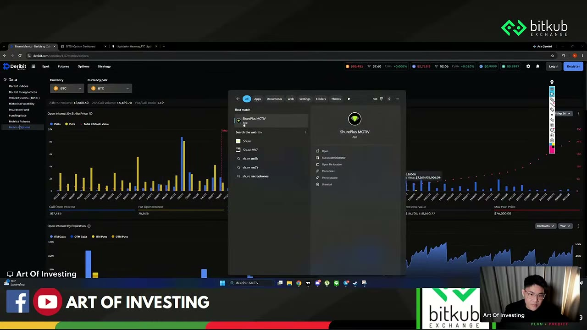

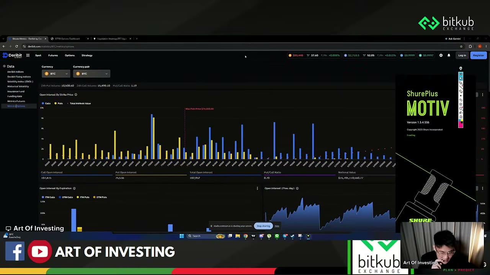

[00:01:53] ล้อแม็กขูดฟุตบาทนะครับก็แนะนำหน่อยนะ ครับผม เดี๋ยวๆรอเพื่อนเพื่อนๆเข้ามาเดี๋ผมถาม เรื่องนี้อีกทีแล้วกันนะครับอ่ะวันนี้ เนาะก็ตลาดขึ้นมาค่อนข้างแรงแล้วเนาะแต่ ว่าเมื่อบ่ายเมื่อบ่ายผมบอกอย่างงี้เมื่อ บ่ายเนี่ยผม take  profit ไม้ outcoin ทุกตัวไป ประมาณ 20% แล้วนะของของ position นะครับ ผมก็บอกนักเรียนไปแล้วว่าผมเท take profit ไปประมาณ 20% ละเดี๋ยวจะอธิบาย ว่าทำไมแล้วก็ยังคิดจะรันยาวอยู่มั้ยนะ ครับสำหรับผมอ่ะผมก็ยังมองว่ายังมีโอกาส จะรันยาวนะแต่ว่าผมแค่เห็นว่ามันมีจุด คล้ายกับ เหตุการณ์หลัง 10 ตุลาคมนิดนึงในรูปภาวะ การย่อของ outil นะครับคือตอนเนี้ยผมรู้ สึกว่า leverage มันค่อนข้างเยอะแต่ว่า ไม่ได้ไม่ได้ล้นเหมือนตอนที่บitcoinมัน เพิ่งเบรคแถว 72,000 มานะครับตอนเนี้ยเรา เห็นการย่อที่ค่อนข้างสมเหตุสมผลในมุมมอง

[00:02:55] ผมนะก็คือบitcoinวันเนี้ยร่วงมาประมาณ 1% ถูกมั้ยวันเนี้บitcoinย่อมามาประมาณ 1% outcoin ก็ย่อประมาณเนี้ย 1%  2%  3% หรือบางตัวที่แบบเค้าขึ้นมาเยอะมากๆใน หลายๆวันเนี่ยก็ย่อ 5-6% เออผมมองว่าโอเค มันย่อในระดับที่ไม่ได้เกิดจาก Force liquidation หรือว่า position แตกอ่ะนะ ครับแล้วก็ผมไม่เห็น Wick เท่าไหร่คำว่า Wick คือมันไม่ได้เห็นภาพแบบ Bitcoin สมมุตินะถ้า Levelate ใน Outcoin มันเยอะ แบบมหาศาลจริงๆอ่ะเวลาย่อปุ๊บอ่ะบitcoin ย่อนิดเดียวอ่ะมันจะต้องไหลฟื๊ดเงี้ยอ่ะ ที่ผมเคยอธิบายเรื่อง Force  Sal นะครับ แล้วมันก็จะต้องดีดกลับที่เดิมถูกมั้ยอ่ะ วันเนี้ยผมไม่เห็นแบบนั้นเท่าไหร่ฉะนั้น ผมก็เลยมองว่าเออเอ่อตัว Leverage ใน Outcoin เนี่ยไม่ได้ล้นตลาดเท่ากับแต่ ก่อนแล้วแต่ตอนเนี้ยมันเป็นมันเป็นการย่อ แล้วก็เดี๋ยวผมจะมาอธิบายให้ฟังนะครับ สำหรับมุมมองผมตลาดกำลังย่อพอดีเลยนะครับ ผมใครที่รอตลาดย่ออยู่นะครับก็ตอนนี้ย่อ

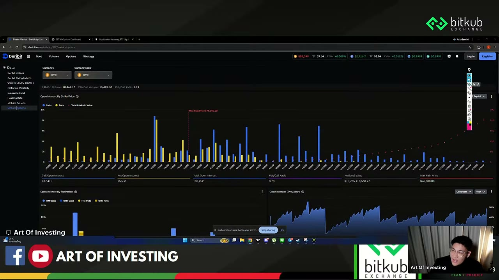

[00:03:56] มาให้คุณแล้วนะครับผมหลายตัวเลยนะผมมอง ว่าหลายตัวสวยนะ ครับหลายๆตัวสวยแล้วก็ผมคิดว่าตลาดเนี่ย ยังค่อนข้างมีความลังเลนะครับในสำหรับราย ย่อยผมก็เลยมองว่าเออๆยังมีอัพไซตอีก หน่อยนะครับใช้คำว่าอีกหน่อยแล้วกัน เดี๋ยววันนี้จะมาวิเคราะห์แต่ละปัจจัยให้ ดูนะครับก็เออเดี๋ยวผมขอวิเคราะห์นี้ด้วย เนาะเอ่อ โอเคโอเค อ่ะวันนี้ขออนุญาตแบบไม่ไม่พูดพ่ำทำเพลง นะครับเดี๋ยวเริ่มเลยนะครับสวัสดีครับ สวัสดีคุณโกโก้สวัสดีคุณธนพงษ์สวัสดีคุณ รัฐพงษ์สวัสดีคุณแอคครับสวัสดีธนพงษ์ครับ สวัสดีครับคุณเจบอคุณจตุรงค์Theลองเกม จีรพันธ์แล้วก็คุณจูเนียร์นะครับอ่ะ อันนี้ก็คือเป็นภาพรวมที่ดีแหละก็คือเงิน ใน ETF เนี่ยมันบวกค่อนข้างเยอะนะครับต่อ เนื่องกันทุกวันเลยก็คือบวก 2,000 กว่า บitcoin +  5,000 กว่าบitคinบ 12,000 กว่าบitcoinนะครับแล้วก็ +  8,000

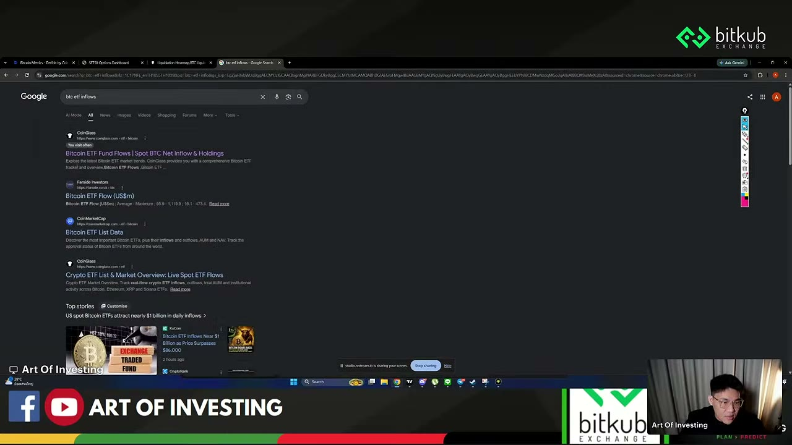

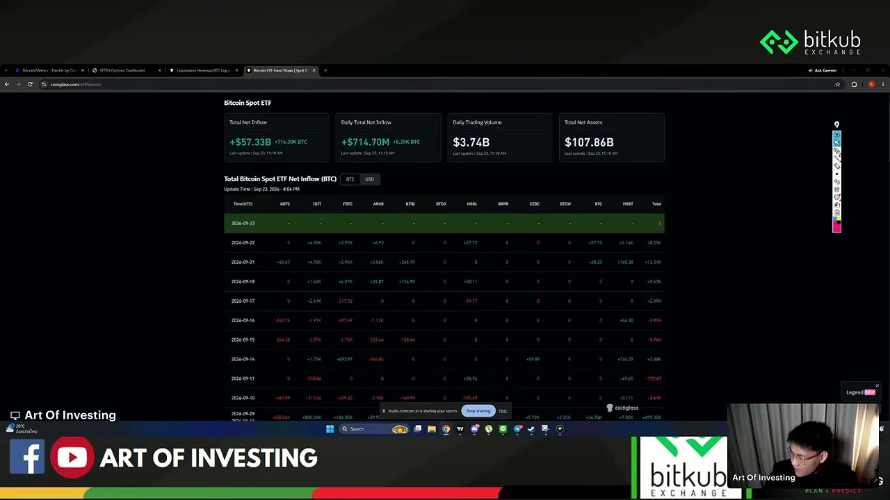

[00:04:57] บitcoinนะครับค่อนข้างเยอะนะตรงเนี้ยเป็น ภาพบวกที่ค่อนข้างเยอะต่อเนื่องเทียบกับ ตอนที่ตลาดย่อเป็นระยะเวลานานนะครับทีนี้ ภาพรวมต่อมาเนี่ยคือมันมี 2 พอย์ที่ผมรู้ สึกว่ามันขัดขัดกันนิดหน่อยสำหรับการเบรค มาเนาะก็คือขั้นแรกนะครับการที่เราจะดู อtionัอย่างมีนัยยะเนี่ยอ่ะอธิบายเพิ่ม ให้ฟังหน่อยนะครับที่เพื่อนเพื่อนบางคน สงสัยกันนะครับก็คือเฮ้ยคุณอาร์ตผมดูวัน ไหนได้บ้างวันไหนมีนัยยะสำคัญวันไหนไม่มี นัยยะสำคัญวันไหนเทรดได้วันไหนเทรดไม่ได้ ผมอธิบายแบบนี้นะครับให้คุณดูเฉพาะวันที่ expiry มันเยอะนะครับคือวันที่วันหมด อายุที่จำนวนสัญญามันสูงมากจริงๆนะครับ มันถึงจะมีนัยยะสำคัญอย่างเงี้ยวันที่ 25 กรกฎาคมเอ่อกันยายนนะครับแล้วก็มันอีก เยอะอีกทีนึงก็นู่นเลยเนาะ 30 ตุลาคมนะ ครับแล้วก็มีของประจำอาทิตย์ก็อาจจะเป็น วันที่ เพราะอะไรเราถึงไม่สามารถใช้ Data  Option ที่เป็น OI เนี่ย Day เทรดได้ทุกวัน

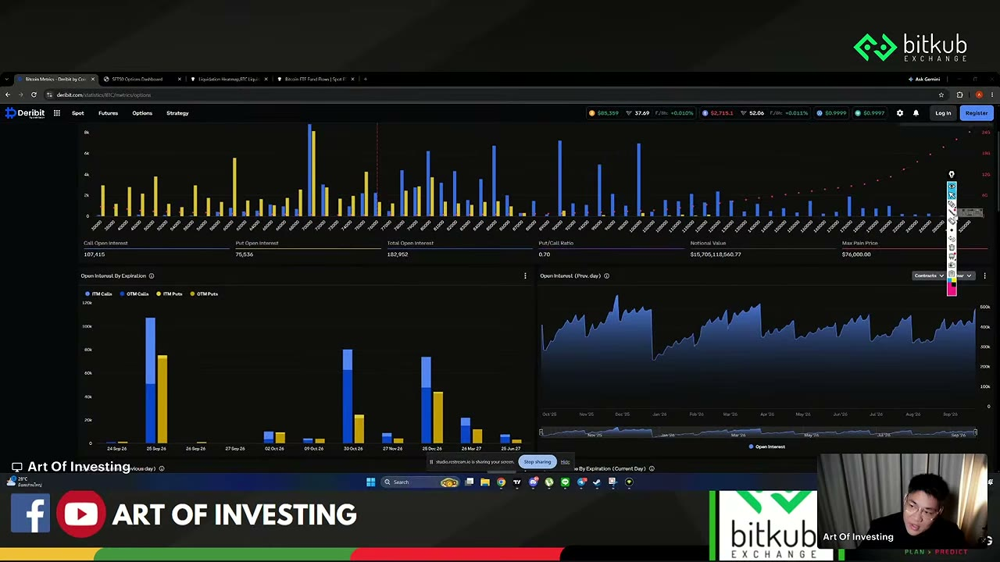

[00:05:57] เหมือนทองอ่ะเนี่ยคือสาเหตุนะครับเพราะ ว่าทองเนี่ยมันเป็นสินทรัพย์ที่ใหญ่ อันดับต้นๆของโลกถูกมั้ยเราเรียกว่ามัน เป็น Asset  Class ระดับโลกอ่ะ World Asset  Class นะครับทีเนี้ยเงินสถาบัน เนี่ยมันอยู่ในนั้นเยอะแล้วเพราะว่ามัน เป็นสินทรัพย์ที่คนทั่วโลกเข้าใจณวันนี้ ไม่มีใครบนโลกไม่เข้าใจว่าทองคำคืออะไร ทองคำทำไมถึงมีค่าทุกคนเข้าใจหมดถูกมั้ย ครับฉะนั้นรายใหญ่ที่เข้าไปกินค่าน้ำไป กินพรีเมี่มในนั้นน่ะมันเยอะแต่ทีเนี้ย บitcoinเนี่ยมันยังเป็นสินทรัพย์ที่เล็ก ถ้าเทียบกับหุ้นตัวนึงเทียบกับเอ่อทองคำ อะไรอย่างเงี้ยนะครับบitcoinเนี่ยมันยัง เป็นสินทรัพย์ที่เล็กแล้วยังไม่ใช่ทุก พื้นที่บนโลกที่รู้สึกว่าฉัน enjoy กับ บitcoinฉันฉันยอมรับบitcoinนะครับฉะนั้น เงินของสถาบันเนี่ยมันเลยไม่ได้ flow เข้าไปเยอะขนาดนั้นที่จะไปเก็งกำไรกินค่า พรีเมี่มทุกวันนะครับเพราะว่าเค้ายังมี สินทรัพย์ทางเลือกที่ทำได้ง่ายกว่าอย่าง ทองคำนะครับ

[00:06:59] เราก็เลยไม่สามารถใช้Dayรดได้ทุกวันนะ ครับไม่สามารถdayดรดได้ทุกวันเราจะต้องดู เฉพาะวันที่เอ่อมันมีจำนวนสัญญาค่อนข้าง เยอะหน่อยนะครับอ่ะอย่างเนี้ยวันที่ 25 ทีนี้ผมเห็นอะไรใน data ตรงนี้นะครับก็ ต้องคุยก่อนว่ามันมันมีเสาอีกทีนึงเลยนะ ที่ที่มันเป็น strike  price หรือว่าราคา ที่ถ้าเกิดถึงหรือใกล้เคียงเนี่ยคนที่ถือ สัญญาคอเนี่ยถึงจะกำไรนะครับหรือว่ามี โอกาสที่จะปิด settlement สัญญาเนี่ยก็ คืออีกทีนึงคือประมาณ 90,000 นะครับแล้ว ก็ 100,000 แต่ทีเนี้ยมันมี 2 พอย์ที่ผม รู้สึกว่าแถวเนี้ยมันเริ่มน่าจะมีจังหวะ ย่อได้ไม่ไม่ใช่ปัจจุบันนะไม่ใช่ 85,000 นะแต่ผมแค่มองว่าถ้าขึ้นไปถึง 90,000  - 100,000 น่ะผมเริ่มเห็นโอกาสที่มันจะรทร หรือว่าย่อซึ่งเราไม่รู้เลยนะครับว่าย่อ

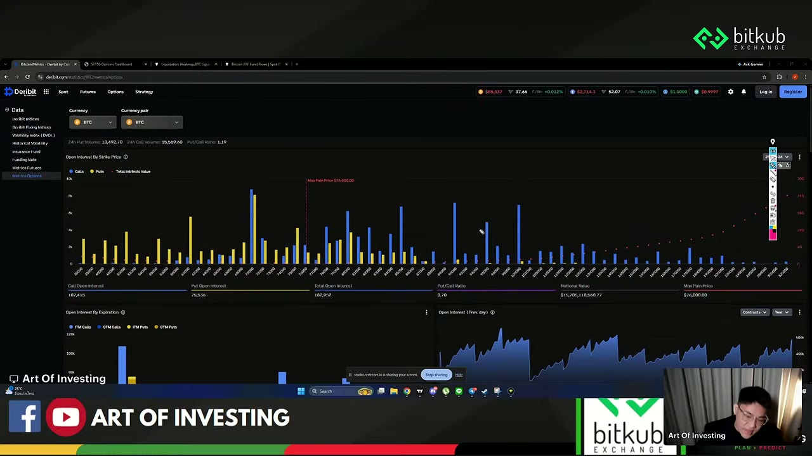

[00:08:00] ตรงนั้นน่ะมันจะลึกลงไปเท่าไหร่จะลงไปแบบ หลุด 80,000 มั้ยหลุด 70,000 มั้ยไปเห็น เลข 6 มั้ยนะครับแต่ว่าผมจะอธิบายให้ฟัง ก่อนว่าทำไมตรงนั้นน่ะผมถึงมองว่าจะเป็น จุด take  profit  future ผมในใน altcoin Coin นะครับแล้วก็ใน Bitcoin ที่เป็น leverage นะครับในบางตัวที่ผมบาง position ที่ผมเปิดไว้เดี๋จะอธิบายให้ ฟังข้อแรกนะครับผมไปดูสัญญาของปิดเดือน ของแต่ละเดือนนะแล้วก็สัญญาที่มันควรจะมี เพิ่มเนี่ยก็คือวันที่ 25 กันยายนให้ทุก คนนึกภาพอย่างี้ครับถ้าเกิดว่าคนในตลาด ไม่ว่าจะเป็นนักเกงกำไรรายเล็กหรือราย ใหญ่เนี่ยเค้าเชื่อจริงๆว่าราคามันจะต้อง วิ่งวิ่งขึ้นต่อนะครับสิ่งที่มันควรจะตาม มาคือเสาของราคาสัญญาที่มันต้องสูงขึ้น อ่ะสมมุตินะตอนที่ราคามันวิ่งพรวดๆอ่ะคือ เมื่อวานนะครับที่มันวิ่งมาถึง 87,000 รอบนึงเงี้ยที่มันถึงตรงนี้แล้วอ่ะสมมุติ

[00:09:02] ว่านี่คือราคาเมื่อวานนะ ถ้าเกิดว่าคนเนี่ยมันมองว่าเฮ้ยโอ้โหแบบ นี้ราคามันต้องไปต่อะนะครับถ้าคำนวณค่า IV นะ imply volatility เนี่ยนะครับมันจะต้องขยับไป เรื่อยๆงั้นสิ่งที่เราควรจะเห็นถ้าเกิด ตลาดเชื่อว่าเฮ้ยไปต่อแน่เสาพวกเนี้ยมัน ควรจะงอกขึ้นครับ ถูกมั้ยแล้วก็เสาพุธเนี่ยที่มองว่าราคา ไม่น่าจะลงไปลึกกว่านั้นก็ต้องควรจะงอก ขึ้นนะครับในละแวกอย่างี้อย่างเงี้ยมัน มันควรจะเห็นสูงขึ้นแต่ปัญหาคือถ้าใครที่ เก็บรูปไว้หรือทำ Snapsot ไว้อ ปัญหาคือนอกจากมันไม่เพิ่มแล้วมันลดด้วย อันนี้ก็มีเพื่อนคนนึงเพิ่งพูดในห้องแชท เลยก็คือดีมากนะครับใน Telegram มีเพื่อน บอกเออใช่ครับแล้วมันก็ลดด้วยใช่ถูกต้อง เลยนั่นคือเรื่องที่ผมกำลังจะพูดเพราะว่า ถ้าคุณไปดู Snapsot ตรงนี้นะครับอ่ะ เดี๋ยวผมเลื่อนให้ดูตรงนี้นะ เราดูตอนที่ราคามันขึ้นมาถึง 70,000 นะ

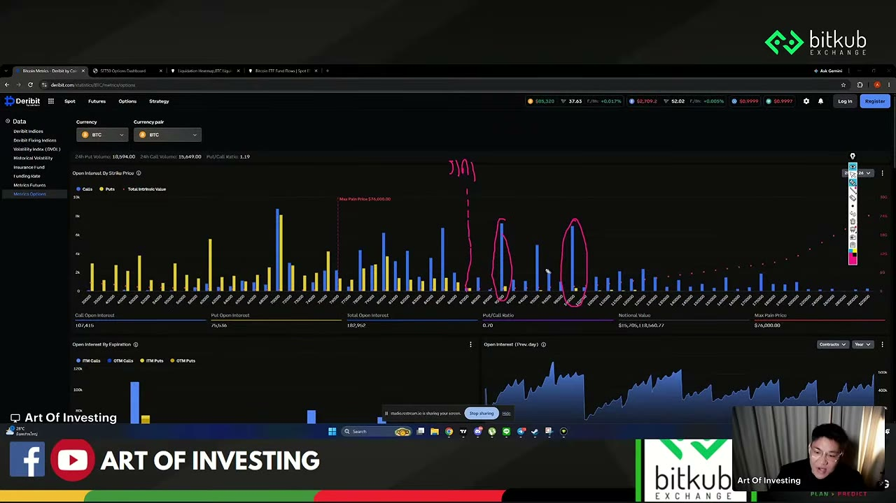

[00:10:02] อ่ะตอนแรกเราเห็นสัญญาตรงนี้ถูกมั้ยนะ ครับก็คือ 85,000 เนี่ยค่อนข้างเยอะมาก เลยถูกมั้ยครับแล้วก็ 90,000 แล้วก็มีอีก ที่นึง 95,000 กับ 100,000 ก็คือ 9,900 contract นะครับ 9,500 คact 9,000 เอ่อ 9 เอ่อ 5,400 คอนค,100คactแล้วเราดู ถ้าเกิดราคามันขึ้นเนี่ยมันควรจะวิ่งราคา มันควรจะวิ่งตึ๊กๆๆเสาขึ้นมาอ่ะคุณดูลอง ลองลองดูภาพแบบนี้นะครับมันไหลอย่างงี้ ตึ๊บๆๆๆอ่ะเห็นมั้ยมันลดนะครับเนี่ยแล้ว คุณดูดิเสาเสาตั้งแต่ราคา 90,000 ขึ้นไป อ่ะครับไม่เพิ่มเลยอ่ะเราเราเราย้อนดูตรง นี้นะตรงนี้นะดูนะเสาตั้งแต่ 90,000 ไป เพิ่มเลยครับ เห็นมั้ยเนี่ยคือ 1 เรื่องที่ผมมองว่า เอ้อทำไมวะนะครับผมว่าเออทำไมอ่ะเพราะว่า

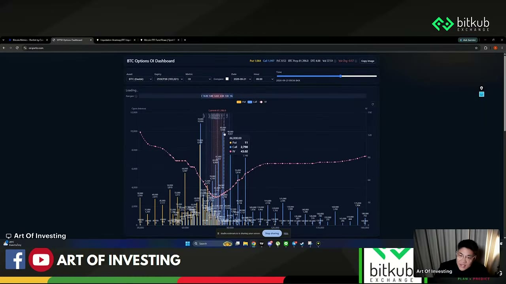

[00:11:02] อย่างปกติครับอ่ะเวลาราคามันขยับเนาะอ่ะ เดี๋ยวผมเอาลองให้มันไม่ค้างก่อนสักครู่ นะครับอ้าวเว็บค้างไปแล้วนะครับอ่ะไม่ โอเคมันได้แค่นี้อ่ะนะครับเนี่ยคือราคา มันควรจะต้องขยับขึ้นมาอย่างเงี้ยครับ เนี่ยเห็นมั้ยตอนที่มันมีการคำนวณ current price นะครับเนี่ยเสามันต้องเขยิบเขยิบ ขึ้นมาตามราคาที่มันเปลี่ยนไปเรื่อยๆ อย่างี้ครับแต่เนี้ยพอมาถึงจนราคา ปัจจุบันเนี่ยครับเอ่อฝั่งคอเนี่ยไม่ได้ เพิ่มเยอะเท่าที่ควรแล้วถ้าไล่ไปดูนะครับ อ่ะเอาตุลาคมเลยเนาะก็คือจริงๆ expiry มันยังไม่เยอะมากก็จริงนะครับ 30 ตุลาคม เนี่ยก็มีประมาณนึงนะครับแต่ว่าเราไม่ เห็นคอหลังจาก 100,000 กับ 95,000 หรือ 90,000 [เสียงกระแอม]เหมือนกันเห็นมั้ย เหมือนกันและอีกเรื่องละงั้นเฮ้ยเดือนนี้ ก็แล้วเดือนหน้าก็แล้วนะครับไม่คนในตลาด ยังมองว่าโอกาสผ่าน 100,000 ค่อนข้างยาก

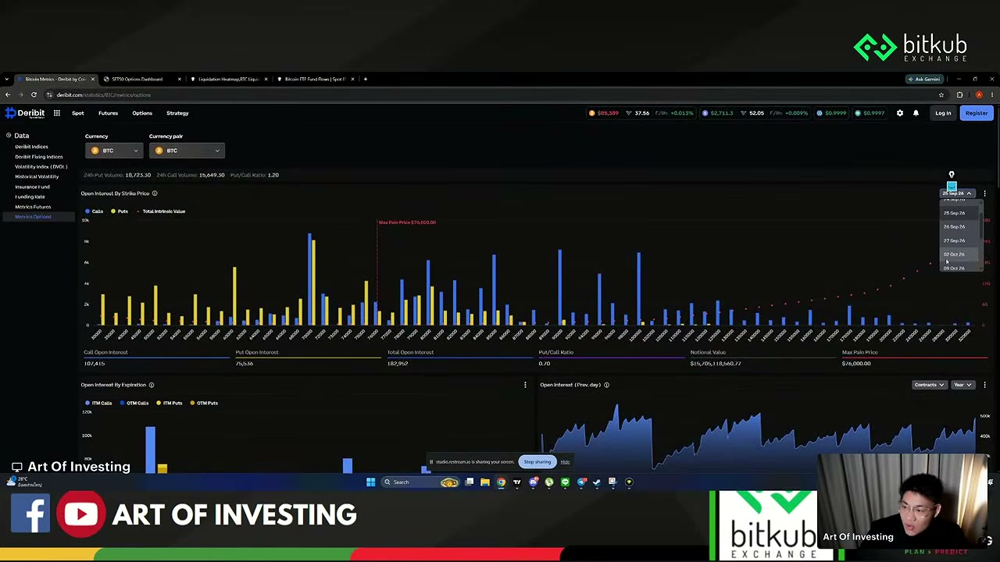

[00:12:03] นะครับโอกาสผ่าน 100,000 ค่อนข้างยากถ้า ดูเป็น Standard  Devation กี่ เปอร์เซ็นต์ว่ะเดี๋ยวผมนับก่อนนะครับก็ เอ่อราคาณปัจจุบันเนาะถ้าเกิดว่าวันศุกร์ นี้ราคาเทียบกับมันยังใช้คำว่า 0 ศ0 เดดingไม่ได้เนาะเพราะว่าวันนี้มันยัง เหลืออีก 2 วันกว่าที่กว่าที่ราคามันจะ ขึ้นไปเทสแต่ตอนนี้นะเอาณณเวลานี้นะครับ ก็โอกาสไปถึง 90,000 แล้วแล้วทะลุในลวด เดียวเนี่ยยังยากเลยนะครับในจังหวะเนี้ย ฉะนั้นน่ะมันก็จะมีโอกาสที่เบรคผมก็เลย มองว่าเฮ้ย data  2 อย่างบอกพร้อมกัน อย่างเงี้ย 1 ราคาเบรคขึ้นมาถึง 87,000  7 ฝั่งคอไม่เพิ่มนะครับคือคนในตลาดไม่ ได้มองว่าจะวิ่งไปไกลกว่านี้สักเท่าไหร่ ฝั่งคอไม่เพิ่มเยอะนะครับอีกเรื่องนึงคือ เราดูข้ามเดือนไปเนี่ยเราก็ยังไม่เห็นว่า มีคอ option เนี่ยวางไว้หลัง 100,000 เลย ซึ่งมันจะเพิ่มมาทีหลังก็ได้แหละแต่ตอน เนี้ยราคามันมาถึง 87,000 แล้วอ่ะนึกออก มั้ยนะครับฉะนั้นจริงๆมันควรมันควรเริ่ม

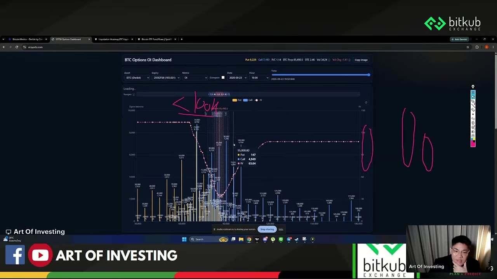

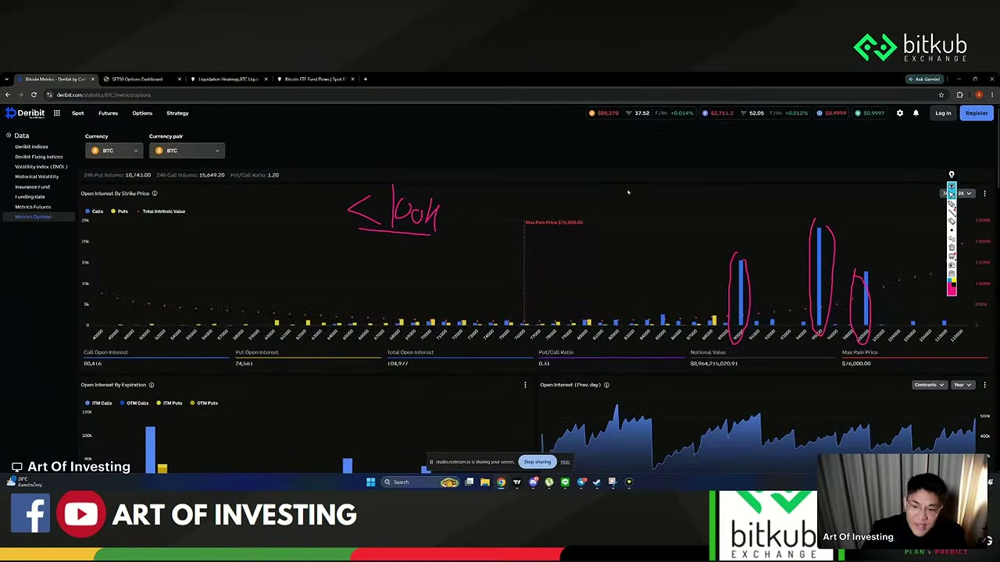

[00:13:04] ไล่มาละเออผมก็เลยมองว่าเอองั้นตรงเนี้ย มันยังเป็นโซนที่ตลาดเนี่ยมอง ผ่านได้ยากนะทีเนี้ยเฮ้ยแบบนี้ขึ้นไปถึง ช็อตหรือเปล่าอย่าอย่าเพิ่งมองแบบนั้นเรา มองด้วย data เนี่ยอย่าลืมว่ามันสามารถ add  up  data มันก็จะเปลี่ยนตามราคาที่ เกิดขึ้นถูกมั้ยสมมุติว่าราคาขึ้นอ่ะเสา ราคามันก็เปลี่ยนมันก็มีขึ้นๆลงๆขึ้นๆลงๆ ฉะนั้นนะครับมันจะมีนัยยะสำคัญต่อเมื่อ ใกล้ๆจะถึงวันนั้นซึ่งอันเนี้มันใกล้ถึง แล้วก็คือประมาณ 2 วันนะครับวันที่จะมี นัยยะที่สุดในการดูนะครับก็คือประมาณ 2-3 วันก่อนหน้าวันหมดอายุที่มันจะเริ่มเริ่ม เป็นนัยยะสำคัญถ้าไกลเกินเนี่ยยังไม่มี นัยยะเท่าไหร่อื แล้วมันก็จะไปตรงกับอีก 2 ทฤษฎี นะครับอีก 2 ทฤษฎีเนี่ยก็คือ 1 ก็เรื่อง Global  Liquidity นะครับก็คือเราอยู่ใน ช่วงที่บitcoinเป็นสินทรัพย์สุดท้ายที่ วิ่งขึ้นมา นับจากสินทรัพย์อื่นที่วิ่งมาตั้งแต่ต้น

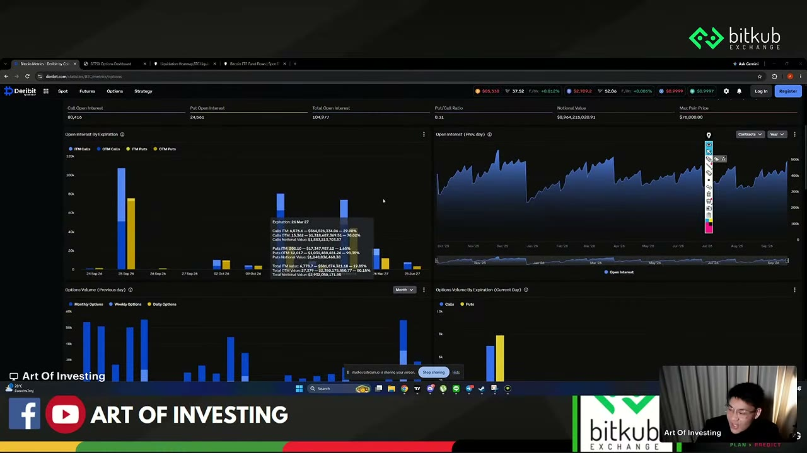

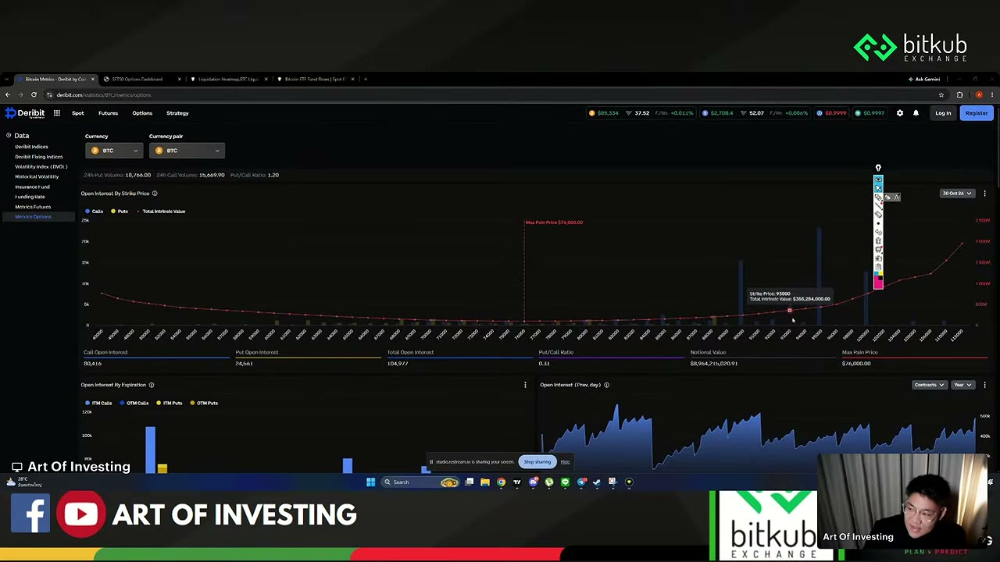

[00:14:05] ปีตลาดหุ้นอเมริกาโอ้โหโหโตระเบิดระเบ้อ เราเราเห็นตลาดหุ้นอเมริกาวิ่งเหมือนเอ outซีซัปี 2021 อ่ะหุ้นวิ่งแบบ 4 เด้ง 7 เด้งตัวเล็กๆเงี้ยเราเราเห็นแล้วถูกมั้ย ครับน้ำมันขึ้นมาจนช่วงพีคก็คือ 100 กว่า ฉะนั้นเงินมันก็ไหลเข้าไปในน้ำมันก่อน หน้านั้นแล้วทองคำขึ้นมาตั้งแต่ 2,000 ไหลขึ้นมาเรื่อยๆๆๆจน 4,000 กว่าถูกมั้ ครับฉะนั้นเนี่ย บitcoinอ่ะมันมาสะสมแล้วเริ่มวิ่งใน จังหวะที่เงินน่ะมันไหลเข้าตลาดตลาดอื่น เนี่ยไปเยอะมากแล้วงั้นเมื่อไหร่ก็ตามที่ เงินมันเริ่มจะไหลออกมาพักตัวจากตลาด เหล่านั้นน่ะมันมันแปลว่าเม็ดเงินที่ยัง จะเหลือที่จะ flow เข้าไปในบitคinอ่ะมัน ไม่เหลือเยอะขนาดนั้นเพราะว่าโดยส่วนตัว บitcoinยังไม่ได้เป็นสินทรัพย์ที่แยก ประเภทแบบเอกฉันว่าถ้าเกิดเงินมีเงินมี ปัญหาทองคำมีปัญหาฉันเก็บบitคinไว้แล้ว ฉันจะปลอดภัยซึ่งอนาคตอ่ะมันอาจจะเป็นภาพ

[00:15:05] แบบนั้นแต่ว่าณปี 2026 ตอนเนี้ยทั่วโลก โดยส่วนรวมอ่ะยังไม่ได้เชื่อในภาพนั้น เท่าไหร่นะครับงั้นแนวโน้มที่บitcoinมัน จะตามเม็ดเงินที่เริ่มไหลออกจากตลาดอื่นๆ เนี่ยมันเลยเริ่มมีนะครับอ่ะเอาพอย์แรก ก่อนนะก็คือคิดว่าผ่าน 90,000  -  100,000 ได้ค่อนข้างยากทีนี้เรามาดูเรื่องกราฟกัน ต่อนะครับอ่ะก็ Liquidation  Hitmap นะก็ ดูหน่อยเนาะก็คือมีโซนที่คนวาง Stop  Loss ไว้เยอะก็คือ 86,000 กับ 87,000 ก็คือตรง นี้นะครับเวลาไปชนมันก็อาจจะเกิดแบบดัน ขึ้นไปนะครับก็คือโดน Force  buy เนาะก็ คือคนที่ช็อตไว้ก็โดนโดนบังคับซื้อนะครับ มันก็จะอาจจะtriกเกอร์ขึ้นไปหน่อยแต่ที เนี้ยโดยส่วนตัวนะผมอ่ะจะไม่ค่อยได้ใช้ Liquidation  Heat  Map เยอะเท่ากับ Option เพราะว่า Heat  Map ตรงเนี้ยคุณ อย่าลืมว่ามันยกออกเมื่อไหร่ก็ได้นึกออก ใช่มั้ครับสมมุติว่าคุณมี position ที่ คุณตั้ง Stop  Loss ไว้ตรงเนี้ย แล้วคุณรู้สึกเปลี่ยนใจอ่ะคุณอาจจะเป็น รายใหญ่หรือเป็นใครก็ได้ไม่ไม่มีใครรู้

[00:16:06] อ่ะคุณยกออกปุ๊บไอ้ไอ้แถบเหลืองตรงเมันก็ หายไปะนะครับฉะนั้นเนี่ยมันมันต่างจาก อtionัที่ซื้อแล้วคุณเสียค่าน้ำแล้วคุณ ไม่อยากจะยกเค้าเข้าออกมันเจ็บมันเข้า เนื้อนะครับมันไม่คุ้มอือ่ะทีนี้ประเด็น ต่อมาก็คือมาดูกราฟนะครับเดี๋ยวแล้ว เดี๋ยวผมจะไปพูดถึง Outcoin นะครับว่า งั้นมันยังจะมีกราฟทรงไหนที่สวยบ้างทีนี้ อ่ะพาร์ทต่อมาเราก็มาดูเรื่องโมเมนตัม ก่อนนะครับโมเมนตัมเนี่ยใกล้ถึงคค็มที่ มากๆแล้วนะครับใกล้ถึง we เต็มที่มากๆ แล้วคือมันเริ่มเบรกจากโมเมนตัม Day ก่อน อ่ะเอาพาร์ทที่ผมตกรถก่อนนะครับก็คือวัน ที่ผมตกรถเนี่ยผมจะrepลayให้ดู อ่ะตอนนี้อ่ะณวันนั้นนะครับอันนี้อันนี้ เราย้อนไปเราย้อนไปณวันนั้นเนาะเดี๋ยวผม จะวิเคราะห์ให้ฟังว่าเอ่อ ทำไมเราถึงอ่ะไม่ใช่เราแล้วกันสายเทรด โมเมนตัมเนี่ยถึงมองว่ามันไม่ขึ้นใน จังหวะเดียวอ่ะผมไปพูดไว้ในสยาม

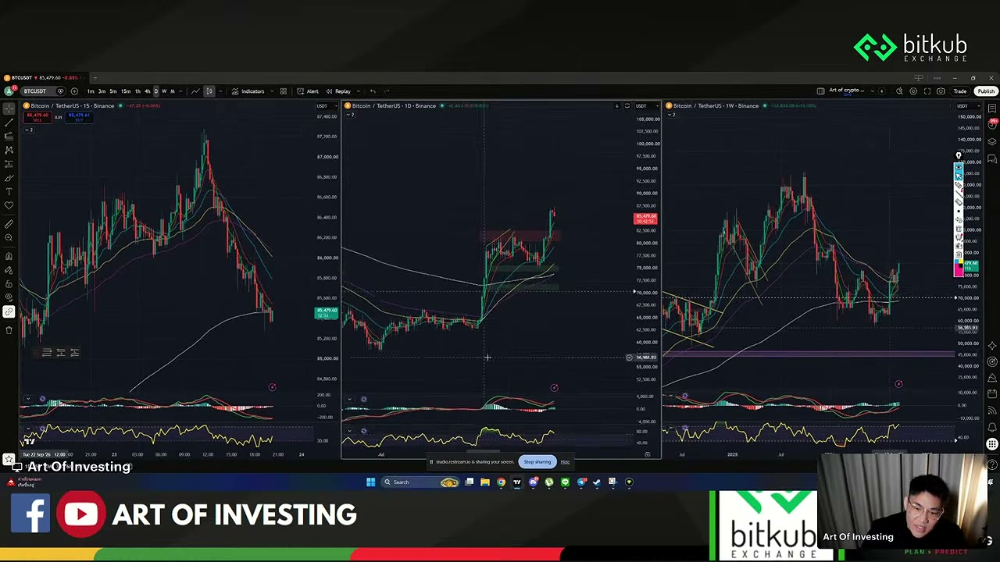

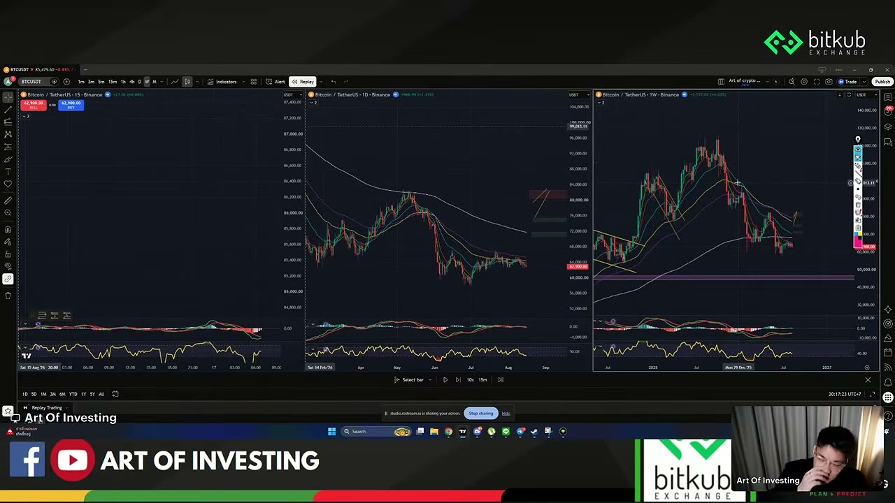

[00:17:06] bl็ockchainว่าตอนที่มันขึ้นไปถึง 82,000 ตรงนี้ว่าเฮ้ยต่ำกว่า 60,000 เนี่ยเป็น เรื่องที่เป็นไปได้และน่าสนใจแล้วตรง เนี้ยผมก็ซื้อจริงๆที่ผมลงไปในเพจจำได้ มั้ยผมหวดเป้งไปไม้นี้ก็คือประมาณแถว เนี้ย 58,000  59,000 นะครับแล้วทีเนี้ย ผมก็มองว่าเฮ้ยตรงเนี้ยนะครับมันอยู่ใน balance  zone อ่ะเดี๋ยวผมย้อนไปอันนี้ สอนเรื่องโมเมนตัมนะกับออเดอร์ในตลาดตั้ง แต่วันนั้นเลยนะครับอ่ะทีเนี้ยมันเป็น balance โซนแบบ ผมก็เลยมองว่าเออถ้าเกิดเราดูเรื่องการ ส่งไม้ต่อหรือหรือโมเมนตัมที่มันวิ่งผลัด อ่ะนะครับเวลาส่งโมเมนตัมอ่ะมันเหมือนกับ เอ่อในระดับ Day จำนวนคนซื้อออเดอร์ซื้อ ระยะการวิ่งใน day เนี่ยมันมากเพียงพอที่ จะยกระดับภาพใหญ่ให้เกิดเทรนด์เราจะเรียก แบบนั้นว่าส่งต่อโมเมนตัมฉะนั้นตอนนั้น น่ะครับผมมองไว้ว่ามันจะขึ้นลวดเดียว เนี่ยผมให้ยากผมให้ต่ำกว่า 30% อ่ะณเวลา นั้นเหตุผลคืออะไรเพราะ MacD มันอยู่ใต้

[00:18:07] ศูนย์ค่อนข้างลึกนะครับมันยังไม่ได้จ่อผม ก็เลยมองว่าเฮ้ยณเวลานั้นน่ะมันมีแนวโน้ม สูงมากเลยที่ถ้าเกิดเบรคข้างล่างแล้วเรา จะได้เห็นการย่อลงไปแถว 50,000 กลางๆหรือ 40,000 ปลายณณตอนนั้นนะแล้วกลับมาขึ้น อีกทีปลายปีอ่ะมันก็จะตรงกับหลายๆศาสตร์ ช่วง Global  Liquidity เริ่มออกแล้วก็ เพิ่งไปเริ่มเคลื่อนปีหน้าแบบสิ้นปีเพิ่ง เริ่มตั้งไข่ทุกอย่างมันจะดูสวยงามมากนะ ครับแล้วก็มันก็จะผ่านพ้นช่วง midterm election พฤศจิกายนไปด้วยถูกมั้ยตอนแรก อ่ะผมมองไว้แบบนั้นผมก็เลยซื้อตรงเนี้ยไป แค่ครึ่งนึงของที่ตั้งใจจะซื้อนะครับอ่ะ เป็นไม้ที่หวดไปทีนี้มันไม่เลือกเป็นแบบ นั้นนะครับมันไปอีกด้านพอไปอีกด้านเนี่ย ผมก็มองไว้อีกว่าเฮ้ยแต่คอ่ะมันลึกขนาด ไหนมันลึกขนาดนี้นะครับฉะนั้นถ้าขึ้นไป เนี่ยผมก็เลยมองว่ามันน่าจะติดพรีเมี่ม แถวตรงนี้ก่อนก็คือ EMA  25 เพราะว่าตั้ง แต่ลงมาเนี่ยตลาดมองตลอดเลยว่าตรงเนี้ย

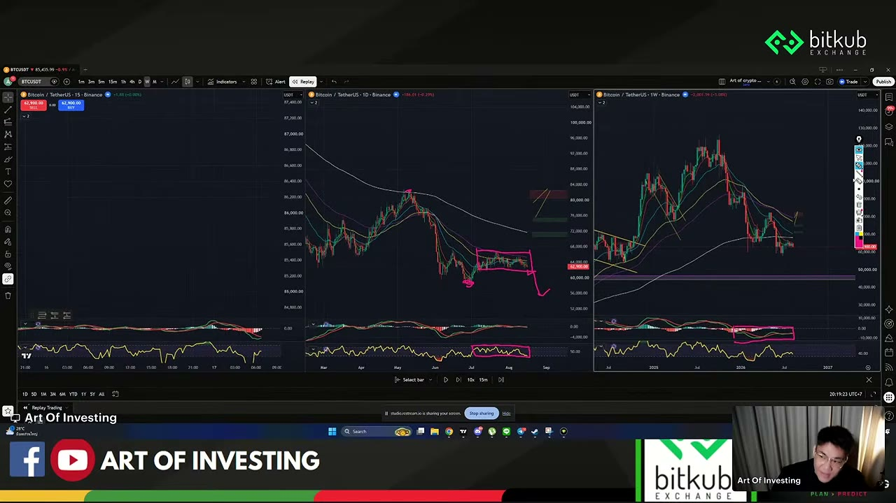

[00:19:11] นับว่าแพงขึ้นมาปุ๊บขายดีกว่าขึ้นมาปุ๊บ ฉันขายใส่ก่อนดีกว่านะครับเราเรียกโซนตรง เว่าพรีเมี่มแต่ว่าตลาดไม่เลือกเดินแบบ นั้นนะครับตลาดเลือกไปปูดเดียวเลยแบบนี้ อ่ะเดี๋นะ มันเลื่อนให้มันเร็วๆกว่านี้ได้มั้เนี่ย นะครับอ่ะไม่เป็นไรผมอันนี้ให้ดูแล้วกัน อ่ะพอมันไปปูดเดียวเลยแบบเนี้ยนะครับสิ่ง ที่เกิดขึ้นเนี่ยคือโอเค day เนี่ยมัน เกิดโมเมนตัมแน่นอนตั้งแต่ตั้งแต่แท่งนี้ และก็คือ MAD เหนือ 0  RSI  Overbard เรา ก็จะเห็นว่าหลายคนแม้กระทั่งคนที่ วิเคราะห์ว่าเอ่อบitcoinน่าจะปรับตัวขึ้น น่ะก็ขายแถวนี้เริ่มเริ่มขายแถวนี้ค่อน ข้างเยอะนะครับ 67,000  70,000  72,000 เพราะว่า data เนี่ยมันบอกค่อนข้างใกล้ เคียงกันว่าเอ้ยมันน่าจะยังไม่ขึ้นในพรวด เดียวแต่ว่าสุดท้ายนะครับก็ขึ้นไปพรวด เดียวเลยจากกระแสกระแสการประกาศนโยบาย buy backอระยะยาวคืนด้วยนะครับทีเนี้ยพอ โมเมนตัมณวันนั้นมันส่งมัน day อ่ะมัน เกิดแล้วแต่มันยังส่งไม่ถึง week ถูกมั้ย

[00:20:17] อ่ะนะครับทีเนี้ยเอ่อภาพรวมเนี่ยนะครับ ภาพรวมเนี่ย ตอนเนี้ย V กับโมเมนตัมก็ยังไม่เกิดนะ ครับมันแค่กำลังจะเกิดอ่ามันมันกำลังจะ เกิดก็คือ WeEK เนี่ยมันเป็น MACD จ่อแต่ มันยังไม่ยังไม่สามารถ push  through ขึ้นไปได้นะครับก็คือมันมี 2 ทางเลือก ระหว่างขึ้นปรวดเดียวเลยแล้วแม็กดีขึ้น อย่างงี้ก็คือเกิดโมเมนตัมละนะครับก็อ่ะ มันก็จะเป็นภาพแบบอย่างี้เผื่อใครนึกภาพ ไม่ออกในweคนะครับ อ่ะมันก็จะเป็นอย่างี้เนี่ยกลับมาขึ้น เนี่ยปึ๊บอ่ะโมเมนตัมเกิดละแล้วก็เกิด เป็นเทรนด์ภาพใหญ่ขึ้นไปต่อนะครับหรือมัน เกิดได้อีกทางนึงก็ก็คือถ้าเกิดมันไม่ได้ ขึ้นไปลวดเดียวเลยนะครับมันก็มันก็มีแนว โน้มที่จะย่อพักตัวก่อนนะครับแล้วก็ค่อย ขึ้นอีก 1 จังหวะนะครับทีเนี้ยไอ้พทตรง เนี้ยนะครับมันก็เลยไปคล้องจองกับ data ที่มันอยู่แถว 90,000  -1,000 เพราะว่า

[00:21:17] ถ้าเกิดมันขึ้นไปรวดเดียวตรงเนี้ยนะครับ อ่ะมันก็จะมีโซนตรงนี้ถูกมั้ย กับ 100,000 ก็คือตรงนี้นะครับผมก็เลย เห็นว่าเออถ้าถึงตรงเนี้ยฮะ ด้วยความที่ data มันมันบอกเราแบบนั้นมัน บอกว่าคนยังมองว่าราคาขึ้นไม่เกินนี้เท่า ไหร่อ่ะผมก็เลยมองว่างั้นมันจะเป็นจุด take  profit ไม้เทรดฟังดีๆนะไม่ใช่ พอร์ตสปอตระยะยาวนะพอร์ตสปอตระยะยาวผมไม่ ขายแน่นอนเพราะว่าเราเราต้องการรอบใหญ่ ถูกมั้ยแต่ทีเนี้ยไม้เทรดสั้นน่ะคุณจะไม่ รู้เลยว่าตรงเนี้ยมันจะย่อลึกแค่ไหนมันจะ ย่อตื้นแล้วไปเลยมั้ยหรือมันจะทะลุไปเลย หรือเปล่านะฉะนั้นเนี่ยผมจะดูโอ้ขอบคุณ ซอ์ Chat ครับคุณอ๊อดขอบคุณมากๆครับ ขอบคุณ 55 บาทขอบคุณมากเลยครับคุณอ๊อด ขอบคุณสำหรับกำลังใจครับอ่ะทีเนี้ยครับ เอ่อมันขึ้นไปค่อนข้าง

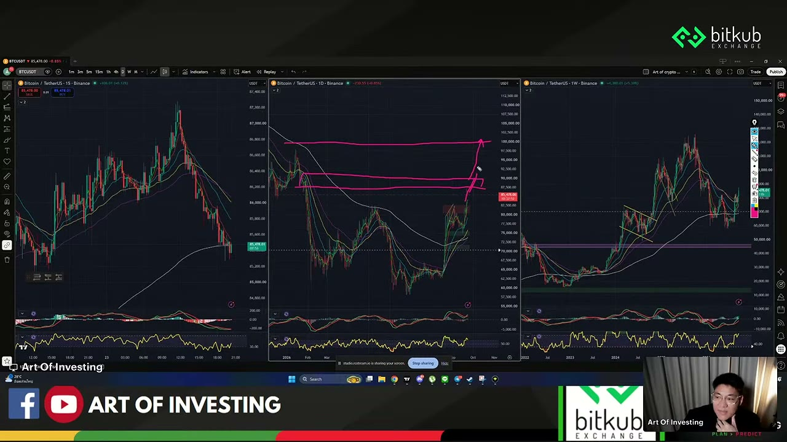

[00:22:19] แรงละนะครับฉะนั้นในโซนตรงเนี้ยผมก็เลยจะ ดู outcoin นะตัวไหนก็ตามที่ผมมีที่ผม โพสต์ลงในเพจว่าแบบผมเข้ามาเนี่ยแล้วมัน เริ่มไปติด premium  zone ใน week เนี่ย อ่ะผมก็อาจจะพิจารณา take  profit outcoin พวกนั้นบางส่วนยกเว้นว่าขึ้นไป แล้วไม่มีอาการอะไรเลยก็คือเบรกพรวดทะลุ ไปเลยอย่างเงี้ยอ่ะโอเคผมก็จะรันนะครับ ฉะนั้น 2 โซนเนี้ยผมอยากให้เฝ้าระวังไว้ หน่อยนะครับจาก data  OI ก็ด้วยนะครับ แล้วก็โมเมนตัมก็ด้วยนะครับก็คือ 90,000 กับ 100,000 ซึ่งถ้าไม่มีอาการผมก็จะถือ นะแต่ว่าถ้ามีอาการผมจะ TP ไม้ my outcoin ที่เป็น Future นะครับส่วนสปอผม ก็ยังรันไปแหละเพราะว่าสปอตอ่ะเราต้องการ เล่นคำใหญ่เท่านั้นเนาะทีนี้อ่ะ สมมุติว่ามันมันย่อไม่ลึกอ่าหรือไม่ย่อ อ่ะอันนี้เราเราดูเคส 2 จุดที่ผมมองว่า น่าจะมีโอกาสสะดุดแล้วกันนะก็คือ 90,000 กับ 100,000 ทีนี้สมมุติว่ามันไม่ได้ย่อ

[00:23:21] ลึกหรืออาจจะไม่ถึง 90,000 แล้วอ่ะถึง เนี่ย 87,000 ฉันจะย่อแล้วอ่ะสมมุตินะถ้า เกิดจะย่อไม่ลึกนะครับก็มี 2 โซนที่ผมมอง ว่าย่อมาแล้วเนี่ยค่อนข้างโอเคนะครับก็ คือแถวเนี้ยอ่ะนะครับประมาณ 80,000 แล้วขึ้นต่อเลยนะครับหรืออีกโซนนึงนะครับ ก็จะเป็นโซนแถวประมาณ 7,000-75,000 นะก็คือเป็นdisคาใหม่ที่ EMA  50 อยู่ ประมาณนี้ 75,000  76,000 โดยประมาณนะ ครับก็อาจจะเป็นโซนนี้ถ้าเกิดย่อมาแล้ว แล้วเกิดโมเมนตัมอีกรอบนะครับก็ผมอาจจะ ไม้เพิ่มอีกชุดนึงที่จุดนั้นแต่ว่าถ้ามัน เบรคไปเลยก็ก็รันรันต่อเท่าที่มีนะครับ มันจะเป็นนี้ที่ที่ผมมองว่าถ้าย่อมา 2 จุดเนี้ยผมค่อนข้างโอเคเพราะว่าตอนนี้มัน inprofit เนาะแล้วเราจะดูยังไงว่า โมเมนตัมหลังจากย่อมาแล้วจะเกิดอ่ะเดี๋ผม จะจำลองตรงนี้ให้ดู

[00:24:24] นะครับวิธีคือดูแบบเนี้ยครับนะครับง่ายก็ คือสมมุติว่าเราวางโซนไว้แล้วใช่มั้ยที่ นะครับนะครับที่ที่เราสนใจสมมุติว่าเรา เรามองเราเราวางโซนไว้ตรงนั้นแล้วอ่ะนะ ครับมันก็จะมีการเกิดพรีเมี่มขึ้นในtimeม frฟมเล็กๆอ่ะเช่นแบบนี้ อ่ะเอา 15 ก็ได้อ่ะอย่างงี้นะครับอย่าง เงี้ยเราก็จะเห็นถูกมั้ยว่าเฮ้ยลงมาปุ๊บ ติดๆติดตลอดเลยเบรกไม่ได้เลยเบรคไม่ได้ เลยแล้ว MaD ก็ลงมาใต้ 0 ด้วยเห็นมั้ยแต่ ทีเนี้ยมันย่อมาที่ EMA  75 แล้วก็ปึ้ง MAD เหนือ 0  RSI  overbard เกิด โมเมนตัมนะครับแล้วก็ขึ้นต่ออันเนี้ยก็ คือโมเมนตัมเกิดนะครับแต่ทีเนี้ยเรา ต้องการภาพแบบเนี้ยแต่ว่าให้มันไปเกิดใน โซนที่เรารอนะก็คือผมมองไว้แถวประมาณ 80,000 เนาะ 80,000 อีกโซนนึงผมมองมองประมาณ 74-76  6

[00:25:28] อ่ะอันนี้เคสย่อบอกก่อน ว่าเราจะ take  action ยังไงนะครับเคสย่อ ผมก็มองมองตรงนี้ถ้าเกิดมันจะขึ้นต่อนะ เพราะว่าอย่างที่บอกคือweคเนี่ย ไม่ยังส่งต่อโมเมนตัมไม่เสร็จอ่ะแต่ที ทำไมผมถึงมองว่างั้น มันยังมีอัพไซตอ่ะเมื่อกี้ที่ผมผมเพิ่ง พูดในเพิ่งๆพูดในกลุ่มTelแกรamไปว่าแบบ เอ้ยมันยังมีอัพไซตอีกหน่อยเพราะณจุด เนี้ยผมว่ามันยังไม่ใช่จุดที่ทุกคนคิด 100% ว่าเฮ้ยไม่ลงแล้วเนี่ยเดี๋ กำลังจะไป New  High อ่ะมันต้องเกิดภาพ นั้นก่อนที่ผมมองว่าออเดอร์ในตลาดมันจะ เยอะพอให้กับรายใหญ่ที่จะ Take  action กับสปอไม่ใช่กับ position  line ของเขา้า อ่ะกับสปอเพราะว่า movement ที่มันจะทำ ให้ position ซื้อหรือออเดอรเมื่อซื้อ เกิดเยอะที่สุดในตลาดเราต้องนึกแบบนี้นะ รายใหญ่เนี่ยเค้าไม่ได้มองในการไล่เก็บ

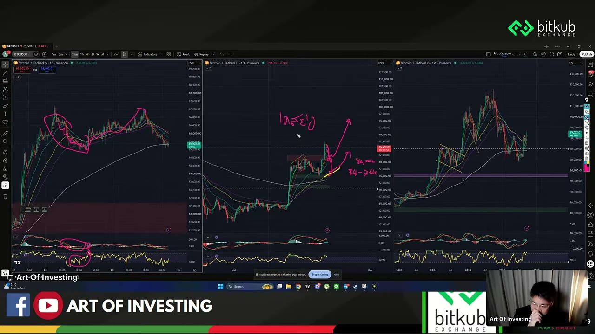

[00:26:29] Stop  Loss รายย่อยนะครับรายใหญ่ไม่ได้ สนใจว่า Stop  Loss รายย่อยอยู่ตรงไหน เดี๋กูไปล้างเดี๋ไปเก็บสิ่งที่เขา้าทำมี 2 เรื่อง 1 ถ้าเกิดเป็น Data  Option หรือ การเล่นแบบกินค่าน้ำทำยังไงที่จะทำให้ค่า น้ำยังอยู่ในกระเป๋าเเหตุ 2 ฝั่งนี่คือ ทางท่าที่ 1  2 สำหรับรายใหญ่รายสถาบัน กองทุนหรือบริษัทก็ตามที่เก็บในรูปแบบ สปอร์ตแล้วต้องการปล่อยของ จุดที่จะปล่อยของได้เนี่ยนะครับคือจุดที่ ออเดอร์ซื้อต้องเยอะถูกมั้ยเพราะไม่งั้น น่ะคุณไม่สามารถโยนออเดอร์ใส่ในตลาดได้ คุณนึกภาพว่าคุณมีตังค์เป็นแสนล้านเป็น ล้านล้านน่ะคุณไม่สามารถกดปุ่ม market ได้อ่ะสมมุติว่าคุณกำไรอยู่ 30% แล้วคุณ กดขายที่marกetตรงนั้นเลยโป้งอ่ะกำไรจาก 30% คุณน่ะมันอาจจะเหลือ 10%  8% เลยก็ ได้เพราะว่ามันกระทบกับราคาตลาดมากเกินไป งั้นภาวะไหนล่ะที่ออเดอร์ซื้อในตลาดมันจะ เยอะมหาศาล คำตอบก็คือเป็นจุดที่คนเชื่อว่าจะไม่ลง อีกแล้วอ่ะจะลงไม่ได้อีกแล้วเออผมก็เลย

[00:27:30] มองว่าอ้าโอเคมันมันก็ยังมีอัพไซตอีก หน่อยนะครับก็คือแถว 9  90,000-1,000 ซึ่งผมเชื่อเหลือเกินว่าถ้ามันวิ่งถึง 100,000 จริงๆอ่ะคนทุกคนมองว่าไม่ย่อ แล้วอ่ะผมว่า 90% แล้วกันมองมองว่าไม่ย่อ แล้วแบบนี้ New  High แน่นอนนะครับผมก็ อ่ะโอเคแล้วทีเนี้ยถ้าเกิดขึ้นไป 100,000 อ่ะเราจะเจอความผันผวนอีกครั้งนึงก็คือ ช่วงของ Midterm  Election นะครับหรือเลือกตั้ง กลางเทอมที่จะเกิดขึ้นในเดือนพฤศจิกายน อย่าลืมว่ารัฐบาลTrัมป์ในการพยายาม Push เรื่อง Cryptoocurrency เขาพลาดไปเรื่อง นึงเราคือ Clarity  Actor Adkin ประธาน SEC หรือประธาน SEC คนใหม่ เนี่ยเขาประกาศเรื่อง Innovative Exemption ที่ประกาศให้สามารถซื้อหุ้น ที่มันเป็น token  Block  blockchain ได้ อย่างถูกกฎหมายทดลองใช้ก่อน 5 ปีนะครับ โดยเฉพาะพวกที่เข้าเกณฑ์เท่านั้นอื [เสียงกระแอม]ผมก็เลยมองว่าเออจุดนั้นน่ะ

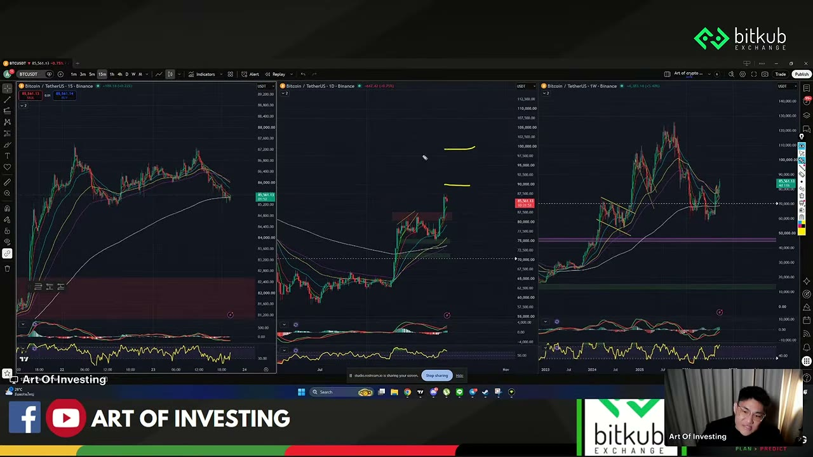

[00:28:32] มันมันมีโอกาสะที่จะเกิดSidewayยหรืออะไร สักอย่าง Global  Liquidity ด้วยผมก็เลย มองว่าถ้าเกิดขึ้นลวดเดียวไปเลยอ่ะ ไม้เทรดผมระวังนิดนึงแต่ภาพรวมอ่ะนะครับ ผมผมไม่ขายพอร์ต Sport แน่นอนในในมุมมอง ส่วนตัวนะเพราะว่าเราก็อย่าไปคิดว่าเราจะ จะทันตลาดอันนี้คืออีกโคตรกับดักผมรู้สึก ว่าเราต้องระวังเรื่องนี้มากๆอย่าไปแบบ เฮ้ยเนี่ยเดี๋ยวดูนะขึ้นไปนะเดี๋ยวจะเปิด ช็อตลงมาเลยแล้วก็แบบโอ้โหลงมาตรงนี้นะ เดี๋จะอัดไม้เลยเดี๋เค้าอย่าทำแบบนั้น เด็ดขาดนะครับเมื่อไหร่ก็ตามที่คุณคิดว่า คุณนำหน้าตลาดอ่ะคือคุณยิ่งวิ่งตามหลัง ตลาดเข้าไปหนักกว่าเดิมเพราะรายใหญ่พวก เนี้ยไม่มีใครรู้นะครับว่าตรงไหนก้นตรง ไหนท็อปสิ่งที่เขา้าทำอ่ะคือเขาค้าแค่ คำนวณโมเดลในกองของเค้าว่าเฮ้ยแบบเนี้ย เรา take  action แล้วมันเกิดผลประโยชน์ ต่อกองทุนเรามั้ยถ้ายังเราต้องรอในช่วง ไหนเหตุการณ์อะไรเกิดออเดอร์ต่อวันเ้า

[00:29:33] เปิดอordเดอร์ Book ดูเพราะว่าพวกเนี้ย เค้าเเห็นอเดer Book อยู่แล้วพอเาไปเซ็น สัญญากับโรกกับ Exchange กับอะไรมันยิงคำ สั่งตรงกันอยู่แล้วพวก H ระดับใหญ่หรือ ว่า ETF ระดับใหญ่เเห็น data พวกนี้อยู่ แล้วเมีหน่วยที่คำนวณโดยเฉพาะนะครับ ฉะนั้นเนี่ยเวลาที่ราคามันขึ้นมาลงอ่ะมัน คือการแย่งกันในการซื้อในการขายของกองทุน เพราะว่าเราอย่าลืมนะครับทุกคนน่ะชอบมอง ตลาดว่ามีเจ้าซึ่งถูกแต่เจ้าไม่ได้มีคน เดียวและเจ้าทุกคนไม่ได้เป็นเพื่อนกัน นึกออกใช่ป่ะเจ้าไม่ได้มีคนเดียวและเจ้า ทุกคนไม่ได้เป็นเพื่อนกันน่ะ คือมันไม่ใช่ว่าแบบเอ้ยทุกคนกองทุนมาเอา มือมาประสานกันรวมพลังขายเฮ้มันมันไม่ใช่ แต่กองทุนคุณแต่ละกองก็แย่งซื้อขาย ออเดอร์บนตลาดเดียวกันเช่นเค้าคำนวณมาและ โมเดลนี้เหมาะกับกองฉันเดี๋ฉันจะต้อง เทคัแบบนี้แล้วราคาตลาดมัน shift เดินทาง ไปะอีกแบบนึงเค้าก็ต้อง take  action นะ

[00:30:35] ครับแต่ละกองก็ต้องแย่งกัน take  action งั้นอย่าพยายามนำหน้าตลาดนี่คือข้อแรกข้อ ที่ 2 คือ ผมเชื่อนะโดยส่วนตัวว่าการเทรดสั้นภายใน 5 ปีจะเริ่มยากขึ้นมากๆอ่ะการเทรดสั้นแบบ แบบสั้นมากๆอ่ะนะแบบ 1 นาที 5 นาทีtimeม frฟรมเล็กๆแล้วแบบถือ position แป๊บแล้ว ออกสปิ้อย่างเงี้ยผมคิดว่าในอนาคตจะยาก ขึ้นนะครับด้วยการเข้ามาแทรกแซงของ AI ที่มันจะทำให้ออเดอร์ในเกมระยะสั้นน่ะมัน ผันผวนมากกว่าปกตินะครับแต่เกมระยะยาวผม มองว่ายังเหมือนเดิมนะครับเกมระยะยาวผมก็ เลยคิดว่าการเล่นสวิงระยะยาวอ่ะยังค่อน ข้างได้เปรียบแล้วแล้วเป็นประโยชน์มากนะ ฉะนั้นตอนเนี้ย ถ้าเกิดมันจะเป็นภาพการย่อแบบสวยหรูเนาะ แบบสวยหรูเหมือนกับบูรันคราวที่แล้วก็อาจ จะเป็นแบบนี้ก็คือเห็นมยว่าตอนนั้นน่ะ เบรคขึ้นมาตรงนี้แล้วนะเหนือพรีเมี่มขึ้น มาได้เนี่ยแต่ว่าเอ่อ MAD ก็ยังไม่เหนือ 0

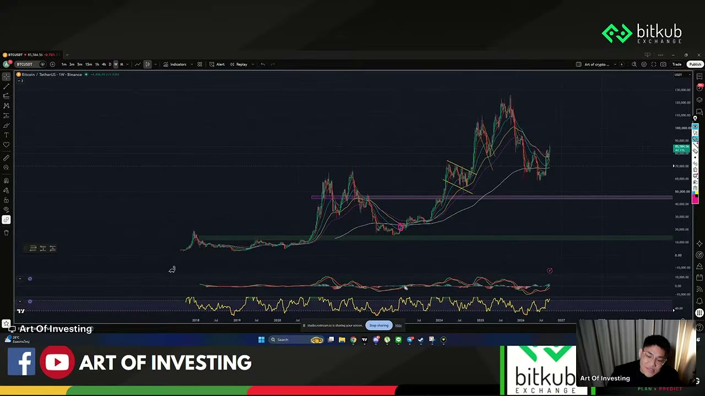

[00:31:37] นะครับ RSI มันoverบอไปและนะครับแล้วก็ ขึ้นมาปุ๊บนะครับตรงนี้เกิดการพีคแล้วทุก คนก็มองว่าโมเมนตัมเกิดแล้วก็คือตรงนี้ เลยนะครับเนี่ย MAD เหนือ 0  RSI  Overb อ่ะตอนเโมเมนตัมเกิดละนะครับแล้วก็ย่อ ก่อนติดซpัพายตรงนี้นะครับเห็นมั้ยแต่มัน ถ้าเกิดนิวโรไม่ได้ย่อลึกอะไรแล้วก็ปึ้ง เกิดอีกรอบนะครับเกิดเป็นเทรนด์ขึ้นมา ฉะนั้นถ้าจะเป็นแบบสวยหรูก็อาจจะเป็นแบบ นี้ก็ได้ถ้าเกิดเกิดการย่อแบบนี้นะครับ ก็ได้ หรืออาจจะย่อนิดเดียวแล้วขึ้นไปเลยก็ได้ นะครับฉะนั้นเนี่ยผมไม่อยากให้ไปพยายามรอ ย่อแล้วเติมของโซนตรงเนี้ยราคาตรงเนี้ยใน มุมมองผมนะเหมาะที่สุดกับการถือรันแล้ว ลุ้นเบรก ไม่ไม่ใช่จุดซื้อของเพิ่มไม่ใช่จุดช็อต ไม่ใช่จุดขายทิ้งก่อนถ้าเป็นบitcoinอ่ะ แต่ทีนี้ถ้าถ้าเป็น outcoin อ่ะ Bitcoin เราเราจบนะครับผมก็อยากให้ดูนิดนึงนะครับ data ก็คือมันจะมีโซนที่เบรคยากอย่างที่ ผมเปิดให้ดูเนาะก็คือ

[00:32:39] อยู่ตรงนี้นะครับก็คือ 90,000 90,000 กับ 100,000 นะครับที่ที่ผมมอง ว่าน่าจะเกิดreีอคtionแล้วก็เบรคเบรกรวด เดียวเนี่ยอาจจะยากอาจจะเกิดอะไรสักอย่าง กุ๊กกิ๊กๆๆแถวนั้นนะครับเพราะว่าหลังจาก นั้นเนี่ยเงินไม่ค่อยมีนะครับเดือนหน้าก็ สูงสุดก็อยู่ที่ 100,000 นะครับแล้วก็ อย่างที่พูดตั้งแต่ต้นไลฟ์คือสัญญาคอหรือ คนในตลาดที่มองว่าราคาทะลุไปฉันถึงจะทำ กำไรได้เนี่ยก็ไม่ได้เพิ่มขึ้นตามนะก็ให้ ระวังตรงนี้นิดนึงนะครับแต่ไม่ใช่จุดช็อต นะในตลาดที่มันเป็นสภาวะโมเมนตัมแบบเนี้ย ผมจะไม่ค่อยช็อตนะครับเพราะว่าเรามันมี แต่ตลาดกำลังจะบูรันถูกป่ะฉะนั้นคุณไป ช็อตมันน่ะผมมองว่าของระบบหรือหรือความ ได้เปรียบในการเทรดมันจะไม่เกิดเท่าไหร่ แบบนี้ฉะนั้นเราณเวลาตอนเนี้ยเราไม่รู้ เลยว่ามันจะไปอย่างนี้เลยมั้ย อ่าอย่างี้มั้ยหรือมันจะเป็นแบบที่เราคาด

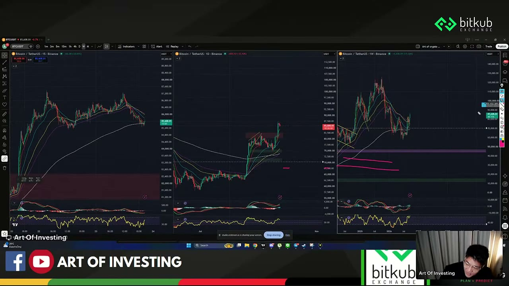

[00:33:40] การณ์กันคือติดแถว 90,000 แถว 100,000 แล้วแล้วย่อมาแป๊บเดียวไม่ให้คนคิดเยอะ ไม่ให้คนตัดสินใจรอดูไซด์เวย์แล้วก็กลับ แล้วก็ค่อยๆขึ้นไปเลยอ่ะอาจจะเป็นอย่าง นี้ก็ได้นะครับนะครับ แบบนี้นะครับ อ่ะโอเคต่อมานะครับก็คือสภาวะของตลาดที่ มันเป็นเรื่องของ Outcoin บ้างแล้วกันสิ่งนึงนะครับก็เรา จะเห็นแล้วเนาะก็คือ Bitcoin  Dominance เนี่ยมันก็ทุบลงมาค่อนข้างรุนแรงเลยนะ ครับในช่วงเอ่อที่ผ่านมานะครับมันก็บ่ง บอกว่าเม็ดเงินเนี่ยมันถูกกระจายออกไปที่ ตลาดอื่นมากขึ้นประมาณนึงสิ่งที่จะจะบ่ง บอกว่าตลาดมีเม็ดเงินไหลเข้าไปที่ altcoin เพิ่มเนี่ยนะครับก็คือ Bitcoin  Dominance ตัว Bitcoin  Dominance เนี่ยนะครับมันจะ ต้องย่อลงนะครับแล้วก็เงินเนี่ยมันต้อง ไหลเข้า Total  2 หรือ Total  3 นะครับ เพราะว่ามันจะบ่งบอกว่าเม็ดเงินเนี่ยมัน ไหลออกจากบitcoinนะครับและมันไหลเข้า Outcoin บางคนอาจจะไม่เข้าใจว่า Total  2

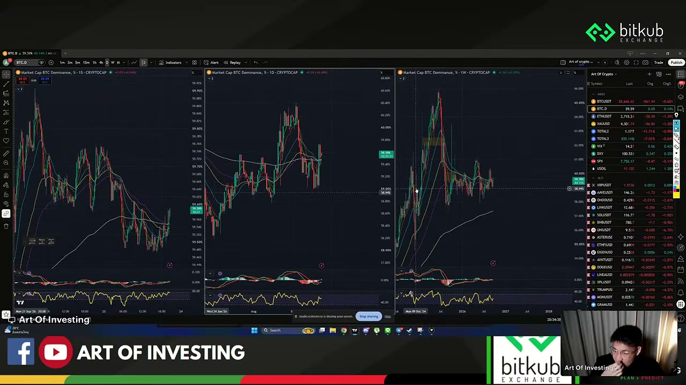

[00:34:41] กับ Total  3 คืออะไร Total  2 คือ รวมทุกเหรียญยกเว้นบitcoinคอย 3 คือรวม ทุกเหรียญยกเว้นบitcoinกับ Etherium นะ ครับฉะนั้นถ้าเงินไหลเข้า Outcoin จริงๆ เนี่ยอ่ะ Total  3 มันจะต้องขึ้นซึ่งเรา ก็จะเห็นว่ามันขึ้นมาพร้อมๆกับมันขึ้นมา พร้อมๆกับเอ่อตลาดนะครับในในกับบitcoinใน ช่วงนั้นนะครับฉะนั้นตอนเนี้ยมันก็ยังมี เม็ดเงินที่ไหลเข้ามาอยู่ใน Outcoin เนี่ยค่อนข้างเยอะประมาณนึงนะครับแต่ว่า มันเป็นเม็ดเงินที่ที่มาพร้อมกับตลาดเนาะ มันยังไม่ใช่เป็นดีมานแท้เพราะว่าวัน เนี้ยที่ผมจะพูดเหรียญเหรียญหลายตัวที่ผม มองว่ามันน่าสนใจอ่ะมันก็คืออยู่ในกลุ่ม ของ RWA หรือว่า Real  World  Asset นั่น แหละนะครับ Real  World  Asset ก็คือ กลุ่มสินทรัพย์บนโลกจริงนะครับทีเนี้ยมัน จะเริ่มมีบางกฎและที่เอาพันธบัตรขึ้นมา launch บนbl็ockchainล่าสุดของ AWAX ก็ launch ขึ้นมาถูกมั้ยครับก็ AAX เอา out perform ตลาดไประเบิดระเบอรไปช่วงนึง แล้วในไม่กี่วันที่ผ่านมานะครับตอนเนี้ย

[00:35:45] มันเลยจะเป็นตีทีมที่เค้าผลักดันแล้วกัน แต่ปัญหาคือณปัจจุบันเนี่ยเม็ดเงินที่เอา ขึ้นมาบนโลกBบlockchainจริงๆอ่ะมันยังไม่ เยอะขนาดนั้นเพราะว่าคุณยังไม่สามารถ กำหนดข้อบริบทครอบคลุมมันได้อย่างชัดเจน ตอนแรกอ่ะคนเขาอยากให้ Clarity  Act กับ Geness  Act ผ่านถูกมั้ยครับแล้วพอมัน เป็นกฎหมายที่ชัดเจนแล้วอันเนี้ยสรุปเป็น สินค้าหรือสินทรัพย์พอกฎหมายมันชัดเจนน่ะ สถาบันน่ะมันจะเอาเงินเข้าไปสู่ตลาดนั้น ได้ง่ายฉะนั้นตอนเcoinอ่ะผมก็เลยมองว่า มันวิ่งเพราะกระแสมากกว่าวิ่งเพราะ real demand ในตัวมันนะครับถ้าเป็นศัพท์ทาง การลงทุนเนี่ยเราจะเรียกมันว่า artificial demand นะครับหรือ demand เทียม นั่นแปลว่าเราเก็รงกำไรกับมันได้แต่ระยะ ยาวเนี่ยเรายังเรายังต้องระวังการ retrace นะครับทีเนี้ยพอผมเห็นภาพรวมมันเป็น อย่างี้นะครับเราก็จะไปดู outcoin ก่อน อย่างสมมุติว่า XRP อย่างี้นะครับอื XR

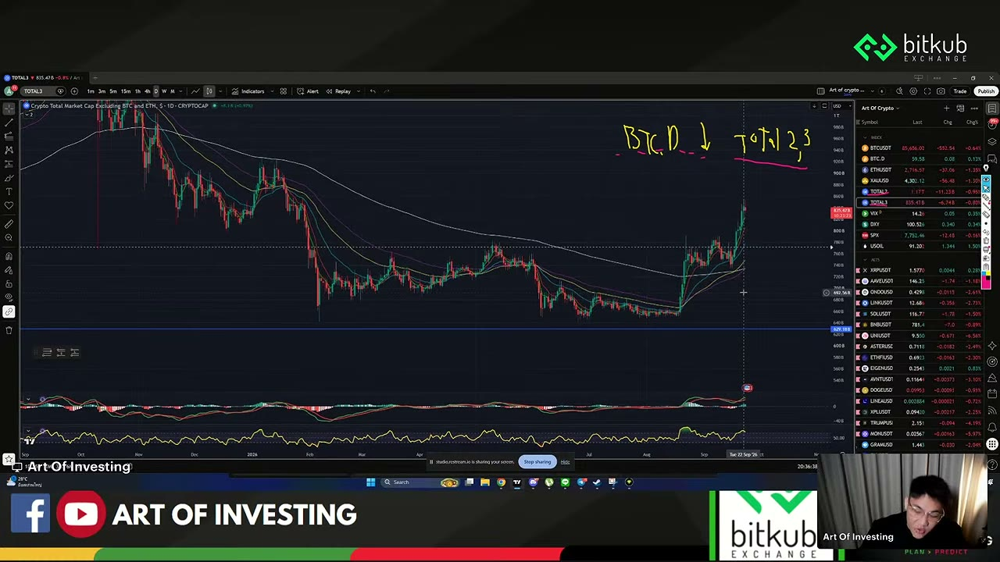

[00:36:45] RP เนี่ยอ่ะตอนแรกผมก็มองมองระยะวันวิ่ง เท่านี้เนาะก็คือแบบเป้าเป้าไกลสุดที่ผม มองว่าอ่ะวิ่งแล้วมันน่าสนใจเนี่ยก็คือ ประมาณนี้นะครับ 2.22.23 23 ตอนแรกที่ที่ผมมองสำหรับ XRP ไว้นะ ครับก็ไอ้อันนี้ก็เป็นอีกหนึ่งตัวที่ผม ถืออยู่นะแต่ว่าผมแบ่ง Take  Profit ไป 20% ละนะครับที่เหลือก็เดี๋ยวลุ้นรันนะ ครับเอ่อ Point มันจะเป็นอย่างี้ มันคือจุดตรงนี้เลยเห็นมั้ยเนี่ยมันมัน คือมันคือจุดตรงนี้เลยเนี่ยแล้วถ้าเราไป ดู Outcoin หลายๆตัวมันเป็นทรงนี้หมดเลย นะครับทรงของการวัดว่าจะเกิดโมเมนตัมใน weคมั้ยดูนะก็คือตรงเนี้ยมันติด EMA  75 ถูกป่ะมันเหมือนกับอะไรรู้มั้ยมันเหมือน กับบitcoinก่อนเบรค 64,000 เดี๋ยวผมจะ เทียบ 2 ภาพให้ดูนะครับว่ามันคือภาพแบบ ไหนอันนี้คือในศาสตร์ของโมเมนตัมนะครับ เนี่ยเราดูอย่างี้ก็ได้เนี่ยเห็นมั้ยมัน ติดอย่างเงี้ยเนี่ยติด EMA  75 ซึ่งเรา ไม่รู้ว่ามันจะเบรคแล้วเกิดโมเมนตัมหรือ

[00:37:46] เปล่านะครับฉะนั้นเรากำไรมาอย่างผมกำไรมา ประมาณ 6,000 ดอนเงี้ย XRP ผมก็ TP  20% โยนออกไปก่อนอีกตัวนึงที่ผม ก็ TP ไป 20% เพราะว่าถ้าเกิดโมเมนตัมมัน เกิดก็คือมันเบรคตรงนี้ Fel นี่ใช่มอ่ะ RSI Bออ่ะโอเคโมเมนตัมเกิดละอาจจะย่อจะ อะไรไม่รู้ผมก็จะวาง Stop  Loss ตรงนี้ละ เพราะโมเมนตัมมันเกิดนะครับแล้วผมก็จะรัน ขึ้นไปถึงประมาณ 2.22.23  23 แต่ตรงเนี้ย ปัญหาคือถ้าโมเมนตัมมันยังไม่เกิดอ่ะมัน ก็มีโอกาสจะย่อลงมาพักตัวให้ได้ก่อนอ่ะ นี้คือ 1 ตัวนะครับ 2 เนี่ยก็คืออ่ะเรา ยังดูอย่างเงี้ยเนี่ยเห็นมั้ยเหมือนกัน หมดเลยนะครับคือมันเป็นจุดที่กำลังจะต้อง นะครับมันเป็นจุดที่กำลังจะต้องวัดว่ามัน จะเบรคหรือเปล่าอย่างที่ผมบอกว่าบitcoin อ่ะผมแฮปปี้ผม enjoy กับการรัน position แล้วลุ้นว่าจะเบรค 90,000 มั้ยจะติด 100,000 มั้ยแล้วแล้วเดี๋ยวเราไปแบ่งแต่ outcoin อ่ะนะครับอย่างที่เรารู้ว่ามัน เป็น artificial  demand หรือ demand เทียมนะครับฉะนั้นเนี่ยผมก็เลยแบ่ง TP ก่อนนะครับในในจุดตรงเนี้ยแล้วแล้วไม่ได้

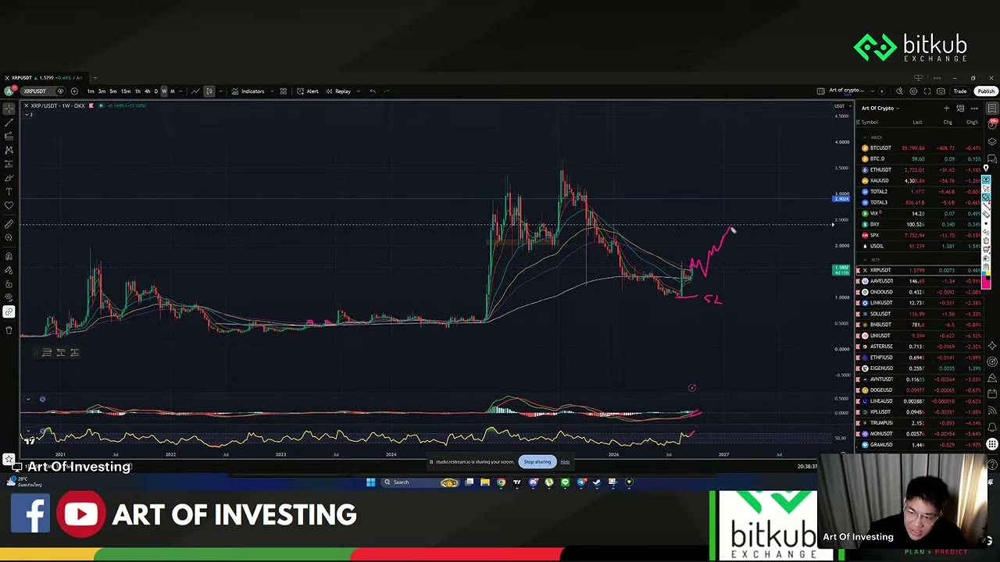

[00:38:46] แบ่งเยอะ อันนี้อีกข้อนึงคือบางคนน่ะจะติดนิสัย เวลาเทรดหรือลงทุนใช่มั้ยบางคนจะติดนิสัย ว่าเฮ้ยเอาไว้ก่อนกำไรอ่ะสมมุติน่ะบวกมา ล้านสมมุตินะเอ้ยโอ้โหเอาไว้ก่อนตั้งล้าน นึงไว้แล้วเดี๋เราค่อยไปเทรดใหม่ทีเนี้ย มันมีอีกเรื่องนึงคือจังหวะครับ และโอกาส คือคุณอย่าลืมว่าคุณไม่สามารถมี Quality Trดหรือการเทรดที่มีคุณภาพได้ทุกวันที่ คุณอยากจะอยากจะมีเช่นจังหวะเนี้ยคุณไม่ สามารถหาจังหวะที่โมเมนตัมมันเพิ่งแบบจ่อ แล้วอาจมีโอกาสจะเกิดแบบเนี้ยได้ทุกวันนะ ครับฉะนั้นคนส่วนใหญ่อ่ะพอ position กำไร มากๆแล้วมันถือไม่ได้มันอยากจะขาย เพราะว่ากลัวกำไรจะหายนะครับอย่างอย่างผม เนี่ยสมมุติว่าเรารันมาแล้วเรากำไรแล้ว อ่ะอย่าง XRP ผมก็มีเนาะที่ผมโพสต์ไปใน เพจนะครับRวอย่างเงี้ยผมก็มีนะครับแต่ว่า วันนี้ก็แบ่งขายไปตัวละ 20% นะครับเพราะ

[00:39:48] ว่าเราไม่รู้จริงๆว่าจะเบรคไม่เบรคอ้าว แล้วทำไมไม่ขายครึ่งนึงอ่ะสมมุตินะสมมุติ ว่าคุณขายครึ่งนึง มันวิ่งไปอีกเท่านึงอ่ะเท่ากับกำไรคุณหาย ไปเท่าไหร่ละนะครับฉะนั้นเนี่ยเวลาจะแบ่ง เนี่ยผมจะแบ่งไม่เยอะนิสัยผมคือเวลาที่ เราถูกทางอ่ะถ้าจะ take  profit ในจังหวะ ที่มันมีความสุ่มเสี่ยงจริงๆอ่ะนะครับผม จะแบ่งน้อย 20%  25 มากสุดอะไรเงี้ยนะ ครับแล้วไปถึงจุดเป้าอ่ะเราค่อยออกเต็ม ก้อนนะครับอ่ะตรงเนี้ย ก็เลยเป็นจุดที่หลายตัวต้องวัดนะครับคำ ถามคือแล้วเดี๋ยวผมจะไปอธิบาย outcoin แต่ละตัวให้ฟังนะแล้วก็แล้วก็ไล่ให้ดูที เนี้ยถามว่าแล้วถ้าไม่ขายมันจะเป็นยังไง มันก็จะเป็นภาพแบบแบบพวกนี้นะครับอ่ะก็ก็ คือแบบแบบตอนนั้นเลยเห็นมั้ย อันเนี้ยคือเหตุการณ์ 10 ตุลาคมเห็นมัน แปลกๆตั้งแต่ตรงนี้ละนะครับย้อนไปเนี่ย ขึ้นไปแล้วมันไม่สามารถเบรคได้เลยแล้วก็

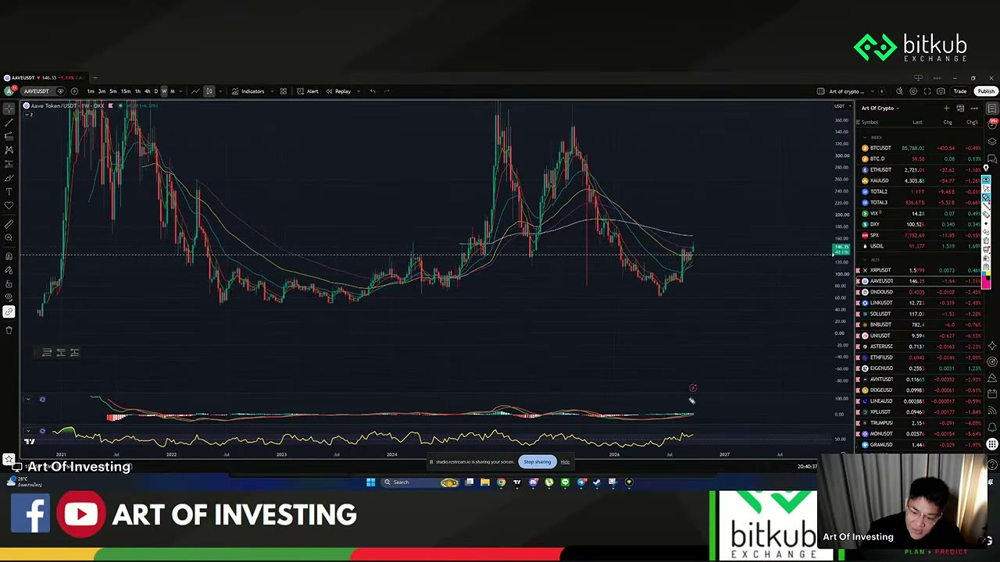

[00:40:49] ทิ้งไปแต่ไส้ไว้นะครับแสดงว่าออเดอร์ขาย เนี่ยมันกองตรงเนี้ยเยอะมากนะครับแล้วสุด ท้ายเนี่ยก็ไม่สามารถเกิดโมเมนตัมในweค ได้ถูกมั้ยไม่สามารถเกิดโมเมนตัมในweคได้ แล้วก็ ดิ่งไป อ่ะอีกตัวนึงที่ตอนนั้นผมเทรดเหมือนกัน คือไenเนี่ยภาพนี้เลยเห็นป่ะเนี่ยคือ เนี่ยติดแล้วมีแต่ไส้ไส้ๆอย่างเงี้ยแล้ว ก็ RSI รีเจectoverบอแกdขึ้นเหนือ 0 ไม่ได้มันก็บ่งบอกว่าเฮ้ยแรงซื้อมานะแต่ โมเมนตัมไม่เกิดพอโมเมนตัมไม่เกิดนะครับ มันก็ทุบซึ่งไม่มีความจำเป็นนะว่าจะต้อง ทุบแล้วจะเกิดนิวลงนิวโรหรืออะไรแต่ว่า ช่วงนั้นน่ะมันเป็นการทุบเพราะว่าเกิด 10 ตุลาคมขึ้นมาพอดีแล้วเงินมันไหลออกจาก ตลาดมันก็เลยจบรอบไปเลยนะครับแต่การที่ โมเมนตัมมันมันไม่เกิดเนี่ยมันมันอาจจะ แค่ย่อก็ได้อย่างี้ถูกป่ะแล้วค่อยขึ้นนะ ครับทีเนี้ยเวลาตัดสินใจผมสอนเลยนะให้คุณ

[00:41:51] น่ะต้องมี data ก่อน อ่ะบางคนเริ่มไม่ถูกคุณอาร์ตแบบบางวัน เนี่ยเฮ้ยผมจะ take  profit กี่ เปอร์เซ็นต์ดีแล้วผมจะไปเก็บของตรงนั้น กี่เปอร์เซ็นต์ดีผมจะขึ้นกี่เปอร์เซ็นต์ ดีที่คุณไม่รู้อ่ะไม่ใช่เพราะว่าคุณไม่ เก่งนะเว้ยแต่ว่าเป็นเพราะว่าคุณน่ะไม่มี data ในมือนะครับคุณไม่มีข้อมูลในมือว่า มันมีกี่เปอร์เซ็นต์ที่จะย่อไปเท่าไหร่ มันจะขึ้นตรงไหนได้บ้างนั่นน่ะคือสิ่งที่ คุณขาดนะครับฉะนั้นภาพในหัวสำหรับผมนะ คุณต้องมี data ก่อนว่าเวลาเกิดอ่ะอ่ะผม ยกตัวอย่างนะยกตัวอย่างสารโมเมนตัมนะยก ตัวอย่างว่ามันเกิดโมเมนตัมในweคเนี่ย มันมีโอกาสกี่เปอร์เซ็นต์ที่จะวิ่งเป็น เทรนด์ขึ้นไปแล้ววิ่งได้ถึงระยะสวิง 2-3 เท่าอ่ะอย่างโมเมนตัมของผมเนี่ยคือ 73% หรือบางตัว 75 ฉะนั้นผมรู้แล้วว่าถ้าเกิด

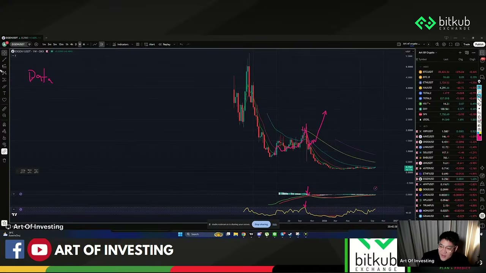

[00:42:54] โมเมนตัมในweคผมต้องรันเพราะว่ามันมี โอกาสแค่ไม่ถึง 30% ที่ position นั้นน่ะมันจะย้อนกลับมา Stop Loss ถ้ามันเกิดเทรนด์ไปแล้วไม่ใช่ว่า ไม่มีโอกาสนะแต่ 73 เนี่ยถือว่าสูงมาก หรือความได้เปรียบของระบบเนี่ยสูงมากที เนี้ยต่อมาคือถ้าเกิดอ่ะเรามีเรื่องเกิดะ ถ้าเกิดไม่เกิด สิ่งที่คุณต้องหา 2 เรื่องระยะย่อ หรือ retrace นะครับกับความน่าจะเป็นที่จะเกิดการย่อใน ระดับลึกเกนั้นกี่เปอร์เซ็นต์ นะครับซึ่งวันเนี้ยคุณมีสิ่งที่เรียกว่า AI เว้ย ถูกป่ะหลักการทำงานนะผมอธิบายง่ายๆเลยซุย ได้ครับผมชอบด้วยนะครับกราฟสวยอ่ะ หลักการทำงานนะผมมองแบบนี้เลยนะครับหลัก

[00:43:54] การทำงานให้คุณหาโมเดลของคุณมาก่อนที่คุณ เข้าใจอย่างลึกว่าทำไมตรงนี้แล้วเกิดการ ทำลายโครงสร้างตรงนี้แล้วหรือโมเดลราคา ย่อมากี่เปอร์เซ็นต์แล้วคุณคิดว่ามันกำไร อ่ะแล้วคุณเอา data ทั้งหมดข้อมูลทั้งหมด ที่คุณมีอ่ะใส่ไปใน AI แล้วให้มันจำไว้ก่อนข้อแรกเอาโมเดลของคุณ ข้อที่ 2 ใส่พวก Open  High  Low  Close เข้าไปนะครับไปหาดาวน์โหลดมันจะมีนะพวก พวกเว็บไซต์ที่มันแจก data เป็นแท่งเทียน น่ะอย่างผมผมก็โหลดของBanceซย้อนหลัง 7 ปียัดไปใน AI ผมมันจะมีมันจะเก็บdata้า ครับกราฟแท่งเทียน 5 นาทีอ่ะ 7 ปีนะครับ ทีนี้ผมก็จะเอาโมเดลผมเนี่ยไปรันผ่านกราฟ แท่งเทียนที่มันมี data ย้อนหลังถูกป่ะ สมัยก่อนน่ะมันทำไม่ง่ายอย่างนี้นะเว้ย สมัยก่อนคือเราต้องเขียน Python หรือว่า เราต้องไป back  test มือเราต้องไปแยกดู ตลาดสมัยนี้มันง่ายขึ้นมากพอไปแบบนี้ เสร็จอ่ะผมก็จะหาแตกออกมา 2 ข้อนี้ที

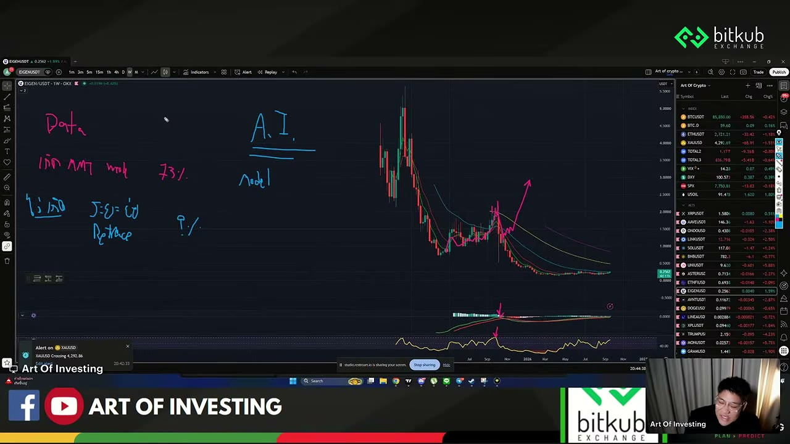

[00:44:57] เนี้ยคุณจะรู้แล้วว่าถ้าเกิดมันไม่เกิด ตรงนั้นน่ะมันกี่เปอร์เซ็นต์แล้วมันคุ้ม ค่าที่คุณจะวัดหรือเปล่าอย่างเงี้ยอ่ะผม ยกตัวอย่างเงี้ยมันเห็นภาพถูกป่ะเฮ้ยคุณ คุณอาร์ตแบ่ง TP ทำไมวะนี่ไงเห็นเลยอ๋อ Weekคมันจะจ่อเกิดโมเมนตัมเว้ยถ้าเกิด เนี่ย 73% ที่มันจะวิ่งเป็นเทรนด์แล้ว เบรคไปเลยแต่ถ้าไม่เกิดเนี่ยมันมีโอกาส ย่อแรงมีครับมีมีตัว out คอยที่ผมคัดมามี มีโอกาสย่อแรงงั้นตรงเนี้ยจ่อๆแล้วเนี่ย แล้วราคาเนี่ยเราก็เห็น data  OI แถว 90,000 แถว 100,000 เออมันเบรคยากงั้น เรากำไรมาเยอะและทำกำไรก่อน 20% อ่ามันจะเป็นภาพนี้แต่ถ้ามันเฮ้ยคุณอาร์ต อันนี้เคสไม่เกิดโมเมนตัมและแล้วเคสเวลา เกิดโมเมนตัมเป็นไงครับโอเคเป็นอย่างงี้ นี่ไงหนุ่มดูนะรอบนี้รีเจคถูกป่ะขึ้น เหนือ 0 ไม่ได้ RSI  Overb ไม่ได้รอบนี้

[00:45:58] ขึ้นได้แล้ว RSI overบอเหนือ 0 แล้วเวลา เป็นอย่างเงี้นะครับอยากให้ผมบอกว่าถ้า เกิดเกิดโมเมนตัมในweคอ่ะโอกาส 73% ที่มันจะไม่ย้อนกลับมา Stop  Loss แล้ว เกิดเป็นเทรนด์ นะครับฉะนั้นถ้าเกิดมันเกิดภาพนั้นน่ะ โอเคผมรู้แล้วว่าโคตรได้เปรียบละในการรัน outcoin นะครับแต่ตอนนี้มันยังไม่เกิด มันคือภาพว่าตรงเนี้ยมึงเอาข้อไหน 1 หรือ เพราะ Global  Liquidity ก็ถึงหาลง พฤศจิกายนมี Midterm  Elction  Data  OI เฮ้ย 90,000 กับ 100,000 ไม่มีใครวาง data หลังจากนั้นเลยไม่มีใครวางคactหลัง จากนั้นเลยนะครับฉะนั้นตรงเนี้ยผมก็เลย มองว่าโอเคถ้ามันก้ำกึ่งอย่างเงี้ยขอกำไร ก่อนตัวไหนกำไร 200,000 ขอสัก 50,000 ก่อนได้มั้ยขอสัก 40,000 ก่อนได้มั้ยแล้ว ที่เหลือปล่อยรันตั้ง Stop  Loss ไว้ข้าง นะครับนี่คือนิสัยเ้าคุณอาร์แล้วแล้วมัน จะมีจังหวะที่คุณอาร์ตถือไปเลยมั้ยมีก็ คือมาแล้วไม่วัดไงขึ้นไปเลยอย่าง เงี้ยอ่ะโอเคเราก็ถืออย่างสบายใจก็รันไป

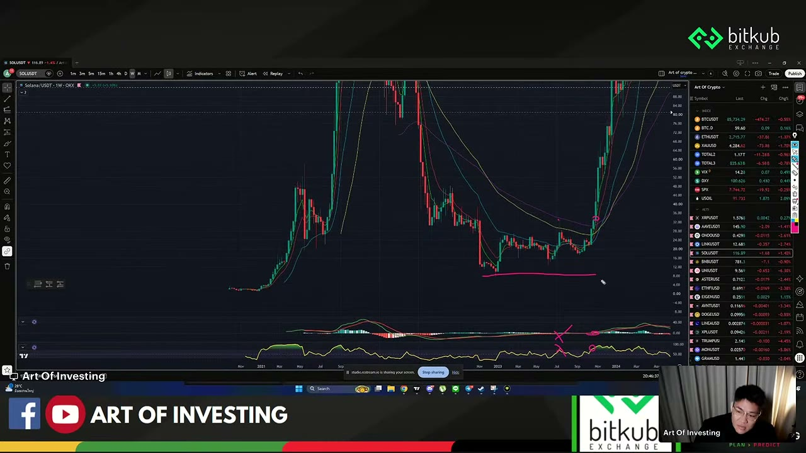

[00:46:59] นะครับทีเนี้ยพอคุณมีdata้าในมือว่าแบบ เอ้ยถ้าเกิดกราฟหน้าตาแบบนี้แรง push หน้าตาแบบนี้โอกาส 55% เว้ยที่จะวิ่งถึง TP โอกาส 60% เว้ยโอกาสอันนี้ 82% เว้ย แต่ปีนึงเกิดแค่ 3 ครั้งอะไรอย่างเงี้ย คุณก็จะมีความกล้าละที่จะกดนึกออกป่ะแบบ เฮ้ยจังหวะนี้ต้องกดว่ะเฮ้ยจังหวะนี้ ต้องถือแต่สาเหตุที่คุณกลัวหรือ กังวลน่ะเป็นเพราะคุณไม่มีdata้าไม่ใช่ คุณไม่เก่งผมบอกเลยนะไม่ใช่คุณไม่เก่งทุก คนสามารถเก่งได้แล้วไม่ต้องไปเสีย เวลาแบบ 10 กว่าปีแบบผมด้วยอ่ะคุณแค่ต้อง มีdata้าในมือนะครับมันถึงจะมีความมั่นใจ เหมือนคุณทำไมคุณถึงมั่นใจว่าขับรถไปทาง นี้แล้วเดี๋ยวมันจะถึงก็คุณมี GPS ก็คุณ มีแผนที่ไงนึกออกมั้ยแต่อันเนี้ยมัน เหมือนเดาอ่ะมันเหมือนกับคุณขับถนนที่คุณ ไม่เคยขับครับคุณไม่มีแผนที่คุณไม่มี GPS คุณทำได้แค่ถามทางคนข้างทางพี่ครับขับตรง

[00:48:01] ไปนี่ถึงมั้ยพี่ครับเลี้ยวได้มั้ฉะนั้น ถ้าคุณมีdata้าคุณจะมั่นใจกฎถามว่าโอกาส โดนไปมั้ยมีดิแต่ว่าถ้าเกิดเปอร์เซ็นต์ มันสูงกว่าคุณจะรู้ว่าทำท่าเนี้ยซ้ำๆเดี๋ พอร์ตจะกลับมาบวกนะครับอืก็อยากให้ดู ตรงเนี้ยอันเนี้ยคือสิ่งที่เรียกว่า age ของระบบอ่ะงั้นเข้าใจแล้วเนาะว่าทำไมผม ถึงแบ่ง Take  Profit  Outcoin คอยไปแล้ว บ้างทีเนี้ยเราจะมาดูกลุ่มนะที่ที่ผมคัด มาโอ้โหนี่ผมแจกการบ้านเลยนะ ครับผมก็บอกนักเรียนไปตั้งแต่ก้นๆแล้ว แหละ[เสียงหัวเราะ]นะครับอาเวเนี่ยผมก็ บอกนักเรียนไปตั้งแต่ตั้งแต่ตรงนี้นะครับ เนี่ย 100  120 นะครับเนี่ยก็เดี๋ยวผม เดี๋ยวผมเอาหลักฐานให้ดูนะครับก็ผมคอกัน ไป inj อะไรเงี้ยแต่ถามว่าเรารู้มั้ยเรา ไม่รู้นะครับผมแค่มองว่าตอนมันเบรคไปตรง เนี้ยเออมันมักจะกลับมารีทest EMA  25 กี่เปอร์เซ็นต์เป็นเราก็มีdata้าในมือถูก ป่ะผมก็มีอ่ะ่ะอันเนี้ยถ้ามันเกิดตรง เนี้ยแล้วย่อมาตรงเนี้ยกี่เปอร์เซ็นต์ที่ มันจะกลับขึ้นไปแล้วย่อมาจริงๆตรงนี้

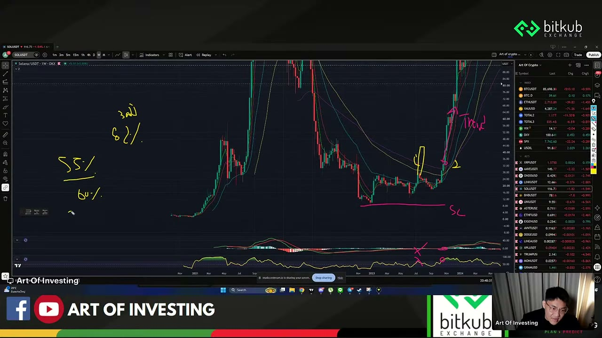

[00:49:01] ก็ได้ของแต่ตัวที่ผมพลาดเนี่ยคือยูิ ไม่ย่อเหมือนกันเลยเห็นป่ะท่าเดียวกันเลย คุณดูนะถ้าผมทำอย่างเงี้ย ท่าเดียวกันเลยผมก็รอเหมือนกันผมก็ แบบเฮ้ยผมโคตรอยากได้เลยอาเวกับยูิเว้ย ถ้าลงมาตรงเนี้ยผมอยากได้สรุปลงมายูิไม่ ลงเห็นมั้ยคุณมีdata้าทุกอย่างจบ ไม่ต้องเกิดตลอดก็ได้แต่คุณจะมี เปอร์เซ็นต์น่ะอ้าว่าถ้าวาง stop ตรง เนี้ยเฮ้ยกี่เปอร์เซ็นต์เองวะที่ค่าจะโดน หรือถ้ามันขึ้นมาเทสตรงเนี้ยแล้วมันไม่ ผ่านในรอบแรกอ่ะมันมีโอกาสกี่เปอร์เซ็นต์ ที่จะออกมารีเทสในจุดจุดไหนบ้างคำถามคือ เฮ้ยคุณอาร์ตแล้วทำไมคุณอาร์ตมองแบบนั้น ก็นี่ไงเห็นป่ะมันติดมันก็ลงมา 25 นี่ไง เราก็ได้ของแล้วเราก็ stop นี้เนี่ยคือพอ มี data ทุกอย่างจบแต่ถ้าไม่กลับมาแล้ว มันเบรคไปเลยก็ต้องปล่อยครับคุณก็ต้องไป หา data ตัวอื่นะว่ามันจะย่อลงมากี่ เปอร์เซ็นต์ซึ่ง data ในมือผมที่เป็นสาย โมเมนตัมอ่ะท่าเนี้ยไม่มี

[00:50:02] สำหรับคนยังไม่มีของไม่ได้ไม่ได้บอกว่า มันจะไม่ย่อไม่ได้บอกว่ามันจะไม่ขึ้นต่อ แต่ไม่มีจุดได้เปรียบที่เกิน 50% อ่ะสมมุติว่ามันเหมือนคุณเดินเข้าบ่อน แล้วแล้วคุณจะไป แทงอ่ะแล้วเขาบอกว่าเกมเนี้ยโอกาสชนะคุณ แค่ 30% อ่ะมันก็ไม่น่าเล่นถูกมั้ยงั้นผม ก็ย้ายย้ายโต๊ะดีกว่าเฮ้ยโต๊ะนี้โอกาส เท่าไหร่ 65 โต๊ะนี้ 57 ก็ยังดีกว่า ต่ำกว่า 50 เราก็ไปเวรนั้นนะครับอ่ะที เนี้ยเอาเอาแต่ละตัวที่ผมมองว่ามีโอกาส ที่จะได้รับsectตอร์กระแสจากตรงนี้ก่อนนะ ครับตัวแรกเนี่ยผมมองอโดนะครับแต่อโด เนี่ยอ่ะตอนแรกผมก็มองมองไว้ตรงนี้เห็น มั้ยอโดเนี่ยมันจะมันจะกลับมารีทestแล้ว แต่อดเนี่ยมีเรื่องน่ากังวลนะเว้ยอ่ะผม เอาตรงนี้ออกก่อนจะจะได้ไม่ate ถ้ามันเหมือนไenมากเลยในจังหวะที่มันไม่ เกิดโมเมนตัมส่งต่ออ่ะดูตรงนี้นะเราดูไen นะเนี่ยภาพนี้เลยนะครับเนี่ยภาพนี้เลยนะ

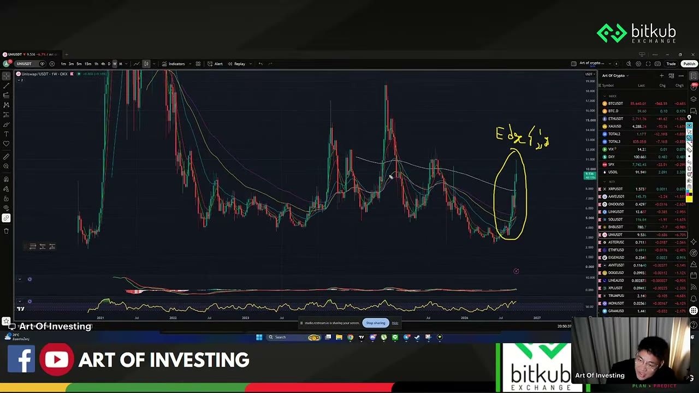

[00:51:05] ครับอย่างี้เลยประมาณนี้เลยนะครับตอน เนี้ยมันคือกำลังวัดแล้วว่าโมเมนตัมอ่ะ มันจะส่งต่อถึงweคหรือเปล่าเห็นนี้ป่ะ งั้นถ้าผมมาดูออนโดตรงนี้เห็นมั้ย เหมือนเลยนะครับฉะนั้นน่ะสิ่งที่คุณ ต้องการจะให้มันเกิดขึ้นน่ะคือตรงเนี้ย มันเป็นกล่องequilิบumถูกป่ะคือ balance zone ยังไม่ยังไม่ย่อมาเนี่ยไม่อยากให้ หลุดกลางกล่องแล้วควรจะเบรคหรือเบรคไปเลย ได้ยิ่งดีนะครับอadเนี่ยเา้าเป็นตัวแรกๆ เลยที่ทำผลตอบแทนในรูปแบบ Real  World ก่อนเลยนะครับที่ทำเรื่องผลตอบแทนคล้าย กับรูปแบบ Borel หรือพันธบัตรนะครับโดย ปัจจุบันเนี่ยอโดเนี่ยเค้ามีหุ้น ที่เป็นสินทรัพย์สังเคราะห์ละหรือ Synthetic  Asset เช่น Apple  on เนี่ย [เสียงสูดหายใจ]นะครับโดยหลักการของเค้า อ่ะก็คือถ้าเกิดคุณอยากจะซื้อหุ้นแต่ว่า

[00:52:06] จะถือบน Blockchain นะครับคุณก็แค่เอา Stable  Coin ไปซื้อทีเนี้ยพอคุณเอา Stable  Coin ไปซื้อปุ๊บตัวโปรเจect onAD เนี่ยเขาก็จะเอาเงินของเขาในกรองกลางชary ไปซื้อหุ้น Apple จริงๆเนี่ยเก็บไว้แล้ว เค้าก็จะมิ้นเหรียญตรงเนี้ยออกมาฉะนั้น ตรงเนี้ยก็เข้าข่าย Real  Asset มีเรื่อง สต๊อกมีผลตอบแทนคล้ายกับบอยผมก็เลยมองว่า อ่ะตัวเนี้ยเออน่าสนใจนะถ้าเกิดโมเมนตัม เนี่ยมันมันเกิดขึ้นสำเร็จนะครับก็ถ้า เกิดมันเกิดขึ้นสำเร็จก็คือโอกาสมันมีแค่ ต่ำกว่า 30% แล้วที่มันจะมาย่ำโลตรงนี้นะ ครับถ้าเกิดโมเมนตัมมันเกิดขึ้นสำเร็จ แล้วก็วิ่ง 1:2 ก็มีโอกาสนะครับฉะนั้นถ้า เกิดวัดระยะ 1:2 อ่ะเอา 1:2  2 เนาะก็ถ้า เกิดเกิดตรงนี้[เสียงสูดหายใจ] อ่ะก็คือตรงนี้มีโอกาสที่จะถึงนะครับก็ อย่างอย่างแย่ก็คือ 1:1 เนาะก็คือ 0.71 71 ในภาพใหญ่ซึ่งการที่เรามีระยะของภาพ ใหญ่อ่ะมันไม่จำเป็นว่าเราต้องเข้าแค่ภาพ ใหญ่นึกออกใช่มั้ยเราสามารถไปย่อยภาพเล็ก

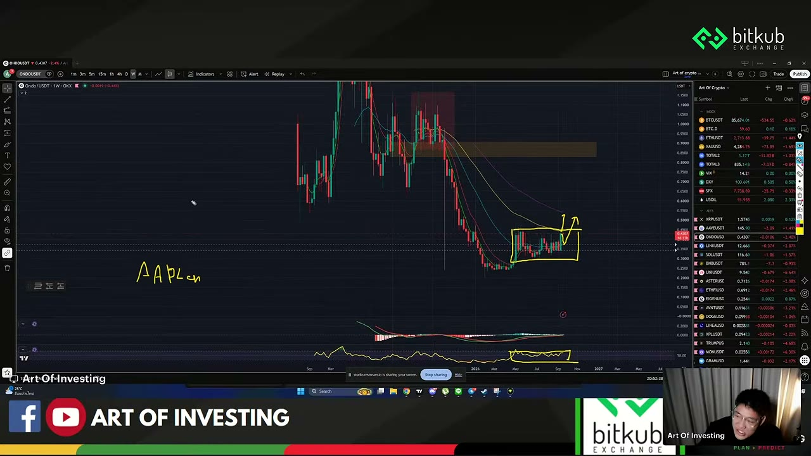

[00:53:08] แล้วใครมีความรู้ศาสตร์ไหนคุณก็เอาศาสตร์ นั้นเข้าไปได้แต่อันเนี้ยมันเป็นแค่ตัว ยืนยันนะว่า 73% คือถ้าเกิดมันเกิด โมเมนตัมในweคเนี่ยมันจะไม่กลับมา stop loss ที่ low  low ล่าสุดนะครับแล้วที่ เหลือคุณก็ไปตีลังกาเอาคุณจะมีความรู้ ศาสตร์ไหนคุณก็แอดเข้าไปอ่ะตัวแรกที่ผม มองนะก็คือมันได้กระแสจาก Real  World Asset นะครับต่อมาก็คือลิงก์เรารู้อยู่ แล้วเทคเทคโนโลยี Oracle นะครับมัน ไม่มีอะไรที่ลิงก์มันจะมีไม่มีโอกาสวิ่ง เลยในจังหวะเนี้ยผมลิงก์เนี่ยเป็นตัว อันดับต้นๆที่ผมชอบเลยเป็นตัวเทคโนโลยี Oracle นะครับนำส่ง API ระหว่างโลกจริง ขึ้นไปบน Blockchain เอา API จากโลก Blockchain ออกมาบนโลกจริงนะครับฉะนั้น การเทียบราคาหุ้นเทียบราคาทรัพย์บนโลก จริงการตึงราคามันใช้เทคโนโลยี Oracle ของShลinkนะครับฉะนั้นShลinkเนี่ยมันมี เรื่อง Lineer  Execution อะไรอีก Parel เราไม่ต้องคุยกันลึกขนาดนั้นเอาเป็นง่ายๆ อ่ะอ่ะก็คือเทคโนโลยีเค้าอ่ะตึงข้อมูลบน โลกจริงกับบนโลก Blockchain ได้ส่ง API ไปมาเข้าหากันได้นะครับ Technology

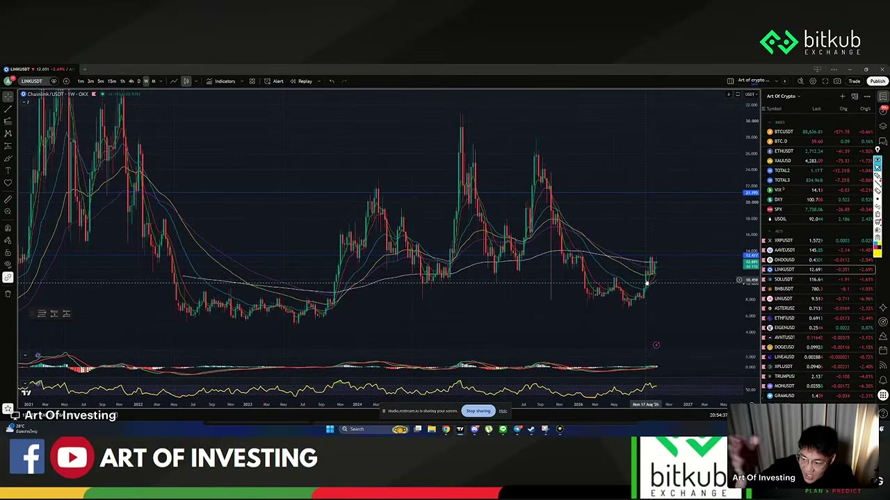

[00:54:10] Oracle เนี่ยผมก็เลยมองว่าโอเค 1  week เบรคพรีเมี่มมาละนะครับแล้วก็โมเมนตัม เนี่ยใกล้จะจ่อะเกิดขึ้นเต็มทีะนะครับตัว นี้ก็ทรงคล้ายๆกับRวเนาะซึ่งมันเบรคมา แล้วตัวเผมไม่ได้ของเหมือนกันเห็นมั้ยผม ตั้งแจ้งเตือนไว้ตรงนี้ลงมาไม่ถึงนะ ครับฉะนั้นตัวไหนได้ของผมก็อัดอัดเงิน เข้าไปตัวไหนไม่ได้ผมก็ไปรอจังหวะอื่น เพราะว่าสิ่งที่ผมต้องการน่ะคือท่า เห็นป่ะเนี่ยคือเวลาคุณมี data ในมือ เนี่ยผมแค่อยากจะแสดงให้คุณเห็นเว้ยว่า เวลาผมเทรดหรือผมลงทุนน่ะผมมีตัวเลขตลอด แล้วมันทำให้เรากล้านึกออกมั้ยอ่ะเฮ้ยคุณ อาร์ตโอ้โหเบรคไปแล้วสวยด้วยงั้นอยากเติม ของ่ะอ่ะงั้นผมก็มีdata้านิดนึงว่ามันมี กี่เปอร์เซ็นต์ที่มันจะน่าจะย่อมาเกิดค่า นี้นึกออกป่ะงั้นผมก็อ่ะกูก็ลองรอตรงนี้ อ้าวไม่มาไม่เป็นไรตัวอื่นมาเราได้ของตัว อื่นนะครับเนี่ยอ่ะก็เป็นลิงก์อีกตัวนึง นะครับที่ผมมองว่าถ้าโมเมนตัมมันเกิด เนี่ยเออก็มีโอกาสวิ่งะต่ำๆผมก็มองว่า

[00:55:11] ลิงก์นะควรจะถึง 18.4 นะครับถ้าถ้าโมเมนตัมในweคเกิด เนี่ยต่ำๆลิงก์เนี่ยก็ควรควรจะถึง 18.4  4 นะครับ[เสียงสูดหายใจ]อีกตัวที่ผมสนใจนะ ครับก็ H เหมือนกัน H  bar  H เป็นพูดได้ ดีครับในแชทเป็นอีกตัวที่ผมมองว่ากราฟสวย แล้วก็ เกี่ยวข้องกับ Real  Waret นะครับคือ เค้ามีระบบเปลี่ยนจากสินทรัพย์จริงเป็น Token ให้คุณได้โดยที่ไม่จำเป็นต้องเป็น หุ้นเท่านั้นไม่จำเป็นต้องเป็นอะไรเท่า นั้นให้นึกภาพว่าสมมุติว่าผมมีคอนโดอย่าง เงี้ยแล้วผมอยากระดมทุนให้แตกพาออกมาใครๆ ก็ลงทุนกับผมได้อย่างเงี้ยผมก็เอาเอกสาร เอาอะไรทุกอย่างไปใช้เครื่องมือของ H ขึ้นมากลายเป็นเหรียญเหรียญนึงแล้วผมก็ แจกเหรียญนี้ให้กับผู้ถือหุ้นให้คุณ สามารถซื้อขายมีกองกลางได้เค้าเป็น เครื่องแปลงสินทรัพย์ในโลกจริงขึ้นไปได้

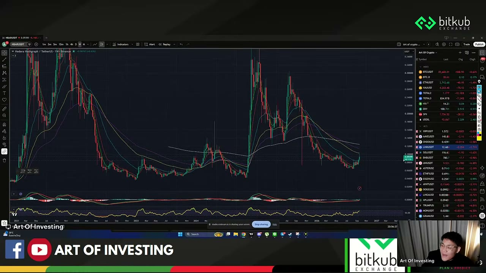

[00:56:11] นะฉะนั้นตอนเนี้ยผมก็มองว่าพรีเมี่มเนี่ย มันจ่อแล้วนะครับถ้าเบรกอ่ะเป้าแรกอ่ะมัน จะเป็นเหมือนอาวกับ U ก่อนวิ่งนะครับก็ คือถ้าเกิดเบรคเนี่ยจุดแรกมันก็จะไปแถว เนี้ยแถว EMA  75 หรือ 200 แล้วย่อ 1 จังหวะแล้วถ้าโมเมนตัมเกิดค่อยเบรคไปถึง โซนที่ 2 นะครับฉะนั้น Hun เนี่ยผมก็มอง 2 จุดนะครับ 0 จุด 0.1 ปลายๆอ่ะประมาณตรง นี้ก่อน 0.117 นะครับกับอีกทีนึงผมก็มอง นู่นเลยก็ประมาณ 0.175  175 นะครับ 2 ตัว 2 จุด นะครับถ้าโมเมนตัมตรงนี้มันเกิดซึ่งตรง เนี้ยต้องห้ามหลุดแล้วนะครับเพราะว่า อย่างเงี้ยอ่ะอันเนี้ยอันเนี้คือคำว่า โมเมนตัมเกิดนะครับอย่างเงี้ยสมมุตินะอ่ะ เราเราดูตรงนี้เลยนะ MacD  0  RSI overbard วาง Stop  Loss ตรงเนี้ยมันโดน เนี่ยคือคำว่า 75% นะครับเนี่ยคือคำว่าเอ่อของไม่ใช่ 73%

[00:57:11] มันเป็นมันเป็น data ที่มีอ่ะสมมุติว่าผม มี data  73% แล้วผมรู้ว่ามันมีโอกาสแค่ประมาณ 27-30% ที่ผมจะโดน Stop  Loss อ่ะถ้าวางโมเดล แล้วอ่ะเราก็กล้าถือเราจะไม่ใจสันว่าแบบ เฮ้ยถึงตรงนี้เดี๋ยวขายทิ้งดีกว่าเฮ้ยถึง ตรงนี้เดี๋กูเอาออกเอ้ยเดี๋ถึงตรงนี้ซื้อ ของใหม่มันจะรวนเพราะคุณไม่รู้ว่าโอกาส ที่ขึ้นตรงนั้นน่ะมันมีเท่าไหร่นะครับ ฉะนั้นตรงเนี้ย data มันบอกและเนี่ยผมอ่ะ ลิมิต AI อ่ะผมยังแคปให้นักเรียนผมดูเลย นะผมทำรีเสิร์ชเสร็จ 2 อันหมด ลิมิตอีกะผมทำรีเมรีเสิร์ชเสร็จอีกอันนึง ติดลิมิ Token อีกะนะครับคือแบบโอ้โห Token เปลืองมากเดือนนึงแต่ว่าก็ก็คุ้ม แหละนะครับกับการที่แบบมันทำลิสต์ทุก อย่างขึ้นมาแล้วเราเห็นเป็นตัวเลขอ่ะผม ว่ามันมันดีมากๆนะอ่ะฉะนั้นตรงเนี้ยก็ เป็นก็เป็นอีกตัวนึงนะครับที่ผมมองว่าเออ สวยนะครับ H  bar เกี่ยวกับอ่ะเอาเป็น กลุ่มSectตorเกี่ยวกับ Real  World  Asset ก่อนเนาะที่ผมมองนะครับต่อมาก็Aวนี่แหละ ชอบมากแต่เอ้ยไม่ย่อพ่อมานะครับ ฉะนั้นอาเวเนี่ยก็ใกล้เกิดและอีกนิดนึงก็

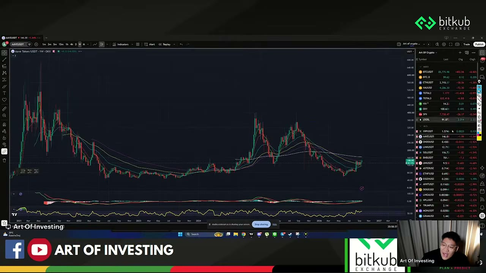

[00:58:13] จะเกิดโมเมนตัมแล้วนะครับถ้าเกิดก็สopมัน ก็จะไกลหน่อยเนาะตัวไหนที่มันออกตัวไปแรง ก่อนหน้าแล้วสopมันก็จะไกลหน่อยนะครับถ้า มันเกิดโมเมนตัมนะผมก็มองว่าประมาณนี้ ก่อนเป้าแรก นะครับประมาณเนี้ย 211 ถ้าวิ่งบ้าๆหน่อย ก็นู่นเลย 285 นี่ผมคัดไคุณปกติผมให้แค่เฉพาะนักเรียน เท่านั้นนะครับเพราะว่าแต่ว่าผมไม่ได้สอน มาปีนึงและก็อย่างที่รู้นะครับว่าผมทำ ธุรกิจของนึงที่ขายใน TikTok อ่ะใครที่ ติดตามก็น่าจะเห็นที่ผมโพสต์ลงเพจกันบ้าง นะครับก็เป็นนั่นน่ะก็อาจจะวุ่นหน่อยนะ ครับเป็นเครื่องหอมเนาะ จารยมีเหรียญไหนน่าถือยาว 2-3 ปีนอกจาก บitคinสำหรับผมไม่มีเลยครับอืผมไม่มีเลย ครับถ้าถือยาว 2-3 ปีนอกจากบitcoinผมไม่ มีเลย ผมเปิดลองMutจอร์ของ BCH มาตอนนี้ราคามัน

[00:59:13] ขึ้นมาเหนือ Er แล้วเอาไงต่อดีครับอ่ะ เดี๋ยวลองดูครับเอ่อ เพิ่งดูจาน A เมื่อกี้อเดอร์ flow อ๋อใช่ จาน A แกพูดไปแล้วใช่มั้ยวันนี้สวัสดี ครับแต่อันนั้นมันจะเป็นเรื่องของอordเดอ Flow เนาะอันนี้เป็นเรื่องของ Stop  Loss ใช่แต่มันมันทำงานคล้ายกันก็คือออเดอร์ มันวางแล้วยกออกได้เอ่อเอ่อสวัสดีครับ อาจารย์อาร์ตช่วงนี้ตลาดไฮปมากมีแต่คนมอง ขึ้นแบบนี้อ่ะโอเคก็ตอบไปในข้อมูลแล้ว เนาะทั้งกราฟทั้งอะไรโอเค OI ทองดูยังไง ครับ OI ดูเว็บ CME ครับนะครับผมแนะนำนะ ก็คือแบบผมเป็นคนอย่างี้เว้ยเวลาที่ผม ได้รับสารหรือความรู้อะไรมาจากใครอ่ะผมจะ ไม่ชอบเอามาสอนเหมือนผมรู้เองนะครับก็ถ้า เกิด OI ทองเนี่ยเดี๋ยวเราดูเพจจาน M กับ จาน A ก็ได้นะครับเ้าเป็นฝาแฝดนะที่เป็น ที่คนนึงเป็นผู้บริหารกองทุนมา 9 ปีแล้ว กองทุนในไทยนะไม่ใช่กองทุนแบบ FTMO เขต แล้วแบ่งกำไรนะกองทุนแบบจดหลักทรัพย์ใน ไทยอ่ะแบบดูแลนักเงินนักลงทุนในไทยเค้า บริหารมา 9 ปีแล้วนะครับแล้วพอร์ตที่เค้า

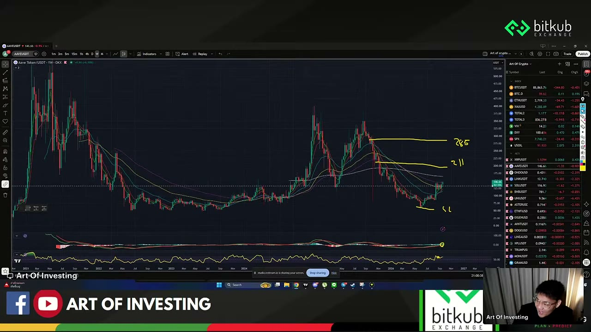

[01:00:14] บริหารน่ะกองของเค้าอ่ะมัน 10 หลักนะครับ ฉะนั้นน่ะผมแนะนำถ้าจะดูoายทองอ่ะไปดู อาจารย์ A กับอาจารย์ M คนนึงเป็น เทรดเดอร์กองทุนมาก่อนอีกคนนึงเป็นผู้ บริหารกองทุนนะครับคือบุคลิกเาอาจจะดู ธรรมดาตลกๆแต่ 2 คนเนี้ยคือแบบ 1 ในนั้น น่ะก็เป็นเทรดเดอร์ให้กองทุนอีกคนนึงเป็น ผู้บริหารกองทุนมา 9 ปีแล้วอ่ะนะครับเออ ทีเนี้ยผมสามารถเอาขึ้นกราฟได้เลยเฮ้ยนี่ นะครับ OI ดูอย่างงู้นอย่างงี้แต่ผมโตมา เราได้ความรู้อะไรมาจากใครอ่ะผมไม่ชอบเอา มาสอนเหมือนเป็นความรู้ตัวเองนะผมว่ามัน ไม่ดีเหมือนกับสมมุติว่าผมอ่ะผมมั่นใจว่า ผมพูดเรื่องโมเมนตัมคนแรกๆเลยอ่ะในตลาด คริปโตนะถ้าในตลาดหุ้นน่ะผมว่าคนใช้ โมเมนตัมอ่ะมีประมาณนึงแต่คริปโตผมกล้า พูดพูดผมพูดแรกๆอ่ะถ้าสมมุติว่าอยู่ๆผม เปิดไปแล้วแบบอุยไอ้พูดเหมือนกู เลยแบบเป๊ะเลยอย่างเงี้ยเราก็คงไม่รู้สึก ดีเท่าไหร่นึกนึกออกใช่มั้ยคุณพิเราก็เออ ๆก็คล้ายกันเนาะอะไรอย่างเงี้ยหรือ

[01:01:15] บางคำอ่ะมันเป็นศัพท์ที่เราคิดเองเพราะ ว่าเราอยากจะพูดให้เข้าใจมันง่ายอย่าง discากับprีemiumอ่ะเขาไม่ใช้กันแต่ผมเอา มาใช้อย่างเงี้ยเออฉะนั้นน่ะผมแนะนำนะถ้า เกิดจะดูเรื่องทองคำอ่ะไปเพจ นะครับ หรือถ้ามีโอกาสเดี๋ยวผมเชิญแกมาไลฟ์คู่ อีกนะครับอ่ะเดี๋ยวๆผมดูเหรียญที่ผมคิด ว่าน่าสนใจเสร็จแล้วอ่ะเดี๋ยวผมไปไล่ไล่ ดูเหรียญที่แต่ละคนขอให้นะครับไวๆแบบไวๆ นะครับยูิไปแล้วอ่ะอีกตัวนึงก็ก็ยูิ ยูิเนี่ยเอ้ยเห็นแล้วเศร้าไม่ได้ของนะ ครับอ่ะแต่โมเมนตัมมันเกิดและนะครับ โมเมนตัมมันเกิดและนะครับอยู่นี้เนี่ย ฉะนั้นน่ะ Stop  Loss อยู่ตรงเนี้ยก็มี โอกาสแค่ต่ำกว่า 30% ที่มันจะวกกลับมานะ ครับแต่ว่าถึงเป้าหรือยังโอเคผมว่าถึงะพอ ดีเลยเป้าแรกของยูินะครับผมมองว่าถึงะก็ คือแถว 10 ดอน 10 ดอนเนี่ยเป้าแรกแล้วนะ ครับอีกเป้านึงที่ผมเชื่อว่าผ่านได้ยาก เลยนะก็คือแถว 14.9 นะครับมันจะมีตรง

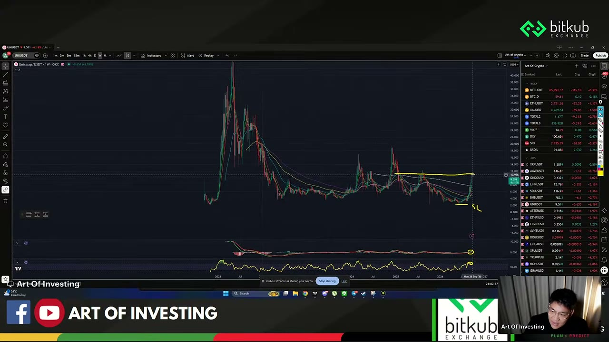

[01:02:17] เนี้ยอืม อ่ะนะครับเป็นเป็น 14.9  9 ที่ผมมองว่า ผ่านได้ยากวิธีนะครับก็คือเวลาที่เราเห็น ตัวที่โมเมนตัมมันเกิดแล้วแล้วเราจะดู day นะครับอย่างงี้อ่ะเห็นมั้ย อย่างสมมุติอย่างเงี้ยถ้าเกิดเราเห็นแล้ว ว่า discount มันคือ EMA  25 อย่างเงี้ย นะครับก็ถ้ามันไม่หลุด 25 เนี่ยมันก็มี โอกาสจะรันขึ้นไปเรื่อยในจังหวะที่มันโฟ อ่ะนะครับเราก็สามารถดูย้อนหลังได้อย่าง งี้อ่ะ เนี่ยอย่างงี้เวลามันเกิดเทรนด์น่ะเห็น อ่าอันนี้disคาเท่าไหร่disคา 50 ครับเห็น มั้ยที่ผมบอกแต่ละรอบอ่ะนะครับว่าเอ้ย อย่าเงี้ยอ่ะมันก็ยังขึ้นเรื่อยๆแล้วถึง ตรงเนี้ยมันก็จะไปติดคีย์เลเวลสักอย่าง ย่อย่อปุ๊บหลุดอะไรหลุดเอ่อหลุดdiscคก็ คือหลุด 50 อ่ะงั้นแปลว่าเมื่อไหร่ก็ตาม ที่ disc หลุดมันจะต้องออกsidewayยเห็น มั้ยแล้วพอมันออกsidewayยปุ๊บอะไรเกิด ขึ้นครับเราก็จะต้องไปรอโมเมนตัมเกิดอีก รอบใน day ไอ้อย่างเงี้ยคุณก็ใช้ตรงเนี้ย

[01:03:19] เป็นจุดเติมของเอ้ยรอบนี้เส้นเส้นอะไร เป็นdisคาครับอ๋อ 10 กับ 25 ครับ โอ้ยหลุดแล้วนี่ตรงนี้อ่าหลุดงั้นต้องออก sideซวยคุณก็ไปรออีกรอบที่โมเมนตัมมัน เกิดขึ้นแล้วเติมของอ้าโมเมนตัมไม่เกิด สักทีมาเกิดตรงนี้เห็นมั้ยเบรคอะไร พรีเมี่มโอกาสกี่เปอร์เซ็นต์ก็คือตรง เนี้ย 73% ที่จะไม่กลับลงมาแล้วจะเกิด เทรนด์เนี่ยคุณก็ค่อยเติมตรงนี้แล้วเล่น เรื่องเนี่ยโมเมนตัม ผมถึงบอกว่าเออเนี่ยแบบเวลามีคนถามผม เรื่องทองอะไรอย่างเงี้ยนะครับมันก็ เหมือนแบบถ้าผมไปเปิดช่องห้องอื่นแล้วแบบ สอนอย่างเงี้ยผมก็เอ้ยก็คงรู้ สึกไม่ค่อยดีอ่ะนึกออกป่ะเพราะว่าเราก็งม ของเรามา 10 กว่าปีแบบขุกขิกจนมาเป็นคำ พูดของเราอ่ะนะครับฉะนั้นเทรดทองอ่ะถ้า เป็น OI อ่ะผมแนะนำจาน A จานMจMดดอร นะครับประมาณนี้อืยูนี้เนี่ยสวยนะครับผม ผมเลยมองว่าถ้ามันไม่หลุดdisคา Day เนี่ย ก็คือ 7 ดอนกับแถว 6 ดอนเนี่ยนะครับก็คิด

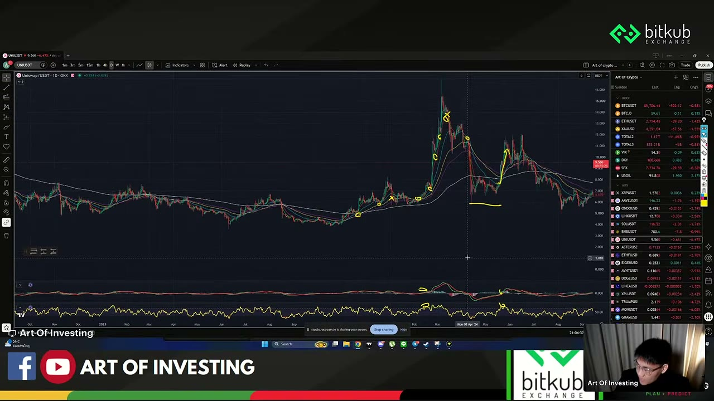

[01:04:19] ว่ามีโอกาสไปต่อก็นู่นน่ะนะครับเอิ่มแถว เนี้ย 14.9  9 เนี่ยก็เป็นอีกตาลนึงนะ ครับที่ที่วิ่งได้เนาะต่อมาก็จะเป็นตัว นะครับ เนี่ยAวกอ่ะสวยมาแล้วเนี่ยฉะนั้นไอ้ไอตัว เนี้ยผมก็เลยลุ้นนะลุ้นนะว่าจะมาแถวนี้ หรือเปล่าเห็นมะถ้ามาแถวนี้แล้วไม่หลุด แล้วเกิดรีเจคจะเป็นเหมือนตัวอะไรครับมัน จะเหมือนอาเว่ นึกออกยังเหมือนอาเว่ถ้ามาตรงนี้แล้วขึ้น อีกทีอย่างี้ก็คือท่าเลยอ่ะเนี่ยเห็นมั้ เราลองไปดู RW ดิอ่ะเนี่ย ฉะนั้นน่ะมันคือท่าแบบนี้นะครับตอนเนี้ย ผมแค่อยากให้มันรีทestลงมานะครับสำหรับ A ส่วนถ้ามีของแล้วก็ก็รันได้ครับก็ลุ้นว่า โมเมนตัมมันจะเกิดเนาะก็คือตอนเ day มัน เกิดแล้วมัน out  perform มากนะครับ

[01:05:20] ฉะนั้นเนี่ยถ้ามันย่อสั้นๆลงมาแถวเนี้ย อ่าผมมองนะแถวแบบเนี่ยน่าสนใจละ 9.3 นะ ครับถ้า 9.3 ลงมาตรงนี้แล้วแล้วรีเจคอ่ะ ก็ผมมอง SL ตรงเนี้ยแล้วผมก็น่าจะรันขึ้น ไปแล้วะเป้าผมมองนี่เลย 20.3 เป้าแรกนะครับ 20.3  3 แล้วถ้าเบรกได้ผม ก็มองตรงนู้นเลยนะครับมันจะเป็นจุดรีทest ตรงเนี้ย 30 นะครับอ่านี่ก็น่าสนใจนะครับ เนี่ยโมเมนตัมก็จะเกิดแล้วแล้วก็เป็นเป็น จุดจุดเอ่อจุดเช็คเหมือนกันนะครับไอ้ EMA 75 เนี่ยอ่ะเดี๋ยวผมย้อนไปให้ดูนะในคราว ที่แล้วอ่ะก่อนที่ตลาดมันแครชอ่ะมันมี หลายตัวเลยที่พยายามจะขึ้นแล้วมันไม่ สามารถเบรกได้แล้วมันก็เกิดภาวะทุบลงไป อ่ะอย่างเงี้ยเห็นมั้อย่างเงี้ย D ก็สวยนะอีกตัวนึงนะแต่ว่ามันอาจจะแบบ ไม่หวือหวาหน่อยเงินมันน่าจะเข้ากลุ่ม Real  SS ก่อนแต่ว่า D เบรคสวยละนะครับ

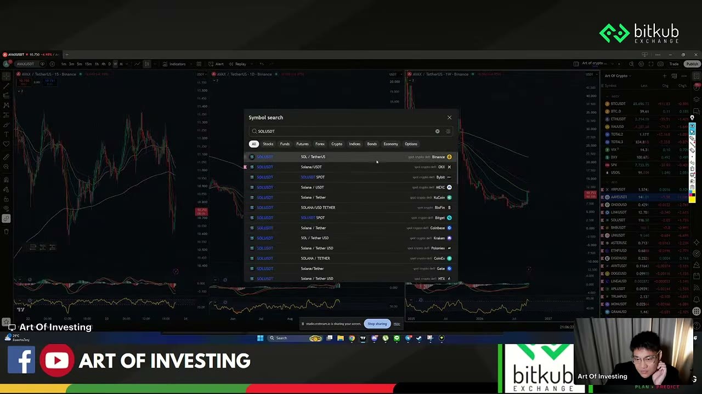

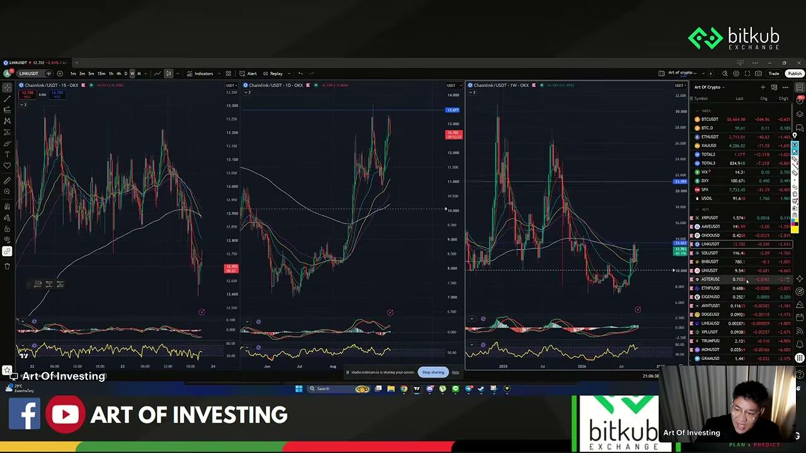

[01:06:21] ก็คือเบรคมาคล้าย AAC เลยตอนนี้เหลือแค่ โมเมนตัมที่มันมันยังไม่เกิดมาจ่อๆถ้า DO ขึ้นน่ะผมก็มองที่แรกก่อนแถวตรงนี้ก่อนนะ ครับที่จะเบรคยาก 0.13  13 อาจจะติดหน่อย นะครับสำหรับ DOT อ่ะจังหวะแรกนะครับ ถึงเป้าตรงนี้แล้วเนาะก็คือโมเมนตัมใกล้ เกิดละนะครับฉะนั้นตอนนี้ผมก็มองว่าโซ เนี่ยมันจะคล้ายๆกับยูินะครับโซเนี่ยตอน เนี้ยกราฟเนี่ยค่อนข้างคล้ายกับยูิละซึ่ง ผมมองว่าถ้าโซไม่หลุด 97 อ่ะสวยนะครับน่า รันละก็คือผมมองว่าสต Stop  Loss ตรง เป็นผลดีะแต่บางคนบอกอูยคุณอาร์ต Stop Loss โคตรไกลเลยอะไรไกลขนาดนั้นอ่ะเรา ต้องมองแบบนี้คือโมเมนตัมอ่ะเวลามองอ่ะ มันไม่ได้มองแค่แบบ 10-20% นึกออกใช่มั้ย มันมองแบบอ่ะมันขึ้นถึงเนี่ยนะครับฉะนั้น เนี่ยเรามองในเกมนี้แล้วถ้าเกิดคุณมี ศาสตร์ที่มันสามารถประยุกต์ได้มากกว่า นั้นเช่นคุณใช้กราฟในtimeมfrฟมเล็กกว่า

[01:07:23] เป็นใน 1  H ใน day ใน 4 ช่มงหรือคุณมี ศาสตร์อื่นสwingเทรด eli  wave คุณมี demand  Suly คุณก็แอดตรงนั้นไประยะ stop loss คุณมันก็จะดีขึ้นแค่โมเมนตัมเมื่อ ในweคมันเกิดอ่ะมันแค่บอกว่า 73% ที่ stop loss เนี้ยจะไม่โดนแต่ตอนเนี้ยังไม่เกิด นะแล้วไอคุณก็พอคุณรู้ data แล้วมันมี 73% น่ะคุณก็ไปเล่นกับตรงนี้ง่ายแล้วนึกออก ป่ะเออคุณก็ไปหาท่าเข้าของคุณเอาว่าถ้า มันเกิดแล้วนะแต่ตอนเนี้มันยังไม่เกิด ฉะนั้นมันเป็นจุดจ่อ อย่างที่บอกก็คืออ่ะแล้วราคาเนี่ยมันมัน ใกล้กับโซนที่มันมีโอกาสเกิด retrace หรือreีctionลงมาแล้วก็ผมก็ก็เลยแบ่งขาย ก่อนเพราะว่ากลัวว่ากำไรจะหายหมดนะครับ อย่างน้อยต้องคว้าหน่อยอ่ะเนี่ยเห็นมั้ย ก็ก็ย่อมาและหลายตัวนะครับเนี่ยก็ลองดู ลองดูนะครับซุยก็สวย [เสียงสูดหายใจ]นะครับเนี่ยซุยก็เบรคสวย เห็นป่ะแต่โมเมนตัมยังไม่มานะครับก็คือ เนี่ยเบรคเบรกพรีเมี่มมาละนะครับทีเนี้ย เอ่อติดตรงนี้ละฉะนั้นผมมองว่าซุยตรง เนี้ยอ่ะ day เนี่ยโมเมนตัมเกิดแล้วแต่

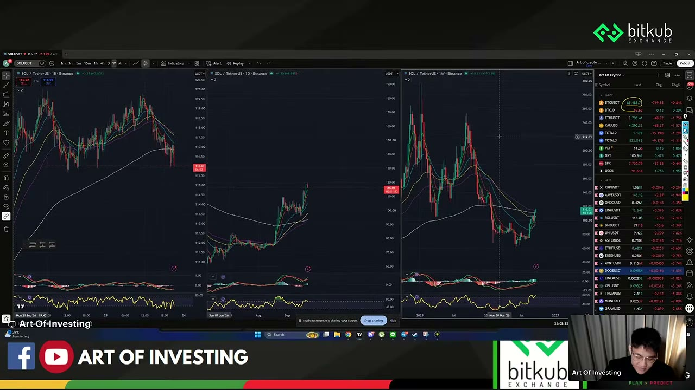

[01:08:24] ส่งไม่ถึง week เห็นมั้ย day เกิดละแต่ ยังไม่เกิดนะครับฉะนั้นไอ้ 73  3% อ่ะมัน จะเกิดในweคเท่านั้นฉะนั้นจุดที่ผมมองว่า ย่อแล้วสวยก็คือประมาณเนี้ย 0.9 หรือ อย่างแย่เลยนะไม่ควรหลุด 0.8  8 ถ้าลงมาตรงเนี้ยแล้วเบรคอีกรอบนึงอ่ะผม ว่าweคน่าจะเกิดโมเมนตัมก็สวยนะครับจุด แรกอ่ะผมว่าเทส 75 ก่อนเลยประมาณตรงนี้ เนี่ย 1.45 ถ้าผ่านนะแล้ว out คอยวิ่งบ้าๆผมก็มอง นู่นเลยนะครับเนี่ยประมาณนี้ 2.4  4 นะครับเพราะว่าเราเทรด outcoin อ่ะเราต้องการระยะที่มันไกลอยู่แล้วนะ ครับเพราะว่ามันเป็น Big  Win น่ะเราเรา จะเทรด outcoin ทั้งทีเราไม่ควรมาแบบหวัง 10-20% นึกออกใช่มั้ครับ ed้าed้าผมจำได้ว่ากราฟค่อนข้างโอเคแล้ว แต่ว่าปัจจัยภายนอกไม่ค่อยมีเหมือนซุยเลย ครับเอด้าเหมือนซุยเลยนะครับed้าเนี่ยมัน จะเหมือนกับก่อนเริ่มต้นอ่ะก็คือตรงนี้

[01:09:25] หรือว่ายูิตรงนี้เห็นนะed้าเนี่ยมันมัน เพิ่งอยู่ตรงนี้นะครับมันเพิ่งอยู่ตรงนี้ เลยอ่ะอย่างงี้ เนี่ยed้ามันถึงตรงเนี้ยนะครับงั้นตอน เนี้ย day เนี่ยมันเกิดโมเมนตัมแล้วแต่ มันยังส่งไม่ถึงweคนะครับจุดที่มันมี โอกาสมารีทestก็ประมาณเนี้ย 0.22 เนี่ยนะ ครับแถวเนี้ย นะครับถ้าย่อมาแล้วไม่หลุดล็อกดีดขึ้น เงี้ยอ่ะโอเคสวยที่ที่มันควรจะวิ่งไปถึง ก็คือตรงนี้แถบเนี่ย 0.36  36 เนี่ยเนี่ยตรงนี้ก็จะสวยนะครับที่แรกก่อน ถ้าเบรคได้ก็โซนนี้ที่หนาหน่อยนะครับก็ อีกเกือบเด้งอ่ะประมาณ 0.5  0.6  6 นะ ครับช่วงช่วง range ตรงนั้นสำหรับ eda เนาะทำไมเหรียญ TRX ไม่ค่อยหลุดเอ่อหลุด EM ครับเพราะว่าเหรียญมันอัตราขยับค่อน ข้างไม่ได้สูงครับในแต่ละสัปดาห์เนาะก็ คือ 3%  2% ก็คือพูดตรงๆก็คือdisคามันยัง ไม่หลุดนั่นแหละนะครับอย่างอันเนี้ย สมมุติว่าอ่ะอันเนี้ยก็คือความง่ายนะเป็น

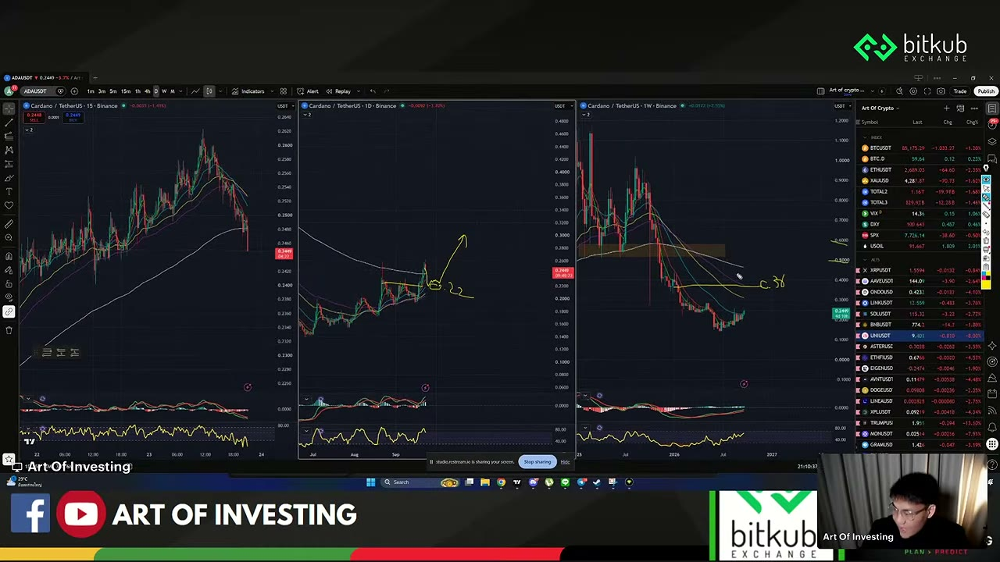

[01:10:28] ไงจะหลุด 85,000 แล้วเนี่ยถ้าผมไม่ผมไม่ แบ่ง Take  Profit ไปนะนั่งเศร้าแล้วนะ ครับผมไม่แบ่ง take  profit ไปผมนั่ง เศร้าแล้วเนี่ยผมบอกนักเรียนไปตั้งแต่ ช่วงบ่ายและเนี่ยอย่างเงี้ยอ่ะนะครับ เนี่ยผมบอกนักเรียนไปว่าตรงนี้นะครับ เนี่ยผม TP  Out  Core  20% เนี่ยผมบอกไป ตั้งแต่ตอน 17:30 น.นะครับเนี่ยก็คือสิ่ง ที่ผมเห็นเนี่ยคือข้อได้เปรียบของการมี data เห็นป่ะพอคุณมี data  OI คุณมี data เปอร์เซ็นต์โมเมนตัมว่าท่านี้จะเกิดอะไร เท่าไหร่เนี่ยคุณก็จะเห็นแล้วว่ามันมี โอกาสย่อหรือเปล่าเนี่ยผมไม่รู้เรื่อง อนาคตอะไรเลยนะ เห็นป่ะเนี่ยครับผมถึงบอกว่าคุณมีdata้า ในมืออ่ะโคตรได้เปรียบนะครับมันตัด สินใจง่ายเนี่ยติดละเนี่ยเดี๋ยวคนก็ไป กังวลกันละจะผ่านมั้ยจะร่วงมั้ยจะทำยังไง ดีจะเบรคหรือจะเนี่ยแหละนะครับ Render หรอตอนแรกอ่ะผมผมตามมานะสมัยมันเป็น เหรียญ RNDR แต่พอมันเปลี่ยนชื่อเป็น Render ผมไม่ได้ดูกราฟเลย

[01:11:29] ตอนนี้ Render มันอยู่ในกลุ่มมันไม่ใช่ Real  World  Asset อ่ะมันเป็นอ่านับ เป็น DPIN นะครับ Decentraliz เอ่อเอ่อใช่นับเป็น DPIN Physical  Infrastructure  Decentraliz Physical  Infrastructure ผมว่าผมว่า Render นับเป็นกลุ่ม DPIN ซึ่งกระแส DPIN ตอนนี้ยังไม่ค่อยมาอือืใช่นะครับเป็นไง เอาย่อแรงมั้ย ขอยบอกเจ้าแล้วเนี่ยใครอยากเติมของก็ต้อง รอรอแถวนี้นะครับเนี่ยต้องรอเนี่ยเห็น มั้ยย่อแล้วเนี่ยแหละสาเหตุที่ผมแบ่ง Take Profit  Alcoin นะครับ มาละ อ่ะประมาณนี้นะครับเหรียญ World  File หรอป่ะ โอ้โหไม่สวยเลยอ่ะผมไม่ชอบกราฟเลยครับแบบ นี้แบบนี้ผมไม่เทรดนะก็คือเหรียญที่สภาพ

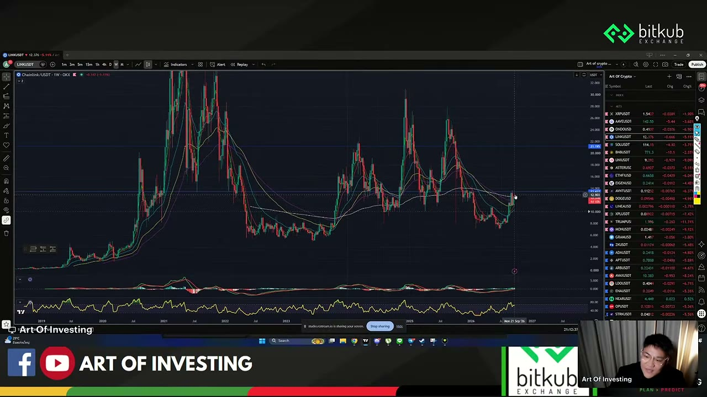

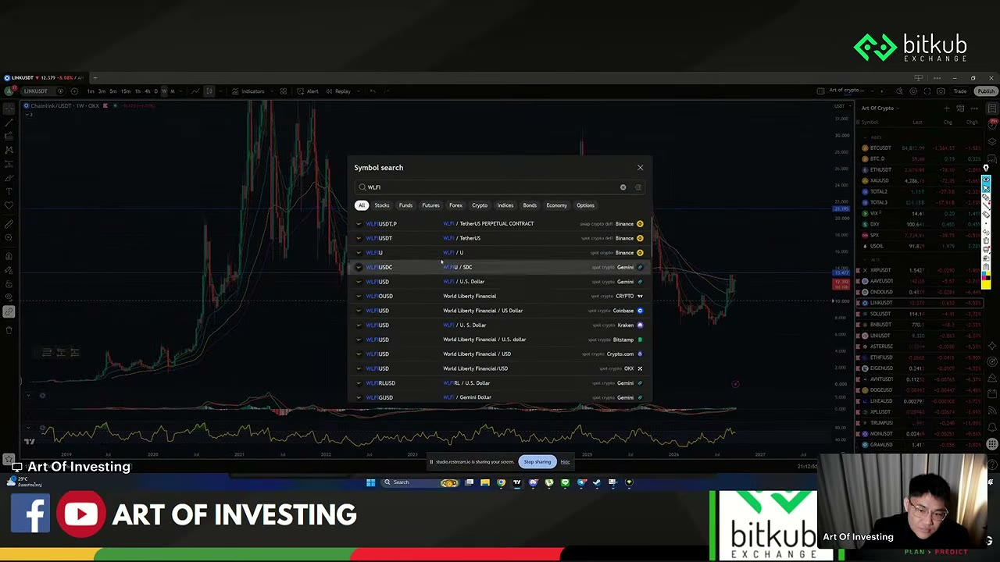

[01:12:30] คล่องต่ำเกินครับแบบเนี้ยเหรียญสภาพคล่อง ต่ำเกินนะครับคือมันมีวิกทั้งบนทั้งล่าง เงี้ยนะครับ พอพอวิกมันเกิดทั้งบนทั้งล่างแบบเนี้ย ครับคือเงินแบเดียวไปสะบัดไปแตะมันเนี่ย ก็เกิด Force  Force  buy  force  sale แล้วนะครับกราฟแบบเนี้ยโคตรมีปัญหานะครับ คือเงินเข้านิดเงินเข้าหน่อยเนี่ยเอ่อมัน กระทบหมดเลยนะครับมันทำให้ราคาเนี่ยปั่น ป่วนหมดเลยฉะนั้นถ้าเป็นแบบเนี้ยนะครับก็ ไม่เหมาะไม่เหมาะเท่าไหร่นะครับที่ที่จะ ที่จะเทรด ขอดู position แป๊บนึง โอเคนะครับอือื โอเคมีตัวไหนมั้ยASธอ ASธอเนี่ยมันเป็นตัวที่ ไม่ได้รับกระแสจาก Real  World  Asset

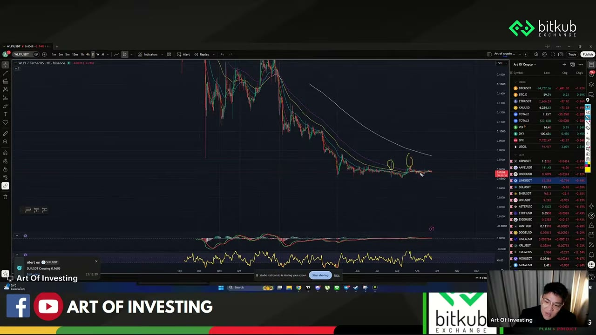

[01:13:32] โดยตรงนะครับแต่ว่ามันได้รับกระแสจาก เป็นกระแสรองอ่ะเช่นแบบเอ้ย Re  Asset มันเกิดขึ้นแล้ว Synthetic  Asset เกิด ขึ้นแล้วเรามีหุ้น Blockchain เทรดแล้ว งั้นเทรดได้ที่ไหนก็คือบน Dex บน sex และ บน Perve  Dex นะครับฉะนั้นมันเป็นกระแส รองแล้วตอนนี้ผมมองว่าถ้าเป็นใน week ไม่ ค่อยสวยเท่าไหร่อืเนี่ยเห็นมั้ยโมเมนตัม ในweคมันมันยังไม่เกิดเลยนะครับฉะนั้นผม ก็เลยมองว่าเออมันไม่ค่อยสวยเท่าไหร่ถ้า จะเป็น ถามว่าเจ้าลากง่ายมยใช่ครับเจ้าลากง่าย ทั้ง World Fลทั้ง ASTER เลยนะครับคือใช้ แล้วกระชากลากได้ง่ายหน่อยเพราะว่าสภาพ คล้องมันต่ำแต่ทีเนี้ยเราจะไปหาdata้าที่ ได้เปรียบอ่ะยากเช่น 73% น่ะของของกราฟ พวกเนี้ยใช้ไม่ค่อยได้ผลถูกมยเพราะ ว่า 73% เนี่ยมันมันจะต้องออกมาอ่ะเนี่ย อ่ะ Study  Case ครับอันเนี้ยคือ Wek แบบ

[01:14:34] เนี้ยคือไม่ใช่แรงขายจริงๆแต่มันคือคำ สั่ง force  sale เห็นป่ะแล้วเดี๋มันจะ รีเจคกลับอันเนี้ยแสดงว่า position แตก เนี่ยคือดีดกลับฟืดปื๊ดอย่างเงี้ยนะครับ คือ position มันแตก เล่นได้แต่แนะนำถ้าเล่นเล่นสปอตเท่านั้น นะอืแต่ถามว่ากราฟสวยมั้ยผมว่าตัวอื่นที่ เราดูกันเมื่อกี้สวยกว่าเยอะอืนะครับ เนียหรอเนียสวยเนียผมตกรถว่ะเออจริงเนีย ผมตกรถตรงนี้เลยเนีย เนี่ยผมตกรถ เนี่ยผมผมรอย่อเหมือนกันแล้วมันไม่ย่อ แล้วมันไปเลยแล้วโมเมนตัมเนี่ยวเกิดแล้ว ฉะนั้นเนียตรงเนี้ยมีนัยยะแล้วครับโอกาส 73% ที่จะมาไม่ถึง Stop  Loss และสำหรับ เนียนะก็คือก็คือล่างสุดมันเนี่ยนะครับ แต่มันไกลมากโอ้โหถ้าคุณวางนี่ก็โอ้โห กี่เด้งอ่ะ 4 เด้งไปแล้วนะครับฉะนั้น ก็คุณต้องใช้ศาสตร์อื่นในการประคองละที

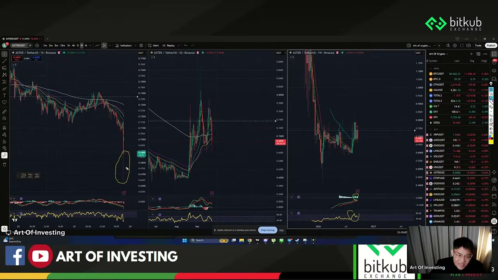

[01:15:35] นี้ภาพรวมก็คือเนียถ้าเป็นเป้าเหรอเอาเอา แบบคร่าวๆก็ได้ เอ่อเอ่อ ถ้าเป็นเป้าอ่ะที่แรก 5.1 ก่อนอืใช่ เนี่ยครับ 5.1 อีกที่ก็ 7.3 ถึงตรงนี้ออกหมดนะเพราะว่า จากจาก data ผมนะจากจาก data ผมนะอื ถ้าจาก data ผมอ่ะผมมองว่า 7.3  3 เนี่ย พูดเป็นเปอร์เซ็นต์จะไอ้นี่ไปป่าวะ 80% วิ่งถึงแค่นี้อ่ะมันก็จะมีบ้างเวลา เวลาที่เราวัด Fibency  Extension นะบาง ตัวมันก็วิ่งทะลุ 4  Fibo  4.2 เลยถูกป่ะ มันก็มีแต่ว่าโดยเฉลี่ยแล้วอ่ะ data ที่ มี age ที่สุดอ่ะก็คือประมาณเนี้ย 2.68 68 นะครับ ผมมานี้อุ้ยสวยหลายตัวนะผมขอดู H bar่อ

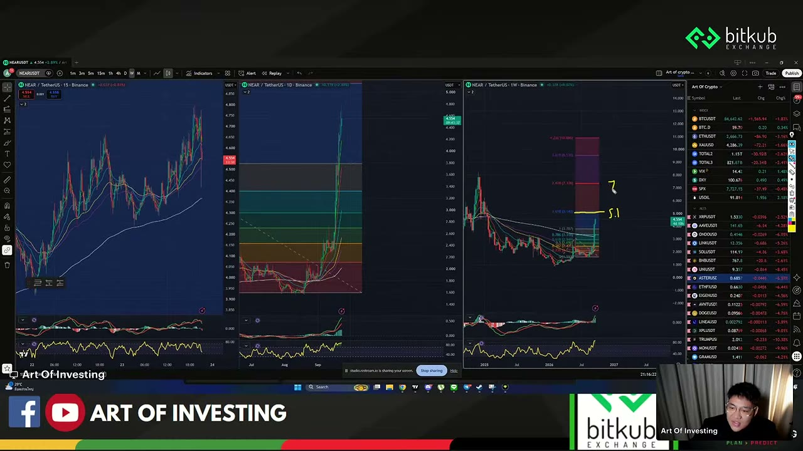

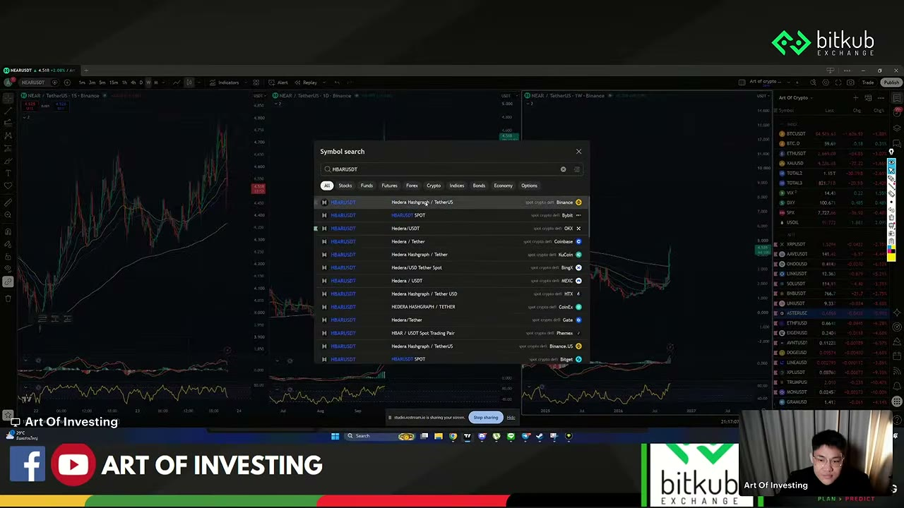

[01:16:39] สวยแล้วเนี่ยกังวลกันไปเลยกังวลกันไปเลย ผมรอเติมนะครับถ้าถ้าหลุดก็หลุดก็ออก เนี่ยถ้าหลุดตรงเนี้ยผมก็ออกแต่ถ้าไม่ หลุดผมก็เติมนะครับเนี่ยเนี่ยแหละอ่ะผม บอกว่าจังหวะแบบนี้แหละคนมันก็จะกลัวถูก ป่ะล่ะว่าแบบเอ้ยเละแล้วตลาดไม่ไปแล้ว หรือจะย่อหรือจะมาแค่นี้ปล่อยปล่อยให้คน กังวลกันไปครับแล้วก็ชั้นตามแผนไปถ้าหลุด ผมก็ stop ไม่หลุดผมก็คว้ากำไรนะครับจุด เข้าที่ดีมันจะเกิดช่วงแบบเนี้ยเนี่ยถ้า คุณมีdata้าไว้ก่อนเนี่ยผมถึงบอกเฮ้ยคุณ อาร์ตแบ่ง TP ทำไมนี่ไงหนุ่มเนี่ยมันเป็น อย่างเงี้ยหนุ่มเอ้ย เนี่ยจำจำไว้นะครับเนี่ยจำหน้าตามันไว้ เนี่ยเวลาที่มันมาเทสโมเมนตัมในweคแล้ว ไม่เกิดเนี่ยรีเจคแรงตลอดนะครับยูิ สวยครับ PR โอเค สวยครับเนี่ยมันรีเจคแรงมากนะครับฉะนั้น ไปดู outcoin ตัวไหนที่มันเทสในweคอ่ะ อันตรายเว้ยนะครับไปรอดูหน่อยนะครับ ว่าแบบอย่างเงี้ยอย่างเงี้ยติดๆถ้าweคนี้

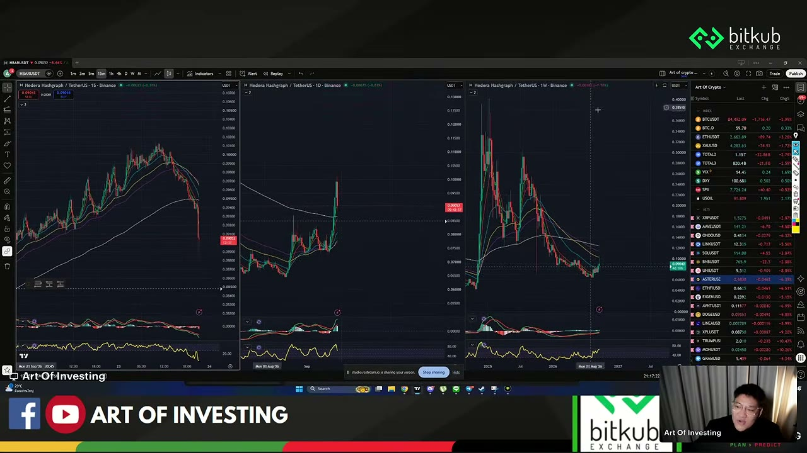

[01:17:41] ยังปิดกดลงมาอีกนะก็ก็ต้องระวังะนะครับ อย่างเงี้ยเนี่ยไอ้พวกพวกที่มันอยู่ในweค อย่างเงี้ยแล้วมันติดอ่ะหลายตัวเลยนะครับ ยิอย่างเงี้ยเห็นมั้อ่ายิมันเบรคไปแล้ว อย่างเงี้ยนะครับเนี่ยเนี่ยติดเงี้อ่ะ เงี้เห็นมอ่ะเนี่ยเนี่ยท่าเดิมผมถึง บอกว่าถ้าคุณเทรดโมเมนตัมหรือว่าคุณเข้า ใจบ่อยๆอ่ะนะครับอ่ะเนี่ยท่านี้เลยเห็น ป่ะเนี่ย ติด 75 นะครับแต่รอบนี้เบรคได้เกิด โมเมนตัมก็วาง stop นี่ก็เกิดเทรนนะ ครับฉะนั้นตอนเนี้ยรอบนี้ก็เหมือนกันติด 75 รอบ 2 ถึงฉะนั้นตอนนี้นะครับเอาแล้ว เบรคเปล่าไหวเปล่านะครับก็คือตรง นะครับตรงนี้ละที่ต้องดูนะก็คือถ้าเกิด มันเบรกกลับขึ้นไปฟื๊บแล้วโมเมนตัมโอเค stop  loss ผมวางนี้แบบโคตรมั่นใจมันจะ 50% อะไรช่างมันแต่ว่าเราเรามีเป้าวิ่ง ระยะไกลนะครับแล้วเราก็มีของ DCA ระหว่าง ทางคืออย่างที่ผมบอกนะบางคนบอกอุ๊ยคุณ

[01:18:43] อาร์ต Stop  Loss  73% แต่โคตรไกลเลย ผมย้ำอีกทีอย่างที่บอกมันแค่เป็นที่บ่ง บอกคุณว่ายิ่งคุณหลังชนฝาใกล้มันมากเท่า ไหร่อ่ะมันยิ่งมีความน่าจะเป็นที่ไม้นั้น มันจะวินสูงนึกออกใช่มยฉะนั้นถ้ามันเกิด โมเมนตัมไปแล้วแล้วมันย่อมาอย่างเงี้ย ยิ่งเราได้ของใกล้เท่าไหร่อ่ะ RR เราก็จะ ยิ่งกว้างนะครับฉะนั้นตอนเนี้ยก็แค่รอดู ว่าตัวไหนอ่ะ position เท่าไหร่บ้างเนี่ย ไอ้บางคนที่บอกว่าอยากซื้ออยากให้ย่ออ่ะ ย่อปุ๊บไม่มีทางกล้าซื้อหรอกเพราะว่า คุณดูตัวเลขอย่างเงี้ย กลัวหมดแหละ ถูกป่ะ นะครับคุณคุณดูตัวเลขตรงนี้คุณกลัวทุกคน นะครับฉะนั้นไปดูเก็บdata้านะครับแล้วก็ อย่างที่บอกเนี่ยแหมเสียดายนะถ้าขึ้นถึง 90,000 แล้วย่อนี่หล่อเท่เลยนะครับแต่ ว่ามันประมาณนี้แหละมันก็ถือว่าใกล้แล้ว เนาะประมาณ 3,000 ดอนนะครับเนี่ยอย่างที่ ผมบอกว่า OI อ่ะเห็นป่ะมันไม่มีคนตั้ง หลังจาก 90,000 กับ 100,000 เลยนะครับ

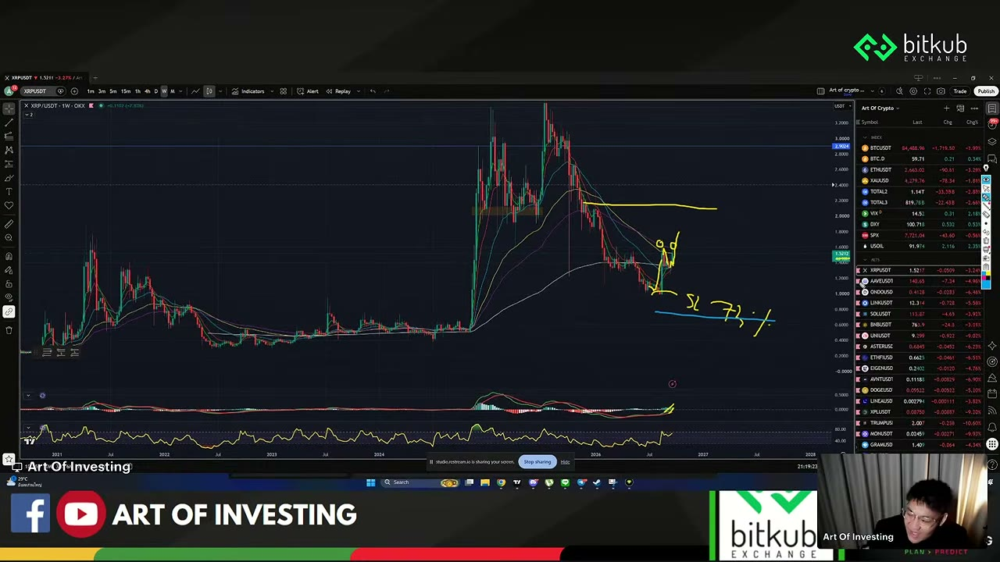

[01:19:44] ฉะนั้นน่ะรายใหญ่แล้วก็คนในตลาดอ่ะยังไม่ ค่อยเชื่อเท่าไหร่ว่ามันจะทะลุ 100,000 นะครับในเดือน 2 เดือนนะครับประมาณนี้ แล้วกันวันนี้นะครับหวังว่าจะได้ประโยชน์ กันนะครับเหมือนเดิมมีแผน take  action ตามแผนนะครับแล้วก็ระวังอย่างที่บอกย้ำ แล้วย้ำอีกปากจะฉีกแล้วโมเมนตัมในweคมัน ยังไม่เกิดนะครับเอ่อหลักๆกลุ่ม Real World  SS ครับผมชอบหลายตัวเลย Ondo ซุยผมก็ซุยซุยดรอปลงมาเออลิงก์อ่ะพวก เนี้ยชอบแต่ถามว่าถ้าเกิดเอ่อ Price Action ที่มันตรงกับ data ที่ผมมีในมือ มันไม่สวยก็คงไม่เก็บแต่ถ้ามันสวยก็ผมก็ เก็บเนี่ย แดงขนาดนี้ใครกล้านะครับมี data ชัยนะ ครับฉะนั้นอ่ะเดี๋ยวผมเอา Study  Case ให้ดูก็คือสมมุตินะว่าเกิดแบบเนี้ยแล้ว คุณไม่รู้ว่าย่อเมื่อไหร่มันจะจบสมมุติ ว่าคุณวางโซนไว้แล้วเช่นตรงนี้เอ้ยคุณ

[01:20:46] อาร์ตผมอยากได้ของจังเลยมันผมจะรู้ได้ไง ว่าตรงนั้นเข้าได้ไม่ได้คุณก็ดูภาพนี้ อย่างี้นะแล้วคุณก็หาโมเมนตัม อ่ะผมยกตัวอย่างเลยติดติด เบรกได้แล้วเหนือ 0  RSI  overbard คุณก็ วาง Stop  Loss ตรงนี้เห็นป่ะมันขึ้นไป แล้วมันลงมานะแต่มันไม่ถึงแต่อันนี้มัน 15% นะอันนี้ไม่ใช่ 73% นะ 73% แค่ในweค แต่มันใช้หลักเดียวกันในการเก็บของได้ เห็นป่ะเงี้ยคุณก็เข้าไปมันก็วิ่งเห็นป่ะ กว่าจะวิ่งแล้วมันไม่กลับมาโดย stop  loss แล้วเห็นป่ะฉะนั้นงั้นอย่างเงี้ยต่อมาคุณ ก็เนี่ยอันนี้คือtimeมfrฟม 15 นะอย่า สับสนนะถ้ามันถึงโซนที่คุณวางแล้วมันเบรค ได้อย่างเงี้ยอ่ะคุณก็วาง Stop  loss ตรง นี้แล้วก็เข้าตรงนี้อย่างเงี้ยได้เห็นป่ะ มันประยุกต์ได้นะครับ เนี่ยจำไว้เลยนะจ๊ะโมเมนตัมในweคสำคัญที่ สุดนะครับคือมันจะเป็นตัวที่บ่งบอก เปอร์เซ็นต์ความ เอ่อน่าจะเป็นที่จะวิ่งขึ้นระยะไกลอ่ะได้

[01:21:48] ชัดที่สุดนะครับเนี่ยฉะนั้นตอนเนี้ย outcoin หลายตัวถึงแล้วนะครับจุดที่ต้อง เลือกอ่ะผมถึงบอกว่าถ้าเกิดคุณไม่คว้า กำไรไว้ก่อนน่ะเข้าเนื้อแล้วนะครับดูตรง นี้ไว้เนาะเออผมเป็นห่วงนะครับเฮ้ย XRP ย่อเยอะเหมือนกันเนาะวันนี้วันนี้ย่อมา กี่เปอร์เซ็นต์เนี่ยอุย 10% เยอะนะครับ เออมีอีกตัวนึงที่ผมชอบนะ J สุดท้ายละตัว สุดท้ายละตัวนี้ชอบนะครับโมเมนตัมจะเกิด แล้วด้วยนะครับเอ้ยรู้หมดเลยผมได้ของมา แถวไหนแถวนี้นะครับผมก็วาง stop ตรงนี้ แล้วแหละเพราะว่า J โมเมนตัมเกิดแล้วนะ ครับฉะนั้นผมก็วาง Stop ตรงนี้ละนะครับ ถ้ามาย่อมาตรงเนี้ยแล้ว day กับ 4 ช่มง มันเกิดโมเมนตัมผมอาจจะเก็บแล้วก็ Stop ตรงนี้ถ้าหลุดนะครับอ่ะประมาณนี้วันนี้นะ ครับขอทุกท่านมีความสุขนะครับใครที่บอก อุ๊ยอยากเห็นตลาดย่อจังเลยคุณอาร์ตจะได้ เก็บของก็ย่อมาแล้วนะจ๊ะแต่ว่าเลือกดีๆนะ ครับเลือกเลือกดีๆนะว่าอยากจะเข้าตัวไหน อย่าแบบไปจิ้มสุ่ม 4 สุ่ม 5 รอดูโมเมนตัม มันก่อนก็ได้ว่ามันเบรคหรือเปล่านะครับ

[01:22:49] ไม่งั้นก็มันก็จะย่อลึกกว่าเดิมนะครับอ่ะ วันนี้ประมาณนี้ครับแล้วเจอกันวันพุธหน้า ไม่แน่ใจจะได้มาไลฟ์หรือเปล่านะครับเพราะ ว่าผมไปญี่ปุ่นนะครับผมไปญี่ปุ่นนะครับ เดี๋ยวว่ากันอีกทีว่าอาทิตย์หน้าจะมีไลฟ์ มั้ยก็แต่ว่าตอนอยู่ญี่ปุ่นผมก็อาจจะมี คลิปวิเคราะห์ได้มั้วะอาจจะถ่ายโทรศัพท์ หรืออะไรยังไงก็ไม่รู้เนาะมันลำบากเหมือน กันนะครับแต่ว่าเดี๋ว่ากันนะครับใน สัปดาห์หน้าผมก็อาจจะไปเที่ยวพักผ่อน หน่อยแล้วเจอกันวันพุธครับทุกท่านสวัสดี

