# BTC ย่อมาเป็นโอกาสหรือความเสี่ยง?

- ช่อง: Art Of Investing
- ลิงก์: https://www.youtube.com/watch?v=30nWEY4Eykk
- วันที่: 2026-10-09
- ความยาว: 1:34:09
- ที่มา: คำบรรยายอัตโนมัติ (auto-generated) ภาษาไทยของ YouTube — อาจมีคำสะกดผิด/คำผิดเสียง
- ภาพ: 58 ภาพจากวิดีโอช่วงที่เปิดกราฟแท่งเทียน (เลือกอัตโนมัติจากสีแท่งเทียน · ตัดภาพซ้ำ) อยู่ในโฟลเดอร์ frames/

---

[00:00:11] [เพลง]อ

[00:00:43] อ่ะสวัสดีครับสวัสดีทุกคนเลยนะครับผม เสียงน่าจะชัดเนาะผมอ่ะเช็คอยู่น่าจะขึ้น ะนะครับก็สวัสดีครับไม่เจอกันอาทิตย์นึง เนาะเพราะว่าผมก็ไปพักผ่อนที่ญี่ปุ่นมานะ ครับสรุปราคาก็ไม่ขึ้นไปเทสถึง 90,000 ด้วยซ้ำนะครับก็ขึ้นไปได้แค่ประมาณ 87,000 แล้วก็ทิ้งตัวดรอปลงมาละนะครับก็เอาจริงๆ มันก็ยังเหมือนที่ผมวิเคราะห์ไว้เนาะก็ คือบitcoinมันยังไม่ได้น่ากังวลนะครับแต่ ว่าตัวที่จะมีปัญหาเนี่ยก็คือ Outcoin นะ ครับเพราะว่า Outcoin เนี่ยมันจะค่อนข้าง sensitive เนาะอย่างที่บอกทีเนี้ยครับ ถ้าเกิดบitcoinมันย่อหลุดจากโซนเนี้ยที่ เรามองกันก็คือ 82,000 อ่ะเป็นคีย์เลเวล หลักที่สุดนะครับแล้วก็เป็นโซนรองลงมาก็ คือ 80,000  10,000-8,000 เนี่ยมันก็น่า จะเกิดการดิฟที่ลงได้บวกลบนะผมว่าประมาณ 75,000 อ่ะ 70,000 อ่ะโซนประมาณนั้นต้นๆ นะครับซึ่งการย่อไปแถวนั้นน่ะผมมองว่าภาพ เทรนด์ของบitcoinระยะยาวอ่ะมันก็ยังดูดี

[00:01:45] ครับแต่ว่า Outcoin นี่แหละที่จะเป็น ปัญหานะครับก็คือคุณต้องดูแผนดูตัวที่คุณ ถือดีๆนะครับว่ามันมีการลงไปจนถึงทำ New Low เลยหรือเปล่าเพราะว่าเราอย่าลืมนะ ครับว่า Outcoin ตัวเล็กๆอ่ะ Market  Cap มันเล็กนะครับมันใช้เงินนิดเดียวนะครับใน การลากหรือการทุบนะครับของ ตลาดเนี่ยเราก็รู้อยู่แล้วนะครับว่า 99% น่ะเอาคอยมันจะหายไปนะครับฉะนั้นก็ผมแนะ นำเหมือนเดิมเนาะถ้าถ้าจะเล่นเนี่ยก็เล่น แค่ตัวใหญ่นะครับอย่างผมเนี่ยก็จะมีขาย ได้ไม่หมดนะอย่างอย่างHบ Bar ที่ผมแปะลง เพจไปกับซุยใช่มั้ที่มันถึงเป้าคือถึง เป้าเนี่ยผมจะออก 30%  -  50% ถูกมยที่ เหลือผมก็จะเลื่อน Stop  Loss มากั้นตาม แต่ละสวิงก็ปรากฏว่า H ก็กลับลงมาที่เดิม นะผมก็โดน Stop  Profit ไปครึ่งนึงขายได้ เป้านึงอีกครึ่งนึงโดนหน้าทุนนะครับแล้ว ก็จะมีซุยก็ก็ขายได้แค่ครึ่งเดียวนะครับ จะมี XPL นี่แหละที่ผมโดนเตะ Stop  Loss

[00:02:46] ออกเนาะส่วน XRP ผมก็ยังถือนะนะครับแต่ ว่าผมจะมีตัวแบ่งออกนะครับจะไม่ได้ออกหมด นะครับสำหรับตัวใหญ่เนาะที่ที่ผมอยากถือ ก็จะมีพวกลิงก์พวกพวกอ่า XRP อะไรเงี้ยนะ ครับที่ผมยังเล่นรอบใหญ่อยู่แต่ภาพเนี่ย ต้องบอกว่าไม่ค่อยสวยนะครับแล้วก็มีโอกาส เกิดดิฟได้หน่อยนึงอ่ะเดี๋ยวเราไป วิเคราะห์ตัวเลขต่างๆให้ฟังแล้วกันนะครับ ก็คิดว่าไม่ไม่น่าจะมีอะไรน่ากังวลนะครับ สำหรับตลาดสวัสดีครับอาจารย์ถ้าทรัมป์แพ้ เลือกตั้งมิดเทอมเดือนหน้าบitคinจะย่อแรง กว่านี้อีกมั้ยครับผมคิดว่าจะใช้คำว่าผัน ผวนมากกว่าแล้วก็ถ้าเกิดเราเชื่อมั่นใน ทฤษฎีเนาะว่าตลาดบitcoinมันเปลี่ยนไปแล้ว มันไม่เหมือนเดิมอ่ะผมก็ มองว่าถ้าเกิดมันดิฟจริงๆสมมุติเนาะก็คือ ช่วงเนี้ยหลุด 82,000 หลุด 80,000 ลงไป รุนแรงอย่างเงี้ยผมเชื่อว่ามันจะขึ้นอีก ครั้งนึงก่อนเกิด midterm  election นะ ครับเพราะว่าตลาดและคนส่วนใหญ่อ่ะมันก็จะ

[00:03:48] ไปรอหลังพายุถูกมั้ยเช่นเฮ้ยเนี่ยเดี๋ยว เกิดตั้งเทอมแล้วทรัมป์แพ้เดี๋ยวต้อง เปลี่ยนรัฐบาลไส้ในเดี๋ยวตลาดจะต้องทุบ เละแน่เลยเดี๋ยวฉันจะรอเก็บที่ราคาต่ำ กว่านั้นซึ่งพอมันเป็นแบบนั้นน่ะตลาดมัน ก็จะมักจะก่อนนะครับเราต้องอธิบาย 2 เรื่องที่มันต่างกันนิดนึงคือที่ผมจะบอก ว่าเจ้าเขาไม่ได้ไล่เก็บ Stop  Loss อ่ะ อันนี้คือในรูปแบบ Intraday หรือรูปแบบ รายวันถูกมยเพราะว่าเขามีรูปแบบ High Frequency  Trading หรือ HFT อยู่แล้ว ฉะนั้นเขาจะไม่ได้มาไล่เก็บ Stop  loss รายย่อยในการdayดหรือรายวันอ่ะพูดแบบนี้ แต่ว่าในภาพรวมที่มันเป็นสินทรัพย์เนี่ย เค้าจะต้องถ่ายของแล้วก็สะสมของเข้ามันจะ ต่างจากการทำ HFT นิดนึงนะครับพวกกองทุน ที่จะต้องถือเนี่ยฉะนั้น Move เนี่ยมัน มักจะเกิดในจังหวะที่คนไม่ได้ตั้งตัวนะ ครับแล้วมันก็จะเร็วแล้วก็แรงเกินกว่าที่

[00:04:49] คนส่วนใหญ่จะตั้งตัวได้อย่างที่เราเห็น ก่อนมาอย่างผมเนี่ยผมก็ยังพลาดเลยในช่วง ช่วงเดือนสิงหาคมถูกมั้ยผมก็คิดว่ายังไง น่าจะขึ้นปลายปีมันก็วิ่งก่อนเลยสิงหาคม นะครับฉะนั้นรอบเนี้ยถ้าเกิดดิฟอีกผมก็ มองมุมมองส่วนตัวนะผมก็คิดว่ามันจะฟื้น ก่อนที่ midterm  election จะเกิดขึ้นนะ ครับฉะนั้นความผันผวนมากกว่าที่จะเกิด ขึ้นนะครับอื ก็เดี๋ยววิเคราะห์แต่ละให้ดูนะครับแต่ว่า ผมเหมือนเดิมไม่ได้มีอะไรน่ากังวลมากนะ ครับสวัสดีครับอาจารย์สวัสดีไม่เจอนานเลย นะครับสวัสดีครับคุณวุฒินันท์นานแค่ไหนก็ ยังหล่อเหมือนเดิมย้ายงานไม่ได้มาทักโอ้ เป็นไงบ้างครับตอนนี้ทำงานด้านไหนอยู่ ครับสวัสดีครับคุณจูเนียร์ยูิกับลิงก์ได้ ครับเดี๋ไลดูสวัสดีครับคุณจตุรงค์สวัสดี ครับคุณกัญยพัก์มาเดี๋ยวเริ่มเลยเนาะจะ ได้ไม่เสียเวลานะครับ เดี๋ยวมาดูตรงนี้

[00:05:53] เหาซะแล้วนะครับปกติปกติผมนอนเร็วไงผมนอน ผมนอน 20:00- น.นะครับแล้วก็เวลาที่ ญี่ปุ่นมันก็จะเร็วกว่าไทย 2 ชั่วโมงใช่ มั้ยเออก็ชินนะครับกลายเป็นเดี๋ยวนี้ผม กินข้าว 15:00 น. อ่ะเดี๋ยวผมแชร์หน้านี้ก่อนตึ๊บๆๆสวัสดี ครับน้องวิกเตอร์นะครับ เดี๋ยวนะ โอเคเอาหน้าผมหลบไปก่อนปึ๊บ เดี๋ยวนะมาเลือก template ตรงไหนว่ะชึบ โอเคก็เรื่องตัวเลขนะส่วนตัวผมมองว่า อาทิตย์เนี้ยไม่ได้มีข่าวใหญ่อะไรเท่า ไหร่นะครับที่ตลาดกำลังจับตาว่าเอ้ยข่าว นี้มันจะไดฟตลาดในที่ดังไหนข่าวนี้มันจะ ทุบตลาดหรือเปล่าข่าวนี้มันจะเอ่อทำให้ ตลาดไปอีกทางหรือเปล่าตอนเนี้ผมยังไม่ เห็นข่าวใหญ่เท่าไหร่ในสัปดาห์นี้นะครับ แต่ว่าตัวเลขที่คนส่วนใหญ่กังวลเนี่ยก็จะ เป็นของ ETF มากกว่านะครับที่เงินมันไหล ออกทีเนี้ยเงินไหลออกตอนเนี้ยมันเยอะแค่

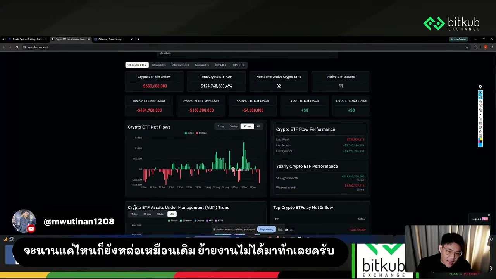

[00:06:54] ไหนนะครับก็ต้องบอกว่ามันเป็น ช็อตเดียวที่ไหลเยอะที่สุดตั้งแต่ขึ้นมา ตั้งแต่สิงหาคมเลยนะครับก็คือตั้งแต่ สิงหาคมเนี่ยนะครับเราก็จะเห็นว่ามันส่วน ใหญ่เนี่ยมันจะเป็นกรอบการที่เงินไหลเข้า ETF เป็นก้อนๆใหญ่ๆถูกมั้ยครับแล้วก็มี การไหลออกบ้างนะครับแต่ช็อตเนี้ยเป็นช็อต ที่ใหญ่ที่สุดนะครับตั้งแต่ขึ้นมาใน จังหวะนั้นเลยนะก็คือเงินไหลออกลวดเดียว เนี่ยนะครับช่วงเนี้ยประมาณ 650 ล้าน ดอลลาร์นะครับถ้าเรามาดูเฉพาะตัวเป็น บitcoinนะครับที่เป็น EDF เนี่ยอ่ะเราก็ จะเห็นว่า ช่วงที่มันเริ่มชะลอนะครับก็คือ +  1,500 +  300  +  700 นะครับ -700  +  1,200 นะครับ +  2,200  -  1,1 บวกเอ่อ 1,300 นะครับแล้วก็ตอนเนี้ยอ่าเราก็จะเห็นเนาะ เมื่อวานนะครับมีการไหลออกค่อนข้างเยอะก็ คือ 5,600 นะครับทีนี้คำถามของคนส่วนใหญ่

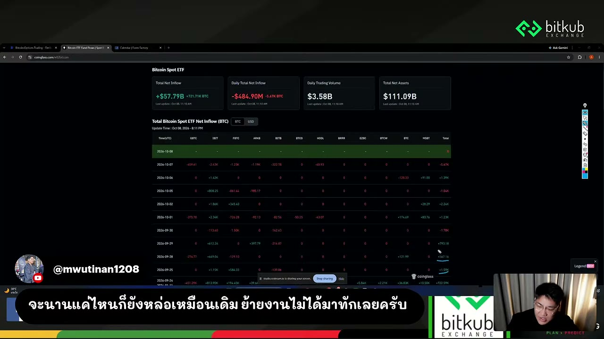

[00:07:54] เนี่ยก็คือมันจะเป็นขาลงหรือเปล่ามันจะ ทุบแล้วใช่มั้ยเราจะได้เห็นราคา 30,000 ใช่มั้ยอ่ะผมบอกแบบนี้เดี๋ยวเราต้องมาดู โซนตรงนี้ก่อนนะครับอืเอาเรื่องแรกก่อนนะ ครับก็คือค่า IV ผมไปทำ Data  Sign มานิด นึงนะครับโดย option ใน Bit เนี่ยมันยัง จะมีจำนวนสัญญาที่เยอะที่สุดอยู่นะครับใน บรรดา Option ของบitcoinหลายๆที่นะครับ เพราะว่าการเปิดสัญญาเนี่ยก็จะบอกว่ามัน ง่ายแล้วมันก็ยังถูกนะครับจำนวนสัญญา เนี่ยมันก็เลยเยอะเนาะ ค่า IV สำหรับทองคำเนี่ยที่เป็น Fix Range เนี่ยเขาจะใช้ประมาณ 0.6 หรือ 0.65 65  0  Trading เนาะแต่ว่าของ Crypto เนี่ยเท่าที่ผมไปทำ Data  Sign มานะช่วง ที่เราสามารถใช้ Fix  Range ข้ามไปอีกวัน น่ะมันจะเป็นประมาณ 19:00 น.นะครับฉะนั้น ถ้าเรากะประมาณ 19:00 น.นะครับโอกาส 70% ก็คือจะอยู่ในระยะนี้นะครับอ่ะ ซึ่งผมก็เก็บdata้าไว้และตอน 19:00 น. เนี่ยก็คือประมาณบ -500 จุด

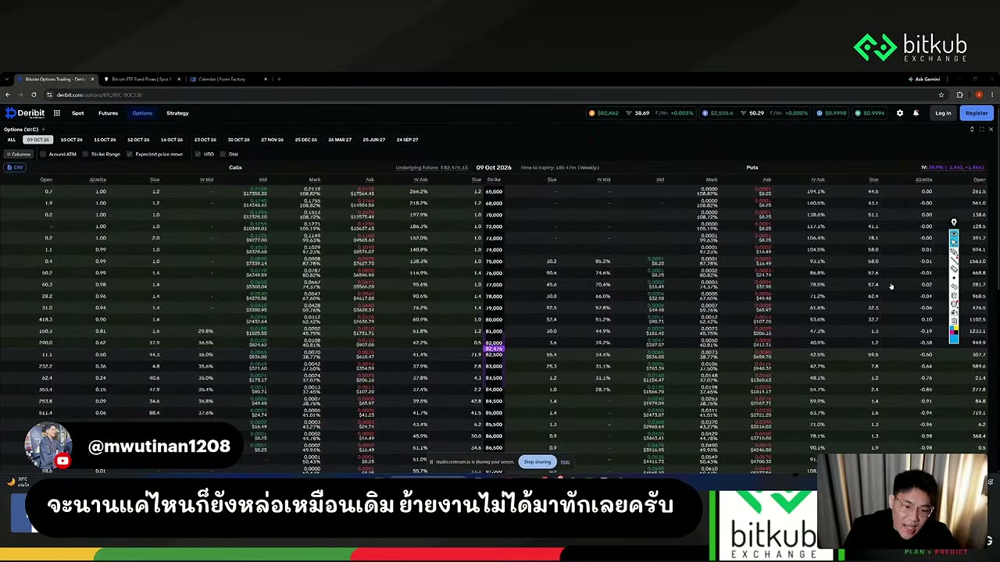

[00:08:59] โอกาสจะอยู่ในกรอบเนี้ยคือ 70% นะครับ ฉะนั้น data ของค่า IV เนี่ยหรือ imply Volatility เนี่ยบวกลบโซนประมาณ 82,000 เนี่ยนะครับที่ 1,500 จุดนะครับฉะนั้นเรา ก็จะรู้เลยว่ากรอบราคาเนี่ยครับมันวิ่งนะ ครับไม่น่าเกิน 84,000 หรือถ้าจะลงเนี่ยก็ลงไม่เกินประมาณ 85,000 นะครับอยู่ประมาณเนี้ย 70% นะครับ 70% เลยที่อยู่ในกรอบนี้แล้วถ้าเราไปดู data นะครับที่เป็นตัวเลข o ด้วยอ่ะเดี๋ยวผม เช็คก่อนว่า 19:00 น.อ่ะมันเท่าไหร่นะ ครับเอาราคาเป๊ะๆเลยดีกว่า อ่ะ 19:00 น.อยู่นี่ปึ๊บ 82  500 อ่ะ 82 500 คำนวณก่อน 82  500  +  1,500 ก็ 84,000 ถูกต้อง 82500  -  1,500 ก็คือ 8,000 โอเคงั้นก็จะผนวกกับ data พอดีนะ ครับคือถ้า 1,500 จุดนะครับจาก 82500

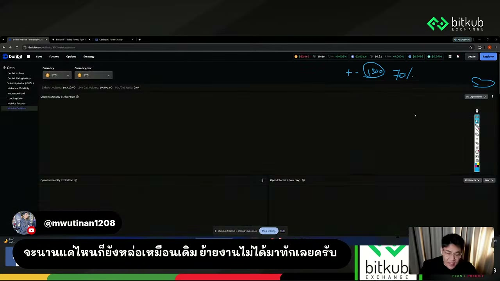

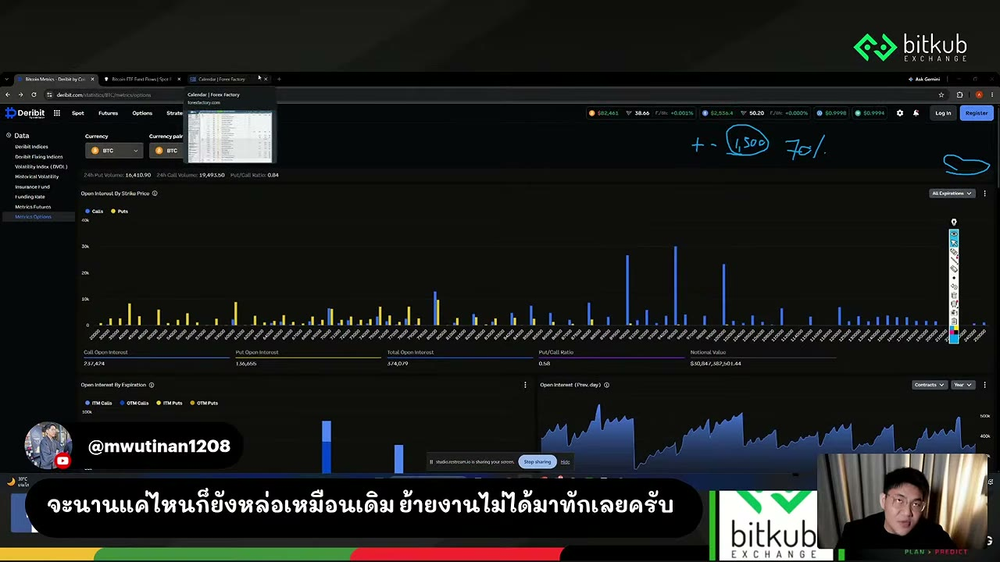

[00:10:00] เนาะก็คือมันจะมีกรอบฝั่งบนอยู่ที่ประมาณ 84,000 นะครับแล้วก็กรอบล่างอยู่ที่ ประมาณ 81500 อ่ะโดยจาก Data  sign นะครับเอ้ยไม่ใช่ 81 500 สิ 81 ขออภัย อ่ะนะครับ 70% นะครับที่จะยังอยู่ในกรอบ นี้พรุ่งนี้ งั้นโอกาสจะหลุดกรอบเนี่ยครับมีแค่ 30% เท่านั้นเราก็รู้แล้วว่าตัวเลขตรงเนี้ย มันค่อนข้างมีนัยยะสำคัญนะครับทีนี้พอมา ดูในรูปแบบ data ที่จะหมดอายุพรุ่งนี้อีก ซึ่งเป็นวันศุกร์เนาะมันก็สอดคล้องกันอีก นะครับคือเราจะเห็นว่ามันจะมีpุ option เนี่ยนะครับค่อนข้างเยอะแล้วกองใกล้ๆกัน นะครับในโซนตั้งแต่ 8,000  8,000 แล้วก็ 80,000 แต่ว่าอันเนี้มันไม่ใช่ day ที่ ที่เปิดใหม่เนาะมันก็จะเป็นตัวตัว data

[00:11:01] settlement รวมนะครับไอ้ตัวเลขแบบเนี้ย มันก็เลยค่อนข้างดึงดูดราคาลงมามากกว่า ถ้าเราดูเรื่อง IV หรือ Impire  volality นะครับอ่ะตรงนี้เดี๋ผมอธิบายให้ฟังใครฟัง แล้วไม่เก็ตไม่เป็นไรนะครับค่อยๆฟังไป เดี๋ก็ซึมนะครับตอนนี้ก็มองภาพรวมตามผมไป ก่อนแล้วกันอ่ะดูแค่ภาพรวมไปก่อนนะครับ อ่ะอย่างเนี้ยวันที่ 9 เนี่ยเราก็จะเห็น ว่าไvเนี่ยมันค่อนข้างเบ้ซ้ายนะครับค่อน ข้างเยอะเนาะฉะนั้นเนี่ยมันลงมาถึงขอบและ นะครับมันลงมาใกล้กับขอบด้านล่างและตลาด เนี่ยมองเม็ดเงินว่ามีโอกาสจะถึกโซนตรง เนี้ยค่อนข้างเยอะเฮ้ยคุณอาร์ตแล้วถ้า เกิดตลาดมองว่าราคาจะไม่ถึงโซนนั้นหรือ ไม่ทะลุโซนนั้นเนี่ยมันจะหน้าตาเป็นยังไง คำตอบก็คือมันก็จะหน้าตาเป็นอย่างี้ ผมกดตรงนี้ปั๊บเนี่ยเห็นมั้ยอ่ะอันเนี้ย มันก็จะไปตรงกับบทความที่แล้วนะครับที่ผม เขียนไปตอนที่มันอยู่ 87,000 ว่า เออ 9  90,000 กับ 95,000 เนี่ยมันมันมี

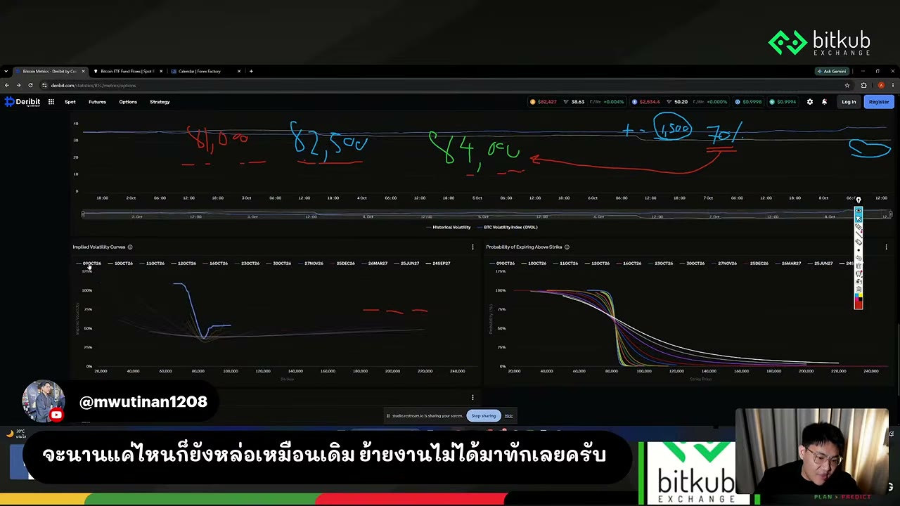

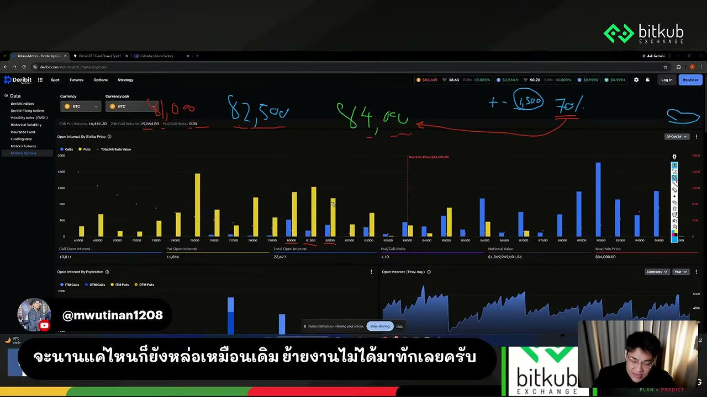

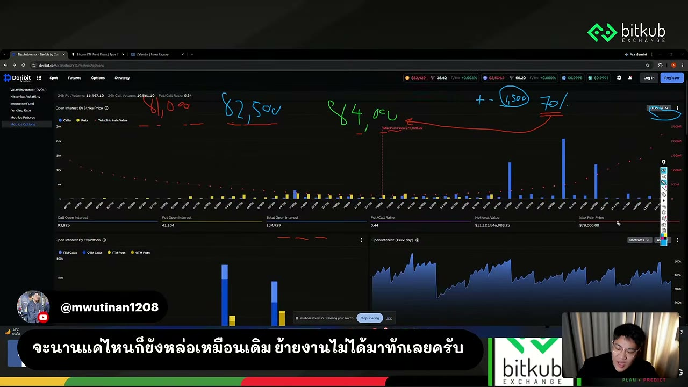

[00:12:03] ช่องว่างของ สัญญาเนี่ยที่กว้างมากๆนะครับอันเนี้ยมัน แปลว่าเอ้ยจำนวนเงินน่ะเค้าก็ไม่ได้กังวล มากว่าหรือเชื่อมั่นมากนะครับว่าราคา เนี่ยมันจะวิ่งมาถึงโซนตรงนี้เพราะเม็ด เงินเนี่ยมันไม่มีระหว่างกลางเลยนะครับ ฉะนั้นเราสามารถมองว่าตรงเนี้ยมันเป็นการ เหของคนที่เาค้ามี contract ตรงนี้มาก กว่าก็ได้หรือป้องกันความเสี่ยงว่าเออคิด ว่าราคามันน่าจะไม่ถึงหรอกแต่ถ้าถึงเนี่ย ก็กันความเสี่ยงไว้มากกว่าเป็นความรู้สึก ที่เชื่อว่าราคาจะวิ่งไปถึงนะครับเวลา เห็นมันแหว่งกว้างๆแบบเนี้ยก็คือตรงเนี้ย ตีความว่าได้เลยว่าผ่านได้ยากค่อนข้างยาก เพราะว่าถ้าเกิดมันมีเงินกระจายกระจาย เนี่ยให้เรานึกภาพออกถูกมั้ยครับมันแปล ว่าเอ้ยเค้าก็คิดว่าราคามันน่าจะถึงตรง นี้ราคามันน่าจะถึงตรงนี้ในมุมมองของผู้ ซื้อสัญญาคอนะครับหรือว่ามุมมองของราย ใหญ่ที่มากินค่าพรีเมี่มหรือผู้ขายสัญญา คอแต่ถ้ามันแหว่งไปเลยเนี่ยแสดงว่าเขาไม่ ได้เชื่อเท่าไหร่ว่าราคาเนี่ยมันจะวิ่งมา ถึงโซนใกล้ๆตรงนี้นะครับตรงเก็เลยเป็น ด่านใหญ่ทีเนี้ยพอมันไม่ขึ้นมาเทสถึง

[00:13:05] 90,000 ด้วยซ้ำนะครับแล้วโมเมนตัมเนี่ย มันไหลลงไปเราก็มาดู data ของ ที่จะถึงวันพรุ่งนี้นะครับสิ่งที่ชัดก็ คือโซนตรงนี้ นะครับแล้วมันก็จะไปผนวกกับตรงนี้พอดีก็ คือขอบล่างอ่ะอย่างที่ผมบอกในกลุ่มTelแกม ไปนะครับใครที่อยู่ในกลุ่ม Telegram ที่ เป็นกลุ่มสาธารณะนะไม่ต้องสมัครไม่ต้อง อะไรก็สามารถเข้าได้เลยนะครับที่ที่ผมแปะ ลงไปในทุกคลิปเครับก็เข้ามาสมาชิกเราจะ 4,000 คนแล้วก็จะเห็นนะครับว่าผมก็เฮ้ย ไลฟ์ผมหลุดป่าวะเดี๋ยวผมไม่ได้ดูหน้าตัว เองเลยโอเคนะครับโอ้ยขอบคุณคุณซอ์ชครับ คุณอ๊อดขอบคุณมากครับขอบคุณสำหรับกำลังใจ ครับขอบคุณมากครับ เป็นขอบล่างะนะครับฉะนั้นโซนตรงเนี้ยก็ เป็นคีย์เลเวลที่ไม่ควรหลุดถ้าหลุดเนี่ย ครับก็มีแนวโน้มที่จะเกิดการย่อที่ผมใช้ คำว่าไม่ค่อยสวยเท่าไหร่นะครับอ่ะซึ่งตอน นี้เราเห็นreีคtionะถูกมยเราเห็นreีคtion

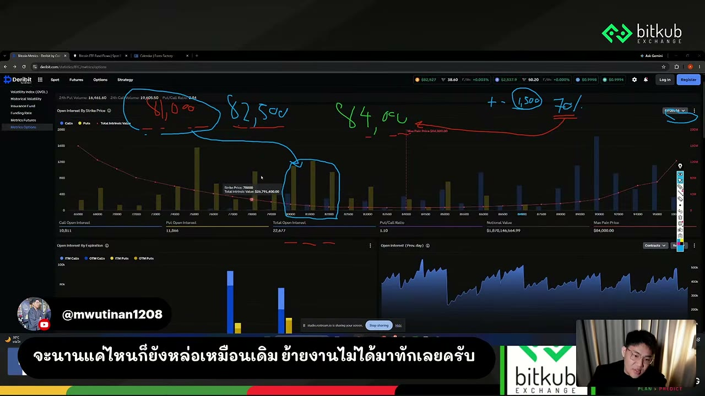

[00:14:06] เข้ากราฟเลยนะจะได้ไม่เสียเวลานะครับเรา เห็นีคชัแล้วถูก เนี่ยราคาก็รีบาวขึ้นมาละเห็นมั้ยครับตรง 82,000 ซึ่งเป็นพอดีกับบล็อกเลยนะครับ บล็อกที่ใช้คือประมาณ 2,000 จุด 8,000  84,000 นะครับถูกมยระยะครึ่ง บล็อกก็คือประมาณ 83,000 ระยะครึ่งบล็อกล่างก็คือประมาณ 81500 อ่ะ นะครับเนี่ยพอมาถึง 82,000 เนี่ยก็เกิด รีเจคขึ้นมาละนะครับอันเนี้ยก็เป็นสัญญาณ ของขอบล่างนะครับที่ว่า 70% เนี่ยก็คือ ภายใน 19:00 น.พวกเนี้ยราคาก็มีโอกาสที่ อยู่ 84,000 กับ 8,000 นะครับอ่ะผมอย่าง ที่ผมวางวางเส้นไว้เลยนะครับในโซนราคาตรง นี้ฉะนั้นมุมมองตอนเนี้ยถ้าเกิดนะถ้าเกิด ว่าโซนตรงนี้เอาอยู่แล้วแล้วขึ้นต่อไปเลย นะครับหรือว่าไซด์เวย์ขึ้นต่อไปเลยอ่ะผม

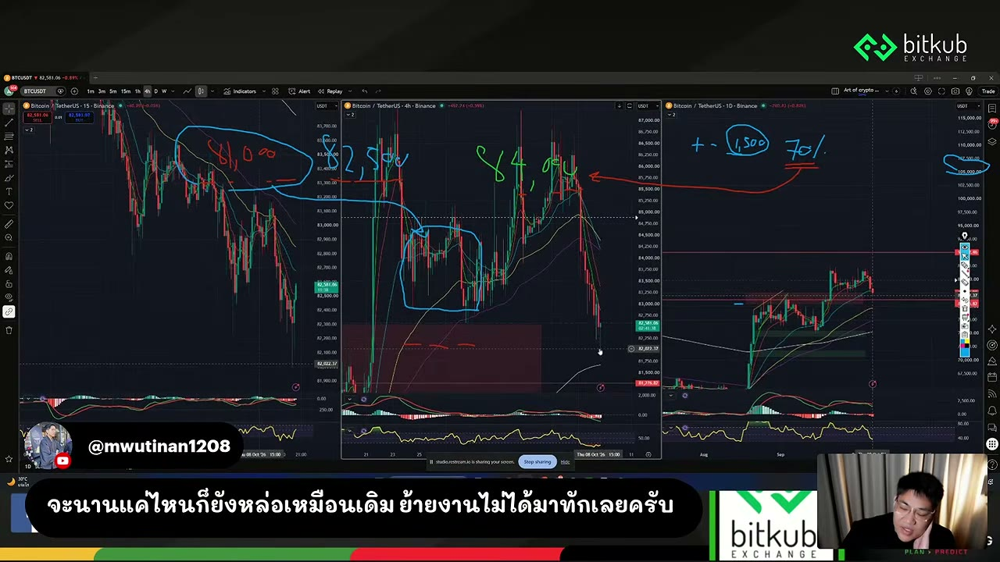

[00:15:07] มองว่าจะเป็นภาพที่จำเป็นต้องเกิดขึ้นอ่ะ ใช้คำนี้ไม่ใช่คำว่าควรนะครับแต่ใช้คำว่า จำเป็นต้องเกิดขึ้นคำถามคือทำไมจำเป็น ต้องเกิดขึ้นสิ่งตรงนี้ครับเราเรียกว่า การส่งต่อของโมเมนตัมของสวิงนะครับอ่ะ อธิบายแบบนี้ ระยะสวิงเนี่ยมันบอกความโฟโมของตลาดได้นะ ครับอย่างอันเนี้ยเงินเนี่ยมันวิ่งเข้ามา พรวดเดียวเลยถูกมั้ครับแล้วก็เกิดการย่อ แบบนี้ แล้วมันก็วิ่งขึ้นต่อแบบ สิ่งที่แตกต่างไปจากสวิงก่อนหน้าชัดเจนนะ ครับก็คือระยะที่มันขึ้นมาหลังจากการย่อ ถูกมั้ยอันนี้กว้างเท่านี้ระยะอัดตรงนี้ เหลือแค่นี้เองนะครับฉะนั้นถ้าเกิด โมเมนตัมมันส่งต่อโดยที่ทำ New  High

[00:16:10] ระยะสั้นลงได้ขนาดนี้นะครับ ก็มีแนวโน้ม ที่จะเกิดการพักตัวที่ลึกนะครับหรือพัก ตัวในโซนที่ต่ำกว่านี้ถ้าเกิดมันอยากจะ ให้โมเมนตัมเนี่ยส่งต่อไปได้ลวดเดียวอ่ะ เรานึกภาพแบบนี้นะครับเหมือนว่ามันมีของ ที่เห่อมากๆนะครับแฟรนไชส์อะไรก็แล้วแต่ เพิ่งเข้ามาขายอย่างผมชอบยกตัวอย่างคริส ครีมใช่มั้ยเพราะว่ายุคผมอ่ะมันจะเป็น โดนัทอันนั้นน่ะไม่ไม่มีอะไรดังกว่าโดนัท คริสครีมะนะครับคนมันแห่เข้ามาทีเนี้ยพอ กระแสตกแล้วเหมือนเขาไปคิดค้นผลิตภัณฑ์ ใหม่มาเฮ้ยรถออริจินอที่เคลื่อมน้ำตาล กระแสมันตกแล้วเว้ยเไปคิดรถบลูเบอร์รี่ ผสมกับสตรอ์เบอร์รี่มานะครับมันก็ฉุด กระแสเนี่ยกลับขึ้นมาได้อีกครั้งนึงแต่ ไม่แรงเท่าเดิมไอ้ตรงเนี้ยเป็นจุดวัดใจ ว่าแบรนด์น่ะจะไปต่อหรือไม่ไปต่อจะอยู่ใน ใจคนไทยต่อไปได้มั้ยเพราะว่าถ้าเกิดคุณ ออกโปรดักใหม่มาแล้วอ่ะคุณทำได้แค่ครึ่ง เดิมทำได้แค่ 30% ของเดิมอ่ะครับกระแสมัน จะค่อยๆเฟสเนี่ยคือสิ่งที่เรียกว่า

[00:17:11] โมเมนตัมนะครับโมเมนตัมเนี่ยมันจะช้า หน่อยแต่แต่ว่ามันจะอ่านว่าออเดอร์ในตลาด เนี่ยสูญเสียความเชื่อมั่นถ้าสูญเสียใน เลเวลนี้แปลว่าจะมีแนวโน้มออก sideway กี่เปอร์เซ็นต์ถ้าไม่สูญเสียในจุดนี้แปล ว่าโอกาสจะไปต่อเลยกี่เปอร์เซ็นต์เนี่ย ครับคือคือเสน่ห์ของโมเมนตัมฉะนั้น สิ่งที่เราต้องการให้เกิดขึ้นหากไม่ ต้องการให้การไม่ต้องการให้เกิดดิฟหรือ ไม่ต้องการให้เกิดการพักตัวที่รุนแรงสิ่ง เดียวที่จะต้องเกิดขึ้นคือไม่ควรหลุดโซน ตรงนี้แล้วครับก็คือ 8,000-8,000 เนี่ยผม ไม่ให้ถึง 80,000 ด้วยผมให้ถึงโซนแค่ตรง เนี้ยนะครับมันจะต้องขึ้นไปเลยเพื่อทำให้ โครงสร้างของสวิงเนี้ยยังไม่จบนะก็คือ ขึ้นต่อไปอย่างี้เลยนะครับอ่ามันก็จะทำ ให้ไอ้วงรีตรงเนี้ยที่มันเป็นโมเมนตัมขา ขึ้นเนี่ยครับมันเริ่มเท่าๆกันอ่ะถ้าเป็น แบบเนี้ยเทรนด์จะยังไม่เสียรูปโมเมนตัมจะ ยังไม่เสียรูปนะครับแต่ผมให้เคสเนี้ยไม่ สูงมากนะครับผมให้สัก 30-40% แล้วกันอ่ะ

[00:18:12] ประมาณนี้นะครับก็คือขึ้นต่อเลยซึ่งก็สวย นะแต่ว่ามันก็ยังไม่ใช่จุดเก็บสปอตเพิ่ม ของผมอ่ะเพราะว่าอย่างที่บอกผมก็มี 70% ของที่ต้องการแล้วเนาะที่มันเป็นสปอตนะ ครับฉะนั้นตรงเนี้ยโมเมนตัมไม่ควรหลุดนะ ครับถ้าเกิดต้องการจะขึ้นต่อแล้วก็ทำให้ เทรนด์มัน healthy นะครับเราจะจำภาพนี้ ได้เดี๋ยวผมจะเอา study  case ให้ดูนะ ครับว่าแบบไหนเนี่ยที่จำเป็นต้องขึ้นเลย หรือแบบไหนเนี่ยที่พักแล้วออกข้างแล้ว เทรนด์จะยังไม่เสียรูปนะครับก็คือตรงนี้ เราเทียบกับภาพนี้ก็ได้อ่ะดีผมเทียบอย่าง เราดูนี่นะ กลับดูตรงนี้ก็ได้นะครับอย่างงี้อ่ะอย่าง เห็นมย เนี่ยครับเราจะเรียกว่าเทรนมัน healthy อ่าถ้าถ้าเกิดมันมันเป็นแบบเนี้ยเราจะ เรียกว่าเทรนเนี่ยมันค่อนข้าง healthy

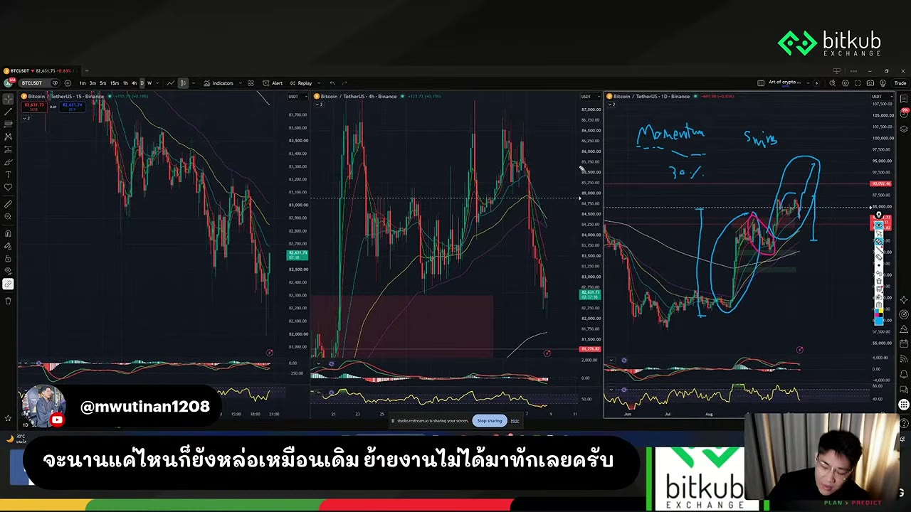

[00:19:14] เพราะว่าระยะสวิงขึ้นมาของความโฟมแต่ละ ครั้งหรือชุดที่สวิงเกิดเทรนด์แต่ละครั้ง เนี่ยระยะใกล้เคียงกันนะครับระยะมันใกล้ เคียงกันมันแปลว่าความหวือหวาของตลาด เนี่ยมันเท่าเดิมอ่ะผมยกตัวอย่างครีม เหมือนเดิมอเรียกว่าแบรนด์โดนัทแบรนด์นึง ก็ได้ออกรถน้ำออกออกรถน้ำตาลมานะครับ กระแสตกละคนเริ่มเบื่อแล้วเอ้ยรสออริจินอ ไม่อร่อยว่ะกินบ่อยแล้วมีรสอื่นให้ กินมั้ยอ่ะไปออกรถบลูเบอร์รี่มาปื้งกระแส มาอีกคนต่อแถวลวดอีกสักพักคนเบื่อรถ บลูเบอร์รี่ละอ่ะออกรถช็อกโกแลตคู่กับ วนิลาอย่างละครึ่งเป็นทูโทนปึ้งกระแสกลับ มาได้อีกนะครับเนี่ยถ้ามันเทรนด์แบบเนี้ย ครับการย่อตัวเป็นสิ่งที่รับได้เพราะมัน แปลว่าแบรนด์เริ่มแข็งแกร่งอ่ะพอพอผม เปรียบเทียบแบบนี้นึกนึกภาพออกแล้วใช่ มั้ยพอผมไม่พูดเป็นภาษาตัวเลขอ่ะอ่ะพอผม พูดแบบเนี้ยจะนึกภาพกันออกแล้วคือภาพ ลักษณ์ของแบรนด์มันเริ่มแข็งละคนจะไม่ได้ จดจำว่าไอ้โดนัทอริจินalอร่อยคนจะไม่ได้

[00:20:15] จดจำว่าไอ้โดนัทบลูเบอรี่อร่อยแต่พอมัน เกิดการ[เสียงกระแอม] ดรอปของกระแสไปแล้วเค้ากลับมาได้คนจะ เริ่มจำแล้วว่าร้านเนี้ยอร่อยเฮ้ยร้าน โดนัทร้านเนี้ดีนะเว้ยร้านโดนัทร้าน เนี้ยเมนูอร่อยทุกเมนูเลยนะเว้ยอ่า มันจะเป็นอย่างงี้นะครับแต่ทีเนี้ยถ้า มันเป็นภาพนี้ก็คือที่ที่เราพูดกันก็คือ ระยะเนี่ยมันต่างกันนะครับ อ่าตรงนี้เนาะแล้วมันจบเลยเนี่ยนะครับคน จะยังไม่ได้จดจำว่าร้านเนี้ยอร่อยคนจะจด จำแค่เมนูเดียวเฮ้ยว่าโดนัทเคลื่อมน้ำตาล มันอร่อยว่ะนะครับมันแปลว่าเค้าปรับ เปลี่ยนโมเดลอะไรขึ้นมาแล้วก็แล้วแต่ เนี่ยมันไม่สามารถดึงความสนใจจากตลาดกลับ มาได้นะครับงั้นเคสเนี้ยเราก็เลยจะมองว่า เทรนด์เนี้ยก็จะไม่แข็งแรงนะครับถ้าถ้า เกิดถ้าเกิดเป็นเกิดเคสนี้เนาะก็คือหลุด

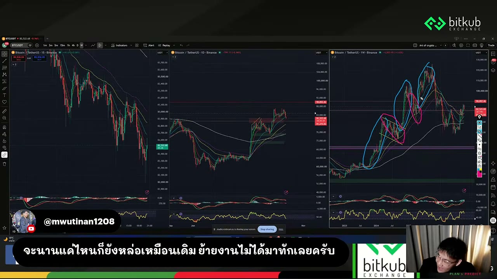

[00:21:18] โซนเนี้ย 8,000 หรือ 8,000 แล้วแล้วพรวด ลงมาเนี่ยนะครับเทรนดเนี้ยก็จะไม่แข็งแรง ภาพจะออกหน้าตาแบบไหนบ้างอ่ะโอเคภาพตรง เนี้ยสำคัญและนะครับแล้วก็ผมว่ามันจะเป็น ประโยชน์แล้วกัน 1 สิ่งที่เราเห็นนะครับคือweคเนี่ยมัน overbอได้แล้วแต่ ma เนี่ยมันยังขึ้น เหนือศูนย์ไม่ได้ทั้ง 2 เส้นนะครับแต่มัน ค่อนข้างใกล้ละนะครับฉะนั้นส่วนตัวผมนะผม ผมให้ 70% ว่าไม่น่าจะเกิดนิวโรต่ำกว่า 60,000 หรือ 58,000 ผมคิดว่า 70% มี โอกาสแบบนั้นแต่เราก็ไม่รู้ว่ามัน 100% หรือเปล่าอ่ะแต่ว่าด้วยการที่โมเมนตัมมัน เลี้ยงขึ้นมาได้ถึงโซนตรงนี้แล้วอ่ะนะ ครับแล้วอีกนิดเดียวเนี่ยก็คือถ้าเราพูด เป็นภาษาหยาบๆนะก็คือเอาเท้าสะกิดอ่ะ โมเมนตัมในweคมันก็จะเกิดแล้วนะครับมันก็ เลยไม่จำเป็นที่จะต้องทำลายโมเมนตัมตรง นี้ทิ้งแล้วไปสร้างใหม่ในเชิงจิตวิทยาของ ตลาดนะครับในเชิงความต้องการของตลาด

[00:22:21] ภาพรวมตรงเนี้ยมันอาจจะออกเป็น false  break หรือดิฟเล็กๆแบบนี้ก็ได้นะ ครับอย่างเงี้ย อ่ะสมมุตินะผมมองว่าถ้าเกิดเคสนี้นะครับ ดิฟลงมาอย่างงี้เลยฟึ๊บอ่ะ 75,000  74,000 หรืออะไรก็แล้วแต่นะครับถ้า 75,000 อย่าง เงี้ยแล้วดึงกลับตรงเนี้ยปึ้งเทรนเกิด แล้วครับอ่ะ แบบนี้ก็วิ่งขึ้นต่อได้ละนะครับไม่ไม่มี ภาพนักกังวลอะไรผมก็มองว่าโอกาสถ้าเป็น แบบเนี้ยมันจะเป็น best  case ก็คือเคส ที่ดีที่สุดนะครับไม่มีการย่อตัวเทรนด์ ไม่ลงลึกนะครับถ้าเป็นแบบนี้เทรนด์เกิดนะ ครับในweคก็ที่ผ่านมาทุกcซิลแล้วกันที่ ผ่านมาทุกcซyเมื่อเทรนใน week เกิดเนี่ย มันก็จะวิ่งยาวๆนะครับแต่ก็ต้องบอกเนาะ ว่ารอบเนี้ยมันต่างจากเดิมทั้ง timing ที่เปลี่ยนไปปกติมันจะวิ่งปลายปีเสมอแล้ว มันก็จะเกิด accumulation หรือจังหวะการ

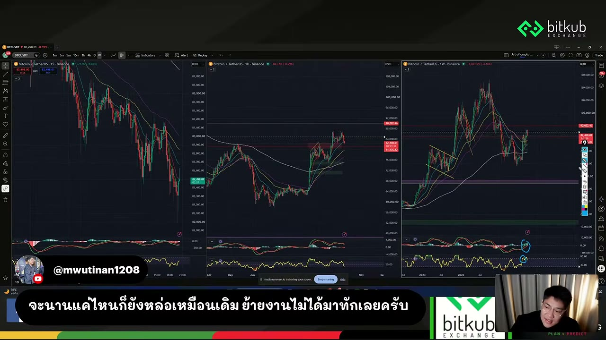

[00:23:22] สะสมของเนี่ยทุบตบลงมาเก็บอีกทีซึ่งรอบ นี้ก็ไม่เกิดนะครับแล้วก็ขึ้นไปเลยรอบนี้ ก็อาจจะเป็นรอบแรกที่เปลี่ยนไปก็ได้นะ ครับแต่ว่าในมุมมองผมเนี่ยผมยังมองแบบนี้ ก็คือถ้าลงมาตรงเนี้ยแล้วเกิดโมเมนตัมนะ ครับผมก็น่าจะเก็บของเพิ่มอีกอ่ะสมมุตินะ จินตนาการว่าสมมติสมมุติว่าตรงนี้เอาไม่ อยู่อ่ะสมมุติสมมติ แล้วภาพรวมอ่ะเอาสซัก 4 ชมงก็ได้สมมุตินะ อืสมมุติว่าลงมาเทสงี้ปึ้งๆเหมือนจะเอา อยู่ละแต่เอาไม่อยู่ฟึ๊บอย่างี้นะครับลง มาแถวตรงนี้เลยสิ่งที่ผมจะดูเนี่ยนะครับ ก็คือการเกิดพรีเมี่มของเค้าคำว่าการเกิด พรีเมี่มก็คือผมจะมองแบบนี้ปึ้งสมมุตินะ มันลงมาอย่างงี้ อ่ะแล้วมันก็จะต้องมี EMA นึงที่มันติดมา ตลอดถูกมั้ยที่เราเรียกว่าพรีเมี่มอย่า เงี้ยนะครับอ่ะฉะนั้นถ้ามันลงมาที่โซน นั้นนะครับแล้วโมเมนตัมมันเบรคได้ก็คือ เรารู้อยู่แล้ว 3 ข้อ 1 ราคาเบรคพรีเมี่ม นะครับ 2  MACD กลับมาขึ้นเหนือ 0 นะครับ

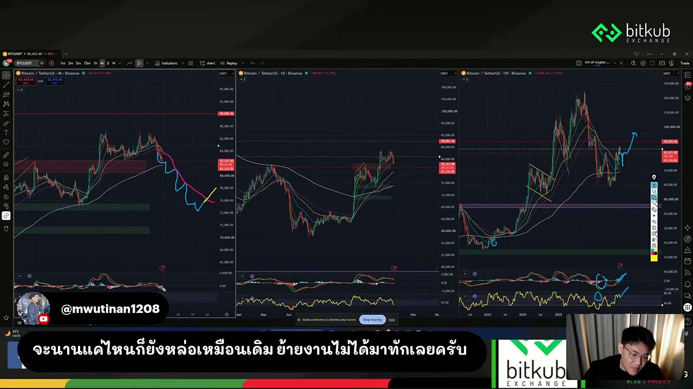

[00:24:25] 3  RSI กลับมาได้แปลว่าโมเมนตัมมันเกิด นะครับอ่ะตรงเนี้ยผมก็จะเก็บสปอตเพิ่มก็ จะเป็นจุดสะสมสปอตเพิ่มของผมและแต่ว่าถ้า เกิดมันลงมาแล้วโมเมนตัมมันเกิดไม่ได้นะ ครับก็มันจะไม่ใช่ได้จุดเก็บของนะผมก็จะ ยังรอต่อไปมันก็มีแนวโน้มที่จะลงไปลึก กว่านั้นเนี่ยครับสำหรับบitคinผมถึงบอก ว่าภาพรวมไม่ได้น่ากังวลอะไรนะครับภาพภาพ รวมผมคิดว่าอยู่ในเทรนด์ที่มันมีโมเมนตัม ที่ดีนะครับยกเว้นว่าตลาดเขาจะทุบหนักผม ให้โอกาสแค่ 30% ที่จะเกิดแบบเคสแย่นะเคส แย่ก็คือแบบตรงเนี้ยจะเป็น false เบรกแบบนี้นะนะครับเนี่ยเห็นมั้ย เอ่อถ้าถ้าเคสแย่ๆนะก็คือจะเกิด force เบรกแบบนี้ก็คือโมเมนตัมเหมือนกำลังจะมา นะครับแล้วก็ทุบลงไปจนเกิด new แต่ส่วน ตัวนะผมมองว่ามีโอกาสแค่ 30% นะครับเพราะ ว่าเม็ดเงินมัน accumulate เข้ามาค่อน

[00:25:26] ข้างเยอะแล้วสภาวะตลาดเปลี่ยนไปค่อนข้าง เยอะแล้วมันจะมีแต่เรื่อง Global Liquidity นะครับจำได้มั้ยที่ผมจะถือหาง มาตลอดว่าเออ Global  Liquidity เนี่ยมัน มันอยู่ในช่วงขาลงแล้วนะแล้ว Bitcoin เนี่ยมันแลกิ้มันมาตอนจังหวะที่ตลาดอื่น มันวิ่งขึ้นไปหมดแล้วหุ้นก็ขึ้นไปแล้วนะ ครับน้ำมันก็ขึ้นไปแล้วนะครับ 2-3 ปีที่ ผ่านมาทองคำนี่ยิ่งไม่ต้องพูดว่ามันวิ่ง ขึ้นไปก่อนแค่ไหนฉะนั้น lo สภาพคล่องของ เค้ามันจะต่ำลงอันนี้ก็ไปฟังเต็มๆของคุณ หาในบitcoin Adic ได้นะผมมองว่าเป็นเป็น ที่ค่อนข้างน่าสนใจมากๆนะครับก็ จุดนั้นน่ะนะครับถ้าเกิดเป็น Big  DI เนี่ยผมก็มองว่า มันจะต้องเป็นเคสที่ค่อนข้าง extrem มากในระดับนึงที่จะดึงให้ตลาดทุบ ลงมาได้ขนาดนั้นนะครับถ้าถ้าจะย่อลงมา ขนาดนั้นเนี่ยมันจะไม่ใช่แค่บitคinะที่จะ เป็นตัวออกมาหรือทุบจนเทรนด์เสียแค่ตัว เดียวนะครับมันจะดึงให้ตลาด NASDAQ หรือ ว่าตลาดหุ้นอเมริกา SP  500 เนี่ยลงมา

[00:26:27] ด้วยเหมือนกันแน่นอนถ้าเกิดเป็นเคสนั้น แล้วดิฟลงมาจนเกิด New  Low จริงๆนะครับ ก็จะกลับไปเข้าสู่ lo  4  year  cycle ที่ค่อนข้างชัดนะนะครับก็คือ ต้นปีจะเกิดหลุมนะครับแล้วหลังจากนั้น เนี่ยก็จะเริ่มเกิดเป็นเทรนด์ขึ้นมาอย่าง แข็งแรงะนะครับแล้วก็คิดว่าน่าจะวิ่งจนจน New  High นะครับถ้าเป็นเคสนั้นแต่ผมยัง ถือแค่แค่ 30% แล้วกันอ่ะผมแบ่งแบ่ง 2 สี อย่างงี้เนาะ ก็คือโซนตรงนี้ที่ผมผมมองเนาะอ่ะอ่ะคิด ว่าลงมาตรงนี้แล้วแล้วเกิดเป็นดิฟแล้ว ค่อยขึ้นอ่ะตรงเนี้ยผมมองแค่ 30% แล้วกัน นะครับแต่ว่าไอ้การถึงตรงเนี้ยถ้า โมเมนตัมไม่เสียเรื่องcrิpycreมที่ผมผมยก ตัวอย่างไปนะครับเรื่องโมเมนตัมก็คือถ้า ขึ้นเลยตรงนี้นะครับ หรือย่อดลงมามีดิฟเหมือนกับไซเคิลก่อน หน้าเงี้ยฟึ๊บแถว 75,000 นะครับประมาณ นั้นบวกลบ 5-10%

[00:27:27] ผมยังให้ 2 เคสเนี้ย 70% นะครับโดย Playbook ของผมเนี่ยก็คือถ้าเกิดถ้าเกิด เป็นเคสนี้ผมจะจะยังไม่เก็บสปอร์ตเพิ่ม อ่ะในพอร์ตเล่นรอบนะ ในพอเล่นเล่นรอบของผมนะครับไม่ไม่ใช่ พอร์ต DCA ระยะยาวนะครับอันนี้พูดถึงใน พอร์ตเล่นรอบนะแต่ว่าถ้าเกิดเป็นเคสเนี้ย ผมมีผมมีสปอ Bitcoin ที่ผมต้องการอยู่ 70% แล้วใช่มั้ยผมจะเก็บเพิ่มถ้าเป็นเคสนี้นะ ผมเก็บเพิ่มอีก 30% เลยก็คือกลายเป็น 100 นะครับแล้วผมจะตั้ง Stop  Loss  low จะออก 30% ถ้าเกิดถ้าเกิด low นี้โดน ทำลายถ้าไม่โดนทำลายแปลว่าผมจะได้ของครบ นะครับแต่ว่าถ้าเกิดเคสนี้ผมก็จะเข้าอีก 30% ที่เหลือเหมือนกันเราก็จะวาง Stop Loss ที่ low นี่นะครับแต่อันเนี้ยจะ เป็น Stop  Loss ครึ่งนึงของพอร์ตเลยอ่ะ ของผมอ่ะมันจะเป็นเด็กเด็กเนิบ้าตัวเลข

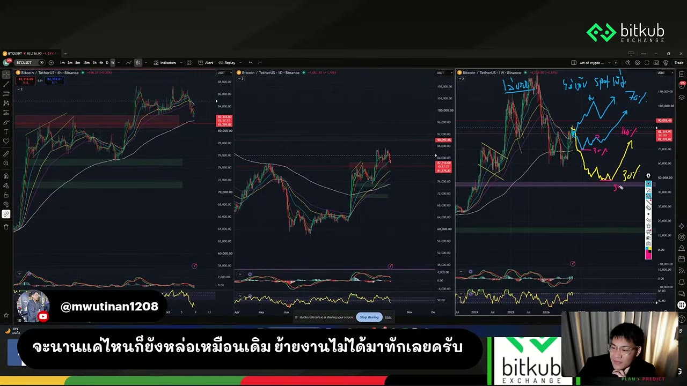

[00:28:27] นิดนึงนะเพราะว่าผมจะคำนวณเปอร์เซ็นต์ ความเสียหายกับเปอร์เซ็นต์การเติบโตตลอด นะครับเพื่อไม่ให้พอร์ตเนี่ยมันเทคความ เสี่ยงมากเกินไปนะครับผมพูดเป็นภาษา มนุษย์ง่ายๆแล้วกันก็คือถ้าเคสบนสุดเลยก็ คือแบบเอ้ย 8,000  8,000 ไม่หลุดเลยแข็ง แรงแข็งแกร่งมากโมเมนตัมไปต่อเลยอย่าง เงี้ยนะครับผมก็ไม่เก็บสปอร์ตเพิ่มเพราะ ว่ามี 70% แล้วแต่ว่าถ้าเกิดหลุดโซนตรง นี้ขึ้นมานะครับแล้วเกิดเป็น Force เบรก ก็คือมีดิฟเล็กๆด้วยความที่ตลาดมันกังวล ในเรื่องของเลือกตั้งกลางเทอมเนาะแล้วก็ เป็นช่วงที่สภาพคล้องโลกเนี่ยเริ่มอยู่ใน ช่วงขาลงแล้วนะครับลงมาที่ประมาณสัก 75,000 อยู่โซนตรงนั้นบวก -5-10% แล้ว เกิดโมเมนตัมอีกครั้งนึงใน day อ่ะสมมุติ ลงมาอย่างงี้ปึ๊บๆๆแล้วขึ้นไปต่อเงี้อ่ะ จุดเนี้ยผมก็จะเป็นจุดที่เก็บเพิ่มอ่ะผม ก็จะเข้าไปอีก 30% ที่เหลือแล้ว Stop loss  30% ที่เหลือตรงนี้นะครับอ้าแบบ นี้แต่ถ้าเกิดมันลงลวดเดียวเลยปึ้งๆตรง นี้โมเมนตัมก็ไม่เกิดอะไรไม่เกิดนะครับผม

[00:29:28] จะค่อยมาเก็บแถวโซนตรงนี้นะครับก็คือใน บริเวณราคา 50,000 ถึง 54,000 นะครับอ่ะ จะเป็นจะเป็นจุดเก็บของผมอีก 30% ที่ เหลือตอนเกิดโมเมนตัมนะครับถามว่าทำไมถึง มองโซนราคาไว้ที่ตรงนั้นอ่ะเดี๋ยวดูแบบ อ่ะไม่ได้เปลี่ยนภาษา อืต้องเป็นบิดสตมป์เนาะปึ๊บๆ อ่ะเนี่ยครับเพราะว่าถ้าเราพูดเรื่อง Discount  Zone กับ Premium  Zone น่ะนะ ที่ผ่านมาdiscซoneตั้งแต่ปี หรือ 10 ปีที่ผ่านมาเนี่ยครับโซนที่ตลาด ให้ความรู้สึกว่าได้ของลดราคาคือ EMA  25 ในกราฟQuวarterนะครับเห็นมั้ยตรงนี้

[00:30:29] นะครับเนี่ยคือสิ่งที่เรียกว่า ในรูปแบบ technical  analysis ที่เป็น กราฟแท่งเทียนนะครับซึ่งปัจจุบันเนี่ยมัน มี qu  data ที่คนทั่วไปเข้าถึงได้ง่าย ขึ้นคุณก็จะเห็นว่าเออมันไปดูเรื่อง short term  holder  long  term  holder ได้ ทั้งเป็น onchain  data เป็นค data ที่ แบบระยะการเก็บออเดอร์การเกิดสเปรดเอ่อ ระยะวิ่งในแต่ละช่วงอย่างเงี้ยมันก็จะ เห็นได้มากขึ้นแต่ถ้าเราจะวิเคราะห์ด้วย แท่งเทียน รูปแบบ Technical  Analysis แบบเนี้ย เนี่ยคือโซนที่ตลาดเนี่ยตีความว่าได้ของ ลดราคา นั่นคือสาเหตุที่ในบทความที่ผมเขียนตลอด ว่าเอ้ยโซนนั้นน่ะผมมีของครึ่งนึงแล้ว แล้วผมก็เพิ่งมาเติมของที่เหลือให้มันได้ 70 ในจังหวะที่มันรีบาวแล้วนะครับเนี่ย คือวิธีการดูว่าตลาดเนี่ยมันรู้สึกถูกกับ โซนราคาไหนแล้วรู้สึกแพงกับโซนราคาไหนนะ ครับโซนที่แพงเนี่ยเราก็ดูในรูปแบบ reversร์ชionได้นะครับอ่ะผมก็เลยมองว่า ตรงเนี้ยมันมันค่อนข้างสวยละถ้าเกิดว่า

[00:31:30] ราคาจะย่อไม่แรงแล้วก็ขึ้นต่อไปเลยอย่าง เงี้ยเห็นมั้ยลงมา 75,000 หรือลงมาแย่ๆ อะไรอย่างเงี้ยแล้วก็ไซด์เวย์ขึ้นไปต่อ เงี้ยมันยังมีแนวโน้มที่สวยกว่าอยู่ถ้า เกิดคุณเก็บสปอรตนะครับผมว่าผมว่าสวยกว่า นะครับส่วนถ้าเป็นรูปแบบ หุ้นอ่ะมันก็จะเดินทางแบบเนี้ยนะครับผมจะ ใช้หลักการเนี้ยในการ DCA หรือเข้าแบบร่ำ ซ้ำเห็นมั้ยคือวิธีการแทรกอ่ะง่ายมาก ถ้าเกิดเราเอาทั้งหมดออกอ่ะผมจะบอกผมผม เทียบแบบนี้แล้วกันอ่ะเดี๋ยวนะมันมันซ่อน อินดิเคเตอร์ไงวะอ๋อมันต้องซ่อนอย่างงี้ นะอ่ะสมมุติว่าเอาออกเงี้ยแล้วแล้วเราไม่ ใช้งานรูปแบบอินดิเคเตอร์อะไรเลยก็แล้ว แต่แล้วเราคำนวณว่าเอ้ยเราดูแต่แนวรับแนว ต้านว่าเมื่อไหร่ของจะถูกของจะแพงถ้าเรา ดูในภาพใหญ่เงี้ยสมมุติว่าเรามองว่าเฮ้ย ตรงเนี้ยเบรคขึ้นมาละเป็นนเบรAK new  high งั้นตรงนี้สูงเรารอรีทestอ่ะรอบนี้เราได้ ของรอบรอบอื่นเราไม่ได้ของแล้วถูกมั้ย

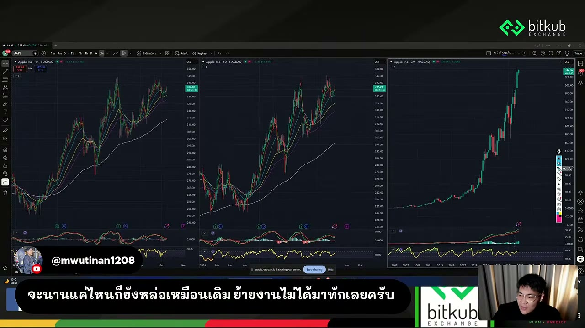

[00:32:34] หรือเฮ้ยเรามองว่าตรงเนี้ยเป็นแนวรับสวย มากเลย hiden  demand เดี๋ถ้าลงมาเราจะ ได้ของนะครับแบบเนี้ยมันก็จะใช้ได้ไม่ได้ เกิดประสิทธิภาพในภาพใหญ่นั่นคือสาเหตุ ที่ผมจะชอบใช้อินดิเคเตอร์ในรูปแบบค่า เฉลี่ยนะครับทีเนี้ยเราต้องรู้ลิมิตของ มันก่อนลิมิตของมันคือขีดจำกัดของมัน อันเนี้ยเป็นเรื่องที่สำคัญมากๆแล้วผม เชื่อว่าคนส่วนใหญ่มักจะมองข้ามคนส่วน ใหญ่หา Holy  Grail คนส่วนใหญ่หาจอก ศักดิ์สิทธิ์ที่รู้ปั๊บจบรู้ปั๊บเอ้ยใช้ อันนี้แหละอันเดียวมันทำแบบนั้นไม่ได้เรา ต้องรู้ทั้งข้อดีข้อเสียข้อดีของ อินดิเคเตอร์ที่ผมใช้นะครับคือไอ้ EMA แล้วก็ RSI เนี่ย มันไต่ตามตลาดหรือมันเกาะสภาวะตลาดตลาด ได้ดี เฮ้ยตลาดยังรู้สึกถูกอยู่มั้ยตลาดยังรู้

[00:33:36] สึกว่าได้ของลดราคาเรื่อยๆมั้ย พวกเนี้ยทำงานได้ดีมากเห็นมั้ยเอ้ยแมด เหนือศูนยหมดตลอดเลยแล้วก็ย่อทุกครั้ง กลับไปบอได้ทุกครั้งเลยว่ะเฮ้ยมันแปลว่า ความโฟขึ้นใหม่ทุกครั้งงั้นไอ้จุดdisคา ตรงเนี้ยก็เป็นจุดที่ยังใช้ได้ถูกมั้ยแต่ ถ้าเมื่อไหร่ก็ตามพี่หลุดdisคคราวแรกแล้ว มันจะเป็นเหมือนทองคำเดี๋ยวผมจะเปิดเทียบ ให้ดูแต่ละตัวนะครับแต่ข้อเสียคืออะไรรู้ มั้ยทั้ง 3 ตัวเนี้ยช้า ถ้าเกิดคุณไปเทียบกับ รูปแบบการเข้าด้วยศาสตร์อื่น demand supัlyมี reversion หาจุดคุ้มทุน balance balance  zone อะไรก็แล้วแต่มันจะช้านะ ครับฉะนั้นการใช้พวกเนี้ยเป็นจุดเข้าอ่ะ ข้อเสียคือจะช้าแต่จะวัดสภาวะตลาดระยะยาว ได้ดีนะครับฉะนั้นถ้าเกมระยะยาวการสะสม แบบ 5 ปี 10 ปีขึ้นไปอ่ะอินดิเกเตอร์ เหล่าเนี้ยถ้าเกิดคุณเข้าใจการใช้งานของ

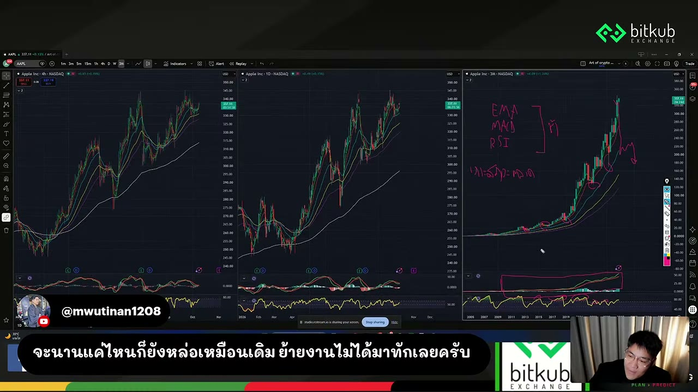

[00:34:37] มันแล้วก็เข้าใจขีดจำกัดว่ามันไม่ได้สุด ยอดมันไม่ได้ดีที่สุดในทุกสภาวะมันมีข้อ เสียคุณจะใช้งานมันได้ทรงพลังมากๆนะครับ อ่ะเราอยากไปลองลองดูตรงอื่นเงี้ย Amazon เงี้อันนี้เป็นตัวที่ผมชอบมากนะกดผิดอีก อ่ะตรง นะครับอย่างเงี้ยเราก็ยังสามารถใช้ได้นะ ครับในจุดตรงนี้อ่ะเดี๋ยวผมเอาให้ดูอ่ะลบ เห็นมั้ยว่าตรงเนี้ยdiscา disc เราก็ได้ของเรื่อยๆนะครับเนี่ยจะเป็นจุด ที่เราได้ของเรื่อยๆนะครับแล้วมาจุดถึง จุดตรงเนี้ยอ่ะเกิดวิกฤตนะครับตอนนั้น โควิดเนาะหลุดแถว 2019-2020 ก็ทุบลงมาจน หลุด discount เลยตรงนี้ปั้งเข้ามานะครับ อันเนี้ยก็แปลว่ามันเกิด ความคริของตลาดและตลาดมองว่าเฮ้ยมัน รุนแรงมากมันน่ากังวลมากแบบนี้ราคาจะกลับ

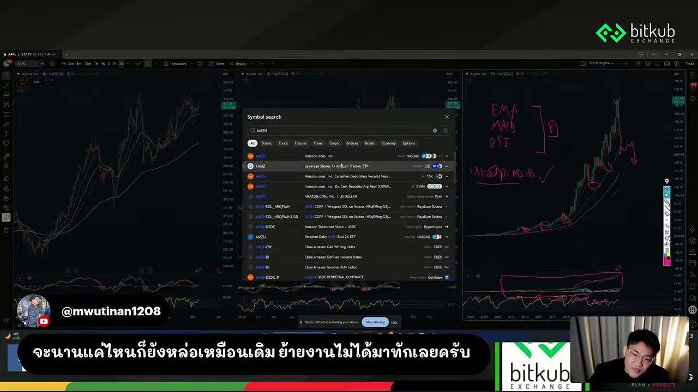

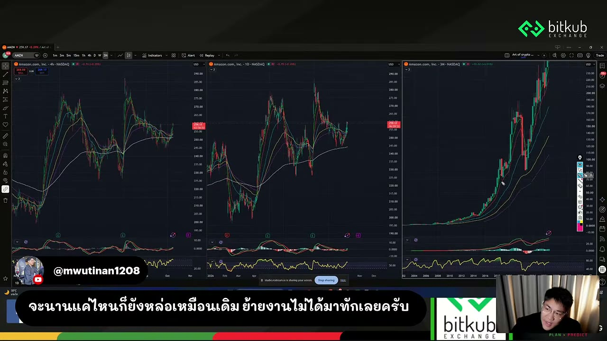

[00:35:39] มาได้มั้ยถ้าเกิดเป็นเคสเนี้ยที่ทุบลงมา แล้วไม่เกิดรีบาวoundที่discนแล้วแล้ว กลับไปเลยนะครับเราจะตีความว่าdiscโซนตรง เนี้ยใช้ไม่ได้แล้วนะครับเราจะมองว่า discซoneตรงเนี้ย ไม่ได้ทรงพลังเท่าเดิมเพราะว่ามันมันคือ โซนที่ตลาดมองว่าถูกมาตลอดแต่อันเนี้ย เกิดวิกฤตอ่ะฉะนั้นผมก็จะไม่สามารถใช้ EMA 25 ที่เดิมได้ในการมองว่ามันถูกเราก็จะ ต้องปรับภาพไปมองว่างั้นจังหวะที่มันย่อ ลงมาลึกกว่านั้นเราก็จะไปดูว่าโมเมนตัม มันกลับมามยอ่าตรงนี้นะครับเห็นมยเราจะ แทรกแบบนี้แทนอ้างั้นเราจะรู้ได้ไงว่าตรง ไหนคือพรีเมี่มอ่ะง่ายมากงั้นหลุดdisคา แล้วถูกต้อง MAD ลงมาต่ำกว่า 0 แล้วถูก ต้องเกิดพรีเมี่มแล้วนี่ไงตึงถูกมั้ยตึง ถูกมั้ยแล้วก็นี่เบรกพรีเมemiมได้ MAD กลับมาขึ้นเหนือ 0 แล้ว RSI กลับมาoverบอ งั้นตรงเนี้ยจะเป็นจุดที่เราจะต้อง เนี่ยครับมันจะเป็น conditionition ที่

[00:36:40] คุณจะต้องเข้าใจว่า ตลาดตีความยังไงกับกับตัวนั้นนะครับว่า มันอยู่ในจุดลดราคามั้ยหรือมันแพงไปแล้ว หรืออะไรเงี้ยเนี่ยนะครับก็จะเป็นจุดที่ เวลาเกิดวิกฤตมันก็จะหลุดdiscค zone แปล ว่าเอ้ยหลักตลาดตลาดไม่ได้มองว่ามัน ถูกแล้วแต่เนี่ยครับมันจะมีหลายตัวมากเลย นะที่ผมมองว่ามันวิ่งค่อนข้างสวยมากๆ อย่าง Microsoft เนี่ยเห็นมั้ย นะครับก็อยู่ใน gap  disc เงี้ยเนี่ยราคา ก็ขึ้นไปและนะครับฉะนั้นถ้าเราไปรอทุก อย่างมันแครชแล้วแล้วกลับมาที่ตรงเนี้ยนะ ครับมันจะมีโอกาสยากมากๆที่เราจะได้ของนะ ครับแล้วสุดท้ายเราจะปล่อยโอกาสทั้งหมด หลุดมือไปนะครับเราก็จะได้นั่งมองว่าแบบ เออเฮ้ยเราไม่น่าปล่อยให้โอกาสตรงนี้หลุด ไปเลยเราน่าจะแบ่งเข้าแล้วสุดท้ายเราก็จะ ไปซื้อของแพงอยู่ดีวิธีคืออย่างที่ผมบอก สมมุติว่าคุณจะเก็บสินทรัพย์นั้นในระยะ ยาวอยู่แล้วในวิธีส่วนตัวของผมอ่ะอย่าง ที่บอกก็คือครึ่งนึงผมจะ DCA อีกครึ่งนึง ผมจะร่ำซ้ำเนาะ อันนี้ผมไม่ได้พูดเรื่องนี้นานะก็เลย เดี๋ยวเดี๋ขอยกยกมาอธิบายเพิ่มให้ฟัง

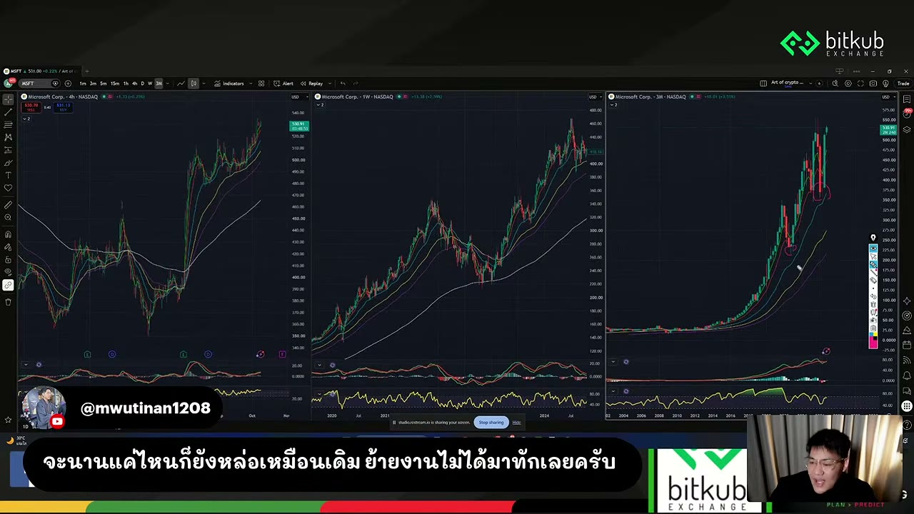

[00:37:42] หน่อยแล้วกันคือ DA เนี่ยเราซื้อทุกราคา อาจจะทุกวันจันทร์ทุกวันอังคารก็ได้นะ ครับแล้วแต่เลยแต่ทีเนี้ยไอ้ซumเนี่ยแทน ที่เราจะเข้าทุกเดือนนะครับก็สมมุติว่า คุณมีเงินลงทุนเดือนละ 10,000 บาทแล้วคุณ อยาก optimiz หรืออยาก เค้าผมนึกภาษาไทยไม่ออกใช้คำว่ารีด ประสิทธิภาพแล้วกันรีดประสิทธิภาพมันยัง ไงดีก็คือคุณก็ DCA เดือนละ 5,000 แล้วอีก 5,000 คุณเก็บไว้ทุกเดือนเลยจน กว่ามันจะเข้ามาที่discอยสมมุติว่าคุณรู้ ว่า Microsoft เนี่ยมัน discount อยู่ที่ EMA ต่ำกว่า EMA  10 และ 25 ก็คือตรงนี้ ที่เป็น discount ของ Microsoft ถูกป่ะ อ่ะสมมุตินะ อย่างเงี้ยแล้วคุณเริ่ม DCA  Microsoft ตอน 2020 อ่าตอนตอน 2020 นะครับแล้วมัน เพิ่งมาdiscาให้คุณเนี่ยตอน 2023 ก็คือ 3 ปีถูกมั้ย 3 ปีสมมุติว่าตรงนี้คุณคุณ

[00:38:42] เพิ่งมาเริ่มเข้าตรงนี้ 3 ปี อ่างั้นถ้าเกิดคุณ DCA [เสียงกระแอม]ไป เรื่อยคุณก็จะได้ของฝั่งนี้เดือนละ 5,000 เดือนละ 5,000 เดือนละ 5,000 ไป 3 ปีและ คุณจะมีเม็ดเงินตรงนี้นะครับปีละ 60,000 3 ปีคือ 180,000 นะครับก็คือคุณจะมีเฉลี่ยตรงนี้ตึ๊กๆๆๆๆ [เสียงหัวเราะ]ๆๆ ตึ๊กๆๆๆนะครับแล้วก็คุณเอา 180,000 เนี่ย เข้าเปรี้ยงเดียวในโซนที่มันเป็นล่ำซ้ำนะ ครับในโซนที่เป็น discount แล้วหลังจาก นั้นเราก็จะทำเหมือนเดิมนะครับอันนี้อัน นี้คือรูปแบบการเก็บสะสมของระยะยาวแบบที่ ผมใช้เนาะด้วยความที่เราเราอ่านโมเมนัม แบบTechคnical Analysis นะครับฉะนั้นก็ เก็บเงี้ย DCA  DCA  DCA  DCA แล้วเราก็ เก็บร่ำซำไปเรื่อยๆเก็บเงินร่ำซำไปเรื่อย ๆพอไม่รู้ว่ามันผ่านไปกี่ปีพอมันลงมาแล้ว ก็เอาร่ำซำเนี่ยมาเข้าแล้วเราก็คอยวาง Stop  Loss เฉพาะไม้ล่ำซ้ำนะครับไม้ DCA

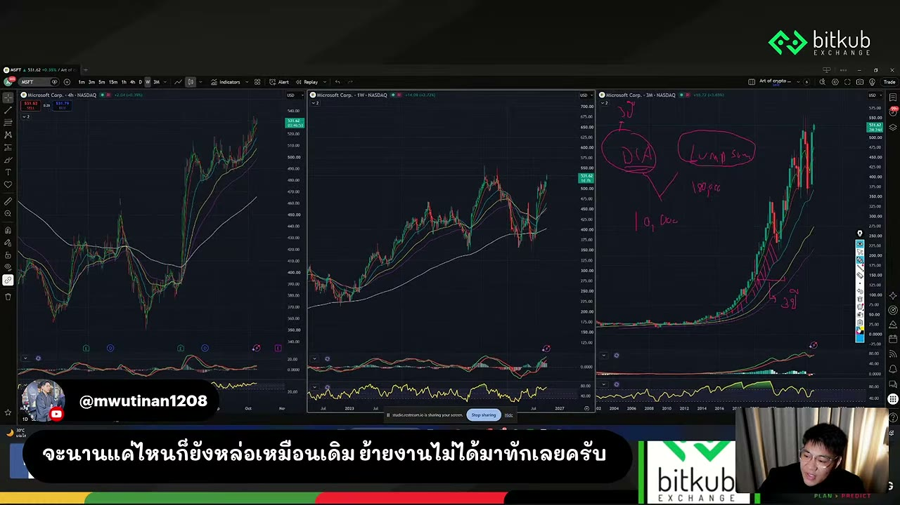

[00:39:45] ผมไม่ Stop  Loss เลยนะครับถ้าเกิด โมเมนตัมของตลาดไม่เกิดวิกฤตครับมันก็จะ ไปของมันเรื่อยๆอย่างเงี้ย นะครับอย่างเงี้ยเห็นมั้ยก็จะไปของมัน เรื่อยๆนะครับอย่างจังหวะที่เกิดล่ำซ้ำ เนี่ยคุณก็วาง stop ตรงนี้เพราะว่ามัน เกิดโมเมนตัมแล้วเห็นมั้ เนี่ยครับ[เสียงสูดหายใจ]นี่คือเกมสะสม ระยะยาวแล้วถ้าเกิดเมื่อไหร่ที่เกิดการ หลุดdiscซoneครั้งแรกในtimeม frame ใหญ่ ผมก็จะ rebalance พอร์ตแล้วผมออกแน่ๆ ครึ่งนึงนะครับผมออกเลยครึ่งนึงนะครับอัน นี้คือ data สถิติที่เราเก็บมาส่วนตัว เนาะมันแปลว่าผมไม่ต้องการรับความเสี่ยง ที่มากไปเพราะว่าเราดูดิว่าสินทรัพย์นั้น น่ะมันวิ่งด้วย discoun zซoneนั้นน่ะมา กี่ปียิ่งนานการหลุดเทรนด์ระยะยาวเนี่ย โอกาสจะพักตัวกว้างค่อนข้างสูงนะมันจะ เหมือนกับทองคำเนี่ยผมไปเทียบกับทองคำให้ ดูนะครับ อ่ะเราดูทองคำตรงนี้นะครับ นี่เราก็จะเห็นเนาะว่าตัวของdiscซoneของ

[00:40:46] ทองคำเนี่ยมันคือ EMA  25 นะครับมันนาน มากเลยนะนะครับอย่างเงี้ยแล้วก็ หลุดตรงนี้เนี่ยเห็นมั้ยพอมันหลุดตรง เนี้ยครับผมถึงบอกว่าขาขึ้นที่ลวดเดียว ของทองอ่ะจบแล้วถ้าใครดูมาตั้งแต่ดูไลฟ์ ผมมาตั้งแต่ตอนนู้นเลยอ่ะนะครับเนี่ยตั้ง แต่ต้นปีอ่ะอ่ะผมว่าผมว่ามันต้องมีคนจำ ได้นะผมบอกเอ้ยเนี่ยไอ้ขาขึ้นทองแบบลวด เดียวอ่ะจบแล้วต่อจากเนี้ยอย่างดีเลยนะก็ คือไซด์เวย์แล้วขึ้นต่อแต่จะไม่ขึ้นลวด แบบเดิมแล้วเพราะว่าดิเคาอ่ะมันจบไปแล้ว นะครับฉะนั้นตอนเนี้ยคุณต้องรอโมเมนตัม มันกลับขึ้นมาอีกครั้งซึ่งยังเกิดขึ้นไม่ ได้เฮ้ยคุณอาร์ตใช้แม็กดีโคตรช้ามัน มีประโยชน์ยังไงนี่ไงเห็นป่ะนี่มัน เหนือศูนย์ตลอดเลยและมันไม่เคยหลุดdisดา เลยเห็นป่ะเนี่ยทองคำเงี้ยเนี่ยแสดงว่า ออเดอร์ซื้อมันไหลเข้าตลาดเรื่อยๆเรื่อยๆ ๆๆๆๆๆๆราคายิ่งขึ้นออเดอร์ซื้อก็ยังไหลๆ ลงมาในโซนเดิมที่ตลาดเคยมองว่าถูกก็ มีเงินใหม่เข้าปั้งๆแบบนี้ครับคือเทรนด์

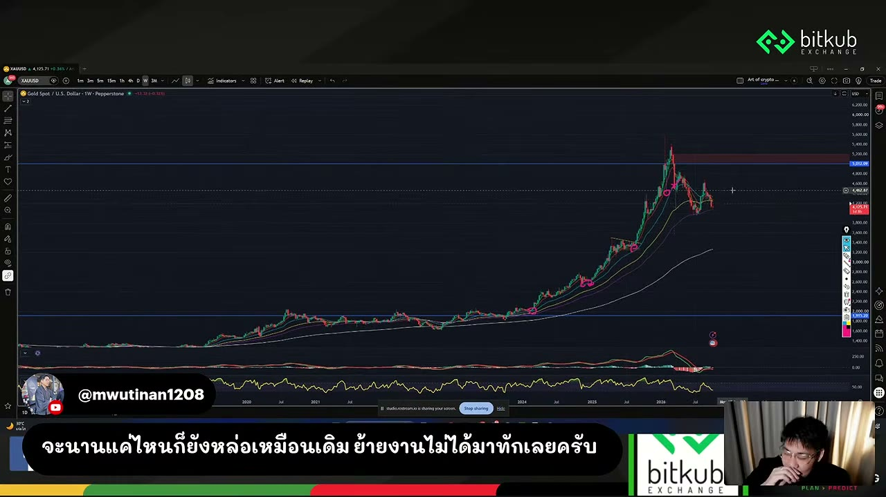

[00:41:49] ที่แข็งมากๆ แต่ตอนเนี้ยมันกลับได้แล้วเห็นป่ะ เนี่ยผมถึงบอกว่าเอ้ยถ้าเกิดจะมองว่าทอง จะกลับมาขึ้นเป็นขาขึ้นยาวๆอีกครั้งนึง ภาพตรงนี้มันต้องมันต้องกลับไปให้ได้ก่อน อ่ะก็คือ 1 นะมันจะต้อง MAD กลับขึ้นไป เหนือ 0  RSI กลับไปoverบอเพื่อมองว่า ออเดอร์ซื้อกลับมาเยอะกว่าขายอีกครั้งแค่ แค่ตรงนี้ก่อนนะยังไม่ต้องเกิดเทรนด์ไม่ เทรนด์นะซื้อกลับมาเยอะกว่าขายอีกครั้ง นึงนะครับแล้วก็จะต้องเบรค high ตรงนี้ไป เพื่อคอนเฟิร์มว่าสวิงใหม่ได้เริ่มเกิด ขึ้นแล้วนะครับฉะนั้นตอนเนี้ยถ้าจะมองว่า ทองจะเป็นขาขึ้นอีกยาวๆเนี่ยผมมองว่าภาพ รวมออก sideway ก่อนนะภาพรวมออก sideway ซึ่งโซนแบบเนี้ยมันมันเหมาะจะเป็นโซนของ การ DCA นะครับ DCA ระยะยาวมากกว่านะครับเพราะว่า ตอนเมันหลุดละมันมันหลุด discount โซน แล้วเราจะมาเข้าไม้ล่ำซ้ำแบบเนี้ยไม่ เวิร์คนะครับตอนเมันเป็นโซน DCA เนี่ย ครับพอคุณจำแนกอย่างเงี้ย มันจะง่ายแล้วพอผมกลับมาที่บitcoinคุณก็

[00:42:50] จะยิ่งเห็นภาพได้ชัดอ่ะนะครับมาละบitcoin ไหลมาแล้วนะครับหลุด 82,000 แล้วนะหลุด คีย์เลเวลแล้วฉะนั้นตอนเนี้ยให้ระวังเลย นะครับอ่ะ outcoin เนี่ยเอ่อภาพที่ผมค่อน ข้างกังวลแล้วผมเตือนไว้จำได้มั้ยว่าแบบ เฮ้ยมันเทสในweคนะถ้ามันเบรคเนี่ยมันก็จะ เป็นเทรนด์ที่ค่อนข้างรุนแรงแต่ถ้ามัน เบรคไม่ได้เนี่ยนะครับการย่อของมันเนี่ย จะค่อนข้างมีรีเจคที่แรงเหมือนกันอาจจะ เป็นอย่างเงี้ยเห็นมั้ย ถ้าเบรคได้อ่ะก็เป็นเทรนวิ่งยาวแต่เนี่ย นะครับหลายตัวเริ่มละเห็นมั้ยหลายตัว เริ่มละเนี่ยเริ่มเกิดอาการละนะครับ ฉะนั้นตรงเนี้ย เห็นมั้ยoverบอไม่ได้แกดีขึ้นเหนือ 0 ทั้ง 2 เส้นไม่ได้งั้นถ้าตลาดใจดีอย่าง ที่ผมบอกเฮ้ยโมเมนตัมมันจะไปต่อแล้วมันจะ ขึ้นต่อเลยมันจะไซด์วยแล้วขึ้นเลยอย่าง เงี้ยนะครับก็นับเป็นเรื่องดีถูกมั้ยก็ นับนับเป็นเรื่องดีว่าเป็นเคสเบสเคสแต่ ที่ผมดูอ่ะคือเฮ้ยถ้าคุณถือตัวเล็กอ่ะบาง ตัวมันจะไหลออกไปเลยอย่าง XL อย่างเงี้ย เห็นมั้ยอย่างเงี้ยมีโอกาสเกิดนิวโรนะ

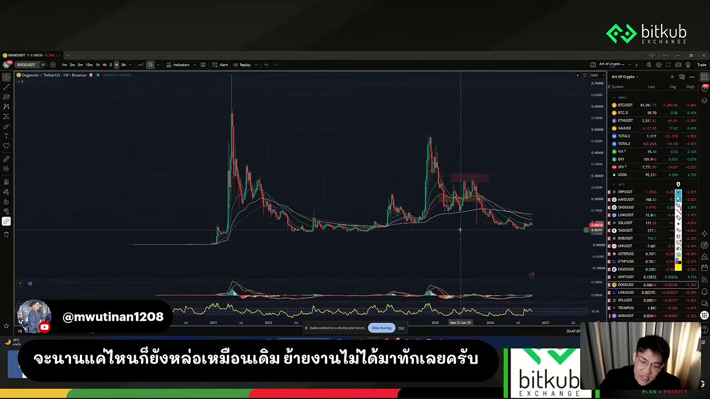

[00:43:51] ค่อนข้างสูงนะครับเพราะว่ามันไม่มีฐาน ผ่านฐานที่ผ่านมาตอนแรกอ่ะผมมองว่าถ้ามัน เบรกตรงนี้แล้วมันยืนได้มันควรจะชูตขึ้น ไปเลยนะครับตอนมันย่อเนี่ยผมเลยแบ่งเก็บ แต่มันมันฮิต stop  loss ผมและตอนตัว เนี้ยผมโดน stop ออกนะครับแต่อย่างตัวพวก เนี้ยถ้ากลับมาอย่างเงี้ยโอ้โหผมชอบเลย ถ้าเกิดลิงก์กลับมาตรงนี้แล้วเกิด โมเมนตัมอย่างเงี้ยกลับขึ้นอีกรอบโอเคผม ผมกลับเข้าเลยแต่ถ้าเกิดว่าตลาดมันไม่ กลับอย่างที่บอกมันเกิดดิฟผมก็จะไปรอภาพ เดิมนะครับไปรอภาพเดิมก็คือรอโมเมนตัมมัน เกิดใหม่ เนี่ยครับเล่นง่ายมากเลยถ้าเล่นโมเมนตัม ภาพใหญ่ผมถึงบอกว่าอยู่กับภาพใหญ่ไว้อ่ะ การตัดสินใจคุณจะไม่ต้องทำบ่อยนะครับแล้ว ก็มันได้ประสิทธิภาพนะครับอย่างี้อ่ะ เดี๋ยวตอบคอมเมนต์ก่อนแล้วเดี๋ยวผมไปไล่ วิเคราะห์ตัวอื่นนะครับ เนี่ยก็คือ 70% ไม่จะไม่หลุด 80,000 ภายในพรุ่งนี้ 19:00 น.นะครับถ้า เกิดหลุดเนี่ยก็น่าจะพรวดนะครับค่อนข้าง รุนแรงนิดนึง H จะหลุดมั้ยก็มีแนวโน้มนะ ครับเพราะว่าผมโดนออกออกไปผมออกที่เป้าผม

[00:44:53] อ่ะผมได้ออกไปแค่ครึ่งเดียวนะครับอีก ครึ่งนึงผมยังไม่ได้ออกก็คือตรงนี้ฉะนั้น ตอนเนี้ยผมมองว่า HR เนี่ยมีโอกาสลงมาเทส ถึงตรงนี้เลยนะครับแล้วอาจจะเกิดดิฟอย่าง งี้แล้วค่อยขึ้นอย่างี้ก็ได้นะครับแต่ถ้า เกิดตลาดยังเทต่ออย่างเงี้ยผมว่า New  Low นะครับทรงพวกเนี้ยคือ Outcoin อ่ะอย่าไป ถือนานอย่าไปถือนานถ้าเกิดเราถือเนี่ยเรา ไม่เอาเป้าเล็กอยู่แล้วเพราะว่าเรา ต้องการลุ้นโมเมนตัมแบบนี้ถูกมั้ยฉะนั้น หลักการของผมเป็นอย่างนี้ตลอดเมื่อไหร่ก็ ตามที่ถึงเป้าแรกผมออก 30-50% ที่เหลือผมรันเป้าใหญ่ถ้าไม่ได้ผมกลับมา stop เลยนะครับมันต้องดูเรื่อง reward แล้วก็ความน่าจะเป็นที่เกิดขึ้นนะครับอ่ะ อย่างตรงนี้มาถึงโซนและนะครับปึ๊บอ่าก็ดู นิดนึงอย่างที่บอกมี 3 เคสนะครับระยะยาว บitcoinไม่ได้น่ากังวลเท่าไหร่ถ้าลงมาก็ ยิ่งดีเป็นจังหวะที่น่าจะเก็บของแต่ที ผมจะสื่อให้เห็นถึงเรื่องอะไรรู้มั้ยนะ คือความกังวลของตลาด

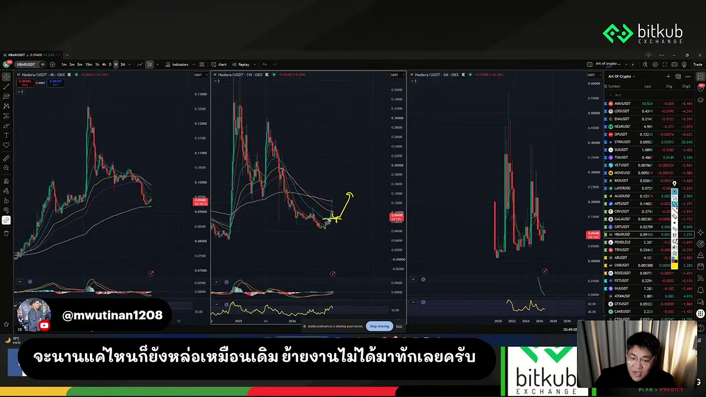

[00:45:55] สวัสดีคนดูทั้ง 148 ท่านนะครับเราต้อง เข้าใจก่อนว่าตลาดอ่ะมันทำเรื่องเนี้ยได้ ดีเสมอคุณสังเกตเรื่องนึงมั้ยก่อนหน้า เนี้ยคุณว่ามีกี่คนที่บอกว่าลงมานะจะซัด ให้เต็มข้อเมื่อไหร่ตลาดจะย่อฉันอยากจะ เก็บของจังเลยอันนี้เอาบitcoinย่อแค่นิด เดียวนะคุณเห็นป่ะว่าแค่ 5% แต่ out คอย หลุดเละเทะถูกป่ะบางตัวลงมา 20 บางตัวลง มา 30% จากยอดบางคนบางตัวแบบเสียโครง สร้างไปะแค่เนี้ยคุณว่าสภาวะตลาดอ่ะตอน เนี้ยระหว่างแบบเก็บครับพี่เก็บครับพี่ อยากได้ครับกับอูยเดี๋ลงลึกแน่เลยเดี๋ยว ยังไงก็ต้องลงอีกเดี๋ยังไงต้องไปไอ้อย่าง ไหนมันอย่างไหนมันมากกว่ากันคำตอบก็คือ อย่างนะครับตลาดมันจะทำงานเรื่องเนี้ยได้ ดีเสมอผมถึงบอกว่า พอลงมาเดี๋ยวคนก็ไม่กล้าซื้อครับอยู่ดี คุณคุณไม่ต้องกังวลเลยนะครับฉะนั้นยิ่งคน ไม่กล้าเร็วเท่าไหร่เนี่ยมันก็จะทำให้

[00:46:57] จังหวะของตลาดเนี่ยมันได้ไวขึ้นผมก็เลย มองว่าถ้าเกิดดิฟจริงๆเนี่ยตลาดควรจะกลับ มาวิ่งขึ้นเริ่มสร้างฐานเนี่ยก่อนเลือก ตั้งกลางเทอมเกิดขึ้นความผวนตรงนั้นจะ เกิดขึ้นด้วยซ้ำเพื่อให้รายย่อยเนี่ยกลับ มาตัดสินใจไม่ทันอีกครั้งนึงนะครับ ใช่คนมันจะกังวลครับพอ out คอยลงแรงๆที นึงก็กังวลแล้วนะครับ ตอนไปญี่ปุ่นมีเช็คตลาดมั้ครับมีครับมีๆ ผมเทรดด้วย 2 ไม้ตอนอยู่ญี่ปุ่นเทรด 2 ไม้แต่ไม่ได้เทรดแบบเฝ้าหน้าจอกดอะไรเยอะ ก็ไอ้ที่ทำ Block  Trading อ่ะครับที่ที่ ลงไปแต่วันนี้ผมโดนไปไม้นึงนะโดนไปประมาณ 1,000 ดอนยูเนียรผมผมเล่นตอนมันรีบาวที่ 8,2500 แล้วผมวาง stop ที่ 8,1900 ก็ เป็นบล็อก trading อ่ะแล้วผม TP  84,000 แต่ว่ามันลงมา stop ผมโดนไป 1,000 ดอนวัน หวัดดีครับคุณแบคทีเรียลหวัดดีครับผม

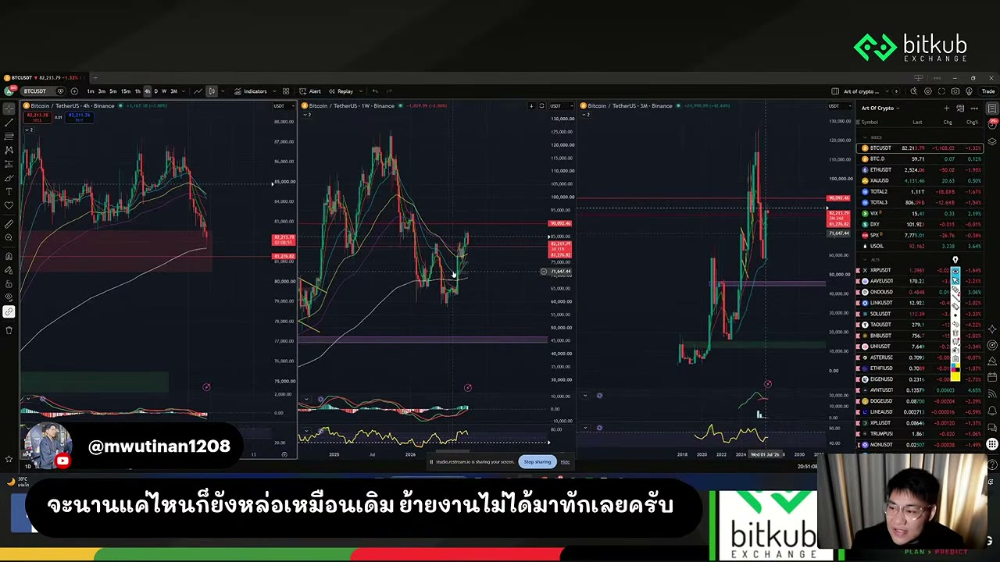

[00:47:58] สวัสดีครับทุกคนได้ครับเดี๋ยวดูให้ครับ เอด้าช่วงคุณรอคอยสอนแบบเดิมแต่ละเอียด ขึ้นเรื่อยๆอ่ะใช่ครับแต่ว่าภาษาก็อาจจะ ต่างดาวขึ้นคนมาใหม่ก็จะแบบเอ้ยพูดอะไร ฟังยากจังเลยนะครับอ่าแต่ว่าเดี๋ยวจะ พยายามทำให้มันเข้าใจง่ายขึ้นเรื่อยๆครับ Stop ร่ำซำเฉยๆไงครับปกติราคามันไม่ได้ ปรับใหม่เลยครับ Stop ร่ำซ้ำเฉยๆหมายถึง ว่าหลังจากเราเข้าไม้ร่ำซ้ำด้วยโมเมนตัม ไปแล้วครับไอ้ตรงนั้นน่ะมันไม่ควรจะกลับ มาโลเดิมคุณจูเนียนึกออกมั้เช่นสมมุติว่า โซนตรงเนี้ยถ้าเกิดว่ามันเป็นdisคจริงอ่ะ อ่ะสมมุติว่าตรงนี้เรา DCA อ่าเรา DCA นะ แล้วตรงเนี้ยเราเข้าด้วยร่ำซ่ำ อ่ะฉะนั้นถ้าเกิดร่ำซำมันเกิดโมเมนตัม เนี่ยก็คืออย่างงี้แล้วมันเกิดไปอย่างี้ ใช่มั้ย ต่ำกว่า 30% มันจะไม่กลับมาที่ low เดิม ตรงนี้แล้วคุณจูเนียร์นึกออกป่ะถ้าเกิด เทรนด์มันเกิดและdiscาโซนตรงนั้นตลาดยัง มองว่ามันเป็นจุดdiscค

[00:48:59] ต่ำกว่า 30% ที่มันจะกลับมาที่ low เดิม งั้นถ้ามันลงมาตรงเนี้ยแสดงว่ามันมันเป็น อัตราความน่าจะเป็นที่ยากที่จะลงมาทำ New Low หลังจากเกิดโมเมนัมไปแล้วในภาพ Week เราก็เลยตั้ง Stop  Loss ไว้ว่าเอ้ยถ้า ไม้ล่ำซ้ำอ่ะก็เราก็จะโดนแค่ไซส์ของไม้ลำ ซ้ำแต่ถ้าไม่โดนเราจะได้หุ้นตัวนั้นหรือ สินทรัพย์ตัวนั้นเพิ่มในอัตราที่สูง ฉะนั้นนะครับสมมุติว่ามันเกิดโมเมนตัมใน discาโซone 5 ครั้งเราอาจจะโดน stop  my mind ซ้ำแค่ครั้งเดียวแล้วถ้าเราเอา data ตรงนี้กับตัวเลข list  reward  ratio ไป เทียบอ่ะเราจะเห็นภาพเลยว่าเออเทียบเทียบ กับ DCA อย่างเดียวกับร่ำซ้ำที่มีโอกาส Stop  Loss บ้างต่ำกว่า 30%  25-30% อ่ะ ถ้าจะเอาตัวเลขเป๊ะๆเนี่ย เราเก็บหุ้นในระยะยาวถ้านับ 10 ปีบวก เนี่ยได้มากกว่าเดิมถึง 50% เนี่ยเห็นมั้ยเราเราใช้เงินเท่าเดิมความ เสี่ยงสูงขึ้นเล็กน้อยแต่ได้จำนวนหุ้นสูง

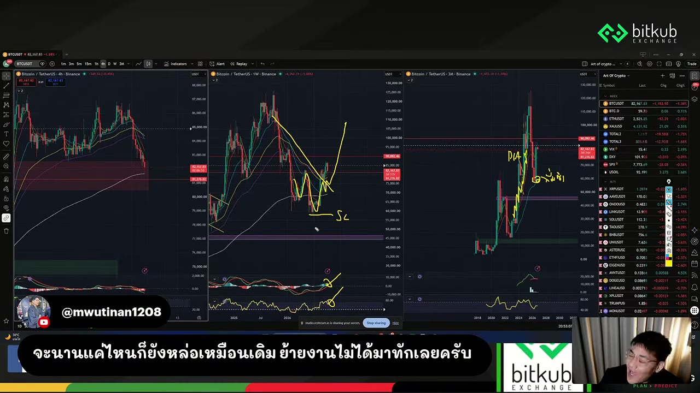

[00:50:01] ขึ้นครึ่งนึงนะครับเนี่ยมันมันจะเป็น อย่างี้ฉะนั้นน่ะผมถึงบอกว่าโมเดลที่ดี อ่ะมันต้องมีทั้งข้อดีข้อเสียมันมันถึงจะ เป็นโมเดลที่ใช้ได้จริงมันไม่ใช่ว่าแบบ อุ๊ยโมเดลนี้ไม่เวิร์คเลยไหนเดี๋ยวหา โมเดลที่มันสมบูรณ์ที่สุดหาโมเดลที่มันดี ที่สุดอะไรอย่างเงี้ยนะครับมันก็จะยิ่งทำ ให้หรือความได้เปรียบเวลาที่คุณลงทุนใน ตลาดอ่ะหายไปเรื่อยๆนะครับฉะนั้นเนี่ยเรา ดูไปเลยว่าเฮ้ยแต่ละครั้งอ่ะมันมีกี่ เปอร์เซ็นต์ที่มันจะเกิดนิวโรอีกหลังจาก เราเก็บของตรงนั้นไปแล้วถ้ามันต่ำหรือมัน เป็นตัวเลขที่เกิดขึ้นได้ยากแล้วอ่ะเรา ควรวาง Stop  Loss ด้วยตรง Stop  Loss นะครับคือ Stop  Loss ถ้า เกิดลงมาตรงนั้นแล้วอ่ะมีโอกาสว่ามันจะ ไม่ไปทางเดิมแล้วเช่นถ้าเกิดเรามองว่า ราคามันจะขึ้นน่ะ Stop  Loss ที่ดีไม่ใช่ การรีดให้สั้นที่สุดแต่ Stop  Loss ที่ดี คือถ้าเกิดมันลงมาต่ำกว่าตรงนั้นอีกอ่ะ แนวโน้มราคาจะไม่กลับตัวขึ้นไปต่อแล้ว นั่นน่ะคือ Stop  Loss ที่ดีครับ มันไม่ใช่ว่าแบบเอ้ยวางตรงนี้ดีกว่ารีดดี

[00:51:02] กว่าเอ้ยวางตรงนี้ Stop  Loss ไม่ดีครับ Stop  Loss ที่ดีคือมันเหมือนกับว่าถ้า วันเนี้ยคุณจะไป สักที่นึงอ่ะผมเรียกว่าปลาจีนแล้วกันนะ คุณต้องมีพยากรณ์ที่บอกไปเลยอ่ะว่าน้ำ ท่วมกับไม่ท่วมนะครับอย่าไประหว่างทางอาจ จะท่วมเท่าไหร่อาจจะไม่ท่วมเท่าไหร่ถ้า คุณวาง Stop  Loss แบบนั้นนะครับระยะยาว มันจะมีปัญหาเพราะคุณจะไม่เชื่อมั่นใน Stop  Loss ตัวเองเอ้ยเป็นยังไงคุณอาร์ต ไม่เชื่อมั่นใน Stop  Loss ตัวเองสมมุติ นะการเทรดเนี่ยมันเป็นเรื่องแปลกอย่างนึง คนคิดว่าเราจะไม่สามารถแพ้ 7 ไม้ 8 ไม้ 9 ไม้ 10 ไม้ต่อเนื่องกันได้คำตอบคือเป็นไป ได้และโมเดลคุณยังใช้งานได้ดีด้วยแต่คุณ แค่อาจจะไปเจอช่วงหลุมแบบ risk หรือไปเจอ ช่วงที่ Strategy ของคุณหรือว่า Trading  Model ของคุณน่ะมันไม่เหมาะกับตลาดช่วงนั้นนะ ครับทีเนี้ยถ้าเกิดคุณตั้ง Stop  Loss ด้วยสมมุติฐานที่มันดี Trading  Model คุณเข้าใจถูกแล้วอ่ะคุณก็จะแค่จะทำเหมือน เดิมไปเรื่อยๆเอ้ยโดน 8 หมายติดไม่เป็นไร

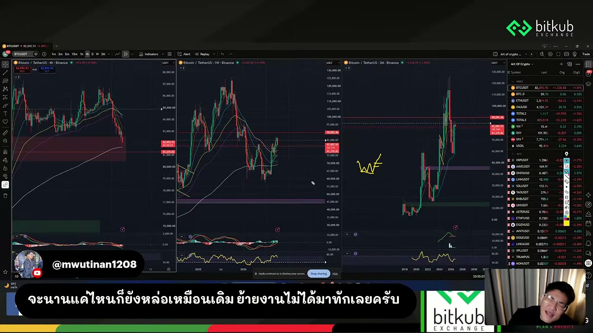

[00:52:04] กูก็ทำต่อไปเพราะเพราะว่าพอตลาดกลับเข้า มาในสู่ในภาวะปกติ ผลกำไรมันจะกลับเข้ามาบวกตามค่าเฉลี่ยเอง แต่ถ้าเกิดคุณ stop  loss ด้วยความแบบ สุ่มอ่ะรีดบ้างกว้างบ้างสั้นบ้างไว้ตาม สวิงบ้างพอคุณโดนแบบนั้นน่ะคุณจะไม่กล้า และว่าจังหวะเนี้ยต้อง take  action หรือ จังหวะนี้มันเป็นหน้าเทรดของฉันคุณจะไม่ กล้า take  action และเพราะคุณก็จะรู้สึก ว่าเฮ้ยแล้วถ้ามันลงอ่ะเฮ้ยแล้วถ้ามันมา กิน Stop  Loss ก่อนแล้วค่อยกลับขึ้นไป วางเผื่อเลยเผื่อปุ๊บอู้หูลึกรอบ นี้เสียตังค์เยอะเลย RR ก็ไม่คุ้มและนะ ครับมันก็จะเพี้ยนไปหมดประมาณนั้น เวลาพลาดไม่เข้าออเดอร์ดีๆวิ่งไกลๆแล้ว แต่เจอsetอใหม่ทั้งรอตัวเดิมแล้วย่อเข้า ทั้งหาตัวใหม่แล้วกดไปมันแหกบ่อยนี่มี วิธีแก้มั้ครับก็ตามนี้เลยครับน้องออมสิน อย่างที่เพิ่งพูดไปอธิบายคุณจูเนียร์ เมื่อกี้เลยดูโมเดลเราก่อนว่าโมเดลเราอ่ะ มันยังใช้ได้มยตาม data ที่เรารีเสิร์ช

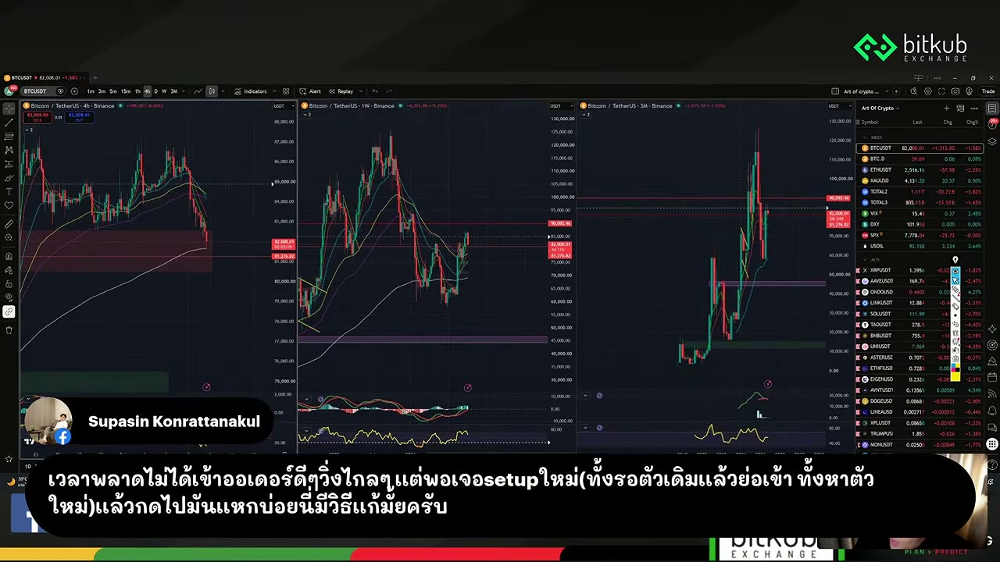

[00:53:05] ถ้าโมเดลเรามันบอกเหมือนเดิมเฮ้ยเหมือน เดิมเลยdata้ายังดีมีความได้เปรียบของ ตลาดถ้าเป็นแบบนั้นไม่ต้องแก้อะไรเลยครับ ทำไปเรื่อยๆเดี๋ยวมันจะกลับเข้ามาหาค่า เฉลี่ยเองนั่นน่ะคือคือคำว่าสถิติหรือ stat แต่ว่าคนส่วนใหญ่จะทำได้ยากนิดนึง นะครับเพราะว่า พอโดนเยอะๆมันก็มึนไงนะครับฉะนั้นเราเรา แค่ต้องเข้าใจใน data ของ ชนหลายไลฟ์แต่ผมดูอาจารย์ก่อนโอ้ขอบคุณ มากครับ หมายถึง DCA ได้ราคานึงแล้วร่ำซ้ำอีกราคา นึงราคามันจะไม่ปรับมารวมกันเหรอครับรวม ครับแต่ว่าไอ้ก้อนร่ำซ้ำอ่ะเราจะได้ของ ที่เยอะกว่าตอน DCA ในโซนที่มันลดราคา ฉะนั้นถ้าเกิดเราไม่ได้เก็บไม้ร่ำซ้ำไว้ แล้วเรา DCA ไปเรื่อยๆครับแล้วตอนราคามัน ไปเลยอ่ะค่าเฉลี่ยเลนเฉลี่ยมันจะกว้าง กว่ากันครับ

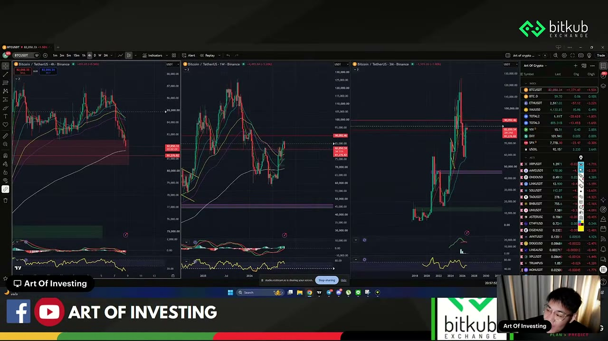

[00:54:06] ไม่ได้ชมหลายไลฟ์ศัพท์ใหม่เยอะเลยจริงๆ อ่ะมันก็เป็นเรื่องเดิมๆแหละแต่ผมพูดอาจ จะเป็นศัพท์เทคนิคalไปเลยไงครับมันก็อาจ จะเป็นอย่างงั้น อาจารย์ดูเนียหน่อยครับไม่ค่อยอ่านอะไร กลุ่มได้ครับอ่ะเดี๋ยวไปดูอธีเรiมก่อน แล้วกันนะครับอย่างอธเรียมเนี่ยอ่าผมมอง ว่าสวยถ้าเอากราฟเลยนะผมว่าอเลี่ม กราฟโคตรสวยเลยนะครับก็คือมันมาฟlizซone พอดีเลยอ่ะผมมองว่าเอเลี่ยiมเนี่ยกราฟ สวยๆนะครับก็คือตรงเนี้ยถ้าเกิดweค ต่อไปอ่ะมันขึ้นต่อได้เลยอย่างเงี้ยอ่ะ สมมุตินะโมเมนตัมคมันเกิดแล้วอ่ะก็คือมัน มันพร้อมมากๆแล้วนะครับแต่ว่าถ้าเกิดมัน มันเกิดการทุบลงไปตรงนี้ก็อาจจะเป็น falce break นะครับก็คือกราฟมตรงเนี้ยนะครับ มันก็จะเป็น falce  break ฉะนั้น อธีเรียiมเนี่ยโซนที่ผมมองว่าไม่ควรหลุด นะก็คือที่ผมวางกรอบสีเหลืองไว้เลยนะครับ ประมาณ 2,400 ถ้าหลุดเนี่ยผมมองมองว่าโมเมนตัมเสียนะ ครับในระยะสั้นนะครับก็โซนตรงเนี้ยบวกลบ นะครับถึงประมาณ EMA  25 เนี่ยผมมองว่า

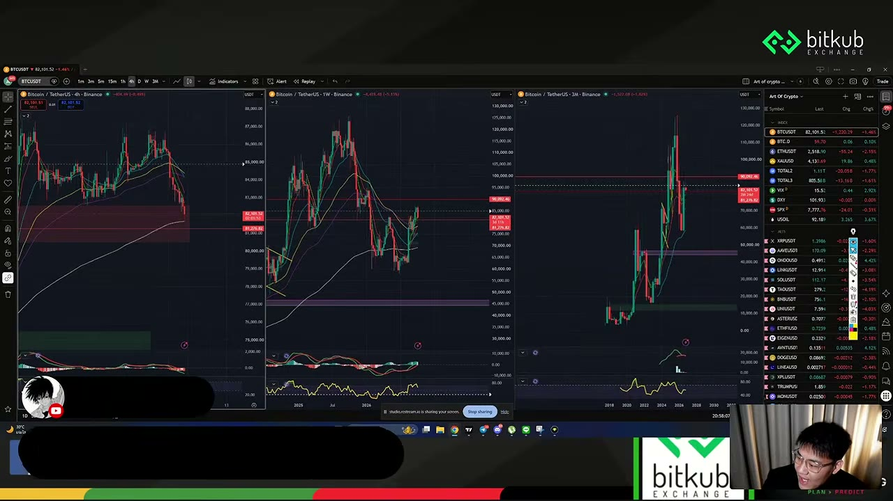

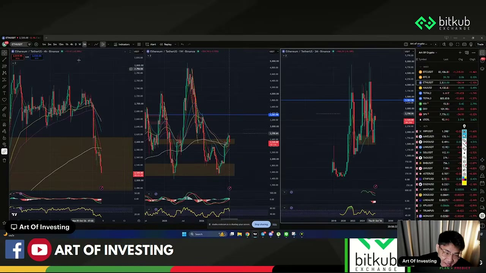

[00:55:07] ไม่ควรหลุดนะครับถ้าหลุดเนี่ย แรงส่งของโมเมนตัมตรงเนี้ยจะเสียนะครับ มันก็จะย่อลงมาอีกทีถึงตรงนี้เลยนะ 2,000 เป็นกลาง Balance โซนนะครับฉะนั้นถ้าตอน 2,400 หลุดเนี่ยผมจะมารอดูโมเมนตัมอีกที ที่ 2,000 เลยนะครับผมจะมารอดูโมเมนตัม อีกทีที่ 2,000 ถ้าเกิดโมเมนตัมที่ 2,000 มันเกิดขึ้นนะครับก็จะจังหวะตรงนี้เนาะ เงี้ยก็ยังสวยอยู่เพราะอะไรเพราะว่ามัน เบรคพรีเมี่มมาแล้วเห็นตรงนี้มั้ยเนี่ย ครับมันเบรคพรีเมี่มะ นะครับมันเบรกพรีเมี่มมาแล้วะฉะนั้นผมผม มองว่า 2 เคสเนี้ยยังมีความเป็นไปได้อยู่ นะครับแต่ว่าถ้าหลุด 2,400 แล้ว 2,000 ยังรับไม่อยู่อีกเนี่ยผมว่ามันจะเป็นเป็น โซนที่ไม่ค่อยสวยและสำหรับผมนะก็คือ โมเมนตัมอ่ะมันจะดรอปมันจะไม่สามารถเกิด ขึ้นได้นะครับถ้าเป็นแบบนั้นเนี่ยก็มี โอกาสจะลงมาเทสที่ low เดิมนะครับให้ดู 2 โซนนี้ก่อนนะครับสำสำหรับอีเรiมเก็คือ 2,400 กับ 2,000 ถ้าเกิดเวลามันลงมาแล้ว

[00:56:08] มันเกิดการเทestโมเมนตัมนะครับอ่ะอย่าง สมมุติว่ามันเป็นอย่างี้ก็ได้อ่ะยกตัว เนี่ยอ่ะย่ออย่างี้พอดีเลยสมมุตินะว่าย่อ อย่างงี้ขึ้นมาอย่างงี้ปึ๊บปึ๊บปึ๊บ อ่ะงี้แล้วก็ตรงนี้ลากมาฟืด งี้แสดงว่าตรงเนี้ยเป็นพรีเมี่มถูกมั้ย งั้นถ้าเกิดมันเกิดลงมาพักตัวอยู่ในโซน ที่ออเดอร์ในตลาดมักจะให้ความสนใจนะครับ หรือว่ามันเป็นโซนdiscาของโซนในตลาดเงี้ย แล้วโมเมนตัมมันเกิดขึ้นได้อีกรอบงี้ นะครับ แบบเนี้ยเราก็ค่อย follow เข้าไปแล้วตั้ง stop ตรงนี้อ่าผมจะทำแบบนี้นะครับเวลา

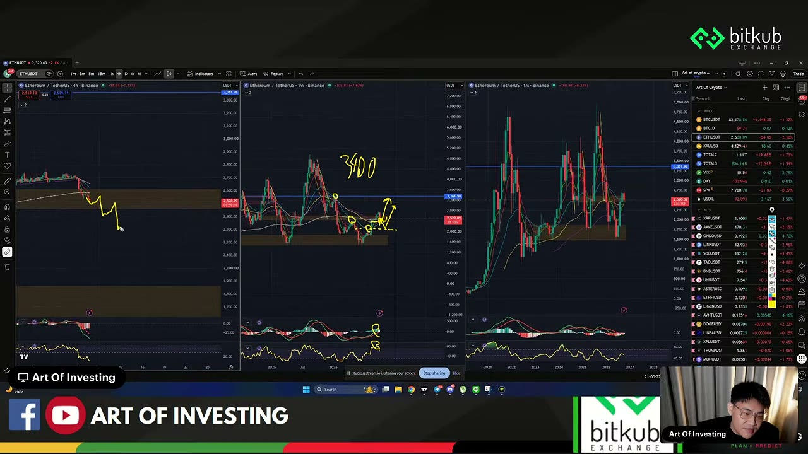

[00:57:08] ที่ราคามันย่อมาแรงๆแล้วเราหวั่นใจว่าแบบ เฮ้ยมันจะขึ้นต่อได้มั้ยมันจะลงต่อมั้นะ ครับก็คือผมจะไม่ค่อยรับมีดเกลี้ยงเดียว เลยแบบเอ้ยลงมาแล้วเว้ยซัดปั้งนะครับแบบ นั้นมันจะเทคความเสี่ยงค่อนข้างสูงไป หน่อยนะครับสำหรับพอร์ตเล่นรอบนะฉะนั้นผม ก็จะรอให้โมเมนตัมมันเกิดก่อนแล้วค่อยวาง Stop  Loss นะครับท่าผมจะเป็นอย่างี้ ตลอดก็คือเดี๋ยวไปรอดูแล้วกันว่าอีเรiม อ่ะจะเกิดท่านี้ที่ราคาเท่าไหร่ 2,400 หรือ 2,000 นะครับถ้าเกิดอ่ะผมก็จะ follow จิ้มเข้าไปหน่อยเพราะว่าผมอยากเก็บเหมือน กันนะครับสำหรับตัวเทรดเพิ่ม ประมาณนี้นะครับสำหรับอีทีเerรiมอ่ะ เดี๋ยวดูให้ทีละตัวเมื่อกี้ขออะไรกันบ้าง นะขออนโดะใช่มั้ยอนโดใช่วันนี้อโดรีบาว ครับอโดโมเมนตัมยังไม่เสียครับอโด โมเมนตัมยังสวยอยู่ครับแต่ว่าเอ่อมันมี แค่ตลาดที่จะทำให้สั่นคลอนหรือเปล่านะ เพราะว่าตรงเนี้ยมันเนี่ยนะครับเราจะเห็น ว่าอดadเนี่ยเบรกพรีเมี่มขึ้นมาได้ะนะ ครับก็คือโซน EMA  10 นะครับที่มันชนแล้ว

[00:58:10] เกิดreีอคtionตลอดเลยนะครับแล้วก็ WeEK เนี่ยนะครับโมเมนตัมตรงเที่เบรคขึ้นมาตรง เนี้ยสวยมากเห็นมั้ย MAD เหนือ 0 แล้ว RSI overbard ได้แล้วนะครับฉะนั้นถ้าลงมาไม่ เกินกับครึ่งกล่องเดิมเนี่ยนะครับหรือลง มาเทสกล่องตรงเนี้ยไม่เกิน 0 ไม่ต่ำกว่า 0.4 เนี่ยนะครับผมมองว่าโมเมนตัมยังค่อน ข้างสวยนะครับแล้วถ้าเกิดขึ้นต่อได้เลย เนี่ยอย่างเงี้ย เป้าเทสอีกทีเดี๋ยวผมมองแถวนี้เลย 0.73 นะครับ อ่าตรงนี้นะแต่นะครับแต่เมื่อไหร่ก็ตามนะ ครับที่มันหลุดนะครับอ่ะโมเมนตัมตรงนี้ โซนตรงนี้นะที่ผมมองว่าจะไม่สวยแล้วนะ ครับก็คือ low ตรงนี้ 0.41  0.42 เนี่ยนะครับโซนตรงเนี้ย 0.41 0.42  42 เนี่ยนะครับผมมองว่า ไม่ควรหลุดนะครับถ้าหลุดเนี่ยแรงส่งตรง เนี้ยจะเสียหมดเลยแล้วมันกลายเป็นว่าแรง

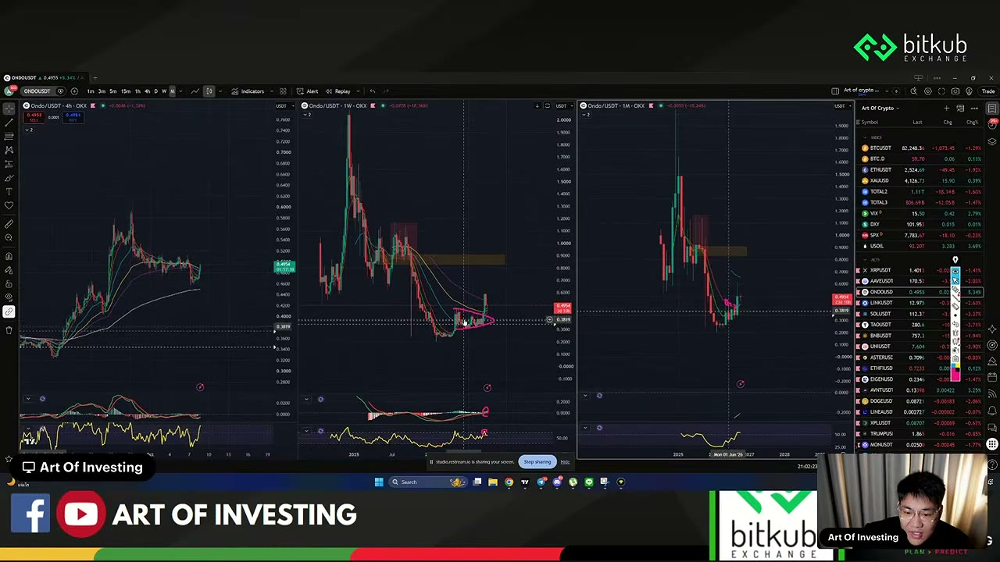

[00:59:13] ที่เบรคชุดเนี้ยครับหรือ balance โซน เนี่ยครับมันต้องกลับมาเทสกันใหม่หมดเลย เห็นมั้ยเพราะตอนเมันเกิดการรีทestไปแล้ว นะครับงั้นมันไม่ควรลงมาหลุดมาต่ำกว่าโซน นี้แล้วครับเพราะว่ามันจะแรงส่งทั้งหมด เนี้ยออเดอร์ที่สร้างโมเมนตัมตรงเนี้ยมัน จะหายทำให้โอกาสที่เม็ดเงินใหม่ๆมันจะ กลับมา follow เนี่ยเกิดขึ้นได้ยากขึ้นนะ ครับฉะนั้นอดเนี่ยผมมองว่าไม่ควรหลุด 0.41 นะครับไม่ควรหลุด 0.41 ถ้าไม่หลุดเนี่ยผม ก็มองลุ้นเนี้ย 0.73 นะครับยังสวยแต่ถ้า เกิดตรงนี้ปิดอย่างี้นะอันนี้อันนี้เคส ที่ยังขึ้นต่อนะแต่ถ้าเกิดว่าเป็นเคสย่อ แรงๆนะครับก็คือลงเงี้ยปึ้งๆอย่างเงี้ยมี โอกาสหลุดตรงนี้เลยครับ 0.3  3 แล้วมี โอกาสเทสเแถวใกล้โลเดิมนะครับก็คือถ้าweค เนี่ยปิดแดงใหญ่ 2 แท่งติดกันเนี่ยผมว่า เริ่มไม่ค่อยสวยและนะครับก็ให้ระวัง รีบanceซพอร์ตดีๆแล้วกันนะครับส่วน นะครับยังไม่เกิดการพักตัวที่รุนแรงเท่า ไหร่นะครับฉะนั้นตอนเนี้ยผมมองแบบนี้

[01:00:14] เอ่อเนี่ยนะครับมันเบรคขึ้นไปละนะครับ แล้วก็มันมีจุดdiscคอยู่เนี่ยคือ 50 อ่ะ เราเห็นแค่แค่ครั้งเดียวถูกมั้ยฉะนั้นรอบ ต่อมาเนี่ยผมมองว่าถ้าเกิดเป็นเทรนด์ใหญ่ นะครับใน day เนี่ยตราบใดก็ตามที่มันไม่ หลุด EMA  50 อ่ะผมคงไม่ออกหมดนะสำหรับRว เนาะก็คืออย่างเงี้ยผมก็มองว่ามันยังเกาะ discคาแล้วเกิดขึ้นไปเรื่อยๆได้เพราะ week เนี่ยโมเมนตัมมันเกิดแล้ว RSI มัน overbard แล้วนะครับฉะนั้นถ้ามันไม่ได้ ลงมาจนหลุด discount  zone ผมก็ยังจะรันเทรนต่อนะครับตอนเนี้ยมันถึง เป้าและนะครับเป้าแรกของผมเนี่ยคือ 174 นะมันถึงแล้วฉะนั้นถ้าเกิดมันย่อแล้วยัง ไม่หลุดเป้าต่อไปที่ผมมองอ่ะก็คือกลางตรง นี้ที่เป็น hiden supัlyนะครับกับก้นตรง นี้ผมมองประมาณ 220 สำหรับนะถ้าเกิดยังไม่หลุด EMA  50  day ถ้าหลุดผมออกครึ่งนึง นะครับเวลาเล่นคอยผมจะผมจะรัดกุมนิดนึงนะ

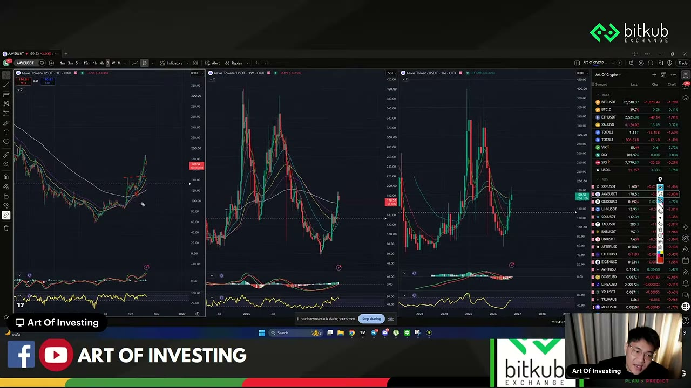

[01:01:16] ครับมันจะเป็นอย่างงี้นะครับใช่ออนโด ออนโดะบวกครับมันก็จะบวกเงี้ยเพราะว่ามัน เอ่อเอ่อพวกตัวเล็กอ่ะครับเวลามีข่าวมี อะไรมามันจะเอามาเป็นกระแสแล้วเอามาดัน ภาวะตลาดได้ง่ายนะครับ เต๋าหรอ ย่อแรงเหมือนกันนะย่อแรงนี่เต๋าเนี่ย ปัญหาคือมันยังไม่สามารถเบรคโซนตรงนี้ได้ เห็นมั้ยนะเวลาที่คุณเปิดไปแล้วเจอแนว ต้านเจออะไรก็แล้วแต่นะครับแล้วคุณลาก เมาส์ไปเนี่ยนะครับแล้วคุณลากเมาส์ไป เนี่ยหรือลากกรอบไปเนี่ย คุณเห็นแต่ไส้แบบเนี้ยซัพพlyหนาอ่ะจำไว้ นะถ้าเกิดเป็นแบบเนี้ยซัพพlyจะหนามากเช่น คุณลากเงี้ยฟืดตรงเนี้ย

[01:02:17] เฮ้ยโอ้โหมีแต่ไส้เว้ยถ้าแบบเนี้ยครับมัน แปลว่าออเดอร์ขายเนี่ยมันขวางอยู่ก้อน ใหญ่มากพอออเดอร์ขายมันขวางอยู่ก้อนใหญ่ มากนะครับสิ่งที่จะเกิดขึ้นก็คือถ้ามัน ไม่สามารถปิดเต็มแท่งเหนือโซนนั้นได้ เนี่ยแปลว่าออเดอร์ซื้อเนี่ยมันก็ไม่มาก พอที่จะทำให้เกิดเทรนด์ครับเพราะว่า สมมุติว่ามันเกิดแรงซื้อขึ้นมาออเดอร์ ซื้อมาๆพอไปเจอกำแพงใหญ่มันก็ไป match ออเดอร์ขายแchออเดอร์ขายแชออเดอร์ขายสุด ท้ายผ่านไปก่อนจะปิด week หรือก่อนจะปิด สัปดาห์ก็ยังเบรคไม่ได้ก่อนจะปิดสัปดาห์ ก็ยังเบรคไม่ได้แปลว่าออเดอร์ซื้อทั้งหมด นะครับที่มันสะสมเนี่ยมันไม่มากพอที่จะทำ ให้เกิดเทรนด์นะครับมันก็ทุบลงมาไหล เรื่อยๆไหลเรื่อยๆไหลเรื่อยๆนะครับ เนี่ยเห็นมั้ยก็เหมือนจะเบรคนะแต่สุดท้าย ก็ไปได้แค่ไส้เนื้อเทียนก็ยังอยู่ในโซน ฉะนั้นนะครับเต๋าเนี่ยจะเป็นเทรนด์ต่อ เมื่อมันจะต้องเบรคโซนเนี้ยแบบเต็มแท่ง ถึงจะเกิดโมเมนตัมได้เนี่ยครับแต่ว่าเห็น มั้ยว่าอินดิเคเตอร์เี่มันมารอแล้วมันแปล

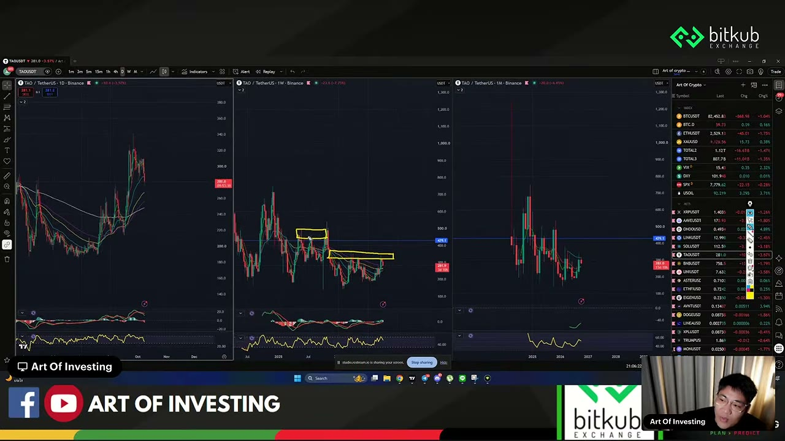

[01:03:18] ว่าออเดอร์ในตลาดอ่ะไม่ไม่ได้ต่างกันฟ้า กับเหวละคือออเดอร์ขายกับออเดอร์ซื้อ เนี่ยเริ่มใกล้เคียงกันมากขึ้นเรื่อยๆนะ ครับฉะนั้นเต๋าเนี่ยผมมองว่าแถวนี้สวยนะ เนี่ยครับเนี่ยถ้าย่อมาซักเนี่ย 260 เนี่ยหรือแถวเนี้ยนะครับเริ่มไซด์เวย์ เนี่ยผมว่าก็เริ่มสวยละนะครับถ้าเกิดว่า โมเมนตัมมันเกิดขึ้นอีกครั้งเนี่ยผมขอดู 1 ชั่วโมงก่อนอ่าเนี่ย สมมุตินะว่าถ้าใครอยากได้เต๋าหรือว่าอยาก จะเทรดอ่ะเนี่ยเราเห็นพรีเมี่มแล้วถูกป่ะ เนี่ยเห็นป่ะคือ EA  25  MAD ต่ำกว่า 0 เงี้ยฉะนั้นเมื่อไหร่ก็ตามที่ มันสามารถเบรคพรีเมี่มได้นะครับ RSI  MAD กลับมาเหนือ 0  RSI กลับมา เนี่ยอ่ะนะครับโมเมนตัมมันถึงจะเกิดนะ ครับก็ใช้ตรงเนี้ยเป็นวางจุดวาง Stop Loss ได้นะครับแล้วก็ดูรันขึ้นไปถ้าอัน นี้ไม่ได้ให้ซื้อขายตามนะแต่ว่าสอน โมเมนตัมนะครับว่ามันจะเปิดเกิดเป็นเคส แบบไหนถ้าเกิดเรามองว่าตัวเนี้ยจะเกิด เทรนด์วิ่งต่อได้ในระยะยาวนะครับก็ต้อง

[01:04:18] เกิดภาพ นะครับก็จะต้องเกิดภาพนี้คือราคาไหลขึ้น ไปแล้วถ้าปิดแบบนี้เหนือแท่งเทียนได้ เนี่ยเทรนด์เต่าจะเกิดละแล้วผมก็มองว่ามี โอกาสวิ่งนะครับที่แรกที่ถ้าเกิดเต๋าทะลุ โซนตรงนี้ได้นะครับผมมองว่าวิ่งไกลเลยโซน แรกเนี่ยผมมองเทสนู่นเลย 427 นะครับถ้า ถ้าเกิดทะลุตรงนี้ได้นะแล้วถ้าทะลุ 427 อ่ะอีกทีนึงนู่นเลย 550 นะครับ [เสียงสูดหายใจ]ก็จะเป็นภาพที่สวยแต่ตอน เนี้ยมันยังติดซัพพlyใหญ่อยู่นะครับแต่ผม บอกแบบนี้นะเฮ้ยคุณอาร์ตงั้นผมไปรอเบรก ก่อนแล้วเดี๋ยวรอย่อรีเทสหลังจากนั้นไอ้ ทรงแบบเนี้ย ไม่ค่อยรีทestมันจะไปเลยนะครับเพราะว่า ไอ้กำแพงตรงเนี้ยมันหายไปแล้วยิ่งมันเป็น สินทรัพย์ที่มันไม่ได้ใหญ่ระดับแบบตัว ท็อปของตลาดตัวต้นๆของตลาดเนี่ยมันเวลา มันเบรคมันจะเปรี้ยงเดียวแล้วไปเลยครับ มันจะไปแบบเนี้ยเนี่ยครับมันจะไม่ค่อยรอ เห็นมั้ยตรงนี้ก็มีเหมือนกันมีไส้อย่าง เงี้ย[เสียงสูดหายใจ]เงี้ยเกิดคุณไปรอ เอ้ยเดี๋ยวรอเบรคก่อนแล้วค่อยยอย่อมันจะ

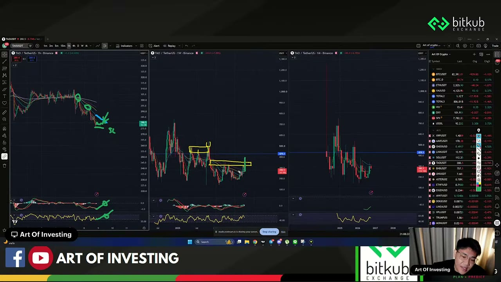

[01:05:18] ไม่ค่อยย่อครับมันจะไปเปรี้ยงเดียวแล้วจบ งานไปเลยนะครับเหมือนกับ H  bar ผมก็กะ ว่ามันจะไปอีกสุดท้ายมันไม่ไปเราก็ต้อง ยอมก็ออกครึ่งนึงนะครับที่เหลือผมตั้งไว้ หน้าทุนผมว่าน่าจะโดนนะแต่โดนก็โดนเพราะ ว่าเราเราเก็บสถิติไว้แล้วนะครับว่าโอกาส ที่มันจะย้อนกลับมามีกี่เปอร์เซ็นต์ยูิ เหรอโอ้ จริงๆตอนเบรคไปสวยๆนะยูิเนี่ยเห็นมยจูน เนี่ยเห็นภาพแล้วถูกป่ะยูิเนี่ยโมเมนตัม เกิดแล้ว ยูนี้เนี่ยโมเมนตัมเกิดแล้วเห็นป่ะเนี่ย ฉะนั้นน่ะตอนเนี้ยมันมีโอกาสเป็นเทรนด์ และแล้วมันย่อมาเฮ้ยแล้วแบบเนี้ยเมื่อ ไหร่มันถึงจะกลับไปขึ้นได้อีกรอบเราจะรู้ ได้ไงว่าเราไม่ได้รับมีดคุณจุเนี่ยเห็น ยังชัดป่ะ เห็นมั้ยพรีเมี่มงั้นถ้าอะไรเบรคพรีเมี่ม ได้เมื่อไหร่ นะครับแล้ว MACD กลับขึ้นมาเหนือ 0 ได้ 2 เส้นนะครับ RSI  overbard อ่ะก็แปลว่า

[01:06:19] โมเมนตัมเกิดฉะนั้นถ้ามันเกิดแบบเนี้ยมัน ก็อาจจะมาสะดุดตรงนี้แถว EMA  10 อะไร เงี้ยแล้วค่อยกลับขึ้นต่อไปเทสนะครับที่ แรก 10 นะครับที่แรกก็จะเป็นกรอบตรงนี้ อยู่เห็นมั้ยแสดงว่าซัพพlyายตรงเนี้ยยัง หนาอยู่นะครับงั้นถ้าเบรคตรงนี้ได้อ่ะควร ทะลุเราก็มองที่แรก 12 เลยแล้วถ้าทะลุไป มองโซนซัพพlyายใหญ่อีกทีนึงนู่นเลย 14 นะ ครับก็มองมองวิ่งไกลเลยนะครับถ้าเกิดขึ ขึ้นได้แต่ถ้าเกิดตรงนี้เบรกพรีเมี่มได้ ต้องดูดีๆนะถ้าเกิดมันเบรคพรีเมี่มได้ ขึ้นมาจริงๆแต่ MACD ขึ้นเหนือ 0 ไม่ได้ RSI  overboard ไม่ได้แปลว่าโมเมนตัมมัน จะไม่เกิดครับคือออเดอร์ซื้อมาแต่มันไม่ ได้มาก้อนเดียวมันไม่ได้มาเรื่อยๆมันไม่ ได้มาเยอะเพียงพอที่จะเจอแรงขาย แล้วไม่เสียเทรนด์อ่ะผมยกตัวอย่างให้ดู เอ้ยคุณอาร์ตเป็นไงวะนึกภาพไม่ออกอ่ะผมยก ตัวอย่างงี้ให้ดู อ่ะดูอย่างงี้

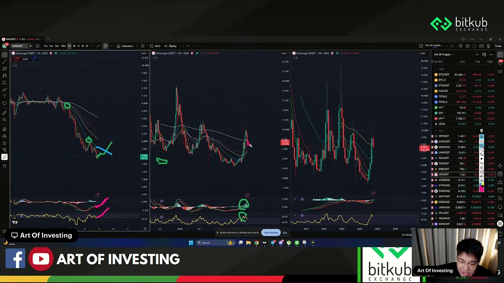

[01:07:21] อ่ะเดี๋ผมยกตัวอย่างงงอย่างงี้ก็ได้อย่าง เงี้ยจะจะชัดนะครับอ่ะเดี๋ยวหาที่มันเบรค อ่ะอ่าเอย่างี้ก็ได้นะครับเนี่ยอย่าง เงี้ยเห็นมั้ยอย่างเงี้ย สมมุติว่ามันติดๆเอ้ยเบรคได้แล้วแต่อะไร เงี้ยครับ RSI บอไม่ได้อย่างเงี้ยครับ เงี้ยมันก็บ่งบอกนะครับว่าเทรนด์เนี่ย หรือโมเมนตัมเนี่ยมันไม่เยอะพอมันไม่เกิด นะครับฉะนั้นน่ะผมถึงบอกว่าเฮ้ยถ้าจะเกิด อ่ะต้องรอให้ 3 ข้อคitionเนี่ยมันเกิด ขึ้นพร้อมกันนะครับนั่นน่ะมันเป็นมันจะ เป็นตัวจุดชนวนโมเมนตัมนะครับอย่าง อันเนี้ยเห็นป่ะติดพรีเมี่มโคตรชัดเลย เนี่ยในกราฟ 1 ชั่วโมงเงี้ยเนี่ยติด พรีเมี่มเบรคขึ้นได้ยังอ่ะเอ้ยยังไม่ได้ ใกล้ๆใกล้ๆละ RSI overบอแล้วแต่แdงยังไม่ เหนือ 0 ยังเข้าไม่ไม่ได้นะครับมันก็ เรียงๆๆๆอีกนะครับแล้วไป body ตรงนี้แตรง นี้อ่าแล้วก็เข้านี่ stop นี่ อย่างเงี้ยครับคือคือการเข้าด้วยโมเมนตัม นะครับ

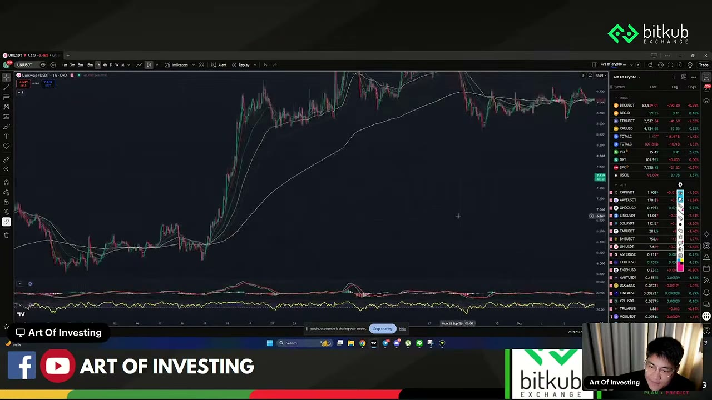

[01:08:23] ฉะนั้นตอนเนี้ยเห็นแล้วนี่พรีเมี่มอ่ะ รอเบรกก่อนโมเมนตัมถึงจะขึ้นได้นะครับตอน นี้ยังไม่เบรคอ่ะรับมีดครับเนี่ยแล้วก็ เนี่ยเอ่อรีเจคเห็นมั้ยที่เท่าไหร่ โดยประมาณนะครับก็อย่างที่บอกครับมันจะมี โอกาส 70% ที่ภายในพรุ่งเนี้ยมันจะไม่ หลุด 8,000 กับวิ่งได้ขึ้นไม่เกิน 84,000 นอกนั้นก็เป็นอีก 30% ที่เหลือที่มันจะ วิ่งรุนแรงนะครับอ่ะเวลาผมมองกรอบอ่ะผมก็ จะมองแบบนี้ก็คือสมมุติว่าผมได้กรอบของ วัน 19:00 น.หมดแล้วใช่มั้ยผมก็จะมอง อย่างเงี้ยว่าเกาะมันอยู่ที่เท่าไหร่ถูก ป่ะแล้วโอกาส 70% ก็คือเทรดเข้าหากรอบไอ้ ไอ้หลักการเนี้ยผมได้มาจากจาน M กับกับ จานจาน A นะแล้วผมก็มาประยุกต์นะครับ อย่างเงี้ยเห็นมั้ย เนี่ยมันคือการเทรดเข้าหากรอบ 70% แต่เรา ต้องไปดีไซน์ระยะวิ่งของมันอีกนะครับว่า data ของผมอ่ะยังยังไม่เสร็จสมบูรณ์แต่ ผมมองว่าใกล้ะนะครับก็คือระยะน้อยระยะขาด

[01:09:24] เกินว่าถ้าวิ่งเกินเท่าไหร่จะนับว่าหลุด กรอบถ้าวิ่งเท่าไหร่ถึงจะเป็นระยะที่ เหมาะสมแล้วก็คุ้มค่าธรรมเนียมด้วยเพราะ ว่าอย่างที่เรารู้เราเทรดCryptocurrนcy อ่ะมันมีค่าธรรมเนียมเนาะมันไม่ได้เทรด ฟรีแล้วก็มีแค่ค่าสเปรดเหมือนเหมือนคนที่ เทรดทองคำบน Forex  Pat  Platform พวก Foreign  Exchange นะครับเป็นอย่างงี้ เอ่อเมื่อกี้มีใครขอตัวหน่อยนะ EDA ใช่ มั้ยแล้วก็ อ่ะเดี๋ดูให้หน่อยแล้ว เนี่ยโมเมนอันเนี้ยเบรคเบรกขึ้นมาสวยและ นะครับแต่ว่าแม็กยังไม่เหนือ 0  RSI ยัง หักหัวบอไม่ได้อย่างเงี้ยครับก็อาจจะต้อง รอไซด์ยอีกดอกนึงเงี้ยครับแล้วค่อยขึ้น อีกทีนึงเงี้ยจะสวยกว่าตอนนี้โมเมนตัมไม่ ค่อยสวยเท่าไหร่นะครับแล้วก็ลงมาทำ Low กว่าเดิมถ้าจะมองว่าตรงนี้เป็น false เบรกเอ่อ

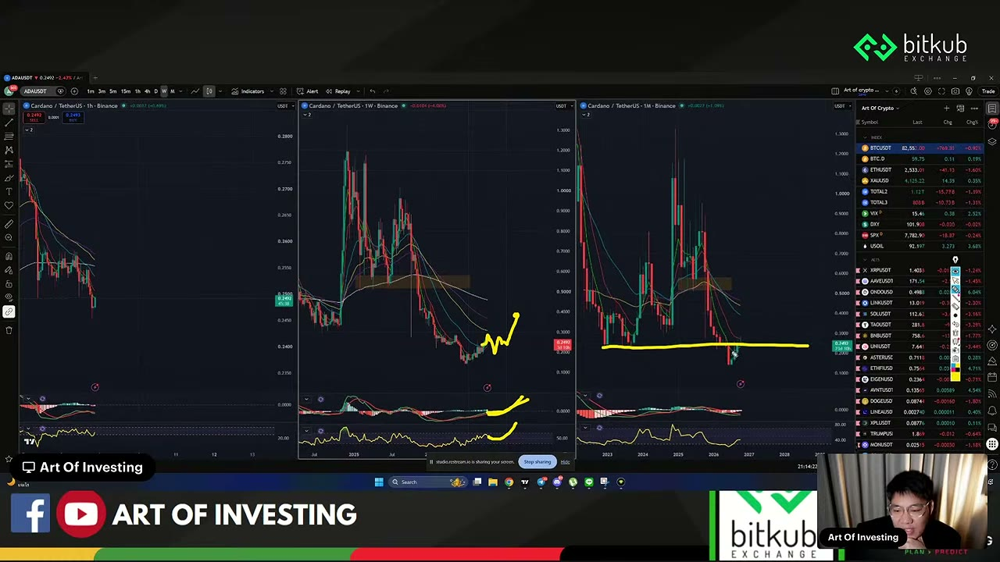

[01:10:26] มาดูที่ day แล้วกันนะครับก็จะเห็นว่าตรง นี้นะครับก็คือตอนเนี้ยมันย่อมาละก็คือ มารทestที่ flip  zone ที่มันเพิ่งเบรก ขึ้นไปนะครับฉะนั้นตอนเนี้ยมันก็มี พรีเมี่มอยู่ชัดมากๆนะครับงั้นเบรคเมื่อ ไหร่นะครับผมก็มองอย่างเงี้ย Stop  Loss นี่นะครับแล้วก็เข้า follow ตรงนี้ถ้า อยากจะ follow เนาะแล้วก็วิ่งไปที่เดิม โดยแนวต้านเนี่ยผมมองที่เดิมก่อน 0.3 นะ ครับ 0.3 กับ 0.3  37 สำหรับนะที่ที่เป็น แนวแนวต่อไปที่มีโอกาสจะวิ่งถึงได้ถ้า เกิดโมเมนตัมนะแต่ถ้าโมเมนตัมไม่เกิดครับ มันจะไหลเป็นขี้เลยครับมันจะไหลอย่าง เงี้ยอ่ะเดี๋ยวบางคนนึกว่าเอ้ยคุณอาร์ต ไอ้พรีเมี่มเนี่ยแล้วหน้าตาเป็นยังไงนึก ออกแต่ discount ก็นึกตอนที่มันลงครับ เนี่ยอย่างเงี้ยนะครับเนี่ยสมมุตินะว่า คุณเห็นแล้วว่าพรีเมี่มมันคือ 50 อ่ะ เนี่ยพอเบรคไม่ได้อ่ะแบบปิดเหนือแท่งไม่ ได้มันก็จะอยู่อย่างเงี้ยครับมันถ้าเราไป เข้าอ่ะเอ้ย Stop  Loss มันก็โดนทุกๆอัน น่ะนะครับเนี่ยเห็นมั้ย RSI overบอ

[01:11:27] ไม่ได้เลยกี่ครั้งก็ตามดูนะ เนี่ยอย่างเงี้ยบางคนถึงบอกเอ้ยคุณอาร์ต ทำไมทำไมถึงต้องรอวะทำไมไม่เข้าไปเลยทำไม มันย่อนู่นนั่นนั่นแล้วไม่เบรคไปเลยทำไม ไม่ดูแค่ราคาไอ้แบบนั้นน่ะมันอาจจะเหมาะ ถ้าคุณ day เทรดหรือเทรดสั้นในวันนึกออก มั้ยแต่ถ้าเกิดคุณต้องการถือสินทรัพย์แบบ รันเทรนน่ะเราต้องการมั่นใจก่อนว่า ออเดอร์ซื้อที่มันเข้ามาสะสมในสินทรัพย์ นั้นน่ะมันมีแล้วนะครับเออถ้าเกิดคุณเทรด แบบรีเจคมี reverseion อย่างงั้นน่ะเอ้ย day เทรดเวิร์คคือแบบลงมาแล้วเข้า ตรงนี้แหละเงี้ยมันเวิร์คนะครับหรือเทรด เข้าหากรอบเลยเออมันเวิร์คแต่ถ้าเกิดคุณ จะสะสมแล้วรันให้มันเป็นเทรนด์น่ะมันไม่ มีสินทรัพย์ที่แบบปึ้งแล้วเกิดเทรนอย่าง เงี้ยในระดับ Day  week นึกออกใช่มั้ครับ มันต้องเป็นการสะสมของก่อนเพราะว่ามัน เป็นเนื้อของจริงๆเป็นสปอต เนี่ยผมก็เลยเอาตรงเมากรองยอมเข้าช้า หน่อยเห็นมั้เบรกได้ปิดเต็มแท่งก็ไม่ได้ RSI ก็โอบอไม่ได้ MAD ก็ขึ้นเหนือ 0 ไม่

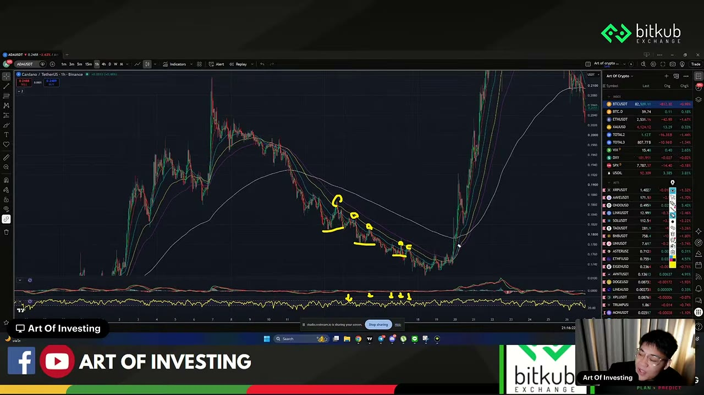

[01:12:29] ได้อ่ะแล้วพอมันเบรคอ่ะตรงนี้เบรคยังเบรค แล้วนะเปิดเต็มแท่งแล้ว MACD เหนือ 0 ยัง เหนือ 0 และนะครับ RSI overบอไม่บอเงี้ย คุณก็ค่อยวาง Stop  Loss ตรงนี้แล้วคุณก็ รันอย่างเงี้ยเห็นมั้ยแล้วคำถามคือเอ้ย คุณอาร์ตแล้วทำไมเวลาถึงจุดแล้วไม่ TP ไม่อะไรทำไมถึงกั้นหน้าทุนเนี่ยเพราะว่า ถ้าเกิดเรารอมาขนาดเนี้ย นึกออกป่ะแล้วเราจะเอาแค่เนี้ยมันไม่คุ้ม นะครับเราต้องมองโอกาสความว่าชถามว่าไอ้ ที่บitคinลงมาจาก 87,000 เนี่ยแล้วคอยลง มาเละขนาดเนี้ยกำไรผมหาย 7 หลักนะแล้วไม่ ใช่ 7 หลักต้นๆนะแต่ผมยอม เพราะอะไรรู้ป่ะเพราะว่าถ้าเกิดมันไม่ลง มาถึงจุดที่เราคิดว่ามันจะหลุดอ่ะแล้ว เทรนด์จบอ่ะมันรันยาวไงครับกำไรมันก็ก้อน ใหญ่เราต้องดูด้วยว่ามันมีโอกาสจะเกิด reวร์ดแบบนั้นให้ชีวิตเรากี่ครั้งอ่ะนึก ออกมั้ยที่เขาบอกว่าลงทุนแล้วเปลี่ยน ชีวิตคือเราเราควบคุมความเสี่ยงแล้วอ่ะ มันไม่ใช่แบบเฮ้ยคว้าไว้ก่อนเว้ยบวก 2 ล้านคว้าไว้ก่อนเว้ยเดี๋ยวรอบหน้าเข้าไป

[01:13:30] เอากันใหม่ไอ้จังหวะแบบเนี้ยมันอาจจะ 4 ปีมีครั้ง 2 ปีมีครั้ง 5 ปีมีครั้งนะครับ ฉะนั้นเวลาที่มันเกิด setup ที่เรารอมา นานน่ะเราควรจะไ the  trend นะครับสำหรับ การเล่นล่อไม่ไม่ได้นับdayดต้องต้องแยก ก่อนนะครับ CFG มั้ย CFG นี่เออขอโทษนะครับไม่รู้ เลยว่าเหรียญเค้าทำอะไรนะครับเออทำอะไร ครับบอกผมหน่อยได้มั้ยตัวนี้ไม่ได้ตามเลย แต่เดี๋ยวดูกราฟก่อน ตัวนี้ไม่ได้ตามเลยครับ อืมก็โมเมนตัมยังไม่มีเนาะแล้วก็ภาพรวม ไม่ค่อยสวยขอดูพรีเมี่มใน day หน่อยเอ้ย Day เบรกพรีเมี่มแล้วนะ เนี่ยอย่างที่ผมบอกนะว่าว่าเวลามันอย่าง เงี้เห็นป่ะป่ะมันชัดอย่างเงี้ยเนี่ยเวลา มันชัดอย่างเงี้ยวิธีเล่นก็โคตรง่ายเลย เบรกปิดเต็มแท่งได้เข้าถูกป่ะวาง stop ตรงนี้อ่ะแล้วที่เหลือก็รันเทรนฉะนั้นมี โอกาสน้อยอ่ะต่ำกว่า 30% ถ้าเกิดว่าเกิด

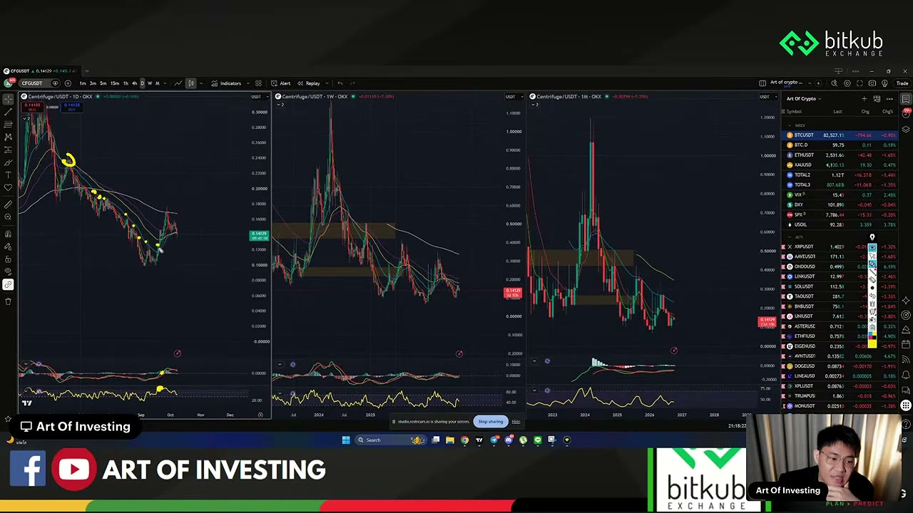

[01:14:32] เทรนด์แล้วแล้วมันจะย้อนกลับมาที่เดิมถูก มั้ยฉะนั้นตอนนี้มันยังไม่กลับที่เดิมแต่ มันกลับมาที่ flip zซoneนะครับแล้วภาพ ใหญ่เนี่ยคือมันยังไม่เบรคกรอบตรงนี้ไอ้ เส้นตรงเนี้ยผมผมบอกนะว่าเราเราใช้ดูแค่ ประกอบอย่าไปใช้แบบเอ้ยมันคือแนวรับแนว ต้านใจเราเราเน้นดูราคาอิงไปกับค่าเฉลี่ย นะครับฉะนั้นตอนเนี้ย MACD ยังขึ้นมา เหนือศูนย์ไม่ได้แปลว่าออเดอร์ขายยังเยอะ กว่าซื้ออยู่ในระดับ week นะครับแล้วก็ โมเมนตัมยังไม่เกิดยังไม่เกิด buy ใน ระดับ week นะครับฉะนั้นตรงเนี้ยถ้าเกิด มันไม่กลับมาที่ low นี้ของ day แล้วและ โซนตรงนี้เกิดรีบาวoundแล้วรับอยู่ปิด new high เหนือตรงนี้ได้เนี่ยก็มีแนวโน้ม ครับว่าขึ้นอีกทีนึงเนี่ยไม่ต้องเบรคไกล นะครับมันก็จะทำให้โมเมนตัมใน wek เนี่ย เกิดแล้วแล้วเบรคตรงนี้ได้นะครับแต่ถ้า เกิดว่า ตรงเนี้ยมันหลุด low เนี่ยนะครับมันก็จะ แปลว่าโมเมนตัมที่มันส่งขึ้นมาเนี่ยก็จะ พังนะครับแล้วก็ไปอยู่ low เดิมฉะนั้นผม มองว่า low เนี้ยไม่ควรหลุดและเพราะว่า เนี่ยมันครบเห็นป่ะเนี่ยคitionมันครบและ ก็คือเบรกprีemium magd เหนือ 0  boss

[01:15:33] ฉะนั้นถ้าจะเล่นก็คือเข้าตรงนี้ stop ตรง นี้นะครับแล้วก็ต้องให้มันเกิดเทรน ซึ่งตอนนี้ยังไม่เกิดนะครับ เนียเนี่ยแข็งโคตรโคตรแข็งโป๊กมากนะครับ เนี่ยนี่มันแข็งจริงๆนะครับแล้วก็ โมเมนตัมเกิดหมดแล้วนะครับเนี่ยเห็น มั้ย we เกิดโมเมนตัมแล้วอย่างเงี้ย Magnin  0  RSI overbอแล้วเงี้ยแล้วก็ เราก็ไม่ต้องดูแล้วว่าเทรนใน day เนี่ย มันเกิดหรือไม่เกิดนะครับทีเนี้ยคุณอาร์ต ทำไงดีวะแรงแรงขนาดนี้ take  action ไม่ ถูกง่ายโคตรดูอย่างงี้ ย่อยไปเนี่ยนะครับแล้วผมก็จะชอบหาdisคานะ ครับว่าเฮ้ยคุณนัทสมมุติว่าผมมีของมาแล้ว แล้วผมยังไม่ได้แบ่งขายเลยแล้วถ้ามันไม่ ขึ้นต่อมันย่อตามตลาดผมกลัวครับผมกังวลผม

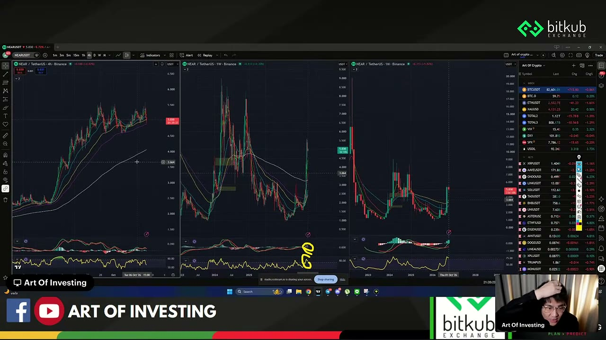

[01:16:35] จะทำไงดีง่ายโคตรย่อยลงไปจนกว่าคุณจะเจอ ดิเคาเนี่ยนะครับฉะนั้นถ้าคุณเจอdisคาของ สวิงมาแล้วอ่ะเห็นนี้ป่ะป่ะ งั้นถ้าหลุด EMA  75 ของ 4 ชม. TP  30% ที่เหลือถ้าโมเมนตัมเกิด low ตรงเนี้ย ต้องไม่กลับมาแล้วแต่มันไกลมากถูกมยงั้น Stop  Loss ใหญ่สุดคุณต้องอยู่ตรงนี้นะ ครับแล้วที่เหลือเนี่ยคือจุดโรยตัวออกโรย ตัวออกนะครับจุดแรกที่คุณจะต้องแบ่งออก เนี่ยสำหรับการเล่นรอบนะผมก็จะเป็นอย่าง งี้นะครับก็คือเนี่ยเห็นdisดคาละโคตรชัด เลยงั้นถ้าหลุดdisดคาปิดเต็มแท่งหลุด EMA 75  4 ชั่วโมงเมื่อไหร่ผมออกเลย 30% ถ้า มีผมดันไม่มีผมตกรถเฮ้ยตัวไหนตกผมตกนะตัว ไหนมีผมก็ลงเพจเห็นป่ะ Stop  Loss ผมก็ลง ผมไม่ชอบแบบเคลมแค่เคลมแค่ส่วนที่มันชนะ อ่ะแบบเอ้ยพอร์ตตัวนี้ก็ชนะตัวนี้ก็ชนะ โอ้โหถ้ามันขนาดนั้นรวยไม่ต้องทำอะไรแล้ว นะครับไอ้ตัวเนี้ยผมตกรถนะครับเนียเนี่ย

[01:17:38] แต่ว่าถ้าเกิดโมเมนตัมเนี่ยก็ทำตามนี้ เห็นมั้เนี่ยหลุดอ 75  4 ชม.ปิดเต็มแท่ง TP ก่อน 30% ที่เหลือถ้าไม่หลุดตรงนี้ อ่ะสมมุตินะมัน sideway ลงมาอย่างงี้ เงี้ยก็รันต่อคือ EMA  200 แล้วก็ Flip zone นะครับโดยตรงเนี้ยไม่ควรกลับมาแล้ว เนี่ยครับคือจุดแบ่ง TP จุดแรกที่เหลือก็ กั้นหน้าทุนนะครับที่เหลือก็กั้นหน้าทุน ไปเพราะว่าเทรนด์มันเกิดแล้วเราก็ต้อง ลุ้นให้มันวิ่งวิ่งต่อเนาะก็คือเกิดการ พักตัวแล้วก็วิ่งต่อเนี่ย เนี่ยอ่ะยากมั้เนี่ย เห็นมยเกิดรีเจคและงั้นวันต่อไป 19:00 น. ผมก็จะไปเปิด IV ดูอีกสมมุตินะเนี่ย สมมุตินะพรุ่งนี้ 19:00 น.ผมก็จะไปเปิดดู อีกนะครับ อย่างเงี้ย ก็จะไปเปิดเอ้ยเท่าไหร่วะ 19:00 น.บวกลบ ประมาณกี่จุดแล้วเราผมก็จะพอตไว้ว่าเป็น กรอบเป็นกรอบอย่างเงี้ยนะครับเพราะว่าไอ้ ไอตรงเนี้ยมันคือดูจำนวนvolุeแล้วก็เทียบ ความน่าจะเป็นนะครับเห็นมั้ย roughly  68%

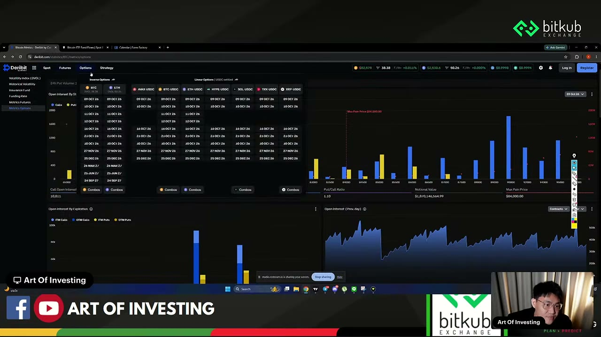

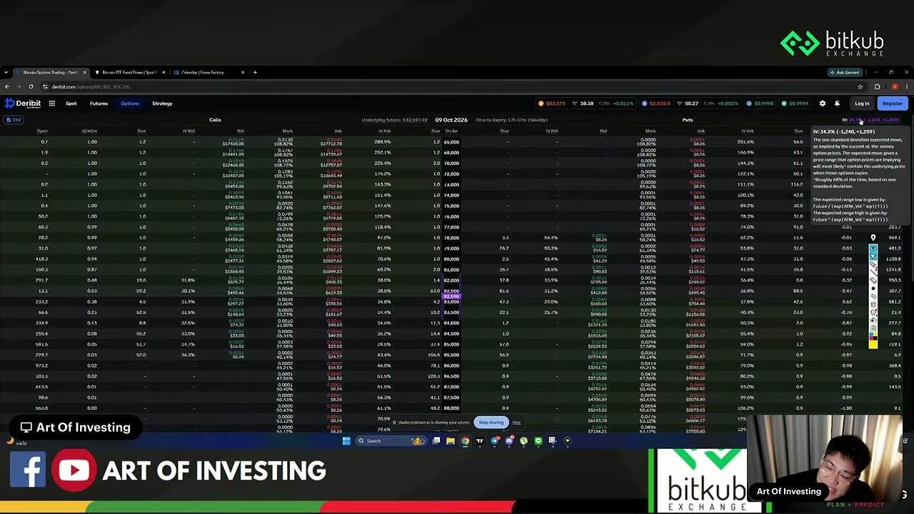

[01:18:38] นะครับเห็นมยที่มันเขียนอยู่ตรงดอกจันทร์ น่ะว่ามันจะอยู่ในโซนนี้นะครับก็ตีไป ประมาณ 70% เนี่ยตีไปประมาณ 70% เนี่ยผมบอกแล้วถ้า เทรดด้วยdata้ามันก็จะมั่นใจหน่อยเวลาโดน ก็โดนเวลาได้ก็ได้นะครับอย่างเย็นเห็น มั้ยโซนมันเอาอยู่อ่ะนะครับเนี่ยก็ 70% อ๋อเป็น Real  World  Token เป็น Tokenization ใช่มั้เอ้ยถ้างั้นน่าสนใจ ครับผมว่าธีมนี้จะมาแต่ว่าก็มองๆองตัว ใหญ่ๆก่อนคือผมจะเป็นแบบนี้คุณคุณ NJN น่ะผมอ่ะชอบสไตล์เหมือนพี่นี่ผมเนี่ยจะ เลือก Wiinner ไม่เก่ง คือมันจะมีมันจะมีนักลงทุนที่ถนัดต่างอ่ะ นะผมยกตัวอย่างอย่างนึงคนนึงที่เลือกเก่ง เนี่ยคือพี่หมูโอกบีหรือชารคหมูเค้าอ่ะจะ ชอบเลือกผู้ชนะในกลุ่มเดียวกันเนี่ยได้ เก่งมากเช่นมีแบรนด์แฟชั่น 4-5 แบรนด์น่ะ เขาจะหยิบแบรนด์ที่มันน่าจะเป็นอันดับ 1

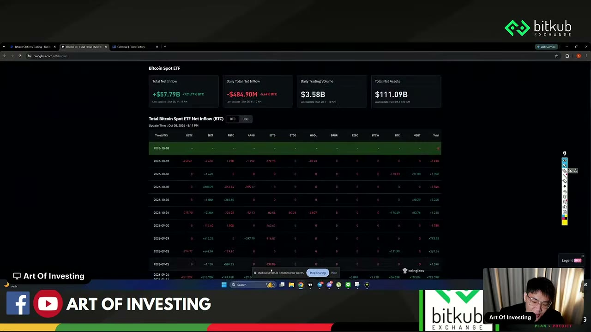

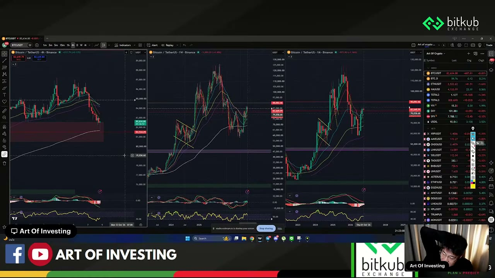

[01:19:38] ขึ้นมาถูกแต่ผมเนี่ยจะชอบหลักการลงทุนแบบ พี่คือผมจะดูว่าทุกแบรนด์น่ะใช้อะไร เหมือนกันเหมือนที่เขายกตัวอย่างนะครับ ว่าเอ่อพี่ี่เนี่ยแกสังเกตมานานและว่า รถเนี่ยมันน่าจะต้องใช้อ่ารถไฟฟ้ามันน่า จะมาแต่เขาเลือกไม่ถูก Xiaomi ก็ทำรถ BYD ก็ทำรถ NA ก็ทำรถtสlaก็ทำรถ Benz กับ BM ก็มาเริ่มมาทำ Hbrid ถ้าอยากจะลงทุนรถไฟ ฟ้าในอนาคตไม่รู้ว่า แบรนด์ไหนจะชนะแกก็เลยไปดูตามแต่ละโรงงาน ว่าเขาใช้แบตยี่ห้ออะไรสรุปไปเจอว่าหลายๆ โรงงานใช้ใช้แบตยี่ห้อนึงแกก็ลงทุน หุ้นแบตตัวนั้นแทนเพราะว่าหลายๆแบรนด์ ใช้แบตของบริษัทนี้นะผมจะเป็นสไตล์ นี้ฉะนั้นถ้าดู Tokenization กับ Real World  Asset อ่ะผมก็ชี้ไม่ได้เหมือนกัน ว่า ONDO จะได้รับกระแสเท่าไหร่แต่ONโด ล่าสุดถ้าผมจำไม่ผิดมีทำกับ Black Roอมั้

[01:20:40] หรือ JP  Morgan ที่เทสเรื่องสภาพคล่อง กับปรับเปลี่ยนสินทรัพย์ Real  World  Ass อ่ะที่มีข่าวอ่ะช่วงนั้นก็ได้ภาษีะแต่ทุก ตัวที่มีการationขึ้นไปบนโลก Blockchain น่ะขาด Chain  Link ไม่ได้หรือขาด ระบบ Oracle ที่ช่วยดึงราคาหุ้นในโลกจริง ขึ้นไปบนโลก Blockchain ทำให้เกิด Synthetic  Asset หรือการเทียบราคาได้ผม ก็จะเลือกจิ้มลิงก์อ้าผมผมจะเป็นสไตล์นี้ สมมุติว่าแบบเฮ้ยไม่รู้เลยว่าอ่ะตัวอื่น เทรดไปเทรดๆตามหน้างานแล้วกันแต่ถ้าจะให้ เลือกว่าอ่ะงั้นขาดอะไรไม่ได้ผมก็จะจิ้ม ตัวนั้นแทนแล้วมันอาจจะวิ่งน้อยกว่าตัว อื่นหน่อยแต่เราจะวิเคราะห์เรื่องจังหวะ และ timing ได้ง่ายกว่าเออผมอาจจะเป็น สไตล์นั้นเพราะผมเลือกอันดับ 1 ไม่เก่งผม จะไม่รู้ว่าตัวไหนจะชนะหรือถ้าเกิด อิฟraจะมาผมก็จิ้มอีธีเรiม นะครับแล้วเราเอาเงินน่ะอัดตัวนั้นแทนอ่ะ ผมจะไปสไตล์นี้ XRP ได้ครับเกครับอาจารย์ ขอบคุณครับยินดีครับเงียบจังผมว่า DOT มันเสียศูนยไปครับตั้งแต่ตอนนั้นที่

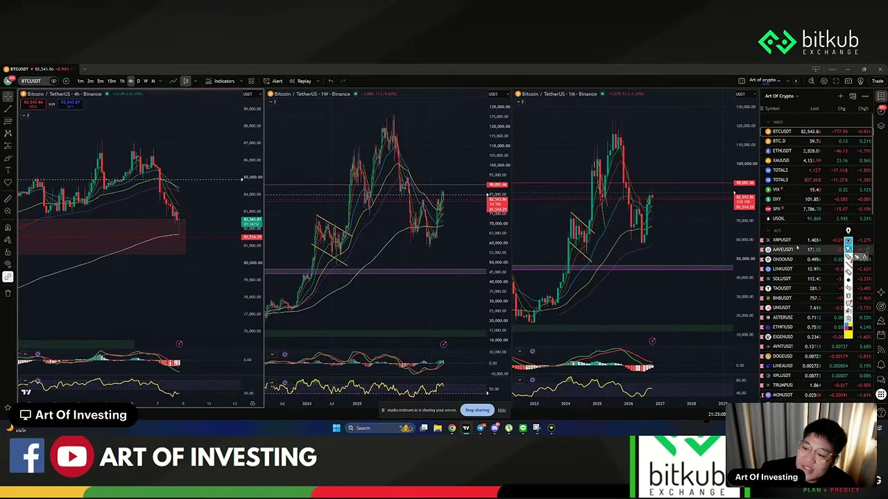

[01:21:40] เรื่องของ Multichan มันบูมมากจำได้มั้ย เรื่องของ Multihain  Atom ทำ SDK Software  Development  Kid  Dot เนี่ย ทำเรื่อง Relay  Chain ที่มีเหรียญ Kusama KSM อ่ะนะครับแล้วมันไม่เวิร์คเทคโนโลยี Multichan เก่าแล้วคนไม่ใช้ไปทำ เรื่อง Parel  Execution ไปทำเรื่องอื่น กันแล้ว Dot ก็เลยไปทำเรื่อง Data  Aility Service แทนทีเนี้ยไอ้ Data Availability  Service เนี่ยที่เหรียญ Dot  Pocadot มันทำเนี่ย คือมันไปช่วยจัดเก็บพื้นที่การเก็บข้อมูล บนโลก Blockchain ที่มีธุรกรรมเยอะๆปัญหา คือพออีทีเรiมเนี่ยที่มันเป็น infrastructure ที่ใหญ่ที่สุดเม็ดเงิน อยู่บนนั้นหรือ TVL เยอะที่สุดมันก็มีการ อัปเกรดเป็น 2.0  0 มี 5 มันก็มีระบบ data availability  service ในตัวเองหลายๆ chain ก็เริ่มมีระบบแบบ plugin อ่ะถ้า นึกภาพง่ายๆเรามี data  availity  service แบบ freelance เรามีเอ่อแบบ Celestia

[01:22:42] อย่างเงี้ยที่เป็น modular  blockchain นะครับก็คือความจำเป็นที่จะต้องใช้ dot อ่ะมันดรอปลงมันไม่ใช่กระแสหลักแล้วว่า แบบเอ้ยตัวนี้ต้องมีตัวนี้เท่านั้นคุณถึง จะจัดเก็บdata้าได้ดีหรือจัดเก็บพื้นที่ ข้อมูลการตรวจสอบธุรกรรมได้ดีมันมีตัว เลือกเยอะขึ้นแล้วอ่าChaน Infrastructure ที่ใหญ่ที่สุดอย่างiumเงี้ยเค้าก็มีระบบ นี้ในตัวเองมี blob อีกที่อัปเกรดเข้ามา มันก็เลยลดทอนความจำเป็นของ dot ไปเยอะ มากๆ อ่ะใช่ๆครับคุณ AJM ใช่ผมมองแต่ผมมองว่า หยอดได้นะอย่างสมมุติว่าเราเตรียมตังค์จะ มาเสี่ยง 100,000 ในกลุ่มเนี้ยเราอาจจะ เอา 600,000 หรือ 700,000 น่ะเลือกกลุ่ม ที่ทุกตัวต้องใช้อ่ะผมยกตัวอย่างนะสมมุติ ว่าเฮ้ยผมว่าtสlaมาคุณอาร์ตผมว่าVyDกอร์ มาอ่ะเราอาจจะทำแบบนี้เราอาจจะเอา 700,000 น่ะไปลงหุ้นแบตที่ 3 เนี้ยใช้แล้วอีก

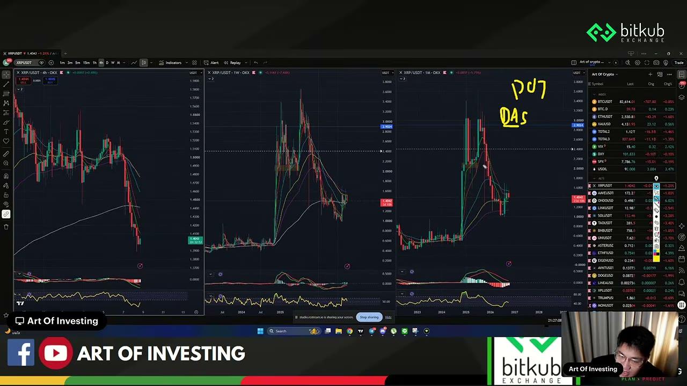

[01:23:43] แสนๆน่ะเราไปเลือกลงใน 3 ตัวเนี้ยที่เรา เก็งกำไรว่ามันน่าจะเ dominate ตลาดจาก ที่มันมี 10  20  30 แบรนด์อ่ามันจะเป็น อย่างงั้นนะครับผมว่าทำแบบนั้นได้นะเพราะ ว่าถ้าเกิดคุณเลือกตัวถูกอ่ะผลตอบแทนมัน เยอะกว่าเอ่อคุณลงในของที่ทุกตัวต้องใช้ อยู่แล้วเพราะว่ามาจinมันมันกว้างกว่า XRP ตรงนี้อ่ะผมมองว่าย่อตรงเนี้ยครับก็ ตรงเนี้ยตอนแรกอ่ะผมมองว่าถ้ามันปิดตรง นี้เขียวไปเลยอ่ะโมเมนตัมมันเกิดและมันจะ วิ่งเหมือนXRวกับลิงก์แต่ด้วยความที่มัน ยังไม่สามารถเบรคได้นะครับก็มันก็มีโอกาส จะกลับมาเทสSซidewayยตรงนี้อีกรอบนึงนะ ครับซึ่งโซนที่ไม่ควรหลุดเลยสำหรับผมอ่ะ คือ 1.2 สำหรับ XRP นะ ใครอยู่ผมไม่อยู่นะถ้าหลุด 1.2 อ่ะผมก็ ยอมออกนะครับเพราะว่าผมมองว่าโซนตรงเนี้ย ถ้าเกิดหลุดเนี่ยมันมีโอกาสจะมาเทสถึงนี่ เลยแล้วถ้าตรงนี้เอาไม่อยู่อีกมันจะหลุด นวโรนะครับฉะนั้นตราบใก็ตามที่ยังไม่หลุด

[01:24:44] 1.2  2 เนี่ยถ้าเกิดมันเกิดโมเมนตัมอีก ครั้งนึงอย่างี้ปึ๊บ มันจะเป็นจุดที่ผมอาจจะเติมของแล้วรันละ นะครับอ่ะผมอาจจะเติมของแล้วรันละนะครับ มันก็มีแนวโน้มที่จะเกิดการเบรคตรงนี้ แล้วขึ้นไปได้นะครับสำหรับ XRP นะผมมอง ที่แรกเลยอ่ะ 1.9 นะครับถ้าเกิดว่ามันไม่ หลุด 1.2  2 นะแล้วปิดเต็มแท่งทะลุตรงนี้ ได้อ่ะผมมองที่แรกเลยคือ 1.9  9 เพราะ โมเมนตัมมันพร้อมแล้วนะครับส่วนภาพใน week เนี่ยก็คือเราเห็นมั้ยมันเบรกพรีเมี่มมา ได้แล้วแค่ MACD ยังเหนือ 0 ไม่ได้แล้ว RSI ก็ยังoverbอไม่ได้ฉะนั้นโมเมนตัมของ XRP ใน week เนี่ยมันก็เลยยังไม่เกิด ครับเอ้างั้นทำไมคุณอาร์ตรีบเข้าจังทำไม เก็บของเข้าไปก่อนทำไมนู่นนี่นั่นไปก่อน นี่ไงเพราะว่าถ้าเกิดกว่าเราจะไปรอตรง นั้นน่ะคุณเข้าตรงนี้คุณ stop  loss ตรง นี้ถูกป่ะอ่ะสมมุตินะเนี่ยสมมุติว่ามัน วิ่งยัน 2.6 นะหรือ 2.4  4 นะคุณเพิ่งได้

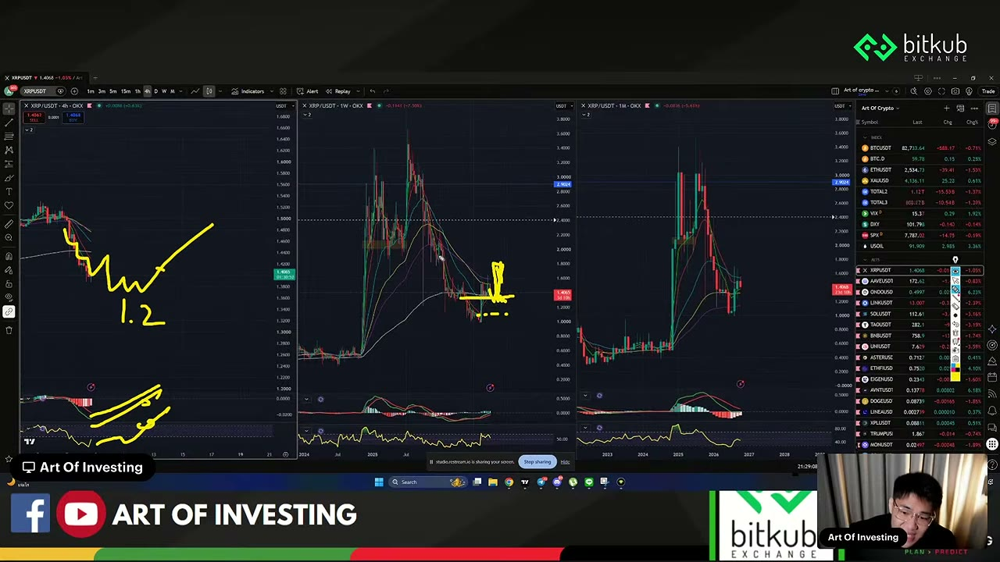

[01:25:46] reward  1:1 อ่ะแต่ถ้าเกิดคุณเข้าตรงนี้ แล้วลุ้นว่าโมเมนัมตรงเนี้ยจะทำให้ week อ่ะเกิดเทรน reward คุณอาจจะเป็น 1:4 นะครับอ่ะมันเวทกันว่าแบบไหนความน่าจะ เป็นมันคุ้มกว่านะครับแบบนี้ ถ้าไม่หลุด 1.2 ผมว่ายังโอเคนะครับ โมเมนตัมก็ทะลุได้ผมมองว่า 1.9  9 เลยนะ ครับประมาณนี้สำหรับ XRP เพราะว่าตอน เนี้ยเห็นมั้ยเวลาที่มันเป็นขาขึ้นน่ะ MAD มันเหนือ 0 ตลอดตอนเมันยังกลับมาไม่ได้ ครับเนี่ยมันยังกลับมาไม่ได้ เต๋าวิเคราะห์ไปแล้วครับผมไฟคอยเหรอไฟล คอยอ่ะเดี๋ยวดูให้ไลคอย อุ้ยเบรคสวยว่ะแต่ว่าผมมองว่าตั้งแต่มัน มีข่าวเรื่องเอ่อคณะกรรมการของไฟคอยโกง อ่ะในที่จีนหรือที่ไหนสักที่ผมผมจำไม่ได้ นะครับเอ่อตั้งแต่มีข่าวตรงนั้นน่ะผมก็ คิดว่ากระแสเหรียญมันดรอปไปค่อนข้างเยอะ ไอ้ตัวเนี้ยถ้าถามผมนะถ้าจะเล่นน่ะเล่น

[01:26:50] แบบช็อตเดียวแล้วทิ้งดีกว่าก็คือ TP แล้ว หนีซะแบบอย่างเงี้ย เห็นป่ะมันจะเป็นเหมือนอ่ะที่ไปเจอกลไก ช่องโหวไปเจอบัอะไรทีมงานเทกันเองนะครับ มันจะเป็นอย่างเงี้ยมันจะเป็นเหมือนอ่ะนะ ครับเนี่ยเนี่ยครับเนี่ยเนี่ยมันมันเวลา เหรียญมันเกิดปัญหาภายในอ่ะมันจะเป็นภาพ นี้บ่อยนะครับต่อให้ลากขึ้นมามันก็จะ เปรี้ยงเดี๋ยวแล้วทิ้งนะครับเออไฟล์คอยผม มองเคสนี้นะให้ระวัง อ่ะเดี๋ยวผมดูให้ตัวสุดท้ายคือมานะครับ โดูไปยังผมจำไม่ได้อ่ะเดี๋ยวดูโอีกรอบนึง จำไม่ได้เหมือนกัน เอ่อโอเค TST เนี่ยยังจะคล้ายกับ XRP นะ ครับก็คือแบบโมเมนใน week ยังไม่เกิดส่วน Day เป็นยังไงบ้าง[เสียงสูดหายใจ]โอ้โห เหรียญพวกนี้เล่นยากเลยอ่ะสำสำหรับผมนะ คือถ้าจะเล่นแล้วแบบเป็นการเทรดอ่ะผมว่า ยากเพราะว่าสภาพคล่องต่ำคือดูกราฟ

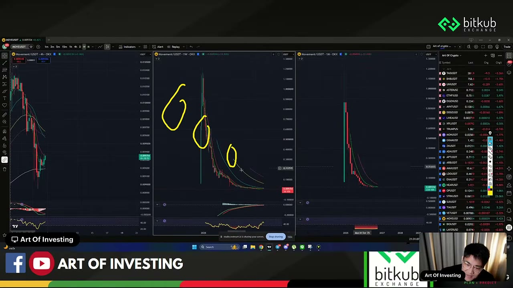

[01:27:51] แล้วเนี่ยถ้าเกิดคุณเปิดไปแล้วไส้ยาว ๆเยอะมากเลยนะครับแสดงว่าสภาพคล่องมันต่ำ แบบเต้องเล่นในเชิงหวยเท่านั้นหวยก็คือ แบบถ้าเสียก็เสียทั้งก้อนเช่นแบ่งเงินลง 30,000 ก็คือ stop  loss ที่ low เลย อะไรอย่างเงี้ยเราจะเทรดแบบรีด optimiz performance ไม่ค่อยได้เพราะว่าแบบเนี้ย แสดงว่าเงินเข้ามานิดนึงปึ้งกูพุ่งและขาย ที่ทำกำไรนิดนึงปึ้งกูทุบและเงินเข้ามา นิดนึงปึ้งกูพุ่งและขายนิดนึงกูทุบะนะ ครับฉะนั้นแบบเนี้ยสมมุติว่าคุณจะรีด เลื่อน Stop  Loss มาไว้หน้าทุนเลื่อน Stop  Loss ไปไว้สวิงค่อยๆไล่ไปแบบนี้จะ ทำกับเหรียญพวกนี้ไม่ได้เลยมันจะต่างจาก เหรียญใหญ่เช่นแบบสมมุติอย่างบitcoin เงี้ยใช่มั้ยเออเฮ้ยโมเมนตัมเกิดตรงนี้ แล้วงั้นตรงเนี้ยไม่ควรจะกลับมาแล้วเรา เลื่อน Stop  Loss เลื่อนนู่นนี่นั่นพอ เราเจออะไรที่สภาพคล่องสูงอ่ะครับมันจะมี เม็ดเงินคอยเข้ามาซับราคาเสมอแบบเนี้ยเรา จะเลื่อน Stop  loss อย่างมีประสิทธิภาพ ได้แต่ว่าถ้าเหรียญอย่าง TST ไม่ใช่ว่า เทรดไม่ได้แต่เทรดแล้วจะเลื่อน Stop  Loss ปรับนู่นเนี่ยคุณจะโดนเกี่ยวไปหมดอ่ะ

[01:28:52] เพราะสภาพคล่องมันต่ำเหรียญแบบนั้นเทรด ยากจะต้องมองเป็นหวยนะครับอ่ะเดี๋ยวผมขอ ดูอีก 2 ตัวสุดท้ายนะครับก็โกับนะครับ โเนี่ยทรงคล้ายๆกับลิงเลยนะครับก็คือไอ้ ไอ้ทรงแบบเนี้ยที่มันเป็นtวnไส้ด้านบน เนี่ยผมไม่ค่อยชอบเท่าไหร่นะโดยโดยส่วน ตัวนะครับแต่ว่าด้วยความที่ผมให้เกียรติ นะครับที่มันสามารถเบรกพรีเมี่มขึ้นมาได้ แล้วรอบนึงนะครับแล้วก็โมเมนตัมใกล้จะ เกิดมากๆแล้วสำหรับโนะครับถ้าเกิดโไม่ หลุดตรงนี้ที่เป็น hiden นะครับแถว 95 คือสมมุตินะว่าสมมุติเลยนะว่าบitcoinร่วง มาแบบ 76,000  75,000  77,000 หรือ 78,000 แล้วโซไม่หลุดตรงนี้นะครับก็คือ 95 ผมมอง ว่ายังสวย อ่ะถ้าเกิดถ้าเกิดมันจะทุบแรงนะสมมุตินะ ก็คือแบบปึ้งมาตรงเนี้ยผมมองว่ายังสวยนะ ครับส่วนถ้าระยะสั้นอันนี้คือระยะกลางนะ ถ้าเกิดไม่หลุด 95 ผมมองว่ายังเล่นได้ยัง สวยส่วนระยะสั้นก็เนี่ยง่ายมากดิคาอยู่

[01:29:52] ตรงนี้ะนะครับฉะนั้นถ้าหลุดตรงเนี้ยก็มี โอกาสออกหน้าไซด์วยละก็คือไม่ควรหลุด EMA 50  Day นะครับแถว 107 ประมาณนี้อ่ะตัวตัวสุดท้ายมานะครับสุย โอเคนะผมยังถืออยู่นะครับสุยผมยังถืออยู่ แต่ถ้าหลุดเทนผมก็ยอมเขวี้ยงนะครับ เอ่อโอ้ทรงนี้ก็เล่นยากนะครับถ้าจะเล่น ต้องเล่นหวยเหมือนกันทรงนี้เหมือนเหมือ TST เลยนะครับถ้าอยากเล่นก็คือตรงเนี้ย มันติดพรีเมี่มตรงนี้มาตลอดใช่มั้ยฉะนั้น ถ้ามันเบรค EMA  25 ได้ Magdin  RSI  Over Boss ก็อาจจะเข้าตรงนี้แล้ว Stop  Loss ตรงนี้แต่เลื่อน Stop  Loss ก้านหน้าทุน อะไรไม่ได้เลยครับ EDA วิเคราะห์ไปแล้วครับคุณอิสลเรียว ย้อนดูได้นะครับอ่ะเนี่ยประมาณนี้นะครับ เนี่ยให้ดูตรงนี้โก็วิเคราะห์แล้วเนาะอืม โอเคเรียบร้อยครบทุกตัวอ่ะเป็นไง รีบาวoundละ นะครับแต่รีบาวตรงเนี้ยไม่ไม่ได้ว่าแบบจะ กลับเทรนจะอะไรนะครับเป็นตามที่บอกก็คือ

[01:30:54] โซน reject นะครับเนี่ย 70% ที่มันจะอยู่ในกรอบเนี่ยเห็นมยถ้า ใกล้กรอบเราก็จะต้องมีระยะว่าหลุดไปเท่า นับว่าโซนนั้นรับไม่อยู่ระยะวิ่งควรเป็น เท่าไหร่เนี่ยครับมันจะเป็นอย่างงี้แล้ว ก็กรอบบนผมมองไว้ 84,000 เนาะอ่าอย่าง เงี้ยนะครับจนถึง 19:00 น.พวกเนี้ยก็มี โอกาสถ้าหลุดแล้วมันก็จะวิ่งกลับมาในกรอบ อ่ะ 70% นะครับ อันนี้คือมุมมองในรูปแบบdayรดเนาะที่ที่ ดูด้วย data  OI กับค่า IV เอาจริงๆ เสน่ห์ของ OI มันอยู่ที่ IV นะนะครับมัน อยู่ที่ IV อ่ะวันนี้ประมาณนี้แล้วกันผม ก็เชื่อว่าน่าจะได้เห็นภาพประมาณนึงนะ ครับแล้วก็อย่างที่ผมบอกอ่ะคนมันกลัวอยู่ แล้วราคามันทุบมามันก็แบบอุ๊ยหลุดแล้วทุก อย่างจบแล้วแบบนี้ไม่กล้าเข้าแล้วแล้วคุณ ก็จะนั่งมองเหรียญ มันมันวิ่งขึ้นไปเรื่อยๆอ่ะนะครับฉะนั้น พอพอมันถึงจุดที่คุณมองแล้วว่าโมเมนตัม มันเกิดอ่ะให้คุณวาง Stop  Loss แล้วก็ เข้าไปเลยเพราะว่าอะไรรู้มั้ยมันจะเป็น

[01:31:56] ภาวะที่เรียกว่า Brain  Block คุณระวัง ภาวะนี้ให้ดีนะเว้ยผมเสียหายเพราะภาวะนี้ มันบ่อยมากแรกๆอ่ะ เพราะว่าถ้าเกิดคุณรู้สึกว่าเฮ้ยเดี๋ยว ราคาต้องทุบแน่เลยอ่ะสมองคุณจะเจอแต่เหตุ ผลที่มาช่วยยืนยันว่าเดี๋ยวต้องทุบแน่เลย เดี๋ยวถ้าเข้าตรงนี้เดี๋ยวจะต้องโดน Stop Loss ฉะนั้นน่ะครับคุณจะเป็นการตัดสินใจ ตอนที่สมองคุณน่ะมันบล็อก ทางเลิกอื่นทิ้งหมดเลยเพราะมันมองว่า คุณเชื่อมากๆว่ามันจะลงงั้นมันจะช่วย สนับสนุนคุณถูกป่ะสมองมนุษย์อ่ะมันเกิดมา เพื่อเอาตัวรอดออนโดวิเคราะห์แล้วครับ ออนโดวิเคราะห์แล้วครับออนโดผมก็ยังถือ อยู่แต่ถ้าหลุด 0.41  0.42  42 ผมผมหนี หมดทุนผมอยู่ 0.39  39 อันนี้บอกเลยที่ผม ลงไปในเพจอ่ะไปไปย้อนดูได้นะครับที่ผมลง ด้วยว่าแต่ละตัวทุนผมอยู่เท่าไหร่อ่ะทุก ตัวยังเหนือทุนอยู่แต่กำไรหายไป 7 หลัก กว่าแล้วครับ[เสียงหัวเราะ]เพราะว่าผม

[01:32:58] แบ่งขายไปทีละ 30% ผมไม่ได้ขายหมดไงเพราะ ผมอยากให้เกิดเทรนด์ใหญ่ทุกตัวยังเหนือ ทุนผมอยู่แต่กำไรผมหายไป 7 หลัก นะครับ เอาเมื่อกี้พูดถึงอะไรอ่ะโอเคเนบ็ockแต่ เวลาที่คุณวางแผนก่อนที่ราคามันจะทุบอ่ะ หรือก่อนที่ราคามันจะลงอ่ะคุณไม่ได้วาง แผนในมุมมองที่แบบเดี๋มันจะต้องทุบเดี๋ยว จะต้องเละฉะนั้นคุณดูอย่างรอบคอบแล้วนึก ออกมยผมเลยบอกว่าถ้าเกิดคุณวางsetอไว้ แล้วแล้วหน้างานไม่เปลี่ยนน่ะมันเกิดคุณ ก็เข้าเลยนะครับแล้วคุณก็เชื่อในรูปแบบ trading  setup ของคุณไปเพราะว่าถ้าถ้า คุณวิจัยมาแล้วแบบไม่มั่วนะไม่ได้แบบ อุปมาอุปไมยขึ้นมาเองนะว่าอันนี้แหละ เวิร์คอันนี้แหละถูกต้องอย่างเงี้ยเชื่อ มันครับแล้วเดี๋ยวมันจะกลับเข้าหาค่า เฉลี่ยเองประมาณนี้วันนี้นะครับไม่ได้มี อะไรซับซ้อนหรือยากอ่ะเดี๋ยวเจอกันใหม่ พุธหน้าครับผมขอบคุณที่ทุกคนเข้ามารับชม นะครับ Art  of  Investing ครับผมสวัสดี ครับเออคุณฮาร์ดวหายไปหลายไลฟ์เลยนะนะ ครับคิดถึงเหมือนกันนะครับคุณฮาร์ดวไม่

[01:33:58] ต้อง donate ให้ผมเหมือนเหมือนทุกครั้งก็ ได้ครับที่แบบที 179 นะแค่เข้ามาทักทาย กันหน่อยนะครับก็ดีใจเนาะสวัสดีครับทุก ท่านหวัดดีครับ

