# BTC น่าช้อนไหม

- ช่อง: Art Of Investing
- ลิงก์: https://www.youtube.com/watch?v=vKY9DaxtDz4
- วันที่: 2026-10-14
- ความยาว: 1:02:26
- ที่มา: คำบรรยายอัตโนมัติ (auto-generated) ภาษาไทยของ YouTube — อาจมีคำสะกดผิด/คำผิดเสียง
- ภาพ: 35 ภาพจากวิดีโอช่วงที่เปิดกราฟแท่งเทียน (เลือกอัตโนมัติจากสีแท่งเทียน · ตัดภาพซ้ำ) อยู่ในโฟลเดอร์ frames/

---

[00:00:43] อ่ะสวัสดีครับสวัสดีครับขอโทษทีขอโทษทีนะ ครับไปพาน้องหมูกรอบเข้านอนมานะครับผมก็ เดี๋ยวนะเอาแชทเอาเชิตขึ้นก่อนผมก็เอ้ย ไม่ได้เซ็ตเลยนะครับผมวันนี้มาเรทนิดนึง นะโหกล้องกล้องมันใกล้ไปมั้เนี่ยเดี๋ยวนะ เอ้ยใกล้ไปพี่ชาย อโอเคมันจะใกล้ชิดกันเกินไปนะครับผม สวัสดีครับทุกคน

[00:01:09] เป็นไงบ้างเดี๋ยวนะเดี๋ยวนะเดี๋ยวนะแป๊บ นึงนะอันนี้ปึ๊บ โอเคโอเคโอเคนะครับ สวัสดีครับอาจารย์หวัดดีครับ หวัดดีครับจองโต๊ะสวัสดีครับแหมคุณ จูเนี่ยวนี้มาเร็วนะครับสวัสดีครับคุณ เอ็นเจอครับสวัสดีครับคุณจิรกิจสวัสดีคุณ ตี้ด้วยนะครับสวัสดีคุณโกโก้ด้วยนะครับ สวัสดีคุณจตุรงค์ด้วยนะครับเออสวัสดีครับ สวัสดีทุกคนเลยนะครับเอ้อวันนี้นะครับก็ อยู่บ้านคนเดียวนะครับอยู่บ้านคนเดียวก็ เลยแบบต้องให้ข้าวน้องหมานะครับน้องหมู กรอบแล้วก็คอย ดูแลเค้าเนาะแปรงฟงแปรงฟันนะครับแล้วก็ เช็ดเท้านี่ก็ยังไม่ได้แปรงฟันเลยนะครับ เดี๋ยวผมน่าจะแปรงฟันให้เค้าอีกทีหลัง ไลฟ์เสร็จนะครับเออก็เลยมาขึ้นไลฟ์ช้าเลย นะครับก็วันนี้ CPI เพิ่งออกเนาะตัวเลขก็ ใช้คำว่าตามคาดการณ์ได้มั้ยตามคาดการณ์

[00:02:10] ของนักลงทุนนะไม่ใช่ตามราดตามคาดการณ์ของ ตัวเลขเศรษฐกิจนะครับมันจะมี 2 ตัวเลขที่ ผมมองว่ามันค่อนข้าง โคลิateกันชัดเจนอย่างนึงนะครับก็คือตัว บอนของ 10 ปีนะครับมันเด้งขึ้นทันทีเลย หลังจากที่ CPI เนี่ย ประกาศออกมานะครับซึ่งตัวเลขเนี่ยในมุม มองผมนะค่อนข้างเป็นผลลบนะครับระดับนึง เลยนะครับถามว่าทำไมถึงเป็นผลลบนะครับอ่ะ เดี๋ยวผมจะไล่ายตรงนี้ให้ดูแล้วกันเดี๋ยว ผมขอเอาเป็นอันนี้แล้วกันเดี๋ยวนะ ปึ๊บอ่ะเดี๋ยวผมย้ายมาเป็นฝั่งนี้แทนก่อน นะครับแล้วก็เอา for ตรงนี้โอเค เอานี้ขึ้นตื๊บๆนะครับแต่ว่าผมมีข่าวดี เนาะก็คือตอนนี้ data เทรดง่ายมากคำ ว่า data เทรดง่ายมากก็คือมันอ่านทิศทาง ค่อนข้างง่ายนะครับมันชัดใช้แบบนี้แล้ว กันใช้คำว่าชัดแล้วกันเพราะว่าสัปดาห์

[00:03:11] ก่อนนะครับมันไม่ชัดเนาะก็คือตัวจำนวน สัญญาเนี่ยมันกระจายมันไม่กระจุกตัวเป็น โซนแต่พอกระจุกตัวเป็นโซนแล้วเนี่ยเราวาง Stop  loss ง่ายมากแล้วเราก็จะเจอพื้น ที่ว่าเฮ้ยตรงเนี้ยใส่ตรงไหนดีซึ่งอัน นั้นน่ะเดี๋ยวผมจะเล่าให้ฟังซึ่งวันเนี้ย จะไปไวๆนะครับจะได้ไม่รบกวนเวลามากแล้วก็ กระชับด้วยเนาะขั้นแรกนะครับตัวที่ผมอยาก ให้โฟกัสมากๆเลยนะดูตรงนี้ นะครับดูตรงนี้หน่อยคือคอ CPI เนี่ยมัน ออกมาเกินคาดก็คือมันไม่ลดนะครับอย่างตัว เลขก่อนหน้าเนี้ยที่เขามองว่าเฮ้ย Call CBI เนี่ยมันขึ้นนะทั้ง Mon  on  mon ก็ คือเดือนชนเดือนกับ Year  on มันขึ้น 2 ตัวเลยนะครับถามว่าอันเนี้ยพอ มันขึ้นมาสูงกว่าคาดทั้ง 2 ตัวเนี่ยมัน สร้างความน่ากังวลยังไงให้ตลาด คือถ้าเกิดตัว CPI ขึ้นอย่างเดียวเนี่ย ครับคนยังมองว่าเฮ้ยมันน่าจะเป็นผลกระทบ มาจากแค่กลุ่มพลังงานหลักอย่างน้ำมันถูก

[00:04:15] มั้ยอ่ะอย่างอย่าตรงนี้เนาะที่มันขึ้นมา เนี่ยอ่าถ้าเกิดตัว CPI โดดๆขึ้นแต่ตัวคอ ไม่ขึ้นเนี่ยครับมันยังพอมองได้ว่าเงิน เฟ้ออ่ะมันดื้อเพราะแค่น้ำมันมันแพงแต่พอ ตัวคอ CPI มันเพิ่มเนี่ยมันทั้งสูงก็คาด การณ์แล้วมันเพิ่มใน year  on  year ด้วย นะมันเลยเป็นมุมมองว่าเฮ้ยพิษร้ายของเงิน เฟ้ออ่ะมันเริ่มกระจายออกไปกว้างกว่า กลุ่มพลังงานแล้วนะครับอ่ะอันนี้คือในมุม มองของเฟซที่เขา้าอ่านเอกสารนะครับฉะนั้น มุมเนี้ยค่อนข้างน่ากังวลและสำรับเขาก็ก็ คือเฮ้ยน้ำมันแพงมันเริ่มจะส่งผลต่อต่อ เงินเฟ้อในกลุ่มอื่นนอกเหนือจากกลุ่มพลัง งานแล้วนะครับฉะนั้นค่าตรงเนี้ยไม่ได้ เป็นผลดีนะครับต่อเงินเฟ้อแล้วกันนะครับ ไม่ไม่เป็นผลดีเนาะ และสินทรัพย์เสี่ยงทีนี้ตัวต่อมาที่ผม สังเกตเนี่ยคือแล้วตลาดอ่ะรับรู้ไปแค่ไหน แล้วนะครับนักลงทุนจะชอบใช้คำนี้คือคำว่า

[00:05:17] Price  in นะครับ Price นักลงทุนจะใช้คำนี้บ่อยมากเฮ้ยตลาด price in ไปแล้วเฮ้ยตลาดยังไม่ price  in เลย อ่ะ price  in เนี่ยคือตลาดเนี่ยรับรู้ อารมณ์จากข่าวหรือจากการคาดการณ์ไปมากแค่ ไหนผมมองแบบนี้ถ้าเกิดตัวเลขออกมาไม่ดี แบบนี้นะก็คือค CPI ก็ขึ้น CPI ก็ขึ้นตัว ที่เราต้องดูนะคือบอน ระยะสั้นนะครับเรียกว่าสั้นได้มั้ยอ่ะ สั้นแล้วกัน 10 yearียนะครับไม่ใช่ตัว 20 กับ 30 เนาะถ้าเกิดมันขึ้นไม่แสงไม่สูง มากไม่แรงมากอ่ะนะครับมันแปลว่าตลาดอ่ะ ได้ดูดซับความกลัวจากทิศทางตรงเนี้ยไป ตั้งแต่สัปดาห์ก่อนเดือนก่อนแล้วตั้งแต่ มันขึ้นไป 5.3  5.4%  4% แล้วนะครับแล้ว ถ้าเกิดเมื่อกี้ประกาศ CPI คอย CPI ออกมา อย่างเงี้ยมันขึ้นนิดเดียวเราก็อุปมา อุปมัยได้เลยว่าเฮ้ยตลาดไม่ได้กังวล นี่หว่าเออตลาดมันรับรู้ไปแล้วตลาดมัน

[00:06:19] กลัวล่วงหน้าไปแล้วแต่เมื่อกี้ไม่ใช่ สัญญาณเนี้ยชัดนะครับเมื่อกี้ไม่ใช่อ่ะ เห็นมั้ยอันเนี้โคตรชัดเลยคือปึ้งขึ้นมา เลยนะครับอย่างเงี้ยซึ่งเยอะนะคุณดูนะตอน แรกมันอุตส่าห์หักหัวลงนะจาก 5.3% ลงมาเหลือ 5.15  15 อ่ะอันเนี้ยนี้เริ่ม เป็นสัญญาณดีแล้วถูกมั้ยว่าเอ้ยบอ เริ่มลงอ่ะผลตอบแทนจากพันธบัตรเริ่ม ลดลงแล้วว่ะแบบนี้มีแนวโน้มที่เงินมันจะ ถูกถ่ายไปที่สินทรัพย์เสี่ยงมากขึ้นถูก มั้ยแต่มันเด้งพรวดเลยแบบนี้ป้างขึ้นมา จังหวะเดียว one  shot ในขณะที่ข่าวออกนะ ครับทิศทางแบบเนี้ยบ่งบอกว่าตลาดยังไม่ ได้ price  in ความกังวลเข้าไปมันเพิ่งจะ เข้าไปใน[เสียงกระแอม]ตลาดฉะนั้นนั้นใน ช่วงสัปดาห์นี้นะครับในช่วงสัปดาห์เนี้ย ผมมองว่ายังย่อได้อีกนะครับยังย่อได้อีก ออกทิศทางไซเวย์ยหรือย่อตัวมากกว่าขึ้น

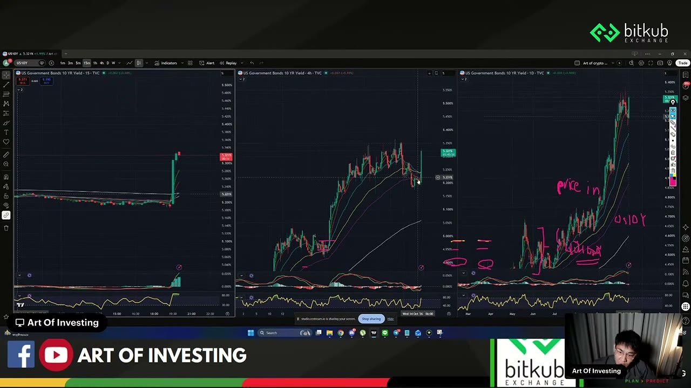

[00:07:21] ต่อทันทีแบบผมมองว่าโอกาสยากแล้วกันที่จะ แบบพรุ่งนี้ตื่นมาแล้ว 85,000  86,000 87,000  89,000 ผมมองว่าจากค่า 2 อย่าง ที่ออกมาคอ CPI  CPI และบอย 10 ปี เด้งพรวดเลยไม่ก็ได้ค่อยๆขึ้นแบบเนี้ยนะ ครับ 1 ฝั่งและที่บอกว่าตลาดเพิ่งรับความ กังวลเพิ่มอีกฝั่งนึงที่เป็นฝั่ง Data Option ที่ผมบอกว่าตัวเลขมันชัดคือตรง นี้ครับจะเอาให้ดู ชัดมากด้วยนะครับตัวเลขมันชัดเลยก็คือตรง อ่ะ option ดูวันนี้ก่อน เอาวันที่สุดสัปดาห์นี้ก่อนนะครับคือมัน กองอยู่ที่ 78,000  -80,000 อ่าเฮ้ยคุณ อาร์ตแล้วแบบนี้มันมันชัดยังไงเพราะว่า ระหว่างทางมันแหว่งไงครับเห็นมั้ย เนี่ยระหว่างทางมันแหว่งพอระหว่างทางมัน

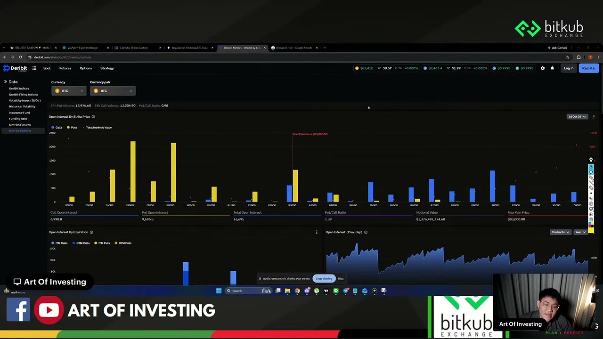

[00:08:22] แหว่งอ่ะ มันตอบได้ว่าตลาดอ่ะคาดไม่เล่นราคาตรงนี้ กันเท่าไหร่นะครับฉะนั้นตอนแรกเนี่ยเขา ให้ค่าที่ 83,000 เยอะเห็นป่ะฝั่งพุทธนะ ฝั่งที่เป็นเสาเสาสีเหลืองเห็นมั้ยครับ ฝั่งที่เป็นเสาสีเหลืองเนี่ยอ่ะเดี๋ยวนะ เค้าให้ค่า 83,000 กันเยอะว่าถ้าเกิดไม่ หลุด 83,000 เนี่ยก็ยังจะไซด์เวย์อยู่ใน กรอบเแหละระหว่าง 83,000 กับ 85,000 ถูก มั้ยแต่หลุดปุ๊บตรงเนี้ยมันโล่งนะครับถ้า ในเชิง Delta  Hing  Dynamic  Haging  Delta Haging เขาจะมองว่ามีโอกาสเกิด GammaM Sque ถูกมย หรือรายใหญ่ต้องแย่งกัน short fฟิวเจอร์ เพิ่มนะครับถ้าเกิดเค้าขายพุไว้พอมันเป็น ทิศทางเนี้ยในเอาในทฤษฎีก่อนเดี๋ยวผมจะ อธิบายภาคปฏิบัติให้ฟังในทฤษฎีอ่ะมันก็จะ

[00:09:23] ต้องพรวดซึ่งมันก็พรวดจริงๆถูกมั้ยปลื้น มา 8,000500 ตอนนี้ 8,2400 ะนะครับก็คือ พรวดมาที่แถวตรงนี้ะแต่ทีเนี้ยอ่ะอ้าวคุณ อาร์ตงั้นเราก็ถือชอตไปจนถึง 80,000 เลย ได้มั้ยถ้าถามว่าถือชอตจนจน 80,000 เลย ได้มยผมมองว่าได้แต่ต้องคาดingอ่าได้แต่ ต้องคาดเทingมันไม่ได้ใช้ได้ตรงเป๊ะ เหมือนทองเดี๋ยวจะอธิบายให้ฟังนะครับ อย่างทองคำเนี่ยมันเป็นสินทรัพย์ที่ได้ รับการยอมรับทั่วโลกแล้วถูกมั้ยทุกคนเข้า ใจหมดแล้วว่าทองคำคืออะไรฉะนั้นเม็ดเงิน มันเข้าอย่างถูกกฎหมายได้ง่ายคำว่าเม็ด เงินเข้าอย่างถูกกฎหมายได้ง่ายอ่ะให้คุณ นึกภาพว่าบริษัทใหญ่ๆสถาบันใหญ่ๆเนี่ย เค้าต้องการสภาพคล่องถูกมั้ยเค้าก็จะต้อง สินทรัพย์ที่เขามีอ่ะไปค้ำประกันเพื่อกู้ ออกมาเป็นสภาพคล่องเป็นเงินสดไปเล่นกับ การขยายธุรกิจหรือแม้กระทั่งสถาบันหรือ กองทุนใหญ่ๆทีเนี้ยพอทองคำมันถูกกฎหมาย

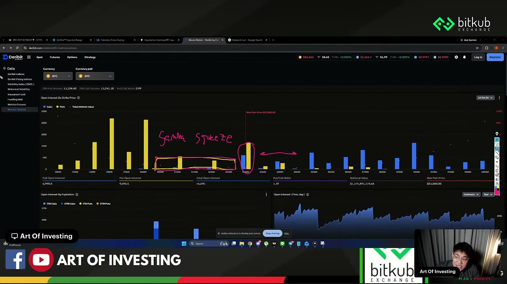

[00:10:24] มากกว่าบitcoinถูกกฎหมายหลายฉบับมากกว่า การเก็งกำไรหรือกินส่วนต่างค่าน้ำค่า พรีเมี่ยมเนี่ยบนทองคำมันจะเยอะกว่า ฉะนั้นเวลาหลุดแล้วพรวดอจากโซนนี้ไปโซน นั้นจากโซนนั้นไปโซนนี้เนี่ยทองคำจะค่อน เป็นไปตามทฤษฎีก็คือทะลุปุ๊บเกิดแกม squ เลยเฮ้ยชนโซนที่เป็นเสาใหญ่แล้วเกิดรีเจค เลยแต่ถ้าเป็นบitคinคุณต้องบิดนิดนึง เพราะว่าเม็ดเงินตรงเนี้ยยังไม่ใช่ราย ใหญ่ทั้งหมดมันยังผนวกรายย่อยและคนมี ตังค์ที่เป็นวับานเข้าไปด้วยมันไม่ใช่ เม็ดเงินของสถาบันซะส่วนใหญ่แบบทองคำนะ ครับฉะนั้นที่ผมบอกว่าง่ายอ้าวถือไม้ช็อต ต่อง่ายเหรอไม่ใช่สิ่งที่จะบอกว่าง่ายคือ ถ้าเกิดเราจะมองในเกมลองหรืออยากจะช้อน เนี่ยโซนนี้เท่านั้น ซึ่งพอดีกับโมเมนตัมเห็นมั้ยพอดีกับตัว เลข CPI  3 อย่างที่มันสอดคล้องกันแบบ

[00:11:24] เนี้ยเราจะเรียกมันว่า confluence นะฮนะ ครับหรือว่าการยืนยันทับซ้อน confluence ควรจะมาจากแบบนี้นะครับ confluence ไม่ ควรจะมาจากอินดิเคเตอร์ 3 ตัวเช่นเส้นนี้ ตัดกับเส้นนี้นับ 1  store ตัดขึ้นนับ 2D เหนือ 0 นับ 3 โอ้ย 3 ข้อแบบนี้ติ๊กถูก 3 อันจุดเข้าแน่เลยไม่ไม่ควรใช้แบบนั้นนะ ครับแต่ confluence เนี่ยอันเนี้ยมาจาก อะไรตัวเลขเศรษฐกิจตัวเลขเม็ดเงินของคน ที่มีเงินเยอะมากๆถึงจะเล่นoptionัและ 3 โมเมนตัมการซื้อขายฉะนั้นั้น confluence 3 ค่าเนี่ยครับมันมาจากคนละ regine นะ ภาษาเอบ้านๆน่ะมันมาจากคนละแขนงนะครับไม่ ใช่แค่เป็น technical  analysis บนกราฟ อย่างเดียวมันมีตัวเลขเศรษฐกิจด้วย งั้นพอเห็นตรงนี้ปุ๊บเปิดกราฟเห็นชัดเลย นะครับดูตรงนี้ก่อนอันเนี้ยคือแนวรับนะ ครับเพราะสระรายใหญ่สำหรับสัปดาห์นี้นะ

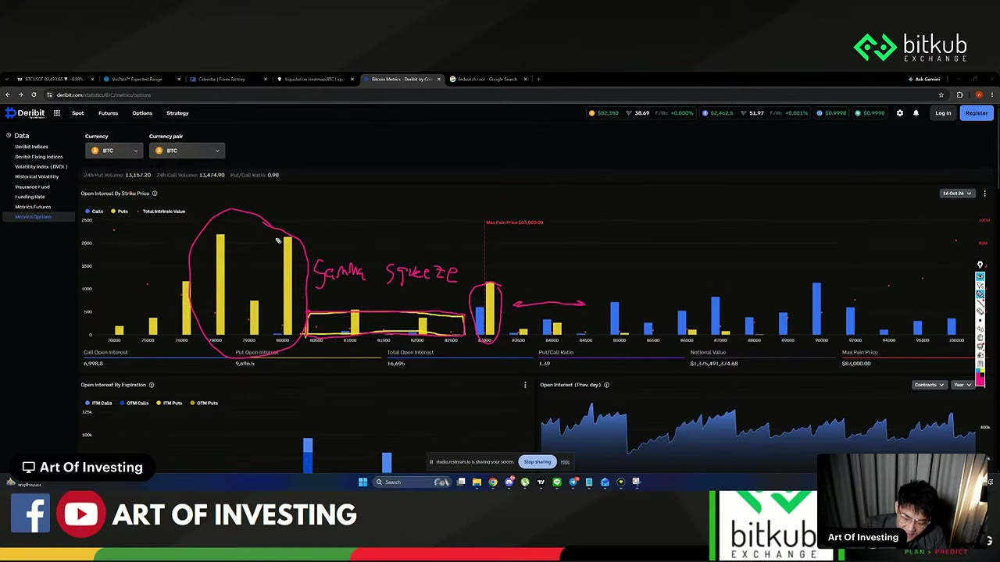

[00:12:25] ครับเค้าไม่ได้มองเยอะว่ามันจะเกิด reีแอคชัอะไรแถว 8,000  82,000 เามองว่า ไม่คุ้มในการเปิดสัญญาไม่ว่าจะซื้อหรือ ขายสัญญานะครับเมองไปที่โซน 78,000-80,000 นี่คือฝั่งแรกนะครับต่อมาฝั่งที่ 2 พระ เอกของงานนะครับเราจะเรียกว่า imply volatility หรือค่า IV นั่นเองหากใครไม่ รู้ว่าค่า IV ใน delbit ดูตรงไหนนะครับ ให้เลื่อนลงมาข้างล่างแล้วตรงเนี้ยมันจะ เป็นเส้นปะพวกๆไปหมดเราจะดูไม่รู้เรื่อง นะครับก็ให้เราดูว่าเราต้องการจะดูของวัน ไหนแล้วติ๊กวันอื่นออกนะครับอย่างี้นะ อย่างที่ผมบอกว่านัยยะที่มีอ่ะไม่ใช่สิ วันของอชัที่มีนัยยะที่สุดอ่ะจะมีแค่วัน ศุกร์กับวันสิ้นเดือนนะครับ 2 วันที่จะมี นัยยะไม่ใช่ 2 วันดิ 2 ช่วงที่จะมีนัยยะ สำคัญช่วงจันทร์ถึงพฤหัสบดเนี่ยครับจะไม่ ค่อยเท่าไหร่นะครับจำนวนคอนทร ฉะนั้นถ้าเอาวันที่มีนัยยะของสัปดาห์ เนี้ยมันจะเป็นวันศุกร์ก็คือวันที่ 16 นะ

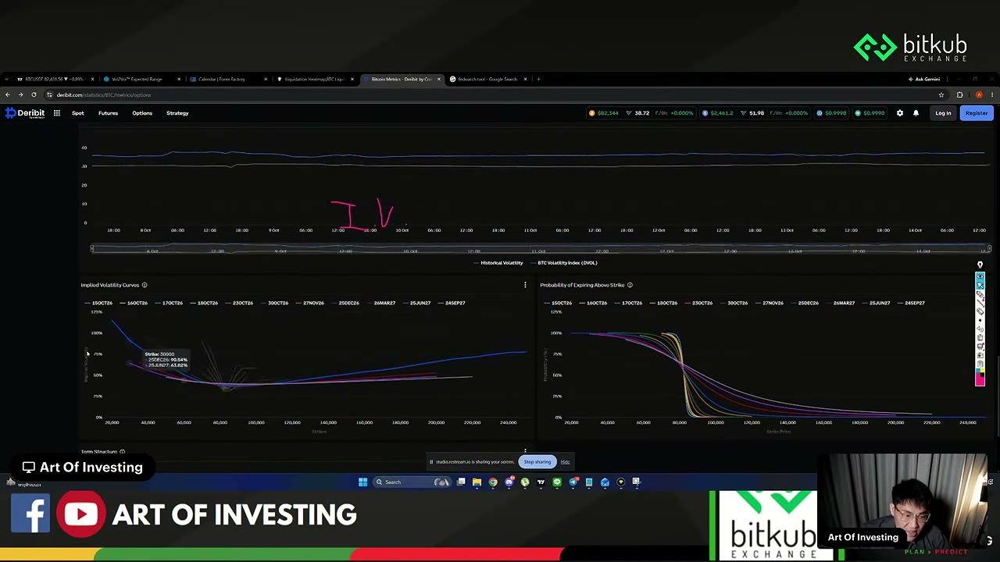

[00:13:28] ครับแล้วพอ IV แบบเนี้ยเราจะเรียกว่ามัน สกิลนะครับสกิลหรือว่าเบ้ซ้ายแบบเนี้ย ครับแสดงว่าvolุ่มฝั่งพุทธมีสูงกว่าก็คือ แนวโน้มนะครับมันจะลงไปหาแนวรับฝั่งด้าน ซ้ายแล้วเด้งได้ง่ายกว่าที่จะเด้งระหว่าง ทางแล้วขึ้นมาฝั่งขวาหรือขึ้นมาฝั่งขวา ก่อนแล้วค่อยเด้งลงไปด้านล่างนะฉะนั้นถ้า เอาตามตัวเลข data นะครับทั้งหมดนี้นะ ไม่น่าจะขึ้นมาเทส 5  85,000 ได้ง่ายเท่าไหร่นะครับมีแนวโน้มที่จะลงไป หาโซน 8  78,000 ถึง 80,000 ได้ง่ายกว่า นะครับอ่ะทฤษฎีจะบอกแบบนี้นะครับเพราะว่า มันมันหลุดเอ่อตรงตรงกลางมาและก็คือ 83,000 เนาะนะครับฉะนั้น โซนที่ได้เปรียบในการเทค Action มี 2 โซน แล้วกันนะครับก็คือสำหรับวันศุกร์นี้เท่า นั้นนะย้ำนะวันศุกร์นะสำหรับสัปดาห์นี้นะ ไม่ใช่แบบอุ๊ยยึด 85,000 เป็นแนวต้านตลอด เอ้ยยึด 80,000  10,000-78,000 เนี่ยเป็น แนวรับตลอดเฉพาะภายในวันศุกร์และเสาร์นี้

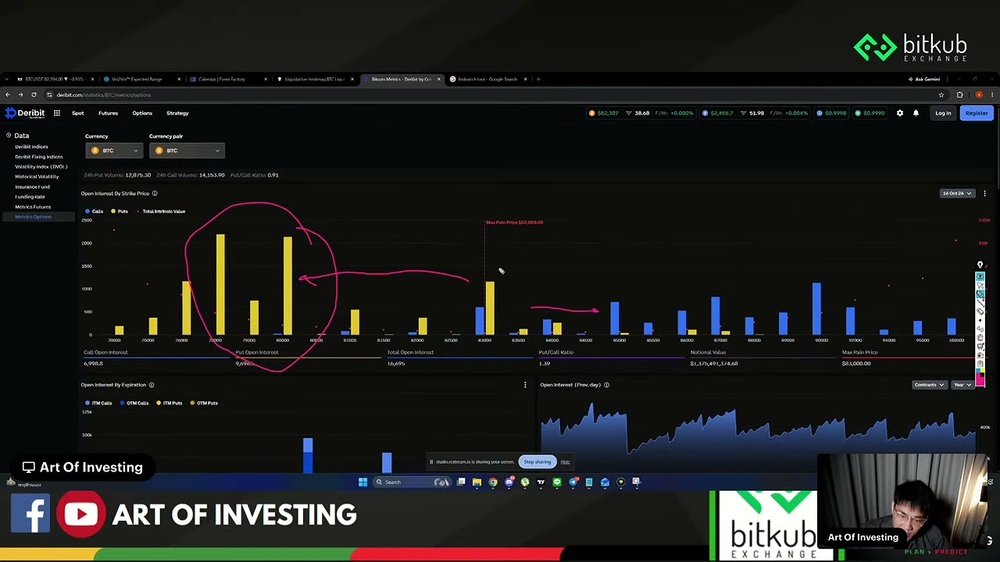

[00:14:31] เท่านั้นนะครับที่ที่ data ตรงเนี้ยจะใช้ ได้ผลทีนี้พอมาดูที่กราฟบ้างนะครับนี่ชัด บ่ชัดบ่พี่น้องนะครับชัดบ่นะครับอ่ะอัน นี้ก็จะเป็นกรอบที่ มีโอกาสกลับไปปิดภายในกรอบ 70% นะครับใน เวลาก่อนจะ 15:00 น.พรุ่งนี้นะครับฉะนั้น เนี่ยผมมักจะนะครับส่วนส่วนใหญ่ที่ผมพูด ว่า Block  Trading  Block  Trading ที่ ผมเขียนในเพจแล้วเนาะช่วงที่มัน sideway เนี่ยคือผมจะได้กรอบทุกวัน 19:00 น.เพราะ ว่าผมเปลี่ยนตัวค่า Impire  Velocatity ผมใช้ค่าตอน 19:00 น.แล้วก็ใช้ราคาตอน 19:00 น.เนี่ยเป็นมีนหรือค่าเฉลี่ยไว้มี เวลาเดี๋ยวผมจะอธิบายศาสตร์แล้วให้ฟังนะ ครับยังยังไม่ต้องเข้าใจทั้งหมดก็ได้เอา เป็นว่าง่ายๆแบบเนี้ยผมเอาแค่ volume option นั้นน่ะมันมีเยอะหรือน้อยแค่ไหน แล้วถ้ามีเยอะแปลว่าโอกาสจะวิ่งกว้างถ้า มีน้อยก็โอกาสจะวิ่งแคแคบนะครับฉะนั้นถ้า มันเป็นตรงเนี้ยนะครับก็เลยมีแนวโน้มนะ

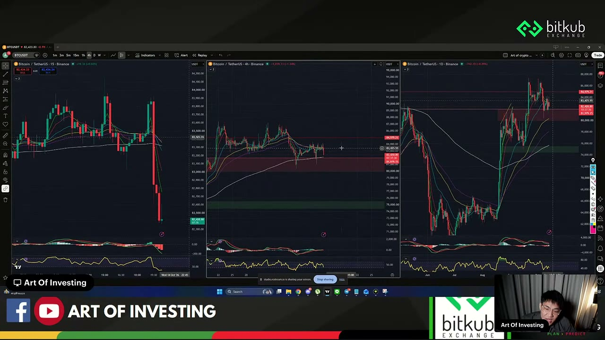

[00:15:34] ครับว่า 70% หากหลุดไปแต่ก่อน 15:00 น.เนี่ยมัน จะกลับมาปิดในกล่องนะครับซึ่งไอ้ที่ผม โพสต์ลงเพจไปที่ผมเทรดมา 3-4 วันเนี่ยเรา ก็จะเห็นว่ามันก็คือภาพพวกนี้แหละนะครับ ก็จะเป็นแบบหลุดกรอบดีดกลับเข้ามาหลุด กรอบแล้วผมก็จะเทรดกลับเข้ามาหรือเบรก กรอบบนแล้วผมก็จะเทรดกดลงไปนะครับมันจะ เป็นรูปแบบนี้ทีเนี้ยตรงเนี้ยมาสอดคล้อง กันก็พอดีพอดีนะครับก็คือ data ของวัน ศุกร์เนี่ยมันจะมีช่วง 80,000 ถึง 8 78,000-80,000 ถูกมั้ยฉะนั้นก็ถ้าเกิด มองในทฤษฎี Box  Trading เนาะก็คือถ้าลง มาตรงเนี้ยแถวใกล้ๆ 80,000 เนี่ยแล้วเกิด reีอคtionเนี่ยก็เทรดกลับกรอบได้ถ้าเกิด ภายในวันนี้นะครับก็เป็น Block  Trading ในวันนี้ก็จะได้เปรียบนะครับโอกาสตรง เนี้ย 70% เลยยิ่ง 80,000 เนี่ยยิ่งสูงนะ ครับแต่มันสูงมากๆเลยแหละถ้าเกิด 80,000 แล้วแบบแต่มันไม่ใช่แบบเด้งแล้วขึ้นยาวนะ ครับสำหรับ Block  Trading ก็คือเด้งกลับ เข้ามาแล้วปิดในกรอบ 70% อ่ะอันนี้คือรูป แบบ Block  Trading ซึ่งผมยังไม่เคยสอนใน

[00:16:36] ในในไลฟ์นะครับก็เดี๋ยวไว้มีเวลาจะอธิบาย ให้ฟังนะครับแต่ว่านักเรียนผมก็น่าจะเห็น ภาพคร่าวๆแล้วแหละเดี๋ยวผมก็จะนัดนัก เรียนเก่ามาอัปเดตนะเพราะว่าปีนี้ยุ่ง เรื่องธุรกิจมากนะครับไม่ได้เปิดสอนเลย เนาะอ่ะ แล้วในเชิงโมเมนตัมล่ะโอเคสนุกตรงนี้แหละ ที่ผมบอกว่าง่ายเราอาจจะแบบเอ้ยกดดัน กันใช่มั้ยจะลงจะขึ้นเฮ้ยไป ยังไงวะเทรดแล้วเครียดว่ะอ่ะพอdata้า มาแบบเนี้ยผมยิ้มเลยยิ้มนี่ไม่ใช่ว่าแม่น นะแต่มันวางแผนง่ายครับคือ Stop  Loss  TP ชัดฉะนั้นงั้นตอนเนี้ยเราดูก่อนว่า day กับ week อ่ะเกิดอะไรขึ้นนะครับ Week เนี่ยถ้าเอาในมุมมองโมเมนตัมเนี่ยคือมัน สำเร็จแล้วนะมันครบทุกข้อแล้วนะก็คือ เนี่ยเอ่อ เหนือพีemiมเบรกพีemiมขึ้นมาได้แล้วนะ ครับ MAD เหนือ 0 ทั้ง 2 เส้น RSI overbard เนี่ยมันมันครบแล้วครับมันแปล ว่าโมเมนตัมอ่ะมันเกิดและแค่มันยังเกิด อย่างไม่แข็งแรงเท่านั้นนะครับงั้นถ้าย่อ ไม่ลึกอ่ะโอกาสจะขึ้นต่ออ่ะมีมากกว่าลง

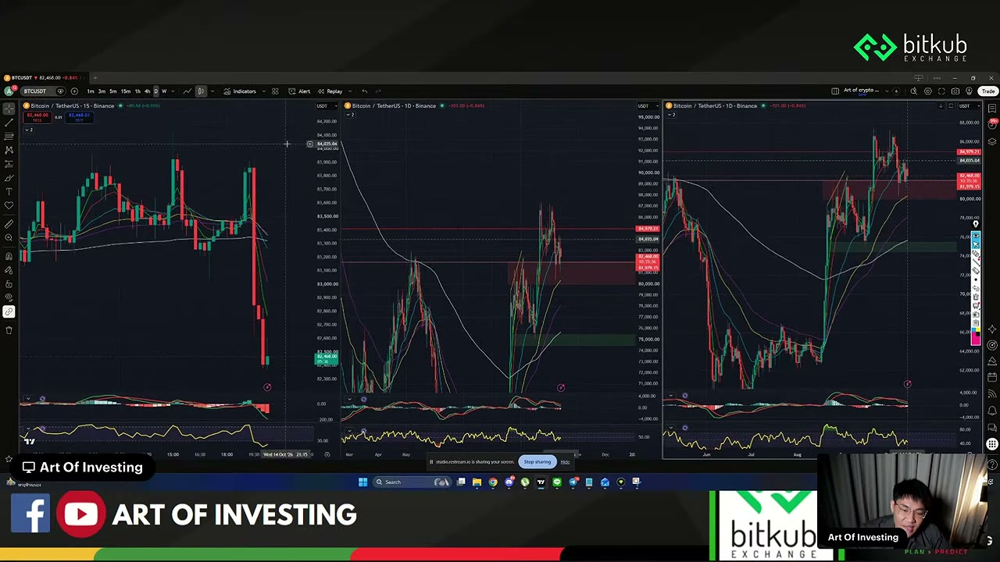

[00:17:38] อ่าเห็นมั้ยเนี่ยทีละข้อนะงั้นโมเมนตัม อ่ะบอกแล้วว่าถ้าย่อไม่ลึกอ่ะโอกาสจะขึ้น ต่อมีมากกว่าลงอ้าวแล้วถ้าย่อแล้วไม่หลุด โซนตรงไหนล่ะถึงน่าสนใจนี่ไง 78,000 -80,000 ผมบอกโอ้สวยว่ะพอdata้าเป็น แบบเนี้ยนะครับฉะนั้นเนี่ยง่ายเลยเราก็ รู้แล้วว่าโมเมนตัมในweคเนี่ยเฮ้ยมันบอก ว่าย่อได้นะเว้ยแต่ว่าถ้าอยากจะขึ้นจริงๆ อ่ะไม่อยากให้ย่อลึกนะครับอ่ะงั้นจาก data เนี่ยถ้าไม่อยากให้ย่อลึกตรงไหนย่อตรงไหน ได้บ้างก็ตรงนี้เลยครับจะสวยมากก็คือโซน 7,000-80,000 ตรงนี้ถูกมยฉะนั้นเนี่ยใน พอร์ต Sport เนาะผมบอกอยู่แล้วว่าพอร์ต Sport อ่ะผมมีของ 70% แล้วอ่า ซึ่งผมเขียนบทความไปเมื่อวานว่าเฮ้ยตรง เนี้ยผมไม่ take  action นะเพราะว่า data มันยังไม่ชัดแต่พอมาวันเนี้ยข่าวออกอะไร ออกชัดเลยพอชัดปุ๊บอ้าง่ายดิงั้นผม รู้ละผมเหลืออีก 30% งั้นผมซื้อเพิ่มตรง

[00:18:42] ไหนดีนี่ไงมันต้องเกิดภาพไหนแบบนี้ไงถ้า ไม่เกิดไม่ซื้อถ้าเกิดซื้อครับโอ้โหแล้ว ไม่พอ 78,000 ตรงกับอะไรอีกครับ EMA  75 โอ้โหมันก็ยิ่งชัดมันคือศาสตร์โมเมนตัม คู่กับอtionัเลยแล้วมันดันบรรจบเป็นที่ เดียวกันนะครับงั้นภาพที่เราจะ take action จะเป็นแบบนี้นะครับคืออ่ะอันนี้ ไม่ไม่ได้บอกให้ซื้อขายตามนะครับแต่ว่า อธิบายเพื่อการเรียนรู้เนาะในเรื่องของ เอ่อ Volatility ของ option นะครับกับตัว กับศาสตร์โมเมนตัมนะครับงั้นภาพที่ผมอยาก เห็นนะก็คือตอนเนี้ยเห็นมยมัน oversow แล้วแล้ว MAD กำลังจะลงมาใต้ 0 ละนะครับ จุดที่น่าสนใจถ้าลงมาคือมันจะต้องลงมา อาจจะเด้งกลับขึ้นไปปิดพรุ่งนี้ก่อนแล้ว ลงต่ออ่ะได้หมดแต่ถ้าลงมาในโซนนี้และ 80,000  78,000-80,000 เนี่ยอ่าถ้าลงมา ในโซนนี้แล้วเรียบร้อยนะครับสิ่งที่เรา

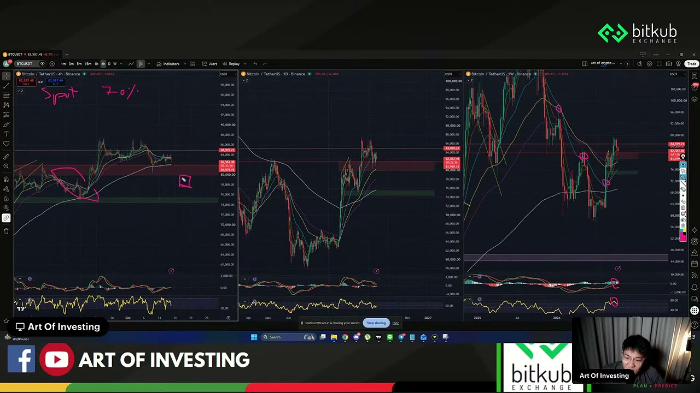

[00:19:44] ต้องการดูต่อไปคืออะไรครับโอ้โหทุกคน รู้อยู่แล้วอ๋อคุณอาร์ตครับเราก็จะต้องหา EMA ใช่มั้ครับที่มันชนแล้วไม่ผ่านถูก ต้องครับแล้วหลังจากนั้นก็เบรคครับ MACD เหนือ 0 ครับ RSI  overbard ครับถ้าเป็น เคสเนี้ยผมก็จะเข้าเพิ่มอีก 10% กลายเป็น นะครับเฮ้ยคุณอาร์ตทำไมไม่อัดเพิ่ม 30% ไปเลยเพราะว่าตั้งแต่มีบitcoinมาบนโลกนี้ นะครับนี่เป็นไซเคิลแรกที่ย่อน้อยที่สุด ก็คือย่อแค่ 50% ผมก็ยังไม่ค่อยวางใจมัน เท่าไหร่นะว่ามันจะไม่มีดิฟอีกครั้งนึง จากมาโครต่างๆแต่ว่าในฐานะที่เราเป็น เทรดดเดอร์อ่ะเราจะไม่ คิดนอกกรอบกลยุทธ์ที่เรามีครับเพราะว่า กลยุทธ์เราอ่ะมันพิสูจน์มาแล้วว่าตัวเลข ทางสถิตสถิติอ่ะมันเป็นจุดได้เปรียบหรือ นะครับถ้าเกิดเราไปคิดว่าเอ้ยมันไม่น่าจะ เป็นอย่างงั้นไม่น่าจะเป็นอย่างนี้สุด ท้ายมันจะเหมือนเราเราแทงพนันน่ะครับเรา ก็จะไปตามความรู้สึกหรือการ feeling ซึ่ง มันไม่ควรให้เกิดแบบนั้นเกิดขึ้นนะครับ

[00:20:46] ฉะนั้นเนี่ยพอมันเป็นครั้งแรกที่ย่อย่อ น้อยที่สุดเวลาเกิดตลาดหมีแล้วก็ 2 ไม่ เกิดการทำ accumulation หรือทุบอีก 1 จังหวะก่อนจะขึ้นพฤศจิกายนนี่ก็เป็นครั้ง แรกเลยในทุกไซเคิลนะครับผมก็เลยอ่ะงั้น รอบเนี้ยถ้ามันไม่ย่อมาในโซนน่าสนแต่จริง ๆอ่ะผมไม่ถือ 100% ผมติดเงินสดไม่ได้ เพราะผมมองว่าโอกาสที่ S&P  500  1-2 ปี นี้อาจจะย่อสซัก 20%  30% มันมันมีค่อน ข้างค่อนข้างเยอะและนะครับจากตัวเลข เศรษฐกิจน่ะเนาะผมก็เลยมองว่าอ่ะถ้าเกิด ผมได้บitคinไม่ 100% เงินตรงนั้นเดี๋ยวผม แบ่งแบ่งไปซื้อหุ้นหุ้นอเมริกาฝั่งตรง นู้นก็ได้นะครับอ่ะทีนี้ เราเห็นภาพตรงนี้ละก็คือถ้าเกิดลงมาจริงๆ ที่โซน 78,000-80,000 นะแล้วก็เกิดโมเมนตัมภาพคุ้นๆอย่างเงี้ย อ่ะเราท่องกันมาอ่ะพอลงมาปุ๊บคุณก็หา EMA เลยเส้นนึงที่แบบลงมาแต่ละครั้งแล้ว เบรคไม่ได้อ่ะเบรคปุ๊บ MAD เหนือ 0  RSI overbard  RSI ผมใช้ 7 นะครับไม่ใช่ 14 เนาะอันเนี้ยก็เก็บได้แล้ว Stop  Loss

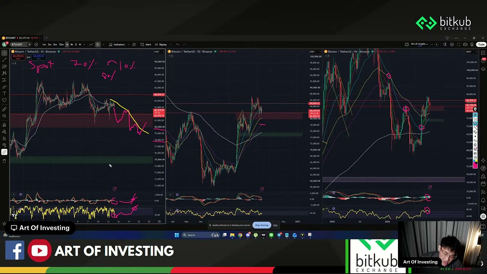

[00:21:47] อ่ะวางสวิง Low ตรงนี้เลยนะครับแล้วถ้า เกิดมันเป็นภาพผมฉายให้เห็นนะก็คือ อ่ะมันก็จะเป็นเคสนี้ได้ที่เราจะเล่นขึ้น ต่อได้นะก็คือถ้าเกิดตรงเนี้ยแล้วทะลุ New High อ่ะผมมองว่า 90,000 อย่างต่ำ นะครับเคสนี้เก็บของได้อ่ะ นะครับอ่า นะครับแต่คุณฟังคitionให้ครบนะไม่ใช่แบบ เอ้ย 79,000 ละเอ้ย 80,000 แล้วซัดเลย แล้วกันไม่ได้นะคุณคุณฟังคitionให้ครบ มันต้องลงมาโซนนี้แล้วเกิดโมเมนตัมใน 1 ช่โมงหรือ 4 ช่มงอ่ะนะนะครับแล้วมันจะพอ ดีกับกราฟ Day ที่มาลงมาที่ EMA  75 แล้ว คุณก็ค่อยเอ้ยแบบเนี้ยเข้าแล้วมี Stop Loss เพราะว่าอะไร 78,000-80,000 ก็ บอกไว้ในตัวเลข option ว่าเค้าวางพุไว้ เยอะนะครับ มันก็มีโอกาสที่ราคาเนี่ยลงมาถึงแล้วเค้า Settlement หรือปิดทำกำไร option ออกมัน

[00:22:49] ก็จะพอดีกันมันก็จะส่งให้ราคาเด้งนะครับ งั้นก็ตรงเนี้ยเก็บของได้ถ้าเกิดมี โมเมนตัมนะครับอ่ะเขียนไว้หน่อยถ้ามี โมเมนตัมเนาะเก็บของได้ถ้าเกิดมีโมเมนตัม นะครับถ้าไม่มีก็อย่าไปเก็บมันส่วน เคสอื่นผมจะไม่ take  action เลยอ้านะ ครับเทสอื่นผมจะไม่ take  action เลยหรือ ถ้าเกิด ใครก็ตามนะครับที่ถือไม้ช็อตอ่ะโอเคอัน นี้อันนี้ในฝั่งในฝั่งสปอตไปแล้วเนาะใน ฝั่งสปอตไปแล้วเนาะพูดถึงคนถือไม้ช็อตก็ ได้เผื่อบางคนเค้าเค้ามีของช็อตมาตั้งแต่ ข้างบนนะครับก็ data มันฟ้องชัดอยู่แล้ว เนาะก็คือ 85,000 เนี่ยเป็นอีกโซนนึงเลย ที่เค้ามองว่าเอ่อไม่น่าจะผ่านก็คือมี callวallอยู่ประมาณนึงนะครับสมมุติว่าคุณ ช็อตมาจากตรงนี้หรือคุณจะช็อตมาตรงนี้นะ ครับมีมี 2 มี 2 ช้อยส์ให้คุณเลือกนะครับ ระหว่างถ้าเกิดคุณมีของตรงเนี้ยก็ การหน้าทุนทำ Stop  Profit นะครับหรือถ้า

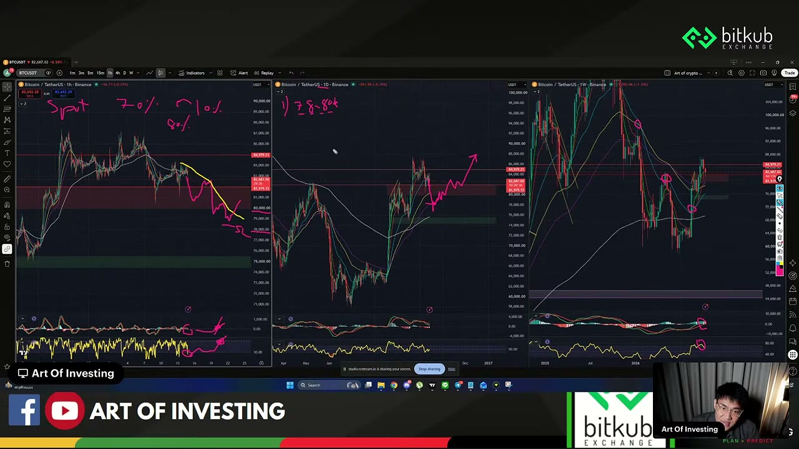

[00:23:49] เกิดคุณมองว่าคุณมั่นใจมากๆว่ามันจะลงอ่ะ ซึ่งซึผมไม่นะผมไม่มองแบบนั้นเพราะว่า Data  Option มันบอกผมอีกแบบแต่ว่าถ้า เกิดคุณมั่นใจว่าเอ่อเอ่อ มันมันจะลงลึกเลยยาวเลยในจังหวะเดียวอ่ะ เนาะก็ให้วางซัก stop  loss ซัก 85  500 อ่ะอันเนี้ยประมาณเนี้ยได้ก็คือประมาณ ครึ่งบล็อกนะครับก็คือ 500 จุดนะครับก็ วาง stop ตรงนี้ก็ได้ถ้าเคยใครอยากถือ ช็อตวัดแต่ผมไม่นะผมผมจะรอย่อแล้วลองหรือ เก็บสปอร์ตมากกว่าฝั่งเนี้ยอ่ะแล้วแต่ สมมุติว่าคุณมีไม้ช็อตแล้วคุณแบบเอ้ยคุณ อาร์ตผมช็อตมาปลายยอดเลย 87,000 แบบผม หล่อมากผมอยากรันอ่ะผมก็มองว่างั้นก็ตั้ง กั้นหน้าทุนไว้นะครับถ้าเกิดคุณช็อตมาที่ 87 อ่ะคุณก็กั้นหน้าทุนไว้ที่ 85,000 500 นะครับส่วนถ้าเกิดคุณช็อตที่ 84,000 อ่ะผมบอกเลยคุณไม่ค่อยได้เปรียบเท่าไหร่ นะครับเพราะว่าตัวเลขมันอยู่ 85,000 งั้น ก็มี 2 ทั้งเลือกระหว่างแบบอ่ะถ้ามาหน้า ทุนฉันออกหรือจะยอมตั้ง Stop  Loss แบบ

[00:24:50] เฉื่อนเนื้อหน่อยที่ 85,000500 นะครับ ฉะนั้นไม้ช็อตเนี่ยก็ไม่ได้ได้เปรียบเท่า ไหร่นี่ก็มีเริ่มมีเด้งะเห็นมั้ยดีจคละ หน่อยเนาะงั้น ภาพสำหรับ การลองก็จะคล้ายกับจุดเก็บสปอตนะครับก็ คือถ้ามันลงมาในโซนตั้งแต่ 80,000-78,000 เงี้ยแล้วเกิดโมเมนตัมอ่ะค่อยค่อยพิจารณา เข้ารองก็จะได้เปรียบกว่าแล้ววาง Stop Loss ที่ที่ low นะครับวางตรงนั้นดีกว่า นะครับแบบนี้ เนี่ยบitcoinไม่ยากนะครับไม่ยากส่วน data สิ้นเดือนผมเปิดให้ดูหน่อยแล้วกันนะครับ ก็คือวันที่ 30 เนาะ 30 อันเนี้ยไม่ชัดอื บอกอะไรไม่ได้เท่าไหร่นะเพราะว่า data ภาพใหญ่เนี่ยมันเป็นมันเป็นค่าเก่าเลยก็ คืออย่างเงี้ยเห็นมั้ยก็คือแถวแถว 90,000 กับ 95,000 ที่เขา้าวางทิ้งไว้ซึ่งตอน เนี้ยมันยังไม่นับว่ามีผลนะเพราะว่ามัน เกิน 5 delต้านะครับคำว่าเกิน 5 del้าก็ คือมีแค่โอกาส 5% ที่แบบมันจะเดินทางไป

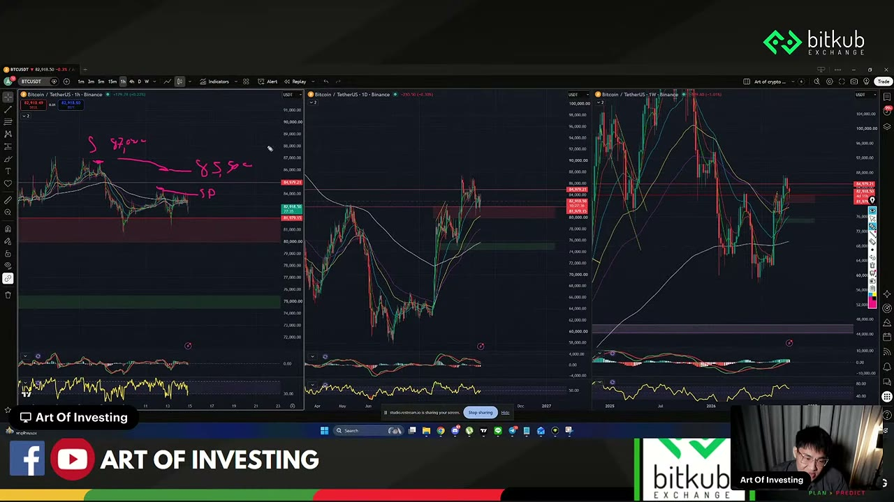

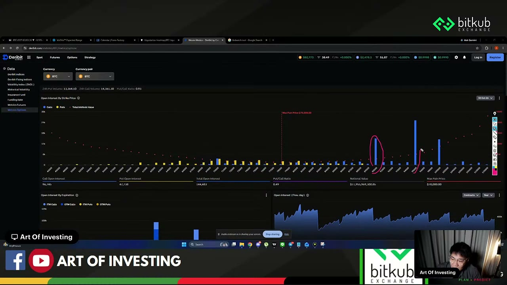

[00:25:51] ถึงณราคาตรงนี้นะครับพูดเป็นภาษาบ้านก็ คือมันยังไกลไปที่จะมีผลนะครับมันต้อง ขึ้นมาซักประมาณ 80,000  17,000 อ่ะเออ ไอ้เสาเนี้ยมันถึงจะเริ่มดูดราคาเข้าไปนะ ครับตอนนี้ยังอ่ะนะครับฉะนั้นไอ้ค่าตรง เนี้ยเทียบกับเสาเนี้ยมันค่อนข้างเตี้ยนะ ครับมันก็จะมีแค่เนี้ยเห็นมั้ 80,000 78,000 หลุดอีกทีก็ 75,000 นะครับเงี้ย ชนะวันที่ 30 อ่ะมันก็เลยยังดูอะไรเยอะ ไม่ได้นะครับเพราะว่าเหลืออีกต้อง 15 วัน ถูกมั้ยฉะนั้นน่ะเราจะดูแต่แบบอุ๊ยแบบนี้ ขึ้นแน่นอนแบบนี้ขึ้นแน่นอนเจ๊งครับถูก มั้ยเจ๊งครับเพราะว่าอย่าลืมว่าเค้ามี เวลาวางหรือยอมปิดอชักันทิ้งไปก่อนอีก ต้อง 15-16 วันน่ะฉะนั้นตัว data ตรงนี้ มันอาจจะเปลี่ยนก็ได้นะครับก็เลยให้ยึด ให้ยึดค่าของวันที่ 16 ไปก่อนเนาะอืก็คือ ตรงเนี้ยอาจจะเด้งนะครับก็ 1 จังหวะก็ ต้องลุ้นแล้วว่ามันจะเบรคขึ้นไปแถว New High หรือเปล่าแต่ว่าถ้าเกิดตรงเนี้ยเรา เด้งเด้งแล้วเบรก 85,000  87,000 ก็ต่ำ สุดคือ 90,000 ได้เห็นแน่นอนนะครับฉะนั้น

[00:26:52] โซนตรงเนี้ยได้เปรียบในการ take  action นะครับถ้าลงมาเกิดโมเมนตัมก็เข้าแล้วก็ วาง Stop  Loss ที่ swing  low ซะนะครับ อย่าลืมนะมี Stop  Loss เสมอนะครับ data มันชัดขนาดนี้แล้วถ้าโดนก็คือยอมโดนไปอ่ะ ประมาณนี้นะครับสำหรับ Bitcoin เดี๋ยวดู อีเรiumให้ด้วยนะครับ โอเคตัวอีเeriiอืม Day มันลงมา EMA  75 แล้วเนาะแล้วก็ภาพตรงนี้เอ่ออeriเรียมรอบ เนี้ยผมมองว่า data เอ่อต้องบอกแบบนี้บิด บitcoinแล้วว่าน้อยกว่าทองคำเยอะแล้วอีiม ก็ยังน้อยกว่าบitcoinนะครับทีเนี้ยพอ จำนวนสัญญาณมันน้อยอ่ะผมก็ ไม่แน่ใจเหมือนกันว่านัยยะสำคัญมันจะเยอะ แค่ไหนเพราะว่าผมไม่มี data ในอดีตแบบ 2-5 ปีนึกออกมั้ยข้อยากอย่างนึงนะครับสำหรับ การดู option น่ะคือคุณต้องซื้อนะครับ ต้องซื้อ data เค้ากลับมาเพื่อ back  test เพราะว่ามันไม่ใช่มันไม่ได้ออกมาเป็นกราฟ

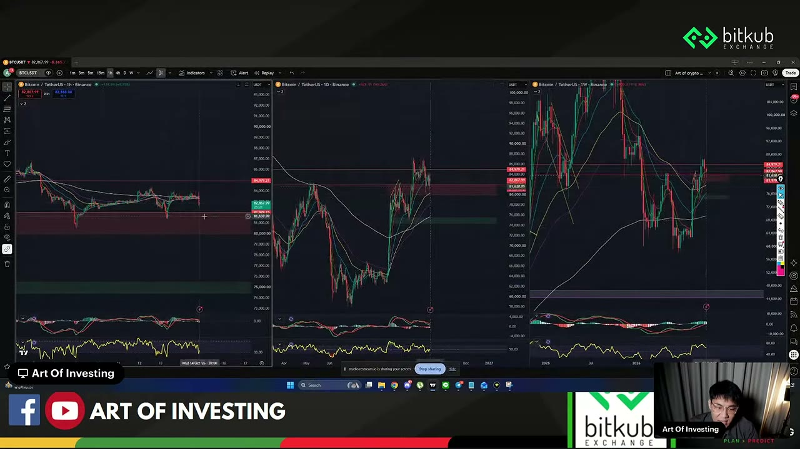

[00:27:54] ถูกมั้ยเราไม่รู้ว่าวันนั้นน่ะ option มันมีเสาราคาตรงไหนบ้างเราไม่รู้ว่าใน อดีตวันนั้นน่ะค่า Impire  Volatility กี่ชั่วโมงอ่ะเป็นตรงไหนบ้างแต่ตอนเผม เก็บละผมมีซื้อของ Revit มา back  test แล้วก็มีเก็บใช้ตัว Airmage อ่ะที่มัน เป็น agent นะครับเก็บทุก 1 ช่โมงฉะนั้น เดี๋ยวเวลาผ่านไป 1 ปีอย่างเงี้ยผมก็จะมี data เพิ่มเรื่อยๆเรื่อยๆๆๆนะครับ อืโอเคประมาณนี้ สำหรับออเรiumนะครับผมผมก็มองว่าตรงนี้ ย่อมาแล้วแต่ว่าถ้าเกิดอยากจะเติมของเหรอ ผมมองเหมือนบitcoinเลยก็คือ DCA ก่อนนะ ครับไม้ใหญ่อาจจะโซนนี้อาจจะยากนิดนึง เนาะสำหรับอทีเรียมยกเว้นว่ามันลงมาซัก แถวเนี่ย 2,280 เนี่ยนะครับอย่างเงี้ยอ่ะแถวๆเนี้ยแถว EMA 25 ในในweคอย่างเงี้ยนะครับให้มันลงมา อีกสัก 1 จังหวะอย่างเงี้ยแล้วแล้วค่อย รีเจคเงี้ยเงี้ยอ่ะถึงจะมีจุดได้เปรียบนะ

[00:28:56] ครับตอนเนี้ยถ้าอยากจะเก็บอธีเรียมเหรอผม มองว่า DCA ไม้ย่อยๆน่าจะเหมาะกว่านะครับ เพราะว่าภาพรวมตลาดเนี่ยถ้าเกิดบitcoin มันยังมีไซส์ให้ลงอีกหน่อยแล้วอธีเรiมมัน ถึงแนวรับแล้วอ่ะผมก็เลยมองว่ามันมันน่า จะลงไปอีก 1 ชั้นได้นะครับใครมีแล้วก็ถือ รันไปนะครับแต่ว่าถ้าจะเติมของผมก็ยัง เชียร์ว่า DCA ดีกว่าในในจังหวะนี้นะครับ ดีครับคุณเอ้พีรพงษ์น้ำมันบอลขึ้นบitคin ยังไหวได้ไงอ่าใช่ครับสวัสดีครับอาจารย์ อาร์ตสวัสดีครับคุณจิรพันธ์สวัสดีครับคุณ อริยารอครับของใหม่ดีจังที่สุดโอ้สวัสดี ครับคุณปุ๋มปุ๋มนะครับผมเห็นมาคอมเมนต์ ทุกบทความผมเลยขอบคุณมากๆเลยครับสวัสดี ค่ะอาจารย์สวัสดีครับสวัสดีครับน้อง ออมสินสิ้นเดือนเค้าเห็นอะไรเหรอครับทำไม ถึงวางตรงนั้นเยอะครับไอ้ตัวนั้นน่ะผมอ่ะ ดูมาตั้งแต่ตั้งแต่ต้นเดือนเลยตั้งแต่วัน ที่ 1 วันที่ 2 เลยมันอยู่ตรงนั้นตั้งแต่ แรกแล้วฉะนั้นน่ะตอนเค้าวางอ่ะครับราคา มัน 87,000 มันมันเป็นขาขึ้นที่ขึ้นมาเยอะๆนะครับ

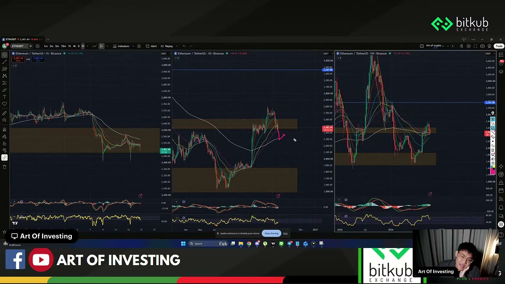

[00:29:57] เค้าก็เลยวางที่ 90,000 กับ 95,000 เยอะ ครับน้องออมสินฉะนั้นน่ะมันเป็นมันเป็น สัญญาเก่าผมถึงบอกไงว่าพอมันเป็นสัญญา เก่าที่เปิดตั้งแต่ต้นเดือนน่ะช่วงช่วง ต้นถึงแบบไล่มาตอนราคามัน 87,000 อ่ะจน ตอนเนี้ยราคามันย่อมา 82,000 อ่ะมันก็เลย ไม่ได้เป็นภาพที่เอ่อใช้คำว่าอะไรเดี๋นะ สมองผมเบอรนิดนึงนะครับมันก็เลยไม่ได้ เป็นค่าที่มีนัยยะสำคัญผมถึงบอกว่าตอน เนี้ยเสาราคา 90,000 น่ะยังไม่ได้ดึงดูด ราคาเท่าไหร่นะครับฉะนั้นอธีมตรงเนี้ยผม มองว่า DCA ก่อนนะครับยกเว้นมันลงมาสซัก 2,200 ปลายๆอ่ะอ่ะค่อยๆว่ากันเกิด โมเมนตัมค่อยเข้านะครับอย่างสมมุติว่ามัน ย่อมาอย่างี้อ่ะสมมุตินะอย่างเงี้ยอ่ะ ค่อยเข้าถ้าถ้าไม่ย่อผมก็คงไม่เข้าเพิ่ม และนะครับสำหรับอีทีเรiมบitcoinก็เหมือน กันเนาะอ่ะส่วนทองคำเป็นไงเออนะครับเมื่อ กี้ข่าวออกใช่มั้ยโอหทุบกันดึ้มดั้ำนะ ครับก็เห็นและว่า 2  SD มันอยู่ประมาณ บล็อกก่อน 4125 เนาะแล้วก็ 4,100 นะครับ

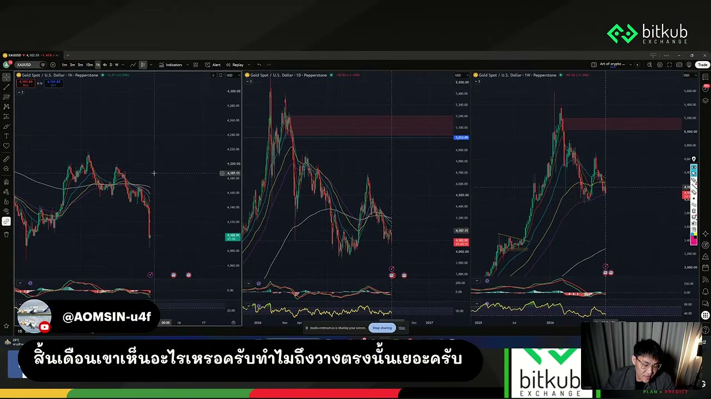

[00:31:01] มันก็จะเป็นขอบละเออก็เห็นอยู่ว่าว่ามี รีบาวแต่ผมไม่ได้เทรดนะผมเป็นคนไม่ชอบ เทรดข่าวว่ะหัวใจจะวายนะครับเออผมแบบไม่ ค่อยเทรดข่าวแล้ว ina  day เนี่ยนะครับ เวลาที่มันเป็นวันข่าวเนี่ยมันจะตรงบ้าง สวนบ้างนะครับ อ่ะทองคำเหรอตรงเนี้ยมันมันลงมาถึง EMA 75 ที่ผมมองแล้วนะก็คือตรงนี้นะครับแถว แถว 4,100 อ่ะเดี๋ยวๆๆเดี๋ยวว่ากันหน่อย ก็ได้ดูทวโนิดนึงอ่ะโอเคเดี๋ยวผมเปิดทอง คำเดี๋ เอาของสัปดาห์นี้ก่อนแล้วกันเนาะก็คือดู พรุ่งนี้ก่อนฉะนั้นถ้าเป็น OI พรุ่งนี้นะ ครับก็มันก็มี contract ตรงเนี้ยเยอะนะ ครับก็คือ 900 กว่า contract ก็ถือว่า เยอะนะครับที่ที่ 4,0 แต่ว่ามันจะทะลุตรง นั้นลงไปได้อ่ะมันก็จะต้องทะลุ 4,100 ก่อนซึ่งตอนเนี้ย 4,100 ยังเอาอยู่นะครับ

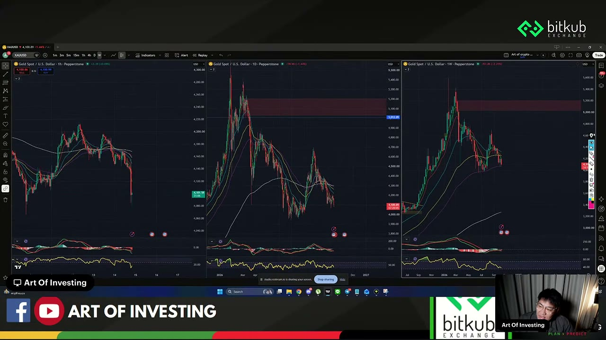

[00:32:03] 4,100 ลบกับค่า difference  basis ก็จะ อยู่ประมาณ 4,080 ฉะนั้นถ้าค่าอันนี้ใน CFD ก็คือประมาณ 4,030 นะครับก็คือถ้า เกิดทองลงแรงๆเนี่ยจุดเด้งอ่ะน่าจะอยู่ นู่นน่ะ 4,030 ภายในพรุ่งนี้นะครับแต่ว่า ถ้าเกิดเป็นวันศุกร์อันเนี้ย data ตรง เนี้ยมันขัดกันนิดนึงนะครับก็คือวันศุกร์ เนี่ยมันก็หนาสุดตรงนี้เห็นป่ะอ่ะฉะนั้น เนี่ยถ้าเกิด 4,080 รับอยู่เนี่ยนะครับก็ ตรงเนี้ยก็มีโอกาสจะเด้งขึ้นมาก่อนและนะ ครับแต่ว่าถ้าตรงเนี้ยรับไม่อยู่เนี่ยนะ ครับแล้วหลุดพรวดไปเนี่ยก็จะไปอีกทีที่ 4,030 อันนี้คือแนวแนวรับทองเนาะผมคำนวณ หยาบๆในหัวให้นะครับจริงๆมันคือเอาเลขตรง เนี้ยไปลบ 22.5 นะครับแล้วคุณก็จะได้ค่า เบิของทองออกมานะครับมันก็จะต้องมี in intraday ที่คุณต้องดูด้วยเนาะแต่ว่า intrad  day มันเสียเงินนะครับถ้าใครไม่ ได้จ่ายเดือนละประมาณ 50 ดอนเนี่ยก็จะดู ไม่ได้ก็คือประมาณนี้นะครับส่วนที่มีคน ถามว่าแบบเอ้ยคุณอาร์ตจาน A เค้า

[00:33:04] ดูยังไงทำไมค่ามันต้องเอามาลบกันด้วยอ่ะ โอเคผมอธิบายให้ฟังคุณก็จะต้องเข้าตรงนี้ เห็นป่ะแล้วคุณจะต้องดูก่อนว่าไอ้คทact ที่คุณดูอ่ะมันคือสัญญาหมดอายุเมื่อไหร่ เห็นมั้ยฉะนั้นน่ะอย่าลืมว่าตัวเลข OI อ่ะนะครับมันจะ เทรดบนราคา Future มันไม่ได้เทรดบนราคา Sport  CFD นะครับฉะนั้นไอ้อันเนี้ยมัน คือพอเราเอาเมาส์มาวางอ่ะเราจะเห็นว่ามัน คือฟิวเจอร์ที่หมดอายุธันวาคม 2026 นะ ครับวิธีดูเนี่ยเราก็ไปดูที่ investing.com ก็ได้นะครับ investing.com คอเนี่ยแล้วเราก็ดูว่าอันเนี้ยมันหมดอายุ ของเดือนไหนเห็นมั้ยงั้นไอ้ตรงเนี้ยมัน บอกอยู่ว่าเดือนธันวาคม 26 ฉะนั้นเรารู้ แล้วว่าอtionัที่เทรดทองกันน่ะคือราคาตรง นี้แล้วเห็นมั้ว่าราคามันต่างกันนะครับ อันเนี้ย 419 แต่ว่าราคาสปอตเนี่ยเท่าไหร่ 4097 เห็น มั้ยฉะนั้นมันห่างประมาณ 22.5  5 นะครับ เราก็จะทดราคาแบบนี้ที่จาน A เขาเรียกว่า

[00:34:07] dipice อ่ะหรือมันคือ different  pricing นะครับนะครับก็ประมาณตรงเนี้ยที่มีคนถาม นะฉะนั้นก็แนวรับทองอยู่ประมาณนี้นะครับ ก็ดูจากตัว Impire  Volatility มันดูลงนะครับเพราะว่ามันโค้งมาหายตรง เนี้ยซึ่งตอนเมันก็อยู่แนวรับตรงนี้ละถ้า เอาไม่อยู่ก็คือก็คือตรงนี้นะครับแถว 4030 นะครับทองคำแล้วก็เด้งระยะสั้นก่อนเนาะก็ คือของสัปดาห์นี้เดี๋ขอดูสิ้นเดือนดิออ สิ้นเดือนก็ก็แถวเนี้ยเนาะถ้ามันเป็นกรอบ เนี่ยก็คือเออผมว่าแถวนี้ก็อูย 4,000 เลย นี่หว่าเออก็ก็แถวนี้เลยใช่ 4,030 อืก็ ประมาณตรงนั้นเสร็จแล้วก็น่าจะดีดเบาๆ กลับมาแถวกลางๆก่อนนะครับอ่ะประมาณนี้นะ ครับสำหรับทองคำส่วนน้ำมันผมยังไม่ได้ดู เลยนะเดี๋ยวขอดูน้ำมันนะฉะนั้นอ่ะเดี๋ยว ดูกราฟหน่อยแล้วกันงั้นทองคำเนี่ยมันอยู่ ที่ตรงนี้แล้วเนาะก็คือ EMA  75 ในวก็คือ ตรงนี้เป็นแนวรับใหญ่และถ้าถ้าเกิดเป็น สาดโมเมนตัมก็ไม่แปลกใจที่ถึง 2  SD แล้ว จะเด้งนะครับงั้นแนวรับตรงเมันก็จะมี 2

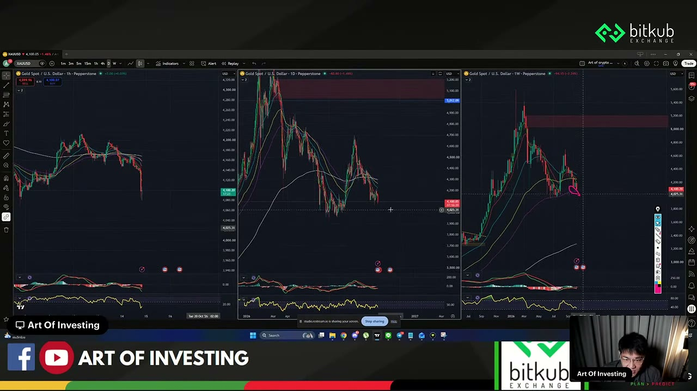

[00:35:08] แนวที่ใหญ่มากๆนะก็คือ 4,080 กับอีกที่ นึงก็คือ 4,030 นะครับเป็น 2 โซนนี้แล้ว กันที่ที่ผมมองว่าอ่ะอาจจะมีอาจจะมีการ เด้งได้ถ้าเกิดหลุด 2 โซนเนี้ยก็ไม่น่า บายแล้วครับมันก็มีโอกาสจะทุบเนาะฉะนั้น ก็ลองรอดูตรงนี้ก่อนถ้าเกิดช็อตมาเซลล์มา ตรงเนี้ยผมว่าก็ก็ควร TP แล้วนะสมมุติว่า คุณคุณช็อตมาเซลล์มาจากด้านบนหรือถือของ อ่ะผมมองว่าถ้าคุณเทรดไม่ได้แบบถือข้าม เดือนน่ะแถวเนี้ยก็ก็น่าสนใจที่จะแบ่งทำ กำไรและทองคำนะครับเพราะว่าเนี่ยมันมัน แนวรับใหญ่และ 4080 กับ 4030 น่ะนะครับ แนวรับใหญ่เพราะว่าถ้าหลุดตรงเนี้ยมันจะ พอดีกับโมเมนตัมคือมันจะเปลี่ยนโซนอาจจะ ได้เห็น 3,900  3,800 อะไรเงี้ยนะครับแต่ ถ้าไม่หลุดมันก็จะรีบาวขึ้นมาหาตรงนี้ ก่อนเนี่ยผมว่าไม่ไกลเกินนี้หรอกไม่ไกล มากอ่ะ 4,250  50  4,260 นะครับถ้าไม่ หลุดก็อาจจะรีบาวขึ้นมาแค่นั้นแล้วก็ ไซด์เวย์ต่อนะครับอ่ะดู 2 จุดนี้ไว้แล้ว

[00:36:08] กันนะครับอ่ะสำหรับทองคำเนาะส่วนน้ำมัน เดี๋ยวขอดูน้ำมันหน่อยดิน้ำมันน่ะขึ้นมา แล้วเนาะฉะนั้นเดี๋ยวผมขอดูตัวเลขน้ำมัน เอาวันศุกร์แล้วกันอืก็กองนะตัวเลขที่ ผ่านยากก็ไม่ได้เดายากก็คือ 97.5 นะตอน นี้ราคาน้ำมันเท่าไหร่ เอ่อก็ 95 นะครับราคาฟิวเจอร์เดี๋ยวก็ ต้องไปดูเทียบกับไอ้นี่อีกเนาะหมดอายุอ่ะ สัญญาเดียวกันนะครับก็คือวันธันวาคม 2026 นะครับฉะนั้นเอิ่มจาก data ผมก็มองว่าแถว 98 ผ่านยากและ 100 น.นี่ค่อนข้างยากนะ ครับในในจังหวะนี้เนาะจังหวะขึ้นลวดเดียว อ่ะเดี๋ผมขอดูนี่หน่อย อืมผมคิดว่าน้ำมันเนี่ยน่าน่าจะไปติดแถว 100 นะครับถ้าฉะนั้นถ้าเกิดคุณรันมา สมมุตินะเอาจริงๆน้ำมันกราฟโคตรสวยเลยนะ ถ้าเป็นtimeมเฟรมเล็กๆอ่ะอันเนี่ยอย่าง เงี้ยคุณดูดินะครับเออแต่ไม้นี้ผมโดนไปนะ ครับไม้นี้ผมผมไปเข้าบล็อกเรดingแล้วมัน ตอนแรกผมมองว่ามันจะไม่หลุด 90 เนาะแล้ว

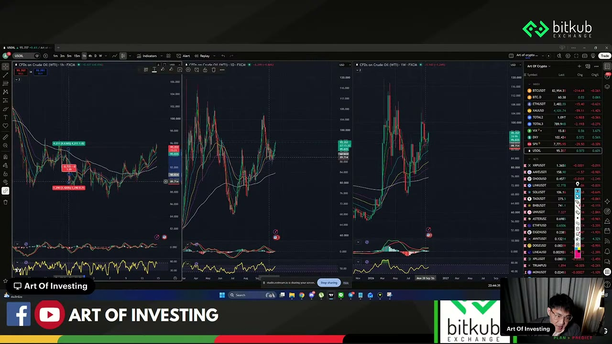

[00:37:10] มันก็หลุดไปที่ 86 แล้วค่อยรีบบาวกลับมา นะครับก็ผมยังไม่ได้ follow ตัวนี้ผมไป follow ทองซะก่อนนะครับได้ได้ทองคืนมาก็ ดูตรงนี้นะครับเนี่ยผมว่าตรงเนี้ยสวยนะ ครับที่ที่มันเป็นช็อตเบรคขึ้นมาแล้วอีก รอบเงี้ยนะครับตรงเนี้ยสวยมากนะครับที่ 90 รับอยู่เห็นมั้ยฉะนั้น 90 รับอยู่ตาม data มันขึ้นมาปึ๊บ 95 ะฉะนั้นตอนเนี้ยผมมอง ว่าแถว 97 เนี่ยกับแถว 100 เนี่ยเดี๋ยวผม ยังไม่ได้ดูดิฟดิฟ price นะว่าว่ามันดิฟ เท่าไหร่นะครับเดี๋ยวเดี๋ต้องไปเปิดดู เหมือนกันนะครับว่าเอ่อราคามันห่างกัน เท่าไหร่แต่ว่าถ้ามองคร่าวๆกะคร่าวๆเนี่ย ก็คือประมาณนี้นะครับประมาณ 97 กับ 100 เนี่ยใกล้ๆเนี่ยก็ควรต้องแบ่ง Take Profit ออกะยกเว้นว่าคุณจะกั้นหน้าทุน อะไรก็ up  to  you เนาะแต่ว่า data ระยะ สั้นเนี่ยก็คือ 2  2 จุดนี้ก่อนสำหรับ สัปดาห์นี้แล้วกันนะครับสำหรับสัปดาห์นี้ อ่ะมันจะเป็นประมาณนี้นะครับก็คือบitcoin ทองคำแล้วก็น้ำมันภาพไม่น่ากังวลเท่าไหร่ นะครับอย่างอันเนี้ยก็เนี่ยเนี่ยเล่นก๊อก

[00:38:12] ๆแก๊กๆไปอย่างเงี้ยถ้าลงมาไม่ถึงคุณอาร์ต แล้วถ้าลงมาไม่ถึงแล้วขึ้นเลยทำไงอ่ะก็ ไม่ได้ทำอะไรก็ถือของเท่าที่มี 70% แล้ว ก็รันไปนะครับถ้าลงมาก็ได้เติมไม่ลงมาก็ รันเท่าที่มีนะครับอ่ะเดี๋ยวมาดู Outcoin บ้างทีเนี้ยอยากให้ระวังนิดนึงนะถ้าเกิด หลุด 78,000 ผมค่อนข้างเป็นห่วงoutcoinอย ว่ะอย่างผมผมบอกแล้วใช่มั้ว่าผมโดนเตะออก ไป 2 ตัวจาก outcoin ที่ผมถือผมโดนเตะ H กับ XPL นะครับตอนแรกHบ Bar วิ่งไปโคตร ไกลเลยผมขายไปครึ่งเดียวนะครับแล้วก็มัน ลงมาหน้าทุนเลยมันก็เตะผมออกไปแล้วกับ XPL อ่ะตัวนี้ขาดทุนนะ XPL เข้าเนื้อไปประมาณ 2,000 ดอนมั้งผมไม่ได้เข้าเยอะเพราะว่า เหรียญมันเล็กนะครับอย่างที่ผมบอกว่าใน weคเนี่ยมันน่ากังวลนิดนึงเวลาที่ Outcoin หลายๆตัวเนี่ยอย่าลืมว่ามัน sensitive กับ Bitcoin ค่อนข้างมากเนาะฉะนั้น เห็นมั้ยมันเทส EMA  75  2 รอบและไม่ผ่าน นะครับแล้ว RSI ก็ overbard ไม่ได้แสดง ว่าโมเมนตัมมันไม่เกิดเห็นมั้ยพอโมเมนตัม ไม่เกิดแม็กดีก็ยังเหนือ 0 ได้แค่ได้แค่

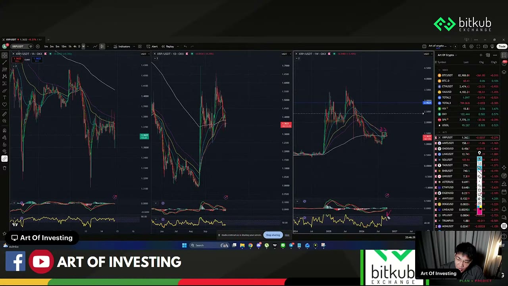

[00:39:13] เส้นเดียวเงี้ยทีเนี้ยภาพมันจะเป็นอย่าง นี้ครับถ้าสมมุติว่ามันส่งไม่สำเร็จเนี่ย เนี่ยมันออกอย่างี้ได้เห็นมั้ยเนี่ยเนี่ย เห็นป่ะไม่ผ่าน 75 ไม่ผ่าน 75 อย่างเงี้ย we overbอไม่ได้เงี้ยมันมันย่อแรงได้นะ ครับฉะนั้น out คอยหลายๆตัวมันคือจุดวัด ตรงนี้ค่อนข้างเยอะสำหรับ XRP เนี่ยผมก็ มองว่าอืมค่อนข้างค่อนข้างโมเมนตัมมัน ดรอปลงมาแล้วแหละก็คือตรงเนี้ยจากตอนแรก ที่ผมมองเนาะก็คือตอนนั้นน่ะถ้ามันปิด อย่างี้เต็มอ่ะโอ้โหโคตรสวยก็คืออันเนี้ย ก็สามารถไปต่อได้เลยนะครับแต่ทีเนี้ยเค้า รีเจคกลับมาแล้วงั้นโมเมนตัมต่อมาเนี่ย มันต้องมาสะสมใน day นะครับโดยที่ day ตอนเนี้ยยังเป็น balance โซนออกด้าน ข้างอยู่โซนที่ผมมองว่าถ้าหลุดแล้วจะแย่ นะสำหรับ XRP คือ 1.16 นะครับโซนตรงเนี้ย ไม่ควรหลุดและนะครับไอ้ 1.16  16 เนี่ยนะ ครับโซนตรงเนี้ยนะครับไม่ไม่ควรหลุดและนะ ครับไอ้ตรงเนี้ยมันอาจจะมี downside ได้ อีกหน่อยเนาะเป็นการเขย่าเผื่อบitคinมัน ทุบลงมานะครับแต่ว่าถ้าเกิดบitcoinมัน

[00:40:15] หลุด 80,000 แล้ว XRP ก็หลุดตรงเนี้ยเออ ผมก็จะหนีก่อนนะครับแล้วเดี๋ยวมันสะสม โมเมนตัมใหม่ผมค่อยเก็บใหม่แต่ว่าถ้าเกิด บitcoinไม่หลุดแล้ว XRP ย่อไม่ลึกอ่ะผมก็ จะต้องลุ้นอีกทีมันก็จะออกท่านี้ได้ ฉะนั้นถ้าเกิดมันไม่หลุดอ่ะแล้วเบรคอีก ครั้งนึงอ่ะนะครับก็คือ MAGD ต้องเหนือ 0 ทั้ง 2 เส้นแล้วนะแล้ว RSI ก็ต้องoverบอ เพื่อให้เพื่อให้โมเมนตัมมันเกิดแล้วมัน ก็จะได้วิ่งแบบนี้เนี่ยอย่างเงี้ยนะครับ เนี่ยถ้าโมเมนตัมใน week มันเกิดอ่ะอย่าง ที่ผมบอกนะครับว่า data ที่เก็บมาย้อน หลัง 7 ปีนะครับถ้าเกิดเกิดโมเมนตัมในweค นะครับิปโtoอ่ะ 75% จะไม่กลับมาที่ low เดิมจะเกิดมันเทรนด์ใหญ่ไปเลยฉะนั้นตอน เนี้ยมันยังไม่เกิดขึ้น 75% ตรงนั้นยัง ไม่เกิดขึ้นนะครับเรายังลุ้นให้ 2 เคสนี้ เกิดอยู่นะครับแต่ถ้ามันลงมาลึกกว่า 1.16 16 กออกก่อนผมก็คงจะหนีก่อนครับ อ่ะมีใครอยากให้ดูตัวไหนมครับระวังตัว เล็กๆนะระวังเราระวังระวังตัวเล็กๆนิดนึง อย่างเงี้ยอย่างเงี้ยอ่ะผมออกไปแล้วอย่าง เงี้ยทรงมันทะเลมากคือตอนแรกอ่ะมันมี

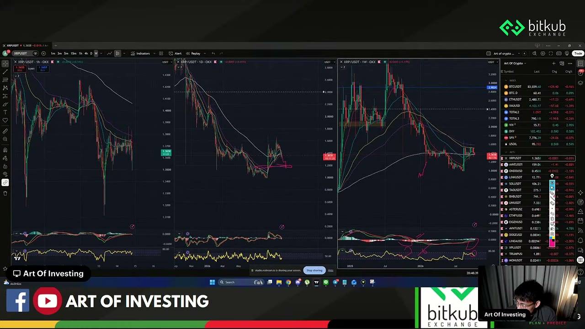

[00:41:16] Token unล็อใช่มั้ยผมก็กะว่าเออมันจะ ขึ้นไปให้คนที่แบบขายแบบเค้าได้ของมามัน ต้องลากขึ้นไปให้คนพวกนั้นออกของถูกมั้ ล่ะคือเค้าโดนล็อคเหรียญไว้อย่างเงี้ยเออ ผมก็กะว่าเฮ้ยพอทุบลงมาอย่างเงี้ยแล้วคน มันจะไม่ได้ตัวแล้วมันจะขึ้นต่ออะไรแต่ เค้าปฏิเสธเค้าไม่เลือกแบบนั้นฉะนั้นพอ ราคามันกลับลงมาอย่างเงี้ยครับมันมีโอกาส นิวโรลึกได้ค่อนข้างเยอะนะครับฉะนั้นไอ้ ตัวที่มันเป็นตัวใหญ่ Market  Cap มัน ใหญ่หน่อยเนี่ยมันอาจจะ เอ่อใช้คำว่าย่อไม่ลึกนะครับแต่ไอ้พวกตัว เล็กๆแบบเนี้ยระวังนะนะครับระวังระวังนิด นึงนะโอ๊ยคุณฮาร์ดวลสวัสดีครับไม่เจอหลาย สัปดาห์เลยคิดถึงคุณฮาร์ดวลบางทีไม่ต้อง โดนทุกสัปดาห์ก็ได้ครับผมเกรงใจคุณ ฮาร์ดวelldonโateให้ผมหลายพันแล้วนะครับ เกรงใจมากๆเลยครับขอบคุณมากๆเลยครับคุณ ฮาร์ดวลยังไม่ยอมทักเพจผมมานะเผื่อผมแบบ ส่งของชำรวยส่งอะไรไปให้บ้างนะครับถ้ามี โอกาสคุณฮาร์ดวลทักเพจ Facebook ของหัว หน่อยนะนะครับขอบคุณซอ์ช 179 บาทนะครับผม

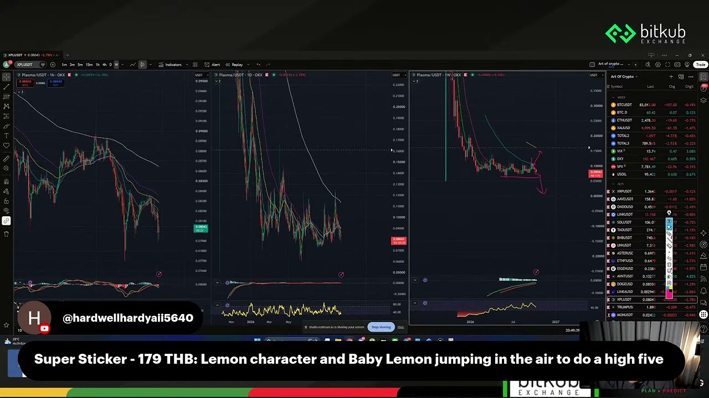

[00:42:17] จะได้เอ่อส่งของชำรงชำรวยอะไรให้ไปได้ บ้างนะครับอ้าโอเคทองวิเคราะห์ให้ฟัง คร่าวๆแล้วเนาะเป็นภาพเล็กระยะสั้นนะครับ ก็ 4,080  4,030 ดูให้หน่อยนะครับถ้าไม่ หลุดอาจจะได้เห็นรีบาวเอ่อสวัสดีครับ จารย์เพิ่งไปเม้มทองมาเออผมเห็นแล้วผม เห็นแล้วโอ้โหถ้าผมเทรดหัวใจวายแน่เลยผม เป็นคนไม่เทรดขาวเพราะอย่างเงี้ยนะครับ มันแรงเกินวอลุ่มมันเยอะเกินนะครับเวลา หลุดแล้วมันทำใจไม่ค่อยได้นะสวัสดีครับ คุณอุดมน้องอุดมหวัดดีครับสุยออนโดลูกรัก ไอ้ออนโดเนี่ยแย่อยู่เหมือนกันนะใน มุมมองผมอ่ะนะครับก็คือโมเมนตัมมันเกิดไป แล้วในweคนะครับแต่ว่าราคามันย่อลงมาก็ คือถ้าคุณจะใช้ 75% ของออนโดอ่ะมันตรงนี้ เลยไงมันลึกไปนะครับฉะนั้นตอนนี้อโดมา อยู่ที่ flip  zone แล้วไม่ควรหลุด แล้วครับนะครับฉะนั้นอดเนี่ยตอนเนี้ยมัน คือเข้าใกล้ EMA  50 กับ 75 ใช่มั้ยอย่าง แย่เลยนะอโดADมันควรจะเป็นอย่างงี้อโดAD ผมยังถือนะอย่างเงี้ยนะครับถ้าอย่างเงี้ย

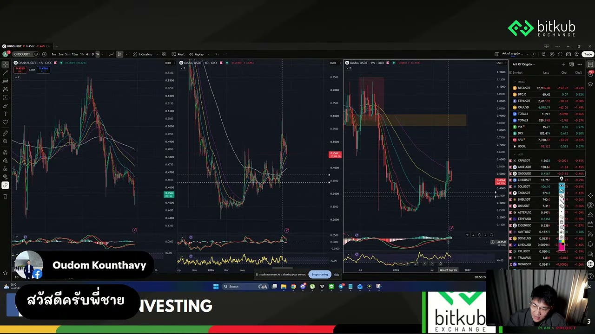

[00:43:17] รับได้เอ้ยสวยก็คือบitคinมึงทุบอีกสัก 1 จังหวะวะ 78,000 รับอยู่หรือ 75,000 อย่า เงี้ยสมมุตินะแต่ออนโดไม่หลุด 0.4  2  0.4 4 อย่างเงี้ยอ่ะโอเคแล้วแม็กดีกลับไปอ่า อย่างเงี้ยอ่ะคุยกันได้อย่างี้คุยกันได้ นะครับแต่ว่าถ้าหลุดตรงเนี้ยตัวใครตัว มานะ 0.42 เนี่ยกับ 0.4 เนี่ยผมบอกเลยตัว ใครตัวมานะทุนผมอยู่ 0.398 อ่ะนะครับตอน มันขึ้นตรงเนี้ยโอโหผมกำไรโคตรท่วมอ่ะนะ ครับแทบจะต้องพายเรือท่วมจัดแต่เป้าผมอ่ะ ผมมอง 0.9  9 กับ 1.2 ไงฉะนั้นผมก็เลยไม่ ได้ปล่อยเลยเพราะว่าผมเห็นว่ามันเบรคสวย นะครับฉะนั้นตอนนี้ย่อมาแล้วะผมให้มันอีก หน่อยแต่ถ้าหลุด 2 ตัวเนี้ยผมหนีนะครับ ถ้าเกิดมันรีบาวผมก็มองที่เดิมก่อนเป้าก็ คือแถวนี้นะครับที่มันเป็นตัวแท่งเนื้อ เทียนที่ไม่มีไส้นะครับประมาณ 0.58 นะ ครับส่วนถ้าทะลุเนี่ย ผมมอง 0.9  9 กับ 1.2 ออนโดะอ่าใช่สุ่ยยังสุ่ยผมก็ยังอยู่นะ

[00:44:17] ครับโหสุ่ยกับ H ผมเป้าเป๊ะเลยอ่ะนะ ครับผมก็เลยแบ่งออกไป 30% แต่ที่เหลือก็ ยังถือนะครับเนี่ยเป้าผม EM  50 ถ้าใคร ย้อนดูอ่ะดูในบทความก็ได้ที่ผมแปะไว้อ่ะ อ่ะพูดแล้วคันปากเปิดเลย โอ้ตั้งแต่ก่อนผมไปญี่ปุ่นเลยนี่หว่าอ่า ตรงนี้นะครับไม่ใช่อันนี้สิ นี่ๆๆสุยอยู่ไหนวะ อันนี้อนุอันนี้สุยป่ะนี่ XRP นี่ inj อ่ะนี่ๆๆสุยเห็นป่ะเอ่ออันเนี้ยผมเข้ามา

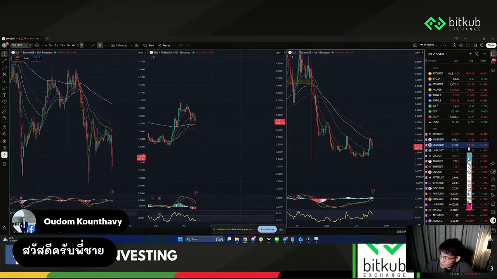

[00:45:17] ตั้งแต่ 0.97  97 นะครับแล้วก็ในไลฟ์อ่ะ ผมวาดผมวาดเป้าไว้นะครับไว้ที่ 1.2  2 นะ ครับเพราะว่านี่ไงเนี่ยเห็นป่ะตรงเนี้ย เป้าผมและนะครับผมก็เลยแบ่งไปหน่อย กับ H อีกตัวนึงนะครับที่ H ก็เป็นอีกตัว ที่ถึงเป้าเนี่ยเห็นมั้ยHบในไลฟ์เนี่ยที่ ที่ผมไลฟ์ไว้วันนั้นนะครับตั้งแต่เอ่อสั โอ้โหตั้งแต่เนี่ยยังเดือนที่แล้วอ่ะ 15 วันน่ะนะครับมันถึงมันถึงเป้านี้แล้วเลย ด้วยมันขึ้นไป 0.12  1  2 นะครับแต่ว่าผม กะออกหมดเป้านี้เพราะมันเหรียญเล็กผมว่า มันน่าจะวิ่งไกลๆแบบกระชากงี้ได้หรือ กระชากงี้แล้วค่อยลงนะครับแต่กลายเป็นว่า มันถึงตรงนี้แล้วมันลงเลยนะครับฉะนั้น H ก็เป็นอย่างี้ อ่ะแต่ซุยโอเคครับซุยโซนตรงนี้เริ่มโอเค และนะครับเริ่มๆเริ่มอยู่ในจุดพักที่สวย แต่ถ้าหลุดแล้วจะไม่น่ารักก็คือเนี่ยครับ 0.938 ถ้าหลุดไม่น่ารักแล้วตัวใครตัวมัน ก่อนนะครับ 0.938  938 นะครับถ้าหลุดตรง

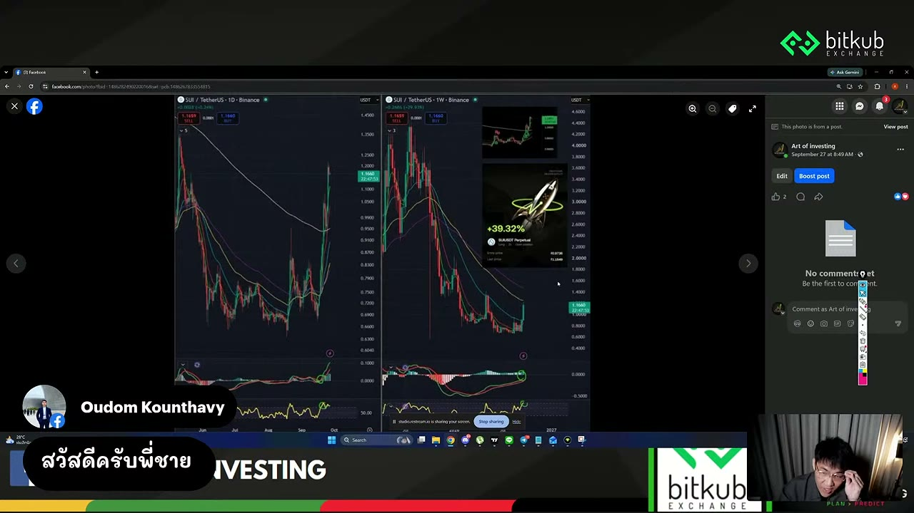

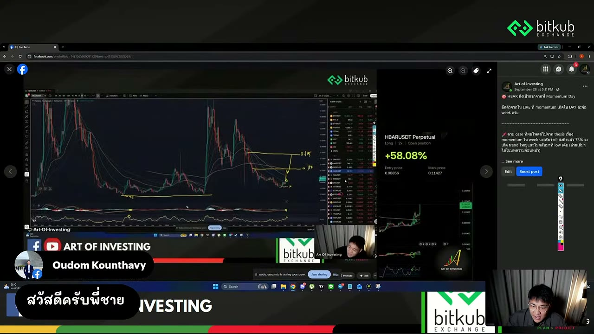

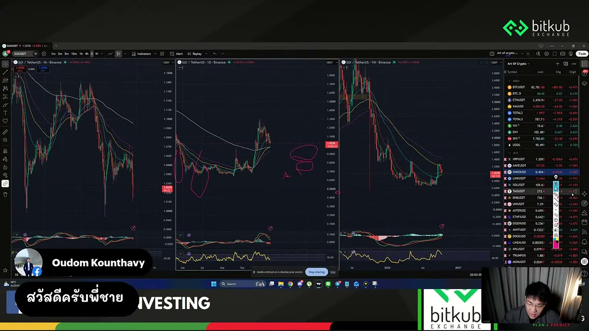

[00:46:19] เนี้ยตัวใครตัวมันก่อนไม่สวยแล้วเพราะว่า ตรงเนี้ยมันยังเป็น flip  zone อยู่นะ ครับที่ส่งราคาได้แล้วก็มันใกล้ EMA  25 แล้วนะครับท่าเนี้ยมันยังขึ้นมารีทest ก๊อกแก๊กๆแก๊กๆแล้วไปต่อได้แต่ถ้าหลุดตรง เนี้ยมันจะเทส low เดิมครับซึ่งไม่ควรให้ หลุดนะครับฉะนั้นถ้าเกิด 0.938  938 หลุด ผมไปที่เหลือหมดนะครับที่ที่ออกไปแล้ว ครึ่งนึงที่เหลือผมหนีะนะครับเนี่ยมันจะ เป็นอย่างี้นะผมถึงบอกว่าเวลาคุณเทรดอ่ะ หรือคุณเก็รงกำไรแล้วมันบวกแล้วอ่ะอย่า แบบไปนั่งเทียนว่าเราเก่งเราเจ๋งนะเว้ย อย่างผมอ่ะผมเทรดมา 12 ปีกว่าแล้วปีหน้า 13 ปีใช่มั้ยเลขไม่ค่อยดีเลยเว้ย 13 มัน จะโอเคกับชีวิตมั้ยวะอ่ะพฤษภาคมปีหน้าผม อยู่ในตลาดมาครบ 13 ปีใช่มั้ยคุณเห็นมั้ย ผมวิเคราะห์เป้าอ่ะเป๊ะเลยนะแต่ถาม ว่าผมได้กำไรแต่ไม้เติมมือจากมันป่ะยัง ไม่เลยเห็นมั้เพราะว่าอะไรเราบริหารเรามี หลายเป้าเรามีหลายตัวที่ถือเรามีบitcoin เป็นตัวหลักนะครับฉะนั้นน่ะผมถึงบอกว่า การเทรดไม่ใช่แค่การหาเป้ากับการมี แผนมันคือการ Money  Management ด้วยแล้ว

[00:47:20] ก็มันคือการตัดสินใจด้วยว่าถ้าเกิดคุณถือ สินทรัพย์ที่มันมีโอกาสพุ่งแรงอ่ะคุณจะ ขายหมดก้อนเลยมที่จุดแรกหรือคุณจะถือต่อ ให้ RR มันกว้างกว่านั้นนะครับอย่าง อันเนี้ยถ้าเป็นบitcoinอ่ะผมก็จะออกเต็ม แต่ด้วยความที่มันเป็นเหรียญ outcoin เนาะผมก็จะเลยจะถือถึงเป้า 2 นะครับแต่ ว่าอันเนี้ยถ้าเขาจะให้แค่เป้าแรกเราจะ ขายได้แค่ครึ่งเดียวก็ต้องยอมครับที่ เหลือก็ต้องหนีตรงเไม่ควรหลุดละนะครับถ้า ใครนึกภาพบอกเอ้ยคุณอาร์ตหน้าตาเป็น อย่างี้เป็นไงนะครับก็เอ่อเดี๋ยวหาให้ดู นะครับอ่ะมันจะเป็นประมาณนี้เดี๋ยวผมหา ให้ดูมันจะมีมันจะมีหน้าตาแบบนึงหอันนี้ หมายถึงสุยนะครับเดี๋ยวเดี๋ยวจะหาตัวที่ มันยังมี BNB น่าจะมีอ่ะอย่างงี้อย่างี้ อ่ะอย่างเงี้ยนะครับอ่ะมันยังเป็นท่านี้ ได้อยู่นึกออกมั้ยก็คือขึ้นมาแล้วย่อ ไซเวย์แถว EMA  25 กับ EMA  10 ก็คือสี ฟ้ากับสีแดงแล้วขึ้นต่ออ่ะเนี่ยผมให้มัน อ่ะท่าสุดท้ายและก็คือถ้าถ้าสุ่ยมันยัง อยากจะไปต่อไม่ทุบอ่ะก็คือมันต้องไม่หลุด

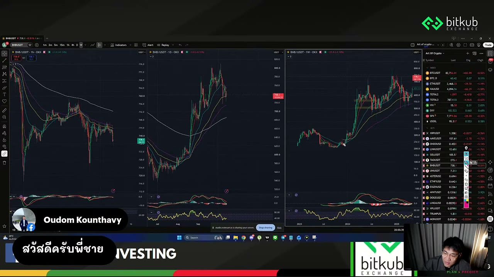

[00:48:21] 0.  938 แล้วมันจะยังอยู่ท่านี้แล้วขึ้น ต่อได้แต่ถ้าหลุดเนี่ยครับมันเทสโล่างสุด แล้วครับก็คือพโล้แล้วครับตัวใครตัวมัน แล้วครับนะครับไม่ไม่ควรไปถือวัดต่อและ นะครับเนี่ยฉะนั้นตรงเนี้ยดูไว้หน่อยนะ ครับคือมันก็ป้วนเปี้ยนได้แต่แค่ตรงนี้นะ ฉะนั้นถ้าหลุดอ่ะผมไม่อยู่ะนะครับมันมี โอกาสจะลงมาอย่างี้ ซึ่งถ้าตรงนี้เอาไม่อยู่แล้วบitcoinมัน เลือกว่าจะcasสเราจะเห็น 69,000 อีกครั้ง 72,000 เนี่ยไอ้บitcoinไม่น่ากังวลเพราะ เราเก็บยาวแล้วต้นทุนเราดีถูกป่ะผมมีไม้ แบบ 59,000  62,000  65,000  68,000 อย่างเงี้ยฉะนั้นไม้บitคinผมอ่ะที่ลงมัน ยังโอเคในระยะยาวแต่แบบ outcoin ครับถ้า เกิดบitcoinมันมันเลือกที่จะดัมหนักๆแล้ว ค่อยไปขึ้นต่อปีหน้าบitcoinไม่น่าห่วงเลย ได้เก็บของเพิ่มด้วยแต่ Outcoin จะเละ ครับฉะนั้นน่ะถ้าหลุดตรงเนี้ยผมว่าหนี ก่อนนะครับสำหรับช็อตแรกอย่าไปวัดตรงนี้

[00:49:23] บางคนโอ้ยถ้าบitคinไม่หลุด 75,000  78,000 ตรงนี้เอาอยู่ก็คืนยาวแล้วถ้ามันเอาไม่ อยู่อ่ะครับคือคุณอย่าใช้ชีวิตในตลาดทุน แบบคาดหวังนะแบบเอ้ยไม่หลุดหรอกเอ้ยได้ เจ๊งนะครับ พอดีมีคำถามต่อจากไลฟ์ที่แล้วเหมือนกัน พี่อาร์ตลืมตอบครับพี่อาร์ตคิดว่าเก็บ สถิตินี่มันต้องเยอะแค่ไหนดีครับแล้วบาง ทีผมก็หลุดกดเบิ้ลไปก็มีครับจากที่จดๆไว้ โอเคสถิติที่ดีนะครับเอาแค่ระยะที่เราคิด ว่ามันไม่ overfitting ครับน้องออมสินคำ ว่า overfitting อ่ะคือสมมุติว่าเรามี data  1 ปีใช่มั้ยเราต้องเข้าใจก่อนว่า 1 ปีนั้นน่ะมีอะไรเกิดขึ้นบ้างเช่น 1 ปี นั้นมีการทำ QE เราเอา data ปี 2020 มาทำ แล้วก็ตอนนั้นเป็นช่วงที่อัดฉีดเงินแล้ว สินทรัพย์เสี่ยงวิ่งทั่วโลกงั้นตอนนั้น น่ะเราไปหากลยุทธ์อะไรก็ตามมาแล้วอัดอัด เข้าไปอ่ะบวกหมดมีแค่บวกมากกับบวก

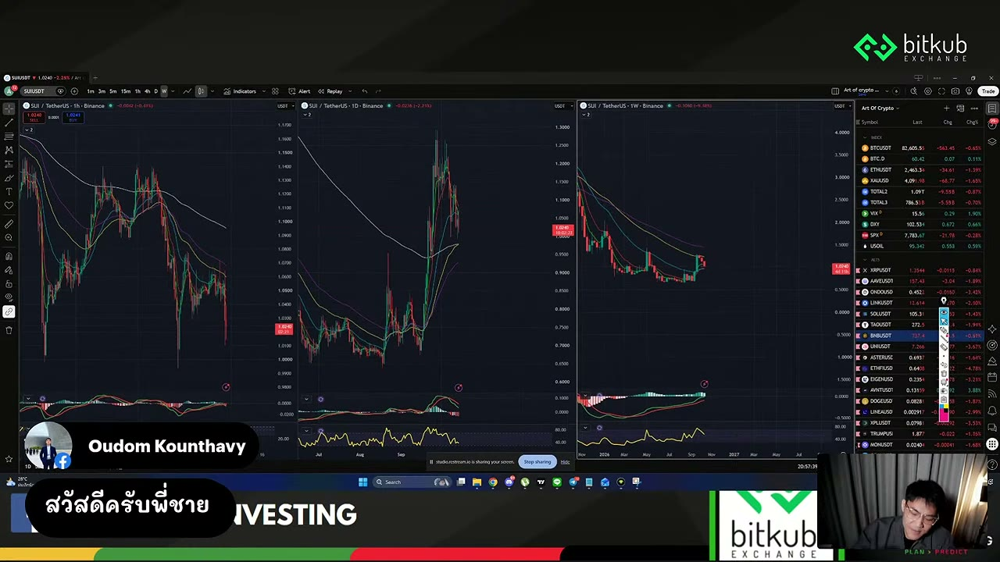

[00:50:25] น้อยเราก็จะไปเลือกไอ้อันกลยุทธ์ที่มัน บวกเยอะสุดถูกป่ะเพราะเราเข้าใจว่าเฮ้ยกู แบเทestมาช่วงโควิดเนี่ย 2 ปีเ 2020-2022 เนี่ยกลยุทธ์เนี้ยได้กำไรเยอะสุดเลย กูใช้กลยุทธนี้นี่แหละไอ้แบบเนี้ยเขาจะ เรียกว่า overfitting นะครับคือ sample siiz ไม่มากพอทีเนี้ยมันมี overfitting จำนวนปีไม่เท่ากันไงน้องออมสินนึกออกมย ฉะนั้นคำว่าสถิติเท่าไหร่ดีอ่ะคือมันจะ ต้องกว้างกว่า 1  session อ่ะเราจะเรียก ตรงเว่า regime นะครับงั้นถ้าเกิดช่วงที่เราดึงมา มันเป็นโควิดอ่ะงั้นเราต้องยืดต่อเฮ้ย แล้วหลังโควิดล่ะ Strategy เรามันเป็นยัง ไงวะฉะนั้นมันจะไม่ใช่แค่ 2 ปีพอ 5 ปีพอ มันจะต้องแบบเราต้องมีสัก 3  regim อ่ะ ถ้าจะเวิร์คนะน้องออมสินสมมุตินะนึกภาพ ให้ฟังเลยอ่ะเอากลยุทธเราอ่ะไปผ่านโควิด ไปผ่านช่วงที่เกิด QE ไปผ่านช่วงที่เกิด QT ไปผ่านช่วงที่ไม่เกิดอะไรอ่ะ

[00:51:30] แล้วถ้าออกมา 3 ตลาด 3 ช่วงแล้วมันมี AGE หรือมันแสดงผลว่า เฮ้ยมันยังเป็นบวกนะเฮ้ยมันยังกำไรนะงั้น แสดงว่า data ที่เราเอามาใช้อ่ะพอและที่เอามา backทestอ่ะพอและกลยุทธ์นั้นน่ะใช้ได้ จริงและนะครับหาแบบนั้น ไม่ได้อยู่ที่จำนวนปีอยู่ที่ reg สวัสดี ครับอุ้ยขอบคุณซอช 69 บาทครับคุณอ๊อด ขอบคุณมากๆเลยครับขอบคุณครับวันนี้ผมก็ พลาด Big  Move อีกแล้วครับมองเป็นย่อ by Fibo ทะลุ SL หมายถึงตัวไหนทองเหรอครับ หรือว่าหรือว่าบitcoinไม่เป็นไรครับเรา ค่อยๆดูไป อย่างที่ผมบอกนะ Fibo อ่ะมันเป็นไม้ บรรทัดในมุมมองผมอ่ะมันแค่ย่อมากี่ เปอร์เซ็นต์ของสวิงก่อนหน้าขึ้นไปกี่ เปอร์เซ็นต์ของสวิงก่อนหน้านะครับเราก็ ต้องไปดูตรงนั้น XRP หรือ XPL ครับเอ่อมี ทั้งๆทั้ง 2 ตัวครับแต่ว่าตัวที่น่าห่วง อ่ะคือ XPL ผมมองว่า LOW เก่าอาจจะเอาไม่

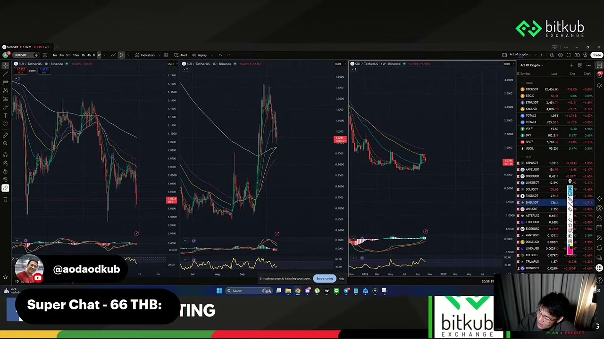

[00:52:31] อยู่สำหรับสำหรับ XPL นะ เมื่อวาน ETF ซื้อค่อนข้างเยอะเลยครับใช่ ครับแต่ว่าวันนี้ตัวเลข CPI มันออกมาเนาะ มันก็กดดันว่าเฟน่าจะต้องขึ้นดอกซึ่งขึ้น ดอกอย่างเดียวไม่พอมันแปลว่าน้ำมันก็ยัง ไม่ลงผลตอบแทนจากบอล 10 ปีก็ยังขึ้นกลับ มา 5.3%  3% นะครับฉะนั้นก็มันอาจจะย่อ อีกหน่อยหรืออาจจะsidewayย down ไม่ได้ แบบทุบหนักฉะนั้นก็ยังไม่รู้งั้นบitcoin ผมก็มองที่ 78,000-80,000 น่ะถ้าลงมาเกิด โมเมนัมผมผมรู้สึกว่าน่าสนใจมากแต่ถ้าลง มาไม่ถึงผมจะถือเท่าที่มีเหมือนที่อธิบาย ต้นไลฟ์Micคร Strategy หรอเออไม่ได้ดูเลย ตัวนี้เป็นไงบ้างเพราะผมถือบitcoinโดยตรง เนาะโอเคถึงแนวต้านและนะครับก็คือทรง เดียวกับสุยเลยเห็นป่ะถ้าที่ผมชอบ โมเมนตัมอ่ะเพราะว่ามันจะเกิดภาพซ้ำครับ พอเราเห็นบ่อยๆอ่ะมันจะนึกออกว่าอ๋อโอเค งั้นถ้าแรงซื้อประมาณเนี้ยงั้นมันจะต้อง เทสตรงนี้ก่อนถ้าไม่ผ่านมันจะลงมาท่าไหน งั้นอันเนี้ยท่าเดียวกับสุยนะครับก็คือ

[00:53:32] ถ้าเกิดว่า อ่ะผมอยากหาภาพอ่ะมันมันมันเป็นภาพนี้ได้ คุณคุณ cx เห็นตรงนี้มั้ขึ้นมาชน EM  200 ไม่ผ่านแล้วลงมาSซway์แถว EMA  25 แล้ว ขึ้นอีกรอบอ่ะโอเคงั้น Micro  Strategy อ่ะตรงนี้ชน 200 นะครับแล้วก็โมเมนตัมยัง ไม่เกิดเห็นมั้ยผ่านพรีเมี่มมาแล้วนะคือ โซนที่ชนทีไรแล้วเกิดแรงขาย New แปลว่า ตลาดตีความว่าราคาตรงนั้นแพงเกินไปตรงเ ทะลุมาได้แล้วแต่ MAD ยังไม่เหนือ 0  RSI ยังไม่นะครับฉะนั้นถ้าย่อลงมาไม่ควรลึก ต่ำกว่าแส ละ Micro  Strategy นะถ้าเกิดไม่ลึกตรง เนี้ยแล้วขึ้นอีกรอบเงี้ยอ่ะอย่างเงี้ย Follow ได้นะครับเงี้ยถ้าถ้าอย่างเงี้ย แล้วอย่างเงี้ยก็เราก็เข้าตรงนี้ใช่มั้ย แล้วเราก็ Stop  Loss ตรงนี้แล้วเราก็ run อย่างเงี้ยได้ นะครับแต่ว่าถ้าราคาตรงเนี้ยต้องรอมันย่อ ก่อนถ้าไม่ย่อก็ไม่ควรเข้าครับมันแพงอ่ะ เหมือนเงี้ยมันจะเป็นรีเจคก็คือมันต้อง ย่อลงมาโซนตรงนี้ก่อน

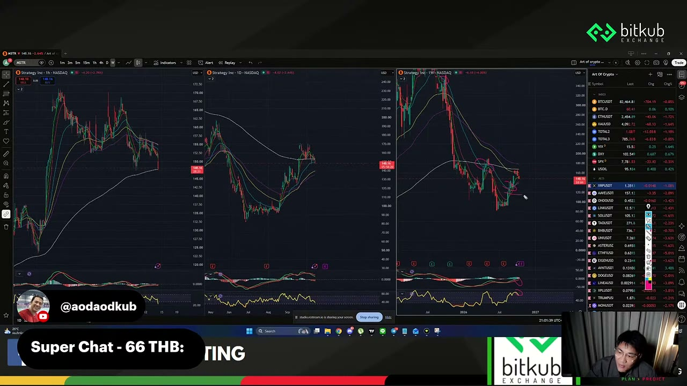

[00:54:34] ถึงจะน่าสนใจ สวัสดีครับอาจารย์สวัสดีครับัมเหรอเออไม่ ได้ดูเลยว่ะผมไม่มีไงเลยไม่ได้ดูผมตกรถไป โอ้โหโคตรสวยที่เดิมเลยนี่หว่าเนี่ย ครับพรีเมี่มชัดเจน เห็นมั้ยฉะนั้นท่าเดียวเลยตรงนี้อ่ะเนี่ย หลุด 0.135 ตัวใครตัวมัน นะครับนะครับถ้าไม่ถ้าหลุดตรงเนี้ยไม่สวย และอ่ะถ้าไม่หลุดนะ Word  CAS อ่ะผมว่ามี 2 จุดที่อารบิัอาจจะเด้งได้ 0.16 กับ 0.135 แต่ถ้าหลุด 2 โซนเนี้ยตัวใครตัว มันครับแปลว่าโมเมนตัมทั้งหมดเนี้ยหายหมด เลยนะครับแสดงว่าแรงซื้อตรงเนี้ยหายหมด เลยถ้าหลุด 0.135  135 นะครับฉะนั้นถ้า ใครมีของล่างๆอ่ะก็ระวังแถวนี้หน่อยนะ ครับอย่างที่ผมบอกไปนะตั้งแต่มันในบทความ อ่ะตอนมันหลุด 82,000 ไปก่อนหน้าที่มันลง ไป 80,000 กว่าๆเออเด้งขึ้นมามันจะไม่สวย แล้วนะครับอย่างเงี้เห็นมั้ยโมเมนตัมมัน มันหายไปแล้วเหมือนบทความที่ผมเขียนเมื่อ

[00:55:35] วานน่ะ ยูิยูิเป็นไงไหนดูดิเออยูิยูิเอาจริงๆ เบรกโคตรสวยเลยนะแต่ย่อพะโล้มาก เลยนะครับอ่ะเห็นมั้ยมันออกท่านี้ได้อ่ะ ผมเรียกทรงทรง JD อ่ะนะครับทรง JD อ่ะก็ คือทรงนี้ก็คือยืนพนมมือเลยนะครับแต่ที เนี้ยโอเคแนวรับที่ผมมองว่าน่าสนใจนะ 6.5 5 นะครับแล้วก็อีกโซนนึงที่มันจะเป็นโซน แถวนี้แถว EMA เนาะแล้วเป็น Hiidden Demand ก็คือ 5.1 อ่ะตรงเนี้ยนะครับถ้าย่ออีกครั้งนึงเราย ขึ้นตรงเนี้ยอ่ะยังรับได้หรือเอาเอาทุเรศ เลยนะแบบโอ้โหลงมากวาดนู่นกวาดนี่แล้วแบบ เริ่มรีเซตโมเมนตัมใหม่ก็คือแถวเนี้ย 5.1 แต่ถ้าหลุดอีกนะครับแปลว่าโมเมนตัมตรง เนี้ย 0 ต้องไปต้องไปสะสมใหม่นะครับคือ มันต้องไซด์เวย์สะสมใหม่เลยอ่ะนะครับ ฉะนั้น 2 ส่วนเนี้ยไม่ควรหลุดหรือว่าถ้า ใครอยากจะแบบเอ้ยอยากมีของก็เนี่ยรอดูถ้า มันลงมาแล้วเกิดโมเมนตัมค่อยเข้านะไม่ใช่ ลงมาแล้วซัดเลยนะครับก็ดูก่อนมีโมเมนตัม มั้ยถ้าไม่มีก็อย่าไปเข้า

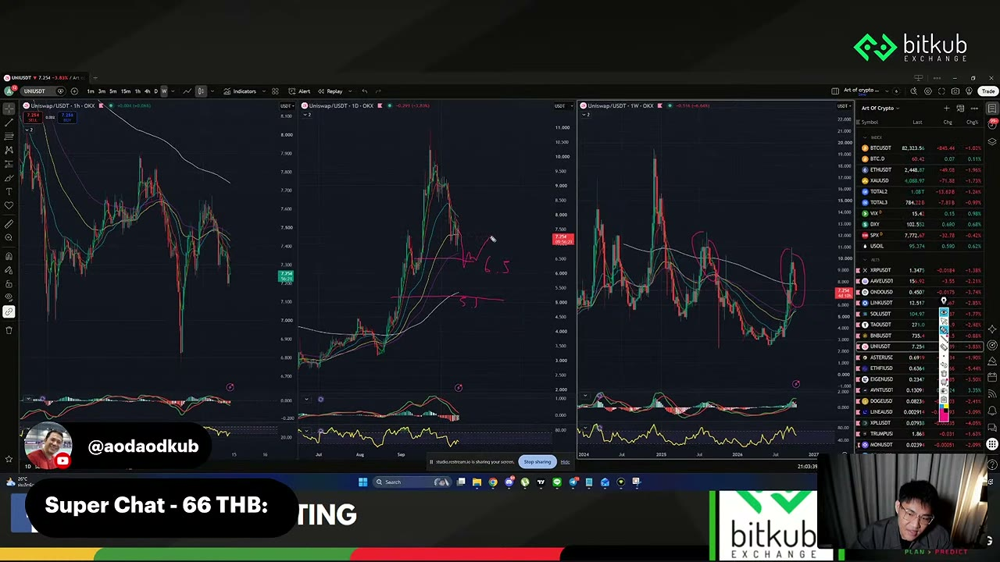

[00:56:42] ตลาดซึมๆรอเด้งเดือนหน้าหรือเปล่าครับผม วิเคราะห์บITคอยไปแล้วนะต้นไลฟ์ลองลองไป ย้อนดูได้ครับว่าโซนไหนน่าจะมีโอกาสหรือ ถ้าโซนไหนทะลุไปก็จะไม่สวยนะครับลองดูได้ ต้นไลฟ์เนาะ โอเคเนียหรอเอ้ยเนียแข่งโป๊กเลยนะนะ ครับเนียเนียแข่งโป๊กเลยนะงั้นแนวรับที แรกผมมองว่าถ้าเนียไม่หลุด 3.77 ยังไม่ น่ากังวลแล้วกันอืถ้าเนียไม่หลุด 3.77  77 รันไปก่อนครับ ผมว่าผมว่าโอเคอยู่นะครับยกเว้นว่าคุณ อยากจะแบ่งทำกำไรมันก็ถึงเป้าแล้วนะก็คือ ตรงนี้เห็นป่ะไส้ไส้ตรงเแสดงว่าซัพพlyาย มันเยอะนะครับก็คือชนปุ๊บเกิดรีเจคเลยนะ ครับก็ขึ้นอยู่กับแผนถ้าถ้าเกิดคุณบอกว่า เอ้ยทุนคุณดีมากคุณมีของแถวนี้คุณอยากจะ รันก็อ่ะไม่ดู 3.77  7 ผมมองว่าทรงยังไม่ เสียแล้วกันสำหรับเมียนะ เออฮัลโหลยายนงอ่ะใช่มั้ยปั๊มโอเคขาขึ้น มากะหน้าฝากใช่ครับเนี่ยแหละ

[00:57:44] ปั๊มเหรอหูเจดีย์อีกแล้วพนมมือเลยแบบนี้ ท่าเหมือนบitcoinเลยนะครับก็คืออ่ะดีเลย ผมจะพูดเรื่องนี้พอดีก่อนจะแยกย้ายนะครับ ก็คืออยากให้ดูเรื่องสวิงอย่างเงี้ยเห็น ป่ะเราเห็นระยะสวิงป่ะกับระยะตรงเนี้ยมัน โคตรต่างกันเลยเห็นป่ะเกือบ 2 เท่าอ่ะ ฉะนั้นแสดงว่าแรงซื้อตรงเนี้ยมันไม่เยอะ เท่าชุดก่อนงั้นในสารโมเมนตัมนะถ้าเกิด เวลาเราเห็นว่าระยะสวิงแรงซื้อมันเริ่ม ดรอปอ่ะมันเริ่มต่ำอย่างเงี้ยมันต้องย่อ ไม่ลึกครับแล้วต้องขึ้นเลยนะครับโมเมนตัม ตรงเนี้ยมันจะไม่เสียแต่ถ้าเกิดว่ามันย่อ ลึกก็คือย่อลงมาเกินครึ่งของของตรงเนี้ย อ่ะสมมุติย่อมาตรงเนี้ยเงี้ยมันแปลว่า โมเมนตัมตรงเนี้ยหายหรือถูกทำลายมันจะ เหลือแค่ตรงนี้งั้นมันก็เลยต้องไปsideวย แล้วค่อยขึ้นครับฉะนั้นตรงเนี้ยผมมองว่า ถ้าเกิดไม่อยากย่อลึกนะก็คือเนี่ยไม่ควร หลุดนี่แล้ว 0.0043 8 นะครับยังยังพอขึ้นได้แต่ถ้าย่อลึก กว่านั้นเนี่ยโอ้โหมันจะลงมาแถวนี้เลยนะ

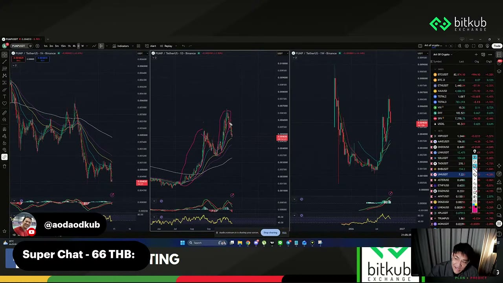

[00:58:46] ครับก็คือเนี่ย 0.0032  0032 แล้ววยด้วย นะครับฉะนั้นตอนเนี้ยโมเมนตัมมันดรอปถ้า อยากจะขึ้นต่อเลยเนี่ยก็มันไม่ควรหลุดแถว นี้ละเนี่ย 0.4438  4438 เนี่ยที่ผมบอกนะ ครับอ่ะประมาณนี้แล้วเนี่ยอย่างที่บอกนะ ก็คือบitcoinอ่ะมันคือภาพเดียวกันเลย เนี่ยสวิงเนี้ยใหญ่สวิงเนี้ยเล็กงั้นที่ ผมบอกอ่ะเอ้ยถ้าไม่หลุด 82,000 อ่ะวัน ก่อนตรงนู้นน่ะเนาะแล้วขึ้นเลยอ่ะเออมัน ยังมันยังดีนะครับโมเมนตัมมันยังสวยแต่พอ หลุดไปแล้วเนี่ยเนี่ยมันก็จะซึมอย่าง เงี้ยนะฉะนั้นผมยังมองว่า 78,000-80,000 อ่ะเออถ้ามีโมเมนตัมอ่ะผมถึงจะสนใจถ้าไม่ มีผมไม่เติมของไม่ทำอะไรทั้งนั้นถ้าถ้า เป็นพอร์ตสปอตนะครับอ่ะใครฟังไม่ทันก็ไป ดูต้นไลฟ์ได้นะครับวันนี้ประมาณนี้เนาะ เออผมคิดว่าเพื่อนๆน่าจะเห็นภาพอ่ะผมยัง ค่อนข้างแฮปปี้กับกับ data ที่เห็นเลย เพราะว่ามันวางแผนง่ายดีนะครับอย่างตรง เนี้ยเนี่ยมันชัดเนาะก็คืออยู่ตรงนี้ถ้า ถ้ามาไม่ถึงก็คงไม่ take  action อะไรนะ

[00:59:48] ครับเนี่ยง่ายดีนะครับอ่ะวันนี้ประมาณนี้ แล้วกันนะครับขอบคุณทั้ง 190 คนนะครับที่ เข้ามารับชมนะแล้วก็ขอบคุณซอร์ชมาทุก ครั้งเลยนะครับคุณฮาร์ดวลกับคุณอ๊อดนะ ครับขอบคุณมากจริงๆนะครับที่เป็นกำลังใจ ให้กันเนาะมาทีไรก็ซอ์ชหลายพันแล้วนะจาก คุณอ๊อกับคุณฮาร์ดวลอ่ะคือผมไลฟ์เดือนละ 4 ครั้งใช่ป่ะ 2 คนเนี้ย Donate ทุกไลฟ์อ่ะ ก็คือผมจะได้เดือนนึง ประมาณเท่าไหร่ 800 อ่ะเออแล้วเค้าเค้าทำ อย่างี้มาเป็นปีๆแล้วอ่ะเออผมก็เออได้มา ได้มาเยอะเยอะมากเลยผมก็เลยรู้สึกว่าเออ ขอบคุณมากๆเลยนะครับตรงเนี้ยอย่างน้อยอ่ะ ผมจ่ายค่าน้ำค่าไฟให้แม่กับยายผมได้ทุก เดือนน่ะนะครับอย่างน้อยค่าน้ำได้เออ ขอบคุณขอบคุณมากๆนะครับมีสอนมั้ครับปลาย ปีปลายปีปลายปีอาจจะเปิดคอร์สกับอาจารย์ เอ็มนะครับที่เป็นเอ่อหนึ่งในผู้บริหาร กองทุนเนาะเดี๋ยวๆเดี๋ยวรอดูตอนนี้ก็ กำลังดูเนื้อหา Commitment  of  Trader

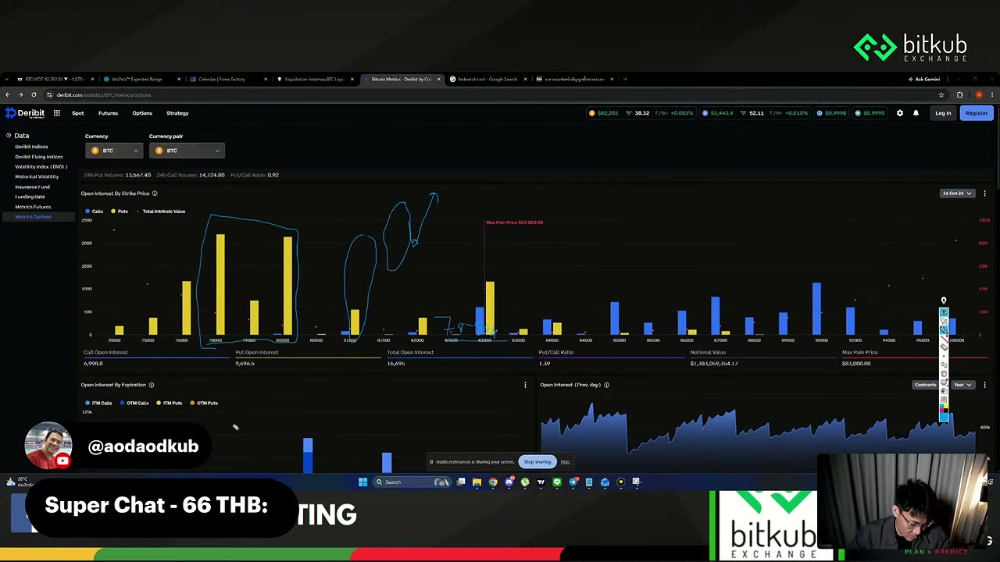

[01:00:49] กันอยู่นะครับเป็น data ประยุกต์มาใช้กับ Bitcoin นะครับแต่ว่าถ้ามันคลาสPRวทเปิด สดอ่ะตอนนี้ผมยังติดพาเรื่องเรื่องธุรกิจ หลักของที่บ้านอยู่นะครับปีนี้มันยุ่งมาก เนาะเพราะว่าพยายามขายขยายตลาดให้มันแบบ โตกว่าเนี้ยไม่ใช่แค่แบบขายในtiิTokนะ ครับฉะนั้นก็เออยังยุ่งมากแล้วก็อย่างที่ บอกคือผมอ่ะติดนิสัยถ้าเกิดสอนเรื่องลง ทุนหรือเรื่องเทรดอ่ะผมชอบสอนสด เพราะว่ามันต้องเกิดจากการถามตอบเกิดจาก การอธิบาย ประสบการณ์มันไม่ใช่แบบทฤษฎีแบบเฮ้ย อันเนี้ยดูนะเดี๋ยวมันเกิดอันนี้เดี๋ยว มันจะเกิดอันนี้ถ้าเป็นช่วงนี้คุณก็ซื้อ ช่วงคุณขายคือการเทรดกับการลงทุนน่ะครับ มันมี decision ที่จะต้องทำลึกกว่านั้น มันผมก็เลยชอบการสอนสดที่มีการถามตอบงั้น ก็อาจจะได้ดูคลาสก่อนเนาะช่วงๆสิ้นปีคุณ ยาโมโตะว่าแบบเออมันจะออกมาทันมั้ยถ้าออก มาทันก็เดี๋ยวว่ากันนะอ่ะประมาณนี้นะครับ ก็ขอบคุณทุกคนมากนะครับวันนี้ 190 คนเดี๋ เจอกันใหม่พุธหน้านะครับแล้วก็เดี๋ยวถ้า

[01:01:49] ลงมาณ 78,000  80,000 เดี๋ยวผมก็เขียนบท ความอัปเดตใน Facebook นะครับใครยังไม่ ได้ติดตาม Facebook ก็ไปติดตามด้วยพรุ่ง นี้ผมอาจจะไปที่บitคupนะแต่ว่ามันเป็นงาน เฉพาะ KOL ที่ไปได้เค้าก็เชิญไปนะครับก็ เดี๋ยวพรุ่งนี้ผมน่าจะไม่อยู่นะครับไปที่ งานบิด Cup เอ่อคนทั่วไปเข้าไม่ได้เนาะ เป็นงานอะไรของเค้าเนี่ยแหละเกี่ยวกับการ ลงทุนนี่แหละนะครับอ่ะเดี๋ยวว่ากันนะครับ เอออย่าเปิดสิ้นปีอีกใช่เดูแบคทีเรียล ตลาดมันย่อพอดีเนาะอ่ะเชิญครับทุกคน สวัสดีครับขอบคุณทุกคนมากเลยนะครับ Investing นะครับขอให้ทุกท่านมีความสุข ในการลงทุนครับสวัสดีครับเชิญวันพุธครับ บ๊ายบาย

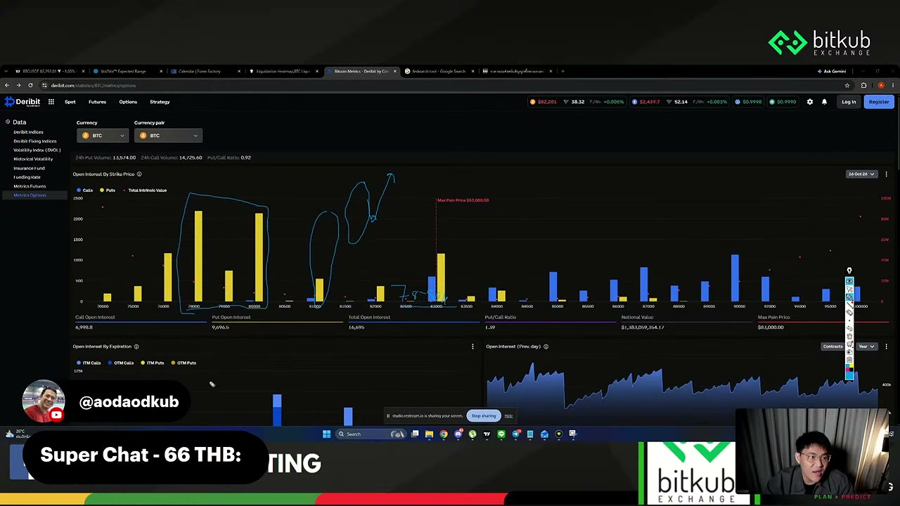

