# การประกาศอัตราดอกเบี้ยและเลือกตั้งกลางเทอมจะทำให้ BTC เลือกทาง

- ช่อง: Art Of Investing
- ลิงก์: https://www.youtube.com/watch?v=W_3COlLG7x4
- วันที่: 2026-10-28
- ความยาว: 1:07:35
- ที่มา: คำบรรยายอัตโนมัติ (auto-generated) ภาษาไทยของ YouTube — อาจมีคำสะกดผิด/คำผิดเสียง
- ภาพ: 23 ภาพจากวิดีโอช่วงที่เปิดกราฟแท่งเทียน (เลือกอัตโนมัติจากสีแท่งเทียน · ตัดภาพซ้ำ) อยู่ในโฟลเดอร์ frames/

---

[00:00:00] ครับฮัลโหลสวัสดีครับเดี๋ยวผมเช็คก่อนนะ YouTube ขึ้นหรือเปล่านะครับเดี๋ยวเช็ค แป๊บนึง อ่ะขึ้นแล้วเนาะโอเคโอเคขึ้นแล้วครับขึ้น แล้วครับเดี๋ยวขอของานรีบสักครู่ฮะงานรีบ ครับงานรีบวันนี้แป๊บนึงนะ เดี๋ยวผมใส่รัวเลยนะครับวันนี้พอดีมีต้อง ไปกินงานแต่งนะครับเสียงได้ยินชัดเนาะนะ ครับผมขออนุญาตใส่รัวเลยนะตอนเนี้ยพอดีพอ ดีเดี๋ยวผมต้องไปกินงานแต่งนะครับแล้วก็ มันเรทละนะครับคือเค้านัด 19:00 นึงนะ ผมผมคิดว่ายังไงก็ไม่ทันนะครับแต่ว่า เดี๋ยวอ่ะก็เต็มที่แล้วกันเนาะเราก็ไม่ อยากทิ้งเพื่อนๆที่รอเราอัปเดตลสัปดาห์ อยู่นะครับแล้วก็เออ เพื่อนในชีวิตจริงด้วยนะครับเขาจะเป็น

[00:01:01] ฝั่งเป็นฝ่าแล้วนะครับก็พยายาม man  2 ฝั่งให้เร็วที่สุดโอเคมาผมขออนุญาตนะวัน นี้ผมจะไม่รอเพื่อนๆค่อยๆเข้ามานะผมขอ อนุญาตใส่เลยนะรัวนะครับอ่ะ พอย์แรกนะครับก็คือตามชื่อคลิปเลยนะครับ เราจะมีการประกาศอัตราดอกเบี้ยนะครับก็ คือ 1:30 น.นะครับวันนี้แหละประมาณประมาณ 1:00 น.เนาะก็คือ C  Meeting นะครับก็จะ เป็นช่วงนี้นะครับ 1 นะครับ Federal  Fund Rate นะครับแล้วก็จะมีการกล่าวสุนทรพจน์ ต่อใช้คำว่ากล่าวสุนทรพจน์ได้มั้ยใช้คำ ว่าตอบคำถามต่อแล้วกันนะครับเป็น conference นะครับของ Kevin  Watch ซึ่ง ปกติเนี่ยที่เป็นยุคสมัยของJโมวELเนี่ยนะ ครับมันจะเป็นการกล่าวแล้วตอบคำถามสื่อ ที่นานมากประมาณครึ่งชั่วโมงถึง 45 นาที นะครับแต่ว่าตัว Kevin  Watch เนี่ยเค้า พยายามทำสิ่งที่ต่างออกไปเขาบอกว่าการที่ ให้ประชาชนรู้ data หรือว่าทุกก้าวที่เฟซ

[00:02:05] จะตัดสินใจเนี่ยมันอาจจะไม่ได้เป็นผลดี ต่อการจัดการเงินเฟ้อของเฟดนะครับเค้าก็ เลยพยายามปรับครับเราจะสังเกตว่าเค้าออก มาพูดเกี่ยวกับดอกเบี้ยการขึ้นเงินเฟ้อ ทิศทางของ Federal  Reserve น้อยลงเทียบ กับสมัยของโจรงPวellเขาจะออกมาพูดแค่อ่ะ Meeting้นี้เขามองยังไงไงเคงดอกเบี้ย เพราะอะไรพอปีนี้ยังเพิ่มมยปีหน้ายังยึด มั่นต่อการขึ้นดอกเบี้ยหรือเปล่าเขาจะพูด แค่นี้นะครับเราจะไม่พูดเสริมไม่พูดความ คิดเห็นแนวทางต่อตลาดอื่นๆมากนักเช่นตลาด แรงงานยังรับไหวมั้ย GDP เป็นยังไงเขาจะ ชอบบอกว่าตรงนั้นเป็นหน้าที่ของรัฐบาลการ รับผิดชอบนโยบายที่คุณหาไว้ มันเป็นหน้าที่ของรัฐบาลอ่าเจะโยนตรงนั้น และนั่นคือสไตล์ของ Watch ฉะนั้นผมมองว่า น่าจะกินเวลาไม่นานนะครับของเค้าเนี่ยผม เห็นเดี๋เนี้ย 15 นาที 20 นาทีเสร็จละนะ ครับแล้วก็ตัวเลขที่เราได้เห็นเนี่ยมันจะ ชัดมากๆเลยนะครับก็คือตลาดเนี่ยคิดว่าจะ ต้องคงอัตราดอกเบี้ยเนี่ยค่อนข้างเยอะ 90%

[00:03:08] เลยนะครับก็คือ ตรงนี้เนาะเราจะเห็นว่าตลาดเนี่ยคงอัตรา ดอกเบี้ยเนี่ยนะครับ 90% ที่ 3.75 ถึง 4 นะครับทีเนี้ยทำให้ 1:00 น.วันเนี้ยผมมองว่าถ้าเกิดมันไม่ ได้ออกมาเกินคาดการณ์หรือว่าต่างจากที่ ตลาดคิดไว้เยอะมากๆอ่ะมันไม่น่าจะทำให้ ตลาดเนี่ยแครชหรือว่าวิ่งแบบหวือหวานะ ครับเช่นสมมุติว่าออกมาอ่ะก็คงดอกจริงๆผม เชื่อว่าตลาดก็อาจจะเขย่าด้วยความเล่นกับ สภาพคล่องเล็กน้อยนะครับอาจจะมีการกวาด ลิquidationเพราะว่ามันวางไว้ถี่แล้วเดี๋ อันเนี้ยเดี๋ยวผมจะรีบวิเคราะห์ให้ฟังนะ ครับเรื่องจุดต่างๆอ่ะทีนี้ ถ้าเกิดมันออกมา ขึ้นดอกเนี่ยอ่ะเอาพอย์แรกก่อนนะถ้าเกิด พอย์แรกเค้าประกาศออกมาว่าเฮ้ยขึ้นอัตรา ดอกเบี้ยเนี่ยอ่ะอันเนี้ยผมเชื่อว่าตลาด น่าจะลงอันเนี้ยจะลงค่อนข้างชัดเจนนะครับ ถ้าถ้าเกิดเลือกทิศทางนี้นะครับ

[00:04:11] แต่ว่า point เนี้ยคือ point ที่ 1 มันมีอีก point นึงนะครับ point ที่ 2 เนี่ยคือ dot  plot นะครับกับนโยบายของเขาค้า เนี่ยที่บอกว่าเฮ้ยปีเนี้ยอาจจะขึ้นอีก แค่ครั้งเดียวหรือไม่เห็นความจำเป็นที่จะ ขึ้นแค่ครั้งเดียวเนี่ยคุณจะเปลี่ยนคำพูด ตรงนี้มั้ยเช่นผมเห็นว่าปีหน้าเราจะมีการ เพิ่มจำนวนครั้งที่จะขึ้นดอกเบี้ยนะครับ จากเท่าไหร่เป็นเท่าไหร่นั่นคือภาพใน อนาคตที่ควรจะกังวลอีกข้อนึงนะครับฉะนั้น ดอกเบี้ยเนี่ยถ้าเกิดออกมาตามคาดการณ์ก็ คือไม่เพิ่มผมเชื่อว่าตลาดไม่ได้กระทบ อะไรมากนะครับ ถ้าเกิดออกมาแป๊บนะผมรวมๆคำพูดก่อนแต่ว่า ถ้าเกิดออกมาขึ้นดอกอ่ะอันเนี้ถึงจะเกิด movement ที่รุนแรงนะครับแล้วต่อมาก็คือ Dot  plot ปรับเพิ่มมั้ยถ้าไม่ได้เพิ่ม อะไรนะครับก็ คิดว่าตลาดก็น่าจะเขย่าแล้วอยู่ในกรอบ ก่อนนะครับไอ้ตัวพระเอกจริงๆเนี่ยที่คน

[00:05:13] เขารอกันเนี่ยคือวันที่ 3 นะครับ 3 พย. เนี่ยมันคือการเลือกตั้งกลางเทอมนะครับ หรือ midterm  election ซึ่งการเลือกตั้งกลางเทอมตรงเนี้ยนะครับ เค้าเค้ามีสถิติมาตลอดในอดีตเนาะว่า บitcoinเนี่ยเลือกตั้งกลางเทอมทีไรตลาด ทุบทุกทีลงทุกทีเลยนะครับงั้นรอบนี้จะ เป็นเหมือนเดิมมั้ยซ้ำรอยมั้ยอ้าโอเคผม พูดแบบนี้นะครับสิ่งนึงที่ทรัมป์ไม่อยาก ให้เกิดขึ้นแน่ๆก็คือฝ่ายของเค้าเนี่ย เป็นฝ่ายที่แพ้ในการเลือกตั้งกลางเทอม เนาะก่อนหน้าเนี้ยเรามีการได้วิเคราะห์ กันมาหลายอย่างล่วงหน้านานมากๆว่าเค้าจะ ต้องทำหลายๆอย่างให้เสร็จเพื่อที่จะทำให้ ชื่อเสียงของเขาดีก่อนที่จะถึงวันเลือก ตั้งกลางเทอมซึ่งเวลาผ่านมาไวมากจากตอน ที่สงคราม ที่ดันราคาน้ำมันขึ้นไปสูงมากๆอ่ะเพิ่ง

[00:06:15] เริ่มต้นจนมาวันเนี้ยถึงเลือกตั้งกลาง เทอมอ่ะจากตอนก่อนมันหลายเดือนมากตอนเ ครับเหลืออีกแค่อาทิตย์กว่าๆ 2 อาทิตย์ ปัญหาคือเขาค้ายังเคลียร์ไม่จบข้อแรกนะ ครับสงครามไม่จบเค้าทำได้ดีอีกแค่พาร์ท นึงก็คือตลาดหุ้นยังทำ New  High อยู่ยัง ไม่แครชนะครับแล้วก็เรื่องเงินเฟ้อก็ยัง ไม่จบนะครับภาพรวมยังไม่ได้ไปในทิศทางที่ ดีเท่าที่ควรฉะนั้นทรัมป์เนี่ยทำได้แค่ 1 ใน 3 นะครับทรัมป์ทำได้แค่ 1 ใน 3 ของสิ่งที่ เขา้าตั้งใจจะทำให้สำเร็จอ่ะเี่เห็นมั้ย พอขึ้นไปใกล้ 82,000 อ่ะนะครับมันก็ทุบ และตอนนี้เราก็จะเห็นว่าทุบมาจะ 1,000 จุดะใช่มั้ยผมเช็คก่อน อ่าใช่นะครับ สักครู่นะผมขอเช็คอันนี้นิดนึง ตึ๊บๆ

[00:07:22] อ่ะนะครับ ทำให้ภาพรวมแนวโน้มที่เค้าน่าจะกู้ชื่อ เสียงตัวเองได้ดียังทำให้ตลาดยังมั่นใจใน ตัวเอยู่เนี่ยก็เริ่มสั่นคลอดนะครับที เนี้ยถ้าใครยังไม่เข้าใจว่าเลือกตั้งตรง เนี้ยมันมีผลยังไงนะมันเหมือนกับว่ามันจะ ต้องเปลี่ยนไส้ในของรัฐบาลน่ะทีเนี้ยเวลา เราจะเห็นประธานธิบดีออกนโยบายอะไรมาก็ แล้วแต่ใช่มั้ครับมันจะต้องมีการเซ็นยอม รับถูกมั้ยของรัฐบาลหน่วยใต้ลงมานะครับ เพื่อส่งให้นโยบายตรงนั้นน่ะมันผ่านแต่ที เนี้ยถ้าเกิดทรัมป์เนี่ยแพ้ในการเลือก ตั้งกลางเทอมเนี่ยไส้ในของรัฐบาลเนี่ยมัน จะเป็นอีกฝ่ายที่เข้ามาทำงานแทนฉะนั้น เวลาที่ประธานธิบดี ออกคำสั่งอะไรออกไปมันก็จะโดนขัดไม่ผ่าน ไม่เห็นด้วยไม่เหมาะสมนู่นนี่นั่นมันก็จะ ถูกยิงออกมานะครับนั่นก็จะเป็นอีกหนึ่ง แล้วตัวที่มันจะทำให้ตลาดอ่อนไหวหรือแครช

[00:08:24] ได้เนี่ยเพราะว่าต้นปีถัดไปครับมันจะยิ่ง เป็นปัญหาใหญ่จำได้มว่าผมเคยวิเคราะห์ให้ ฟังว่าทุกครั้งที่เกิดการเลือกตั้งต้นปี สินทรัพย์หลายๆอย่างจะย่อตัวเดี๋ยวผมจะ อธิบายให้ฟังนะครับทุกครั้งที่เกิดการ เลือกตั้งอันนี้อันนี้ไม่ใช่กลางเทอมนะ กำลังจะเชื่อม do ให้ฟัง ทุกครั้งนะครับquวarเตอร์แรกหลังจากการ เลือกตั้งนะครับ ทุกทรัพย์มักจะพักตัว เฉพาะสินทรัพย์เสี่ยง นะครับเพราะว่า ธนาคารกลางจะเริ่มปล่อยให้รัฐบาลกู้ได้ ยากขึ้นเพราะเค้ายังต้องปรับตัวกับรูปแบบ นโยบายใหม่สมมุติว่าที่ผ่านมาเป็นยุค โจไบเด้นถูกมั้ยเรารู้อยู่แล้วว่าโจbบเดน กับทรัมป์อ่ะสไตล์ฉีกเลยคนละเวเลยนะ ครับคนนึงเอ่อทำเงียบๆเบื้องหน้าพูดไม่

[00:09:29] aggressive ไม่รุนแรงอีกคนนึงโฉ่งฉ่าง ประกาศทุกอย่างที่ฉันคิดได้ใน True Social แล้วคนก็มาแชร์กันใน Twitter นะ ครับฉะนั้นสไตล์มันต่างกันพอนโยบายรัฐบาล มันเปลี่ยนน่ะอ่ะช่วงคอเตอร์แรกเค้าก็ ต้องรอดูก่อนเฮ้ยกฎหมายเป็นยังไงเรายังจะ ปล่อยกู้ได้มั้ยนะครับทิศทาง [เสียงสูดหายใจ]การเดอะใช้เงินของรัฐบาล มันจะเป็นยังไงผมเพิ่งอ่านบทความก่อนขึ้น ไลฟ์เนี่ยผมว่าเค้าสื่อได้ชัดมากเลยคุณ คิดว่าถ้าคุณสร้างรายได้ได้เดือนละ 50,000 แต่ว่าคุณใช้จ่ายเดือนละ 68,000 ทำ อย่างี้ทุกเดือนน่ะคุณคิดว่าจะเกิดอะไร ขึ้นกับบัญชีคุณคำตอบคือมีปัญหาถูกป่ะ เป็นหนี้แน่นอนแล้วเาบอกว่าเนี่ยคือสิ่ง ที่อเมริกาเป็นมาตลอดคือรายจ่ายมันสูง กว่ารายได้ตลอดรายได้หลักของรัฐบาล อเมริกาครับมันจะมาจากภาษีถูกป่ะนะครับ ทีเนี้ยเอ่อ รายได้ที่เข้ามามันไม่เพียงพอต่อนโยบาย ที่เขาจับเช่นช่วยคนตกงานช่วยเอ่อผู้สูง

[00:10:33] อายุหรือนโยบายทำบ้านให้กับคนไร้บ้านอะไร ก็แล้วแต่ที่เป็นนโยบายของรัฐอ่ะครับพูด ง่ายๆคืองบดุลมันขาด มันก็เลยทำให้หนี้เนี่ยมันโตขึ้นเรื่อยๆ แล้วตอนเนี้ยเค้ากำลังพยายามจะแก้ปัญหา เงินเฟ้อผนวกกับก้องก้อนหนี้มหาศาลที่มัน พันดันทุรังกันเนี่ยจนทำยังไงก็ไม่จบสัก ทียังไม่จบนะครับเจอตัวจุดชนวนอีกจุดนึง เป็นตัวที่ 3 อีกก็คือ การ price  in ของ AI นะนะครับทีเนี้ยเรารู้อยู่แล้วว่าไม่ว่า ยังไงก็แล้วแต่โลกเราจะไม่มีทางกลับไป อยู่ในยุคที่ไม่มี AI อีกแล้วเพราะว่ามัน เหมือนกับอินเทอร์เน็ตยุคแรกๆที่ อินเทอร์เน็ตมาเราก็คงไม่สามารถจินตนาการ โลกที่กลับไปไม่มีอินเทอร์เน็ตได้เพราะ เรารู้แล้วโอ้โหมันเชื่อมต่อทั่วโลกเข้า พร้อมกันมันสะดวกขนาดไหนถูกมั้ยแต่ทุกวัน

[00:11:35] เนี้ยรายได้ที่เกิดจากบริษัท AI ยังไม่ เทียบกับเปอร์เซ็นต์ที่เงินลงทุนอัดลงไป เนี่ยต่ำมากๆ ฉะนั้นราคาที่มันดันตัวหุ้นบริษัทขึ้นไป สูงขนาดนั้นน่ะมันคือราคาที่ price  in อนาคตว่าอนาคตเ่ะมันจะต้องจำเป็นอนาคต เนี่ยมันจะต้อง ใช้งานกันอย่างแพร่หลายมันต้องเติบโตกว่า นี้มหาศาลแต่เมื่อราคาของอนาคตอ่ะครับมัน อยู่สูงกว่าปัจจุบันมากเกินไปเดี๋ยวมันจะ ต้องกลับเข้ามาหาค่าเฉลี่ยและค่ามีนผนวก กับเรื่องนี้ครับการปล่อยกู้ยาก ฉะนั้นเลือกตั้งแต่ละครั้งธนาคารรอปรับ นโยบายของเพื่อดูนโยบายของรัฐบาลถูกมั้ย ทีนี้ถ้าเลือกตั้งกลางเทอมล่ะเลือกตั้ง กลางเทอมถ้าอีกฝ่ายได้เกิดอะไรขึ้นถ้าอีก

[00:12:38] ฝ่ายได้แปลแปลว่านโยบายก็ต้องเปลี่ยนอีก หรือเปล่าแล้วตอนเนี้ยธนาคารปล่อยกู้ยาก อยู่แล้ว ถูกมั้ครับตอนเนี้ยเาเริ่มปล่อยกู้ยาก งั้นบริษัทต่างๆที่รายได้ไม่ชัดเจนว่าแบบ เฮ้ยคุณกู้ไปแล้วคุณไปลงทุนเนี่ยผลตอบแทน เนี่ยมันสอดคล้องกับจำนวนที่คุณกู้ไปมย อ่ะถ้าตามวีดีโอของคุณ CK ที่ไวรัล่าสุด เลยผมขอหยิบยกมาพูดแล้วกันเพราะว่ามัน เห็นภาพง่ายที่ บริษัท Cloud เนี่ยกู้เงินเยอะมากเพื่อ ซื้อชิปไปให้บริการ Cloud แต่ปัญหาคือรายได้ยังไม่สูงขนาดนั้นแต่ เงินที่เค้ากู้มาเค้าเอาไปซื้อชิปของ Nvidia ชิของบริษัทต่างๆเพื่อเอามาทำ เป็น compute นะครับถ้าเกิดธนาคารเริ่มให้บริษัทเหล่า นั้นกู้ได้ยากขึ้นเาเริ่มกู้เงินได้น้อย

[00:13:39] สิ่งที่จะเกิดขึ้นนะครับก็คือรายได้ของ Nvidia และบริษัท ship อื่นๆก็จะเริ่ม น้อยลงด้วย TSMC ก็จะรายได้น้อยลงอ่ะขอ อภัย TSMC ก็จะผลิตชิปออกมาน้อยลง Nvidia ก็จะรายได้น้อยลงแล้วตรงนั้นน่ะมันจะเป็น อีกหนึ่งจุดชนวนที่จะทำให้แชได้ยังไม่จบ กับ Antropic บริษัท CL นะครับอ่ะถ้าพูดให้เห็นภาพไม่ ก็เจ้าของ AI  CL อ่ะกำลังจะ IPO เดือน พฤศจิกายนซึ่งคนก็คาดหวังมากๆว่ารายได้ และตัวเลขบริษัทมันต้องเติบโตให้เพียงพอ กับแรงที่ตลาดมันเชื่อมั่นฉะนั้นนะครับ ถ้าเกิดเลือกตั้งกลางเทอมทรัมป์แพ้ต้นปี ธนาคารปล่อยกู้ยาก ตลาด AI จะ price  in ไปแล้ว antropic ก็ เป็นความคาดหวังของตลาด นะครับเนี่ยคือเป็นตัวจุดชนวนแล้วทุก ครั้งนะครับที่เราอยู่ในบเบิ้ลหรือฟอง

[00:14:40] สบู่เราจะไม่รู้ตัวหรอกว่าเราอยู่ไปแล้ว ซึ่งณวันเนี้ยผมค่อนข้างมั่นใจระดับสูง ว่าเราอยู่ในบับเบิ้ลไปแล้วสิ่งที่ไม่มี ใครตอบได้อ่ะคือมันจะแตกเมื่อไหร่คือ เมื่อเกิดฟองสบู่แล้วแล้วเราเห็นตัวจุด ชนวนครบหมดแล้วเนี่ยครับแน่นอนแหละวันนึง มันแตกแน่แต่มันไม่จำเป็นต้องแตกทันทีไง ฉะนั้นเนี่ยครับมันไม่ใช่ว่าทุกอย่าง อย่างเงี้ยโอ้โอหเฮ้ยเราเห็นชัดหมดะโหปี หน้าแตกแน่ปีหน้าระเบิดแน่ไม่จำเป็นมัน อาจจะดีลayอีกปี 2 ปีค่อยมีปัญหา 3 ปี ค่อยมีปัญหาก็ได้นะครับงั้นวิธีแก้หรือ วิธีวางแผนจะต้องทำยังไงเดี๋ยวผมจะอธิบาย ให้ฟัง ผมอธิบายให้ฟังแต่เนี่ยคือพอย์สำคัญแล้ว ก็ทุกครั้งเลยนะครับที่ปัญหาของตลาดการ เงินจะเริ่มเกิดขึ้นเนี่ย นะครับมันจะเริ่มเกิดหลังจากมีการขึ้นดอก เบี้ยซึ่งขึ้นไปแล้วนะ

[00:15:44] เกิดขึ้นไปแล้วถูกป่ะฉะนั้นโฟมซครั้งนู้น ที่เขาขึ้นดอกครั้งแรกอ่ะมันนับนาฬิกาถอย หลังแล้วเปรี้ยง การขึ้นดอกครั้งแรกเกิดขึ้นแล้วครับ ฉะนั้นตอนเนี้ยตัวจุดชนวน ก็ชัดแล้วครับเหลือแค่ว่าเราไม่รู้ว่า สมมุติเนาะนึกภาพว่ามันเป็นระเบิดแล้ว แล้วมันก็มีสายเชือกเนี่ยยาวมากๆแล้วตอน นี้มันมีคนจุดละแต่สิ่งที่ไม่มีใครตอบได้ คือสายระเบิดเนี่ยยาวแค่ไหนนะครับงั้นถ้า เกิดคนทั่วไปคาดการณ์เหลือเกินว่ามันจะ ต้องเป็นฟองสบู่แล้วระเบิดแน่ๆในต้นปี หน้าเนี่ยมันจะมีปัญหาเพราะอะไรรู้มั้ย เพราะว่าถ้าเกิดว่าฟองสบู่ยังไม่แตกแล้ว มันแค่พักตัวต้นปีหน้าขึ้นต่ออะไรจะเกิด ขึ้นครับ สิ่งที่จะเกิดขึ้นคือ คนก็จะไปอัดเงินซื้อทีหลังถูกป่ะเฮ้ยไม่

[00:16:44] แตกแล้วนี่ไงย่อแค่นี้ทุกอย่างนิ่งแล้ว ไม่มีปัญหาแล้วสบายแล้วไอ้หนุ่มเอ้ย ยิ้มแย้มเลยไปต่อแน่นอนแล้วพอเป็นแบบ เนี้ยครับจุดชนวนที่มันจุดไปหมดแล้วอ่ะ มันจะค่อยไปแตกทีหลังแล้วแครชลงมานะครับ แล้วคนก็จะเสียเงินมหาศาลวิธีที่ผมทำอ่ะ คือการ DCA ไซส์ลดลง ง่ายมากเลยนะครับสมมุตินะว่าคุณวิเคราะห์ แล้วว่ามันแพงเดี๋ยวอันเนี้ยผมจะมาอธิบาย ให้อาทิตย์หน้าผมติดไว้ก่อนนะว่าดูยังไง ว่าตอนไหนแพงตอนไหนถูกนะแล้ววางแผนไงผม ติดให้อาทิตย์หน้าพอดีวันเนี้ยเดี๋ยวผม ต้องรีบไปกินเลี้ยงงานแต่งเดี๋ยวผมไปไม่ ทันผมอธิบายเหตุผลไว้ก่อนแล้วเดี๋ยววิธี มองว่ามันแพงหรือถูกอ่ะทำยังไงอ่ะเดี๋ยว ผมอธิบายให้ฟังอาทิตย์หน้าเดี๋เดี๋ยวผม ให้ไอเดียไปครับไอเดียเนี่ยครับคือเมื่อ ไหร่ก็ตามที่คุณมองว่ามันแพงนะครับ จากคุณ DCA เต็มๆก้อนอ่ะเรียกว่าคูณ 1

[00:17:44] แล้วกันสมมุติว่าคุณ DCA เดือนละ 10,000 แยกเป็นสัปดาห์ละ 2,500 ก็ได้ถ้าเกิดคุณ รู้สึกว่าช่วงนี้มันแพงมาก คุณก็ DCA ด้วยเลเวล 0.3 พอ จาก DCA เดือนละ 10,000 ใส่เหลือแค่เดือน ละ 3,000 พอรู้แล้วว่ามันแพงเดี๋ยวๆเก็บ ตังค์ไว้เดี๋ยวเมื่อไหร่ก็ตามนะที่มันถูก นะเดี๋ยวค่อย DCA ไม้ใหญ่ขึ้นทำแบบนั้น ได้นะครับพอมันเริ่มลดลงมาแพงเหลือ 0.5 จากใส่เดือนละ 10,000 ใส่เดือนละ 5,000 นะครับพอลงมากลาง เริ่มรู้สึกละเฮ้ยราคานี้แฮปปี้ว่ะรู้สึก enjoy  1 นะครับถูก 1.5  5 ถูกมาก

[00:18:45] 20,000 นะครับให้ใช้วิธีนี้ในการ DC เอา เพราะว่าถ้าเกิดคุณไปหยุด DCA เนี่ยมันจะ ไปทำการขัดขาตัวเองคือผิดหลักเพราะว่า DCA มันคือการ average ราคาไปเรื่อยๆใช่มั้ ถูกมั้ยดอลลาร cost  average งั้นให้ทำ วิธีนี้อย่างตอนเนี้ยถ้าถามว่าตลาดหุ้น อยู่ในโซนไหนผมให้โซนนี้เลยคือแพงมากนะ ครับแล้วทุกครั้งที่เกิดการแชเนี่ยอย่าง ต่ำเนี่ย คือระยะ 30-40% จากยอดนะครับฉะนั้นถ้า เกิดการแครชอย่างรู้แล้วอันนี้เป็นแค่ matรxเดียวนะผมย้ำก่อนอันนี้เป็นแค่ matริกเดียวเดี๋ยวมันจะมีmatรxอื่นๆอีกผม จะมาขยายให้สัปดาห์ต่อไปนะมันจะย่อประมาณ งั้นให้เราเริ่มรู้ได้เลยถูกมยว่าเมื่อ ไหร่ก็ตามที่จากจุดสูงสุดเนี่ยถ้าเกิดมัน แครชแล้วเนี่ยแล้วย่อ 30-40% เนี่ยของ NASDAQ หรือ S&P  5 ทัน 100 เนี่ยเริ่ม นับว่าถูกได้ละก็ใส่ที่ 1.5  5 ส่วนถ้า

[00:19:46] มัน critical เลยย่อเกิน 40% นะครับเรา รู้แล้วว่ามันอยู่ในขั้นถูกมากก็ใส่เดือน ละ 20,000 เฮ้ยคุณอาร์ตแล้วถ้าเกิดมันย่อ ไปแล้วมันยังจมนานน่ะไม่ต้องขึ้นก็ดีไง คุณก็จะได้ใส่ 2 เท่า 2 เท่า 2 เท่าไป เรื่อยๆปีนึงผมมั่นใจยังไงมันก็ค่อยๆฟื้น แล้วพอมันผงกหัวขึ้นมาอยู่ในโซนที่เริ่ม ถูกเดี๋เราจะมีแมรริกตัวอื่นที่วัดค่อน ข้างง่ายนะครับเราก็ใส่น้อยลงทำที่นี้ก็ ได้หรือถ้าเกิดคุณเป็นเทรดหรือนักลงทุน สายโมเมนตัมนะครับหรือถ้าเกิดคุณเป็นนัก ลงทุนหรือเทรดเดอร์สายโมเมนตัมเนี่ยคุณก็ แบ่งครึ่งนึง DCA อีกครึ่งนึงลงทุนแบบไม้ ใหญ่แบบล่ำซำก็ได้เนี่ยทำได้ 2  way เลย อ่ะนะครับประมาณนี้ผมทิ้งไว้ประมาณนี้ะ กันนะครับกับชนวนระเบิด 3 ลูกนะที่บอกก็ คือ AI  price  in ไปแล้วนะครับ 2 เงิน เฟ้อยังไม่จบธนาคารเริ่มปล่อยกู้ยากขึ้น นะครับมันก็จะเป็น Domin ได้ว่าปล่อยกู้ ยากขึ้นไอ้บริษัทที่คอยกู้ไปเพื่อไปลงทุน ไปซื้อในบริษัทอื่นเนี่ยก็จะกู้ได้น้อยลง

[00:20:49] ใช้จ่ายได้น้อยลงพอใช้จ่ายได้น้อยลงไอ้ ชุดบนสุดของห่วงโซ่อาหารกำไรน้อยลงนะครับ ทุกอย่างก็จะเริ่มslowดาวต่อมาคือเลือก ตั้งกลางเทอมนะครับฉะนั้นช่วงเนี้ยมันจะ เป็นช่วงที่เจอความหวือหวาหน่อยฉะนั้นถ้า เกิดคุณผ่านช่วงนี้ไปได้อ่ะผมบอกเลยสบาย แล้วมันก็จะเจอแต่ความสดใสเรื่องที่ง่าย ที่สุดนะสำหรับผมอ่ะคือไม่ต้องไปพยายาม จับจังหวะเนี่ยทำแบบเนี้ย slow  down การ DCA ลงนะครับถ้าเกิดจะสวิงเทรดก็เล่นใน ระยะที่มันกว้างขึ้นหน่อยแบ่งแบ่งโซน หน่อยนะครับอ่ะเดี๋ยวจะวิเคราะห์ให้ฟัง อ่ะเดี๋ยวเราไปขึ้นตัวกราฟเลยนะครับจะได้ เร็วเนาะผมก็เรทและนะครับเดี๋ยวอีกประมาณ ไม่เกินครึ่งชั่วโมงอย่างช้าผมจะต้องะนะ ครับอ่าโอเควันนี้เห็นภาพเนาะฉะนั้นก็ ระวังหน่อยนะครับคืนนี้ 1:00 น.นะ 1:00 น.มีโฟมซนะครับประกาศอัตราดอกเบี้ยเนาะ แล้วก็เอ่อวันที่ 3 พฤศจิกายนนะครับมี เลือกตั้งกลางเทอมนะครับอ่าแล้วก็เหตุผล

[00:21:49] ที่น่ากังวลทั้งหมดก็อธิบายให้ฟังะฉะนั้น ต้นปีหน้าตามหลักทฤษฎีควรจะย่อนะครับแล้ว ก็เริ่มผงหัวขึ้นแต่จะย่อแล้วแบบโดนลาก ให้ทุกอย่างแครชด้วยมั้ยอันนี้ไม่มีใคร ตอบได้นะครับแต่ถ้ามันย่อแล้วขึ้นต่อเลย เนี่ยโดยที่ยังไม่แครชอ่ะผมก็จะยังมองว่า มันแพงแค่อาจจะลดจากแพงมากมาเหลือแพงจาก เรา DCA  0.3 เท่าก็ลดเราก็เพิ่มขึ้นเป็น 0.5  5 เท่าแค่นั้นพอนะครับอ่ะต่อมา คือ Bitcoin ถูกมั้ยอ่ะดูตัวที่ทุกคนเข้า ใจง่ายที่สุดก่อนแล้วเดี๋ยวค่อยไปดูตัว ที่ซับซ้อนกว่านี้นะครับอ่ะเดี๋ยวให้ดู ตัวที่ทุกคนเข้าใจง่ายที่สุดก่อนเนาะอ่า แล้วก็จะมี daily  bit นะ[เสียงสูดหายใจ]ครับอ่ะเดี๋ยวดูตรงนี้ แล้วกันก็คือวันที่ 30 เลยนะครับก็คือมัน จะเป็นวันที่นะครับ

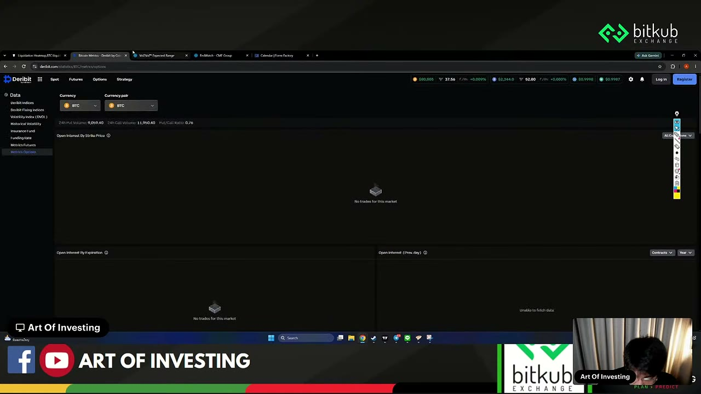

[00:22:55] หมดซีรียส์หลักพอดีนะครับก็จะเป็นตรงนี้ เราจะเห็นว่าสัญญาตอนเนี้ยที่เยอะที่สุด นะครับมี 2 วันนะครับก็คือวันที่ 30 ตุลาคมคืออีก 2 วันนี้แล้วแล้วก็วันที่ 25 ธันวาคมนะครับซึ่งเป็นวันปิดซีรียส์เดือน อย่างที่ผมบอกว่าอtionัเนี่ยครับมันจะมี นัยยะที่สุดอ่ะคือวันปิดซีรียส์เดือนเท่า นั้นไม่ใช่วันปิดซีรีย์ เอ่อรายวันรายวันจะน้อยมากจะส่งผลค่อน ข้างน้อยมากนะครับงั้นตอนเนี้ยหลายคนน่ะ ถ้าไปมองเค้าก็จะไปมองตรงนี้ถูกป่ะ อู้หูคุณอาร์ตเนี่ยเสาโคตรใหญ่เลยอย่าง งี้แกมมmaสquีสป่ะเนี่ยคุณอาร์ตแบบระเบิด นะหลุด 95,000 อย่างงี้หลุด 90,000 นี่ เบรค 95,000 แน่นอนผมบอกแล้วผมไม่มองแบบ นั้นนะครับผมไม่มองแบบนั้นผมมองว่า 90,000 น่ะถึงยากมากด้วยซ้ำภายในวันที่ 30 เนี้ย ผมผมอยู่ฝั่งที่มองว่า 90,000 ถึงยากมาก อีก 2 วันน่ะที่ราคาถึง 90,000 อ่ะผมมอง

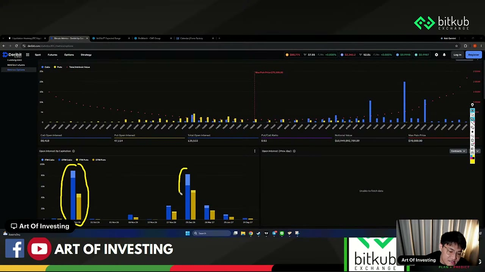

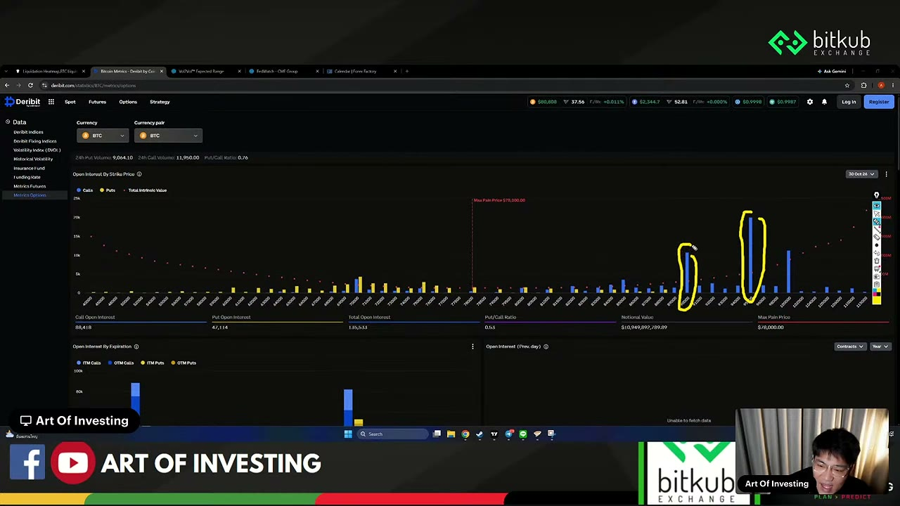

[00:23:56] ว่าโอยากมากอ้าคุณอาร์ตแล้วทำไมถึงเป็น อย่างงั้นล่ะเพราะว่าไม่งั้นน่ะเสาคอมัน จะสูงขนาดนี้ได้ไงต้องบอกแบบนี้อย่างที่ ผมบอกนะครับว่าไอ้เสาตรงเนี้ยมันเปิดทิ้ง ไว้ตั้งแต่นู้นตอนราคาบitคinมัน 87,000 ก่อนมันจะทุบลงมา 89,000 อ่ะ คอเนี่ยเค้าเลยเปิดไว้เยอะซึ่งมันใกล้ เคียงกับราคาตลาดณเวลานั้นนะครับคอมันเลย เปิดไว้เยอะงั้นตรงเนี้ยไอ้ตัวที่ยืนยัน ว่าเฮ้ยมันเปิดทิ้งไว้นานแล้วคือ IV ครับ Imply  Volatility เห็นมั้ยเนี่ยมันยกหางไปฝั่งพุหรือที่เขา เรียกว่า put skิลเนี่ยครับแปลกป่ะเพราะ ว่าถ้าเกิดราคานะครับถ้าเกิดราคามันเนี่ย เพิ่งซื้อสัญญาตรงนั้นเพิ่งถูกซื้ออ่ะมัน ก็จะต้องคสกิลดิแต่อันเนี้ยเฮ้ยทำไม imply

[00:24:57] volatility หรือค่า IV เนี่ยมันไปทาง ฝั่งพุทธมากกว่าเป็นอีกหนึ่งตัวยืนยันนะ ครับว่าสัญญามันถูกเปิดทิ้งไว้นานแล้วนะ ครับงั้นมันจะมีผลน้อยเพราะว่าราคา ปัจจุบันน่ะมันอยู่ตรงนี้เองประมาณ 8,000 ถูกมั้ยตอนนี้ 88,000 00 เนี่ยมันมันอยู่แค่ตรงนี้นะครับ ฉะนั้นเนี่ย gap ผมถึงบอกว่าถึง 82,000 อ่ะก็เริ่ม ฝืดแล้ว 85,000 จะยิ่งฝืดเราเห็นป่ะเนี่ย ย่อลงมาแล้วะไปถึง 8,000  700 คำถามคือ เฮ้ยทำไมเราถึงคิดว่ามันฝืดทำไมคุณอาร์ต ถึงรู้ว่ามันจะฝืดผมไม่รู้หรอกครับแต่ data้ามัน อ่ะอย่างตรงนี้อันนี้ผมผมก็ดึงตัว Gamma  Exposure โดยที่ เอาค่าจาก Taker ของ delibit นะครับที่มา

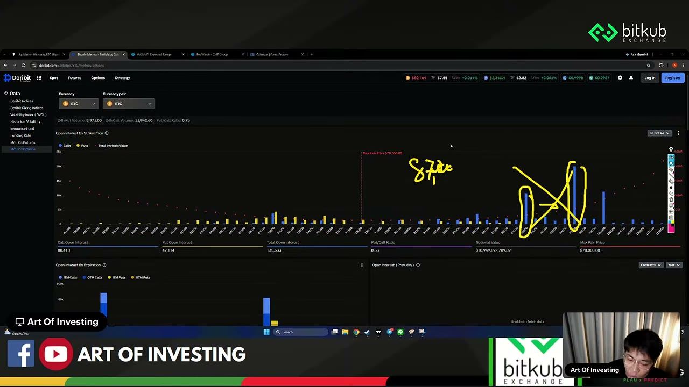

[00:25:57] คำนวณเป็น dealer  gramma พูดง่ายๆนะครับ ก็คืออ่ะผมจะอธิบายให้ฟังแบบเห็นภาพคร่าว ๆแบบนี้นะครับให้ให้ดูแบบนี้นะ Market  Maker ที่เค้าชอบพูดกันใช่มั้ เจ้าตลาดเจ้าตลาด ผมอธิบายให้ฟังคร่าวๆง่ายๆเห็นภาพเค้าจะ บอกว่าเอ้ยเจ้าตลาดมันจะแทงขึ้นเจ้าตลาด มันจะแทงค์ลงเจ้าตลาดมันมองอย่างงี้ Market  Maker ที่ใหญ่แล้วเทรดแบบไม่สน ราคาจริงๆนะครับเค้ากินกำไรจาก 2 ค่าคือ สเปรดกับพรีเมี่ม เวลาเค้าเปิดออเดอร์นะครับเค้าเปิด 2 คำว่าเปิดออเดอร์ 2 ฝั่งเนี่ยฉะนั้นน่ะ ครับการที่เขา้าจะได้รับเลือกว่าเขา้าจะ อยู่ฝั่งไหนเนี่ยมันขึ้นอยู่กับจำนวน ออเดอร์ในตลาดอ่ะเดี๋ยวผมจะอธิบายให้ฟัง

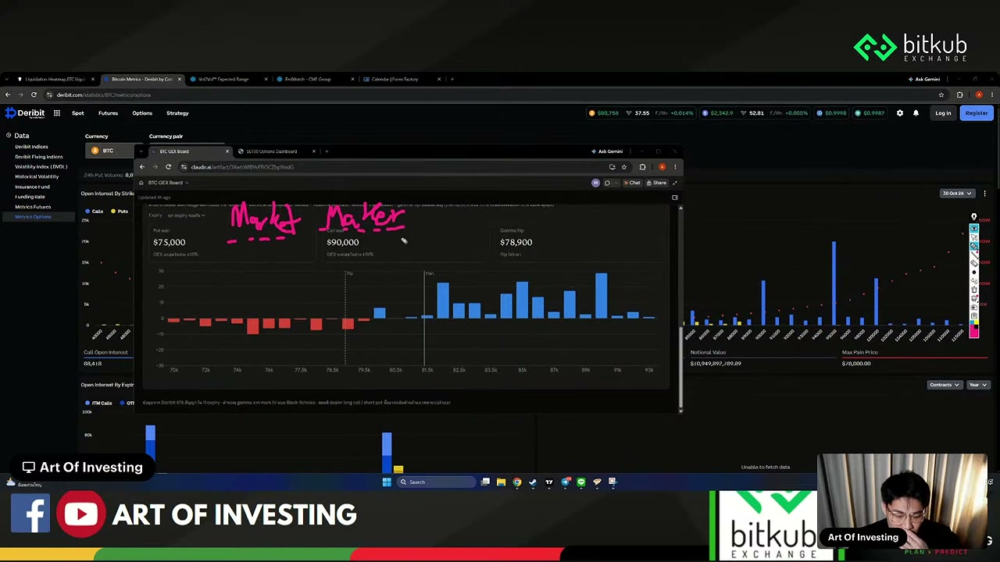

[00:26:58] แบบนี้เฮ้ยคุณอาร์ตแล้วไอ้ที่เป็นแท่งแดง แท่งฟ้าคืออะไรอ่ะเนี่ยผมจะย่อยให้ฟัง คร่าวๆเลยนะแท่งแดงเนี่ยครับคือตัวไหล แล้วก็แท่งฟ้าเนี่ยเป็นตัวเบรก อ่ะผมอธิบายให้ฟังแบบนี้ อ่ะเดี๋พูดให้ฟังก่อนว่ามันคืออะไรสมมุติ นะครับว่าค่ามันเนี่ยถ้าเกิด Gma Exposure หรือว่าเกเนี่ยออกมาเป็นบวก เนี่ย Market  Maker เนี่ยจะถูกบังคับให้ H สวนทางกับราคา ผมจะอธิบายไงให้มันไม่ลึกดีวะมันจะมี เรื่อง Call  by  Call  Sale อีกอ่ะเอา อย่างงี้เอาอย่างงี้ ผมอธิบายคร่าวๆก่อนนะครับการซื้อ Option เนี่ยมันจะมี Core  Buy แล้วก็ Call  Sale ถูกมั้ย

[00:28:00] คนที่ซื้อคyเนี่ยคือคนที่มองว่าถ้าราคา ถึงจุดนั้นและเลยไปได้เนี่ยคนเนี้ยจะกำไร นะครับถ้าถึงหรือเลยสตทแต่เนี่ยมองว่าถ้า เกิดราคาไม่ถึงเขาจะได้ตังค์ อ่ามันจะเป็นแบบนี้ ทีเนี้ยถ้าเกิดเราตีความตามค่าเกนะมันมัน จะต่างจาก IV กับ OI ไปนิดนึงนะถ้าเราตี ความคร่าวๆตามค่าเกกอ่ะครับ เวลามันออกมาเป็นบวกเนี่ย Market  Maker ที่กินค่าพรีเมี่มกับสปรดอ่ะส่วนใหญ่จะ อยู่ฝั่งนี้นะครับฉะนั้นเวลาเค้า H อ่ะ เค้าจะช็อต Hge หรือเปิดฟิวเจอร์แทงลง

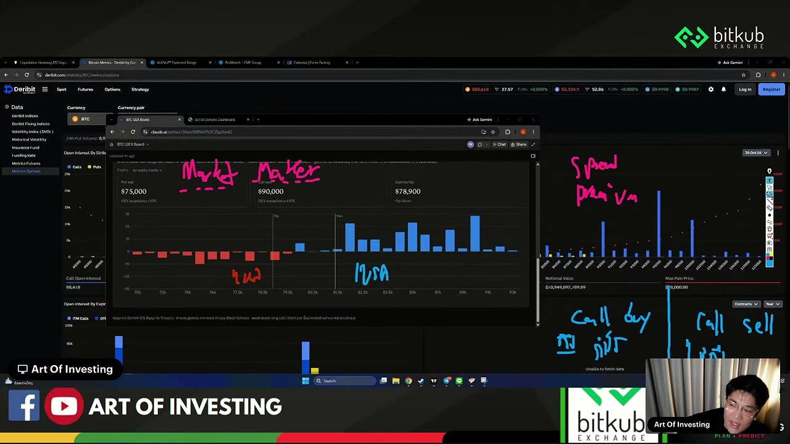

[00:29:00] ซื้อ Option  Core แล้วเปิดฟิวเจอร์แทงลง ฉะนั้นเวลามันไปถึงไปถึงเสาใหญ่ๆหรือ เริ่มทะลุไปเนี่ยเค้าก็จะต้องช็อตเพิ่ม เรื่อยๆเวลาที่เค้าช็อตเพิ่มเรื่อยๆอ่ะ มันคือการขายตลาดถูกมั้ยครับฉะนั้นน่ะ เวลาราคามันขึ้นเรื่อยๆเนี่ยแล้วมันขาย ตลาดเนี่ยมันบ่งบอกว่าอะไรมันก็ยิ่งเป็น ตัวที่จะยิ่งชะลอผมถึงเรียกมันว่าเบรค ถูกมั้ยผมผมถึงเรียกมันว่าเบรก แต่ว่าเวลาที่ถ้า GMA  exposure มันเป็น ลบเนี่ยครับมันจะไปอยู่อีกฝั่งนึงก็คือ มันจะมี Core  by  Core  Sal แล้วมันก็จะ มี put  by  put  sal ถูกป่ะ เค้าก็จะไปอยู่อีกฝั่งนึงซึ่งถ้าเกิดมัน ค่าลบเนี่ย Market  Maker จะถูกบังคับให้ H ทางเดียวกับราคาคือเค้ามักจะอยู่ฝั่ง นะครับงั้นสมมุตินะครับว่า

[00:30:02] ฝั่งเนี้ย มันเป็นค่าลบงั้น market  maker เขาจะ ต้อง short  h คืออะไรครับถ้าเกิดราคาไหลทะลุไปอย่าง เอ่อเค้าเสวนทางถูกมั้ยเค้าสวนทางก็คือ ยิ่งราคาขึ้นเค้ายิ่งช็อตแต่อันเนี้ยครับ ถ้าเกิดว่ามันเป็นค่าลบเนี่ยแล้วทะลุไป ได้เนี่ยยิ่งราคาทะลุไปไกลเท่าไหร่เค้า ยิ่งต้องช็อตเพิ่มเท่านั้นงั้นอะไรมันจะ เกิดขึ้นครับสิ่งที่จะเกิดขึ้นก็คือ รายใหญ่ช็อตเพิ่มพอรายใหญ่ช็อตเพิ่มปุ๊บ ราคาไปโดน Stop  loss ของ retail หรือจุด liquidation พอโดนจุด liquidate มันก็ ยิ่งทำให้รายย่อยเทขายใส่ตลาดอีกพอราย ย่อยเทขายใส่ตลาดรายใหญ่ก็ยิ่งต้องยิ่ง ช็อตเพิ่มอีกเพื่อเหตุนะครับมันก็เลยจะ

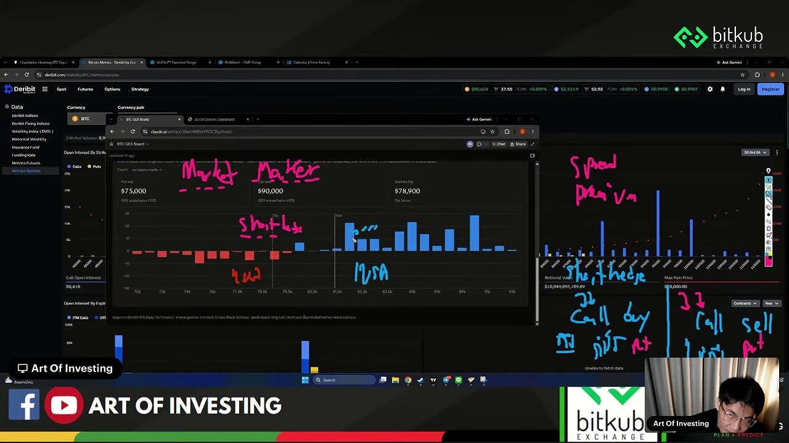

[00:31:02] ไหลรุนแรงทีเนี้ยไอ้ตรงฟliิเนี่ย ไอ้จุดฟliิเนี่ยตรงเนี้ย มันคือจุดที่ทำให้ market  maker ถูก บังคับให้เปลี่ยนหน้าเหตจากเค้าต้องเทสวน ทางกับราคาจะกลายเป็นเค้าต้อง H  follow ทางเดียวกับราคามันก็เลยกลายเป็นจุดที่ผม บอกว่าถ้าหลุดแล้วจะแล้ง นี่คือที่มาที่ 3 วันก่อนผมเขียนว่า 78,000  79,000 อ่ะถ้าหลุดอ่ะน่าจะไหล พวดเลยนะครับซึ่งก่อนหน้าเนี้ยค่ามัน ขยับและตอนแรกมันเป็นบวกตรง 79,000 แล้ว ก็ไปลบทีเดียวคือ 78,000 นะครับแต่ตอน เนี้ยมันเริ่มมันเริ่มขยับบวกขึ้นมาไกล ขึ้นที่ใกล้ๆ 80,000 ละนะฉะนั้นจุด flip เนี่ยคือจุดที่ถูกบังคับ Market  Maker บังคับให้ H กลับด้านนะครับก็พูดง่ายๆ จริงๆมันก็จะต้องมีอธิบายมากกว่านั้นอีก นะเฮ้ยแล้วตรงกลางระหว่างเลยราคาเป็นลบ

[00:32:04] ได้มั้ยคำตอบก็คือได้เพราะมันก็มีลองเหจ ด้วยการลองเหตุด้วยการช็อตอีกแต่เอาง่ายๆ ผมพูดให้เก็ทภาพทั้งหมดเอาแบบนี้ก่อนก็ คือถ้าเกิดเป็นบวกเนี่ยเค้ามักจะส่วนใหญ่ นะใช้คำว่าส่วนใหญ่เพราะไม่ใช่ Market Maker ทุกกองทุนเขาจะ H ทางเดียวกันแต่ ส่วนใหญ่เนี่ยถ้าเกิดค่ามันเป็นบวกเนี่ย เขาจะเหตุทางเดียวกับราคาค่าเป็นลบเนี่ย เอาขออภัยเาค้าจะเหตุสวนทางกับราคาถ้าค่า เป็นลบเนี่ยเค้าจะเหตุเศษทางเดียวกับราคา ฉะนั้นถ้าเกิดมันเป็นค่าบวกไหลๆขึ้นมา เนี่ยมันมักจะขึ้นเป็นบันไดนะครับแต่ถ้า เกิดเป็นค่าติดลบนะครับมันมักจะไหลแล้ว แรงไปหาจุดใหญ่ๆถัดไปอย่างเงี้ยตึ่มๆงั้น ตอนเนี้ยครับสิ่งที่ผมมองมันตรงกัน 3 ที่ เลยนะครับก็คือถ้าเกิดเรารวม expiry ทุก expiry เนี่ยครับก็คือหลุด 78,000 79,000 ก็น่าจะไหลแรงจนไปถึง 75,000 ที่ เป็นพุวallถูกมั้ยส่วนควallผมไม่มอง

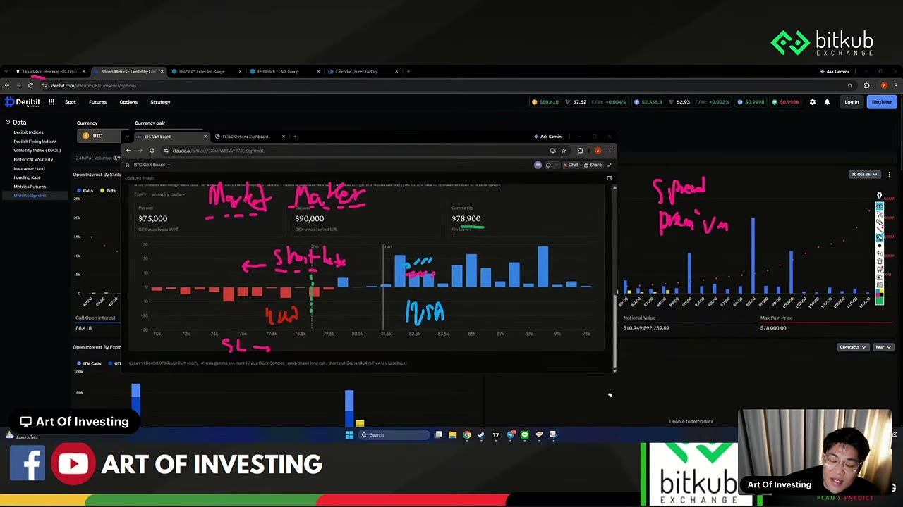

[00:33:06] 90,000 สาเหตุผมบอกแล้วเพราะว่าสัญญา ส่วนใหญ่ที่เปิดถูกเปิดตั้งนานแล้วก่อน หน้านี้นะครับฉะนั้นผมว่าผลมันจะน้อยผม เลยมอง 2 ตัวนี้เป็นหลักก่อนนะครับก็คือ 78,000  79,000 ถ้าหลุดเนี่ยจะไปที่ 75,000 แต่ถ้าไม่หลุดเนี่ยนี่ไงผมถึงมอง ตรงนี้ไง 82,000 กับ 85,000 ที่ผมบอกว่า มันจะขึ้นมา ถูกมั้ยครับนั่นนั่นคือสาเหตุที่ผมมอง 2 ที่นี้ ทีเนี้ยขึ้นมา 8,000  700 แล้วทำไมทุบเลย เพราะว่าบวก -  500 จุดจะเป็นระยะที่เสา นั้นเริ่มทำงานแล้วครับสมมุติว่าแนวรับ อยู่ที่ 75,000  75,000  500 ลงไปเนี่ย เสานั้นเริ่มทำงานะต่อมาถ้า 82,000 12,000 ก็คือต่ำกว่า 500  +  -500 ก็คือ ตั้งแต่ 8,1500 ขึ้นไปเนี่ยเสาตรงนั้นก็ เริ่มทำงานละฉะนั้นถ้าอีกเสา 85,000 ก็ คือตั้งแต่ 8,000500 ขึ้นไปอ่ะเสาตอนนั้น

[00:34:06] ก็ทำงานแล้วเช่นกันฉะนั้นตอนเนี้ยครับมัน เลยไม่ผ่าน มันก็เลยมา sideway ที่ตรงนี้ละนะครับ แล้วผมก็เลยมองว่าถ้าเกิดเวลาผ่านเวลา ผ่านไปอีกนะครับดูตรงนี้นะเวลาผ่านไปอีก นะครับอ่ะสัญญาตรงเจะหมดลงนะครับสัญญาตรง เนี้ยจะหมดลง ก็คือเค้าจะต้อง settlement น่ะนะครับ Settlement ปิดก็คือตอนเนี้ยสัญญาอัน เมื่อกี้มันเป็นรวมทุกวันหมดอายุใช่มั้ย แต่เนี้ยจะเป็นแค่วันหมดอายุเดียวก็คือ วันที่ 30 ตุลาคมที่จะถึงนี้วันศุกร์นี้ ก็คือ flip เค้าเนี่ยจะเลื่อนมาที่ 80,000 ละก็คือถ้าหลุด 8,600 หลุดลงไปเกิน 500 จุดเนี่ยก็คือ 80,000 หลุด 80,000 น่ะอ่ะ ก็จะเริ่มเริ่มไหลละนะครับโดยที่ไหลมาก็ จะมาอยู่ตรงนี้ 79,000 ก็คือพอดีเห็นป่ะงั้นถ้าหลุด 8,100 ก็จะไหลมาที่ 79,000

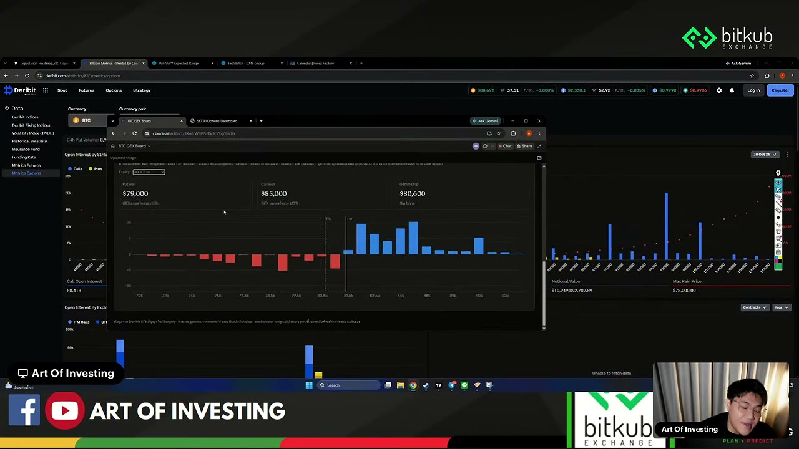

[00:35:07] ถ้าหลุดหลุด 79,000 อีกก็จะไหลมาที่ เนี่ยพอค่ามันใกล้ๆกันน่ะผมเลยสรุปให้ฟัง ได้ว่าอ้าโอเคงั้น 78,000  79,000 เนี่ย แนวรับหลัก ถ้าหลุดจะไหลแรงแต่ถ้าเราดูแบบรวมทุก expiry หรือรวม expiry ที่ใกล้ที่สุดที่ มียอดวอลุ่มเยอะที่สุดนะครับเราจะเห็นว่า โซนตรงเนี้ยตั้งแต่ 8,000  -85,000 เนี่ย ครับเป็นบวกสูงหมดเลยงั้นเวลาเป็นบวกสูง อ่ะครับมันเป็นจุดที่ฝั่งคyบายได้กำไรมาก ที่สุดให้เรานึกภาพแบบนี้ฝั่งที่มองว่า ราคาจะขึ้นน่ะกำไรเยอะสุดเพราะมันสูงที่ สุดงั้นก็มีแนวโน้มที่เขาจะปิดสัญญาเพื่อ ทำกำไรพอปิดสัญญาเพื่อทำกำไรอะไรเกิดขึ้น ครับราคามันก็ย่อไงแบบตัวเนี้ยที่มาถึง เฮ้ยเก็ทป่าวะ[เสียงหัวเราะ] ผมผมใส่หนักไปมั้ยพอดีเวลาวันนี้จำกัดนะ ครับอ่ะถ้าถ้าทันพิมพ์พิมพ์ 1 ให้ผมหน่อย นะครับผมก็ไม่รู้ทันมั้ยเอาแค่ตรงนี้ไป ก่อนก็ได้ก็คือแนวรับแนวต้านน่ะนะครับ

[00:36:09] แล้วพอเรามาดูที่ตรงนี้ที่เป็นค่า o นะ ครับของทอง ยาวเลยพิมพ์ 1 ให้ผมหน่อยแล้วกันนะผมว่า พิมพ์ 0 กันมาเลยไม่ทันครับไม่ทัน ครับไม่เก็ตครับไม่รู้เรื่องเดี๋ยว อาทิตย์หน้ามาขยายให้ฟังแบบละเอียดกว่า นี้ให้นะครับ อ่ะไม่ใช่ทองสิต้องเป็นคริปโตขออภัย อ่ะตัวนี้อุ้ยทันด้วยว่ะโหดีใจนะเนี่ยนะ ครับขอบคุณครับเดี๋ยวๆผมไล่ตอบคอมเมนต์ ก่อนไปนะเดี๋ยววันนี้พยายามเร่งให้ได้มาก ที่สุดเท่าที่จะทำได้นะครับอ่าก็คือตรง นี้นะทีเนี้ยพอผมมาดูเนี่ยโอเค ภาพเดียวกันเลยคุณเห็นอะไรบ้าง อ่ะคุณคุณดูคุณดูความสอดคล้องตรงนี้นะ เมื่อกี้ผมดูค่าเกกอ่ะตัวที่สูงคือ 82,000-85,000 ถูกป่ะแล้วพอมาดู Core  OI ใน CME อ่ะ

[00:37:09] โคตรเยอะเลยงั้นมันแปลว่าตอนเข้าใกล้ เสาเนี้ยมันจะมีแรงสะท้อนถูกมั้ยเพราะว่า มันเข้าใกล้จุดที่คนคอที่ราคาใกล้ 82,000 อ่ะกำไรแล้วแล้วมันเหลือเหลือเวลาอีกแค่ 2 วันน่ะ ขอบคุณ Superchat ครับสด 179 บาทคุณ ฮาร์ดวลขอบคุณมากๆครับขอบคุณมากๆหวังว่า วันนึงคุณฮาร์ดวellจะทัก inbox ผมมาแล้ว ให้ผมตอบแทนอะไรบ้างนะครับแบบส่งกิ๊ฟเซต อะไรไปให้บ้างก็ได้นะครับผมเกรงใจมากเลย ส่งให้ผมทุกทุกไลฟ์เลยขอบคุณมากครับคุณ ฮาร์ดวล 179 บาทขอบคุณครับอ่ะทีเนี้ยเค้า เหลือเวลาแค่ 2 วันทำไมผมถึงบอกว่า option เนี่ยมันจะดูแล้วมีผลหรือได้ผลเนี่ยใกล้ เคียงที่สุดอ่ะคือช่วงสัญญาใกล้หมดอายุ เพราะว่าเวลามันเหลือน้อยคุณนึกภาพตามผม ดิสมมุติว่าคุณเหลือเวลาอีก 15 วันน่ะ แล้วคุณไม่จำกัดกำไรอ่ะคือยิ่งเลย 82,000

[00:38:11] ยิ่งกำไร งั้นถ้ามันเหลือ 15 วันคุณก็ไม่ต้องรีบ ปิดนึกออกป่ะมันเลยอาจจะมีโอกาสทะลุไป ค่อยไปหาเสาอื่นก่อนก็ได้เพราะแบบเอ้ย เอ้ยมันอาจจะขึ้นไป 83,000 ก็ได้หรือ 8,2500 เฮ้ยกูได้กำไรเยอะกว่าเดิมเว้ย เฮ้ยไม่ต้องรีบปิดก็ได้อ่ะมันจะเกิดภาพ นั้นเพราะว่าคนที่ซื้อฝั่งคบายเนี่ยนะ ครับเค้าจะเสียค่าเปิดสัญญาไปแล้วคือสิ่ง ที่เรียกว่าค่าพรีเมี่มเหมือนค่าน้ำ สมมุติว่าผมแทง 1,000 ผมเสียก่อน 100 อ่าเป็นค่าพรีเมี่มและงั้นแต่ว่าถ้าถ้า เกิดมันวิ่งเลยไปอ่ะผมได้ไม่จำกัด แต่ทีเนี้ยพอเวลามันเหลือแค่ 2 วัน เค้าก็เริ่มมีความคิดเยอะขึ้นะเฮ้ยแบบนี้ แน่เลยว่ะเอาไงดีวะเหลือ 2 วันแล้วคืนนี้ มีประกาศโฟมซอีกเฮ้ยราคามันจะย่อลงมา

[00:39:11] ก่อนมั้ยอ่ะไหนๆกำไรละฉันปิดก่อนแล้วกัน นั่นคือสาเหตุที่เกิดที่เสานี้คือ 82,000 ฉะนั้นไอ้ 8,000  85,000 เนี่ยผมไม่ได้ แบบสุ่มๆเลขว่าแบบเอ้ยมันน่าจะตรงนี้แหละ แต่ว่าเราคำนวณมาแล้วว่าเวลามันเหลือแค่ 2 วันแล้วผมตอนผมเขียนน่ะมันเหลือ 5 วันผม ก็มองว่าตอนนั้นราคามันอยู่ที่แถว 79,000 ขึ้นมาเนี่ยโอกาสเกิดรีอคชค่อนข้างสูง แล้วมันใกล้มีคุณดูนะใกล้มีนคือท้องช้าง ช่วงที่วอลุ่มต่ำที่สุดมันจะไหลลงมาหามีน เวลาเกิดreีอคtionมันจะไหลกลับลงมาหามีน แล้วคุณดูมีนมันเท่าไหร่ ราคาตอนนี้เท่าไหร่ เนี่ยอ้าวมั่วไม่เอาเอ้า[เสียงหัวเราะ]มี อยู่จริงไม่เอานะครับผมถึงบอกว่าตอนผมไป เรียนกับจาน A จาน M อ่ะเป็นอีกหนึ่ง

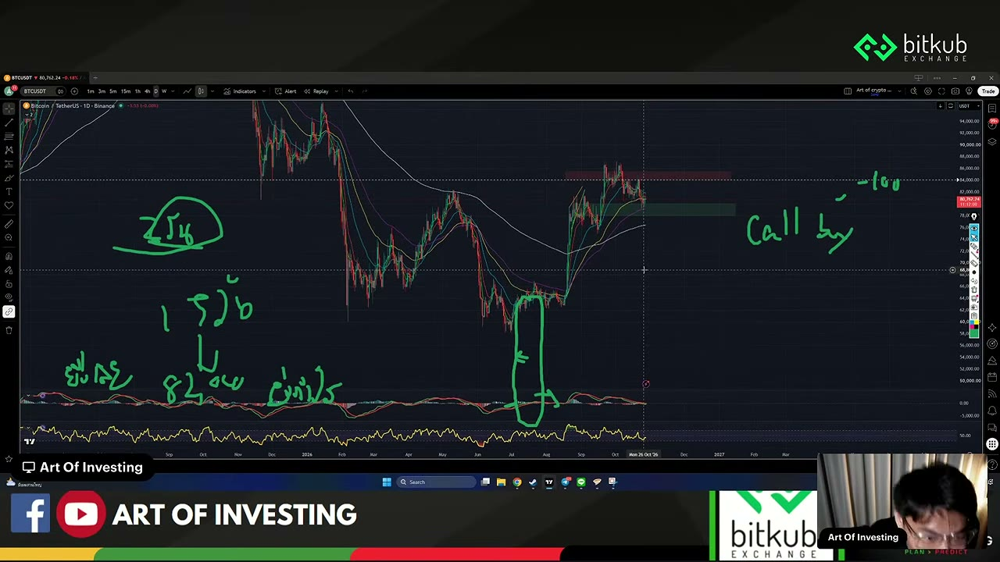

[00:40:13] จังหวะชีวิตที่ผมรู้สึกว่าผมโง่มานาน มากเพราะว่าโมเมนตัมผมอ่ะมันเป็นไดนามิ หรือมันเป็นค่าเฉลี่ยตามตลาดมาตลอดไอ้แนว รับแนวต้านเนี่ยผมไม่สามารถวิเคราะห์ได้ แบบpresีไซiseคำว่า presise คือแม่นยำว่า เฮ้ยต้องใช้แนวรับตรงนี้เฮ้ยต้องใช้แนว ต้านตรงนี้แต่พอมี option น่ะมันเห็นเลย ว่าแนวต้านตรงเนี้ยมันมีเงินรออยู่หรือ แนวรับตรงเนี้ยมันมีเงินรออยู่เพราะว่า ถ้าเกิดคุณไปดูอordเดอร์ Book สมัยก่อน เขาจะดูแค่อเดer Book ใช่ป่ะอเดer Book อ่ะมันวางแล้วยกออกได้ค่าคอมคอมมันนิด เดียวแต่ว่าoptionัเนี่ยมันวางเรายกทิ้ง ไม่ได้ครับเพราะว่ามันเสียค่าน้ำ แล้วค่าน้ำมันแพงเพราะมันเป็นค่าพรีเมี่ม เนี่ยครับฉะนั้นน่ะมันเลยพอแล้วพอผมเอามา back  test ย้อนหลังกับ data ที่ผมใส่ลง ไปคือ Open  High  Low  Close  OHLC อ่ะ มันก็ไปประจวบเหมาะกับ EMA ผมหมดเลยผมก็ เลยได้คำตอบแล้วว่า EMA ผมอ่ะที่มันอยู่

[00:41:15] บ้างไม่อยู่บ้างอ่ะทีเนี้ยผมจะคัดยังไงดี วะว่ารอบเนี้ยค่าเฉลี่ยตรงเนี้ยน่าจะรับ อยู่หรือค่าเฉลี่ยตรงเนี้ยคนไม่ค่อยสนใจ แล้วพอผมได้ data จาก option มาจบเลย อ่ะแล้วคุณมาดูนะว่าตอนที่มันเด้ง 79,000 78,000 มันตรงกับอtionัใช่ป่ะ คุณดูดิมันตรงกับ EMA อะไรผมใครตามผมมา นานคุณจะรู้ว่าผมเล่น EMA  75 บ่อยที่สุด กับ 25 ถูกป่ะแต่บางครั้งอุ๊ยทะลุบ้างอะไรบ้างที เนี้ยผมจะดูยังไงอ่ะว่าไอ้เส้นนั้นน่าจะ รับอยู่หรือไอ้เส้นนั้นมันน่าจะไม่ทะลุพอ ได้อtionัปุ๊บ เปิดโลกอ๋อเงินมารอแอชัตรงนี้เฮ้ยเงินมา รอ centim ตรงนี้แล้วมันบอกได้ยันเวลา เพราะอะไรรู้ป่ะเพราะว่าอีก 2 วันที่ 30 หมดอายุปุ๊บผมก็ต้องไปดูของสัปดาห์ถัดไป ละผมก็ต้องไปกางดูว่าอ่ะงั้นแล้ววันที่ 6 พฤศจิกายนซึ่ง

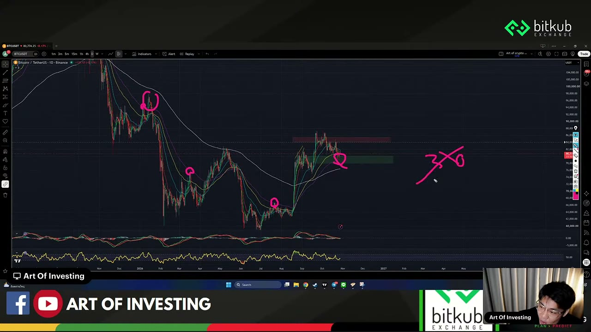

[00:42:17] หลังเลือกตั้งกลางเทอมไปแล้วด้วยเค้าย้าย ไปวางอชัยังไงกันต่อถ้ามันยังวางที่เดิม ผมก็รู้ละงั้นตรงเนี้ยน่าจะทะลุลงไปยากผม ถึงเขียนในบทความว่าอะไรตรงเนี้ยผมซื้อ สปอตไปแล้วแต่ผมยังไม่กล้าเปิด leverage เพราะผมจะรอดูก่อนว่าหลังจากประกาศโฟม C Meeting กับเลือกตั้งกลางเทอมแล้วอ่ะ สัญญาจะยังวางที่เดิมมั้ถ้าวางที่เดิมมัน ก็จะเข้าท่าของผมไง ก็คือกลับไปอะไรเกิดโมเมนตัมท่านี้แก เหนือ 0 อีกครั้ง RSI  overbard เห็นป่ะ data้ามันเชื่อมกันทันทีผมโอเคงั้นขึ้น ได้ถึงไหนไกลสุด 85,000  90,000 ไม่ไกล กว่านี้เพราะเสาเยอะ เนี่ยมันชัดเลยเอ้าแล้วแล้วถ้าผ่านไปวัน นั้นแล้วมันรับไม่อยู่อ่ะแล้ว 6 พย.ไม่ วางตรงนี้กันละไม่วางพุทธ กันที่ 78,000  79,000 ละไปวางนู่น 75,000 ผมก็อ๋ออ่ะโอเคงั้นตรงเนี้ยผมเปิด

[00:43:17] leverage ไม่ได้นะแล้วผมก็จะต้องรอเก็บ ของอีกทีที่ 75,000 ตรงกับอะไร EMA  200 เนี่ยมันจะง่าย แล้วถ้าตรงนี้รับไม่อยู่ 68,000 เอ้ยคุณอาร์ตแล้วแล้วจะรู้ได้ไงว่าจังหวะ ไหนเริ่มกลับมาเปิด leverage ได้ผมก็จะไป รอดู 6 พย.หลังจากนั้นผมไปดูอะไรหลังจาก ผ่าน 6 พย.เสร็จผมไปดู 13 พย. ถ้าเกิดมันเด้ง แล้วพุทธเนี่ยมันวางสูงขึ้นเรื่อยๆผมก็ รู้แล้วว่าคนเริ่มมองขึ้นมากกว่าลงเวลา นั้นผมค่อยเปิด Levate คุณคุณเก็ทภาพเลยป่ะผมถึงบอกว่าเฮ้ย ผมอ่ะขาดตรงนี้มานานมากใครที่เรียนกับผม มา 3-4 ปีอ่ะที่ผมเริ่มสอนตั้งแต่ 2021 อ่ะในเวลานั้นน่ะผมยังไม่มี data  option ในหัวสิ่งที่ผมทำได้อ่ะมีแค่ค่าสถิติเฮ้ย Suply  demand ตรงเนี้ยมันจะอยู่กี่ เปอร์เซ็นต์กับ EMA ตรงเกี่เปอร์เซ็นต์ใน Week มัน 75% นะผมมีแค่นั้นแต่พอมี Data

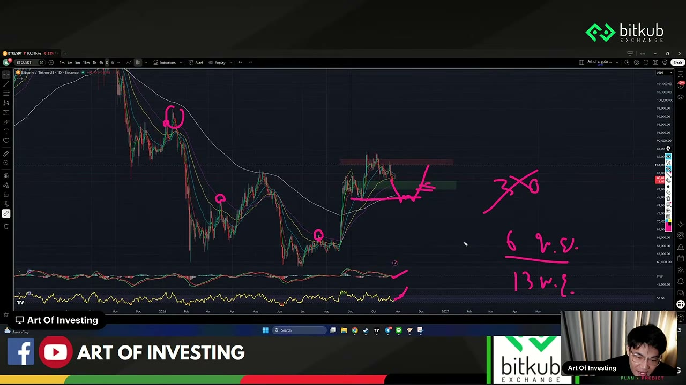

[00:44:20] Option น่ะบอกได้เลยว่าเส้นเนี้ยคน ยังสนใจกันมยถ้าไม่สนใจเรา Stop  Loss ถ้าสนใจเป็นจุดเก็บของมันทำให้ผมได้ static มาเพิ่มแล้วแล้วมันเป็น missing piece อ่ะมันใส่กันได้พอดีมากฟึบ เห็นมั้ยเนี่ยแล้วบางคนผมจะเจอเจอคนบอก กับผมแบบนี้ซึ่งผมเห็นด้วย 100% ผมเห็น ด้วยมากๆคนบอกกับผมแบบนี้ เอ้ยคุณอาร์ตชั บนบitcoinมันน้อยมากเทียบกับทองคำทองคำ เยอะกว่าเยอะเลยีอคtionจากการสะท้อนเสา อ่ะยังไม่เยอะหรอกผมบอกเฮ้ยผมเห็นด้วยผม ไม่เถียงแต่คุณบอกผมว่าบitcoinกำลังจะ เป็นสินทรัพย์ที่รัฐบาลทั่วโลกยอมรับมาก ขึ้นเรื่อยๆถูกป่ะบitคinกำลังจะถูกกฎหมาย หลายฉบับปรับมากขึ้นเรื่อยๆถูกมั้ย บitcoinกำลังจะเป็นresรีรของอเมริกาที่ อนาคตคนพยายามให้นโยบายคือเอาภาษีไปแบ่ง

[00:45:20] ซื้อบitคinด้วย งั้นมันแปลว่ามันก็จะต้องถูกกฎหมายมาก ขึ้นเรื่อยๆดิพอถูกกฎหมายมากขึ้นเรื่อยๆ อะไรเกิดขึ้นเงินจากสถาบันก็จะมามากขึ้น เรื่อยๆครับแล้วพอเงินจากสถาบันเข้ามามาก ขึ้นเรื่อยๆอะไรเกิดขึ้น option ก็จะเยอะขึ้นเงินที่เขาเข้ามาเหจ ก็จะเยอะขึ้นงั้นreีอคtionก็จะยิ่งชัดชัด ขึ้นมันจะชัดเท่าทองคำ อ่ะเนี่ยคุณดูเมื่อกี้data้ามันบอกว่ามัน จะต้องมาหาท้องช้างใช่มั้ยท้องช้างอยู่ 80750 มันเด้งมาละเห็นป่ะแล้วตอนนี้ชอง ช้างอยู่ 81250 แล้วเนี่ยราคามันขยับละ เนี่ยแล้วราคาตอนนี้มาแล้วะ ฉะนั้นตอนเนี้ยครับหมดแล้ว หมดแล้ว คำว่าหมดคือความได้เปรียบของdata้าชุด เนี้ยจบแล้วแล้วผมว่าอันเนี้ยเคลียร์ ปมปัญหาในใจของนักลงทุนหลายคนแนวรับนี้ ยังใช้ได้อยู่เปล่าแนวต้านเนี้ยที่มองว่า

[00:46:21] ราคาจะวิ่งไปถึงอ่ะยังมองแบบนั้นอยู่มั้ย อันเนี้มันบอกได้หมดเลยเลยวันนี้ไม่ใช้ จุดนั้นแล้วเลยวันนั้นค่อยไปดูสัญญาของ วันนั้นฉะนั้นตอนเนี้ยครับโซนตรงเนี้ยไม่ ใช่โซนที่ผมจะเก็บของเพิ่มแล้วเพราะมัน เกิดreีอคtionไปแล้วแล้วโซน 82,000 ไม่ ใช่โซนที่ผมจะนั่งจับตาดูแล้วเพราะเกิด reีอคtionไปแล้ว งั้นตอนนี้แอtionัของผมในกรอบจบไปแล้วคือ ตอนผมเก็บของที่ EMA  75 ใน day สิ่งที่ ผมจะดูคือโฟม C  1 คืนนี้และเลือกตั้ง กลางเทอมวันที่ 3 สัปดาห์หน้า หลุดกรอบล่างมั้ยถ้าหลุดกรอบล่างคือ ซึ่งเป็นจุดที่ Negative  Gamma  Peak ก็มีแนวโน้มที่ราคาจะไหลพวดลงไปแล้วสะดุด หยุดตรงนั้นก่อนแล้วผมก็จะไปดูสัญญาของ วันที่ 6 เฮ้ยถ้าสัญญามาผมก็เขียนบทความ อัปเดตหรือผมก็มาไลฟ์อัปเดตวันพุธพอดี

[00:47:23] เฮ้ย 70  75,000 วางนะผมมองว่าโซนเนี้ย น่าสนใจถ้าเก็บของเพิ่มหรือถ้าโหวเบ๋เลย สมมุติว่าลงไป 75,000 ผมเปิดสัญญาวันที่ 6 พย.วางอีกที 72,000  71,000 ผมก็รู้ เลยว่างั้นแบบนั้นน่ะผมก็จะไปแอเน้นเด้ง ขึ้นแล้วช็อตลงไปหา 72,000 จะสูงกว่าเรา จะดูค่า IV สิสกิลครับเป็นหลักถ้ามันสกิล เบ้ซ้ายแปลว่าตลาดให้ความเสี่ยงในการปก ป้องขาลงมากกว่าก็มีแนวโน้มที่ตลาดจะไปใน ทิศทางลงมากกว่างั้นตอนนี้ครับ งั้นตอนนี้ครับ ถ้าหลุดผมมองเหมือนเดิมแต่จุดสะดุดจะน้อย ลงนะครับผมมองเหมือนเดิม 78,000  79,000 คือแนวรับหลัก ถ้าทะลุมีสิทธิ์เห็น 75,000 นะครับส่วน ด้านบนนะครับตอนเนี้ย 82,000 อ่ะผมให้ผม ให้เหลือครึ่งเดียวแล้วที่จะสะดุดนะครับ ก็คือreีอคชเกิดไปแล้วนี่เห็นป่ะแล้วีคช

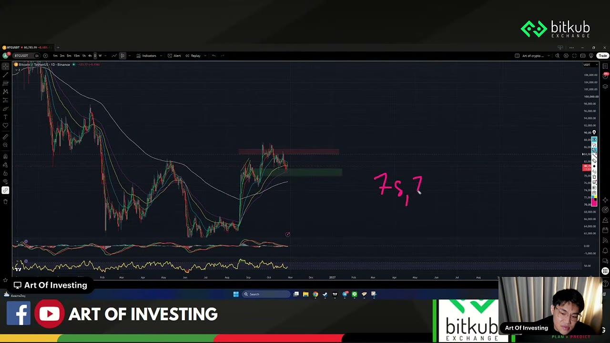

[00:48:24] ระยะมาระยะที่reีแอคชเกิดคือ 500-700 จุด จากเสางั้นถ้าเกิดมันเกิดที่ 8,000 11,000  700 อันเนี้เกิน 700 จุดยังคำ ตอบคือเกินแล้วนะครับงั้นตอนเผมให้น้ำ หนักมาแค่ครึ่งเดียวะขึ้นมา 82,000 อีก รอบอาจจะไม่เกิดreีแอคชัสะท้อนเด้งอะไร รุนแรงะผมมองอีกทีคือ 85,000 เลย ฉะนั้นเสา 85,000 จะเริ่มทำงานได้เนี่ยก็ คือตั้งแต่ราคา 8,4500 ขึ้นไปนะครับงั้น ถ้าเกิดหลุดตรงนี้ก็คือไหลพวดเดียวเลยแต่ ถ้าเกิดเป็นตรงนี้จะเป็นอย่างี้ พอเป็นแบบ ง่ายขึ้นป่ะสนุกขึ้นมั้ยผมอ่ะ Enjoy มาก แล้วผมรู้สึกว่าผมกลับมามีไฟในการทำ data อีกรอบอันเนี้ยผมก็ทำเดี๋ยวผมทำให้นัก เรียนใช้นะครับก็อ่ะมันจะเป็นหลายตัวเนาะ ก็คือผมมีวัดระยะ standard  deviation ให้ด้วยนะครับว่ามันสกิลไปฝั่งไหนนะครับ แล้วก็ระยะที่มีความน่าจะเป็นตอนเนี้ย เห็นมั้ยตอนเนี้ยมันเกิน 5% ด้วยซ้ำอ่ะ

[00:49:28] ที่ที่โอกาสจะไปถึง 90,000 ภายใน 2 วัน เนี้ยฉะนั้นงั้นตอนเนี้ยถ้าตีความตาม data้าณเวลาตอนนี้นะก็คือโอกาสที่ราคาจะ วิ่งไปถึง 90,000 ภายในวันศุกร์มีต่ำกว่า เนี่ยคำถามคือ 5% เกิดขึ้นได้มยได้แต่ สมมุตินะว่าคุณเดินเข้าคาสิโนอ่ะแล้วคุณ รู้ว่าโอกาสชนะคุณมี 5% น่ะคุณจะเบซ นี้คือ 15% ที่มีโอกาสถึง มันเลยเป็นที่มาของมีreรีชionไงครับว่า ถ้าเกิดไปถึงโซนโจรที่ทะลุกว่านั้นน่ะจะ เหลือแค่ 5% แล้วมันเลยมีโอกาสเด้งกับมีน มากกว่าเมื่อกี้พอชน 82,000 ที่เป็นเสา ปุ๊บมันเลยเกิดรีอแคชักลับเข้าท้องช้าง เลยไงสนุกมั้ยเฮ้ยใครมันพิมพ์ 7 ให้ผม หน่อยนะครับเดี๋ยวผมวิเคราะห์บitcoin อธีเรiมแล้วก็ทองคำคร่าวๆแล้วเดี๋ยวผมอาจ จะขอก่อนนะนะครับเพราะว่าเดี๋ต้องไปกิน เลี้ยงงานแต่งกลัวไม่ทันนะ

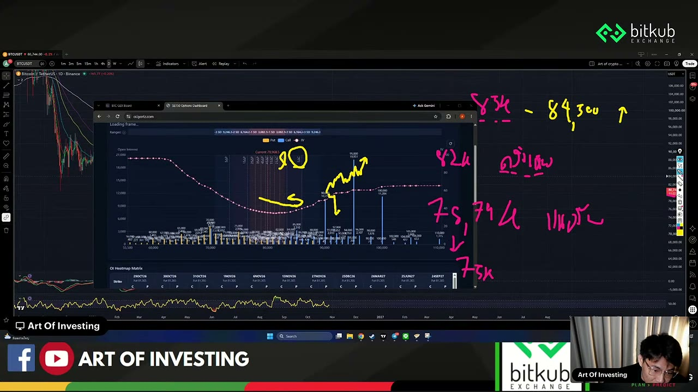

[00:50:30] ขอบคุณซอ์ช 66 บาทจากคุณอ๊อดครับขอบคุณ มากครับ อ่าเนี่ยแหละแค่แค่นั้นนะครับเออสนุกใช่ มั้ยผมรู้เพราะว่าตอนผมรู้ครั้งแรกอ่ะตอน ผมเพิ่งเริ่มเข้าใจอ่ะผมแบบโอนี่แหละที่ ฉันหาอยู่คือทำยังไงให้เราเข้าใจว่าโซน นั้นน่ะเราจะยังใช้อยู่มั้ยอะไรอย่าง

[00:51:09] เอ่อคุณสปารkถามว่าโอ้พิมพ์ 7 มาใหม่หลาย คนเลยขอบคุณมากครับสนใจศึกษาตรงนี้ต้อง เริ่มยังไงผมแนะนำอ่ะคนที่อกำลังจะมี โปรเจคคอแลabกันเร็วๆนี้นะครับแล้วก็ผม แนะนำให้เลยนะครับก็คือช่องนี้ครับคุณ ลองไปดูช่องMtadดerครับ ช่องช่อง MADER นะครับช่องช่อง MADER เอ่อคนนี้เป็นฝาแฝดกันนะครับคนน้องชื่อ จาน M คนพี่ชื่อจาน A นะครับโดยที่คนน้อง เป็นผู้บริหารกองทุนบรจ.ในไทยแบบถูกกฎ หมายนะครับไม่ไม่ใช่กองทุนแบบ FTMO  MyFX Book เอ่อ My  Forex  Fund นะกองทุนแบบ กองทุนถูกหลักกฎหมายในตลาดหลักทรัพย์ใน ไทยครับมา 9 ปีะเค้าเป็นผู้บริหารกองทุน นะครับแล้วก็เอ่อจะมีฝาแฝดเค้าที่ร้ายทุก วันก็คือจาน A จาน A ก็เป็นอดีตเทรดอร์ กองทุนเหมือนกันเหมือนเดิมไม่ใช่กองทุน แบบ FTMO  MyFX  FUN เป็นกองทุนแบบรวบรวม เงินนักลงทุนในไทยแบบถูกกฎหมายเค้าก็เป็น

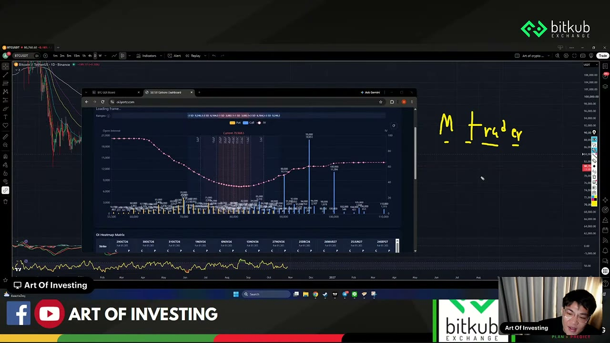

[00:52:11] อดีตฉะนั้นเค้าจะเอาแนวทางการอ่าน option อย่างเงี้ยในที่กองทุนเขาใช้มาพูดแล้วสอน คุณสปารkลองไปดู ช่องนี้ก่อนว่าชอบ data แนวนี้หรือเปล่า นะลองไปดูทั้งเพจ Facebook กับเไลฟ์ YouTube ได้เลยผมอ่ะก็ศึกษาเพิ่มมาจาก ที่นี่แล้วเดี๋ยวกำลังจะมีโปรเจคคอแลab กันระหว่างผมกับจารย M นะครับ แต่ผมบอกตอนนี้นะเฮ้ยคุณดูแล้วมันอาจตื่น เต้นวนว้าวเนี่ยีคtionยังไม่ดีเท่าทองนะ ทองเป๊ะกว่านี้อีกฉะนั้นน่ะครับอีกปี 2 ปีอ่ะreีอคtion Bitcoin จะยิ่งชัดแล้ว ถ้าคุณเริ่มเรียนรู้ตอนเนี้ยคุณโคตรได้ เปรียบคุณจะเข้าใจก่อนแล้วพอเงินมันมาเหจ กันมากขึ้นเรื่อยๆในตลาดอ่ะครับคืออ่ะ เผื่อเผื่อคุณไม่เห็นภาพผมอธิบายอย่างงี้ เมื่อกี้จะพูดอะไรนะนึกแล้วมันลืมไปเลย อ่ะโอเค

[00:53:12] ก่อนคุณจะเอาเงินเข้าไปในตลาดนั้นได้อ่ะ คุณต้องมีการฝากคุณต้องมีการเปิดบัญชีใช่ มั้ยแต่คุณนึกภาพโลกคริปโตดิ คุณนึกภาพโลกคริปโตดิคุณอยู่ตรงไหนในโลก ก็ได้คุณมีกระเป๋าวอลเล็ตได้หมดคุณซื้อ ขายบitคinได้หมดฉะนั้นเงินทั่วโลกมันจะ ไหลเข้ามาในบitคinในฐานะนักเทรดมากขึ้น นักเก็งกำไรมากขึ้นไม่ใช่แค่นักสะสมละ ฉะนั้นพอเงินนักเทรดมันเยอะขึ้นแล้ว บitคinถูกกฎหมายมากขึ้นเงินสถาบันก็ต้อง ไหลเข้ามาพอเงินสถาบันไหลเข้ามาเนี่ยีอคช ตรงนี้ชัดนะครับอ่ะฉะนั้นบitcoinผมสรุป เลยนะครับก็ตามที่พูดมาเมื่อกี้เดี๋ดู โมเมนตัมระยะยาวให้หน่อยเนี่ยเห็นป่ะมัน จะเป๊อะไรขนาดนั้นดูดิ 8,000-800 อ่ะนะ ครับตอนผมรู้ผมยังว้าวเลยแบบเฮ้ย ได้ว่ะอะไรเงี้ยแบบเฮ้ยประยุกต์ได้ ว่ะอะไรเงี้ยแล้วพอเรามาดูกับ EMA อ่ะนัก เรียนผมรู้อยู่แล้วผมใช้ EMA อะไรบ่อย 25 อ่ะพอดีป่ะแต่สิ่งที่เกิดขึ้นคือเฮ้ย

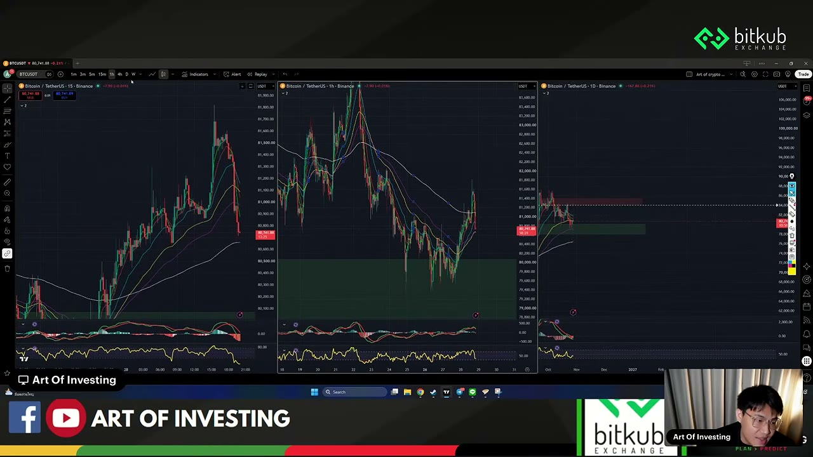

[00:54:13] บางครั้งทำไมรับอยู่ทำไมบางครั้งไม่อยู่ วะเพราะที่ผ่านมาเราไม่มี data ตรงนี้ ครับพอมีปุ๊บอ่ะโอ้โหผมแฮปปี้มากนะครับ อ่ะงั้นตอนนี้นะครับก็อย่างที่บอกเนาะก็ คือ week เนี่ยครับโมเมนัมเนี่ยมันเกิด แล้วนะก็คือ MACD เหนือ 0 ทั้งคู่และนะ ครับแล้วก็ RSI เนี่ยมันoverbบอและแต่ว่า สิ่งที่เกิดขึ้นนะครับคือตอนเนี้ยมัน ทำลายโครงสร้างมาแล้วนะครับมันเกิดแค่การ ย่อตรงเนี้ยมันจะย่อลึกแค่คือตื้นแล้ว ขึ้นเลยมหรือย่อลึกหน่อยฉะนั้นตัวจุดชนวน ตอนเนี้ยนะครับที่วัดเนี่ยคือ ที่เป็นแนวรับหลักถ้าไหลก็ทะลุมา 75,000 แล้วตรงนั้นเราจะไปดู data อีกทีว่ามี อtionัมาวางเพิ่มมนะครับส่วนแนวต้านตอน นี้ผมให้ไกลสุดเลยนะคือ 85,000  82,000 เนี่ยผมให้ครึ่งเดียวแล้วก็คือ 1/2 นะ ครับโฟกัสค่านี้ก่อนนะครับเพราะว่าถ้า เกิดว่ามันทะลุก็คือแบบ 78,000  79,000 ไม่หลุดและแล้วมันทะลุเลยมันก็จะออกภาพ เนี่ยครับคือsideซwayยแล้ววิ่งขึ้นต่อเลย

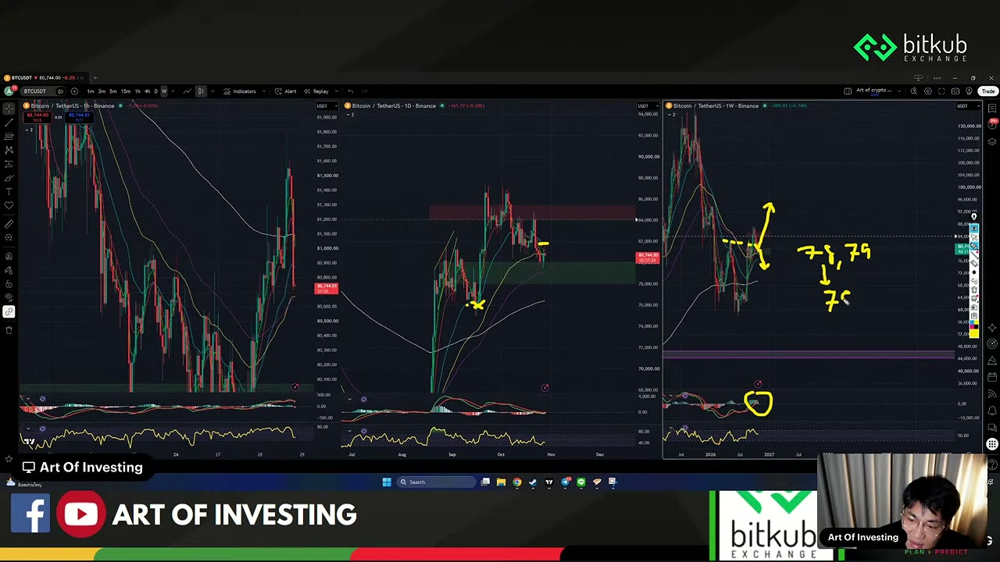

[00:55:15] เห็นมั้ยมันก็จะเป็นบันไดแบบที่ผมบอกก็ คือค่ามันยังเป็นบวกอยู่มันก็จะเป็นบันได ก่อนแล้วค่อยขึ้นต่อนะครับอ่ะงั้นมันก็จะ เกิดเป็นภาพนี้นะครับก็คือถ้าเกิดไม่หลุด 7,000  7,900 นะครับมันก็จะขึ้นเลยแล้ว ก็อัดอย่างงี้แล้วก็เป็นบันไดก่อนนะครับ โดยให้ไม่เกิน 90,000 แต่ถ้าเกิดว่ามัน หลุดตรงนี้ครับก็จะเป็นอีกภาพนึงคือตึ้ง นี้อาจจะตึงอย่างงี้แล้วค่อยขึ้นนะครับดู ว่าหลุดตรงนี้หรือเปล่างั้น ง่ายเลย 7,000  7,9 เก็บของแล้วไม่ต้องทำ อะไรเปิด leverage ได้มครับเพราะว่าราคา ด้านบนยังเบรกแนวต้านไม่ได้แต่ถ้าหลุดลง มาแล้วถึง 75,000 เก็บสปอตน่าสนใจนะครับ เก็บสปอตน่าสนใจ เอ่อแล้วตอนที่จารอาร์ตวิเคราะห์ว่ามันจะ ไม่เบรค 70,000 ก่อนสิ้นปีทำไมมันเบรค ครับที่เวซenอัดฉีดแล้วพุ่งพวดเดียวอชั มันบ่งบอกอะไรบ้างครับอันนี้ไม่ได้แซะนะ ครับถามความรู้เอ้ยผมเข้าใจคุณเมrตามผมมา นานผมเข้าเข้าใจตอนนั้นน่ะก็คือเงินก้อน ใหญ่เสียครับคุณเมสซี่อย่างสมมุติว่าเรา

[00:56:18] วิเคราะห์แล้วว่าตรงนั้นน่ะโอกาสทะลุได้ เนี่ยมีแค่ 25% หรือ 15% นะครับสมมุติว่าเราวิเคราะห์แล้วซึ่งตอน นั้นน่ะ 72,000 คือค่านี้ ซึ่งตอนนั้นน่ะ 72,000 คือค่านี้คุณ เมสซี่ตอนที่มันทะลุขึ้นไปเรื่อยๆอ่ะ โอโอกาสต่ำลงเรื่อยๆผมดูตั้งแต่ 70,000 แล้วโอหทะลุยากพอมันเหลือ 72,000 ผมมองว่าเหลือ 15% แต่มันดันเกิด เคสนั้นครับจนบีบเหลือ 5% ก็เกิดฉะนั้น อtionัตรงนั้นน่ะครับระยะที่มันปิดเลย เค้าเรียกว่าเลยหาง IV อ่ะมันก็เลยเกิด ขึ้นเราจะเรียกตรงนั้นว่า Fattail  Risk นะครับคือมันจะเกิดขึ้นตอนเป็นเทรนด์ที่ แรงมากจริงๆโดยส่วนใหญ่ครับมันจะเกิดมี reversion ใน 1  SD 2  SD

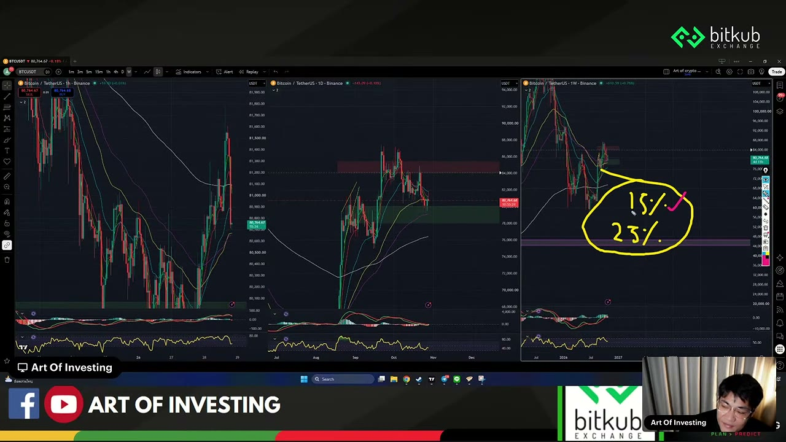

[00:57:19] คำว่าเกิดมีrevชionใน 1  SD  2  SD ก็คือ เวลามันวิ่งไป 2 ระยะอ่ะอย่าง 2  SD เนี่ยคือไม่เกิน 3,000 จุดสมมุติว่าราคา อยู่ที่ 65,000 ผมถึงวิเคราะห์ว่าอะไร 66,000  67,000 ผมว่าไม่ทะลุอ่าจำได้ มั้ยตอนนั้นน่ะที่ผมไม่ได้ไม้รองอ่ะแล้ว ก็มันก็จะต้องกลับหามีนก่อนแต่มันจะมี โอกาสน้อยครั้งมากๆครับที่มันจะทะลุลวด เดียว 3  SD แล้วไม่พักเราจะเรียกตรงนั้น ว่า Fat  terorist คือเทรนนะครับมันก็ เกิดตู้มเลยงั้นตอนนั้นน่ะครับ data option เกิดเคสที่ทะลุ เราถึงมี stop  loss ไงว่าตรงเนี้ยโอกาส ถ้าใน 1  SD ก็จะโอกาสชนะ 70%  68% แต่ ถ้า 2  SD โอกาสชนะขยับมาเป็น 95 และอ่า มันจะเป็นแบบนี้พอทะลุไปก็เรียบร้อยผมเลย ก็คือ Stop  Loss ไม้ช็อตแล้วไม่ได้ไม้ รองเพราะจังหวะนั้นมันทะลุเพราะว่าตอน นั้นคนส่วนใหญ่มองเหมือนกันหมดว่า พฤศจิกายนกว่าจะขึ้นนะครับพอมันขึ้นก่อน

[00:58:19] เงี้ยรายใหญ่มันก็แย่งกันเหตุอย่างที่ผม บอกมันจะเป็นจุดฟliิปแกมมmaก็คือตอนแรก รายใหญ่เค้าเนี่ยเค้าเเหอีกด้านนึงอยู่ แต่พอมันทะลุ Negative grมmaไปอ่ะพอมัน ทะลุไปอ่ะเค้าต้องกลับด้านจากกูค่อยๆช็อต เฮ้ยช็อตไม่ได้กูต้องลองเพื่อเหตุคืนที เนี้ยพอกองทุนมันเยอะมากๆอ่ะที่มันช็อต ไว้อ่ะแล้วมันทะลุ positive grมmaไปกลายเป็น negative อีก รอบนึงเฮ้ยต้องลองะลองๆๆๆเพื่อเหตุแล้วพอ มันขึ้นถึง 79,000 มันคือจุดพีคของกำไรเค้าก็ทำกำไรมันก็ย่อ มา 77,000  75,000 แล้วมันก็ขึ้นต่ออีก รอบมันจะเป็นอย่างเงี้ยครับ อ่าเข้าใจแล้วครับคล้ายๆถูกรางวัลที่หวย หวยที่ 1 ใช่มันจะเป็นแบบนั้นคือเราจะ เน้นเทรดโอกาสเกิดสูงไว้ตลอดแล้วตอนไหน มันไปเกิดเคสที่โอกาสเกิดยากก็ Stop ซะ อ่ะมันจะเป็นฟiนี้ มันจะเป็นฟiนี้เฮ้ยเดี๋ยวผมต้องไปแล้วว่ะ ผมผมดูอชัทองให้แล้วเดี๋ยวผมขอนะครับขอขอ

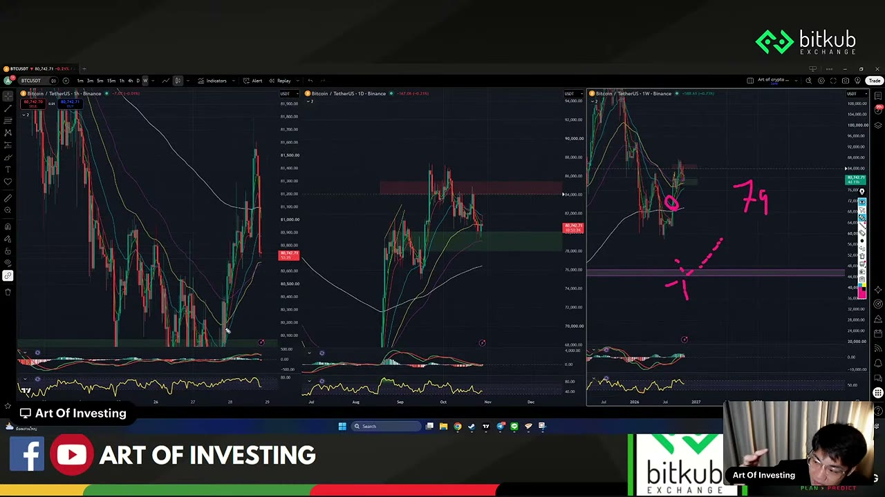

[00:59:19] โทษทุกคนด้วยนะ อ่ะดูกันที่ 30 ดิ 30 อ่ะจริงๆอ่ะมันจะดูเยอะไม่ค่อยได้นะ ครับเพราะว่าเวลาอเป็นซีรียส์หลักสิ้น เดือนอย่างเงี้ยนะครับเขาก็จะวางกันทุก บล็อกแหละคือ 25 แต่มันจะพอดูได้ประมาณ นึงคือแบบนี้นะครับก็คือตอนแรกเนี่ยตอน เนี้ยเรายังมองกันอยู่ว่า 4050 เนี่ยผ่าน ยากนะครับซึ่งราคา 4050 เนี่ยในทองคำมัน อ่ะตอนนี้ก็ทะลุมาแล้วเพราะมันต้อง -12 มันก็คือประมาณ 4,030 นะครับฉะนั้นตอนนี้ ถ้ามันทะลุมาได้แล้วเนี่ยนะครับแนวโน้ม ต่อไปเนี่ยก็คือจะสะดุดตั้งทั้ง 4,075 กับ 4,100 ถ้า -12 ก็คือประมาณบ้าน 4060 นะครับที่จะผ่านยากนะครับกับ 40  8 อ่ะ ประมาณนี้นะครับที่จะผ่านยากในวันศุกร์นะ ครับถ้าถ้าเกิดขึ้นมาถึงยังจะสสะดุดตรง

[01:00:19] นี้ก่อนแล้วโซนตรงเนี้ยที่มันเป็น 1  SD เนี่ยก็คือประมาณ 70% น่ะจะอยู่ประมาณนี้ นะครับตรงเนี้ยผ่านยากและแล้วก็ถ้าเกิด เรามาดูไส้ที่มันต่ำกว่านั้นหน่อยอ่ะมาดู พรุ่งนี้มองไงอ่ะเหมือนกันเลยนะครับ ฉะนั้นถ้าเกิดเป็นพรุ่งเนี้ยก็คือตรง เนี้ยยังมีreีอคtionสูงที่สุดอยู่นะครับ เนี่ยสูงที่สุดอยู่ก็คือแถว 4,100 ก็คือ ตรงเนี้ยreีแอคชัจะสูงที่สุดถ้าขึ้นมาถึง เนี่ยมีโอกาสย่ออย่างน้อย 12.5-25 ดอนนะครับถ้าถึงตรงนี้นะครับเพราะว่า เบasิตอนนี้ค่าความแตกต่างของราคามัน ประมาณ 12.5 เนาะแล้วก็จุดที่ทะลุลงไปได้ ยากก็คือตรงนี้นะครับก็คือประมาณ 3,988 อ่ะโดยประมาณอันเนี้ยก็คือทะลุลงไปยากะ โอกาสโอกาสทะลุตรงเมีแค่ประมาณ 32% ที่จะ ทะลุลงไป นะครับอันเนี้ยโอกาสเป็นแค่ 32% นะครับ ที่ทะลุลงไปแล้วก็ีอคชที่ใหญ่ที่สุดนะ ครับที่จะเกิดกับทองก็คือโซนนี้ 4088 นะ

[01:01:19] ครับแล้วก็อีกโซนนึงก็คือ ผมมองว่า 4150 ยังผ่านยากอ่ะอืผมมองว่า ผ่านยากอ่ะอ่ะผมมองว่าประมาณ 4,0 อ่ะ 12 อ่ะก็คือประมาณตรงนี้นะครับอืผมมองว่า 4,150 ยังผ่านยากนะครับอ่ะฉะนั้นทองดู โซนนี้ก่อนก็คือประมาณ 3,988 กับ 4,088 เนี่ยยังผ่านได้ยากอยู่นะครับก็คืออ่ะถ้า เราดูทองเนาะซึ่งมันจะไปตรงกับ EMA พอดี อ่ะเดี๋ยวดู EMA ทองเห็นมั้ยตรงนี้เกิด อะไรขึ้นนะครับเป็นโมเมนตัมนะก็คือตรงนี้ เห็นป่ะเนี่ยมันยังไม่สามารถผ่านเส้น พรีเมี่มได้เลยเห็นป่ะแล้วถ้าผมเอาเมาส์ ไปวางพอดีเลยเห็นป่ะ 4,140 ก็คือมัน จะต้องเบรคโซนที่ผ่านได้ยากไปก่อนซึ่งโซน ที่ผ่านได้ยากเนี่ย 4088 เนี่ยก็คืออยู่ ตรงนี้ที่มันเป็น flip zซoneอ่ะตรงนี้พอ ดีฉะนั้นถ้าเบรคได้ก็คือไอ้ 4150 ตรงนั้น น่ะนะครับมันก็จะอยู่ใกล้ๆมันจะเลยแฉลบap ไปนิดนึงนะใกล้ๆก็คือ 4140 ก็คือ EMA  25

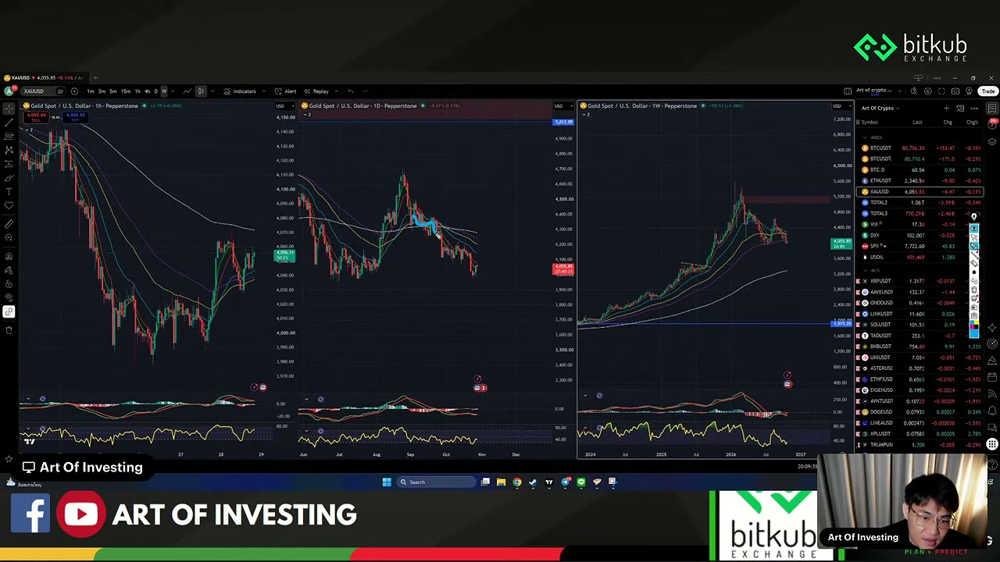

[01:02:20] พอดีฉะนั้นตอนเครับมันคือการขึ้นเพื่อไป เทสแนวต้านนะครับแล้วจุดที่ทะลุลงมาได้ ยากแล้วนะก็คือประมาณ 3,900 อ่ะพอดีเป๊ะ เลยก็คือประมาณเนี้ยแถวนี้ 3,988 ก็คือ ประมาณเนี้ยโลตรงเนี้ย ผ่านได้ยากและนะครับฉะนั้นถ้าเกิดตอนนี้ เนาะมันติดอยู่ตรงนี้ก็คือตรงนี้เลยพอดี เลย 66  406 นะครับโดยประมาณงั้นถ้าทะลุ ตรงนี้ได้อ่ะมีโอกาสจะขึ้นมาเทสตรงนี้นะ ครับที่ 4088 ก็คือก้อนนี้ ส่วนถ้าเกิดทะลุลงมานะครับแนวรับที่ไม่ ควรหลุดแล้วเนี่ยก็คือตรงประมาณตรงนี้เลย 3988 นะครับที่จะเป็นจุดเด้งได้นะครับ งั้นตรงเนี้ยก็จะมีreีคtionตรงนี้นะครับ 4066  4060 นะครับแล้วก็ถ้าทะลุได้ขึ้น มาถึง 4080 นะครับแล้วก็แนว resistance หรือแนวต้านที่ใหญ่ก็อยู่ตรงนี้เนี่ย ประมาณนะครับอยู่ประมาณนี้มันใกล้ๆกับเสา 4125 นะครับเสา 4125 ใน อ่า OI วันพรุ่งนี้นะครับเพราะว่าราคาจาก

[01:03:21] เนี้ยเสายังไม่เยอะคือเขาไม่ค่อยเล่นกัน นะครับอ่ะเฮ้ยวันนี้ผมขอโทษจริงๆนะผมต้อง ไปงานแต่งแล้วเดี๋ยวไว้ประมาณนี้อาจจะไม่ ได้ดู Outcoin ให้นะครับแต่ว่าวันนี้ยิง ขออภัยด้วยนะครับอาจอาจจะไม่ได้ดู out คอยให้นะอย่าอย่าโกรธกันนะเดี๋ยวเดี๋ยว วันหลังมาดูชดเชอให้นะครับ ผมใช้ Lead  the  Market  RTM ใช่มั้ย น้องออมสินมาตลอดพอรู้จัก OI จากช่องจาน M มันทำให้ผมเลือกโซนแต่ละโซนนั้นได้อย่าง มีประสิทธิภาพ ใช่ๆครับคุณออมสินถูกต้องใช่พอพอพอรู้ แล้วมันมันเป็นเรื่องที่ดีแต่ทีเนี้ยผมจะ บอกแบบนี้นะว่าให้ระวังการเทรดสั้นผมจะลด การเทรดสั้นแบบ 1 นาที 5 นาทีผมตัดทิ้ง แล้วตอนเนี้ยผมผมจะไม่เทรดแล้วเพราะว่า เทคโนโลยีอ่ะมันจะเริ่มถึงรายย่อยมากขึ้น เราเริ่มเห็นมั้ว่าตอนเเราเริ่มมีการอ่าน order  flow มีเสียเงินไปอ่าน big  trade เริ่มมาแล้วใน TikTok อ่ะถ้าใครดูอ่ะเอ่อ ใน deep  chart ของ Fabio อ่ะที่มันเป็น การอ่าน order  Flow ดูว่าตรงนี้ออเดอร์

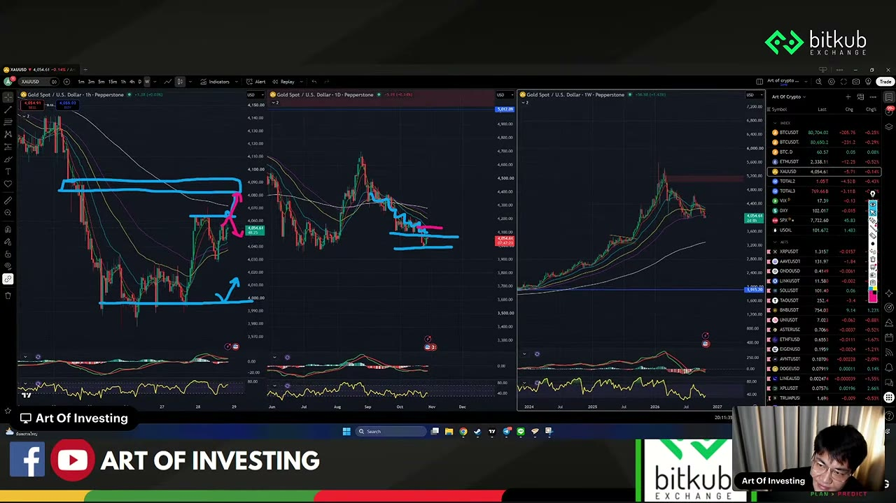

[01:04:23] เพิ่มมาเท่าไหร่ delta เป็นลบหรือ delta เป็นบวกอ่ะแล้วมันจะเป็นจุด bubble อ่ะ ที่เขาเรียกว่า absorption  passive buyer  aggressive aggressive  buyer อย่างเงี้ยพอพอมันมี จุดตรงนั้นแล้วอ่ะสิ่งที่เกิดขึ้นคือเรา อย่าลืมนะว่ากองทุนน่ะเขาไม่ได้ซื้อขาย ออเดอร์กันผ่านตลาดแบบ pending  order เา มีเครื่องมือที่ชื่อว่า High  Frequency Trading พวกเนี้ยต้นทุนเป็น 100m  200 MON นะครับก็คือ 100  200 ล้านดอนที่เขา ทำศูนย์อยู่ในซิลิคอนลยกันมีเครื่องมือ ดึงพวกนี้เ้าเกินค่าสเปรดค่าพรีเมี่มเทำ เร็วมากฉะนั้นคุณจะเจอออเดอร์หลอกมากขึ้น คุณจะเจอการวางแล้วยกออกมันทำได้หลาย อย่างนะครับฉะนั้นไอ้การเทรดสั้นแบบ 1 นาทีเนี่ยผมว่ามันจะยากขึ้นเรื่อยๆณวัน เนี้ยอาจจะยังพอมีอยู่แต่ผมมองว่าผ่านไป สักปี 2 ปีเนี่ยในการเทรด 1-3 นาทีเนี่ย มันจะน้อยลงไปมากขึ้นเรื่อยๆนะครับผมก็ เลยอ่ะเริ่มมาเทรดปรับ range ให้มันกว้าง ขึ้นเพราะผมเริ่มรู้แล้วว่าเฮ้ยเราสู้กับ

[01:05:23] เครื่องมือกองทุนไม่ไหวกับเครื่องมือคน ทั่วไปเนี่ยมันมันจะใกล้เคียงกันมากขึ้น ระดับนึงอ่ะเราไม่มีทางเข้าเ้าได้แต่พอ มันใกล้เคียงมากขึ้นนะครับความได้เปรียบ มันน้อยลงมันเหมือนกับว่าตอนก่อนไม่ใช่ ทุกคนที่เข้าถึงอินเทอร์เน็ตได้ อินเทอร์เน็ตความเร็วสูง 1  MB เป็นแค่ ของคนรวยอ่ะอายุแรกที่มีอินเทอร์เน็ตอ่ะ ผมยังใช้อินเทอร์เน็ตแบบ CS  Lino อ่ะที่ เสียบ 56  KB อีดอูดอาดอีดอูดอัดคุณคุณ นึกออกป่ะมันยังเป็นแบบนั้นอยู่นะฉะนั้น เนี่ยยุคเนี้ยมันเหมือนแบบอินเทอร์เน็ต เร็วอ่ะใครๆก็มีแล้วอ่ะมันก็ความได้ เปรียบที่คุณมีเน็ตกับคนอื่นมีเน็ตก็จะ ต่างลง AI เหมือนกันตอนเนี้ยคนจะรู้สึก ว่าโอ้โหใครใช้ AI เป็นชนะใครใช้ OI เออ ใครใช้ AI ไม่เป็นคุณแท้เดี๋ยวแป๊บเดียว ครับมันจะลดลดส่วนgปช่วงต่างมากขึ้น เรื่อยๆทุกคนจะใช้ AI เหมือนกันหมดแล้ว เวลานั้นน่ะมันจะค่อยไปวัดว่าใครใช้ AI ฉลาดกว่ากันตอนเนี้ยมันยังแยกได้อยู่ใช้ AI เป็นทำเงินได้ใช้ AI ไม่เป็นทำเงิน ไม่ได้เดี๋ยวมันจะชิดกันมากขึ้นแล้วคุณ

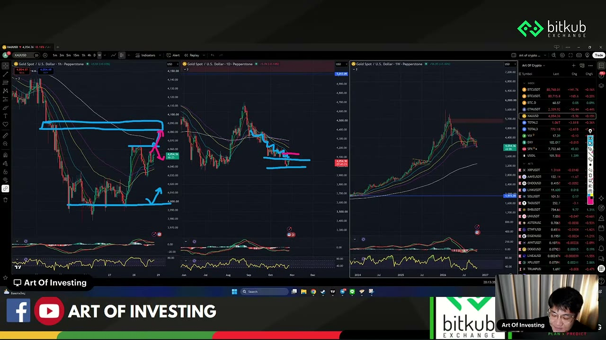

[01:06:26] ไม่ต้องกลัวหรอกยังไงคุณก็ทันเหมือนกับ ตอนคนแต่ก่อนน่ะผมเชื่อว่าทุกคนไม่ได้มี เงินตั้งแต่เกิดในเนี้ยมันต้องมีคนที่แบบ ช่วงแรกที่มีอินเทอร์เน็ตเรายังไม่มีถูก ป่ะผมก็หนึ่งในนั้นที่แบบผมอาจจะไม่ได้ รวยระดับท็อปที่แบบผมสามารถซื้อเน็ตความ เร็ว 1  MB ได้อ่ะตอนนั้นน่ะผมยังใช้ เครื่องแกต่อ CS  Loock  info เน็ตแบบขูด บัตรเติมอยู่เลยงั้นเดี๋ยววันนึงคุณจะแช ทันคุณดูดิเน็ตความเร็วสูงเดี๋ยวเนี้ย เดือนละ 500 เองนะครับเดี๋ยวมันจะใกล้ ขึ้นเรื่อยๆคุณตามทันแน่นะครับอ่ะเฮ้ยวัน นี้ขออภัยเดี๋ยวผมต้องไปงานแต่งแล้วไม่ รู้จะทันมั้ด้วยนะครับขออภัยนะวันนี้ได้ ดูแค่บitคinกับทองนะเดี๋ยวๆคราวหน้ามาดู ตัวอื่นแล้วก็ out คอยให้ด้วยนะครับวัน นี้ขออภัยจริงๆพอดีติดงานแต่ว่าถ้าถามว่า แล้วทำไมไม่ไลฟ์พรุ่งนี้แทนเพราะว่าคืน นี้ 1:00 น.มันจะมีโฟม C ไงผมอยากมา อัปเดตตลาดไว้ให้ก่อนเดี๋ยวไม่งั้นเพื่อน ๆจะวางแผนกันไม่ถูกฉะนั้นตอนเนี้ย 82,000 ไม่ค่อยมีนัยยะแล้วนะครับไปดู 78,000  8 79,000  85,000 นะครับวันนี้ขอบคุณทุกคน มากครับขอบคุณซอ์แชทจากคุณฮาร์ดวellจาก คุณอ๊อดด้วยขอโทษที่ไม่ได้อ่านคอมเมนต์ผม

[01:07:28] อ่านแต่ตอบไม่ทันวันนี้ผมรีบไปจริงๆ เดี๋ยวสัปดาห์ต่อๆไปเราคุยกันเต็มที่ เหมือนเดิมนะครับทุกคนหวัดดีครับ

