# 🔥 LIVE POI สำคัญ !! เข้าแผน DCA ?? BTC 🔥 | EricWeb3 ( 15 ต.ค. 2569)

- ช่อง: EricWeb3
- ลิงก์: https://www.youtube.com/watch?v=Rt1uBXmPthk
- วันที่: 2026-10-16
- ความยาว: 58:45
- ที่มา: คำบรรยายอัตโนมัติ (auto-generated) ภาษาไทยของ YouTube — อาจมีคำสะกดผิด/คำผิดเสียง
- ภาพ: 44 ภาพจากวิดีโอช่วงที่เปิดกราฟแท่งเทียน (เลือกอัตโนมัติจากสีแท่งเทียน · ตัดภาพซ้ำ) อยู่ในโฟลเดอร์ frames/

---

[00:01:06] May  time  is  slowing  down. May  hope  is  still  around. Every  m  grows through  the nothing  more  to  justify every  dream  that  slips find  another  place  to  stay

[00:02:18] time  is  slow may  hope  is  still  around every  m  grows  light  floating softly  through  the nothing  more  to  justify every  dream  that  slips  away find  another  place  to เฮ

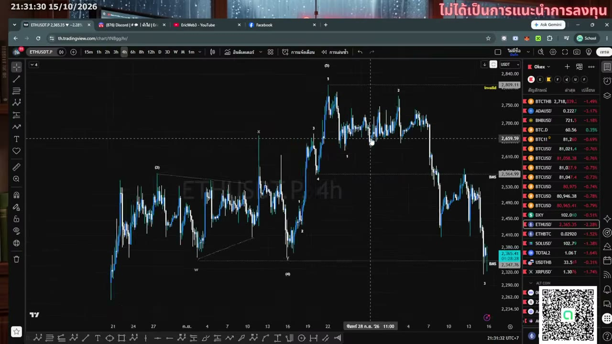

[00:04:03] โอเคสวัสดีครับทุกคนสวัสดีครับสวัสดี เพื่อนๆทุกคนครับใครเข้ามาแล้วคอมเมนต์ ได้นะครับ อ่าอาทิตย์นี้ห่างหายไลฟ์ไปค่อนข้างนานนะ ครับเดือนนี้นะเดี๋ยวมาอัปเดตให้ฟังกันนะ ครับว่าเออหายไปทำอะไรบ้าง แต่ที่แน่ๆคือเป็นไข้นะครับ สวัสดีทุกคนนะครับ ก็มาในช่วงสำคัญพอดีนะช่วงราคานะครับ สำหรับอ่าอ่า Bitcoin นะครับวันนี้เรา เอ่อมาพูดคุยสรุปเทรด setup หน่อยแต่ว่า เป็นเทรด setup ที่เป็นมุมมองที่ค่อนข้าง ใหญ่นะครับแล้วก็เกี่ยวกับเรื่องของอ่า มุมมองของการที่ใครที่รอ DCA สปotใช่มั้ย นะครับนะเพราะงั้นคิดว่าในโซนเนี้ยนะใน โซนเอ่อบitcoinที่เอ่อปัจจุบันเนี่ยนะ ครับ 81,000 เนี่ยค่อนข้างที่จะเป็น POI ที่น่าสนใจนะเป็นจุดเริ่มต้นแล้วนะครับ

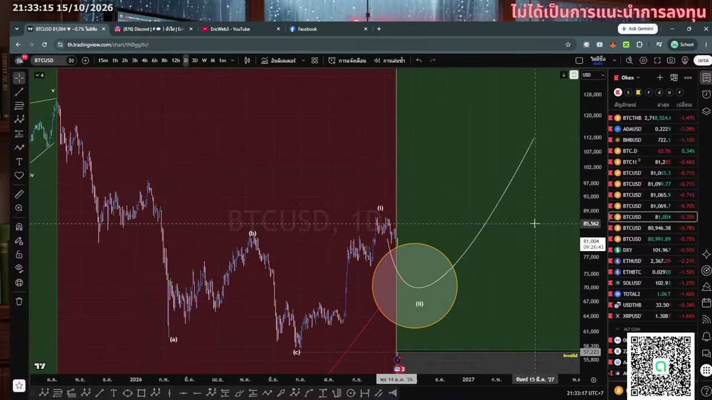

[00:05:04] ที่จะต้องเฝ้าเข้ามองนะครับในสัปดาห์นี้ นะครับหรือว่าในช่วงเอ่อ เดือนนี้นะครับนะ อ่ะใครเข้ามาแล้วก็ทักข้อความได้นะภาพ เสียงชัดเจนนะครับเราจะได้ไปอัปเดตเรup กันต่อเลยนะครับ สวัสดีหน้าเพจด้วยนะครับสวัสดีนะครับ อวันนี้แบบสั้นๆง่ายๆเลยนะสั้นๆง่ายๆเลย นะครับสำหรับบitcoinนะครับเราไปดูชุด ปัจจุบันกันนิดนึงนะครับนั่นก็คือการที่ เอ่อราคาเนี่ยมีการติดเทรนไลนเนาะนะครับ จากไลฟ์ครั้งที่แล้ว 84,300 นะครับนะถ้าราคาไม่ผ่านเนี่ยนะครับหรือ ว่ากลับไปยืนระดับ 85,000 ไม่ได้นะครับ เรายังคงมองว่าบitcoinเนี่ยอาจจะลงขาอีก

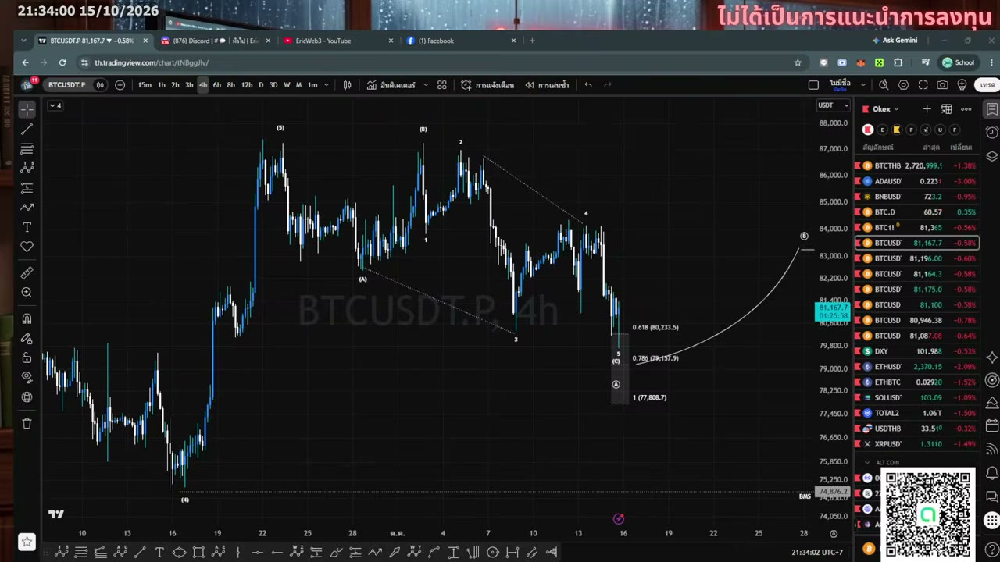

[00:06:06] รหัส 5 นะครับซึ่งมีสิทธิ์ที่จะปรับตัวลง มาย้ำโลนะครับโซน 80,000  100 นะครับหรือ ว่า 8,200 นั่นเองนะครับอ่ะเดี๋ยวย้อน เทรด setup กันนิดนึงเนาะ อ่ะนะครับเ set  up ในเอ่อครั้งที่แล้ว เนี่ยนะครับวันที่ 9 ตุลาคเนี่ยนะครับผม เล่นตามฝั่งขาลงเนาะแล้วก็ตามชุดนี้เนี่ย เป็นอ่ารหัส 5 นะนะครับตามเป็นรหัส 5 มา นะไม่ว่าจะมองเป็น B หรือว่าเป็นเอ่อ Trading  Impun ลงมาเนี่ยนะครับนะก็มอง ว่าโซน 84,300 หรือว่า 83,400 เนี่ยขึ้น ไปเนี่ยนะครับอาจจะเป็นการลงมาย้ำโลอีก รอบนึงใช่มั้นะครับทำให้เอ่อในคอมityเรา เนี่ยนะครับเรามองที่อ่าราคาเนี่ยน่าจะ ต้องมีการปรับตัวลงค่อนข้างหลายตัวเลยนะ ครับในการที่จะปรับตัวลงนะในสัปดาห์ที่ แล้วนะครับอ่ะก็ทำให้มี position ติดมา

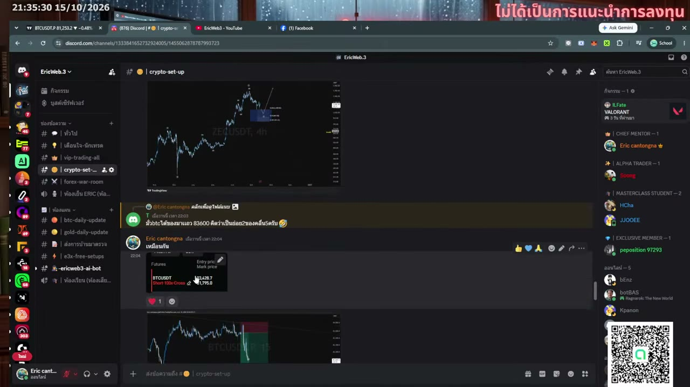

[00:07:10] เนาะที่ entry ซัก 83,400 นะครับนะสำหรับ การเล่น position ฝั่งช็อตใช่มนะครับพอ ช็อตลงมาแล้วเนี่ยก็เจอแท่งอ่า NF แดง รู่นลงมาเลยนะครับไม่ว่าจะเป็นช่วงเอ่อ เมื่อวานนะครับ CPI แล้วก็มาวันนี้ PPI ใช่มั้นะครับลากลงมานะครับแต่ส่วนตัว เนี่ยเมื่อคืนผมป่วยนะกินยาไปแล้วก็หลับ นะครับทำให้ขายหมูไปก่อนนะไปปิดอยู่แถวๆเ นะฮะ 81,500 นี่แหละนะครับขายหมูไปก่อนนะครับนะครับ วันนี้เปิดมาเนี่ยบitcoinก็ค่อนข้างที่จะ ร่วงค่อนข้างแรงนะครับทีเนี้ยชุดที่ตามลง มาเนี่ยนะครับมองว่ากลาง Fibo ไปแล้ว เนี่ยนะครับในขอบเขตของ Wave  5 เนี่ยน่า จะจบที่ซัก 8,200 หรือว่าใน Range ของ 80,000 แล้วก็ 79,150 นั่นเองนะครับนะอันนี้ก็จะเป็น setup ใน ชุดปัปัจจุบันนะตอนนี้ไม่ได้มีไม้ช็อต แล้วนะครับเพราะว่าขายหมูไปแล้วนะครับก็ ไม่เป็นไรนะครับอ่าสำหรับโครงสร้างกราฟ

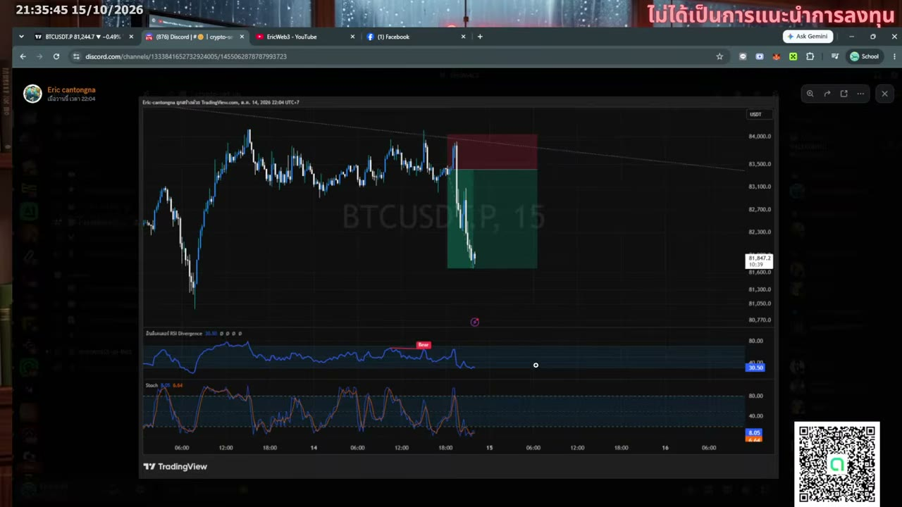

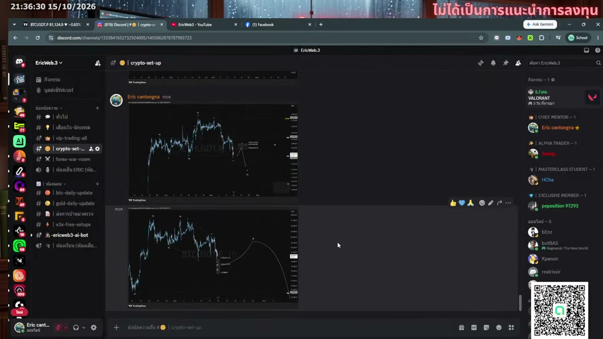

[00:08:10] ปัจจุบันเนี่ยนะครับอ่าวันนี้เพิ่งจบ PPI ไปนะครับก็อ่าพบว่าราคาเนี่ยมีการดึงลงมา เนาะนะครับดึงลงมาทะลุโซน 80,000 นะมาในระดับ 79,700 เลยนะครับสำหรับโลชุด ปัจจุบันนะนี่คือทำโลต่ำกว่าเดิมนะนะถ้า เพื่อนๆดูเนี่ยทำโลต่ำกว่าเดิมเรื่อยๆ แล้วนะครับสำหรับเอ่อบitcoinนะครับนะครับ เพราะงั้นเอ่อโซนชุดนี้เนี่ยก็เข้าข่าย ที่จะเป็นการบอกว่าชุดเทรนของคลื่นปรับ เนี่ยนะครับหรือว่าของฝั่งขาลงเนี่ยน่าจะ ใกล้เข้ามาทุกทีแล้วก็เป็นหัวข้อไลฟ์วัน นี้นะครับนั่นก็คือเอ่อ POI ค่อนข้างน่า สนใจนะ POI สำคัญนะครับสำหรับอ่าบitcoin ในชุดปัจจุบันนะครับทีนี้ชุดปัจจุบันตรง นี้เนี่ย อ่ามองว่าเป็นยังไงบ้างนะฮส่วนตัวเนี่ย เอ่อเอ่อผมยังมองว่าน่าจะลงเป็นขา A ก่อน นะครับนะชุดพักตัวขา A คืออะไรคือชุดนี้ เห็นมยคือลงมาเป็นชุดนี้ก่อนนะครับนะแล้ว

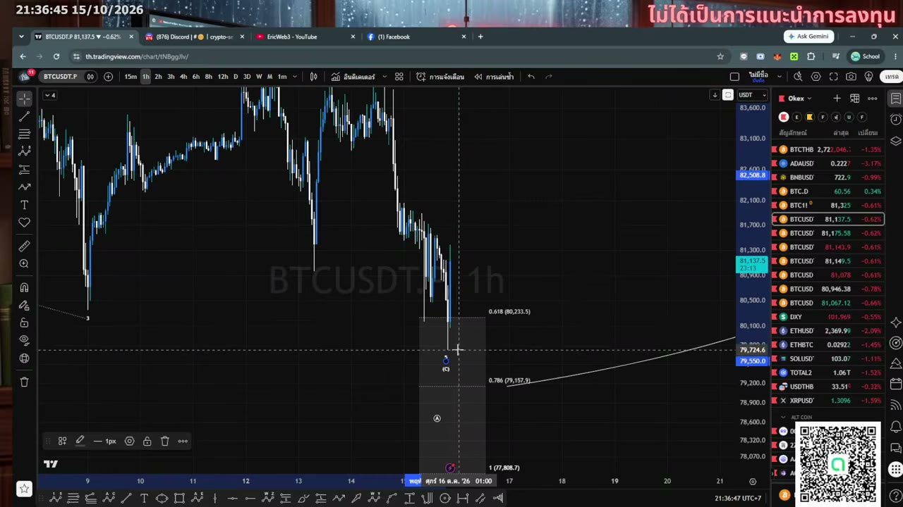

[00:09:12] ก็ชุดที่เป็นดาวเทรนด์ลงมาเนี่ยที่เรา เล่นช็อตกันมาในสัปดาห์หรือก่อนๆเนี่ยนะ ครับนะทำเป็นรหัส 5 นะตรงนี้อาจจะเป็น 1 ก็ได้นะเป็น 1  2  3  4  5 นะครับอ่าขอ ปรับนิดนึงนะอส่วนตัวเดี๋มองน่าจะเป็นชุด นี้มากกว่าเอา 1 ไปอยู่นี่ นะครับออกมาเป็นชุดนี้แล้วก็มี รีเจคขึ้นไปนะจบขา A นะครับอ่ะมองว่าจบขา A แถวๆนี้แหละนะครับ 8,200 จนถึง 200 นะในกรอบนี้นะครับอาจจะจบขา A ได้นะ ครับสำหรับชุดแรกที่เป็น collection สำหรับฝั่งขาลงนะครับนะครับทีนี้เดี๋ยวๆ เดี๋ค่อยพูดนะว่าคเลกชฝั่งขาลงในขนาดไหน นะครับเพื่อนๆไม่ต้องตกใจนะว่าเอ้ยจะมอง ลงทะลุไปแบบ 50,000 เลยมั้ยอันนี้ยังนะ

[00:10:13] ครับอย่าลืมว่าเราให้น้ำหนักของการ DCA แผน A เนี่ยก็คืออะไรครับนั่นก็คือการที่ อ่าเทรนด์ของบitcoinชุดนี้เนี่ยขึ้นเป็น เทรนด์เป็น motive แล้วจบใช่มั้นะครับพอ จบเสร็จแล้วจะต้องมีการย่อ Collective พักตัวนะทิศทางตะนข้ามกันนะครับแล้ว อยู่ก็ขึ้นไปนะครับอันนี้ก็จะเป็นโซน DCA ที่ที่เราเจอกันอยู่แล้วเนาะนะครับสำหรับ ก้อนบริเวณนี้นะครับอ่าใครที่ติดตามกันมา นะอ่ะย้อนไปนิดนึงนะครับอ่าเพราะฉะนั้น ชุดนี้เนี่ยถ้าบitcoinจบที่ขา A แล้ว เนี่ยเพื่อนๆจะเห็นว่าใน time frม 4 ตอน นี้เนี่ยราคาเนี่ยรีเจคแล้วก็มีแท่งดึง กลับไปนะครับมีแท่งดึงกลับไปก็อนุมานได้ ว่ามีสิทธิ์ที่จะจบขา A เนาะนะครับส่วน ขึ้นไปตรงนี้เนี่ยถามว่าอ่าสายฟิวเจอร์ เนี่ยเล่นเล่นฝั่งรีบาวได้มั้ยต้องบอกว่า ได้นะครับแต่ได้แบบต้องระมัดระวังนิดนึง นะครับในโซนนี้นะครับเพราะว่าถ้าเด้งไป แล้วเนี่ยเป็นขา A แล้วชุดนี้เป็นรหัส 5

[00:11:14] ก่อนหน้าเนี่ยนะครับก็ต้องบอกว่าอาจจะ เข้าสู่ชุดของขึ้นปรับนะของ B  of  ZZA นั่นเองนะครับเพราะฉะนั้นเอ่อจะให้ไม่ เกินเนี่ยนะครับนี้ผมให้สูงๆเลยนะให้ไม่ เกินเนี่ยนะครับ 84,300 ที่เดิมเลยนะฮะ อ่ะขึ้นไปแล้วโดนตบนะขึ้นไปแล้วโดนเทโดน เทลงมานะครับอันนี้ก็จะเป็นโซนสำคัญที่ ถ้าบitcoinขึ้นไปแล้วเนี่ยนะครับอาจจะ ขึ้นไปได้แค่สัก 82,500 นะครับหรือว่าสูง ๆเลยเนี่ยที่ Fibo  0.5  5 เนี่ยนะครับ อ่า 80,000 83,500 เนี่ยโดยประมาณเนี้ยอาจจะโดนตบลง มาอีกขานึงนะเห็นมั้อาจจะโดนตบลงมาอีกขา นึงนะครับสำหรับก้อนบริเวณนี้ อืถ้าเล่นเนี่ยถ้าเล่นถ้าเล่นรองสั้นๆ เนี่ยนะครับถามว่าเล่นได้มั้ยเล่นได้แต่ ต้องเข้าไวออกไวนิดนึงนะนะเข้าไวออกไวนิด นึงนะชุดนี้ผมจะเน้นเล่นสั้นๆพอนะครับแต่ โดยรวมเนี่ยถ้าใครเป็นนักเรียนผมเนี่ยผม จะไม่ให้เล่นนะไอ้ก้อนซับเวฟอย่างเงี้ยนะ

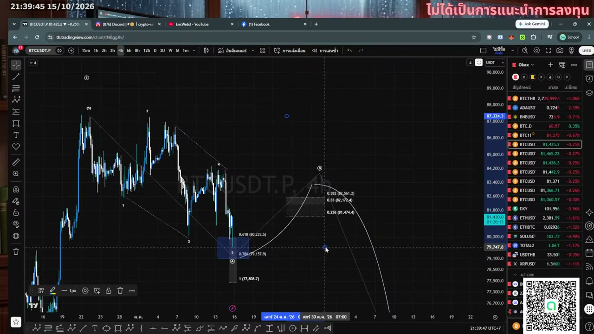

[00:12:16] ครับมีสิทธิ์ที่จะเด้งขึ้นไปนิดเดียวแล้ว ลงนะถ้าไม่ได้ถ้าไม่ได้ระวังหรือว่าไม่ ได้ก็ตั้งกันหน้าทุนโดนหมดนะนะครับชุดนี้ จะไม่เล่นนะเพราะว่าพอย์หลักๆเนี่ยถ้า เทรดฟิวเจอร์จริงๆเนี่ยผมจะไปรอเล่นอ่า key  level สำคัญคือโซนนี้นะนะครับคือ นั่นหน้าช็อตนั่นเองนะค่อยเด้งลงไปนะครับ ส่วนฝั่งเนี่ยอาจจะต้องรอให้ collection เนี่ยจบชุดไปเลยนะครับถึงจะได้เล่นนะครับ อันนี้ก็จะเป็น setup อ่าของปัจจุบันนี้ เนาะที่มองว่าถ้าราคาสามารถยืนได้เนาะนะ ครับต้องยืนได้มากกว่า 82,000 ขึ้นไปนะนะ ครับที่ อ่าก้อนนี้ นะยืนได้มากกว่า 82,000 ขึ้นไปนะคือก้อน นี้นะทำลายโครงสร้างของขาลงก่อนหน้าเนี่ย ชุดย่อยได้เนี่ยนะครับก็มองว่าอ่ามี สิทธิ์ที่จะปรับตัวเป็นคลื่นปรับเนาะอ่ะ คลื่นลงขึ้นไปทำซับ Wave นะครับนะแล้วก็ เตรียมที่จะลงต่อนะอันนี้ก็จะเป็นหน้าของ ฝั่งDayเทรดนะครับในสัปดาห์นี้นะครับ อ่าส่วนตามหัวข้อไลฟเนี่ยนะครับใน POI

[00:13:20] ที่สำคัญนั่นก็คือการที่ถ้าบitcoinไปถึง โซน Wave  B แล้วเนี่ยนะครับไม่ว่าจะออก เป็นในระดับไหนเนาะอาจจะอยู่ที่ 82,500 หรือว่า 83,400 เนี่ยนะครับไม่เกิน 85 เอ่อ 5,000 ขึ้นไปเนี่ยนะครับแล้วมีแท่ง เทลงมาแรงๆอีกครั้งนึงนะครับซึ่งครั้งนี้ อาจจะแรงก็ได้นะนะครับอาจจะแรงมากก็ได้นะ ครับปรับเทลงมาแรงๆอีกครั้งนึงเนี่ยต้อง บอกว่าโซนนี้นี่คือ POI ครับสำหรับใครที่ จะ DCA  Bitcoin หรือว่ามองว่า Bitcoin เนี่ยคงไม่ลงไปต่ำกว่าโลเดิมแล้วนะครับ นั่นก็คือโล 57,500 ใช่มครับนี่เป็นโซน POI ที่น่าสนใจแล้วนะ ครับถ้าถ้าดูประกอบจากเทรด setup นะครับ อ่าอ่ะย้อนกลับไปดูในภาพใหญ่นิดนึงครับ ภาพใหญ่เนี่ยเรามองว่าอ่าอ่าใครที่มองว่า Bitcoin จบรอบแล้วนะครับนะแล้วเตรียมที่ จะขึ้น cycle ใหม่เนี่ยนี่คือโซน A นะ ครับนี่คือกล่อง A ที่จะต้อง DC เป็น POI

[00:14:21] ที่น่าสนใจนะครับนะเพราะว่าถ้าราคามีกับ การปรับตัวย่อลงมานะครับไม่ว่าจะ 75,000 นะครับ 775,000 เนี่ยผมว่าน่าจะน่าจะต้อง เริ่มมีแรงซื้อแล้วนะ 775,000 ก้อนเนี้ย น่าจะต้องมีแรงซื้อแล้วนะครับแล้วก็หนักๆ เลยเนี่ยคือต่ำกว่า 75,000 นะครับมาโซน 60,000  70,000 นะ 65,000  70,000 นะ ก้อนเนี้ยก็น่าจะมีแรง Pull  back กลับ ขึ้นไปนะครับเพราะฉะนั้นตรงเนี้ยเป็นราคา ที่ค่อนข้างน่าสนใจอาจจะเป็นจุดเริ่มต้น ของการเกิดขึ้นปรับนะครับถ้าเรานับกันถูก นะคาดการณ์กันถูกนับกันถูกในไซเคิลนี้ อันนี้คือตั๋วที่ใครที่ตกรถมองว่าตกรถนี่ คือตั๋วแล้วนะนี่คือการตีตั๋วอีกครั้งนึง แล้วนะครับอ่าต้องบอกว่าเป็นการตีตั๋วอีก ครั้งนึงแล้วนะครับในสายสปอตนะนะครับส่วน ตัวผมเนี่ยอันนี้ผมไม่ได้แนะนำซื้อขายนะ แผ่นตัวนะครับส่วนตัวผมเนี่ยผมก็จะเริ่ม มองที่จะค่อยๆ DCA เหมือนกัน นะครับแต่ค่อยๆนะค่อยๆนะเดี๋ยวเราเว้นไว้ นิดนึงว่าค่อยๆเพราะอะไรนะครับเพราะนี่

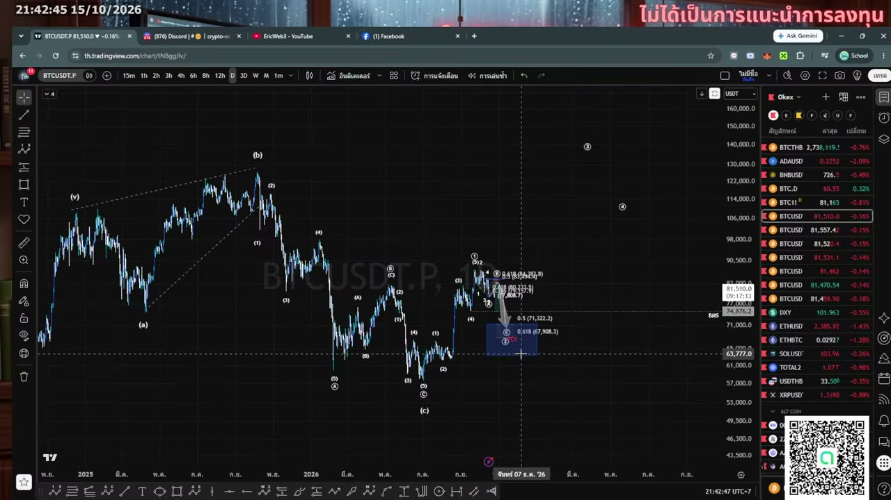

[00:15:23] คือแผน A กรอบ A ใช่มั้ยถ้าราคาปรับตัว ขึ้นแล้วนับถูกนะครับแต่ในทิศทางตรงกัน ข้ามหรือว่า setup ตรงกันข้ามกันเนี่ย อ่าก็ต้องบอกว่า setup ตรงกันข้ามกัน เนี่ยนะครับก็ต้องบอกว่า B  of  Zag ภาพ ใหญ่นะครับยังคงอยู่ยังคงไม่ถูกทำลายนะ ครับซึ่งเชื่อว่าในหลายๆท่านเนี่ยที่ที่ ดูโครงสร้างคลื่นได้เนี่ยนะครับก็เป็นจุด เริ่มต้นของการที่ต้องเฝ้าระวังเหมือนกัน นะครับอ่ะนี่จากเดิมที่ใน setup คู่ขนาน เมื่อกี้นะครับมองขึ้นเนาะนี่คือโซน A ใช่มอ่า POI ที่เราพูดกันเมื่อกี้โซน A นะครับที่จะ DCA แล้วหวังว่าขึ้นเนี่ยนะครับแต่ถ้า เกิดการผิดพลาดขึ้นมาแล้วโซนกรอบ LOW 60,000 หรือว่า 55,000 รับไม่อยู่นะครับ 57,000 รับไม่อยู่เนี่ย จะ invalid ทันทีนะครับนะต้องเข้าสู่

[00:16:25] setup นี้ทันทีนะเพราะงั้นเอ่อเงิน mm ก้อนเนี้เนี่ยผมก็ต้องบอกว่าต้องแบ่งให้ ดีนะครับถ้าลงมาโซนเอ่อโซน A แล้วจะ DCA เนี่ยต้องแบ่งให้ดีนะไม่ใช่ไป All inูom เดียวอันนี้ไม่ดีนะครับต้องดูทิศทางนี่ นิดนึงดูโครงสร้างราคาปรับก่อนนะนะจะไป ถั่วขึ้นอีกทีค่อยว่ากันนะครับแต่ถ้าคุณ ไปใส่ตูมเดียวตรงนี้เลยเนี่ย นะครับมีเงินทุนแล้วไปใส่ all  in ตูมนี้ ตูมนี้ตูมเดียวแล้วปรากฏว่าเป็น B ofซ ขึ้นมานี่คือแย่นะนะครับแต่ถามว่าแย่มาก มั้ไม่ได้แย่มากเลยนะครับถ้าในกรอบระยะ นี้แต่แต่มันสามารถไปสู้กันข้างล่างได้นะ ครับอาจจะโซนเอ่อต่ำกว่า 50,000  48,000 นะครับนะตรง 30,000 เนี่ยอาจจะยังไม่มอง มองนะนะครับซึ่งในหลายๆคนเนี่ยสาย เทคนิคalเนี่ยนะครับบางคนมองลงไปถึงขนาด นั้นแล้วนะครับอาจจะมองว่าเป็นจุดเริ่ม ต้นของขา B  of  Zigzag นั่นเองนะครับอัน นี้ก็ต้องบอกให้เพื่อนๆดูนิดนึงนะครับว่า ไอ้ POI หัวข้อวันนี้มันน่าสนใจยังไงนะ ครับนะอ่าในสายของสปอตเนี่ยเก็ต้องบอกว่า

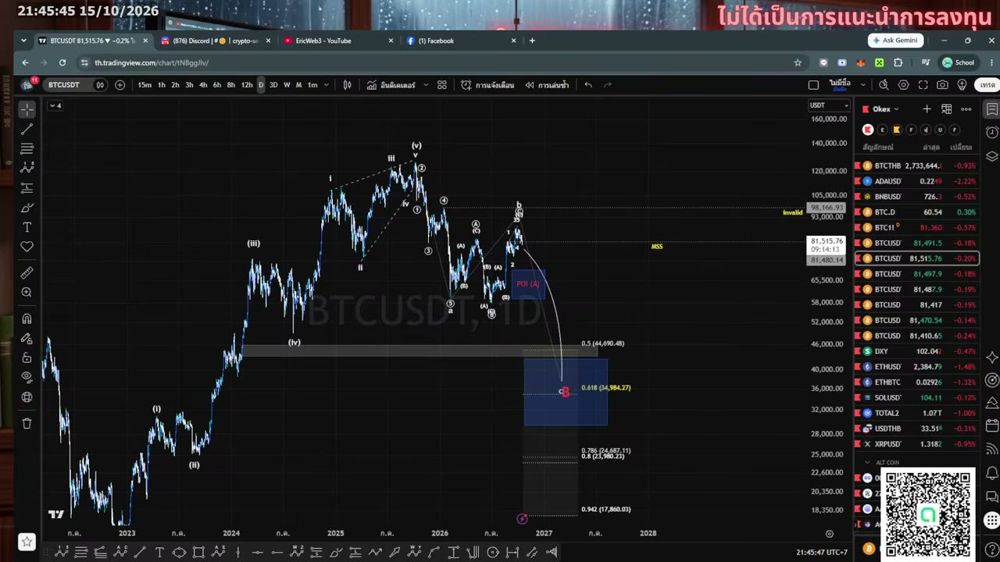

[00:17:27] ผมผมเตรียมไว้แล้วแหละนะเตรียมเตรียมแผน ไว้แล้วนะครับจากเงิน อ่อเงินทุนเนาะนะจากทุน นะครับเราต้องแบ่งแยกก่อนว่าในโซนนี้ เนี่ยเราจะในกรอบ A กรอบ B เนี่ยเราจะวาง ไว้กี่ไม้จาก 100% นะถ้าสมมุติ 100% เรา มีอยู่ซัก 10 ไม้เนี่ยนะครับก็ไม่ได้ยาก เลยก็แบ่งไว้อย่างอะไรครับอย่างละครึ่งนะ ใช่มั้ย 5 ไม้ 5 ไม้นะครับอันนี้ก็สุดแท้ แต่ว่าเพื่อนๆจะมองในแต่ละโซนว่า 5 ไม้ DCA เนี้ยจะไปอยู่ในทิศทางไหนนะครับนะ ถ้าราคาปรับตัวหลุด นะหลุดจากแผนเดิมที่ไม่ใช่ 1  2 แล้วขึ้น 3 แบบนี้นะครับต้องเตรียมลงมาตรงนี้อีก นะผมก็จะกดอีก 5 ไม้สำรองอ่ะนะครับกดอีก 5 ไม้สำรองที่ที่โซน B นะครับอแต่จะไปกว่า จะไปถึงขั้นนั้นเนี่ยเราคงคงมีสำรองเพิ่ม ขึ้นไปและนะครับก็กด 2 ไม้นะครับกด 2 โซน ให้มันราคามันถั่วเฉลี่ยเท่ากันนะครับ

[00:18:28] หรือตรงนี้อาจจะเบาหน่อยนึงนะครับและข้าง ล่างเนี่ยไปเบิ้ล 2 ก็ได้อันนี้ก็แล้วแต่ เพื่อนๆว่าจะวางแผนการถัวหรือว่า mm กัน ยังไงเนาะนะครับนะแต่แนะนำว่าไม่อยากให้ ไปเล่นโซนใดโซนนึงแบบตุ่มเดียวนะครับต่อ ให้เอ่อโซนนี้เนี่ยถ้าเข้าถ้าเข้า DCA ไป แล้วเนี่ยผลปรากฏว่าเป็นรอบใหม่ของไซเคิล จริงๆเนี่ยเราไปถั่วตอนขาขึ้นก็ยังทันนะ ถูกมยไปถั่วตอนขาขึ้นก็ยังทันนะครับเพราะ ฉะนั้นแบ่ง MM เงินทุนให้ดีนะครับแบ่ง แบ่งกันให้เ่อค่อนข้างครอบคลุมทั้ง 2 setup ในชุดใหญ่ดีกว่านะครับอ่าอันนี้ก็ จะเป็นมุมมองส่วนตัวนะเป็นมุมมองส่วนตัว นะครับใครคิดเห็นยังไงก็คอมเมนต์ได้นะ อือ่ะเราย้อนกลับไปที่ setup ฝั่งขาขึ้น ก่อนนะฮะเอาใจฝั่ง buish นะครับ อ่าชุดนี้เนี่ย ก็อาจจะยังไม่ได้ทำอะไรเนาะนะครับในส่วน ตัวผมเนี่ยปิดไม้ช็อตไปนะครับปิดไม้ช็อต ไปแล้วก็อาจจะไปรอเล่นซ้ำนะแต่ว่าอาจจะมี

[00:19:28] ออเดอร์ฝั่งอ่า position ฝั่งรองใน alcoin บางตัวเนpอย่างเงี้ยนิดๆหน่อยๆนะครับแต่ ยังไม่ได้ถือเยอะขนาดนั้นนะครับก็ค่อยๆ เล่นไปค่อยๆเทรดไปนะครับอันนี้ก็จะเป็น โมเมนตัมของ Bitcoin ในภาพของDayเทรดตอน นี้เนาะถือว่าเป็นจุดเริ่มต้นแล้วกันนะ ครับสำหรับคลื่นพักแล้วกันนะครับคลื่น ปรับของการพักตัวนั่นเองนะครับเราไปดู เรื่องของ Divergent กันนิดนึงนะครับใน Time  Frame  4 ตอนนี้น่าจะเป็นการsแล้ว นะครับก็น่าจะมีการปรับตัวขึ้นเนาะตาม นัยยะที่เรามองว่าน่าจะจบAเนาะนะครับ เตรียมที่จะเข้าสู่โซน 8,000  8,500 นะ ครับจนถึง 83,500 นะครับแล้วก็ไม่ควรที่ จะเกินเปเกิน 84,300 นะถ้าเกินเนี่ยเรา ต้องมานับกันใหม่นะนะฮะถ้าเตอถ้าเกิน เนี่ยต้องมานับกันใหม่นะครับอาจจะสำรอง ไว้ว่าเป็นอะไรครับเป็น ending  diagonal ก็ได้นะแต่ผมมองมันปิดผๆแปลกไปนิดนึงนะ ผิดแปลกไปนิดนึงแต่ก็ยังไม่เสียหายที่จะ มองชุดนี้เหมือนกันนะครับนะแต่ว่าต้อง

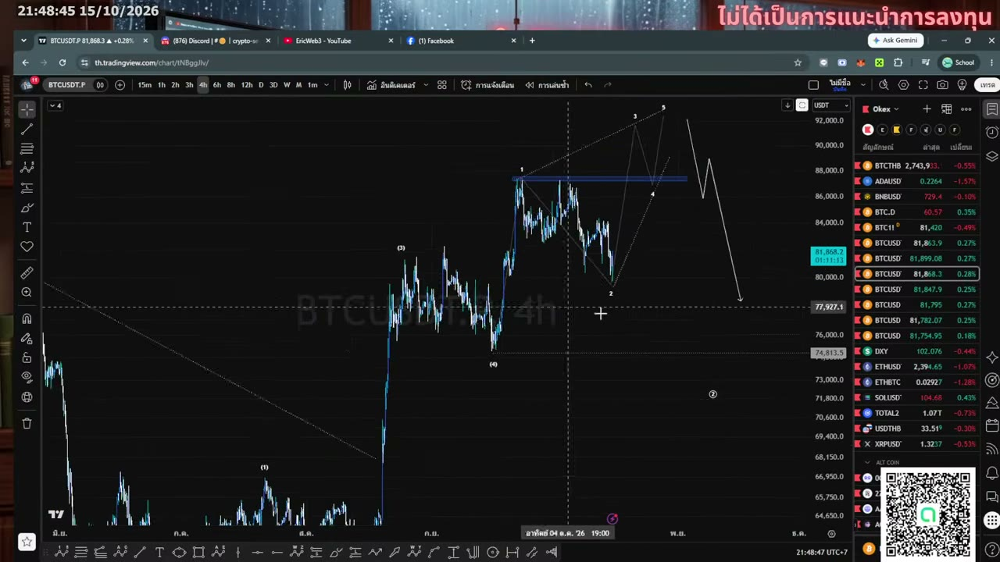

[00:20:29] เกินนู่นเลยนะต้องเกิน 84,300 ขึ้นไปนะ 84,3008,000 นะครับถึงจะมองอีกทีนึงนะ ครับสำหรับก้อนนี้ ยังคงอยู่ที่ Bitcoin นะครับยังไม่ไปไหน นะครับเราไปดูเรื่องของ EMA  50 กับ 200 ใน time ทำ Frame  Day กันนิดนึงนะเพื่อน ๆจะเห็นว่าเอ่อจุดที่รีเจคเนี่ยนะครับนะ อยู่ใกล้ๆกับ EMA  50 ใน Time  Frame  Day นะครับอยู่ใกล้ๆกับ EMA  50 ใน Time Frame แตะแล้วreจคขึ้นไปเลยนะครับในขณะ เดียวกันเนี่ยมี Fair  Value  GAP ใน time frame  day นะครับที่ 83,400 นะครับจนถึงเอ่อ 85,200 นะซึ่งมันก็ตรง กับที่ Fibo  0.5 เนาะ 84,300 นะครับหรือ ว่าครึ่งนึงของแรูปใน time  frame  day นั่นก็คือ 84,200 นั่นเองนะครับนะเพราะ งั้นถ้าใน setup ถัดไปเนี่ยถ้ามองว่ามี แรงซื้อก็จริงนะครับแต่ซื้อไปแล้วติดที่ 83,400 เนี่ยอาจจะมองลงต่อเนาะนะครับก็ เอาแผ่นเนี้ยเป็น main เคไปก่อนแล้วกันนะ ครับสำหรับก้อนนี้นะครับส่วน POI ชุดใหญ่

[00:21:31] เนี่ยนะครับนะอันนี้ผมยังไม่ได้วัดเป้านะ ว่าถ้ามองว่าเป็น C นะยังไม่รู้นะว่าเป็น B2 เรายังไม่รู้นะนะครับนะยังเป็นบอ 2 ยังไม่รู้นะแต่ตอนนี้ขอมองแค่ก้อนตรงนี้ ก่อนนะครับถ้ามองชุดนี้ในระดับลงไปอีกรอบ นึงเนี่ย ฮะก็ต้องบอกว่า 76,000 หรือว่า 73,500 เนี่ยนะครับกรอบแรกเนี่ย ก้อนตรงเนี้ยเห็นมั้ครับมีsupพortzซoneมี next  line อยู่นะครับในการที่จะราคา เนี่ยมีสิทธิ์ที่จะลงมาพักแล้วดึงกลับได้ นะครับเพราะงั้นก็ก็เป็น POI ที่ที่จะ ต้องค่อยๆเริ่ม DCA ในภาพใหญ่เหมือนกันนะ ใครที่วางแผนมาอย่างดีแล้วนะครับนะก้อน นี้ก็ต้องกัดฟันนะส่วนตัวเนี่ย 76,000 นะ 77,000  76,000 หรือแม้กระทั่ง 75,000 เนี่ยผมต้องกัดฟันพรีนะส่วนตัวผมนะกัดฟัน ที่จะพรีเพราะว่าผมผมค่อนข้างที่จะอยาก ให้เค้าลงลึกนะครับอยากให้เค้าไปแปะไป

[00:22:33] เป็นแผน Barish มากกว่า B  of  Zag มาก กว่านะครับนะก็เลยใช้คำว่าคำว่ากัดฟัน นั่นแหละนะครับกัดฟันที่จะต้องพลีไปนั่น เองนะครับ เออเนาะคือลงมาขนาดนี้แล้วก็ต้องเอานะ ครับนะลงมาขนาดนี้ก็ต้องเอานะประมาณนี้นะ ครับสวัสดีครับคุณพอสวัสดีครับ ส่วนส่วนเพื่อนๆจะคิดเห็นว่ายังไงก็แล้ว แต่นะแผนส่วนตัวนะ หรือว่ามีแผนจะแชร์กันก็พิมพ์ได้นะครับ พิมพ์คอมเมนต์กันได้เนาะ อ่ะก็เป็นแผนประมาณนี้นะครับสำหรับ บitcoinนะครับในในโซนที่คิดว่าเดี๋ยวน่า จะเด้งขึ้นไปสัก 82,500 เนาะ 83,400 แล้ว ก็น่าจะปรับตัวยอดลงนะครับถ้าถ้าเบรคเกิน 84,300 ไปเนี่ยเราอาจจะต้องหันไปมองมุม มองนี้แทนนะ Endingal นะขาดลงยังไม่จบ เอ่อขาดขึ้นยังไม่จบนั่นเองนะครับอ่ะ ประมาณนี้มีใครสอบถามเพิ่มเติมมั้ครับ

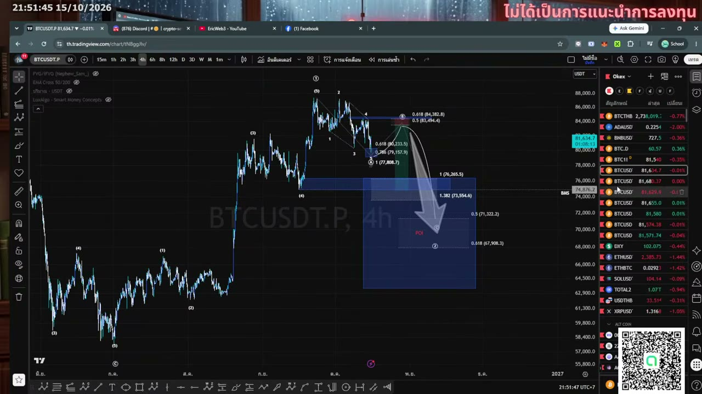

[00:23:39] อ่าแต่อันนี้ผมไม่ได้ไม่ได้ช็อตแล้วเพราะ ว่ามองว่า TP ไปแล้วนะครับปิด TP ไปง่าย กว่านะก็นี้คือปิดไปแล้วนะครับสำหรับ บitcoinนะปิดจบที่ 815 นะ 81500 นะพอละ จริงๆอยากรันมาปิดสัก 8,200 แต่ไม่ทันนะ ครับเพราะว่ากินยาไปแล้วหลับนะเมื่อวาน อ่าพอกินยาไปปุ๊บหลับเลยนะครับในtimeม frame  Dex อันนี้ก็จะเป็นเนี่ยปิดไป แล้วนะครับสำหรับ position ฝั่งช็อตนะฮะ ตอนนี้ก็เดี๋ยวถามว่าเล่นรองมั้ยไม่คงไม่ เล่นนะฮะคงไม่เล่นก้อนนี้ผมจะไปเล่นคีย์ ตรงนี้แทนนะฮะนะเดี๋ยวไล่ช็อตอีกทีนึงแถว ๆนี้และอันนี้ก็เป็นเรื่องของdayดรดเนาะ ฟิวเจอร์เนาะ นะครับเดี๋ยวเรามาดู Outcoin กันบ้างนะ ครับใครอยากดูไหนเพื่อนๆสามารถพิมพ์ คอมเมนต์กันได้เลยนะครับอ่าระบุด้วยนะว่า

[00:24:39] เป็น Sport หรือ Future นะ อ่าพิมพ์กันได้เลยนะครับ

[00:25:06] ใครที่เพิ่งเข้ามาแล้วก็ยังไม่ได้อยู่ community  el  web  3 นะครับก็ QR  Code ด้านล่างขวามือนะครับสามารถเข้ามาพูดคุย ทักทายกันได้เนาะนะครับ Su  Sport ได้ Dodge  Coin  Future อ่ะโอเคนะครับไปดู ที่ Dodge นะเดี๋ยวต่อด้วยซุยเลยนะครับ โอเคครับ Dodgecoin  Future ตอนนี้ในผม มองว่าลงเป็นเอ่อขา C นะอ่าเป็นขา C มาก กว่านะครับนะก้อนนี้แล้วก็ต้องบอกว่าอ่า ถ้าจะขึ้นต่อเนี่ยนะถ้าจะขึ้นต่อจริงๆ เนี่ยนะครับสำหรับ DCH เนี่ย ห้ามหลุดแล้วนะครับห้ามห้ามหลุดลงไปต่ำ กว่า 0.07 แล้วนะครับสำหรับ D นะครับใน โหมดของFutจureตอนนี้เนี่ยใน time frม 1 ชมงเนี่ยน่าจะมี bullish  divergent นะอ จริงๆผมมองว่าเป็น Divergent ไปแล้วนะ ครับอ่าเป้าหมายเนี่ยน่าจะขึ้นไปเทสที่

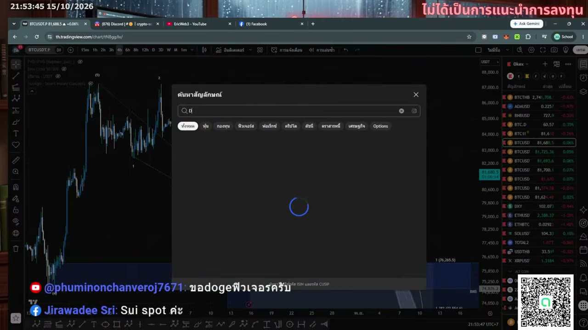

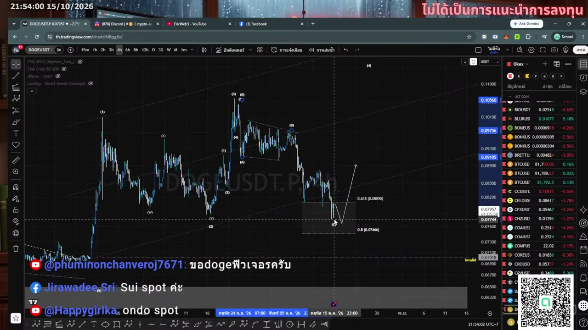

[00:26:06] 0.084  084 มากกว่านะนะครับเดี๋ยวรอการ เบรคด้านล่างนิดนึงเนาะอ่ะเบรกด้านล่าง นิดนึงนะครับเบรกก้อนนี้เบรกย่อรีทestนะ เล่นสั้นๆพอ นะเพราะว่าบitcoinเนี่ยขึ้นน่ะมันขึ้นได้ นะแต่ว่าระวังระวังมันขึ้นสั้นนะต้องรอ เบรคก่อนนะนะอาจจะไป TV แถวๆนึง อ่ะ Dodge  Coin  Future นะครับ เสียงเสียงอาจจะไม่ค่อยดีนะเพราะว่ายัง ไม่หาย ไปดูซุยครับก็เป็นอีกหนึ่งเหรียญที่ค่อน ข้างน่าสนใจ อ่าส่วนตัวผมก็สนใจนะสำหรับซุยนะครับอ่ะ ซุยเนี่ยทำไส้ลงมาเนี่ยหลุด 1 ดอลลาร์นะ ครับก็อย่างที่เคยบอกว่าเอ่อในภาพของซุย อ่ะเนี่ยคือถ้าจะมองว่าเบรค out เนี่ยนะ ครับตรงนี้ต้องมองว่าเป็นการรีทestนะครับ เพราะฉะนั้นนั้นซุยต่ำกว่า 1 ดอนเนี่ยผม มองว่าเป็นจุดที่อาจจะตัดสินใจที่จะกดลง

[00:27:09] ไปอีกนิดนึงนะกดลงไปอีกนิดนึงหมายความว่า อาจจะเข้าเพิ่มนะนะครับแต่เงื่อนไขต้อง เผื่อระวังเผื่อระวังว่าถ้าในอนาคตเนี่ย บitcoinออกมาเป็นoptซิจริงๆเนี่ยลาก outcoin เนี่ยนะครับอาจจะต้องมีการสู้จน ถึงโลowข้างล่างนะนะอย่าเพิ่งไปไว้ใจมาก นะครับอย่าเพิ่งไปไว้ใจมากนะครับก็ให้ดู ว่าในโครงโครงสร้างของซุยตอนนี้เนี่ย ยังไม่เกิด Golden  C เลยนะครับก็พยายาม จะยืนให้อยู่เห็นมั้ยนะครับพยายามจะยืน ให้อยู่ที่ EMA  200 นะถ้าปิดๆแถวๆนี้ได้ เนี่ยปิดแถวๆ 1 ดเนี่ยจะเกิด Golden Cross นะครับแต่ก็ไม่ใช่ว่าเกิด Golden Cross แล้วจะขึ้นนะครับมองว่าเป็นโซนที่ ต้องลุ้นว่าถ้าอยู่ในกรอบแถวซัก 0.9  0.86 อ่า 86 ได้เนี่ยและให้ accumulate ออก ด้านข้างเพื่อที่จะรอพุ่งขึ้นต่อเนี่ยอัน นี้จะดีกว่านะสำหรับซุยนะครับ ส่วนตัวผมมองว่าถ้าได้ต่ำกว่า 1 ดอนน่ะ นะผมจะยังไม่ทำอะไรอืจะยังไม่ทำอะไรสุยนะ

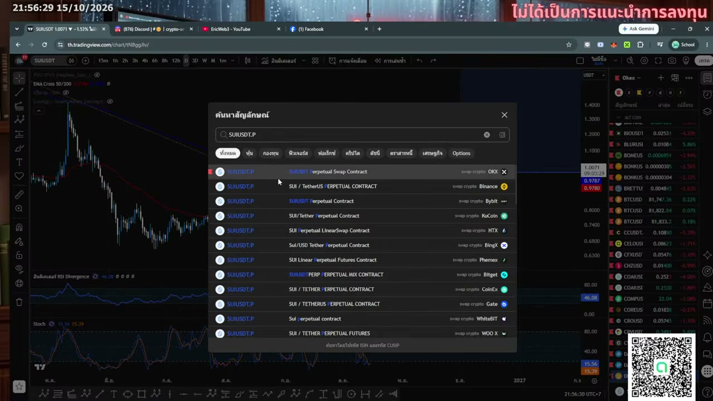

[00:28:12] ครับอาจจะอาจจะยังไม่ได้ทำอะไรเพราะว่า อ่ามันมีสิทธิ์ที่จะลงไปอีกนะลงไปอีก 0.84 84 อย่างเงี้ยนะตรงนี้อาจจะถ้าผมมั่นใจ ในซุยเนี่ยตรงเผมอาจจะเข้าไม้ 2 นะแล้วไป ต่อนะครับ โอเคเนาะเราเล่นแค่กรอบนี้นะครับเล่นแค่ กรอบนี้พอนะ 0.066  066 นะไม่ควรหลุดแล้ว นะซุยนะ อดครับ อoอันนี้ใครขอไว้เอ่ย อoยังเป็นยังมองเป็นการเบรครีทestอยู่ ครับยังมองเป็นการย่อรีทestนะตัวอื่นน่ะ ลงมาเยอะแต่อดน่ะลงไม่ค่อยเยอะนะ เอ่อวอลุ่มค่อนข้างดีนะครับผมมองว่าก็ เล่นตามเทรด setup ไปเนาะ นะครับอที่เอ่อ 0.04 นะ 0.04  444 นะแถวๆเนี้ยผมมองว่าเป็นการ เบรครีทestมากกว่านะตอนนี้บitคinก็เริ่ม

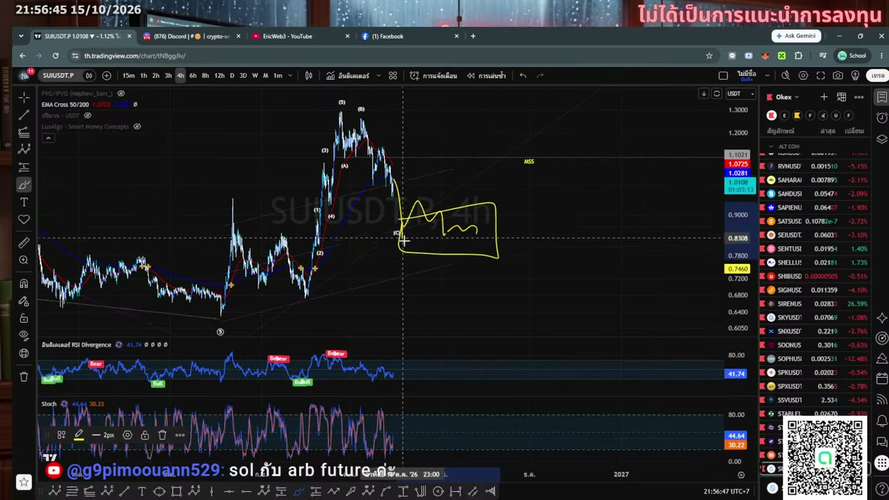

[00:29:13] เริ่มที่จะมาอีกแล้วนะฮะเออพอไลฟ์มาก็ ขึ้นเนาะอืก็น่าจะขึ้นขา B นะฮะประมาณนี้ นะอโดนะเล่นไปนิดนึงนะอดทนนิดนึง ผม SL มันชัดเจนอยู่แล้วอ่ะคือถ้าสู้ หน่อยก็คือตรงนี้นะ SL อก็คือนี่เลย 0.24 อ่าแต่ถ้าเบรคขึ้นตรงนี้สวยๆได้นี่จะ เวิร์คมากนะนะครับ futจureฮะคุณิกกี้ดูแข็งๆใช่ม เหรียญมัน คู่ขนานกับบitcoinพอสมควร ยูิรอบนี้เรามองว่าจบเวฟ 4 นะฮะ จบ 4 หรือ A วะเนี่ย เหมือนจะลงเป็นรหัส 5 มากกว่านะเนี่ยนะ ครับตรงนี้ทำ bullish  divergent แล้ว ครับเตรียมรีบาแล้วครับ

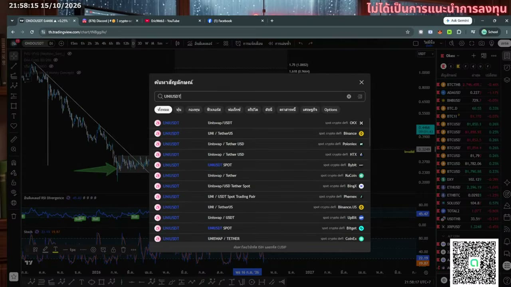

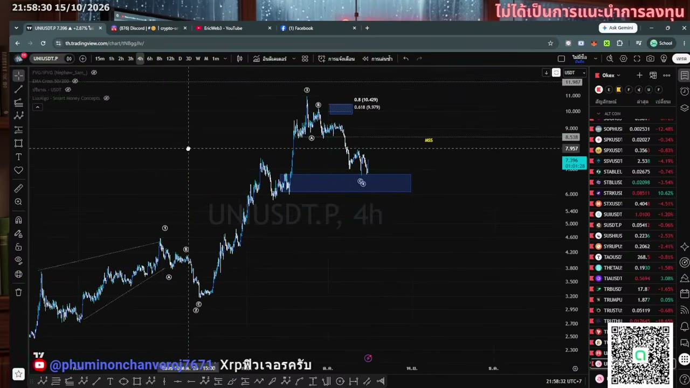

[00:30:16] นะครับเอาแบบเป้าแบบไม่น่าเกลียดแล้วกัน อื 8.6 นะฮะชุดแรก เอาแค่ 8.6 เลยฮะอยู่นี้เดี๋รอปิดแท่ง 4 ก่อนก็ได้ครับให้เกิด Fair  Value  Gap ใน time  frame  1-4 ชม.อ่ะ แต่ 1 ช่โมงเกิดแล้วมั้งเนี่ยอ๋อยังๆ เดี๋ยวเนี่ยๆๆจะจะปิดะจะปิดอีก 50 วินาที เนี่ยจะปิดละเดี๋ยวรอย่อรีเทสักแถวๆเนี้ย เกิดล่อตาม fa  value  gap นี้นะครับ อ่าอาจจะได้เล่นชุดนี้นะ สำหรับอยู่นี้ ผมได้อะไรมาเนี่ยผมได้เหรียญอะไรมาวะ อ๋อ XRP โอเคอ่าเพื่อนๆรอนิดนึงนะครับใจ เย็นนิดนึงนะเออนะครับแต่ถ้าใครอยากเข้า มาพูดคุยในคอมityหรือขอเทรดเupนะ QR  Code

[00:31:16] เลยด้านล่างขวามือเลยอยากตอนนี้คอมunity เราก็คึกๆนะครับตลาดจะหมีจะบูนี่คือื้น หมดนะฮะเข้ามาพูดคุยได้เนาะ เดี๋ยวขอดูยูิปิดแท่งปิดแท่ง Time  frame 1 ชม.ตรงนี้แป๊บนึงนะครับอีกสัก เกิดgปมั้ยอ่ะเกิดแล้วครับนี่เห็นมั้ย เกิดไฟ value gปแล้วเห็นมั้ย อ่ะดูซิว่าจะไปเลยหรือว่าจะย่อมาสักครึ่ง นึงนะฮะลองดูนะฮะ อ่าประมาณนี้นะครับใครที่เป็นนักเรียน เทรดผมก็น่าจะรู้เนาว่ารอการคเฟิร์มยังไง โอเคผ่านนะเอ่อ Open  Future ครับ Open เหรอไม่น่าเคยเห็นเลยครับ ไม่เคยเห็นเลยครับเหรียญนี้ โอ้โหเอาเหรียญอะไรมาให้ผมดูเนี่ย เหรียญอะไรครับเนี่ย

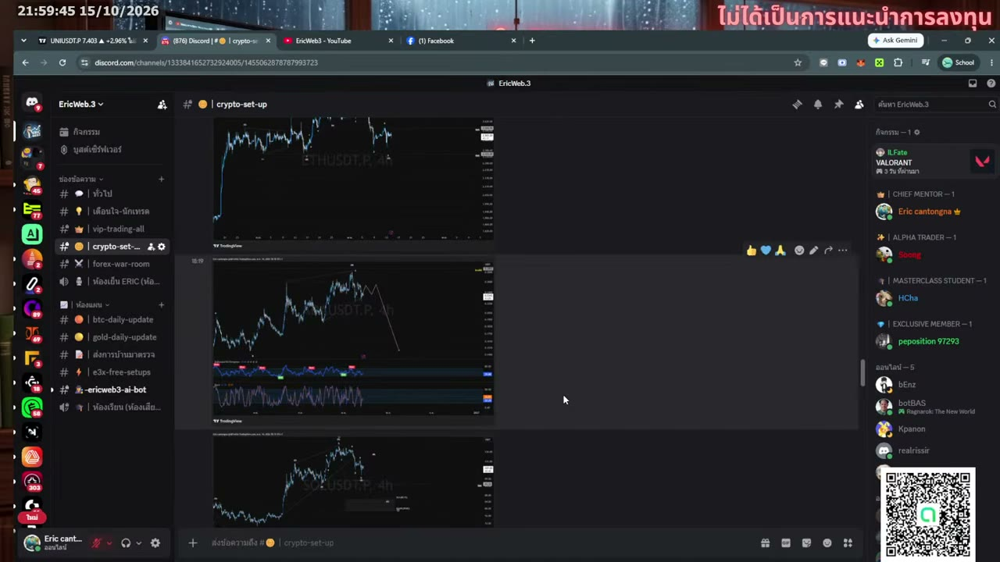

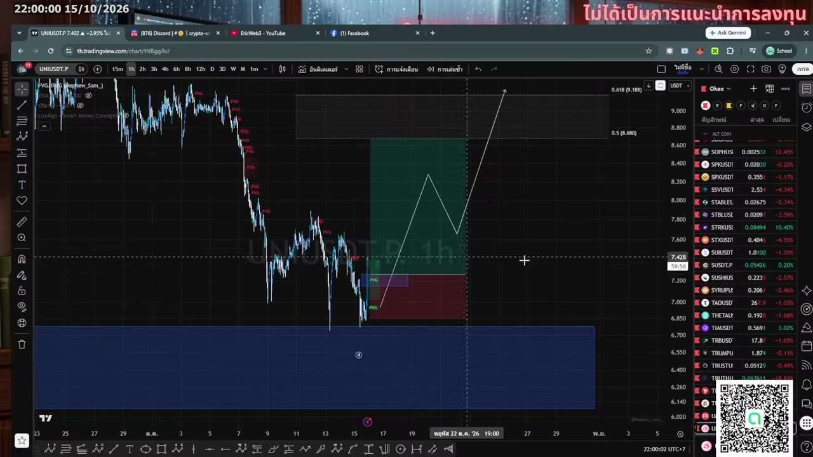

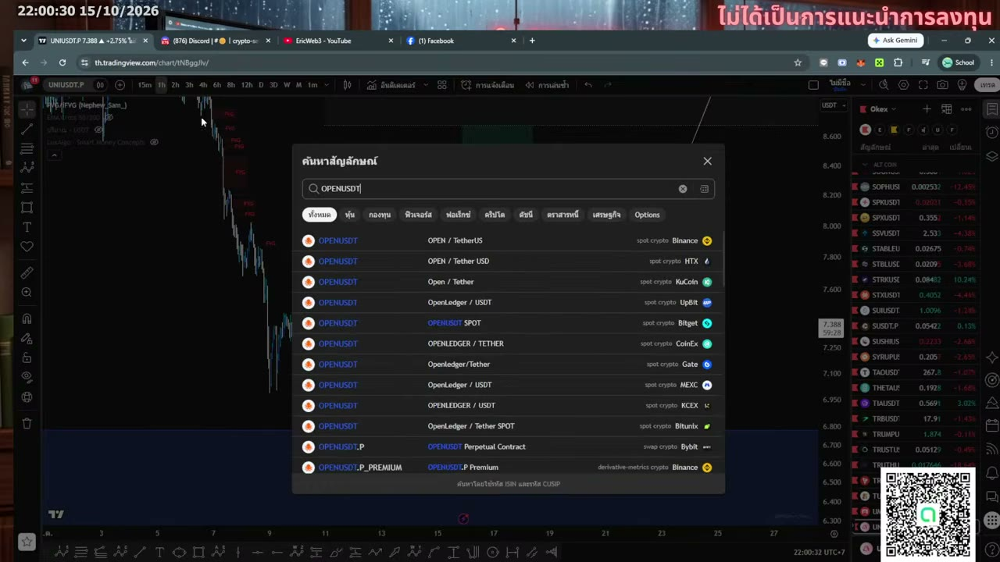

[00:32:19] ใครรู้ช่วยบอกหน่อยแต่ถ้าเห็นแบบนี้ไม่ เล่นนะฮะ ไม่ลอง ไม่ลองแล้วก็ไม่เล่นด้วย เออเหรียญที่มันเป็นเทรนๆแบบเนี้ยครับ อย่าอย่าไปเล่นสวนมันมากนะปล่อยไว้เปล่อย นะครับอย่าไปรับอย่าไปรับแบบคิดว่ามันจะ เด้งมันจะเด้งไม่เอานะมันจะเด้งลงเด้งลง เอานะเดี๋พวกเนี้ยเออนะครับหลีกเลี่ยงนะ หลีกเลี่ยงหน่อยนะ อืดูไม่ได้หรอกครับดูไปก็ลำบากใจเปล่า อย่างเงี้ไม่น่าเล่นนะครับ โกับ ARB ใช่ม โกับ ARB โซรู้สึกจะลงครบแล้วอ่ะครับครบรหัส 5 คล้ายๆกับ Bitcoin นะอ่ะเห็นมคมี divergent มยังไม่มีนะครับชุดนี้โซน เนี่ยผมผมมองว่าน่าจะจบขา A แล้วครับก็ คล้ายๆกับบitcoinนะครับเตรียมรีบาวound ขึ้นขา B นะครับซึ่ง B เนี่ยก็อาจจะกลับ

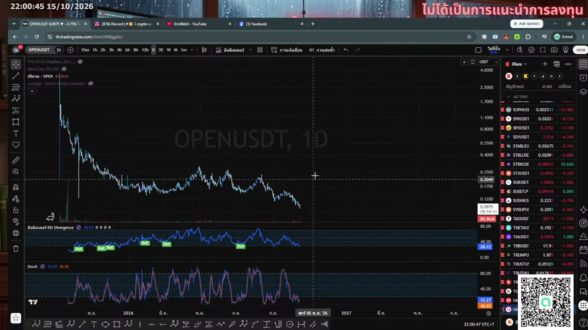

[00:33:23] ไปเทสที่โซน 115 นะโซน 115 นะครับอีกรอบ นึงนะครับแล้วก็อาจจะปรับตัวลงต่อนะครับ เอ่อถ้าเล่นฟิวเจอร์คิดว่าเพื่อนๆจะต้อง รอให้เบรคโครงสร้างนะใครที่ยังไม่เคย เรียนนะรอเบรคโครงสร้างใน time  frame ย่อยก่อนนะครับ Market  sucker  shift มี fair  value  gap ใน time  frame ใหญ่ นิดนึงนะครับเช็ค divergent เช็คคลื่นนิด นึงเนาะ เนี่ยอย่างเงี้ยนี่ยังไม่ได้เบรคเต็มๆนะ ครับแต่ถ้าจะเสี่ยงเล่นอย่างเงี้ยเนี่ยก็ ต้องทำไมต้อง Stop  Loss  Pest  Low ก่อน หน้าเนาะ นะครับ โอเคมยเนี่ยโทำเฟมชั่วโมงมาแล้วอ่ะทำเฟม ชั่วโมงก็ Fue  GAP หมดแล้วครับมีหมดะ เนี่ยฮะโซเห็นมลงมาทำรหัส 5

[00:34:29] อืเนี่ยลงมาทำรหัส 5 อีกขานึงเนาะ อันนี้ก็ให้ไปในห้อง เทรดไปแล้วนะครับเนี่ยลงมาทำรหัส 5 เห็น มั้ลงมา 4 ปรับลงมา 5 นี่เห็นมลงมา 5 เดี๋รอเด้งขึ้นขานึงนะครับเทest F  value gap แล้วนะครับส่วน ARB เอ่อ ARB รู้สึก ผมจะมองลงนะถ้าจำไม่ผิดนะรู้สึกจะมองลงนะ เพราะผมมองว่าจบชุดไปแล้วนะครับอ่าอาจจะ ทำขา B นะชุดนี้อาจจะทำซับเวฟนะครับให้ ระวังการขึ้นทำซับเวฟอีกรอบนึงนะครับแต่ อาจจะขึ้นสูงไปในระดับ 0.21  21 นะครับ ยังคงเป้าเดิมนะครับ ARB นะตัวนี้อาจจะ เป็น Subwave  A  B  C อย่างนี้เนาะ อาจจะขึ้นที่เดิมนะครับแล้วก็เตรียมที่จะ ลงต่อนะครับ Near  Future คุณ Smokey

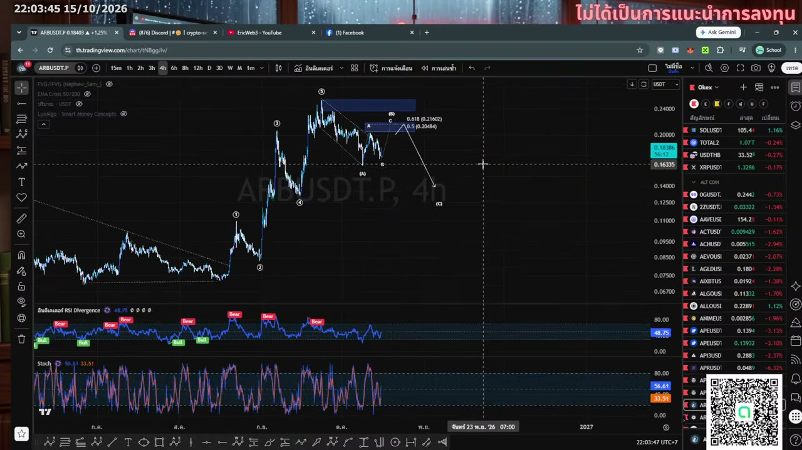

[00:35:35] โทนี่เนียเนี่ยตัวแข็งมากเลยอ่ะเนียเป็น ตัวที่แข็งนะยูิกับเนียเนี่ยผมมองว่าเป็น เหรียญที่ค่อนข้างแข็งนะครับเนี่ยนี่เห็น มั้เหมือนจะยังไม่จบนะฮะเหมือนจะเวฟ 5 ย่อยเนี่ยของเนียเนี่ยเหมือนจะอาจจะยัง ไม่จบนะอืม ยังไม่จบหรอครับเหมือนทำ hiden  bullish มากกว่าเตรียมขึ้นอีกขานึงฮะ ชุดนี้ไม่น่าเกลียดเลยครับเนี่ยไม่น่า เกลียดเลยครับ prวest low ก่อนหน้าฮะ หรือแท่งก่อนหน้าฮะ ว่าไปครับ เอาแค่ขึ้นมา 6 ดอน 6 ดอนได้เนี่ยโหก็ เวิร์คแล้ว ไปต่อฮะจัดไปฮะมันในเมื่อช็อตมันไม่ค่อย ลงก็อย่าไปสวนมันฮะ XRP ครับอ่ะโอเค มีประเด็นอยู่นะครับ XRP

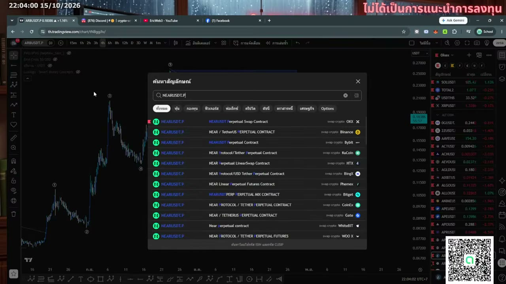

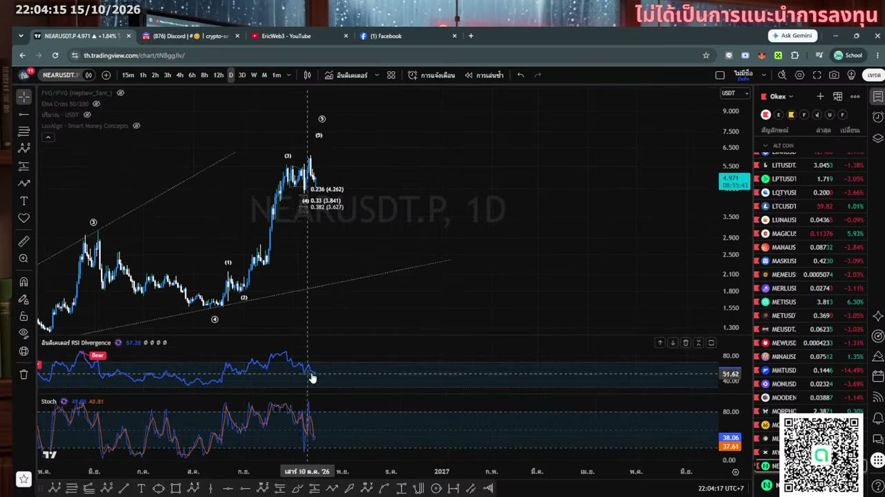

[00:36:38] ให้ระมัดระวังในการที่ถ้าหากว่า เอ่อผมมองว่า XRP เนี่ยยังมองรีบาวound อยู่นะเพราะว่า RR โซนไม่หลุด 1.24  24 เนี่ยค่อนข้างนี่จะน่าสนใจนะครับน่าสนใจ เหมือนกันนะครับสำหรับโซนนี้ซึ่งรู้สึก ของผมน่าจะเกี่ยวมาแล้วอืน่าจะเกี่ยวมา แล้วแหละตอนแรกเกี่ยวเลยไปแล้วนะ XRP อ่ะ นี่นะครับน่าจะเพิ่งเพิ่งได้มาสักพักอ่ะ อันนี้ก็ตั้งไว้เนาะอ้ามาแล้วบitcoin 82,200 นะครับก็ระวังดีๆนะครับถ้าถ้า ทะลุถ้าไปถึงได้ 83,400 นะตามตามไลฟ์ เมื่อกี้นะที่เราพูดกันถึงเมื่อกี้เนาะ ระวังเป็น B  of  Z ระวังดีๆนิดนึงนะครับ อ่า XP เนี่ยอืมถ้าราคาไม่สามารถเบรค Chanling กรอบเนี้ย Ring  Wight ได้ เนี่ยนะหรือ falling  wight เนี่ยนะครับ ชุดเนี้ยที่ซักอ่า 1.4  4 เนี่ยนะครับ ระวังระวังยังคงอยู่ในโครงสร้างของ

[00:37:38] ไดกonalเนาะนะครับติดเทรนไลนแล้วลงต่ออีก ขานึงนะตรงนี้เหมือนรหัสจะยังไม่ครบนะ ครับอาจจะเป็น 1  2  3  4 ตรงนี้นะ 5 อย่างเงี้ยแล้วไปลงมาย้ำอีกรอบนึงซึ่งตรง นี้เนี่ยถ้าไปถึงสัก 1.35 เนี่ยผมอาจจะ กันหน้าทุนแล้วนะครับอาจจะกันหน้าทุนเนาะ แล้วค่อยมาเล่นใหม่อีกทีที่ต่ำกว่าใน ระดับ 1.3  3 นะครับสำหรับ XRP นะครับ อ่าถ้าขึ้นไปได้เนี่ย XRP ต้องบอกว่ายัง อยู่ในขอบขายที่ที่เด้งค่อนข้างแรงนะผมผม พูดอย่างี้เลยนะครับเพราะว่า RSI ใน Time  Frame  Day เนี่ย XRP เป็น ตัวที่ลงมาค่อนข้างเร็วนะฮะ นะฮะลงมาค่อนข้างเร็วนะครับ Over ค่อนข้างเร็วนะครับเดี๋ยวน่าจะมี การพูนึงกลับนี้ store เตรียมงัดขึ้นแล้ว นะพี่นะครับก็ไม่ได้แนะนำการลงทุนนะนะ ครับเป็นแผนส่วนตัวเฉยๆนะทุกคน

[00:38:39] เราอยู่ไหนเนี่ยอryเราอยู่แถวๆนี้เนาะของ ผมน่าจะอยู่แถวๆเนี้ย อืเนี่ยแถวๆนี้อ่ะว่ากันไปนะครับเดี๋ไม่ สามารถเปลี่ยนสัก 1.36  36 ได้นี่ผมก็อาจ จะต้องการหน้าทุนละนะครับ น้ำมันกับทองครับทองโหเมื่อวานเนี่ยถล่ม ทลายเนาะ ไปดูหน่อยซิ ชึบอ่ะโอเคนะครับเราต้องเท้าความกันยาว นิดนึงนะทองเนี่ย ทองผมเล่นเซลล์กับเพื่อนๆมาเนาะในห้องนี้ เนาะกับน้ำมันนะครับอ่ะเซลล์เซลล์ตั้งแต่ ชุดนี้ดีกว่าอ่าตั้งแต่ชุดนี้นะครับมอง เด้งเซลล์นะ 4,190 นะโดยประมาณนะครับซึ่ง ซึ่งขึ้นไปค่อนข้างสูงนะครับแล้วก็ได้ลง มาเก็บข้างล่างรอบนึงนะที่ 4150 นะ 4150

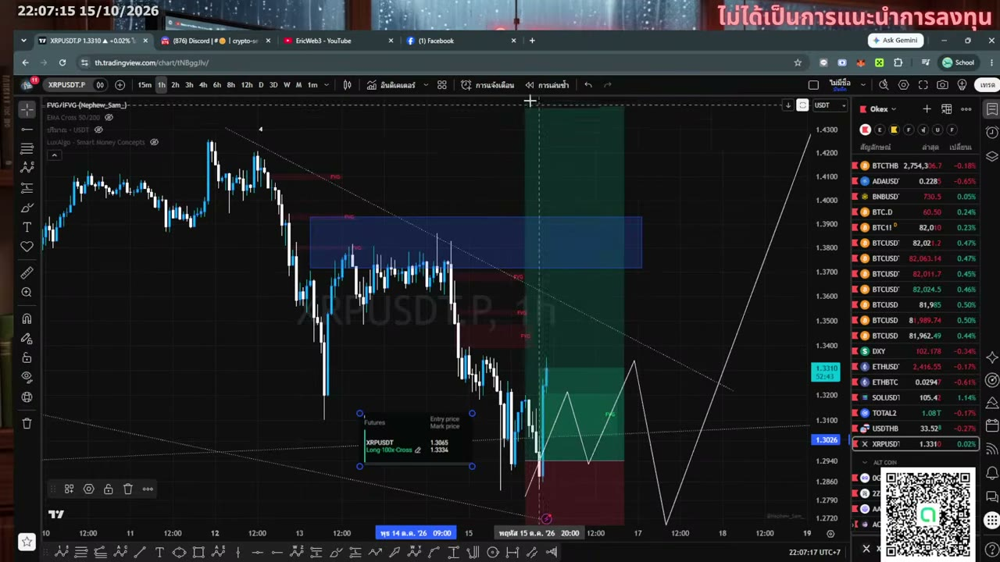

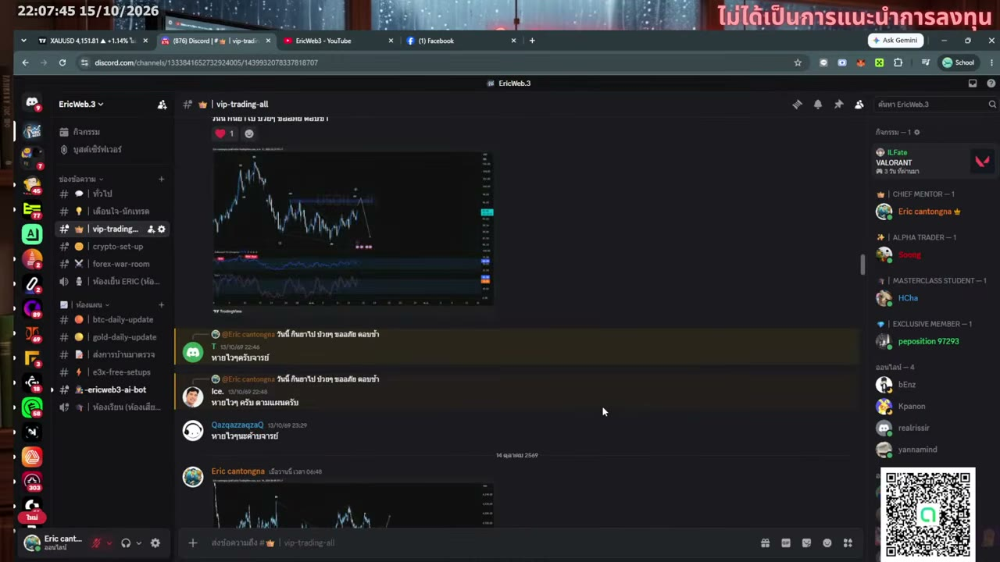

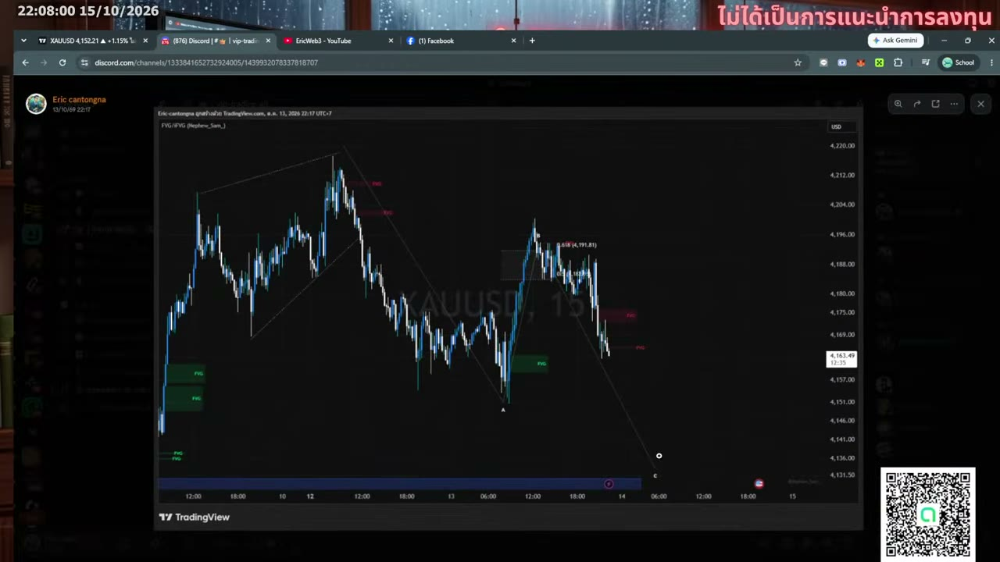

[00:39:41] แล้วหลังจากนั้นเนี่ยจะรอจะรอที่จะเล่น บายเนาะนะครับ 4  41 อ่ะ 41 แล้วก็ 41 นะผลปรากฏว่าโอ้โหพอเจอ CBI ป่ะเนี่ยทอง รูดแบบรูดเลยนะครับรูดเลยก็มาโซนสุดท้าย นะที่ 4,000 นะแถวๆซักเอ่อโลเดิมนะครับ นั่นก็คือโซนนี้นะ 4,084 นะครับนี่ก็เป็นเซ็นทองเนาะก็ได้ฝั่งบาย มาชุดนึงนะเพื่อนๆในห้องน่าจะได้มาแหละ แต่ผมไม่ได้นะเพราะว่าเพราะว่าหลับนะครับ กินยาหลับไปเนาะอืก็ไปเทคปิดที่เดิมเนาะ แถวๆที่ 4166 นะครับนะครับอ่ะก้อนนี้นะ ครับทีนี้ในเทรนด์ของทองเนี่ยต้องบอกว่า ในโซนเนี้ย Solution โซนเนี้ยผมมองว่าอาจ จะมีสิทธิ์ที่จะเล่นย่อบายนะครับมีสิทธิ์ ที่จะเล่นย่อบายมากกว่านะครับในช่วง สัปดาห์นี้นะครับส่วนในก้อนของtimeม frame เล็กตอนนี้เนี่ยต้องบอกว่าเอ่อยังคงมอง การย่อเนาะสำหรับก้อนตรงนี้นะครับจาก เทรนด์ก้อนตรงนี้เนี่ยยังไม่สามารถผ่าน

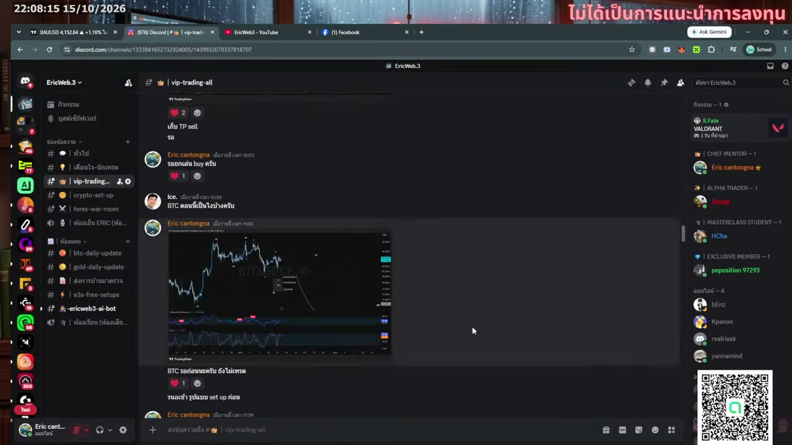

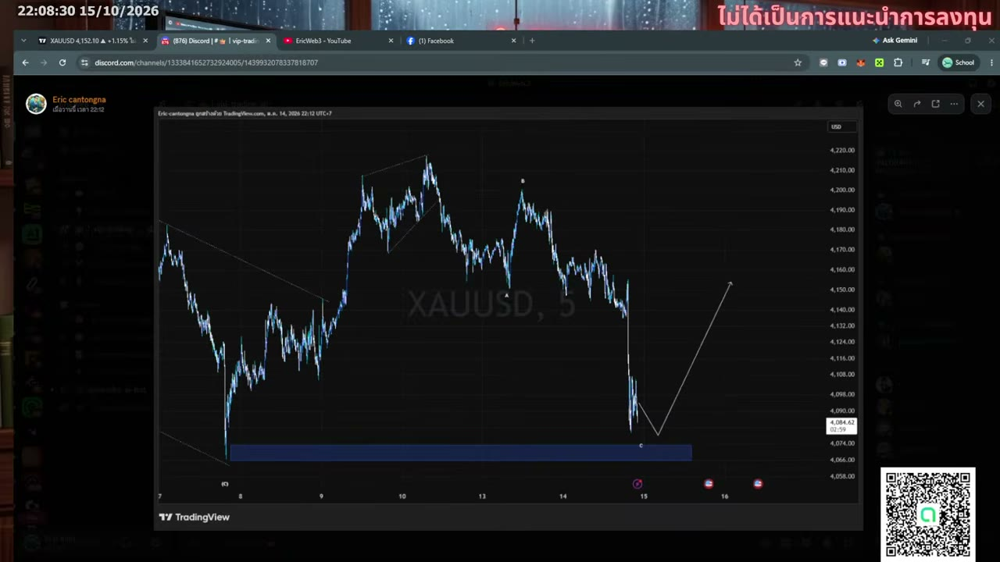

[00:40:42] แนวต้านที่เดิมได้คือ 41  4,170 นะครับ เดี๋ยวถ้าหลุดนะถ้าหลุดอ่า 4,140 เนี่ย อาจจะได้เห็นการย่อลงปักตัวมาเทส 4,110 อีกรอบนึงนะสำหรับทองคำนะครับอันนี้ก็จะ เป็นภาพสั้นเนาะอาจจะเล่นอาจจะรอเล่นอีก ทีก่อนพรุ่งนี้นะนะครับส่วนน้ำมัน น้ำมันตอนนี้ทะลุไปแล้วฮะทะลุกรอบ 96 ไป แล้วครับ 2  3  4 อจริงๆอยากให้จริงๆเค้าลงเวจมา เนี่ยผมได้มานึงแล้วนะได้มารอบนึงแล้วนะ ครับอันนี้น่าจะโดนสop Stop  loss ไปแล้ว นะครับน้ำมันถ้าเป็นแบบนี้เนี่ยน่าจะต้อง ขึ้นไปในระดับ Fibo ถัดไปแล้วนะครับนั่นก็คือ 90  98.6 นะอ่า 98.6 นะครับให้ขึ้นไปก่อนนะ ให้ขึ้นไปก่อนนะครับยังไม่ต้องไปทำอะไร เค้านะให้ขึ้นไปก่อนนะสำหรับน้ำมันนะมอง เป้าถัดไปนะแถวๆที่ 98.6  6 นะสำหรับน้ำ

[00:41:44] มันนะครับ โดย SL ไปผมผมปล่อยเลยนะปล่อยให้เค้าขึ้น ไปอีกโซนนึงแล้วค่อยไปหาโซนเล่นเอา เผื่อหลุดแผนไป B วาง 10 ไม้เหมือนกันใช่มั้ครับโอเค อืมีดึงกลับค่อนข้างเร็วนะครับเอ่อช็อต BTC  B ลง C ยังไงครับโอ้โหนี้พูดกันยาว เลยนะก็รอให้ราคาถึงโซนก่อนนะครับอถึงโซน ก่อนแล้วก็เอ่อในภาพย่อยก็รอให้ราคาเสีย โครงสร้างเนาะนะครับคือถ้าเค้าเรียกว่า อะไรอ่ะถ้าถ้ามีพื้นฐานหน่อยก็จะพอเข้าใจ นะอาจจะรอให้ราคาทำเป็นลิ่มเหมือน Falling Wight อย่างเงี้ยซึ่งเราก็ไม่รู้หรอกมัน จะเกิดหรือเปล่านะครับอาจจะมี Barage Divergent ใน time  frame  1 ชม. 2 ชม. ก็ได้นะครับแต่ยังไม่เข้านะครับรอการติด แนวต้านแล้วก็ย่อรีทestอย่างนี้นะผมถึงจะ

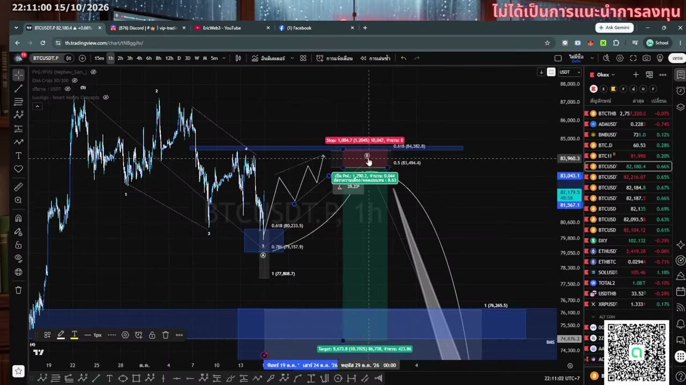

[00:42:44] เล่นนะเนี่ยฮะท่าเทรดท่าเทรดสั้นๆนะแต่ จริงๆคือมันผ่านการนับคลื่นมาแล้วนะ มีดูตัวไหนเพิ่มเติมมีมครับช่วงนี้เอ่อ ใครอยากได้เทรด setup ดีๆก็นี่แหละครับ เคียโค้ดด้านล่างขวามือนะ แหม XRP ไหวมั้เนี่ย อืเดี๋ยวถ้าเนี่ยน่าทรุด 1.34 ได้ก็สวยนะ อาจจะไม่ได้ถือยาวขนาดนั้นนะครับพี่ผมว่า เอ่อต้องระวังที่ 1.36 ก่อน นะครับเนี่ย 1.36  1.37  37 ก่อนนะครับ คลาสเรียนเหรอครับคลาสเรียนผมยังไม่เปิด ครับนู่นเลยครับปีหน้าครับค่อยเปิดตอนแรก ว่าจะเปิดปลายปีนี้ดูท่าจะไม่ทันนะครับอื

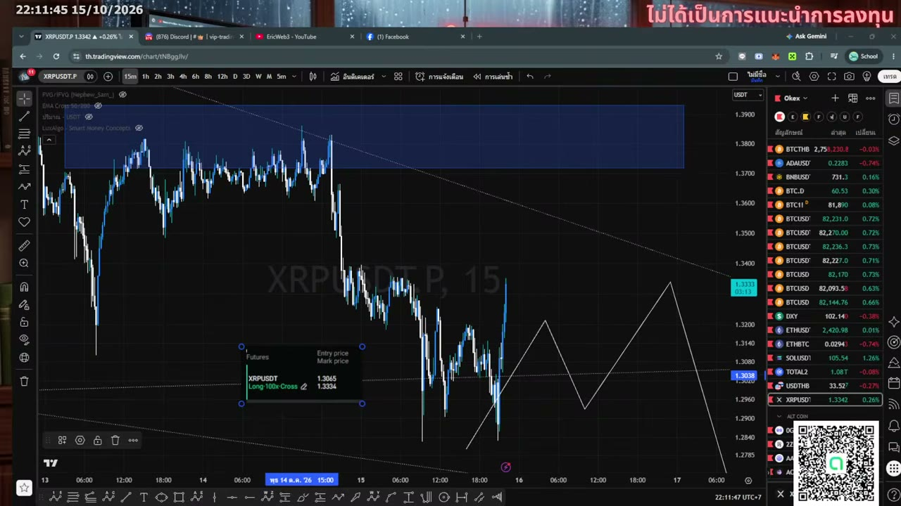

[00:43:47] อันนั้นผมว่าเปิดปีหน้าจะเวิร์คกว่า อ่ะโอเคฮะ มาแล้วะนะครับเด้งมาแล้วะบitcoinนะครับก็ นั่นแหละฮะระวังเอ่อกรอบ 82,500 นะครับ แล้วก็เอ่อในระดับ 83,400 อีกครั้งนึงนะ ครับสำหรับ Bitcoin นะ Ena เหรอผมไม่ได้ดูนานแล้วอ่ะสิ อืมกลัว Setup มันจะไม่แน่นนะเดี๋ยวขอแอบ ไปดูแป๊บนึง ถ้าตัวไหนผมเปิดมาแล้วไม่มีกราฟเนี่ยแสดง ว่าผมไม่ได้ดู ไม่มี setup เนี่ยแปลว่าผมไม่ได้ มีมยไม่มี Future Perชไม่มีอยู่ในสปอต หรือเปล่า พักเ้าให้อันนี้มี อันนี้มีมองเป็นอะไรเนี่ยมองเป็นimpรเหรอ

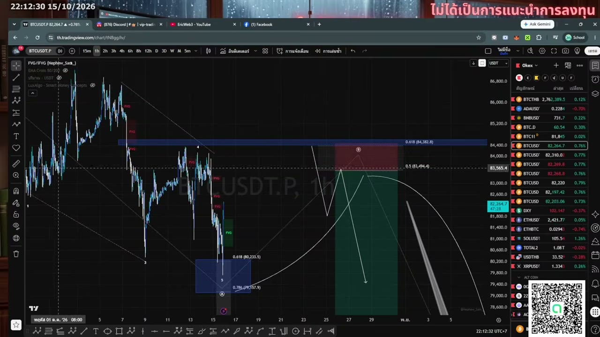

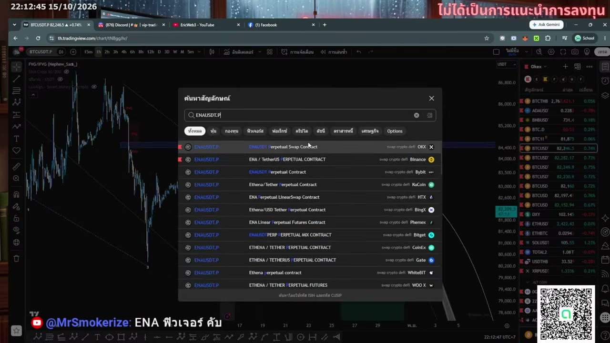

[00:44:51] ทำ frame  day อ๋อมองจบแล้ว ก้อนนี้มองจบแล้ว อันนี้ดูให้ใครเนี่ยอ๋อเทสตรงนี้โอเคนะ ครับอ่ะถ้าถ้าแบบนี้เนี่ยมองว่าเดี๋ยวน่า จะขึ้นมาเทสอีกครั้งนึงแล้วเตรียมลงต่อนะ คือคล้ายๆกับ Bitcoin นะครับตรงนี้อาจจะ เป็น 1  all นะครับ เนี่ยจบเทรนแล้วครับเตรียมที่จะขึ้นมาเทส 0.25  0.26  26 แล้วระวังลงต่อนะ ตรงนี้บitcoinมันมันขึ้นมามันอาจจะขึ้นไป ได้อีก 1,000 จุดนะครับซึ่งมันก็อาจจะลาก outcoin เนี่ยขึ้นไปเทสอีกรอบนึงนะทุกคน นะครับก็อย่าเพิ่งไปกดช็อตมั่วซั่วนะรอ เด้งสูงๆก่อนรอเด้งเข้าโซนก่อนนะครับค่อย ค่อยเอ่อค่อยเทรดนะ ประมาณนี้

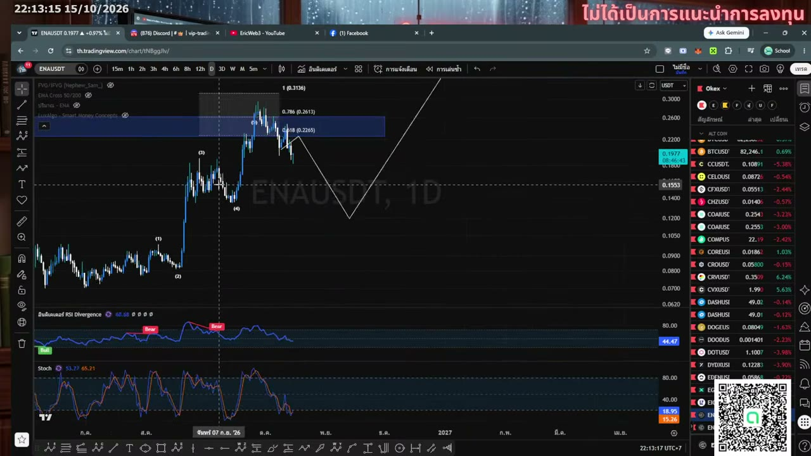

[00:45:53] พรุ่งนี้เฟดใช่มั้พรุ่งนี้เฟรดใช่มั้ครับ ต้องไลฟ์มั้เนี่ย จะมีแรงมาไลฟ์มั้ยเนี่ย เออพรุ่งนี้เฟจะมีแรงมาไลฟ์เนี่ย อ่าก็ถ้าไม่ได้ไลฟ์ก็เนี่ยครับเข้ามาพูด คุยในคอมityเราก็ได้เนาะ นะครับนี่ก็เด้งมาค่อนข้างดีนะค่อนข้าง ข้างดีเดี๋ดูข้างในนิดนึงแต่เด้งโดดๆมา อย่างเงี้ยไม่ไม่ค่อยเวิร์คนะครับอาจจะ เป็นอย่างอื่นแทนนะจริงๆอยากได้ที่แบบ เด้งมาแล้วเป็นอย่างเงี้ยฮะเป็นโครงสร้าง อย่างเงี้ย อันนี้จะสวยนะ ถ้า BTC หลุด 64,000 ตามเวฟเราตีว่าเคส B ย่อลึกมา 100% เลยม ครับพอเสร็จโครงสร้างภาพใหญ่ผมมองว่าผม

[00:46:55] มองว่าอาจจะไม่ได้ 100% ขนาดนั้นนะครับคุณพอเพราะว่าเอ่อ ระดับแรกเนี่ยถ้าวัดมาเนี่ยก็อาจจะ อาจจะที่เดิมเนาะ buttom เดิมอ่ะ 58,000 57,000  58,000 คือ C  =  A ก้อนนี้ก่อน อันนี้คือ 1.1  1 โซนนะซึ่งมันก็ยังอยู่ ในในโซน A ที่จะ DCA ในไม้ใน 5 ไม้แรก เนาะนะครับแต่ถ้า Senario ที่ตีลงมาอีก เนี่ยผมมองว่าก็อาจจะต้อง C ที่ต้องต่ำ กว่า A นะครับคือต้องต่ำกว่า A นะคือต่ำ กว่า A เนี่ยคือใช่หมด นะแต่ถามว่าถ้าผมใช้ Fibo อ่ะผม ผมใช้ Fibo จากสwing High  Swing  Low ใน ก่อนหน้านั่นก็คืออ่า Low  Bottom ครั้ง ที่แล้วนั่นก็คือ 10,000  15,000 600 ใช่มั้ยสวิง High ก่อนหน้าคือ all time  high ถูกมั้ครับคือเทรนด์ก่อนหน้า ทั้งหมดก้อนนี้พอเวลาผมวัดเนี่ยผมก็ตี อย่างนี้เลยผมผมจะไม่เอา fibo  swave มา ให้มันพันจุกจิกเท่าไหร่นะครับก็คือใช้

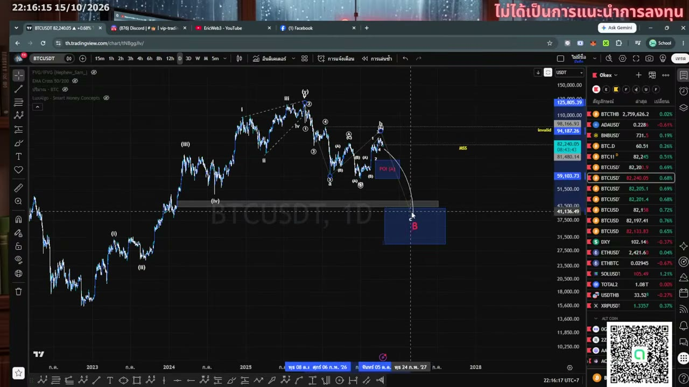

[00:47:56] ตัวเนี้ยสวิง low ไปหา swing  high ก่อนหน้าเนี่ยครับก็จะ ได้fibโบมาพอดีเห็นมั้ย เนี่ยก้อนใหญ่ อันนี้คือภาพใหญ่เนาะที่ที่เป็นเกาะราคา ภาพใหญ่ตาม Fibo ที่จะที่จะเล่นนะเพราะ ฉะนั้น C ตัวเนี้ยมันอาจจะจบที่ตรงนี้ หรือตรงนี้ก็ได้ ได้หมดนะก็จะเป็นเป็นตัวช่วยบ่งเบาะไปนะ ครับแต่ถ้าจะให้แบบ มา 100% มั้ยมันเราอาจจะคาดการณ์ไม่ได้ ขนาดนั้นนะต้องดูหน้างานกันอีกทีนึง เอาเป็นว่าลงมาโซน นี้กับโซนนี้เอาหมด อ่าแล้วก็จากที่เอ่อก็ถ้าถ้านะถ้าสมมุติ ว่าบitcoinยังทำพฤติกรรมเดิมคือลงต่ำกว่า 65% หรือ 60% ลงมาจากพฤติกรรมเดิมๆเนี่ย นะครับเอาแบบง่ายๆเลยนะจาก All  time high ลงมาเนี่ยถ้าเป็น B ofซingนะต่ำ

[00:48:57] กว่า 60% มาเหมือนเดิมเนี่ยก็เข้าโซนนี้ เหมือนกันเห็นมั้ 44,000 แล้วก็เ่อ 38,000 ปลายๆนะอันนี้ไม่ได้บอกว่ามันจะมาถึงนะ แต่แค่บอกว่าถ้ามันทำพฤติกรรมเดิมๆนะครับ แต่ในไซเคิลนี้อาจจะเปลี่ยนไปก็ได้นะจาก สถาบันลงมา นะครับ จากพฤติกรรมเดิมๆเนาะ ไอ้กรอบที่ลงมาเป็นแบรเนี่ยนะครับต่ำกว่า 60%  65% นะค่อนข้างเยอะ เห็นมอันนี้ก็ 80 อันนี้เท่าไหร่ตอนรอบล่าสุดนี้ก็ 70 กว่า เปอ์กับ 80 นะครับถ้าทำพฤติกรรมเดิมๆอีก เอาแค่แบบสซัก 70% นี่ก็ลงมาสซักโซน 40,000 แล้วครับ หลายปัจจัย แต่อาจจะไม่อย่างนั้นก็ได้เนาะ

[00:49:59] Eทีเรiumใช่มั้ยครับeอร์ Eอร์ผมยังให้ขอบข่ายในการที่อาจจะขึ้น เป็น A หรือว่าขึ้นเป็น 4 นะครับนะเงื่อน ไขเนี่ยไม่ไม่ควรที่จะเอ่อระวังการไม่ ผ่าน 2,650 นะครับแล้วลงอีกขานึงนะสำหรับ Eอร์นะจะมองแตกต่างจากตัวอื่นนิดนึงนะ อาจจะทำ 4 นะครับแล้วก็จบ อ่าเป็นชุดนี้แทนนะครับเอ่อSilverอนี่ เดี๋ยวไม่แน่ใจว่า setup ผม invalidation ไปหรือยังจากลงไปเมื่อวานนะครับ อืมขอดูภาพใหญ่นิดนึงตรงนี้ไม่น่าจะขึ้น 1 แล้วครับตรงนี้ไม่น่าจะใช่ 1 ครับใช่มย ยังอยู่นิ ยังอยู่แฮะยังไม่ invalid ฮะ

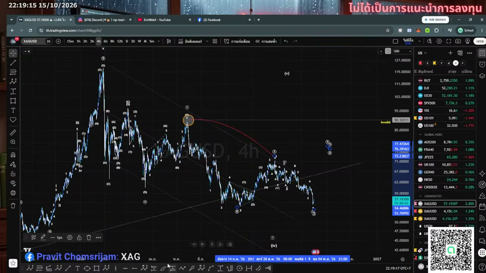

[00:51:01] อืมยังไม่ได้แก้เลยครับแต่ดูแต่คิดว่าแต่ คิดว่าก็จะคล้ายๆกับทองคำที่มองว่าในภาพ รวมเนี่ยนะครับSilเวอร์ตรงนี้น่าจะเป็น ฝั่งายมากกว่าเนาะ 55.14 นะครับจ154.8 8 นะครับค่อนข้างชัดเจนนะ ครับถ้าชุดนี้หลุดแล้วเนี่ยSilเวอร์ถ้า ชุดนี้หลุดเนี่ย ไม่ขึ้นแล้วนะครับไปข้างล่างอย่างเดียวนะ เอ่อในโครงสร้างย่อยตรงนี้ทำ imp มย ใน M เล็กๆนี่ตรงนี้อาจจะต้องรอให้เทรนด์ ตรงนี้ของSilverอเนี่ยขึ้นครบรหัสก่อนนะ ครบโครงสร้างราคาของ Motive ก่อนนะครับ แล้วค่อยรอมารอย่อฝั่งนี้อีกทีนึงนะนะ ครับอาจจะกลับมารับแถวๆซัก 56.5  5 อย่าง เงี้ยค่อยเล่นนะครับ ประมาณนั้นครับผม โอเคนะครับประมาณนี้นะตอนนี้น้ำมันก็ไป อยู่แล้วนะครับ

[00:52:02] อ่าทองคำกลับมาทองคำกลับมาเด้งสูงกว่าไทย เดิม silver  laging โอเคอืมทองส่วนตัว หน้าผมอ่ะผมมองว่าผมอยากให้มันขึ้นมาก กว่าตอนนี้ทองเนี่ยทองคำเนี่ยในทาง TA เนี่ยคือทำ bullish  divergent ทำ frame day ไปแล้วนะครับทอง นะทองคำนะทำ bullish  divergent  frame day ไปแล้วนะครับอ่าฝั่งเซลล์อาจจะต้อง ทับมือหน่อยนะนะครับอาจจะต้องกลับเทรนด์ เป็นฝั่งย่อบายไปนะครับฝั่งเซลล์อาจจะ ต้องทับมือก่อนนะสำหรับทองคำนะครับเดี๋ยว ค่อยมาว่ากันอีกรอบนึงนะฮะอืตัวนี้ก็ชุด เมื่อวานเนี่ยคือแถวๆนี้นะ 4,084 นะที่ set  up เล่นไปนะครับผมไม่ได้เล่นนะเออ ผมไปกดบitcoin นะฮะเออไม่ได้เล่นเลย โอเคครับประมาณนี้ทุกคนนะครับถ้าเพื่อนๆ ชอบใจสำหรับเทรด setup นะครับก็หรืออยาก เข้ามาพูดคุยก็ QR  Code ด้านล่างขวามือ นะครับนะก็มีทั้งอ่าเพื่อนๆในคอมityเนาะ คอยให้คำแนะนำนะครับแต่ก็อย่าลืมนะครับ

[00:53:03] ไม่ได้เป็นการแนะนำการลงทุนอย่างเช่นเคย นะครับเป็นเพียงแค่แผนส่วนตัวนะทุกคนนะ อวันนี้ก็เข้ามาพูดคุยกันค่อนข้างเยอะนะ ครับไม่ว่าจะตลาดจะขึ้นจะลงเนี่ย คอมมิunityเราก็ครึกๆนะครับครึกื้นตอนนี้ กำลังเถียงกันเรื่องไอ้นี่อยู่นะครับ เรื่องราคาสปอรตบitcoinกันอยู่นะว่าลงมา เท่าไหนจะมา 75,000 ได้มั้ยอะไรอย่าง เงี้ยนะครับเออบางคนก็บอกโอ้ยไม่ถึงแล้ว แหละ 70,000 นะครับแต่ผมก็จะเชียร์ให้ถึง นะครับก็เถียงๆกันนะครับแต่เถียงกันแบบ สนุกๆนะครับ โอเคนะครับก็เข้ามาพูดคุยกันได้เนาะนะ ครับประมาณนี้นะครับเดี๋พรุ่งนี้นะนะครับ นะพรุ่งนี้ถ้าไม่ติดขัดอะไรก็จะรีบมาไลฟ์ ให้แล้วกันนะครับดูซิว่าเอ่อในกรอบราคา ของบitcoinเนี่ยนะครับ 82,500 หรือว่า 83,400 เนี่ยขึ้นไปแล้วเนี่ยนะครับกับ เฟดเนี่ยจะถูกทุบลงมาอีกรอบนึงเปล่านะ

[00:54:04] ครับความกังน่ากังวลของเงินเฟ้อยังคง รุนแรงสำหรับตลาดหรือเปล่านะครับแล้วก็ เริ่มมีฝัด้วยนะฝัเรื่องการแฮก Wallet นะ ครับนี่เราอยู่ในcycิleที่ฮาร์ดแวร์ wallเลetไม่ปลอดภัยเหรอเนี่ยเอออาจจะเป็น story ใหม่ของไคินี้ก็ได้นะนะครับนะก็ ค่อนข้างที่จะต้องน่าจับตากันต่อไปนะครับ แต่ก่อนที่จะจบไลฟ์เนี่ยก็ต้องบอกว่าใน ภาพรวมทั้งหมดในตลอดปีที่ผ่านมาเนี่ยนะ ครับในตลอดปีที่ผ่านมาในมุมมองของ โมเมนตัมสotนะครับหลังจากที่เอ่อบitcoin เนี่ยจบจบเอ่อฝั่งของ All  time  High เนาะนะครับจบฝั่งของ All  Time  High เนี่ยซึ่งเอ่อผมหรือว่าเพื่อนๆที่ตามนะ ครับตาม Community หรือว่าตามเทรด setup กันมาเนี่ยนะครับก็จะเห็นว่าเอ่อ คาดหวังที่จะให้เด้งเนาะเด้งทำ Head  and Shoulder นะครับนั่นก็คืออะไรครับการทำ ไหล่ขวาเนี่ก็จะเป็นเห็นมั้ครับมุมมองของ

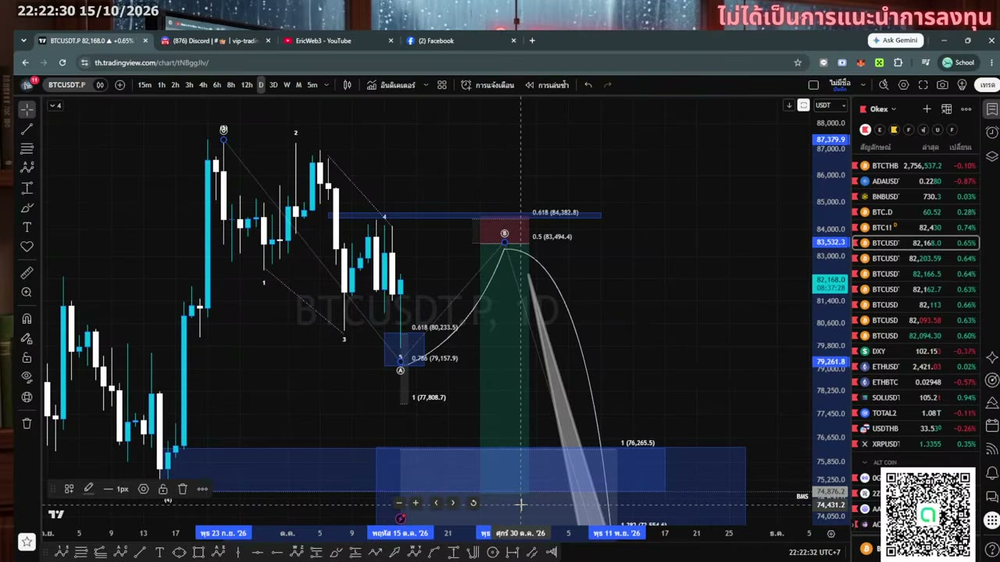

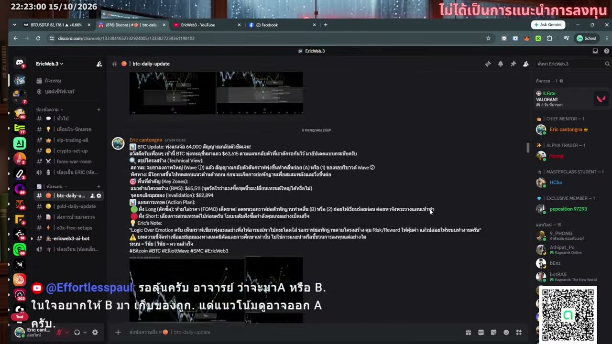

[00:55:05] บitcoinที่ตามมาค่อนข้างนานพอสมควรนะการ ทำไหล่ขวาเห็นมั้ยทำไหลไหลกว่านะครับใน กราฟปัจจุบันเนี่ยถือว่ามีสิทธิ์ที่จะทำ ด้วยพอสมควรนะถ้าออกเป็นฝั่ง เห็นมยมีสิทธิ์ที่จะทำพอสมควรนะครับถ้า ออกเป็นนะครับนี่ก็ใช้ระยะเวลาค่อนข้าง นานเนาะนะครับก็อยากให้ติดตามกันต่อนะ ครับว่าบทสรุปของไซเคิลนี้เนี่ยจะจบที่ ไม่ต่ำกว่า 58,000 หรือว่าจะไปจบที่ต่ำ กว่า 44,000 นะครับก็ฝากติดตามกันด้วย แล้วกันนะครับสำหรับเอ่อElิก Web นะครับ สำหรับคืนนี้ก็ขอขอบคุณเพื่อนๆทุกคนนะ ครับนะครับย้ำกันอีกรอบนึงนะครับเป็นแผน เป็นแผนส่วนตัวนะครับไม่ได้เป็นการแนะนำ การลงทุนเนาะนะครับเดี๋ยวไว้เจอกันใหม่นะ ครับสำหรับไลฟ์ครั้งหน้านะครับสำหรับคืน นี้สวัสดีนะครับ

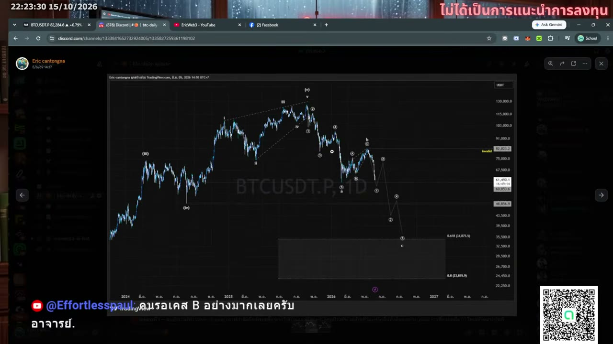

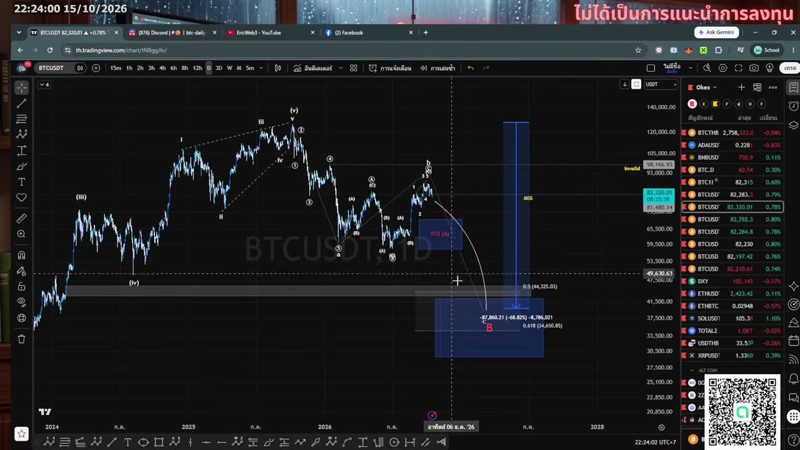

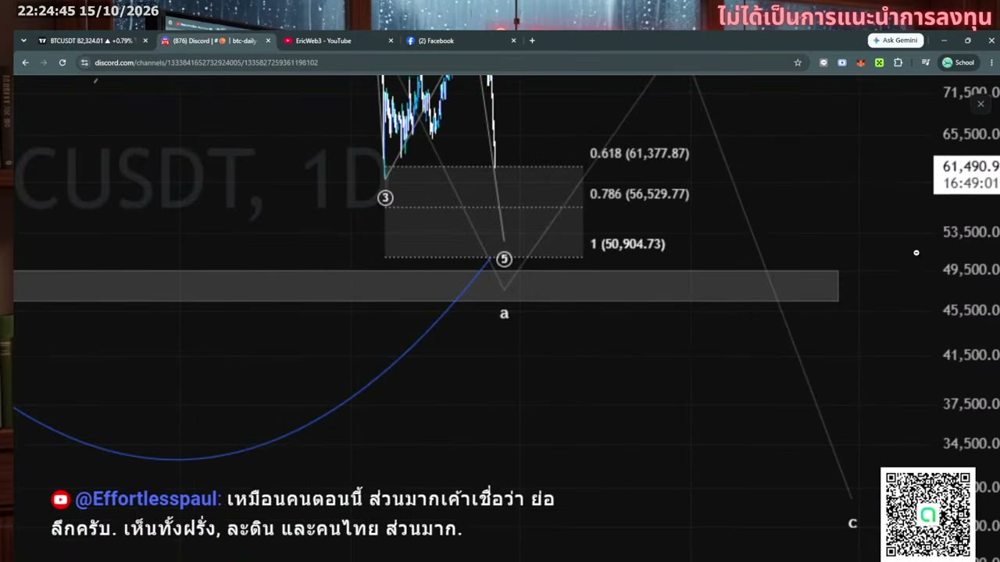

[00:56:35] every  heartat nothing  left  for  me  to come  and  go more  than the  feeling someh  I  still every  ending  leaves  behind something  gentle

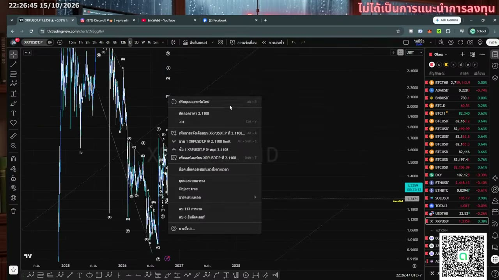

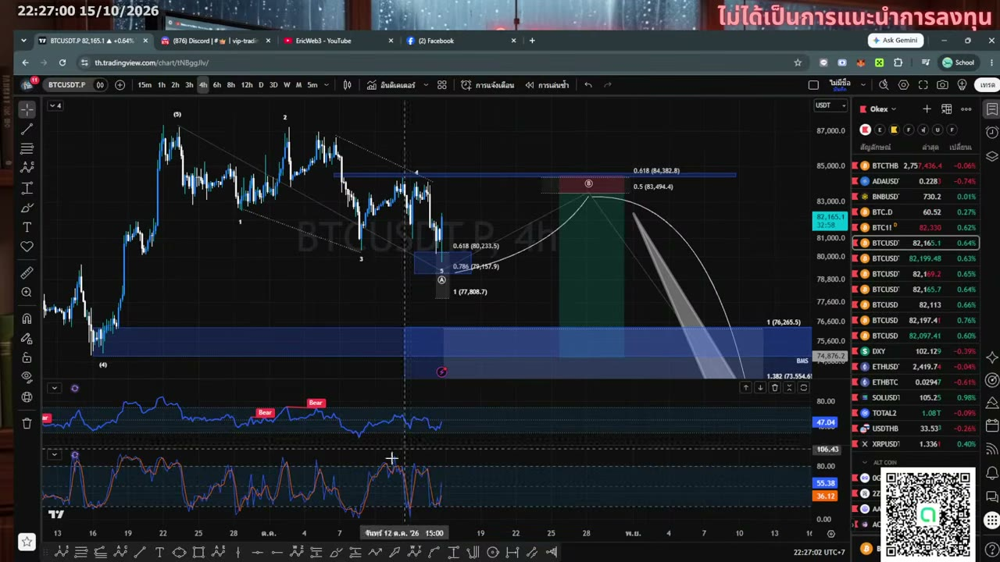

