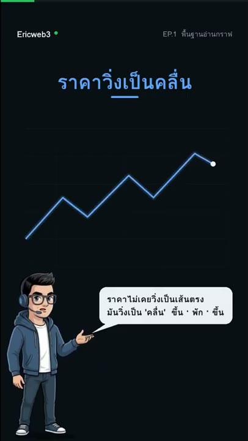
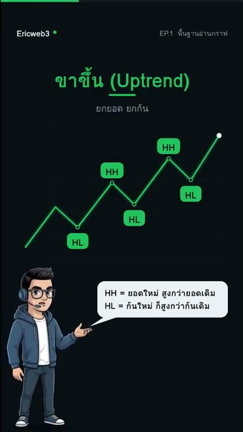
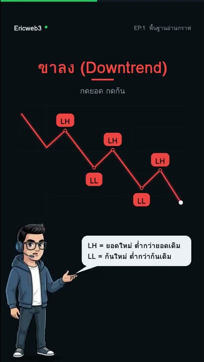
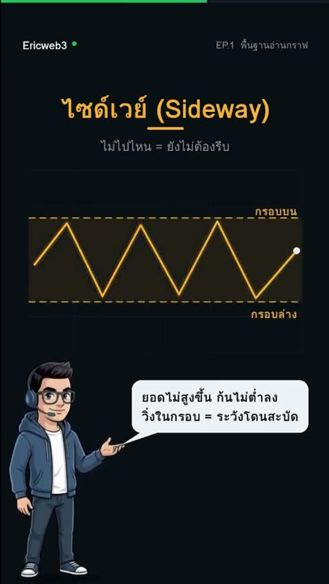
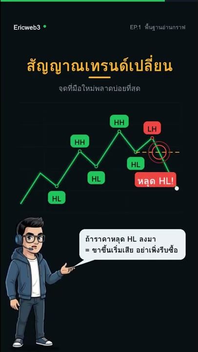
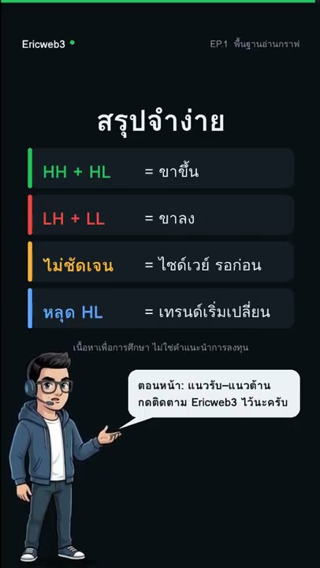

# อ่านกราฟเป็นใน 1 นาที 📈 by Ericweb3

- ช่อง: EricWeb3
- ลิงก์: https://www.youtube.com/watch?v=fthkU0_Bt6A
- วันที่: 2026-10-20
- ความยาว: 1:03 (Shorts แนวตั้ง · EP.1 พื้นฐานอ่านกราฟ)
- ที่มา: คำบรรยายอัตโนมัติ (auto-generated) ภาษาไทยของ YouTube — อาจมีคำสะกดผิด/คำผิดเสียง
- ภาพ: 8 ภาพ = ภาพสุดท้ายของแต่ละฉาก (ครอปเฉพาะส่วนวิดีโอแนวตั้ง) อยู่ในโฟลเดอร์ frames/ — ข้อความแบ่งตามฉาก

---

[00:00:00] สวัสดีครับผม Eric Web3 วันนี้สอนอ่านกราฟใน 1 นาที เริ่มที่สิ่งเดียวเลยครับ โครงสร้างราคา

[00:00:08] ราคาไม่เคยวิ่งเป็นเส้นตรง มันวิ่งเป็นคลื่น ขึ้น พัก ขึ้น

[00:00:13] ขาขึ้น อัพเทรน ยกยอดยกก้น อ่านเทรนด์ดูแค่ 2 อย่าง จุดสูงสุดคือยอด และจุดต่ำสุดคือก้น HH คือยอดใหม่สูงกว่ายอดเดิม HL คือก้นใหม่ก็สูงกว่าก้นเดิม

[00:00:27] ขาลง downtrend กดยอดตกก้น LH คือยอดใหม่ต่ำกว่ายอดเดิม LL คือก้นใหม่ต่ำกว่าก้นเดิม

[00:00:35] Sideway ไม่ไปไหน ยังไม่ต้องรีบ วิ่งในกรอบ ระวังโดนสะบัด

[00:00:40] สัญญาณเทรนด์เปลี่ยน จับตาก้นล่าสุด HL ไว้ให้ดี ถ้าราคาหลุด HL ลงมา ขาขึ้นเริ่มเสีย อย่าเพิ่งรีบซื้อ

[00:00:48] สรุปจำง่ายๆ HH + HL = ขาขึ้น · LH + LL = ขาลง · ไม่ชัดเจนให้รอก่อน · และหลุด HL เท่ากับเทรนด์เริ่มเปลี่ยน

[00:00:59] ตอนหน้า แนวรับแนวต้าน กดติดตาม Eric Web3 ไว้นะ

