# 🔥 LIVE Wave 2 or B แต่ BTC เตรียมลง?? 🔥 | EricWeb3 ( 22 ต.ค. 2569)

- ช่อง: EricWeb3
- ลิงก์: https://www.youtube.com/watch?v=T4DfSB-hqDc
- วันที่: 2026-10-22
- ความยาว: 40:30
- ที่มา: คำบรรยายอัตโนมัติ (auto-generated) ภาษาไทยของ YouTube — อาจมีคำสะกดผิด/คำผิดเสียง
- ภาพ: 25 ภาพจากวิดีโอช่วงที่เปิดกราฟแท่งเทียน (เลือกอัตโนมัติจากสีแท่งเทียน · ตัดภาพซ้ำ) อยู่ในโฟลเดอร์ frames/

---

[00:00:49] C  bre you  and [เสียงร้องเพลง] turn  away [เพลง] spin The  cold your [เพลง] name  still  hangs  in eches  on  the [เพลง] roof  top  smooth and  slow dancing  shadows [เสียงร้องเพลง] from lights  below the  night [เพลง] leans  into  cool  to but  I  play  that [เพลง]

[00:02:41] E  on [เพลง] the  roof  smooth  and dan  shadows  from [เพลง] light  pillow the  leans  tool  to [เพลง] but  I  play  that  any พร้อมฮะสวัสดี[เพลง]ครับ แหมไม่ได้ไลฟ์นานนะครับเพราะว่าเอ่อกราฟ ไม่ค่อยมีเทรนด์ให้เทรดเท่าไหร่นะครับถ้า เราว่ากันตามตรงเนาะเพราะว่าเอ่อในหลาย ครั้งที่แล้วนี่เรารอการจบนะครับจบรหัส 5 แล้วก็ดาวเทรนใช่มั้ยแล้วก็เบรak out นะ ครับ break  out  retest นะครับอาจจะได้

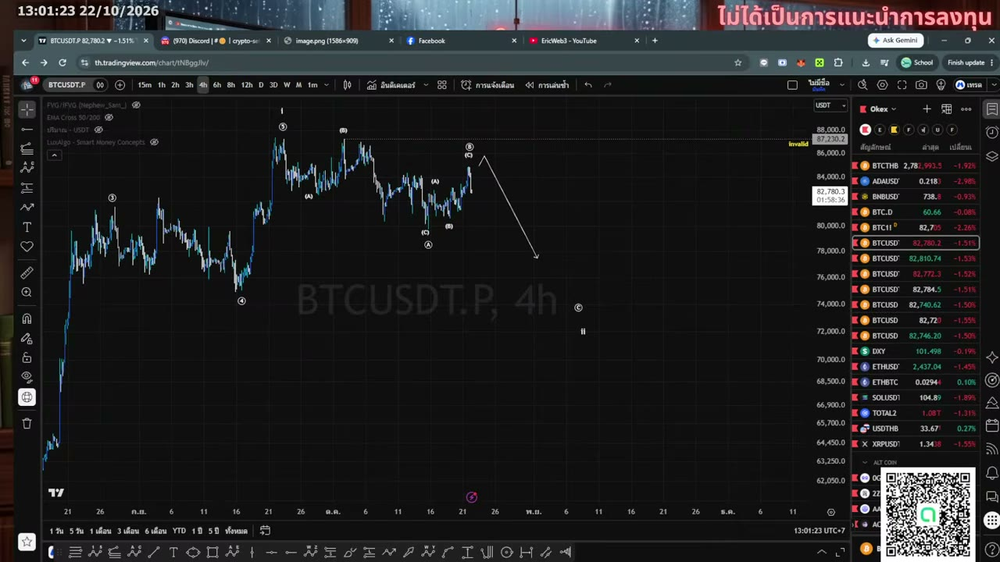

[00:03:42] เล่น position รองสั้นๆนะครับเดี๋ยววัน นี้เรามาrecีคapกราฟกันนิดนึงนะเมื่อวาน มี P  action ไปแล้วฮะสวัสดีคุณพอครับ สวัสดีครับนะครับเดี๋มาอัปเดตกันนิดนึงนะ ครับเดี๋รอเพื่อนๆอีกนิดนึง สวัสดีครับสวัสดีคุณจิมครับพร้อมเทรดนะ เดือนนี้เอ้ยเดือนหน้าต้องเดือนหน้าแล้ว เดือนนี้พอได้อยู่นิดนึงนะครับ อ่าสวัสดีพี่สูงครับพี่สูงใน Line  Open  Chat สวัสดีนะครับพี่ เดี๋รอเพื่อนๆอีกนิดนึงนะครับใครเข้ามา แล้วคอมเมนตได้นะผมไม่ได้เปิดไ talk นะ หน้าเพจก็สวัสดีนะครับโอเค[เพลง]นะเดี๋ยว เรามา recap เทรด setup กันนิดนึงนะครับ แล้วก็มุมมองตลาดนะครับเพราะว่าอ่า Bitcoin เนี่ยค่อนข้างเข้าอ่าโซนราคาที่ ค่อนข้างน่าสนใจแล้วก็อยู่ในจุดที่สำคัญ

[00:04:43] พอสมควรนะครับสำหรับการเ่อเบรครีทestนะ ครับในช่วงตั้งแต่กลางเดือนตุลาคมเนาะนะ ครับรู้สึกว่าไลฟ์เราของเราครั้งที่แล้ว เนี่ยน่าจะวันที่ 15 ใช่มั้นะครับนี่ก็ 7 วันพอดีนะครับ 1 อาทิตย์นะครับที่เบรค ไลฟ์ไปนิดนึงนะครับเราย้อนกลับไปดูเอ่อ เทรด setup กันนิดนึงนะครับในช่วงซักอ่า กลางเดือนเนาะนะครับอจริงๆแล้วเนี่ยผมยก ตัวอย่างของเทรด set  up วันที่เอ่อ วันที่ 19 แล้วกันนะครับอ่าจากมุมมองของ ดาวเทรนด์นะครับจากเพื่อนๆที่เพื่อนๆเห็น กราฟเนาะเรามองว่าเป็นรหัส 5 นะครับ เหมือนอ่าเทรนเป็นเทรนขาลงนะจริงๆเป็น A ก็ได้เป็น B นะครับแล้วก็ 1  2  3  4  5 ก็ได้นะครับแต่จุดที่เราโฟกัสก็คือการที่ เอ่อราคาลงมารีเจคที่ 9 เอ่อ 79,600 นะ ครับแล้วก็พยายามจะทำซับ Wave ยกตัวขึ้น ไปรทestในมุมมองขา B ย่อยเนี่ยนะครับใน กรอบราคาเท่าไหร่ครับจากรายที่แล้วก็คือ 83,400 นะครับจนถึง 84,300

[00:05:44] นะครับก็เอาเป็นว่าเรามองว่าเอ่อราคา เนี่ยควรจะมีการเบรคขึ้นนะครับเพื่อที่จะ ต้องปรับตัวลงต่อนะครับจากดาวเทรนแล้วก็ ชุดเวฟที่นับนะครับอ่าผลปรากฏว่าใน subve ชุดเนี้ยใช้เวลาค่อนข้างนานนะครับอ่า ประมาณสัก 1 สัปดาห์ได้นะครับนะในเทรด setup ของ community เราเนี่ยก็ มีการเล่นรีบาวoundกันไปสั้นๆเนาะนะครับ โดยเฉพาะการที่ราคาเนี่ยอาจจะมีการปรับ ตัวมองเป็นซับ wave เป็น A นะครับแล้วก็ มาบายตรงฝั่งขา B นะเพื่อที่จะยิงขา C สั้นๆนะนะครับอันนี้ก็เป็นมุมมองของ day ของเพื่อนๆเนาะนะครับที่อ่าส่งกันไปใน community กันนะครับเพื่อนๆก็จะเห็นว่า เอ่อในใน setup เนี่ยนะครับผมก็มีการรอนะเห็นมั้ย มีการรอเบรกนะรอเบรคก็มีเล่นเปิด position ฝั่งรองไปสั้นๆนะครับแต่บitcoinเนี่ยเข้า ไม่ทันนะครับนะชุดที่ได้มารู้สึกน่าจะ เป็น XRP นะชุดที่เบรค out ขึ้นมานั่นเอง นะครับนะก็เล่นสั้นๆนะครับไม่ไม่ได้ถือ

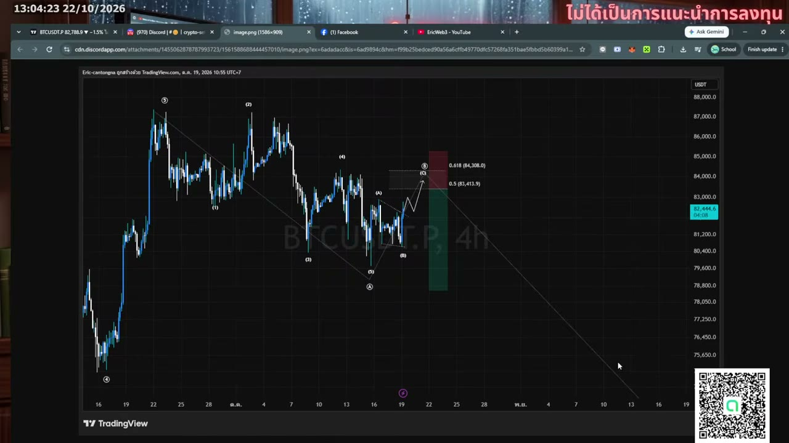

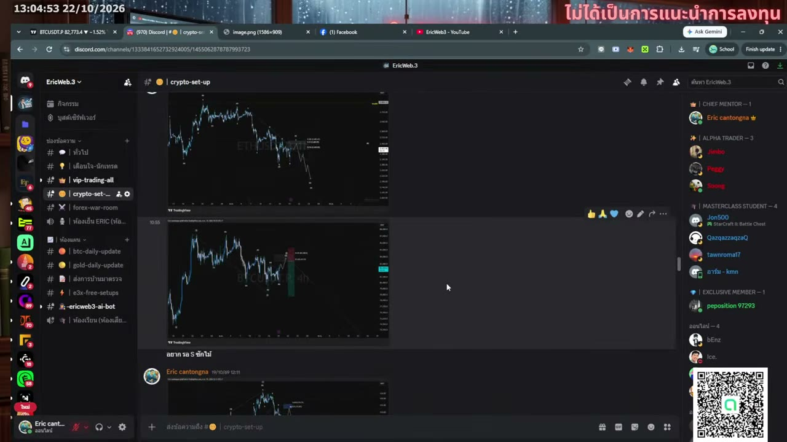

[00:06:47] ยาวขนาดนั้นนะในระหว่างนั้นเนี่ยเราก็ไม่ ค่อยได้เทรดเลยเพราะว่าอะไรเพราะว่าเอ่อ ดูแล้วราคาเนี่ยแพชัค่อนข้างที่จะเคลื่อน ตัวค่อนข้างน้อยนะอันนี้ก็จะเป็นเศษวัน ที่ 16 นะฮะที่รู้สึกจะเหมือนในไลฟ์ครั้ง ที่แล้วเนาะนะครับอ่ะ มาดูกราฟปัจจุบันนิดนึงนะครับอ่าย้อนให้ เพื่อนๆดูแล้วนะฮะกราฟปัจจุบันเพื่อนๆจะ เห็นว่าอ่าsetอของวันที่ 16 นะครับวันที่ 16 ตุลาคมนะครับการจบจบเทรนด์นะของก้อน นะจากเดิมเนี่ยผมมองเป็นอะไรครับเป็น 1  2 3  4  5 นะครับ off a นะจะลงเป็นอะไรก็ไม่รู้แต่ตรงนี้เป็น a นะครับนะแล้วโฟกัสกันที่ราคาเนี่ยมี สิทธิ์ที่จะเบรค down เทรนดนะก้อนตรงนี้ นะครับเบรค down เทรนแล้วก็ปรับตัวขึ้นนะ ครับก็โฟกัสการรีบาวoundขึ้นไปตามมุมมอง ของอ่าเทรด set  up ก้อนนี้ อ่าเห็นมั้ยอ่าเดี๋ยวรีแคapให้ดูนิดนึงนะ

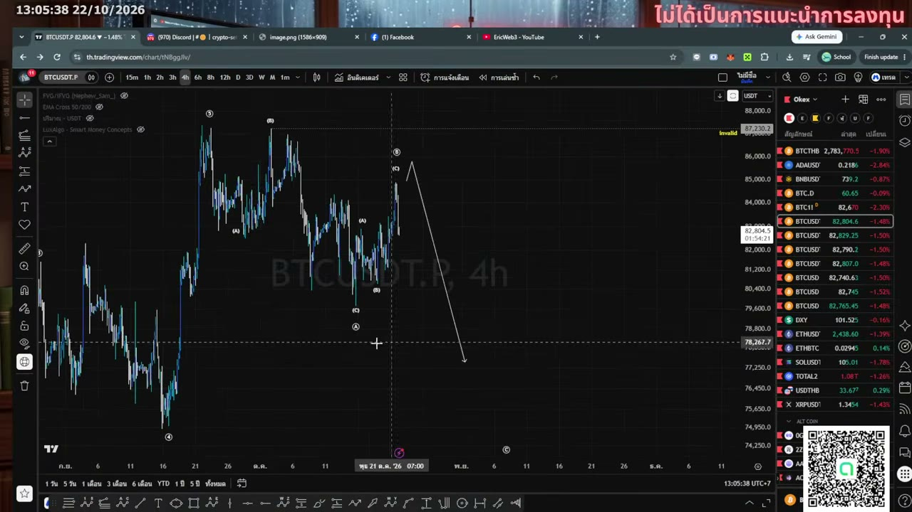

[00:07:50] ครับใครที่เข้ามาแล้วก็สวัสดีนะครับ สวัสดีคุณพัพพงษ์ครับสวัสดีครับ Space  X เดี๋ยวดูให้นะอ่าก็เป็นชุดนี้นะครับนะ ต่างจากการนับนิดหน่อยนะครับนะแต่สิ่งที่ สนใจคือสนใจตัว B ตรงนี้มากกว่านะครับ ซึ่งจากเดิมเนี่ยมองที่ 83,400 นะครับจน ถึง 84,300 นะครับอ่าผลปรากฏว่าเมื่อคืนนะมีแท่งปั๊ม ขึ้นมานะค่อนข้างสวยเลยนะสูงเลยนะครับสูง มากๆเลยนะครับนั่นก็คือไปในระดับเอ่อ เกือบเกือบถึง 85,000 นะนะครับเกือบถึง 85,000 แล้วก็เอ่อมีท่า ที่จะขึ้นไปทดสอบในระดับ 86,000 นะนะ เมื่อวานเราคุยกันในเอ่อ Line  Open  Chat ในคunityเนาะนะครับว่าอืมก็ผมก็ต้องเล่น ตามเพจ setup อ่ะนะครับนะเล่นตามเพจ setup ก็คือในเมื่อทำแผนมาแล้วมองมองว่าขึ้นขา B นะครับไม่ว่าจะเป็น B  of  ZZ ก็ดีหรือ ว่า B  of  Fat ก็ดีนะครับก็ขอมองว่าขึ้น

[00:08:53] ไปเพื่อลงก่อนนะขึ้นไปเพื่อลงก่อนจนกว่า บitcoinเนี่ยจะเบรคมากกว่า 87,300 ขึ้นไป นะครับก็ทำให้มีการเปิด position เล็กๆ น้อยๆมานะครับสำหรับฝั่งช็อตนะเพื่อนๆก็ น่าจะเห็นไปแล้วนะใครที่อยู่ในคอมมิunity นะครับอ่ะทีนี้พอราคาถึงโซนมาแล้วเนี่ยนะ ครับเมื่อเช้านะเมื่อเช้าตอนเปิดแท่ง Day เนี่ยจริงๆผมตื่นมาตั้งแต่ 5: หน้าแล้ว แหละนะครับมาดูอ่ากราฟเนาะนะครับก็ผล ปรากฏว่าก็เห็นแท่งเอ่อรีเจคนะครับใน time frฟม 4 ชั่วโมงเนี่ยหลุดลงมานะครับโดย เฉพาะการที่ราคาเนี่ยหลุดในกรอบ 83,300 จนถึง 83,000 เนาะนะครับในชุดปัจจุบันนี้ เนี่ยอันนี้เป็นสัญญาณแรกที่คิดว่าน่าจะ คเฟิร์มว่าน่าจะมีสิทธิ์ปรับตัวลงนะครับ มีสิทธิ์ปรับตัวลงสำหรับเพื่อนๆที่ไม่ได้ เล่นช็อตมานะครับอ่าในกรอบที่มากกว่า 83,9 9 แล้วหรือว่า 84,300 เนี่ยนะครับก็ไม่เป็นไรนะครับเพราะว่าอ่า ตรงนี้เนี่ยรู้สึกน่าจะเป็น engffing ไป แล้วนะครับใน time  frame  4 เนาะนะครับ

[00:09:54] อ่าโครงสร้างในtimeม frame  1 ชมงตอนนี้ นะครับยังมองว่าถ้าคิดว่าแผนนี้มองลงจริง ๆเนี่ยยังคงมองยังคงบอกว่าทันอยู่นะครับ ทันอยู่นะครับตามสูตรของเราก็คือรอไป retest ที่อะไรครับ fair  value  gap นะรู้สึกถ้าใช้ไม่เป็นก็อินดิเคเตอร์ไป อ่าเห็นมั้มีละนะครับ F  value  gap นะ ครับรอการรest แล้วลงต่อนะครับทีนี้ตรงนี้เนี่ยเพื่อนๆ น่าจะบีบ RR ทันแล้วเพราะว่าอะไรเพราะว่า เอ่อการที่ราคาเสียโครงสร้างลงมาเนี่ยนะ ครับไปรับเทส F  value  GAP นะจากเดิม เนี่ยถ้าใครเล่นชุดข้างบนกับผมเนี่ยนะ ครับ Stop  Loss มันจะต้องไปอยู่ที่ PVS High ก่อนหน้าใช่มยก็คือ 87,300 เลยนะ ครับในสายใหญ่นะครับแต่ใครที่เล่นTimeม Frฟมย่อยนะครับสามารถบีบ RR เนี่ยนะครับ Stop  Loss มาอยู่ที่ 85,000 ได้แล้วนะ ครับนะเพราะฉะนั้นก็รอการรทestเพื่อลงต่อ อีกรอบนึงนะครับตาม Fair  Value  Gap นะ หรือว่าจะไปดูใน Fue  GAP ใน time  frame

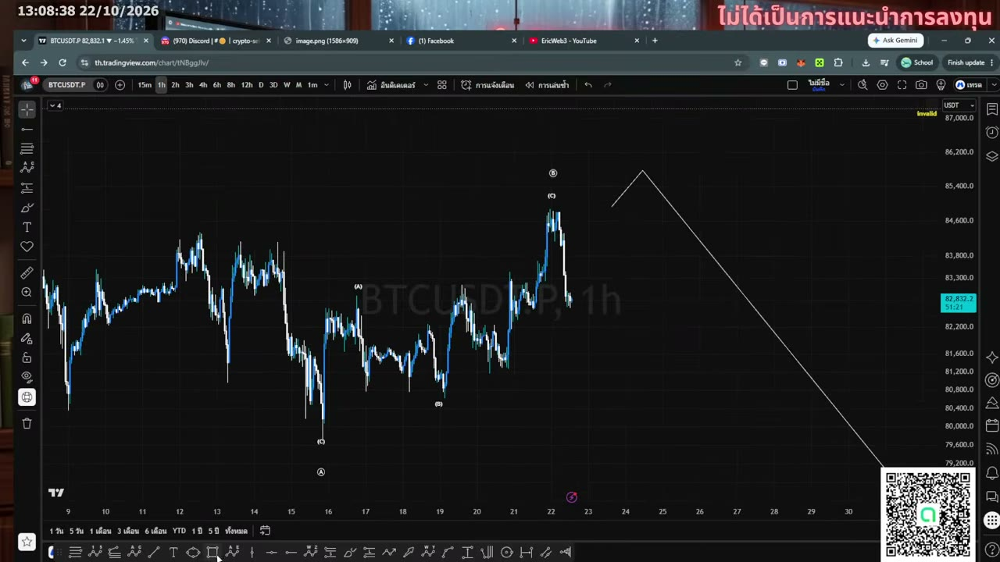

[00:10:55] 4 ก็ได้นะครับอ่ะไม่บอกราคาแล้วกันนะไม่ บอกราคาแล้วกันเอาสักครึ่งนึงของ F  GAP  Time  Frame  4 ช่โมงแล้วกันนะ อ่าเพื่อนๆก็ลองดูเอาเองแล้วกันนะครับ อ่าเหตุผลที่ยังมองว่าทันอยู่ก็คือถ้า ราคามีการปรับตัวย่อลงไปอีกนะครับตาม บริบทของการจบขา B เตรียมที่จะลง C เนี่ย นะครับแน่นอนว่าถ้าเป็นเป้าใหญ่ที่จะนับ เนี่ยนะฮะนั่นก็คือราคาจะต้องมีการเสีย โครงสร้างอย่างหนักนะครับแล้วก็ทิ้งตัวนะ ครับไปในระดับที่ต่ำกว่า 79,000 ลงมาเลย ทีเดียวนะครับนั่นก็คือในกรอบของมีสิทธิ์ ที่จะต่ำกว่าในระดับ 76,000 หรือเข้าสู่ โซน 75,000 ซึ่งเป็น POI ในการที่อาจจะ ได้ DCA  Bitcoin จากไลฟ์ครั้งที่แล้วนะ ครับเพราะงั้นคีย์ตรงนี้เนี่ยใครที่เอ่อ มองว่าเป็น 3  swing  sub  wave ข้างใน ของ wave  B นะครับ

[00:11:56] อ่าก็ต้องบอกว่าเป็น entry ที่ค่อนข้าง น่าจับตานะครับโดยเฉพาะฝั่งDayเทรดด้วยนะ ครับอเพราะฉะนั้นอ่าชุดที่เราจะรีทestและ เล่นลงต่อเนี่ยอาจจะเป็นอะไรครับการทำ เป็นรหัส 5 เนาะ อ่าทำเป็นรหัส 5 ของขา C นั่นเองนะครับอื ถึงบอกว่าโอกาสยังตามเนี่ยยังทันอยู่นะ สำหรับบitcoinนะครับทีนี้ในส่วนของวันนี้ เนี่ยนะครับเพื่อนๆก็คือเอ่อโอเคแหละรอ การรีทestเพื่อลงต่อใช่มั้ยโดยที่ราคาไม่ ควรจะเบรคทะลุ 85,000 นะครับเอ่อเงื่อนไข อีกอันนึงสำหรับในในdayรดเนาะนะครับใคร ที่ช็อตกับผมมานะนั่นก็คือการที่ราคา เนี่ยควรจะต้องทะลุเคลียร์โครงสร้างทิ้ง ไปเรื่อยๆนะครับโดยเฉพาะเพราะเอ่อหลุดอ่า 82,000 นะครับหลุด 81,000 ก็ดีนะครับ หรือทะลุ 8500 ก็ดีนะทำลายแนวรับไปทิ้งไป เลยเนี่ยนะครับอันนี้ก็จะยิ่งส่งเสริมใน การที่จะรันเทรน position ฝั่งขาช็อตมานะ ครับนะครับหรือก็นี่ก็สุดแล้วแท้แล้วแต่

[00:12:58] เลยว่าเพื่อนๆจะไป take  profit  TP1 แถว ไหนเนาะนะครับอาจจะที่สัก 81,000 200 หรือว่าอาจจะไปสุดโลข้างล่างคือ 80,000 นะครับก็ได้นะครับแล้วค่อยรอเอ่อ ในการที่จะรีเ Wave  2 นะครับมาปรับตัว ยิงสวิงชุดใหญ่อีกรอบนึงตรงนี้ก็ได้อัน นี้ก็ไม่มีปัญหานะครับในส่วนของผมเนี่ย เอ่อให้ดูตรงไหนดีในส่วนของผมเนี่ยเมื่อ เมื่อวานเนี่ยก็มีการเข้ามาเนาะนะครับมี การเข้ามาอันนี้ก็จากเดิมนะเข้ามาไปพอสม ควรแหละนะครับจะเห็นว่ามีแต่ฝั่งช็อต อย่างเดียวเลยนะครับ ก็คิดอยู่ว่าอาจจะราคาเสียโครงสร้างหนาๆ เลือกเป็นการรีทestขึ้นเนี่ยผมอาจจะต้อง เพิ่มไปนิดนึงนะชุดนี้อาจจะเพิ่มไปนิดนึง นะอันนี้มุมแผนส่วนตัวนะเป็นแผนส่วนตัวนะ อาจจะเพิ่มไปนิดนึงนะครับแล้วก็กดกดลงมา หรือเพื่อนๆอาจจะเรียกว่าสโนว์บอลก็ได้นะ ครับแล้วแต่นะฮะก็อาจจะกดลงมาเพิ่มเนาะนะ ครับเดี๋ดูว่าราคาเนี่ยจะทิ้งทวนลงได้แค่ ไหนนะแต่โดยรวมก็อยู่แถวๆนี้แหละ 84

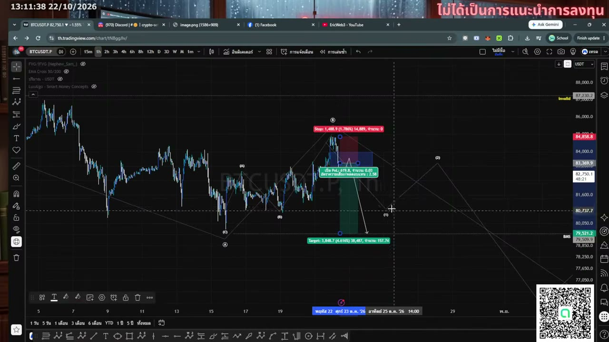

[00:13:58] 83,900 นะครับโดยประมาณนะก็ห่อของมาแล้ว กันนะครับอ่ะนะครับอันนี้ก็จะเป็นมุมมอง ของการที่ช็อตใน Wave  B ก้อนตรง นะ B นะครับเตรียมที่จะลงขา 4 ชุดใหญ่ นั่นเองนะครับซึ่งมีคีย์หลักอยู่ที่เท่า ไหร่ครับ 75,000 หรือว่า 76,000 นั่นเอง นะครับส่วนมุมมองการลงเนี่ยก็จะแบ่งเป็น 2 กรณีแล้วกันนะครับอ่าเราถอยออกไปดูใน timeม frame  4 นะครับอันนี้ผมลบเลยเนาะ ใน Time  frame  4 แล้วก็อ่า Time  Frame Day เนาะนะครับในในภาพการนับเวฟชุดใหญ่ นะครับถึงแม้ว่าจะมองลงก็ตามนะครับนะเรา ไปที่มุมมองมองแรกเลยนะครับที่ใบแอดว่า Bitcoin เนี่ยน่าจะเพิ่งทำ Wave  1 นะ ครับในการขึ้นชุดใหม่นะมุมมองที่เป็น bullish นะครับอันนี้เราจะไม่แบอดฝั่งใด ฝั่งนึงนะครับนั่นก็คือการลงเป็น subwave a  b  c นะครับของ wave  2 อันนี้ wave 1  wave  2 นะครับแนวรับ point สำคัญ

[00:15:01] เนี่ยนะครับจะไปอยู่ที่อไปดู support resistance เนี่ยอ่านี้ครับอ่าจะไปอยู่ ที่แถวๆชุดแรกนะนะที่กำลังปรับตัวลงเนาะ อ่านั่นก็คือ อ่ะโลowเดิมก่อนนะครับนั่นก็คือ 79,500 นะครับซัพพอร์ตต่อมาเนี่ยนก็คือจะอยู่ที่ 75,000 นะครับแล้วก็ระดับล่างเนี่ยจะ อยู่ที่ 67,000 หรือว่า 68,000 นั่นเองนะ ครับสำหรับการที่อ่าอาจจะทิ้งตัวลงมาแล้ว ปรับตัวขึ้นต่อในบริบทของขา C  off  2 นะ ครับแล้วก็เตรียมที่จะขึ้นเวฟ 3 ชุดใหญ่ นะครับอันนี้ก็จะเป็นคีย์ค่อนข้างพอย์ หลักพอสมควรนะครับในช่วงปลายเดือนนี้แล้ว ก็ต้นเดือนพฤศจิกายนนะครับนะโดยเฉพาะมุม มองของสายสปอตนะครับที่คิดว่าบitcoinน่า จะพักตัวในระดับที่ไปต่อได้เนี่ยนะครับนะ ต่ำกว่า 79,000 นะครับ 77,000 แล้วก็ 68,000 เนี่ยอันนี้ก็ต้องเริ่มดูแล้วนะ ครับเอ่อถ้าเราใช้สัดส่วน Fibo เนี่ยนะ ครับจากชุดแรกที่นับไปเนี่ยนะถ้าจบตรงนี้

[00:16:02] จริงๆเนี่ย ผมขอเอาแบบตื้นๆก่อนแล้วกันนะครับเอาแบบ ตื้นตืนก่อนเอาที่ Fibo  33  38.2 ก่อนนะ ครับอ่าก็จะเห็นว่าจะตรงกับอ่าSuพอร์ zซoneนะครับที่แนวรับนะครับสซักประมาณ 76,200 นะที่ Fibo  33  38.2  74,600 นะ ครับสำหรับเป้ารีทestชุดแรกนะครับอ่าส่วน 61.8 นะเอาไปแบบลึกๆเลยนะ 0.5 กับ 61.8 18 เนี่ยจะอยู่ที่ 71,000 จนถึง 67,700 นะก็ใกล้ๆกับอ่าแนวรับด้านล่างตรงนี้เนาะ ตับเวฟ 1 นะนะครับเพราะงั้นในกรอบของการ DCA โซนนี้เนี่ยใครที่มองว่าเป็นกล่อง A เนาะนะครับใครใครไม่ทันนะก็ไปดูย้อนหลัง ได้นะกล่อง A ในการ DCA กรอบเนี้ยนะครับ ถือยังถือว่าเป็นเกรด A นะเกรด A นะครับ ที่จะมองว่าบitcoinเนี่ยขึ้นรอบใหม่นะ ครับถือว่าเป็นเกรด A นะเพราะว่าเอ่อมุม มอง invalidation เนี่ยมันแน่นอนว่าบิด บitcoinมันต้องทะลุ 57,500 อยู่แล้วนะ

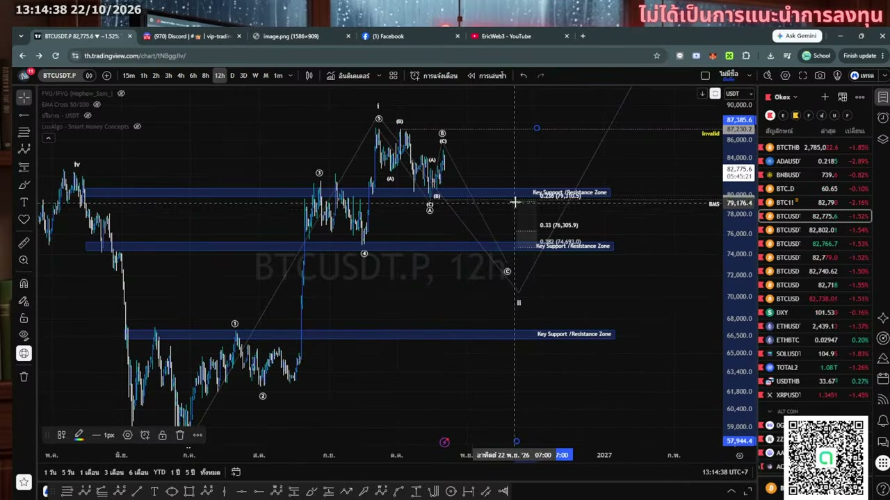

[00:17:05] ครับถ้าถ้าเรานับผิดนะครับอันนี้ก็เป็น แรกนะครับที่ที่เพื่อนๆคาดหวังแล้วก็คนใน ตลาดคาดหวังนะว่าจบฝั่งขาลงแล้วก็มุมมอง ปรับขาขึ้นใหม่นะครับส่วน timing เนาะนะ ครับ timing ที่เราดู setup เนี้ยแล้วไป ประกอบกับเอ่อเรื่องของช่วงเวลาหรือว่า เรื่องของสถิติอ่าก้อนนี้เเห็นมั้ยครับก็ เข้าสู่ช่วงช่วงที่มีการพักตัวนะแล้ว เตรียมไปต่อนะครับก็จะอยู่ในกรอบเดียวกัน นะอันนี้ย้อนให้ดูนิดนึงนะชุดกราฟนี้เนาะ อ่าที่เราแบ่งเป็นอะไรครับเป็นช่วงระยะ เวลา 1,400 กว่าวันเนี่ยนะครับแบ่งช่วง ที่เป็นบูแล้วก็ beish นะครับจะเห็นว่าใน ชุดของการย่อต่ำกว่า 79,000 นะครับ 79,000 ก็ดี 77,000  75,000 นะครับหรือแม้ กระทั่ง 68,000 ก็ดีเนี่ยถ้าออกชุดนี้มา ทันทีเนี่ยนะครับ ถ้าคิดว่าขึ้นต่อก็ถือว่าเป็นแนวบังคับ แล้วกันนะเป็นแนวบังคับในการที่จะต้อง เริ่ม DCA นะครับหรือเพื่อนๆจะ DCA ชุด

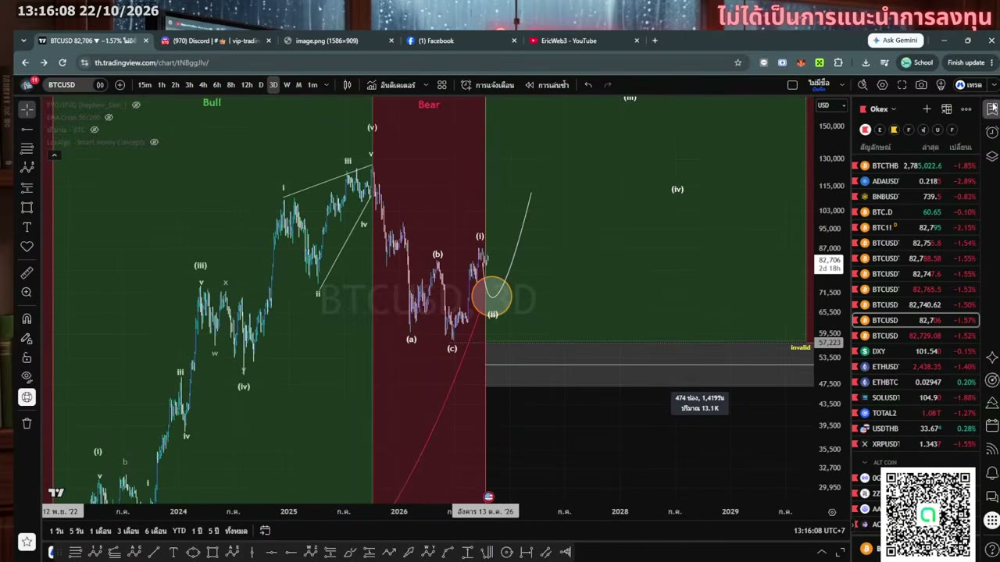

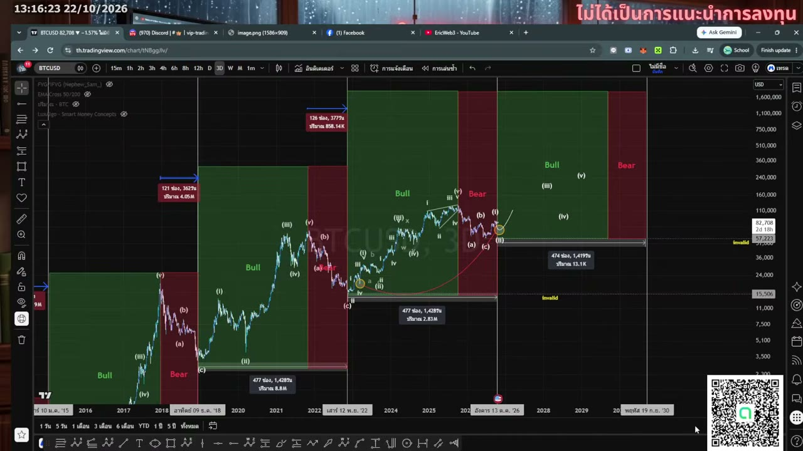

[00:18:07] นี้ลงมาเป็นขา C เลยก็ได้อันนี้ก็ไม่ผิด นะครับแต่ต้องมีการ mm ที่ดีนะวางแผนให้ ชัวร์แล้วกันนะครับอันนี้ก็จะเป็นเ่อภาพ ใหญ่ของการเทรด Future แล้วก็เอ่อ DCA สายสปอพร้อมกันนะสำหรับ Bitcoin นะครับ อันนี้มุมมอง Bullish เนาะนั่นก็คืออะไร ครับ 1 ลง 2 นะเตรียมเข้าสู่ขึ้นปรับชุด ใหญ่แล้วเตรียมขึ้นต่อนะครับ มีอะไรอีกมั้อ่ะไม่มีเอ่ออีกกรณีเดียวกัน เหมือนกันนะครับนะครับจากหัวข้อไลฟ์วัน นี้ก็คือ wave  B หรือ Wave  2 ใช่มนะ ครับทีนี้เมื่อกี้มุมมอง Bullish มันคือ อะไรครับก็คือว่าตรงเนี้ยคือ Wave  2 ถูก อ่ะเวฟ 2 ใช่มั้คือย่อเพื่อขึ้นต่อขึ้น รอบใหม่ไซเคิลใหม่นะครับแต่เคสนี้นั่นก็ คือเป็นเพิ่งจบ B นะฮะจบ B แล้วเตรียมลง

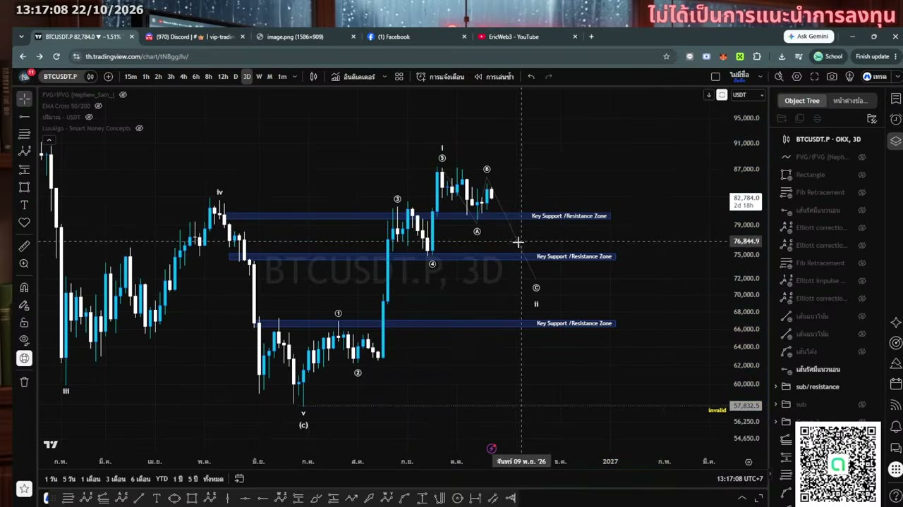

[00:19:10] ขา C นะครับ B ตรงไหนตรงนี้นะก็จะแตกต่าง อ่ารอบเมื่อกี้ อ่าก็จะแตกต่างกับรอบเมื่อกี้นั่นก็คือ ยังมีความเป็นว่าเมื่อกี้เป็น bullish อันนี้ก็คือ barish เลยนะครับนั่นก็คือ การที่ราคาเนี่ยเพิ่งจบ subw โครงสร้าง ใหญ่ใช่มั้ยครับ B โครงสร้างใหญ่แล้ว เตรียมที่จะลงขา C นั่นเองนะครับนั่นก็ คือมีสิทธิ์ที่จะปรับตัวหลุดต่ำกว่านะ ครับหรือว่าอาจจะลงไปย้ำโลที่เดิมในเอ่อ 57,500 หรือต่ำกว่านั้นนะนะครับก็เป็น หัวข้อวันนี้เหมือนกันว่าเอ๊ะไอ้ชุดที่ลง เนี่ยจากเดิมเนี่ยนะนะครับเป็นเอ่อเวฟ 2 ลง 3 ย่อยใช่มยนะครับตรงนี้อาจจะเป็นเวฟ 2 แล้วลงชุดใหญ่ อ่า[เสียงกระแอม]เพราะฉะนั้นบริบทตรงนี้

[00:20:10] เนี่ยค่อนข้างจะต่างกันนะครับโดยเฉพาะ POI กล่อง A ที่จะ DCA ที่เราพูดกันเมื่อกี้ เนาะนะครับว่าถ้าบitcoinนะครับ อารมณ์ตลาดตอนนั้นอาจจะมีอะไรที่กระแทกมา ค่อนข้างแรงจนทะลุ กล่อง A ตรงนี้ไปแผนนี้จะ invalidation ทันทีเห็นมฮะจะ invalidation ทันที อถ้าราคาหลุด 57,500 ต้องออกทันทีนะครับหรือเพื่อนๆอาจจะ เตรียม DCA ไปในกล่อง B ทันทีนั่นก็คือ กรอบนี้ซึ่งราคาอาจจะร่วงต่ำลงมา ทำโลowมากกว่า 57,000 หรืออาจจะสูตรในระดับ 40,000 ก็ ได้นะครับ 40,000 ก็ได้ตามสถิติเดิมที่ บitcoinเนี่ยลงต่ำมากกว่า 70%  65-70% นะ ครับจาก 4  year  cycle นะมันแต่ cycle มันอาจจะไม่เหมือนกันก็ได้นะครับแต่เพียง แค่ว่าเราแบ่งแผน 2 โซนทั้งกล่อง A และ กล่อง B ไว้ว่าถ้าลงมาถึงขนาดนี้แล้วจะ

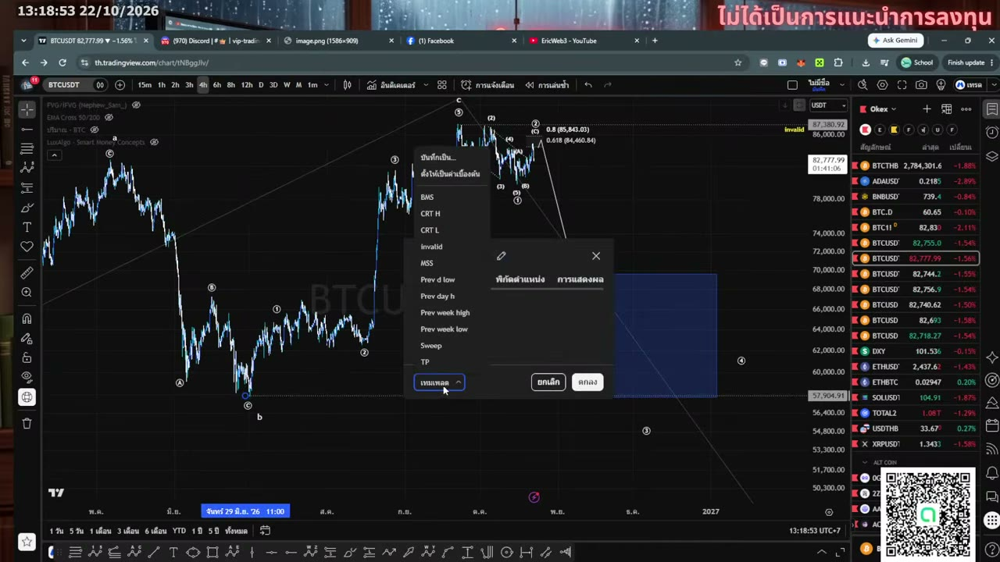

[00:21:11] DCA ยังไงต่อนะครับนะอันนี้ก็คือเป็นจุด เริ่มต้นเหมือนกันว่า ในในกรอบราคานี้เนี่ยถ้าบitคinมีการเท หลุดลงมา 80,000 แล้วเนี่ยนะครับแล้ว เผอิญว่ากล่อง A รับไม่อยู่เนี่ย นะถ้าไม่มีแรงซื้อเนี่ยจริงๆ 75,000 เนี่ยต้องมีแรงซื้อแล้วนะ 75,000  76,000 68,000 เนี่ยต้องมีแรงซื้อใหญ่ๆแล้วนะนะ ครับถ้าไม่มีเนี่ยนะครับอาจจะต้องเตรียม แผน B ไว้รองรับด้วยนะอันนี้ก็ไปดูกันอีก ทีนึงเนาะนะครับอ่าจะแต่จะแต่ยังไงก็คือ ในฝั่งของDayเทรดเนี่ยตรงนี้ก็ขอมองลงไป ก่อนนะตามสดๆนะครับอันนี้ก็เป็น 2ario ที่สอดคล้องกับภาพdayเทรทดรดจากไครั้งที่ แล้วนะครับในการมองว่ารีบาวoundขึ้น B หรือ Wave  2 แล้วลงต่อนะครับสุดท้ายของ บitcoinแล้วะกันนะครับเมื่อคืนก็คือต้อง เตรียมเผื่อไว้เหมือนกันนะครับนั่นก็คือ เอ่อดูเหมือนว่าราคาจะเบรคใช่มั้บitcoin นะครับอันนี้ก็ถ้าราคาเนี่ยนะครับจริงๆผม วาง SL ไว้แล้วนะที่ 87,300 นะคือก้อนตรงนี้เนาะนะครับคือเผื่อเกิด

[00:22:13] กรณีมีราคาแทงขึ้นทะลุมาเนี่ยนะครับก็ เป็นไปได้ว่าเทรนด์ขาขึ้นของบitคinจากโล อ่าจากโล 57,800 เนี่ยขึ้นไปเนี่ยยังไม่ จบนะตรงนี้อาจจะมองว่าเพิ่งทำจบ เวฟ 4 แล้วเตรียมขึ้น 5 นะแต่เงื่อนไขก็ คือต้องเอ่อทะลุ 58,000 นั่นแหละนะครับ แต่นี้ก็ยังไม่ทะลุนะครับก็เลยมองเป็นขา B ลงไปก่อนก็ทำให้เกิดการช็อตเนาะนะครับแต่ ถ้าคือขึ้นไปกิน Stop  Loss ได้เนี่ยก็ แสดงว่าราคาเบรคแล้วนะตรงนี้อาจจะไปเล่น ย่อรีเทสกันอีกรอบนึงก็ไม่เป็นไรนะครับ อันนี้ก็ยังคงค้างไว้ก่อนนะครับแผ่นนี้จน กว่าราคาจะหลุด 79,300 แล้วะกันนะครับใน มุมมองของ Wave  4 ย่อยนะครับซึ่งดูจาก บริบทแล้วเนี่ย น่าจะปรับตัวลงไปก่อนเนาะ อ่ะเป็นไงกันบ้างครับเพื่อนๆคิดว่า ย่อชุดนี้แนวรับตรงไหนเป็นเกรด A ฮะเอ่อ สามารถคอมเมนต์กันได้นะหรือว่าพิมพ์เสนอ ได้นะพูดคุยได้นะครับ Bitcoin ก็จะประมาณ นี้นะถือว่าได้ช็อตมาโอเคแล้วแหละนะครับ

[00:23:14] ในเอ่อ setup เราเนาะ สวัสดี 41 โคโม่หรือโคม่าก็ไม่รู้ตื่น เช้ามาโดนเพื่อนล้อแล้วนะครับตอนนี้ อาจารย์ปาล์ม ตื่นเช้ามาโดนเพื่อนล้อแล้วนะครับโอเคนะ ครับก็ปล่อยให้ราคาย่อลงไปก่อนแล้วกันนะ ตามบริบทนะครับสำหรับบitcoinนะส่วนตัว เนี่ยผมมองคาดหวังว่าน่าจะหลุดไปในระดับ 81,000  8700 อะไรประมาณเนี้ยนะว่าวัน นี้ขอสัก 2,000 จุดแล้วกันแล้ววันศุกร์จะ เทหลุดหรือจะรีบาว[เสียงกระแอม]ขึ้นก็ แล้วแต่นะเนาะ มีคำถามเพิ่มเติมมั้ยครับบitcoinอ่าโอเค ครับถ้าไม่มีก็เอ่อใครอยากดูเหรียญไหน outcoin นะเดี๋ยวมาตาม Outcoin กันบ้าง นะครับใครอยากดูเหรียญไหนนะพิมพเพื่อนๆ พิมพ์ได้เลยนะครับพิมพ์ด้วยนะว่าเป็น Futจureหรือสปอนะนะครับสามารถพิมพ์ได้เลย

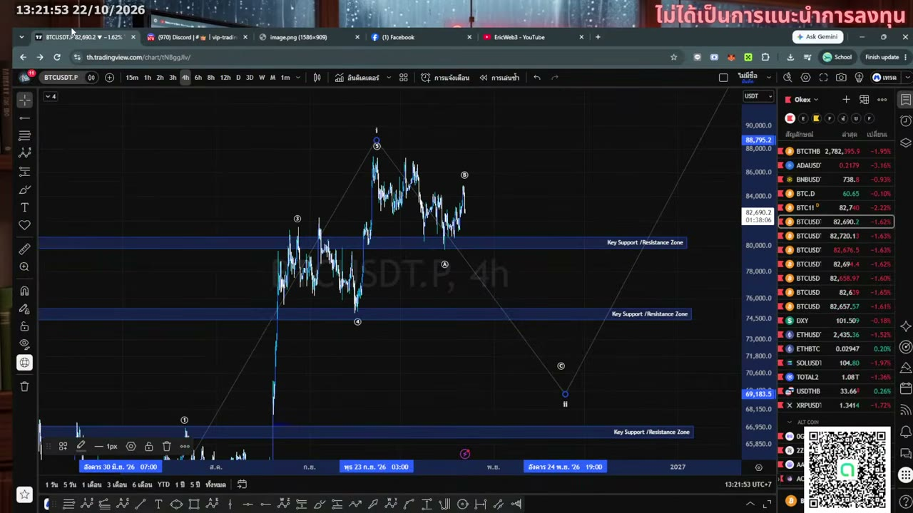

[00:24:14] นะเดี๋จะได้ดูพร้อมกันทีเดียวเลยนะ อืไม่ค่อยเข้าเท่าไหร่ รู้สึกจะไม่ค่อยเทสเท่าไหร่นะน่าจะต้องลง ไปก่อนเลยนะบitคinนะแล้วชุดนี้น่าจะลง 1 2  3 เดี๋ยวน่าจะลงไปจุ่มๆสัก 82,000 นะ ครับคุณRิcky Sou  Future ได้ช็อตมามั้ย อยู่ใน Discord หรือเปล่าอยู่ในDisอร์ หรือเปล่า Solona  Solona ไปแอบดู Setup ย้อนหลัง ส่วนใหญ่ในสัปดาห์ที่ผ่านมาเนี่ยเป็นมัน เป็นเทรด setup รีบoundเพื่อลงต่ออยู่ แล้วนะ ทองเหรอทองทองเนี่ยโอ้โหคือคริปโตขึ้นแต่

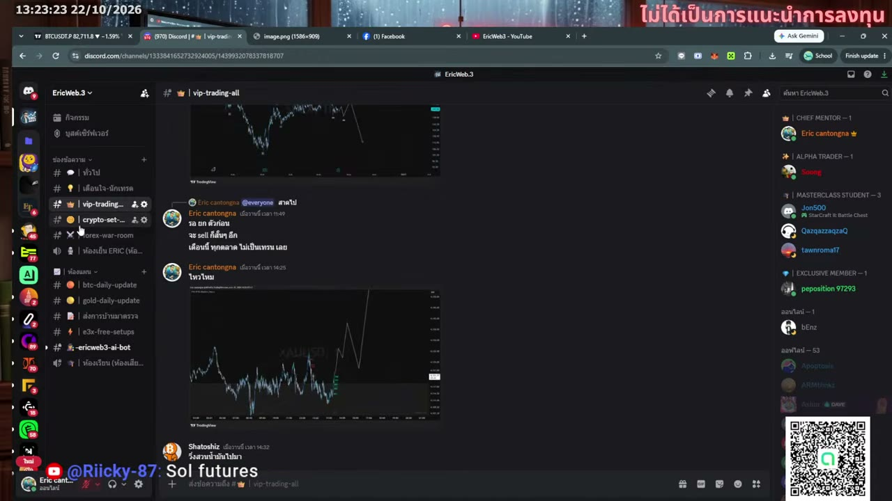

[00:25:17] ทองไม่ขึ้นเนี่ยสิ ผมนี่โดนหน้าทุนกับ Stop  Loss ไปเยอะ เหมือนกันแล้วนะทองเนี่ยก็เดี๋ยวเบรคไป ก่อนนะฮะโอเคครับ Solona จาก setup เดิม เนาะเรามองว่าน่าจะมีการรีทestแถวๆซัก 110 นะครับหรือ 112 หรือ 115 แล้วลงต่อในขา B นะครับใน setup ชุดนี้เนาะนะครับอืมรู้ สึกจะไปไม่ค่อยถึงฮะ อ่าไปไม่ไปไม่ถึงฮะตรงนี้นะโน่าตรงนี้นะ ครับอาจจะชนที่ฟิโบ 33 นะเนี่ยครับชน 33 ครับที่ 109 ฮะอืผมประเมินสูงไปนิดนึง ถ้าจบตรงนี้ก็ เดี๋รอคอนเฟิร์มการหลุดแล้วกันนะครับแต่ ถ้าเราถ้าจะรอขึ้นก็ ถ้าจะรอขึ้นก็เหมือนเดิมครับไปตามชุดย่อย นะเดี๋ยวรอทำ Market Sชipนะจริงๆมันเบรก แล้วแหละ เนี่ยนะอาจจะซ้ำอีกรอบนึงนะ

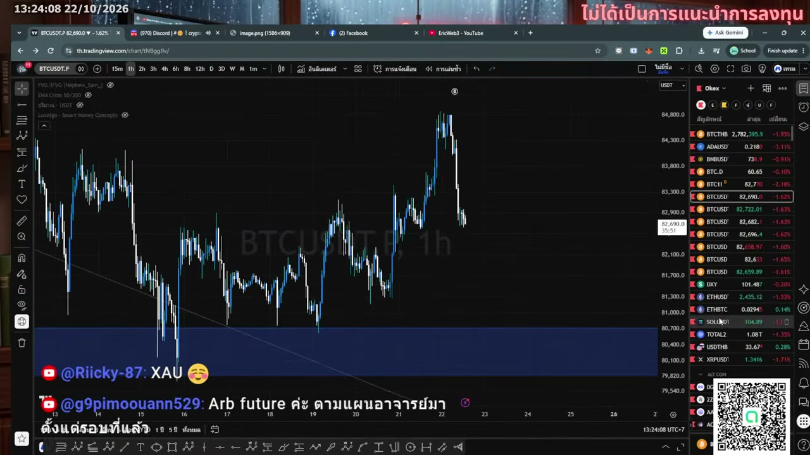

[00:26:19] ตอนนี้ไม่คิดอะไรเลยครับถ้ารีเทคก็ลงต่อ อย่างเดียวนะ 106  107 เนี่ยลงอย่างเดียว [เพลง]นะครับขา B ชุดใหญ่นะมีเป้าหมายนี่ หลุดต่ำกว่า 100 นะครับSolon่านะ อื 90  100 ไปหมดนะครับ ARB  Future ตามแผน ตั้งแต่รอบที่แล้วใช่มั้ยเข้าแผนฝั่งไหน ครับต้องบอกด้วย

[00:26:41] ช็อตหรือรองบอกด้วยนะทองคำเดี๋ยวผมดูให้ อีกทีนึงตอนนี้ทองผมต้องปล่อยไปก่อนนะ ครับเพราะว่า จริงๆทองอ่ะมันมองผมมองขึ้นไปแล้วนะแต่ ว่าชุดโครงสร้างขึ้นมันไม่ได้นะครับเพิ่ง ทำรีเจคเนาะ อ่าเพิ่งทำรีเจคนะครับเดี๋ยวทองต้องดูนิด แต่ตรงคือตรงเนี้ยยังไงมันก็บังต้อง บังคับไปแล้วอ่ะคือถ้านับตรงนี้เป็น 1 ตรงนี้ 1 ย่อยอีกใช่มยตรงนี้มันก็ต้องไป แล้วเชื่อว่าตรงเนี้ยเพื่อนๆหลายคนน่าจะ นับแล้วก็เล่นบายแล้วไปอ่ะนะครับอืตรงนี้ RR มันบังคับรีมันบังคับนะครับบังคับ เล่นฝั่งบายอยู่แล้วก็ Stop  Loss ก็ low เดิมแค่นั้นเลยหลุดก็ออกนะ ARB ใช่มย ARB เป็นไงมั่งน้อ โอเคครับ ARB ติด. 2 นะไม่ผ่าน 0.21 ด้วยชุดนี้มองจบ B แล้วครับเตรียมที่จะเบรค Market

[00:27:42] Structure หลุด 0.17 นะฮะ ARB  ARB อยู่ ไหนหวว่า ผมอาจจะงงๆกับ set  up ตัวเองนะผมผมส่ง เยอะมาก อ่าชุดนี้ฮะอื 0.204  Fibo  0.5  5 เนาะ ช็อตลงมาเนาะโอเคก็เดี๋ยวรอให้เสียโครง สร้างเลยครับรอเสียงโครงสร้างหลุดว่ากัน รอหลุดนะนี่มันเพิ่มมาอีกสวิงนึงนะ อื[เพลง]ถ้าหลุดตรงนี้ได้ค่อนข้างดีนะ ทิ้งต่ำกว่าหัว A ได้ค่อนข้างดีนะ 0.16 อ่ะก็หาแนว TP เอาเองนะครับสำหรับ ARB เนาะหาแนว TP เอา ดูแล้วมันไม่น่าจะผ่าน 0.22 สงสหรอกจาก จากที่ครั้งที่แล้วเนาะเนี่ย ร่วงละมีตัวอื่นมั้ครับ ETS  Sport ครับ อ่ะมา โอดีจังเลยพอเปิดพอกลับมาไลฟ์ปุ๊บตลาดลง ET ตอนนี้อยู่ที่ 2,431

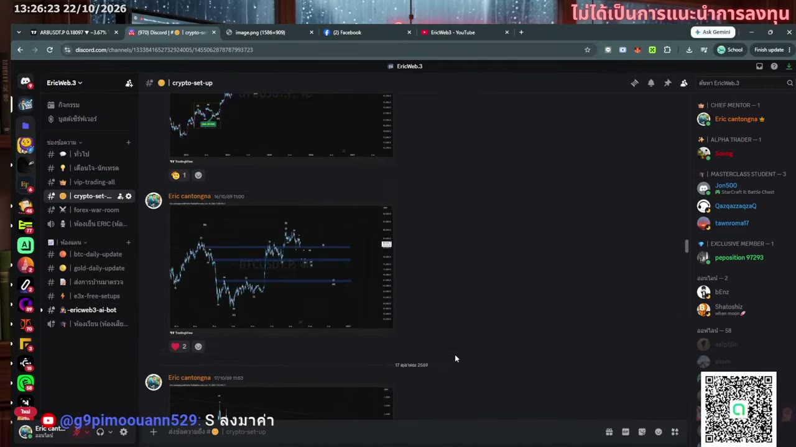

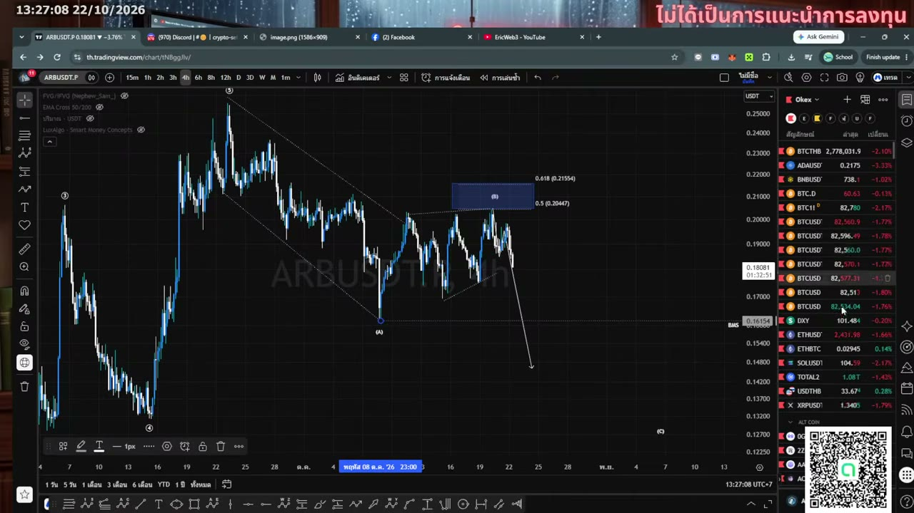

[00:28:44] นะครับEธเรiumเนี่ยผมมองต่างนิดนึงนะอี eอร์กลายเป็นว่าผมไปมองว่าน่าจะเป็นเป็น เอ่อ Wave  4 นะ ไม่ 4 อBก็ลงนะครับ เนี่ยฮะจากเดิมครั้งที่แล้วเนี่ยมองว่า เอ่อแนวต้านซัก 2,455  2,400 78 แต่เมื่อวานน่าจะขึ้นไปเยอะนะ 2,000 2,500 ได้มั้งนะครับแล้วก็ถูกรีเจคเนาะ นะครับผมก็มีช็อตมาเหมือนกันนะครับชุดนี้ สวิงค่อนข้างครบนะ เดี๋ยวเปรียบเทียบกราฟนี่นิดนึงนะครับบาง ทีทำเทรด setup มันก็ต้องมี recap กราฟ กันบ้างนะว่าเอ๊ะแผนเรามองถูกแล้วนับเวฟ ถูกหรือเปล่า นะครับก็มองลงไป อจริงๆตรงนี้อาจจะเป็น B ก็ได้นะตรงนี้ อาจจะเป็น 1  2  3  4  5 ตรงนี้เป็น A แทนนะตรงนี้เป็น B เป็น C ก็ได้ก็แล้วแต่ นะครับแต่ว่าทิศทางเดียวกันเนี่ยมองลง

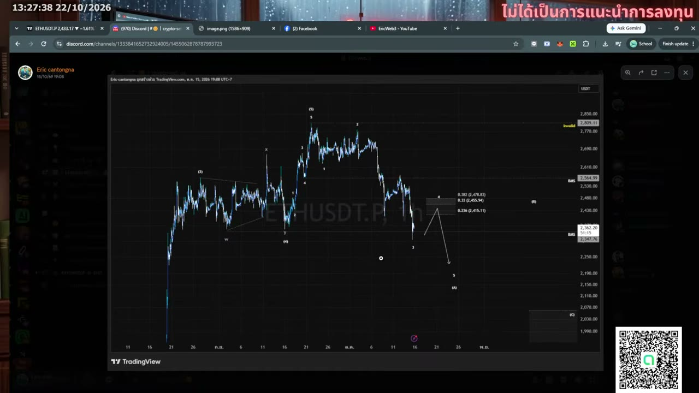

[00:29:44] เนาะส่วนในมุมมองของสปอตเนี่ยeอรต้องต้อง ไปว่ากันที่ด้านล่างนะครับเนี่ยด้านล่าง ที่ว่าเนี่ยซึ่งผมคิดว่าน่าจะต่ำในระดับ แถวๆโซน 2,000 เน ค่อนข้างน่าสนใจคือกรอบบริเวณเนี้ย นะครับในการที่จะอาจจะมองว่าถ้าขึ้นต่อนะ ถ้า Bitcoin เป็นแผน Bullish เนี่ยขึ้น ต่อเนี่ยEอร์เนี่ยชุดเนี้ยก็โครงสร้าง ค่อนข้างน่าสนใจนะครับสำหรับที่จะปรับตัว ขึ้นต่อเนาะ ในก้อนถัดไป นะครับก็ปล่อยไหลไปก่อนนะเพราะว่าตรงนี้ มันทำโลใหม่ไปแล้วนะ 2,290 นะครับแนวแนวถัดไปเนี่ยผมมองว่าแถวๆสซัก 2,000 น่ะ 2,100  2,000 แล้วก็ 1,900 นะ ครับตามสัดส่วนFบ

[00:30:45] งงมากครับดอลลาร์ก็ลงใช่ม ดอลลาร์ลงนิดเดียว แต่เงินบาทอ่อนเยอะเหมือนกันนะจะไป 34 แล้วนะนี่เดี๋ยวๆถ้าเบรก 33.8 นี่คือบาท 34 แล้วนะ 34 แล้วนะครับเออ ปีนึงมั้งถึงปีแล้วมั้งที่ที่เราน่าจะรับ แถวๆ 31 อ่ะหรือว่าไม่ถึง 31 อ่ะเนี่ยชุด เนี้ย bottom ชุดเนี้ยนี่มาก็ค่อนข้าง เยอะนะ ขอไปดู XRP นะครับเนื่องจากผมเคยมี setup ไม้รองมาซึ่งเล่นก้อนตรงนี้นะไม้รอง นะครับจริงๆวางเป้าไว้ที่ 1.42 นะครับไม่ ถึงนะครับไปออกซัก 1.38 นะเพราะว่าตอนแรก จะมองเป็น INP ขึ้นชุดใหม่นะครับผลปรากฏ ว่าออกเป็น 3 สวิงเนาะนะครับแล้วก็มีการ ปรับตัวย่อลงไปก่อนนะอ่าก็คือก้อนนี้เนาะ XRP นะครับขึ้นไปไม่ถึง 1.48 นะไปแค่

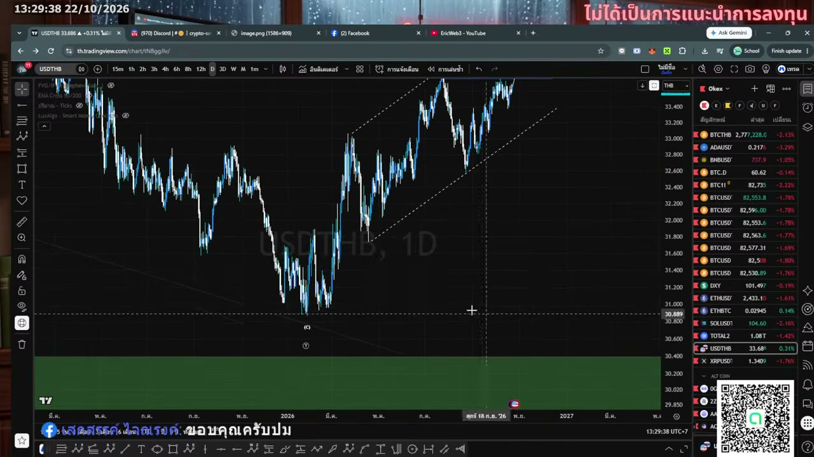

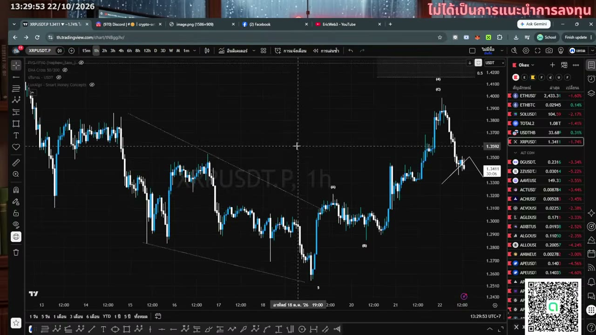

[00:31:47] 1.38  38 นะครับก็เลยมองว่าอาจจะมีการลง subve อีกรอบนึงนะครับผมปรากฏว่าลงมา เรียบร้อยนะครับซึ่งผมก็กดมาเหมือนกันนะ นะก็กดเซลล์ลงมาเหมือนกันนะครับเอ่อคิด ว่าน่าจะลงอีกขานึงเนาะนะครับมาในต่ำกว่า ระดับสัก 1.2 ดอลลาร์นั่นเองนะครับสำหรับ XRP นะครับหรืออาจจะพีคหน่อยเลยอาจจะมา สซัก 1.14  14 ด้วยซ้ำนะครับอันนี้ก็ต้อง รอดูต่อไป อ่าสำหรับไลฟ์นี้ก็เป็นแผนส่วนตัวนะครับ ไม่ได้เป็นการแนะนำการลงทุนนะ สำหรับเพื่อนๆที่ยังไม่ได้อยู่ในคunityนะ ครับหรือว่าอยู่ในอ่าdiscอร์ดหรือว่า Line Open  Chat ก็ Q ด้านล่างขวามือนะครับ เราก็ถึงแม้ว่าจะไม่ได้ไลฟ์หน้าเพจกับ หน้าช่องบ่อยนะเพราะว่าเอ่อต้องรอแพของ ราคาเนี่ยนะครับก็แต่ในdiscอร์กัน Open Chat นี่เรายังคุยกันตลอดเวลานะ [เสียงหัวเราะ]คุยกัน ตลอดเวลาเลยนะครับ

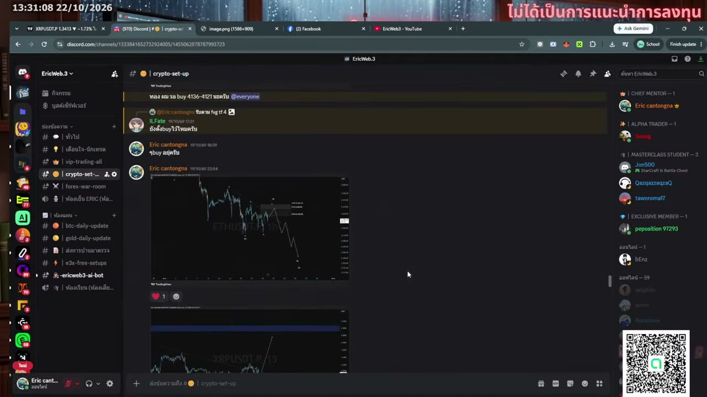

[00:32:52] อ่ะ XRP นะก้อนนี้เนาะ ไหลลงมาค่อนข้างดีนะครับ 3 สวิงชุดนี้นะ ใครที่เป็นนักเรียนเทรดผมก็ Ring  Wight นะครับ Barage  Divergent  Ring  Wight นะครับ Fair  Value  G  Market Suckership นะแค่นี้ก็ท่านี้เนี่ยท่า มีเพิ่มเติมมั้ครับ เอ่อแอบไปดู Dodge  Coin นิดนึงว่าเป็นไง อ่า Dodge  Coin ก็จะคล้ายๆกับ XRP นะ ครับน่าจะติดเวฟ 4 ยอดแล้วเตรียมลงปรับ ตัวลงต่อเนาะนะครับไปในระดับของ Wave  5 นะฮะอืซึ่งน่าจะอยู่แถวๆนี้เลยนะ 0 จุด เอ่อ 0.0  073 ประมาณเนี้ยนะครับสำหรับ ทองเอ้ยสำหรับ Dodge คอยนะ

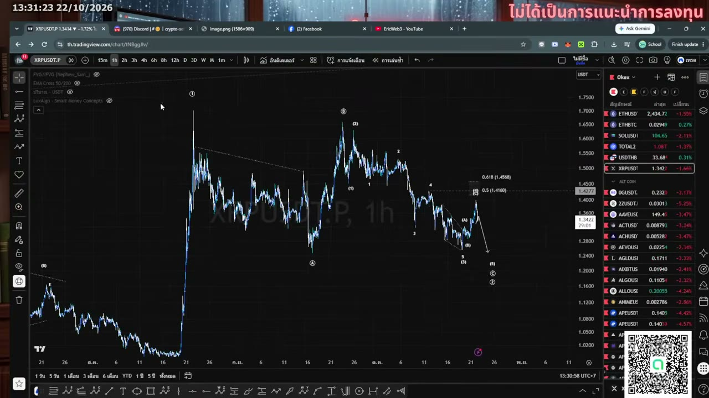

[00:33:59] ส่วนไฮก็น่าจะครบคลื่นพอสมควรแล้วครับ เดี๋ถ้าเตรียมหลุดเทลน นะโดยเฉพาะการหลุด 75-74 ดอลลาร์นี่ระวัง จบเทรนด์ขาขึ้นนะ ไอ้เหรียญที่ไต่เทนไลนแบบเนี้ยระวังนะนะ ครับอย่าไปถือเพลินนะทุกคน เอออย่าถือเพินนะอย่าถือเพลินนะระวังด้วย อยู่ในช่วงขึ้นปรับแล้วนะครับคิดว่าน่าจะ เป็นชุดพักตัวเนาะนะครับก็ระมัดระวังการ ไปรับของแล้วลงต่ำกว่าเดิมอีกรอบนึงนะ เพื่อนๆ

[00:35:01] อืกราฟส่วนใหญ่ก็ น่าจะต้องน่าจะต้องย่อไปก่อนนะครับนะอย่า เพิ่งไปรับของนะอย่าเพิ่งนะอ่าก็ประมาณ นี้แล้วกันนะสำหรับอ่าิปโตนะครับส่วนอื่น ก็ไหลลงไปก่อนนะเดี๋ยวค่อยไปคุยกันอีกที ใน Line  Opish กับdiscอร์ดนะครับนะครับ ขอแวบไปดู ทองนิดนึงนะครับ ทองเนี่ยคือถ้าตรงนี้เอาไม่อยู่แล้วเนี่ย นะครับต่ำกว่า 4,000 แล้วนะครับต้องไป เล่นที่ 3,900 นะครับแล้วก็ถ้าในระดับ 3,900 รับไม่อยู่แล้วเนี่ยทองเนี่ยน่าจะ เป็นเทรนด์ขาลงชุดใหญ่นะนะครับน่าจะเป็น เทรนด์ขาลงชุดใหญ่นะครับอันนี้ก็ต้อง ระวังพึงระวังดีๆนะซึ่งคือถ้าหลุด 3,900 เนี่ยนะครับทองคำเนี่ยมีสิทธิ์ที่จะปรับ ในระดับต่ำกว่า 3,700 ลงมานะคือเป็นเป็น ก้อนชุดใหญ่พอสมควรนะครับนะเพราะงั้นเอ่อ อย่าเพิ่งสวนเทรนด์ดีกว่าตรงนี้เมื่อวาน เนี่ยผมคุยกับเพื่อนเพื่อนในdisคอร์ด

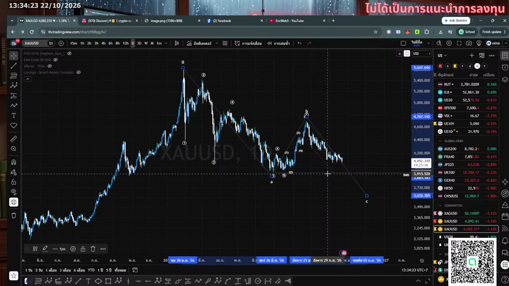

[00:36:04] เนี่ยนะครับก็พยายามจะพยายามจะเล่นแนวรับ นะเพราะเห็น divergent แล้วนะครับแล้วก็ ยกไยก low นะผลปรากฏว่าแค่รับมาสัก 4,100 เขึ้นไปซัก 4150 อย่างเงี้ยไม่ถึงด้วยนะ ครับเหวี่ยงไปเหวี่ยงมานะเหวี่ยงไปเห็น มั้ยเหวี่ยงมากินหน้าทุนแล้วก็ไปอีกนิด นึงนะครับก็เลยพักพักดูไปก่อนนะสำหรับทอง นะครับเดี๋รอให้ฟอร์มคลื่นตรงนี้ให้จบ ก่อนนะครับ อ่าน้ำมันเนี่ยโอ้โหโห จริงๆผมมองว่าไม่ควรจะเบรกก้อนนี้แล้วนะ 96 นะนี้เบรคขึ้นมาก็ระวังการปรับตัว ขึ้นไปในระดับ 100 อีกรอบนึงนะครับก็ พยายามดูกันไหลเงินเบ็ดเวียนกันดีๆแล้ว กันนะครับดอลลาร์ลงเแต่บitคinไม่ขึ้นนะ อสำหรับ DXY ครับดอลลาร์ก็อ่าถ้าหลุด 101 เนี่ยนะครับหลุด 101 เมื่อไหร่ก็อาจจะมี การจบคลื่นแล้วปรับตัวลงแล้วนะลงพักฐาน อีกรอบนึงนะครับ

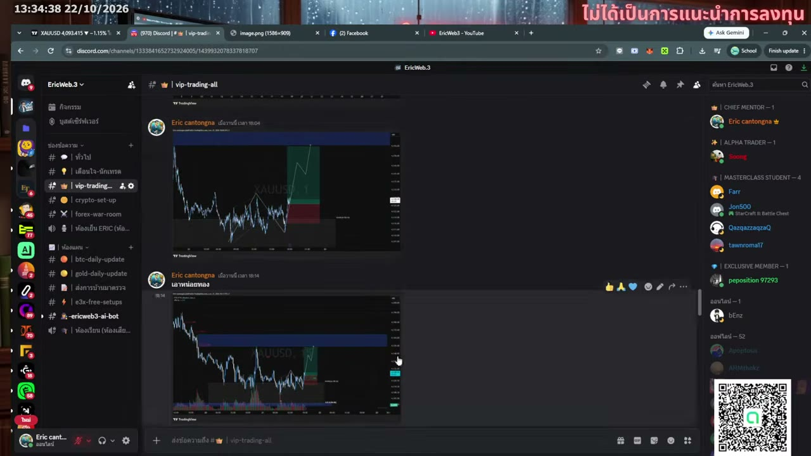

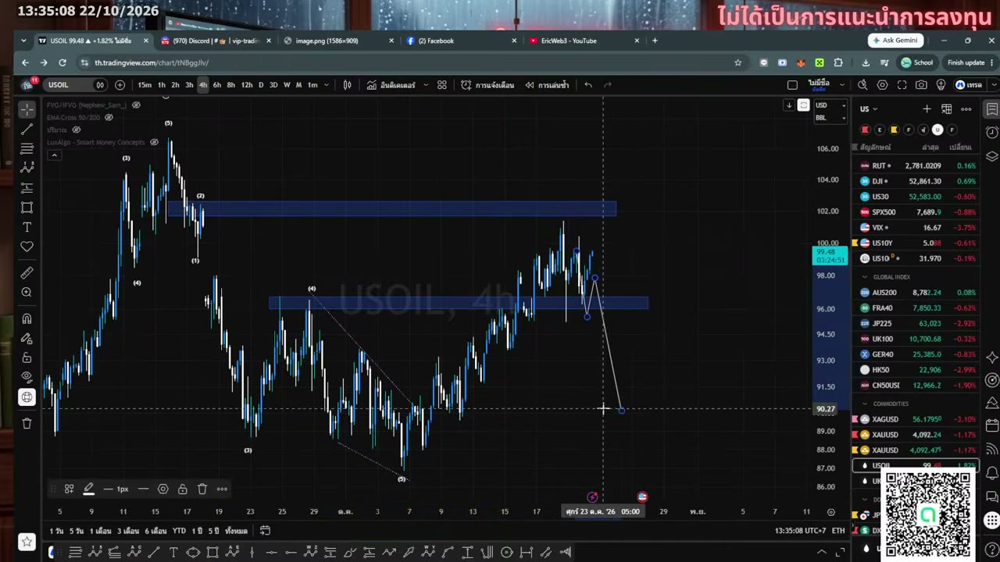

[00:37:07] แต่ิปโตเเนี่ยลงของแท้นะ ไม่ไม่รีทestให้เลยไม่รีทestให้ช็อตอีก เลยเนี่ย อ่ะไม่เป็นไรฮะ อ่ะเป็นไงกันบ้างครับสำหรับ อ่าเป็น wave  B หรือ Wave  2 นะเพื่อนๆ ก็ลองพิจารณาดูแล้วกันนะครับว่าจะออกใน ทิศทางไหนเนาะนะครับส่วนที่ใครที่ช็อตกัน มานะครับใน community เนาะนะครับที่ช็อต มาจากเทรด setup ก็ ลองหาจุดดูนะครับนะลองหาจุดดูว่าจะออกไป ในลักษณะไหนกันต่อนะครับนะโดยรวมแล้ว เนี่ยถ้าเอ่อราคาถึงจุดที่พอใจแล้วก็ พยายามพยายามหาจุดที่จะ take  profit บ้างนะครับนะส่วนใครที่เป็นสายปั้นพอต เนาะเนาะนะครับเดี๋รอการรีบาวก่อนดีกว่า นะครับรอการรีบาวก่อนตัวนี้ก็ปล่อยให้ลง ให้จบก่อนนะครับนะครับโดยรวมแล้วเนี่ยผม อยากให้หลุดสัก 80,000 ด้วยซ้ำนะบitcoin

[00:38:08] นะนะครับเพื่อที่จะได้ไป 75,000 เร็วๆ เนาะนะครับอยากไปดูแอชัตรงนั้นแล้วว่าถ้า ไปถึง 77,000  75,000 แล้วเนี่ยครับจะมี แรงซื้อกลับแล้วมีแรงซื้อกลับขนาดไหนนะ ครับประมาณนี้ทุกคนนะครับใครที่อยากเข้า มาในคอมityก็อย่าลืมนะ QR  Code ได้เลยนะ ครับด้านล่างขวามือเนาะนี่ก็พูดคุยกัน สนุกสนานนะครับมาแชร์แผนได้อ่ะอ่ะประมาณ นี้นะครับเดี๋ยวไว้เจอกันใหม่นะครับใน ไลฟ์ครั้งหน้าซึ่งไม่รู้ตอนไหนด้วยนะครับ ว่าเอ่อ ราคาเนี่ยจะได้มีแอชั่นอะไรให้เราได้เล่น เนาะเดี๋ถ้าบitคinหลุด 80,000  80,000 เมื่อไหร่เนาะเข้าโซนระดับ 77,000  75,000 เดี๋ยวผมจะมาไลฟ์ตามแผงกันอีกรอบนึงนะ ครับแล้วมาดูว่าณตอนนั้นเนี่ยนะครับมีจุด ไหนที่จะได้แอtionับ้างนะครับสำหรับฝั่ง ของการเทรดนะครับสำหรับวันนี้ก็ขอขอบคุณ ทุกคนนะครับใครที่เพิ่งเข้ามาฟังก็ไปดู ย้อนหลังได้ที่ช่องนะนะครับเดี๋ยวไว้เจอ กันใหม่นะครับสำหรับไลฟ์ข้างหน้านะครับ สำหรับบ่ายนี้ก็สวัสดีนะครับ

[00:39:21] between  the  tight The  light I  keep  moving not  to  far a  quiet  rhythm beneath  the  cars.

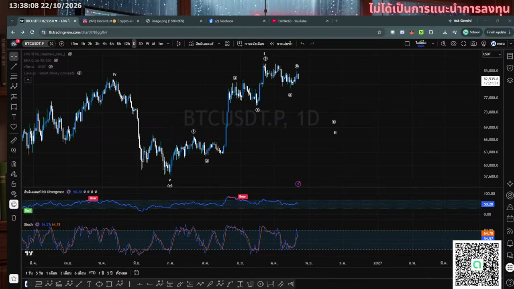

