# 🔥 LIVE สิ้นเดือนนี้ศึกหนัก BTC 🔥 | EricWeb3 ( 26 ต.ค. 2569)

- ช่อง: EricWeb3
- ลิงก์: https://www.youtube.com/watch?v=rZUU0x8xDKU
- วันที่: 2026-10-26
- ความยาว: 46:11
- ที่มา: คำบรรยายอัตโนมัติ (auto-generated) ภาษาไทยของ YouTube — อาจมีคำสะกดผิด/คำผิดเสียง
- ภาพ: 22 ภาพจากวิดีโอช่วงที่เปิดกราฟแท่งเทียน (เลือกอัตโนมัติจากสีแท่งเทียน · ตัดภาพซ้ำ) อยู่ในโฟลเดอร์ frames/

---

[00:01:58] every [เพลง] find [เสียงร้องเพลง] nothing  left  for [เพลง] me [เสียงร้องเพลง] to simple [เสียงร้องเพลง] come  and  go leaving  more  than  they [เสียงร้องเพลง] can  show [เพลง] the  feeling some [เพลง] I  still know  just  how every [เพลง] [เสียงร้องเพลง] ending  leaves  behind something  gentle [เพลง]

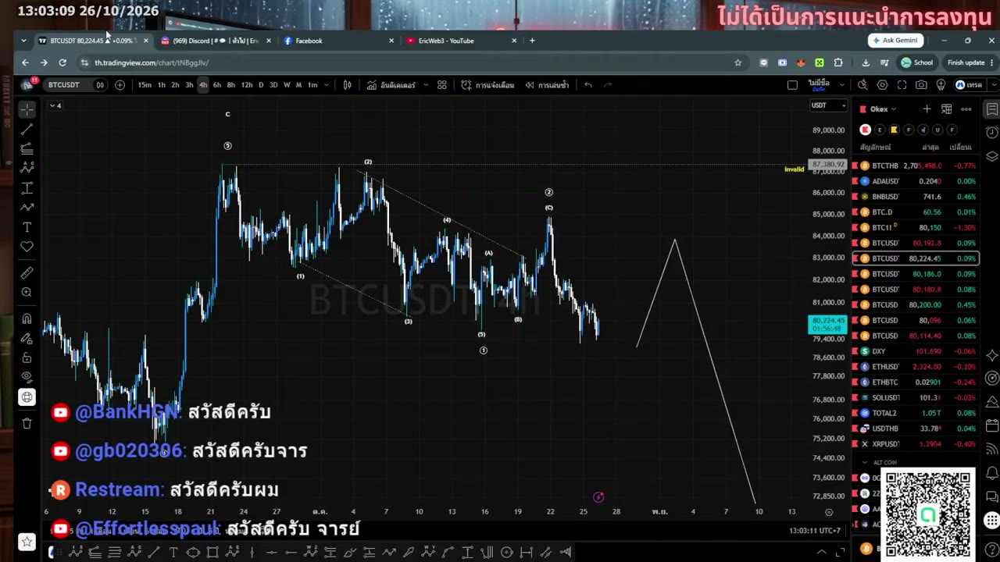

[00:04:32] Golden  hour เคสวัสดีครับทุกคนสวัสดีครับ สวัสดีในช่องครับสวัสดีคุณพอครับคุณแบงค์ สวัสดีครับ

[00:04:57] ผมขอปรับภาพกับเสียงแป๊บนึง อใครเข้ามาแล้วก็คอมเมนต์ได้นะครับสวัสดี นะครับนะช่วงบ่ายนะครับ อ่าไลฟ์ช่วงบ่ายนะครับเดี๋ยวเดือนหน้า เดี๋ยวจะระบุเวลาไลฟ์เป็นตารางแล้วนะครับ เพื่อนๆจะได้เอ่อ เอ่อติดตาม นะติดตามช่วงเวลาถูกเนาะในการไลฟ์แผนเทรด นะครับนะก็คิดว่าน่าจะเป็นเอ่อเป็นช่วง บ่ายของวันจันทร์นะครับแล้วก็วันพุธเนาะ แล้วก็วันศุกร์นะนะครับส่วนเอ่อไลฟ์กลาง คืนเนี่ย[เสียงกระแอม] เดี๋ยวขอไปนึกก่อนว่าเอมีสลอตเวลาว่าง ช่วงไหนบ้างนะครับนะ เออไม่รู้ว่าเพื่อนๆจะชอบดูไลฟ์ตอนกลาง คืนหรือเปล่านะครับเดี๋ยวค่อยมาคลิกกัน อีกทีนึงนะเพราะช่วงนี้ผมน่าจะต้องทำอะไร หลายๆอย่างเยอะนิดนึงนะครับก็สวัสดีทุกคน

[00:05:59] นะครับ อ่าเดี๋จะได้ไลฟ์เทรด setup ทีเดียว อ่ะเป็นไงกันบ้างครับใน[เสียงกระแอม]จาก ไลฟ์ครั้งที่แล้วนะครับก็เอ่อจะเห็นว่า บitcoinเนี่ยก็มีการปรับตัวย่อลงมาเรียบ ร้อยแล้วนะครับสำหรับเอ่อในช่วง อ่าสัปดาห์ที่ผ่านมาเนาะเดี๋ยวเราไปย้อน กราฟกันนิดนึงนะ นะน่าจะเป็นชุดนี้นะครับสำหรับเทรด setup ของ Bitcoin นะครับขอดูทองด้วยตอนนี้ทอง นี่น่าจะไหลเป็นโจ๊กนะครับเดี๋ยวดูให้ เดี๋ยวดูให้เดี๋ยวดูจบบitคอร์ปุ๊บดูทอง เลยนะเพราะว่าทองก็น่าสนใจเหมือนกันนะคุณ แบงค์นะ ผมขันเช็คนิดนึงนั่นเอง

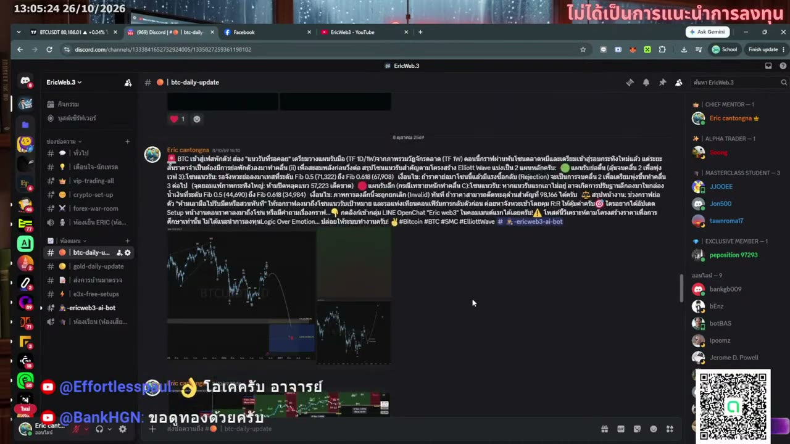

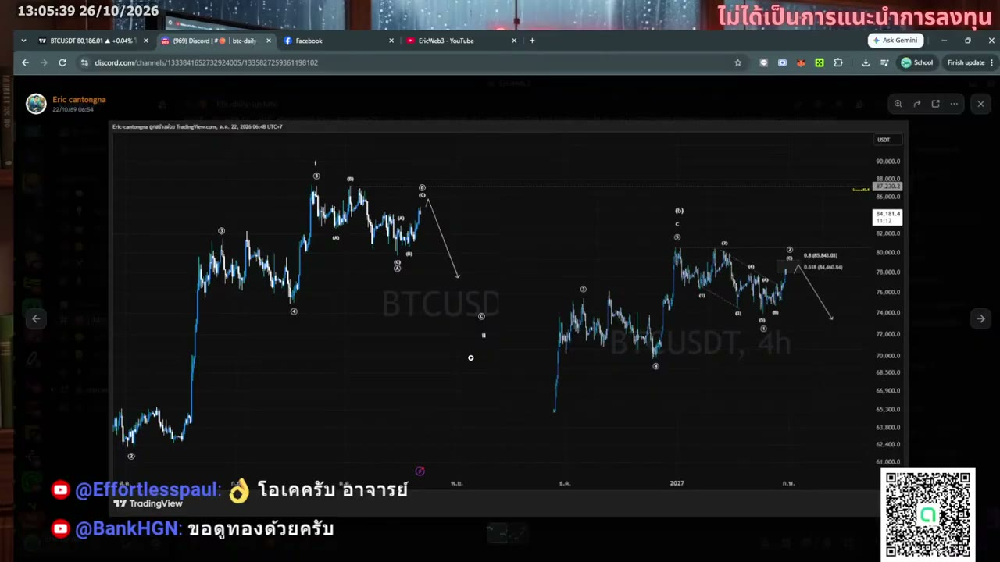

[00:07:01] ถึงแม้ว่าอนาคตสจสปอครบแล้วจะก็ตามเรียน รู้เรียนรู้การอีสไปเรื่อยๆก็ได้ครับได้ อ่ะนะครับก็มาย้อนดูเทรด setup กันเช่น เคยนะครับสำหรับอ่าตลาดิปโตแล้วก็ตลาด อื่นๆเนาะนะครับในตลาดเทรดอื่นๆนะครับก็ อ่าจะเพื่อนๆจะเห็นว่าเอ่อเอ่อ ในช่วงสัปดาห์ที่ผ่านมาเนี่ยนะครับนะตลาด เนี่ยก็มีการปรับตัวย่อลงจากโซนบริเวณ ราคา 84,000 นะครับ 84,000 เกือบ 85,000 เนาะปรับตัว ย่อลงมานะครับสำหรับบitcoinนะนะครับ เนื่องจาก setup ที่เราทำกันไว้เนี่ยมี 2-3io ด้วยกันนะครับสำหรับฝั่งขาลงนะ ครับแต่ลงเพื่ออะไรครับลงเพื่อขึ้นต่อนะ ครับสำหรับ Senario ที่มองว่าจบรอบแล้วก็ เตรียมที่จะย่อเวฟ 2 ขึ้นเวฟ 3 นะครับใน ฝั่งของ bullish นะนะครับนะทีนี้ในโครง สร้างย่อยเนี่ยหรือว่าในtimeมfrฟมย่อย เนี่ยนะครับเราเอ่อตามการย่อเนาะนะครับใน มุมมองของการเป็นเวฟ 2 นะครับหรือว่า wave

[00:08:02] b นะครับจากหัวข้อของไฟครั้งที่แล้วนะ ครับนั่นก็คือ 2 หรือ b นะตรงนี้เห็นมั้ย เป็นเวฟ 2 หรือ all  b เนาะนะครับใครที่ ยังไม่เคยเข้ามาดูก็ไปดูย้อนหลังได้นะ ครับก็จะเห็นว่าอ่าในชุดกราฟปัจจุบัน เนี่ยนะครับจากไม่ว่าจะเป็น wave  B นะ ครับหรือว่าเวฟ 2 ใหญ่ก็ดีเนี่ยนะครับอ่า ก็จะเห็นว่าเรามองว่าราคาเนี่ยบitcoinควร จะปรับตัวย่อนะครับและที่สำคัญคือควรจะ หลุดในโซนระดับ 80,000 นะตัวโซนเอ่อลงมา ในระดับ 80,000 ลงมานั่นเองนะครับซึ่งใน เสาร์อาทิตย์ที่ผ่านมาเนี่ยนะครับก็มีการ ปรับตัวย่อแล้วนะครับโดยเฉพาะหลุดมาระดับ 79,400 ด้วยซ้ำนะครับนะครับในสัปดาห์นี้ ก่อนสิ้นเดือนเนี่ยนะครับที่หัวข้อไลฟ์นะ ครับเราบอกว่าเอ่อบitคinเนี่ยน่าจะสึก นะครับเนื่องจากว่าเอ่อในช่วงปลายเดือนนะ กับต้นเดือนนะครับปลายเดือนตุลาคมนี้นะ ครับแล้วก็ต้นเดือนเนี่ยนะครับมีเอ่อ ประกาศตัวเลขค่อนข้าง

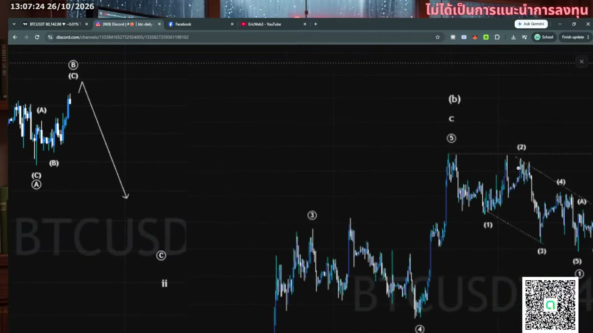

[00:09:04] น่าสนใจนะครับแล้วก็ต้นเดือนพฤศจิกายน เนี่ยก็ FOMC เนาะแล้วก็มีNonฟาร์มใช่ มั้ยนะครับนะแน่นอนว่า 27-28 นี้เนี่ยรู้ สึกจะมี FOMC เนาะนะครับในการอ่าตัดสินใจ เกี่ยวกับอัตราดอกเบี้ยของเฟสด้วยนะครับ นะแล้วก็มีเอ่อตัวเลข CPI นะครับวันที่ 28 เหมือนกันนะครับนะแต่เป็น CPI ของ ออสเตรเลียนะก็อาจจะไม่ได้มีผลมากขนาด นั้นนะครับแล้วก็เป็นเรื่องของ GDP ไตรมาส 3 ด้วยนะครับ PCE นะครับแล้วก็แน่ นอนว่าในช่วงวันที่ 3 พฤจิเนี่ยนะครับการ เลือกตั้งกลางเทอมของสหรัฐนะ US  Midm นะ ครับอันนี้ก็ใครไปดูโพสต์หลายๆโพสต์เนี่ย นะครับบitcoinเนี่ยชอบลงในช่วงMidทม เหมือนกันนะลงใหญ่เนี่ยช่วงMidทมเหมือน กันนะครับของเอ่อกลางเทอมของการเลือกตั้ง ของสหรัฐเนี่ยนะครับอ่าอ่าแต่ผมไม่ได้ทำ มานะนะครับก็คิดว่าเป็นพอย์ที่จับตาดูนะ ครับแล้วก็วันที่ 6 พฤจินะครับก็คือเอ่อ เรื่องของฟาร์มนั่นเองนะครับนะแล้วก็วัน ที่ 10 พฤจิด้วยนะครับยังไม่จบนะ CPI นะ

[00:10:05] ครับนะครับ CPI ก็ดูว่าหากเงินเฟ้อยัง พุ่งกว่าคาดการณ์เนี่ยนะครับดอลลาร์ก็อาจ จะแข็งต่อไปนะครับอันนี้ก็ค่อนข้างหนัก หน่วงนะครับสำหรับปลายเดือนนี้จนถึงเกือบ ๆวันที่ 10 เลยนะครับนะใกล้ๆวันที่ 10 พฤศจิกายนนะครับเพราะฉะนั้นในช่วงช่วง สโคป 10-20 วันเนี้ยนะครับก็อยากให้ เพื่อนๆติดตามตลาดเทรดกันให้ดีๆแล้วกันนะ ครับโอเคนะครับเราไปดูเรื่องของเทรด setup นะครับ Bitcoin นะครับจาก setup เดิมเนาะ เรามองว่าเอ่อ Bitcoin เนี่ยมีการปรับตัว ย่อลงนะครับไม่ว่าจะเป็น Wave  B หรือว่า Wave  2 ในภาพใหญ่เนาะก้อนตรงนี้นะ อ่ะก้อนตรงนี้นะครับ B2 นะครับแล้วก็มี การปรับตัวย่อลงนะครับผลสุดท้ายเนี่ยก็ ราคามีการปรับตัวย่อลงเรียบร้อยแล้วเห็น มั้ยปรับตัวย่อลงนะครับปรับตัวย่อลงเนาะ จากก้อนตรงนี้นะครับอ่าทำลาย low ไปแล้ว นะครับสำหรับราคา 80,000 นะสำหรับราคา 80,000 ทีเนี้ยเอ่อในภาพรวมถึงสิ้นเดือน

[00:11:07] นี้นนะครับนะครับในช่วง 2-3 วันเนี้ยคิด ว่าอาจจะมีการ pull  back กลับนะครับ pull back กลับที่ว่าเนี่ยเป็นในลักษณะไหนนะ ครับอันนี้ setup นี้ลบทิ้งนะในลักษณะของ ใน time  frame  4 แล้วกันนะครับเถ้าใคร สังเกตดูตอนนี้เหมือนจะเริ่มทำ bullish divergent ใน time  frame  4 ไปแล้วนะ ครับส่วนใน time  frame ชั่วโมงเนี่ยนะ ครับอ่าก็เริ่มมีการสะสม divergent เหมือนกันนะครับแต่ยังไม่สามารถเบรค market  structure ได้นะครับโดยเฉพาะใน การที่ราคาจะต้องยืนมากกว่านะครับในระดับ 82,200 ขึ้นไปนั่นเองนะครับนั่นก็คือ ก้อนบริเวณนี้เนาะ อ่าทาง Market  Sucker  Ship นะครับเบรค Market  Structure นะครับ 2 ชุดก่อนที่ จะกลับไปยืนในระดับมากกว่า 82,500 ขึ้นไป นะครับอ่าเพราะฉะนั้นในชุดเอ่อไม้ช็อต เนี่ยนะครับใครที่เล่นช็อตกับผมมาที่ 84,300 ลงมาเนี่ยนะครับตรงนี้ก็น่าจะ เป็นจุดที่จะต้องเทคโปรฟitออกไปแล้วนะ ครับซึ่งจริงๆเนี่ยใน position ฝั่งช็อต ที่ผมช็อตมาเนี่ยนะครับนะผมน่าจะปิดไปแถว

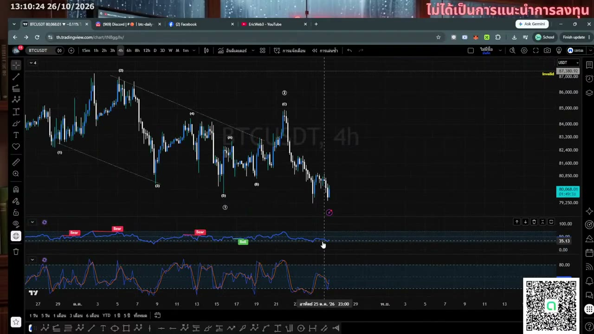

[00:12:08] ๆซักอ่า 81,300 แล้วแหละนะ TP1 ไปแล้วนะ แถวๆก้อนตรงเเนาะนะครับแล้วก็มาปิดอีกที แถวๆสซัก 8,400 นะ TP2 นะครับเสาร์ อาทิตย์เนี่ยผมไม่ไม่มีออเดอร์เลยนะครับ สำหรับอ่าสำหรับอ่า position ฝั่งช็อตที่ ช็อตมานะครับจากสัปดาห์ก่อนนะครับก็ปิด หมดนะครับอาจจะมีเล็กๆน้อยๆบ้างนะแต่ก็ ยังไม่ใช่ไม้ที่เป็นมาจิปกตินะครับเอ่อใน ส่วนของภาพย่อยเนี่ยนะครับคิดว่าก้อน บริเวณตรงนี้เนี่ยคิดว่าน่าจะเพิ่งจบเว็บ 1 ย่อยนะทุกคนนะอาจจะจบ 1 ย่อยนะฮะ 1 2  3  4  5 นะครับ อ่าสำหรับก้อนตรงนี้นะครับในภาพรวมตรงนี้ เนี่ยนะครับสำหรับบitcoinเนี่ยนะครับคิด ว่าน่าจะจบ 1 ย่อยนะในการทำ divergent ชุดนี้เพราะงั้นเป้าหมายการรีบาวoundนะ ครับในชุดปัจจุบันเนี่ยนะครับยังอยู่ที่ อ่า Fibo ตัวหลักตัวเดิมของเราเลยก็คือ 0.5 กับ 61.8 นะครับในระดับที่ 82,180

[00:13:12] นะครับแล้วก็ 82,800 ขึ้นไปนะครับเราจะ ขยับเส้น invalidation เนี่ยนะครับอ่ามา อยู่ที่หัว 2 ย่อยตรงนี้นั่นเองของ ไมโครเนาะนะครับอ่าเพื่อนๆก็จะเห็นว่าจาก เดิมเป็น previous  high รอบที่แล้วเนี่ย คือ 87,400 ใช่มยนะครับรอบนี้เราขยับ invalid เนี่ยนะครับมาอยู่ที่ 80,000 ประมาณ 85,000 นะอ่าถ้าจะสวยๆก็ คือ 85,000  84,900 เงี้ย 85,000 ตีกลมๆ นะครับก็จะเห็นว่า invalid เนี่ยนะครับ เริ่มขยับปรับตัวย่อลงมาแล้วนะครับถึงแม้ ว่าในระดับของ Fibo  Wave  2 เนี่ยอาจจะ ขึ้นสูงไประดับ 61.8 จนถึง 0.8  8 เลยก็ ได้มยถามว่าได้เหมือนกันนะครับอาจจะขึ้น ไปในระดับ 83,700 นะครับแต่คิดว่าชุด เนี้ยขึ้นไปแล้วเนี่ยนะครับสิ่งที่ ต้องการเห็นก็คือว่าขึ้นไปเทคแล้วจะต้อง มี PA  reject ลงมาเนาะนะครับสำหรับก้อน บริเวณนี้ในกรอบโซนราคานี้นะครับทางเดียว กันนะต้องบอกว่าทางเดียวกันรหัส 5 ชุดนี้ นะครับรหัส 5 ชุดนี้นะเพื่อนๆเรากำลังพูด

[00:14:13] ถึงรหัส 5 ชุดนี้นะ อ่าขึ้นอยู่กับว่าบริบทของการลงชุดนี้ เนี่ยจะเทรุนแรงได้ขนาดไหนนะครับนะครับ แล้วก็มีพอย์หลักๆเลยนั่นก็คือกรอบราคา 75,000 นั่นเองเนาะในกรอบนี้เพื่อนๆจะ เห็นว่าในกรอบเอ่อที่ผมทำเนี่ยเบรค Market Structure เนี่ยตรงนี้เป็น next  line เนาะนะครับเป็น next  line ที่ น่าจะเป็นแนวรับสำคัญเหมือนกันที่ใครที่ เล่นสาย Support  Resistance เนี่ยนะครับ หรือว่ามองเป็นโซนแนวรับที่จะต้องเด้ง เนี่ยนะครับ 77,000  76,000  75,000 เนี่ยนะครับตรงเนี้ย ก็อาจจะมีออเดอร์ที่ไปรับหนาๆอยู่แถวๆนี้ ก็ได้นะครับโดยเฉพาะถ้าใครเอ่อไปดูในการ ตั้งเนี่ยนะครับการตั้งรับราคาเนี่ยเกาะ บริเวณ 77,000 ลงมาเนี่ยนะครับก็ เป็นโซนที่ค่อนข้างน่าสนใจเหมือนกันนะ ครับสำหรับกรอบชุดนี้นะครับแน่นอนว่า ในส่วนตัวเนี่ยนะครับอยากให้ราคาเนี่ยลง

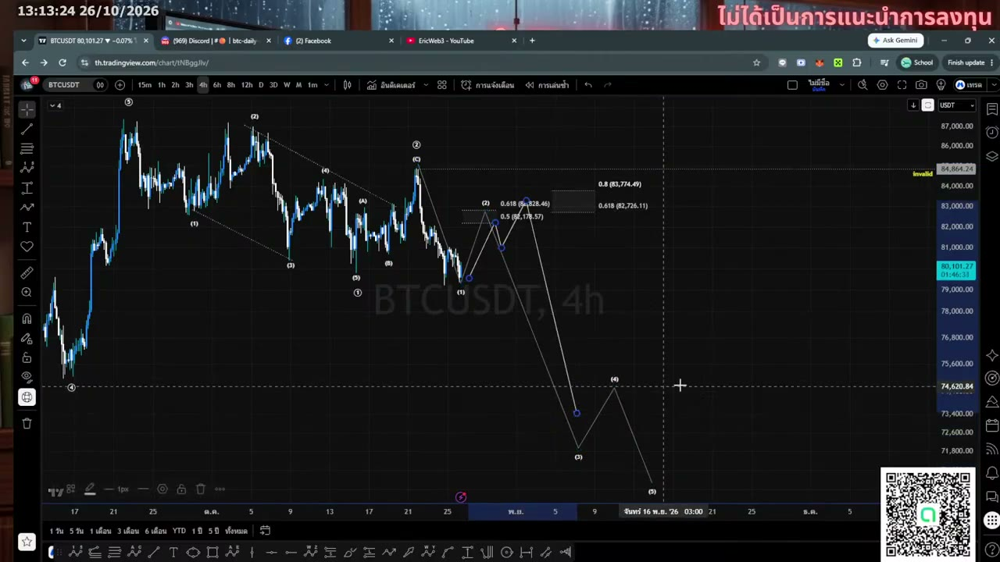

[00:15:14] ไปในขนาดไหนนะครับถ้าเป็นรหัส 5 ลงมาแล้ว หนักๆเนี่ยนะครับอย่างน้อยๆเนี่ยจะต้อง เจอแท่งของบitคinเนี่ยเทหลุดเนาะนะครับเท หลุดลงมาเลยเนี่ยในกรอบราคา 74,500 เนี่ย นะครับเทแท่งแดงหลุดลงมานะครับถ้าหลุดลง มาในกรอบ 74,500 ได้เนี่ยตรงนี้จะเป็นโซน ไหลเร็วนะเห็นมั้ยครับgปว่างค่อนข้างเยอะ นะครับเป็นโซนไหลเร็วเนาะนะครับอาจจะอยู่ ต่ำมาในระดับ 70,000 หรือ 69,000 ทันทีนะ ครับแต่ก็เป้าหมายของผมเนี่ยต้องบอกว่า อาจจะไม่ได้มองทะลุทะลวงขนาดนั้นนะครับ มองแค่ว่าเอ่ออ่าราคาเนี่ย ถ้าขึ้นไปเทสแถวๆสัก 83,000 หรือป่า 82,600 เนี่ยนะครับชุดแรกเนี่ยหวังลงมา แค่ตรงนี้เองนะ 75,000  75,000  76,000 นะแค่นี้ก็สวยแล้วนะครับแต่ถ้าอ่าราคาเท ลงมาเจอ Panic  Sal ลงมาอีกรอบนึงเนี่ย หลุดในระดับ 72,000 เนี่ยก็ต้องบอกว่า เป็น 3 ขยายเนาะนะครับก็ถือว่าเป็นโบนัส ไปนะครับอันนี้ก็ทิศทางเดียวกันนะครับไม่ ว่าจะเป็นเอ่อ Wave  2 นะครับเป็นรหัส 5

[00:16:16] ของ Wave  3 ชุดใหญ่หรือจริงๆแล้วอาจจะ เป็นอะไรครับเป็น อ่ารหัส 5 ของขา C นะเนี่ยฮะก็จะเป็นชุดนี้เนาะนะครับสำหรับ Scenario ชุดนี้เนี่ยใครที่มองว่า จะขึ้นต่อเนี่ยบitคinไม่ย่อแล้วเนี่ยนะ ครับผมมองว่าชุดนี้จะสวยที่สุดแล้ว นะชุดเนี้ยสวยที่สุดแล้วนั่นก็คือเอ่อการ ที่ย่อลงมาแล้วก็อยู่ในกรอบเรangeซัก 75,000 เนาะจนถึงในระดับ 72,000 อย่าง เงี้ยนะคิดว่าชุดเนี้ยสวยๆแล้วนะครับแล้ว ก็ถ้ามีแท่งหรือว่าvolุ่ม pool  back กลับขึ้นไปเนี่ยก็เป็นสัญญาณอันดีที่จะ DCA เนาะนะครับเพราะงั้นในกรอบช่วงของ เทรนด์ชุดเนี้ยรหัส 5 ชุดเนี้ยประกอบกับ เรื่องของประกาศตัวเลขสำคัญนะครับช่วง ปลายเดือนจนถึงต้นเดือนหน้าเนี่ยนะครับ ค่อนข้างสำคัญนะสำหรับ P  Action ชุดนี้ ว่าถ้าราคาถูกเทหลุดลงมานะครับตัวเลขเงิน

[00:17:17] เฟ้อยังสูงอยู่ถูกเทหลุดลงมาเนี่ยนะครับ ก็อาจจะส่งผลให้บitcoinเนี่ยถูกกดราคาลง มาในระดับต่ำกว่า 75,000 จนถึงในระดับ 70,000 นะครับก็ถือว่าเป็นเรื่องที่ดีนะ ฮะสำหรับที่ใครที่รอตามเทรด setup เนาะ แน่นอนว่าเ่อ invalid เนี่ยชุดนี้ค่อน ข้างใกล้เข้ามาทุกทีแล้วนะครับสำหรับจะลง มาเทสโลowที่ไม่ควรจะหลุดต่ำกว่าโลเดิมก็ คือ 57,700 โดยประมาณนะครับนะก็เป็น 2io แล้วกันนะ ครับส่วนเคสที่ค่อนข้างแย่หน่อยเลยก็คือ ถ้าเกิดว่าเอ่อบitcoinถูกเทหลุดแรงเกินไป นะเทหลุดแรงเกินไปโดยเฉพาะโลก้อนตรงเนี้ย นะครับก็คือเอ่อ PVS  Low ก่อนหน้าเนี่ย 57,500 เนี่ยนะครับอันนี้ก็ไม่ค่อยดีและ นะครับก็จะไปหลุดโครงสร้างของการ DCA กล่อง A ของเรานะไปลงในโซน B ทันทีอันนี้ ก็เดี๋เราค่อยว่ากันนะครับเอาเป็นว่าใน แผนของdayเทรดนะครับในช่วงตุลาคมจนถึง พฤศจิกายนนี้เนี่ยนะครับอยู่ในระดับ POI

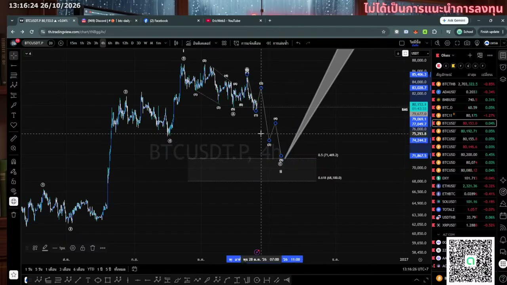

[00:18:18] ราคาที่น่าสนใจก็คือ 77,000 ลงมานะครับจน ถึงในระดับ 69,000 อันนี้ผมวาด range แบบ กว้างๆเลยนะครับแต่ก็ จากราคา 80,000 เนี่ยตรงเนี้ยถือว่าใกล้ แล้วนะครับอีก 5,000 จุด 7,000 จุด 10,000 จุดเี่ถือว่าใกล้แล้วนะครับเพราะเทที เดียวเนี่ยร่วงลงมาเลยนะครับแล้วเพื่อนๆ คิดว่าอยู่ในลักษณะของราคาไหนดีนะครับ อาทิตยทีนี้เราพูดถึงมุมมองของการ รีบาวoundในภาพย่อยของปัจจุบันตรงนี้ก่อน นะครับว่าถ้ารีบาวไปแล้วเนี่ยจะเจออะไร บ้างเนาะนะครับแน่นอนว่าผมขอไปดูที่ Fue GAP ใน time  frame  day ก่อนนะครับนะ เพื่อนๆก็จะเห็นว่ามีเอ่อ Fa  GAP  Time Frame  Day เนี่ยนะครับตรงกับ Fibo  0.5 กับ 61.8  8 พอดีเลยนะครับที่ 82,180 นะครับแล้วก็ 82,700 นะครับก็ จากเดิมที่เราช็อตกันมาเนี่ยเพื่อนๆจะ เห็นว่าผมรันตาม Fue  GAP อย่างเดียวเลย นะในTimeม Frame ใหญ่แล้วก็ไปเล่นในTimeม Frame ย่อยเนาะนะครับตรงนี้ก็เป็นชุดที่ 2 เหมือนกันนะครับถ้าติดไปแล้วลงเนี่ยนะ

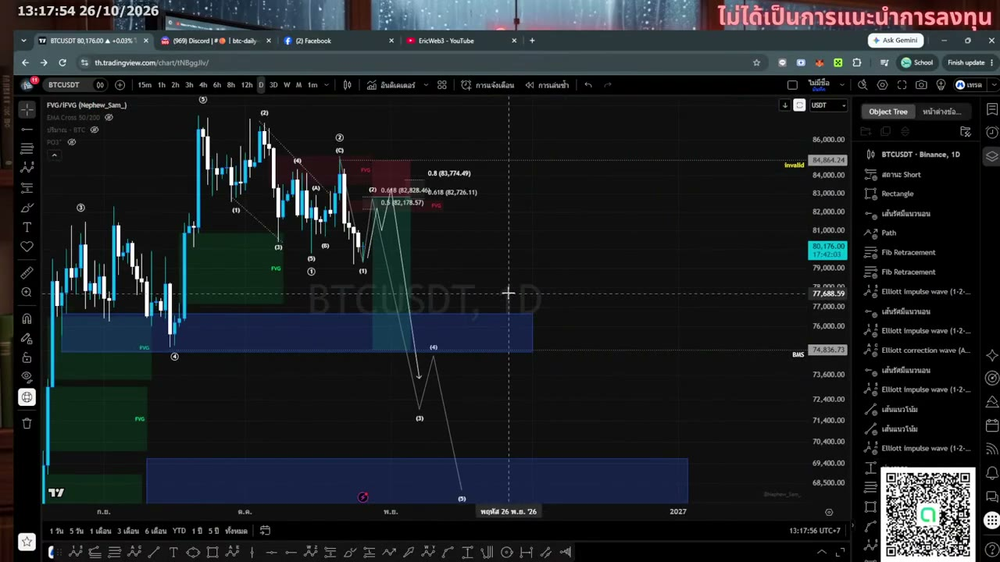

[00:19:18] ครับก็เป็นอ่อ จุดจุดเข้าที่น่าจับตาดูนะก็อาจจะไม่ได้ เล่น position ฝั่ง buy ขนาดนั้นนะครับไป รอหน้าเซลล์จะดีบาทเนาะนะครับก็ตรงกับเวฟ 2 พอดีนะครับประมาณนี้นะสำหรับ Bitcoin นะครับส่วนเรื่องของ EMA ตอนนี้ใน Time Frม 4 เนี่ยเกิด Dead  C ไปแล้วนะครับ แล้วก็ในกรอบราคา 82,000 เนี่ยเอ่อก็จะ ตรงกับ EMA  200  Time  Frame  4 เนาะนะ ครับใน Time  Frame  Day หลุด EMA  50  Time  frame  Day ไปแล้วนะ ครับเพราะฉะนั้นเป้าถัดไปเนี่ยก็จะอยู่ ที่ 76,000 นะ EMA  200 นะครับใน Time Frame  Day นะครับอ่าแรงซื้อเริ่มค่อน ข้างอ่อนแล้วนะครับแล้วก็อ่า Time  Frame Week  EMA  50 นี่ยังไม่หลุดนะถ้าหลุด นี่ต้องหลุด 78,500 นะครับนะครับแล้วก็ EMA  200  week นี่อยู่ที่ POI หลักของ เราเลยนะครับเอ่อในการ DCA นะครับนั่นก็ คือต่ำกว่าระดับ 70,000 นั่นคือ 69,700 นั่นเองนะครับสำหรับบitcoinก็ประมาณนี้ ทันมยสรุปว่ารอเด้งรีบาวoundอ่ะ 82,000

[00:20:22] นะครับ 82,000 ขึ้นไปนะครับ 8,000  83,000 แล้วมองลงต่อนะครับในการเทส Fair  Value Gap  Time  F  day Wave  2 นั่นเองนะครับ อ่ะประมาณนี้ สวัสดีครับอดOกับเต๋าสปอขอ ETH ได้ครับ ไม่งงนะบitcoinนะครับถือว่าถ้าใครติดตาม ไลฟ์มาเนี่ยนะครับตอนบitcoinอยู่ 86,000 87,000 นี่คือเราแช่งให้เราพยในคอมมity เราเราแช่งให้หลุดมาโซน 75,000 แย่แล้วนะ ครับนะฮะอันนี้ก็ใกล้แล้วใกล้แบบใกล้ เอื้อมมือทุกทีนะไม่รู้จะไม่รู้ว่าจะเด้ง 7,000 แล้วหนีไปหรือเปล่านะครับแต่คิด ว่าลงมาต่ำกว่า 77,000 อ่ะผมก็ในแผนส่วน ตัวนะผมก็คงจะต้อง DCA ไปแล้วนะครับอื อ่ะผ่านนะครับบitcoinนะครับเราไปดูทองคำ

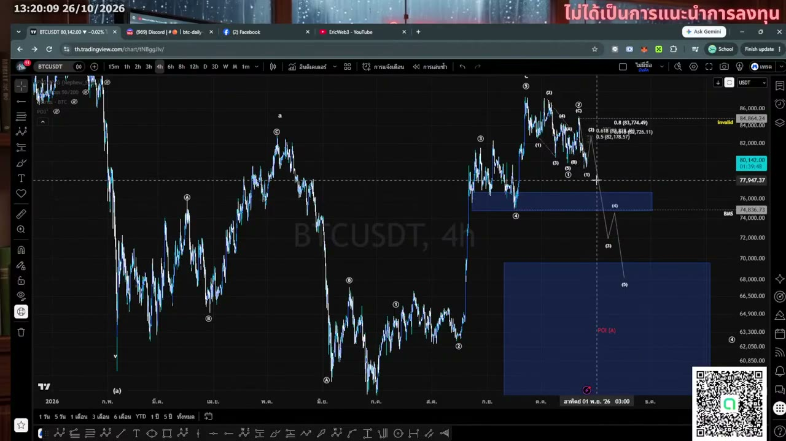

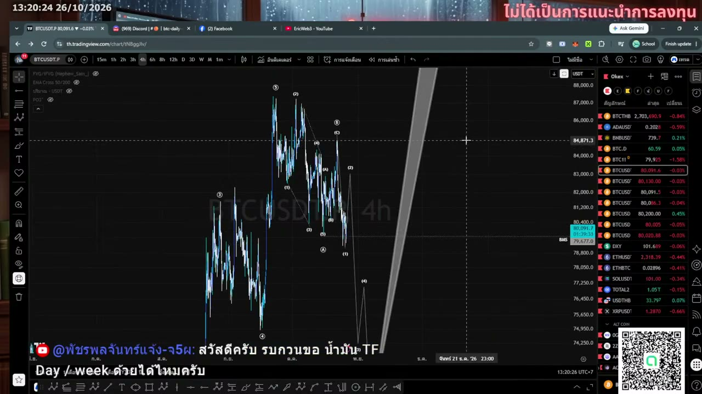

[00:21:24] เลยดีกว่านะครับเราไปดูทองคำเลยเดี๋ค่อย กลับมาย้อนดู Outcoin นิดนึงนะครับทอง ล่าสุดนะต้องบอกว่าหลังจากที่หลุดนะครับ แนวรับ 4,000 นะครับ 4,068 นี่คือลงมาทำนิวโรต่ำเนาะ จากเดิมที่ที่เอ่อผมเล่นเนี่ยนะครับมอง ว่าจะขึ้นต่อเนี่ยนะครับพอหลุดโลไปแล้ว เนี่ยต้องบอกว่าในภาพใหญ่ของทองคำนี่เป็น เทรนด์ขาลงไปแล้วนะครับแล้วก็มีสิทธิ์ที่ จะลงต่ำหลุดในระดับ 3,900 ซะด้วยซ้ำนะ ครับเพราะงั้นในภาพใหญ่ตรงนี้เนี่ยจริงๆ ตรงเนี้ยไม่น่าจะใช่impulาหรอกน่าจะเป็น ชุด combi มากกว่านะเป็น a  b  c  x  a bc มากกว่านะครับดูจากลักษณะการลงอ่ะนะ ครับแต่ไม่เป็นไรนะครับในกรอบตรงนี้เนี่ย มองว่าเพิ่งน่าจะทำเวฟ 3 ขยายเนาะแล้วก็ เอ่อมองเป็นเวฟ 4 ย่อยเนาะนะครับเอ่อใน กรอบระดับ 4,020  4,040 แล้วก็ 4,070 จน ถึง 4,086 เนี่ยนะครับยังอยู่ในขอบขายของ

[00:22:26] Wave  4 เนาะนะครับเพราะงั้นยังมองว่าใน ฝั่งของ เอ่อฝั่งขาเซลล์เนี่ยยังคงได้เปรียบไป ก่อนนะครับสำหรับทองคำนะเด้งเซลล์ง่าย กว่านะครับแต่ว่าต้องอยู่ในกรอบของเอ่อ เวฟ 4 เนาะนะครับเพราะฉะนั้นจุด invalidation เนี่ยจะอยู่ที่ 4,100 เนาะ นะครับนะใครอย่าเพิ่งไปบายสวนมั่วๆนะตอน นี้นะครับผมหยุดบายไปแล้วนะพอโดน SL หลุด 4,060 เนี่ยไม่บายแล้วนะครับก็ไปรอเด้ง เซลล์อย่างเดียวนะครับส่วนในภาพใหญ่เนี่ย ต้องลุ้นว่าถ้าทองคำหลุด 3,9  9 เนี่ยเรา อาจจะได้เห็นทองคำเนี่ยลงมาพักตัวนะครับ แล้วก็อาจจะมีgปอยู่ที่สัก 3,600  3,500 ด้วยซ้ำครับอันนี้ก็คือภาพของอนาคตเนาะนะ ครับในภาพรวมเนาะคิดว่าอาจจะมีสิทธิ์ไป ถึงตรงนู้นได้เนาะนะครับ อ่ะประมาณนี้ก็คือเด้งเซลล์นั่นแหละนะ ครับส่วนน้ำมันใช่มยเอ่อน้ำมัน จริงๆอ่ะน้ำมันน่ะพอมาถึงโซนข้างบนน่ะผม ยังมองย่อตลอดนะนะครับแต่ว่ายังไม่เสีย

[00:23:27] น้ำมันเนี่ยคือถ้าไม่ต่ำกว่า 98 เนี่ยยัง มองเสียเทรนไม่ได้เลยนะครับยังมองเสีย เทรนดไม่ได้เลยก็เดี๋ยวรอรอดูไปก่อนนะ ครับแต่ภาพใหญ่อ่ะคือมองว่าเนี่ยมันควรจะ ต้องย่อแล้วนะไป 106 แล้วต้องย่อแล้วนะ หรือว่าจะหลุดตรงนี้เลยก็ได้เนี่ยหลุด 98.7  7 เดี๋ก็มองหลุดได้นะน้ำมันนะนะ โอเคนะ อ่ะเรามาดู Outcoin กันบ้างนะครับใครอยาก ดูไหนๆพิมพ์ได้นะบอก Sport หรือ Future ด้วยนะ แอบดูซิ ขอ ETH  H etium ลงมาใกล้โซนเหมือนกันแล้วครับก็ คิดว่าเดี๋ยวเตรียมจะรีบาวoundนะจริงๆeอร เนี่ยอาจจะเป็น wave  A หรือว่าเป็นเวฟ 5

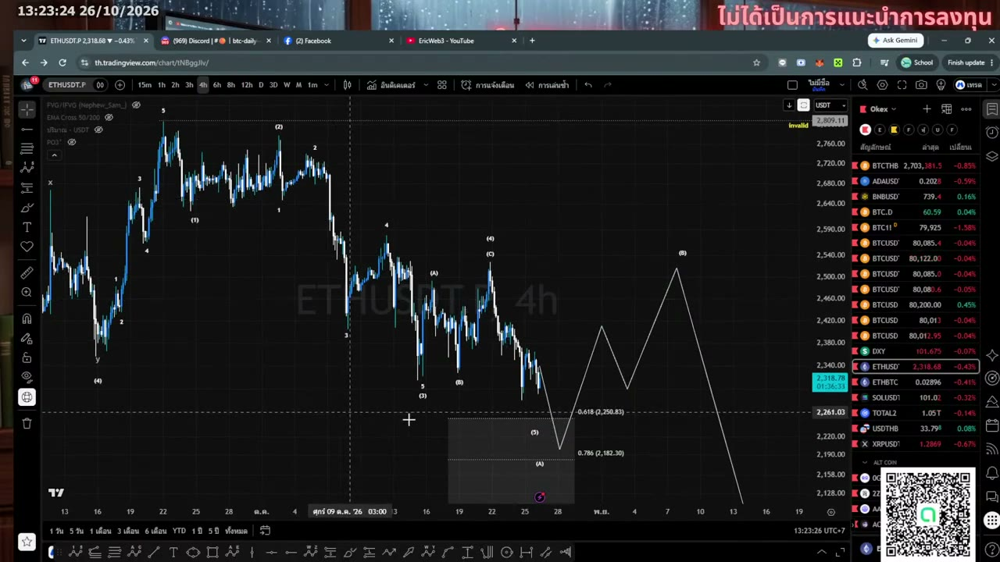

[00:24:29] ก็ได้นะแต่ผมมองว่าเป็น 5 มากกว่านะครับ ขอไปดู setup ย้อนหลังหน่อยEอร์เรา เราทำเทรด setup กัน อย่างอะไรอ่าเนี่ยฮะ อันนี้ก็คือกราฟวันที่ 23 เนาะ อ่ะนี่ 4 ย่อยนะครับแล้วก็ย่อลงมาเนาะใน กรอบระดับซัก 2,200 จริงๆวางไว้ที่ 61.8 เนี่ย 2,250 อ่ะ นะวางไว้ที่ 2,250 แต่ไม่ถึงแล้วนะครับ แล้วก็เกิด divergent ใน time  frame  4 แล้วนะครับก็อาจจะมีสิทธิ์ที่จะได้ลุ้น กลับตัวระยะสั้นแล้วนะครับสำหรับ eher นะ ครับโดยเฉพาะถ้าราคาเอ่อ Pullb กลับมาก กว่า 2,415 เนี่ยนะครับก็อาจจะขึ้นสู่ขา B แล้วนะครับอื[เสียงกระแอม]ก็คงตามเทรด setup แล้วกันนะก้อนนี้ทีนี้ขาที่ว่า

[00:25:32] เนี่ยคือผมประมาณการไว้เฉยๆนะว่า เอาสวยๆเลยเนี่ยนะครับไม่ควรจะผ่าน 2540 อ่ะอันนี้ไม่ใช่พ.ศ.นะหมายถึงอย่างนี้นะ อ่านะมองเป็นชุดนี้มากกว่านะสำหรับ อธอเรียมนะครับก็เด้งลงหรือว่าอาจจะไปแค่ ในระดับ 2,450 เก็ลงนะครับในมุมมองของ B นะเพราะว่า 33  38.2  2 นี้เรายังเดาไม่ ได้นะอาจจะอยู่แค่นี้แล้วลงเนาะ มาประมาณนี้ Solona เสกเนียใช่มอโดเนาะอ๋ออโดก่อน แล้วกันออนโดกับเต๋านะ อันนี้เราทำอะไรไว้อ๋อเบรก market structure ใช่มโอเคไปดูสปotนะครับเป็นไง

[00:26:34] มั่งตอนนี้ก็ขออย่างเดียวแล้วกันก็ทำตาม แผนแล้วกันก็คือนั่นก็คือเอ่อมองว่าไม่ ควรจะหลุด 0.32  32 แล้วนะอด นะครับอืยืน EMA  50  week ไม่ได้ด้วยนะ ครับก็เพราะงั้นผมก็จะทำตามแผนไปเลยนะ ครับไม่ควรหลุด 0.32 เนาะนะครับ ถ้าบitคinยังย่อแบบนี้อยู่ก็ยังทำต้องทำ ใจไว้หน่อยนึงนะยังยืนไม่ได้นะยังยืนไม่ ได้แล้วก็ ถึงมั้เนี่ย 0.9  9 แล้วเนี่ยไม่ถึงนะ อ่ะในกรอบเนี้ยผม ให้แค่นี้เลยคือถ้าจะขึ้นต่อก็ไม่ควรจะ หลุดก้อนนี้แล้วฮะคอนโด นะครับถ้ามันถ้ามันไม่ขึ้นเนี่ยมันจะกลาย เป็น 3 สวิงแล้วลงทันทีนะจะเป็นอย่างนี้ ทันทีนะ โอเคเนาะนะครับแล้วก็เต๋าใช่มย

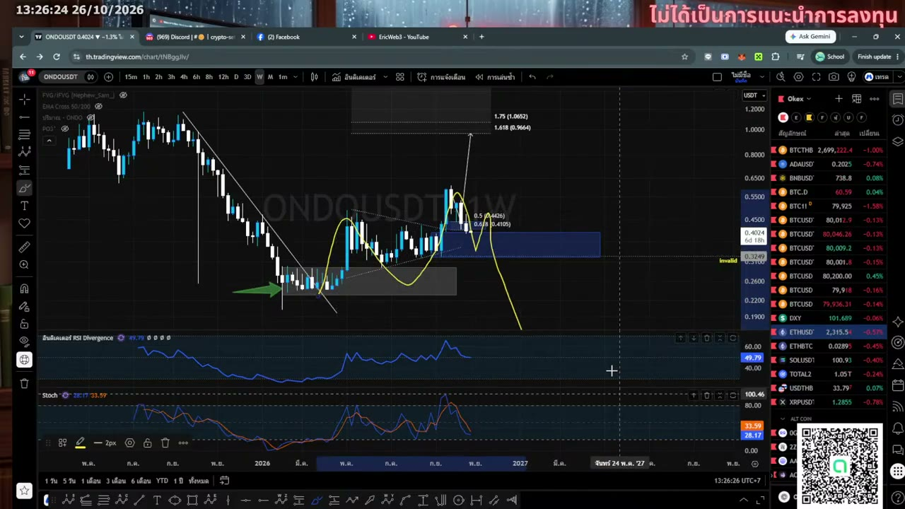

[00:27:34] อ่าเต๋าติดเทรนไลนจริงด้วยครับอ่าติด เทรนไลนด้วยก็ลงกลับไปที่เดิมนะเป็นดาว เทรนลงกลับไปที่เดิมแต่มองว่าแบบแย่ๆ หน่อยต้องต่ำกว่า 180 นะครับในระดับ 170 นะแล้วค่อยว่ากันอีกรอบนึงนะครับสำหรับ นะครับคุณวีรยุทธขอโซโลonaสปอใช่มั้ โน่าก็จะคล้ายๆกับเอ่อ eอรนะครับนะแต่จริงๆนี้ผมนับเป็นอะไร ผมนับตรงนี้เป็น B เหรอไม่ใช่ 5 หรอ A  B  C 1  2 1  2  3  4  5 น่าจะเป็นไอ้นี่มากกว่า อ่ะไม่เป็นไรเดี๋ค่อยแก้ไอ้ตรงนี้อาจจะ เป็นเป็น 5 หรือ B นะเป็น 5 หรือ A นะนะ ครับตรงเนี้ย 5 ตรงนี้อาจจะอยู่นี่นะแต่

[00:28:35] ไม่เป็นไรนะครับอ่าก็คิดว่าเอ่อพุแบคกลับ นะครับนะแต่ว่าอยู่ในระดับซัก 111 นะครับไม่ผ่านก็ลงต่อเนาะนะครับสำหรับชุด สำหรับ Solona เนาะ เหมือนหัวข้อวันนี้ละครับก็คือเด้งสั้นนะ ครับทุกตัวเนี่ยเด้งสั้นหมดนะบitคinก็ เด้งสั้นนะ ส่วนสปอเนี่ย สปอ Soloda จริงๆ POI หลักผมจะไปอยู่ที่ ต่ำกว่า 100 นะครับนั่นก็คือ 86 ดอลลาร์ จนถึง 80 ดอลลาร์นะครับเอ่ออันนี้แผนส่วน ตัวนะแต่แผนผมจริงๆอ่ะผมอยากให้โซ่มาก กว่า 50 ดอน นะครับนี่คือร่างไว้ตั้งนานแล้วนะ 29.8  18 เนี่ยอยู่ที่ 29 ดอนนะครับใคร ทัน Solona  8 ดอนมั่ง เออแล้วขึ้นไปเกือบ 300 จริงๆผมอยากให้มันลงต่ำแบบ มาอย่างเงี้ยมาอย่างงี้เลยอ่ะแล้วไปอ่ะ

[00:29:36] อันนี้แผนมโนนะ เออแต่ชุดเวฟเดี๋ยวดูอีกทีนึงนะครับว่า เค้าจะลงต่ำกว่าอีกหรือว่าเค้าอาจจะใจดี แล้วลงต่ำกว่านี้อีกก็ได้นะครับก็คือต่ำ กว่าระดับ 50 ดอลลาร์เนาะ อือื Near  future ครับ ย่อหรือยังเอ่ย อ่าเนี่ยชุดนี้พยายามจะมองว่าเป็น Wave  4 อยู่นะครับแต่ว่าเหมือนเทรนไลนเริ่ม ปรับตัวย่อหลุดเทรนไลนไปแล้วเพราะงั้นผม จะใช้แค่ Fibo ในการวัดขอบเขตของเวฟ 4 ย่อยแล้วกันนะ ครับว่าถ้าเอาแค่นี้พอเนี่ยถ้าหลุด 0.382 382 เนี่ยผมผมทับมือไม้บายนะนะครับทับ มือไม้บายทันทีเนาะ อ่าคือมันลงก็ค่อนข้างแข็งนะครับแต่

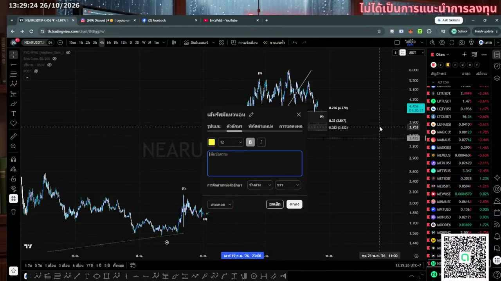

[00:30:37] อืคือถ้าหลุดถ้าหลุด 3.4  4 เนี่คือหลุด ไปข้างล่างแล้วนะครับตอนเฝั่งเซลล์ยังได้ เปรียบอยู่เนาะโดยเฉพาะสายฟิวเจอร์เนี่ย ตอนนี้ก็เด้งเซลล์ไปก่อนอเนี่ย 3 สวิง ปั๊บตรงนี้น่าจะมีgปนิดนึงแล้วก็ลงนะเ เห็นมมีgปด้วยแล้วก็ลงนะครับ อมองว่าน่าจะอยู่ในกลับมาในระดับกว่าต่ำ กว่า 4 ดอนนะสำหรับเนียนะครับ โอ๊ะเออเสกค่อนข้างแข็งครับอ่าค่อนข้าง แข็งแล้วก็ ส่วนตัวนะส่วนตัวผมยังมองว่าในภาพทัก Time frม 4 เนี่ยเนี่ยคือถ้าเบรคเกิน 1,260 ได้เนี่ยมองว่าขึ้นอีกขานึงนะครับอาจจะ ขึ้นไปเทสในระดับ 4  1,400 นะครับอ่ะขอ ตามชุดนี้ก่อนแล้วกันนะสำหรับ SE เนาะ

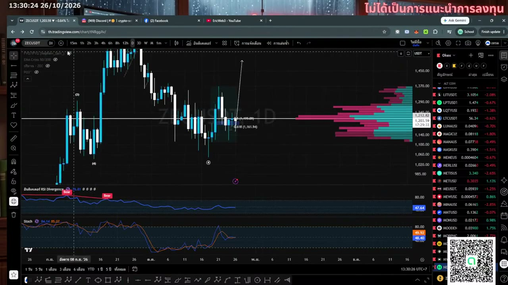

[00:31:43] แต่ถ้ามันไม่ได้จริงๆเนี่ยนะฮะเนี่ย 1,420 นะ 1,454 นะแต่ผมมองว่า 1,420 นี่ก็อาจจะ ต้องเทคออกบ้างแล้วนะครับเพราะว่าเผื่อ เผื่อย่อลงแบบนี้เนาะนะตรงนี้ยังขอบขาย ของ Wave  4 ใหญ่อยู่นะสำหรับ SE นะถ้าดู ตาม Charing หรือว่าตามเทรนไลนเนี่ยยัง มองว่ายังไม่หลุดนะครับ อันนี้ผมตีแบบนี้เลยนะอาจจะไม่เหมือนคน อื่นนะแต่มองว่ายังไม่หลุดนะจนกว่าจะต่ำ กว่า 1000 น่ะถึงจะมองว่าหลุดนะครับ อ่าในภาพย่อยเนี่ยอ่าภาพย่อยเนี่ยเอาแค่ พุแบคกลับไป 1,300 ก่อน แล้วก็ Dodge  Coin เนาะ อ่านะครับยังลงไม่จบเนาะนะครับอาจจะกลับ มาอยู่ในระดับสัก 1.21  21 ดอลลาร์นะครับ

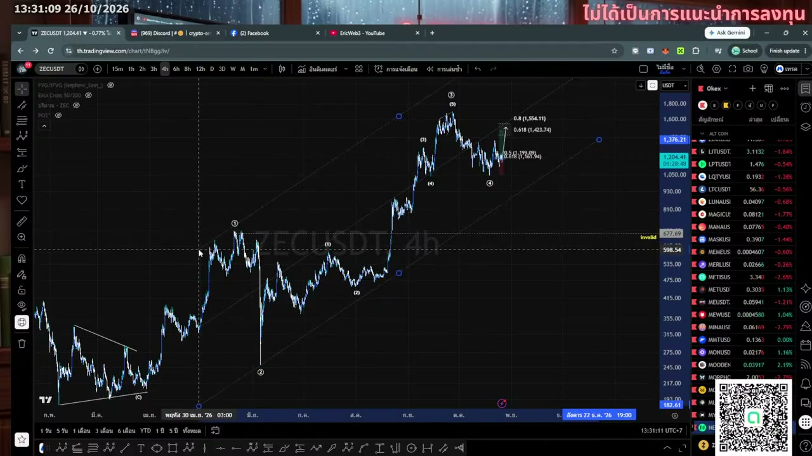

[00:32:46] แล้วก็ค่อยปรับตัวคือตรงนี้เนี่ยคลื่นตรง นี้เนี่ยยังไม่จบนะสำหรับ XRP นะครับเอ่อยังไม่มี divergent ด้วย นะอาจจะมาจุ่มๆแถวสัก 1.24 เงี้ยแล้วก็ Pullแบคกลับขึ้นไปต่ออีกขานึงเนาะนะครับ แต่ถ้า Pull  back กลับขึ้นไปแล้วเนี่ย เดี๋ยวต้องมาเช็คแรงอีกทีนึงว่าได้ขนาด ไหนนะครับตรงนี้คิดว่าน่าจะต้องปรับตัว ย่อลงไปก่อนนะ 1.21  21 นะครับสำหรับ XRP นะครับส่วน Dodge สงสัยผมเปิดบอทไว้คอมกระตุกเป็นอะไรเนี่ย อ่า Dodgecoin ก็เช่นกันครับเข้าฟอร์มตัว ในรูปแบบของ Falling  Wage ไปแล้วนะครับ แต่ว่ายังยกไยก low ไม่ได้เนาะนะครับก็ คิดว่าน่าจะไหลไปก่อนนะยังคงเล่นไม่ได้นะ

[00:33:49] ครับสำหรับ Dodge คอยนะตรงนี้นะออกแบบ ฟอร์มลิ่มไปแล้วนะเห็นมั้ Falling  W นะ อ่าจะคุณ back กลับแล้วก็เบรกเนาะนะครับ จะเล่นได้อีกทีนึงคือตอนที่เา้ายกมากกว่า 0.08  08 นะฮะสำหรับ Dodge คอยนะครับ สปอร์ตมั้ยซุยคุณเจล อืซุยต่ำดอนแล้วครับตอน 5 เก็บยาว

[00:34:59] ผมมองว่าก้อนเนี้ยมันคือ accumulate หมด อ่ะครับคือถ้ามันสมมุตินะถ้าแบบบitcoin ยาวนะซุยอาจจะออกอย่างเงี้แล้ว accumulate อ่ะยาวผมมองว่าเกาะเได้หมดอ่ะ ต่ำกว่าดอนน่ะได้หมดซุยอันนี้ไม่ได้แนะนำ การลงทุนนะแต่มองว่ามันเป็น Accumulate 0.7  0.6  0.4 ได้หมดอ่ะแต่ขออย่างเดียว คืออย่าต่ำกว่า 0.3  3  36 แค่นั้นเอง อ่ะโอเคนะออก คือตอนเนี้ผมต้องโฟกัสที่บitcoinตัวเดียว ก่อนเลยว่าเค้าเค้าจะออกเป็น 1  2 แล้ว ขึ้นต่อหรือเค้าจะลงเป็น 3 ของขา C แล้ว ลงต่ำกว่า 57,000 นะครับมันอยู่แค่นั้น ส่วน outcoin อ่ะ outcoin เนี่ยผมต้องพูด เลยว่าต้องทำใจนะว่าถ้าสมมุติ Bitcoin ไปออกที่มันแบบ อ่ะสมมุติออกเนี้ย

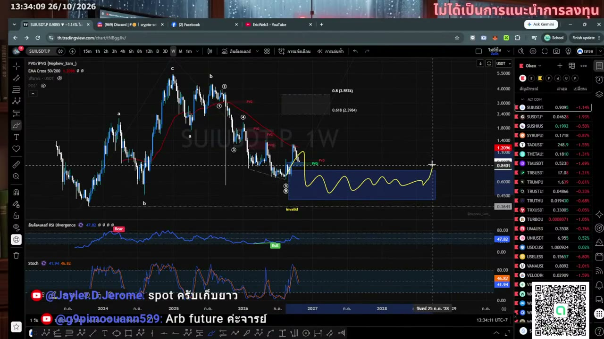

[00:36:01] เดี๋ยวทำไมมันวุ่นวาย อ่ะสมมุติออกนี้ขึ้นมา เรียกว่าอะไรโลกแตกมั้ย Bitcoin ตายแล้ว อย่างเงี้ย Panic  Sal คำว่า Bitcoin ตายแล้วจะมา ตรงไหนดีอ่ะ มาตรงหลุด 57,000 มั้ย[เสียงหัวเราะ] เออคำนี้จะมาตอนไหนดีเนี่ย บitคinแต่แล้วจะมาตรงไหนดีตอนหลุด 57,000 เออนะครับถ้าหลุด 57,000 ก็อาจจะมีคำพูด นี้ก็ได้บitคinใส่เร็วแต่จริงๆกเพื่อนๆ เริ่มพูดแล้วนะครับตอนหลุด 80,000 เนี่ย เนาะเออก็สนุกสนานดีนะครับ Bitcoin ดู กราฟ 3M ให้หน่อยมีโอกาสออก

[00:37:04] เพิ่งจบ 1 กำลังอยู่ในเวฟ 2 มย ไม่รู้นับเหมือนกันหรือเปล่านะครับถ้าจะ มองว่า 1 ทำ 2 ก็ต้องมองชุดนี้อ่ะครับ จริงๆมันไม่ต้องไปทำเฟม mon ขนาดนั้นก็ ก้อนนี้ครับก็คือเทรนด์ชุดนี้จบไปแล้ว เทรนด์ 15,000  1  2  3  4  5 จบ A  B สอง B นะครับ C  1  2  3  4  5 จบ แล้วไปเลย นะครับไปเลยก็คือ ชุดใหม่ 1  2  3  4  5 ขึ้นชุดใหม่ใช่ มั้ยตรงเนี้ยหลายๆคนเค้าบางทีเค้าเก็นับ นะว่าตรงนี้เป็นเวฟ 3 ขยายนะฮ 3 cซคิล ขยายเนาะนะ 1  2  3 ตรงนี้เป็น 4 ใหญ่นะ ครับอันนี้ขึ้น 5 ใหญ่ ก็มีก็แล้วแต่สุดแท้จะนับนะครับแต่ผมมอง ว่าเอาแค่พอย์หลักก้อนตรงนี้ก็พอนะ

[00:38:06] กับตรงนี้แล้วก็ชุดที่กำลังจะขึ้นตรงนี้ นะครับถ้าถ้าจะมองเป็นบูจริงๆก็เนี่ยแหละ ครับก็เหมือนที่เราตามกันตลอดว่า Bitcoin ควรไม่ควรจะทำโลต่ำกว่าเดิมคือ 57,500 แล้วอ่ะก็ต่ำกว่า 77,000 ลงมา 69,000 อ่ะ ก็ขนาดนั้นเอ่อถ้าต่ำ ถ้าเป็น 2 ใหญ่ลง 15,000 อีกรอบนึงผมว่า ต้องรื้อทิ้งอ่ะครับ อืมมันไม่ค่อยสมส่วนเท่าไหร่ ถ้าสมมุติคุณถ้าสมมุติคุณเจลerบอกว่าตรง นี้เป็น 1 แล้วตรงนี้เป็น 2 ใหญ่อ่ะ อืมนี้ผมยังไม่ยังไม่มองแล้วกันเพราะว่า มันต้องไปดูคลื่นก่อนหน้าทั้งหมดด้วยอยู่ ๆจะมานับตรงนี้เป็น 1 เลยมันก็ไม่ใช่ตรง นี้ต้องเป็นอะไรอ่ะก่อนหน้านั้นต้องเป็น อะไรมาถูกมั้ย จริงๆถ้าเราจะว่ากันแบบอย่างเงี้ยเนาะก็

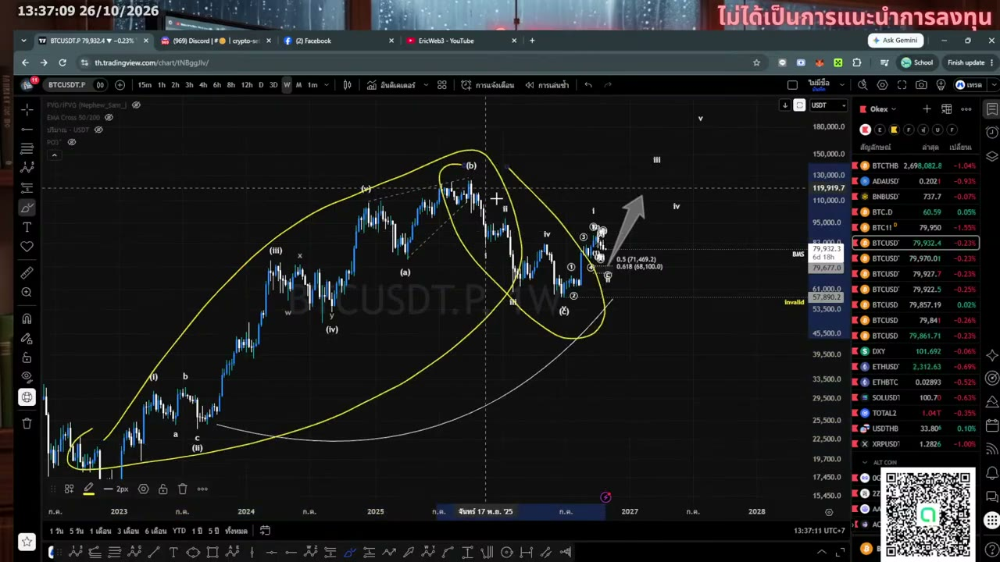

[00:39:09] ต้องมาดูตรงนี้ทั้งหมด ต้องดูไซเคิลตรงนี้loูปนี้ทั้งหมดอ่ะอ่ะ เนี่ยก็ต้องมานั่งไล่ตรงเนี้ยใหม่หมด นะแต่ถ้าไปมองเioนั้นนะผมผมยังไม่มองแล้ว มันอาจจะเป็นอย่างนั้นก็ได้นะแต่ผมแต่ชุด ปัจจุบันน่ะผมผมเอานับตามเท่าที่คิดคิด ว่าประเมินได้เนาะนะครับว่าถ้าออก Ring Wight ออกลุ่มๆแบบนี้ชุดต่อไปเป็นยังไง แล้วชุดต่อไปควรจะเด้งเท่าไหร่แค่นั้นเอง แค่นั้นก็เพียงพอแล้วอันนั้นมันมองไกลไป นิดนึง ถามว่ามันเกิดขึ้นมั้ยเกิดขึ้นได้ นะครับแต่ยังไม่ได้ให้น้ำหนักขนาดนั้น โหถ้าลงมาเอาแค่ลงมา 50,000 น่ะกับ 40,000 น่ะผมว่าก็

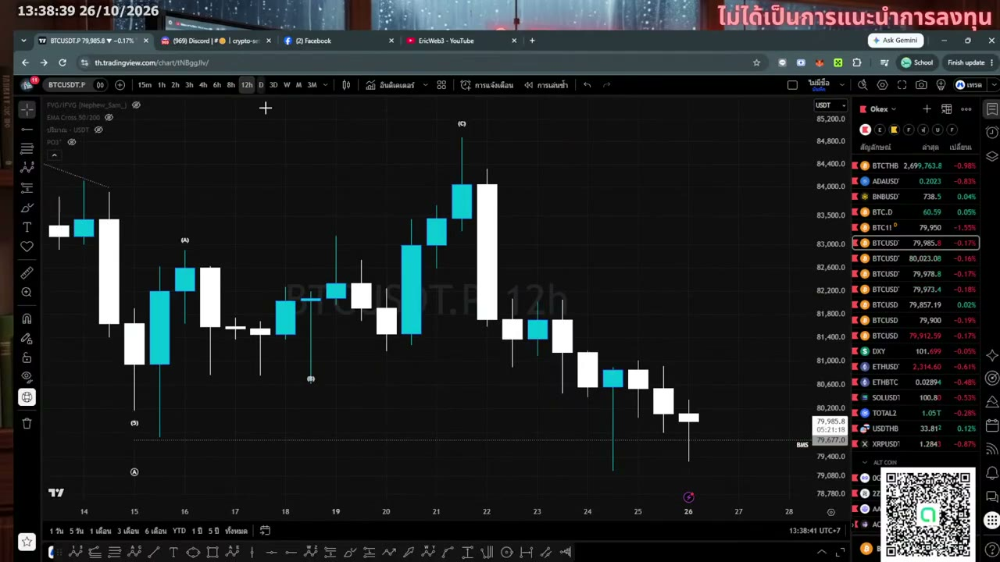

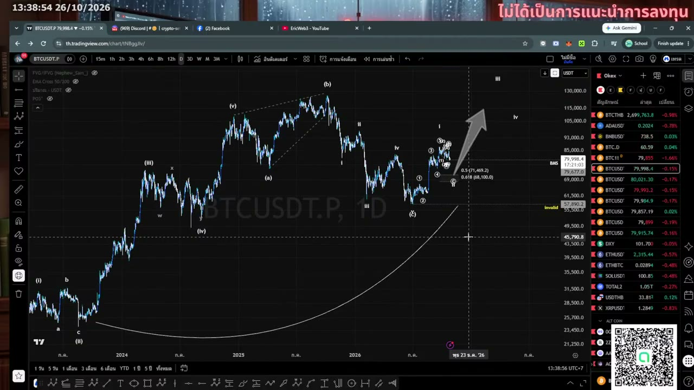

[00:40:13] แย่แล้ว ถ้าลงไปมาในขนาด 15,000 น่ะทรงมันจะไม่ สวยอ่ะสิทรงมันจะขึ้นไม่สวยอ่ะสิ เอ่อไอ้เส้น SMA  200  SMA อะไรของเค้า อ่ะที่เค้าใช้รันน่ะผมว่ามันก็ไม่สวยแล้ว อ่ะนะครับอื แค่ลงมา 40,000 กับ 34,000 นี่ก็ตลาดวน แล้วนะครับ ขอบคุณนะครับโอเคพัม กี่นาทีแล้วเนี่ย 40 พัผมไม่น่าไม่น่าจะมีเทรด setup อ่ะครับ ออนี่ไง พัมล่าสุดหลุดเทนลนไปแล้วตรงนี้มองว่าจบ จบไปแล้วครับคิดว่าน่าจะเพิ่งจบ A เนาะ เดี๋น่าจะลงขานึงนะ

[00:41:18] นะคิดว่าน่าจะรีถ้าเด้งสูงๆเนี่คือ เดี๋ยวทำให้มันถูกต้องนิดนึง 0.05 เนาะ เออ 0.05  05 แล้วก็ ลงต่อนะครับมองว่าชุดนี้จบไปแล้วสำหรับพ นะครับอาจจะลงมารับต่ำๆอีกทีคือต่ำกว่า 0.003 นะ ประมาณนี้อ่า 0.03 นี่มีแคด้วยนะครับ 27 นะตรงนี้ได้หมดเลย อ่ะโอเคฮะประมาณนี้ 42 นาทีนะครับส่วนใคร อยากได้เทรด setup ก็เข้ามาพูดคุยใน คunityเนาะนะครับผมก็อัปเดตในอ่า Line Open  Chat ก็ดีหรือว่าใน Discord ก็ดี นะครับอ่าเข้ามาพูดคุยกันได้เนาะ อหรือว่าจะเป็นฟากของทองคำนะครับอ่าน้ำ มันนะแล้วก็มีเทรด set  up ด้วยค่าเงินมี หมดแล้วฮะ

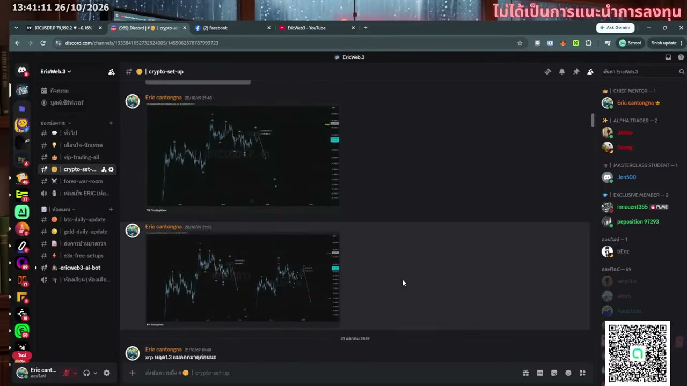

[00:42:21] นี่ยังไม่ได้ลงแบบพวกsetอพวกหุ้นอเมริกา นะนะครับแต่ก็พยายามจะดูเผื่อๆไว้นะครับ ประมาณนี้นะแต่คริปโตเ่ะมีแน่นอนนะครับ อ่ะเคียโค้ดด้านล่างขวามือนะอย่าลืมนะ ครับเป็นแผนส่วนตัวนะไม่ได้เป็นเ่อการแนะ นำการลงทุนนะครับนะครับหรือว่าเพื่อนๆ อยากเข้ามาพูดคุยใน community ของ Elite Web นะครับก็ Line  Open  Chat นะก็มีนะ ครับเมื่อเช้ารู้สึกจะมีเคสด่วน ไอ้หน้าแกกแมวนี่ไม่ใช่นะอ่าเคสด่วนนะ เพื่อนๆเค้าติดดอย position ฝั่งรองเนาะ นะครับ อก็มาพูดคุยกันได้เนาะใครจะเป็นสาย ฟิวเจอร์เป็นสายสปอตนะครับ DCA นะครับก็ หรือว่าเป็นสาย Fundamental นะครับเรื่อง ข่าวเรื่องอะไรก็มีนะมีเพื่อนๆเก่งๆหลาย คนเลยนะในคอมityเราเนาะนะครับก็อยากให้มา ร่วมจอยด้วยกันแล้วกันเนาะ อ่ะประมาณนี้นะครับก็คิดว่าน่าจะเริ่มต้น

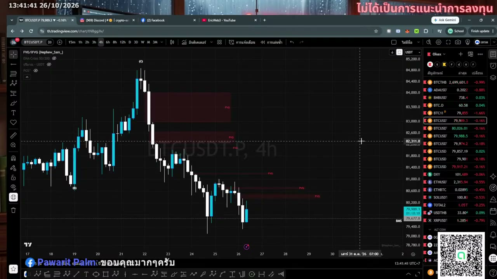

[00:43:25] เทรดแบบระมัดระวังแล้วกันนะครับช่วงปลาย เดือนนะครับช่วงสิ้นเดือนผมก็อาจจะไม่ได้ ไม่ได้แบบผลีผางไปเทรดเยอะนะครับจนกว่า ราคาบitcoinเนี่ยจะเด้งนะครับอ่าจะเด้ง รีบาวoundเข้าโซนมากกว่า 82,000 ขึ้นไป เนาะแล้วค่อยหาจังหวะในการมองลงอีกรอบนึง นะครับอ่าส่วนไลฟ์ก็พยายามจะมาไลฟ์เอ่อ จันทร์พุธศุกร์แล้วกันนะครับจันทร์พุธ ศุกร์นะครับก็พยายามจะมาไลฟ์ให้ทันนะครับ ช่วงบ่ายเนาะนะครับเพื่อนๆจะได้ติดตาม เทรด set  up อย่างใกล้ชิดนะครับแต่ถ้า อยากใกล้ชิดจริงๆก็นู่นน่ะในdiscอร์ดกับ Line  Open  Chat เนี่ยเข้ามาได้ตลอดเลย นะครับเพราะว่าผมก็มอนิตอร์ตลอดอยู่แล้ว นะครับประมาณนี้โอเคนะครับสำหรับบ่ายนี้ ก็ขอขอบคุณทุกคนนะครับอย่าลืมนะครับไม่ ได้เป็นการแนะการลงทุนนะใครสนใจก็เข้ามา พูดคุยกันในคอมityหรือว่าสนุกเฮฮฮาได้นะ ครับประมาณนี้ะกันนะครับ สำหรับบ่ายนี้ก็ขอขอบคุณทุกคนนะครับ เดี๋ยวไว้เจอกันใหม่ไลฟ์ครั้งหน้าครับ สวัสดีครับ

[00:44:48] tomor [เพลง][เสียงร้องเพลง] H  underneath  the [เพลง] every  quiet [เสียงร้องเพลง] thought  I wakes  me [เพลง] from  a  to  sleep us  now [เสียงร้องเพลง][เพลง] no  one  needs  to  tell  me  how every  lonely turn [เพลง]

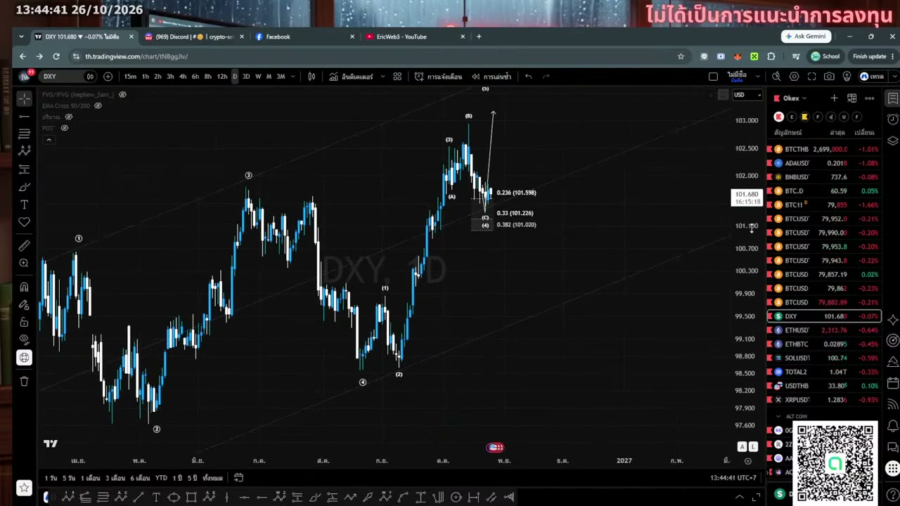

[00:45:52] H  underneath  the every  thought  I  keep wakes  me  from [เพลง] a  gentle  sleep us  H

