# 🔥 LIVE BTC รับแรงกระแทก FOMC คืนนี้! 🔥 | EricWeb3 ( 28 ต.ค. 2569)

- ช่อง: EricWeb3
- ลิงก์: https://www.youtube.com/watch?v=VnxDh4rPyf4
- วันที่: 2026-10-28
- ความยาว: 53:00
- ที่มา: คำบรรยายอัตโนมัติ (auto-generated) ภาษาไทยของ YouTube — อาจมีคำสะกดผิด/คำผิดเสียง
- ภาพ: 27 ภาพจากวิดีโอช่วงที่เปิดกราฟแท่งเทียน (เลือกอัตโนมัติจากสีแท่งเทียน · ตัดภาพซ้ำ) อยู่ในโฟลเดอร์ frames/

---

[00:01:27] every [เพลง] [เสียงร้องเพลง] heart nothing  left  for  me  to [เพลง] simple come [เสียงร้องเพลง] and  go more  than  they [เสียงร้องเพลง] can  show the  feeling every  ending [เพลง] leaves  behind something [เพลง]

[00:02:43] เฮ[เพลง]

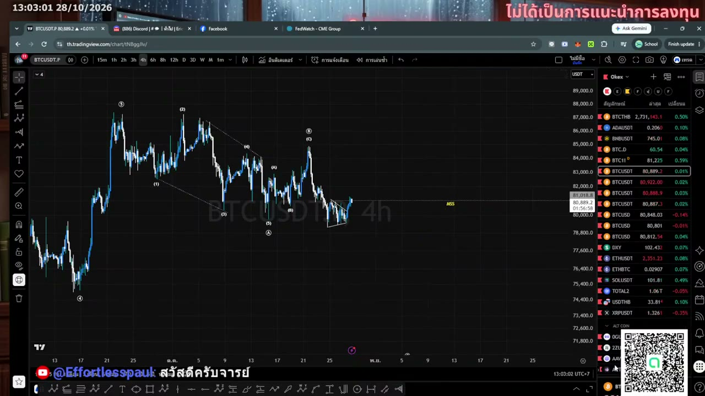

[00:04:02] Golden [เพลง] hour

[00:04:22] สวัสดีครับสวัสดีครับคุณพอสวัสดีทุกคน อ่าเดี๋ยวไลฟ์ประจำวันกันหน่อยนะครับ 13:00 น.ตรงเนาะนะครับก็ติดตามทิศทาง ตลาดกันนิดนึงนะครับสำหรับวันพุธนะแล้วก็ เดี๋เราไลฟ์อีกทีกันก็คือวันเอ่อวันศุกร์ เอ๊ะวันศุกร์ได้มั้ยเดี๋ยวนะ อ่ะวันศุกร์ได้อยู่นะครับพอได้อยู่นะโอเค ก็สวัสดีเพื่อนๆทุกคนนะครับใครเข้ามาแล้ว ก็คอมเมนต์ได้นะสวัสดีนะครับ อ่าตลาดค่อนข้างจะซึมๆนะฮะเงียบเหงาหน่อย นะครับในช่วง ตั้งแต่กลางเดือนตุลาคมมาเนี่ยปลายเดือน ตุลาคมเนี่ยค่อนข้างเงียบเหงาเลยนะครับ ถ้าสังเกต จากกลุ่มคนในคอมมิunityเนาะนะครับเงียบ เลยตอนนี้นะครับเอ่อพอตลาดบูริกเนี่ยถึง จะค่อยๆมานะนะนะตอนนี้บitคinก็อยู่ในโซน ราคา 8,800 นะครับ 80,000  8,800  81,000 นะจากที่ลงมาทำอ่า week  low ในสัปดาห์

[00:05:25] ที่ผ่านมานี่คือ 79,170 นะครับโดยประมาณนะครับก็เอ่อถือว่าในมุม มองทิศทางการปรับตัวย่อลงไปก่อนเนี่ยนะ ครับยังคงทำได้ดีแล้วก็กดดันอย่างต่อ เนื่องเนาะเดี๋วันนี้เรามาตามเรื่องของ เอ่อโครงสร้างdayเทดนะครับชุดย่อย ปัจจุบันแล้วกันนะครับสำหรับบitcoinนะว่า เอ่อมีทิศทางไหนบ้างแล้วก็อ่าในวันนี้นะ คืนนี้เนาะนะครับของอัตราการดอกเบี้ยเนาะ นะครับนะดูจากเปอร์เซ็นต์แล้วเนี่ยนะครับ ถ้าเพื่อนๆไปดูในเ Watch ไอ้ตรง CME เนี่ยนะครับก็จะเห็นว่าเอ่อมีสิทธิ์คงดอก เบี้ยค่อนข้างสูงนะครับนะนี่คือขึ้นมา เนี่ย 90% นะนะครับเคริงคงดอกค่อนข้างสูง นะนะครับก็คิดว่าราคาเนี่ยถ้ายังออกเป็น แบบนี้เนี่ยส่วนตัวนะผมมองว่าน่าจะคุณแบค กลับขึ้นไปในระดับอ่า 91,400 นะครับเอ่อ ในระดับจนถึง 92,500 ขึ้นไปด้วยซ้ำนะ สำหรับบitcoinนะครับแต่ขึ้นไปแล้วเนี่ยนะ ครับในถ้าในมุมมองของเทคนิคalเนี่ยนะครับ ก็อาจจะเป็นการรีบาวไปในการขึ้นไปในสด

[00:06:27] ส่วนของเว็บ 2 นะครับในลักษณะแบบนี้นะ สำหรับ Bitcoin นะ อ่ะอาจจะขึ้นไปได้เล็กน้อยนะครับต้องบอก ก่อนว่าทิศทาง เทรนด์ใหญ่เนี่ยนะครับยังคงมองเป็นดาว เทรนด์ไปก่อนนะนะครับต่อให้ชุดนี้ push back ขึ้นไปเนี่ยเอ่อในระดับ 83,000 เลยหรือว่าอ่า 84,000 เลยเนี่ยนะ ครับถ้ายังไม่สามารถขึ้นไประดับ 80,000 15,000 เนี่ยนะครับยังคงมองเป็นชุดนี้ ก่อนนะครับสำหรับบitcoinนะซึ่งซึ่งจะ สังเกตเห็นว่าราคาเนี่ยลงมาทำ 79,100 เนี่ยนะครับค่อนข้างเสียโครงสร้างในระยะ สั้นไปเล็กน้อยแล้วนะกรอบตรงนี้เนาะนะ ครับอันนี้วาดไม่สวยนะเสียไปแล้วนะนิดนึง นะครับหลุดโครงสร้างมานิดนึงตอนนี้เหมือน จะพยายามจะยืนให้ได้เห็นมั้ยจากจุดที่ เป็น next  line ที่เขาเคยเบรค out ขึ้น ไปอ่ะเนาะนะครับในกรอบ 81,000 นะแล้วก็ 82,000 ขึ้นไปนะครับก็คิดว่าอ่าถ้าขึ้น

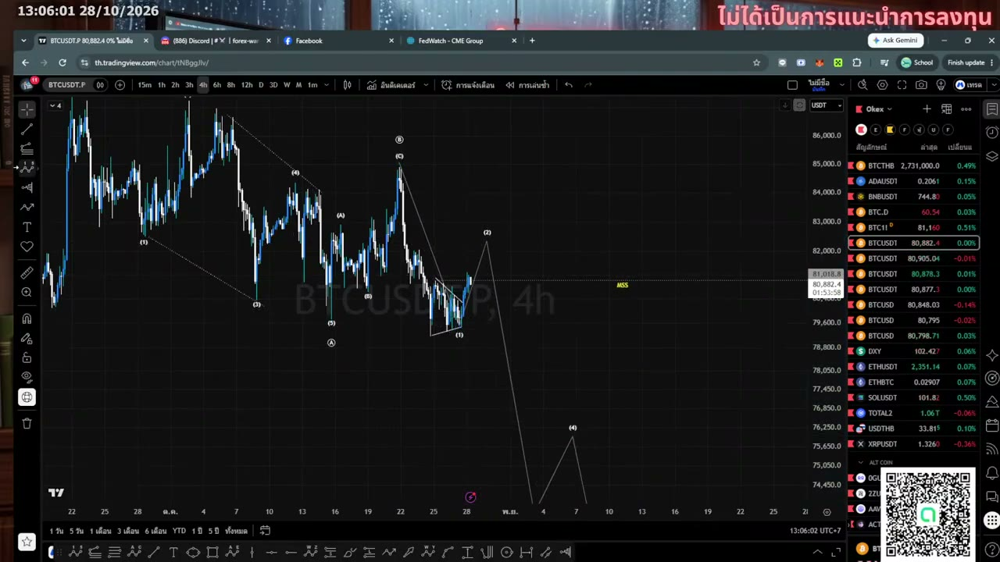

[00:07:30] ไปแล้วเนี่ยอาจจะต้อง ยืนไม่ไหวเนี่ยนะครับก็คงมองทิศทางในการ มองลงไปก่อนนะครับส่วนเป้าใหญ่เนี่ยนะ ครับก็คงยังคงต้องมองว่าในระดับเอ่อ 83,000 นะครับ 84,300 เนี่ยนะครับก็ยัง เป็นเมนเคที่จะต้องเล่นฝั่งส่วนตัวเนาะใน ฝั่งของสายฟิวเจอร์อย่างผมเนี่ยนะครับก็ คงจะ รอช็อตไปก่อนนะนะครับสำหรับชุดนี้อ่าก็ อาจจะรอเด้งเซลล์แบบนี้ไปก่อนนะเพราะว่า PVS  high เนี่ยนะครับมันบังคับอยู่แล้ว นั่นก็คืออ่า 85,000 เนาะนะครับก็ดูการ PB back กลับชุดนี้แล้วกันนะครับแต่ถ้า บitcoinไหลซึมลงไปก่อนเนี่ยเผื่อเรื่อง ของการคงดอกเบี้ยเนี่ยกลับคาดกลับตาลปัด ขึ้นมาเนี่ยนะฮะก็อาจจะเทรนด์ยัง continue อยู่นะก็คือก้อนนี้เนี่ยอาจจะยังลงไปก่อน นะฮะนะเพราะงั้นคีย์เลเวลเนี่ยนะครับที่ เราให้กันไว้ในช่วงช่วงเดือนที่ผ่านมา เนี่ยนะครับ 77,000 ลงมาเนาะในจนถึง 75,000 เนี่ยนะครับก็ยังคงเป็นโซนที่

[00:08:32] ค่อนข้างสำคัญอยู่นะครับที่คิดว่าเอ่อมี สิทธิ์ที่จะลงมา botom ณจุดนี้เนาะแล้ว เกิดแพชับางอย่างนะครับในการพักตัวหรือ ว่าอาจจะถูกเทกระแทกหลุดไปเอ่ออย่าง รุนแรงนะครับอันนี้ก็จะเป็นแผนชุด ปัจจุบันเนาะในสำหรับคืนนี้เนาะนะครับ สำหรับของการอัตราโครงดอกเบี้ยด้วยนะครับ สำหรับเฟสคุณแบงค์ดูอะไรนะทองคำใช่มั้ย เดี๋เดี๋ยวเดี๋ยวดูให้นะสักครู่นะครับอ่ะ ในส่วนของบitcoinเนี่ยนะครับเราอาจจะไม่ ได้พูดเยอะเท่าไหร่เพราะว่าเอ่อเศรษเทรด setup เนี่ยนะครับยังคงไม่ได้ไปไหนไกลนะ ถึงแม้ว่าจะเริ่มมีการรีบาวoundขึ้นมา เล็กน้อยนะครับในระดับสซักอ่า 81,000 นะ อ่าก็ต้องบอกว่าใน 2-3 วันที่ผ่านมาเนี่ยนะครับเอ่อผมก็มี อย่างเมื่อวานเนี่ยมีทดสอบเล่นใบเล็กน้อย นะจริงๆอ่ะชุดนี้ผมเล่นหลายไม้แล้วนะครับ สำหรับการเล่นรีบาว อ่าไม้รองเนาะ Bitcoin นะนะครับแถวๆ 80,000 นะอันนี้ตั้งไว้เอาสวยงามนะ 79,900 นะตั้งเอาเลขมูนะนะครับก็ขึ้นไป

[00:09:34] ปิดๆเปิดๆแถวๆเครับขึ้นไปปิด TP สัก 85,500  8,600 เนี่ยนะครับในกรอบของ Falling  Wage ชุดนี้เนาะในtimeมfrฟมสัก 1 ช่มงเนี่ยเล่นไปแค่ก้อนตรงนี้เองนะอ่า เล่นไปโดนปิดเล่นไปโดนปิดนะครับในกรอบนี้ นะนะครับราคาเยกตัวไม่ค่อยสวยเท่าไหร่นะ เหมือนไม่ค่อยมีแรงนะยังเกิดความลังเล อยู่นะครับแล้วก็ล่าสุดเอ่อน่าจะเมื่อคืน นะเมื่อคืน อ่าเมื่อคืนเล่นก้อนนี้มานะครับก็คือเล่น ในลงไปเล่นใน Low  Time  Frame เนาะชุด ที่เหมือนจะเบรคไปในระดับ 80,000  88,000 8800 นะครับที่ entry สัก 8,000  76 นะ ผมไปเล่นในTimeมfrฟมย่อยนะนะครับในการอ่า ย่อ Low  Time  frame ลงมาเนาะมาเข้าตรง Fair  Value  Gap ใน time  frame สักสัก 5 นาทีนะครับก็จะเห็นว่าพอเล่นไปเนี่ย ราคาเบรคขึ้นไปเนาะนะครับแต่เมื่อเช้าก็ ปิดไปแล้วเพราะว่าเอ่อไม่ไม่อยากดันทุรัง

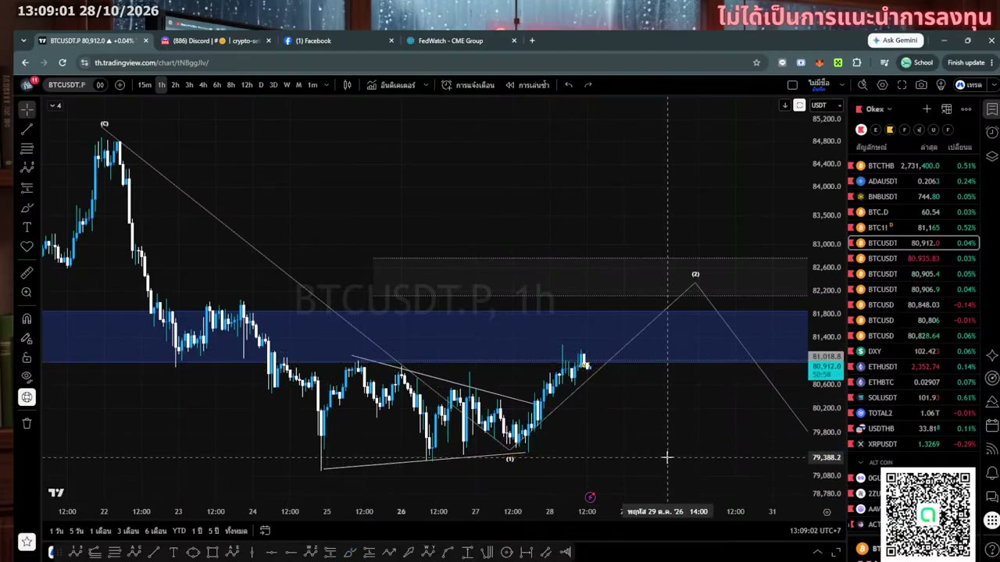

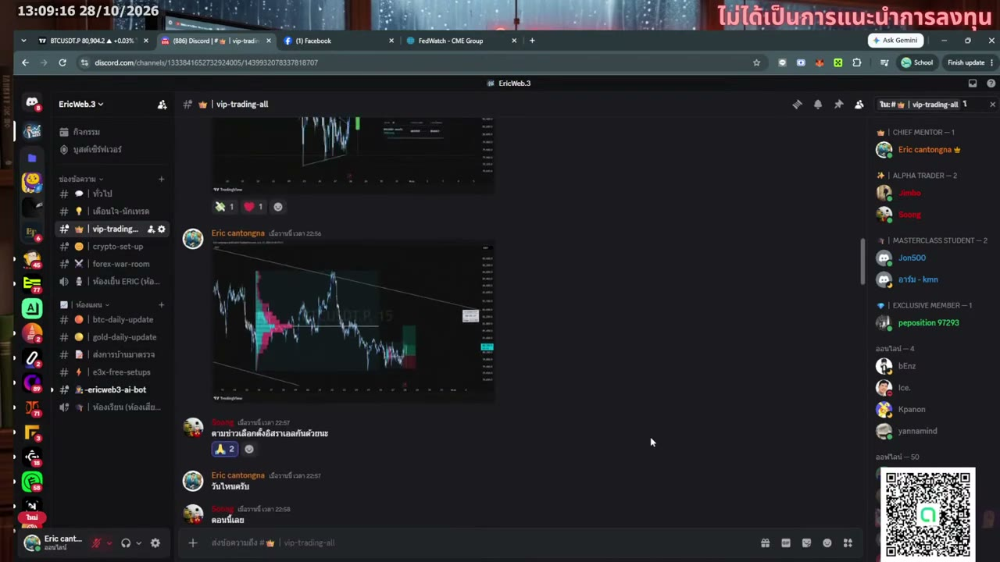

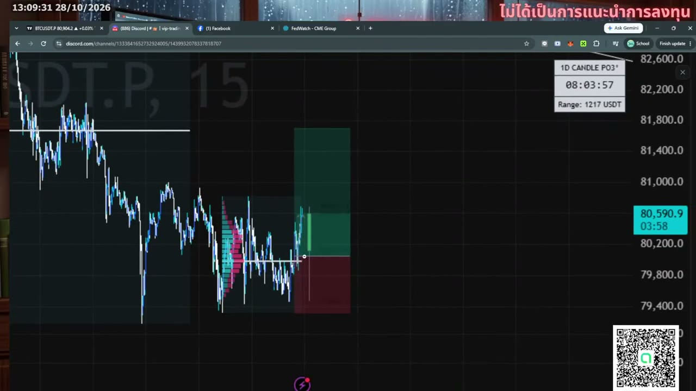

[00:10:35] แล้วกันนะครับในการที่ต้องไปลุ้นให้มัน เหนื่อยนะว่าราคาจะต้องกลับไประดับ 82,000 ขึ้นไปนะก็เลยเอ่อปิดไปก่อนนะครับสำหรับ position ไม้รองนะครับนะชุดนี้นะก็คือก็ คือรองชุดนี้นะเฮ้ย เนี่ยลองชุดเนี้ยไปเนี่ยตัวนี้ปิดไปเล สั้นๆนะครับปิดไปก่อนส่วนถ้าเค้าขึ้นไป ข้างบนหรือว่าจะอะไรอย่างเงี้ยเดี๋ยวค่อย ไปเทค Action อีกทีนึงนะครับนะตอนนี้ก็ เล่นสั้นๆไปก่อนนะเพราะดูแล้วเนี่ยราคา เนี่ยไม่ค่อยไม่ค่อยอยากขึ้นเท่าไหร่นะ หรือว่าต่อให้ขึ้นเนี่ยอาจจะขึ้นเป็นซับ Wave แล้วขึ้นไปแบบนี้ต่อนะเดี๋มาเล่น ตอนย่อรีทestอ่า 8,200 อย่างเงี้ยมี F value  gap สักทำเฟรม 4 ช่มเก็อาจจะสอย ขึ้นไปนะครับหรือเพื่อนๆถ้าใครที่ดูโครง สร้างไม่ค่อยแม่นนะครับดูโครงสร้างไม่ ค่อยแม่นหรือว่าเอ่อรอจังหวะไม่ได้เนี่ย ก็ยังไม่จำเป็นต้องไปยัดเยียดเล่นฝั่ง รีบาวoเนาะนะครับนะเดี๋ยวไปรอตอนแอtionั ซักราคาอยู่ในระดับสัก 82,000 ขึ้นไปแล้ว กันเนาะ 82,000 มีอะไรบ้างนะครับอ่า อ่าใน Time  Frame  Day เนี่ยมี Fair

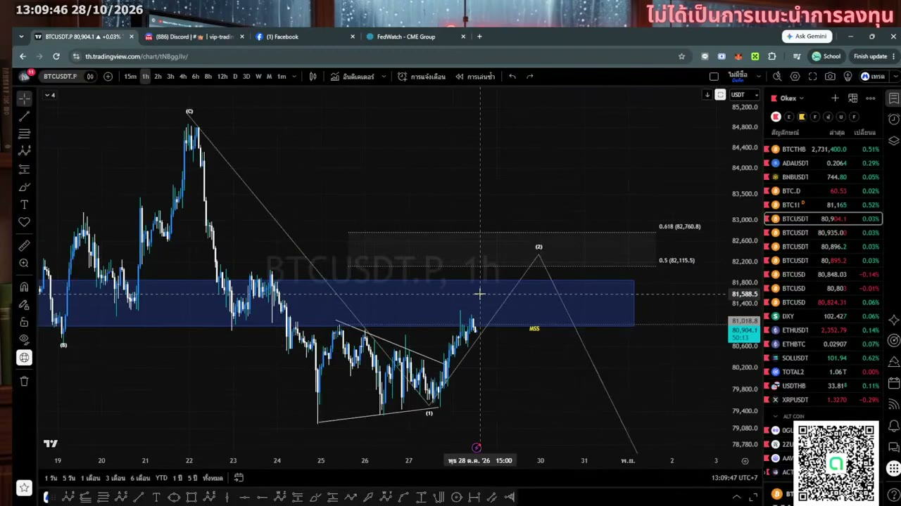

[00:11:36] Value  GAP อยู่เนาะนะครับใน Time  Frame Day เนาะซึ่งคิดว่าราคาน่าจะ Back กลับ ขึ้นไประดับ 82,000 นะครับในสัปดาห์นี้นะ ครับถ้าขึ้นไปแล้วเนี่ยก็อาจจะมีแอชัใน การเล่นฝั่งช็อตลงมานะครับซึ่งไอ้ช็อตตัว เนี้ยผมต้องบอกครับถ้าขึ้นไประดับ 8,000 82,500 เนี่ยนะครับก็อาจจะต้องลุ้นลุ้น กดลงไปหน่อยนะทีนี้ Stop  Loss เนี่ย เพื่อนๆก็อาจจะอยู่ที่ว่าจะรับได้แค่ไหน นะบางคนรับได้ที่แค่ Fair  Value  Gap นะ 1% ตรงนี้ก็ได้นะครับแต่ถ้าเป็นผมเนี่ย ผมสู้จนถึงนู่นเลยนะครับก็คือ PW  high ก่อนหน้าเนาะตอนนี้เนาะนะครับอันนี้ก็จะ เป็น SL ของผมไปนะในการที่ให้ราคาเนี่ยมี อากาศหายใจในการเคลื่อนที่แล้วค่อยทิ้ง ตัวย่อลงมาอีกรอบนึงนะครับส่วนจะย่อไม่ ย่อเนี่ยอ่ะเดี๋ยวเราก็ค่อยว่ากันอีกที นึงนะครับแต่ถ้าเกิดชุดนี้เป็นซับ wave แล้วก็เป็นเวฟ 2 จริงๆเนี่ยนะครับนะเป้า หมายในการที่ราคาจะไปแตะแล้วร่วงลงมาเนาะ นะครับเป้าของเราเนี่ยก็คือบitcoinเนี่ย

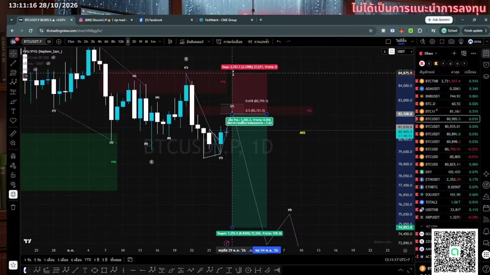

[00:12:38] ต้องทำโลต่ำกว่าเดิมนะนั่นนั่นก็คือโล 79,000 นะครับทีนี้อัพไซตในการทะลุลงมา 79,000 เนี่ยนะครับร่วงลงมาอ่าในระดับ สัก 77,000 เนี่ยนะครับค่อนข้างที่จะ เป็นแท่งยาวยาวแล้วกันเนาะนะครับซึ่งอ่า ใครที่เล่นฝั่งช็อตกับผมมานะแล้วก็จะเห็น ว่าพอเวลาผมช็อตเนี่ยผมจะช็อตแถวๆคลื่น พวกนี้นะไม่ว่าจะเป็นเวฟ 3 หรือเป็นเวฟ C เนี่ยเล่นหมดนะครับออกเป็น 5 สวิงหรือ 3 สวิงเนี่ยเล่นหมดนะเห็นมั้ยอ่าก็จะได้ เทรนด์ตรงนี้มานะเห็นมั้ล่าสุดเราช็อตที่ 84,300 ใช่มั้ยนะครับเพราะงั้นชุดนี้ก็ จะเป็นดาวเทรนด์อีกไม้นึงที่ได้วัดดวง เหมือนกันนะครับสำหรับอ่า position ฝั่ง ช็อตเห็นมั้ยยังเป็นดาวเทรนด์อยู่นะถ้า เพื่อนๆดูนะเห็นมั้ยนะครับ 82,000  82,500 เนี่ยยังเป็นดาวเทรนด์อยู่นะครับนะอันนี้ ก็จะเป็น strategy ไม้ที่ 3 เนาะในตั้ง ของตั้งแต่เดือนตุลาคมมาเนี่ยนะจะเป็นไม้ ช็อตไม้ที่ 3 แล้วกันที่เป็นพอย์หลักนะ ครับส่วนไม้รองเนี่ยต้องบอกว่าอาจจะยัง ไม่ได้คาดหวังให้ราคาปรับตัวสูงขึ้นไปใน

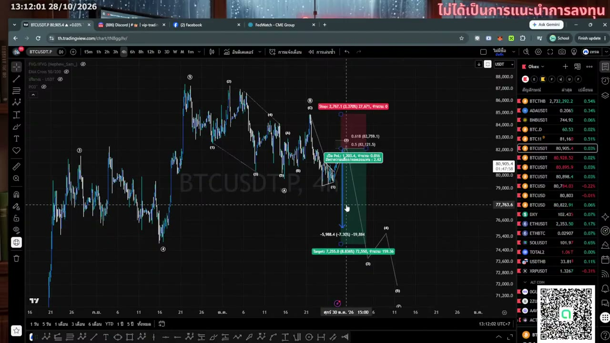

[00:13:38] ขนาดนั้นนะครับอ่อ[เสียงสูดหายใจ] อีกนึงแล้วกันนะครับก็จะ หักล้างนิดนึงแล้วกันนะครับจะหักล้างทั้ง เอ่อในมุมมองที่เป็นอ่ารหัส 5 ของขา C ใน ฝั่งมองลงอ่ะเนาะนะครับนั่นก็คืออ่ามอง ว่าชุดนี้เนี่ยเป็นเวฟ 4 ใหญ่นะครับซึ่ง ยังอยู่ในขอบเขตของของราคาที่ไม่ได้หลุด โซน 75,000 ลงมานั่นก็คือเอ่อในกรอบ บริเวณนี้นะหัว 4 ย่อยเนาะนะครับนะจาก เดิมเนี่ยเรามองว่าตรงเนี้ยอาจจะเป็นอะไร ครับอาจจะขึ้นเป็น tradดing Power ไปนะแล้วก็ตรงนี้ก็ลงนะ ครับขึ้น 2 นะ 2b ใช่มั้ยแล้วลง 4 นะครับ แต่ชุดนี้เนี่ยจะแตกต่างนิดนึงก็คือราคา เนี่ยยังคงเป็นเทรนด์อยู่นะครับยังคงขึ้น ต่อเนื่องอยู่นะยังไต่เทรนไลนอยู่แล้วมี สิทธิ์ที่จะเบรคนะครับเพราะงั้นเอ่อกับ

[00:14:39] แผนที่มองลงเมื่อกี้เนี่ยนะครับนะ invalid เนี่ย 85,000 เนี่ยนะ 85,000 ก้อนตรง ซึ่งตรงนี้มันอาจจะ ทะลุไปแล้วนะนะครับ 85,000 ก้อนตรงเนี้ย นะครับก็ต้องบอกว่าต้อง SL ให้ดีเพราะว่า ถ้าราคาเบรค 85,000 ได้เนี่ยนะครับมัน สามารถลุ้น 88,000 ได้เลยนะครับแล้วก็อาจ จะดันเทรนด์ขึ้นไปในเวฟ 5 ใหญ่ซึ่งเอ่อ ใครที่เป็นสายบullitเนี่ยนะครับหรือว่าไป รับสปอ DCA แถวๆเนี้ยนะครับก็คาดหวังที่ จะให้ลุ้นชุดนี้เหมือนกันนะครับต้องบอก ว่ายังเป็นไปได้อยู่นะครับยังไม่ตีตกนะ ยังไม่ตีทิ้งไปว่าเอ้ยมันจะต้องเป็นเวฟ B ลงขา C แล้วต้องปรับลงมา 68,000 อะไรขนาด นั้นครับเพราะฉะนั้น Strityy ชุดเนี้ย ตราบใดที่บitcoinยังไม่หลุด 74,800 หรือ ว่า 75,000 เนี่ยนะครับยังเกิดขึ้นได้นะ ครับยังเกิดขึ้นได้นะก็เพราะฉะนั้นรอการ เบรค out แล้วกันเนาะส่วนเรื่องของ RSI เนาะนะครับ Divergent เนี่ยต้องบอกว่าใน

[00:15:40] Time  Frame  Day ตอนนี้ราคาค่อนข้าง อยู่ใน range ที่เป็น oversold ไปแล้วนะ ครับก็อาจจะเริ่มทยอยมีแรงซื้อกลับมาเล็ก น้อยนะแต่ว่ายังไม่ได้ยังสู้แรงขายไม่ได้ นั่นเองนะครับนะส่วนตัวเนี่ยผมจะไปเล่น บายอีกทีนึงเนี่ยตอนที่ราคาเบรค 85,000 แล้วนะครับอาจจะไปตามชุดย่อยรีทestเอานะ ครับตามสเต็ปเดิมเนาะนะครับตอนนี้ก็ขอดู ทิศทางไปก่อนแล้วกันนะครับสำหรับบitcoin นะอันนี้ก็จะเป็น scenario  2  scenario ชุดปัจจุบันแล้วกันนะครับสำหรับบitcoin ทันมั้ยทันเนาะคุณแบงค์ขอทองขอน้ำมัน อ่ะใครที่เพิ่งเข้ามาก็สวัสดีนะครับ อืเป็นไงครับมองว่าโลกขึ้นไปก่อนมั้ยวัน นี้ถ้าคงดอกเบี้ยตามคาดคิดว่าราคารีบาว ขึ้นไปในระดับไหนฮะหรือว่าถ้าพลิกแผนผิด แผนขึ้นมาเนี่ยจะลงไปก่อนเลยมยนะครับเอ่อ ก็คิดว่าน่าจะเป็นเป็น verality ที่น่าจะ

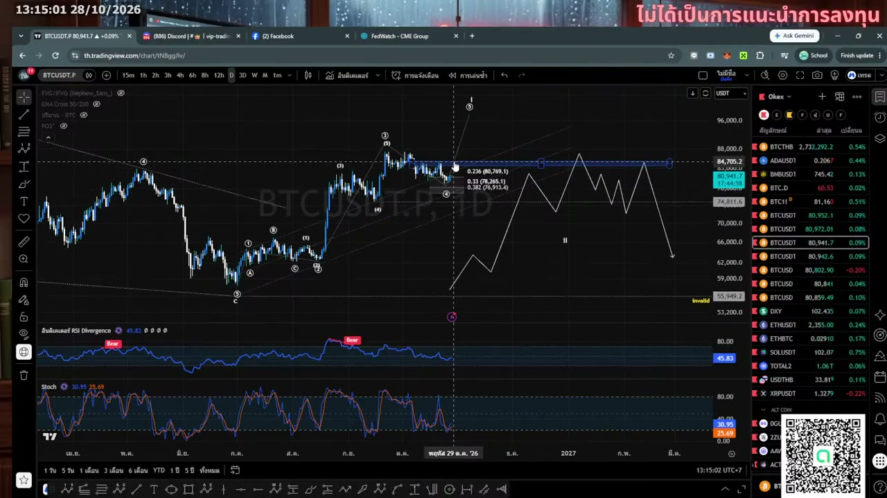

[00:16:42] ดันราคาให้มีแtionบางอย่างแล้วกันเนาะ สำหรับวันนี้เนาะนะครับตอนนี้ก็เคลียร์ position รอแล้วนะเดี๋รอดูทิศทางอีกที นึงนะเอ่อข้ามฟากไปดูทองคำเลยดีกว่านะ ครับอ่ะเดี๋คุณแบงค์เค้ารอโอเคนะครับทอง คำหลังจากที่ไหลลง โมาตลอดเลยนะเมื่อวานเดี๋ยวไปดูรีแคAPใน ห้องdiscอร์ดนิดนึงเอ่อไหลลงรีแคAPไปเนาะ เมื่อวานเนี่ยจริงๆผมโดนหน้าทุนไปที่ 4047 นะโดยประมาณ 40  437 ประมาณเนี้ยนะครับ นี่โดนหน้าทุนไปนะครับมองว่าลง 4 ย่อยต่อ นะครับนะราคามีการปรับตัวสูงขึ้นนะครับพอ ทะลุอ่า 4,030 ขึ้นไปเนี่ยนะครับก็กลาง Fibo เราแล้วนะครับ 4,60  4,080 นะโดย ประมาณนะครับอ่าเพราะงั้นอ่าขึ้นไป 4,0 4,070 เนี่ยคิดว่าถ้ายังอยู่ในขอบข่าย ของการเป็นเวฟ 4 ย่อยเนี่ยนะครับขึ้นไป ไม่เกินเป็นแล 1 ตรงเเนาะนะครับคิดว่า ราคาน่าจะมีแอคชัในการลงต่อนะครับผลปรากฏ

[00:17:42] ว่าวันนี้เนี่ยอ่าเห็นมั้ยขึ้นไปในระดับ สัก 4,070 นะครับแล้วก็มีการทิ้งตัวลงมา นะครับก็ต้องดูต่อว่าถ้าราคาบิดอ่าราคา ทองคำเนี่ยนะครับอ่ารีทestไปสักแค่ 4,06,53 เนี่ยนะครับอาจจะเข้าสู่ชุด บริบทของเวฟ 5 ย่อยเนาะซึ่งมีเป้าหมายใน การลงมาทดสอบระดับ 3,950 ลงมาเลยนะครับก็ต้องบอกว่า ยังคงดาวเทรนด์ยังคงได้เปรียบอยู่นะนี้ก็ อาจจะเซลล์ตาม Fair  Value  Gap ลงมาเนาะ นะครับอันนี้ก็เป็น SGY ของวันนี้นะแต่ ถ้าราคาเบรคเกิน 4,083 เนี่ยอันนี้ผมก็จะ ทับมือก่อนนะนะเพราะว่าเทรนด์ตรงนี้อาจจะ จบไปแล้วนะครับส่วนขึ้นเป็นชุดไหนเดี๋ ค่อยว่ากันเนาะนะครับ อ่าภาพโดยรวมของฝั่งทองเนี่ยยังคงเป็นดาว เทรนอยู่เนาะนะครับยังเหลือการทดสอบ LOW ข้างล่างอยู่นะ[เสียงหัวเราะ]ครับนั่นก็ คือนี่เลยนะครับ 3,000 นะ 3,933 นะถ้า หลุดได้นี่ไปไกลนะไปไกลหมายความว่าลงลึก

[00:18:43] เหมือนกันนะนะครับ อ่ะส่วนน้ำมันนะฮะอ่าน้ำมันก็ต้องบอกว่า เอ่อจริงๆในภาพใหญ่เนี่ยผมมองว่าเป็น douับเบิ้ท็อปมากกว่านะตัว M เนี่ยนะครับ douับเบิ้ท็อปแล้วก็ชุดเวฟเนี่ยมองว่า เป็นรหัส 5 ของเว็บ A หรือเว็บ 1 นะตรง นี้น่าจะเป็น non นะครับแล้วก็อ่ามองลงไป ก่อนนะแต่นะต้องบอกว่าแต่ก่อนว่าราคา เนี่ยเค้ายังไม่หลุดเทรนด์ Line เลยนะ เหมือนจะเคาะแล้วหลุดเคาะและหลุดหลายรอบ แล้วตั้งแต่วันที่ 21 นะครับนะเพราะ ฉะนั้นยังคงให้เครดิตของการไต่ไต่เทรนไลน อยู่แล้วกันนะครับสำหรับน้ำมันนะครับที่ เอ่อถ้าหลุด 98.5  5 ลงมาเนี่ยก็น่าจะ เสียโครงสร้างขาขึ้นนะแต่ใดๆก็ตามเนี่ยนะ ครับยังขอยึดมั่นในแผนในการมองลงก่อนแล้ว กันเนาะซึ่งในกรอบระดับซัก 103.6  103.5 5 เนี่ยนะครับอาจจะอ่าติดเนาะนะครับติด เทไลนแล้วก็ลงต่อนะจนกว่าราคาจะเบรคนะ ครับถึงจะไปนับชุดอื่นนะครับก็ยังคงคงแผน

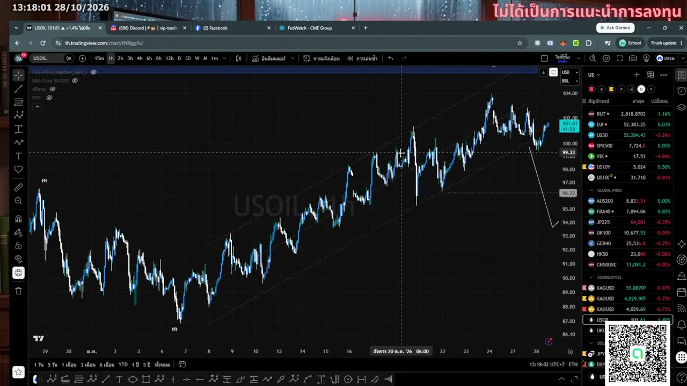

[00:19:48] ชุดนี้ไว้แล้วกันนะครับสำหรับอ่าน้ำมัน เนาะตรงนี้ก็มองเป็น ตัว M ไปละ นะครับมันอาจจะไม่ได้ลงลึกขนาดนั้นนะดู จากสถานการณ์อ่ะเนาะนะครับแต่คิดว่าควรจะ ลงมาพักตัวในระดับสัก 90 ดอนก่อนน่ะ 93-90 ดอนก่อนในภาพใหญ่นะ [เสียงสูดหายใจ]อ่ะประมาณนี้นะครับ Bitcoin ทองคำไปแล้วนะครับส่วนเอ่อ คริปโตใครอยากดูเหรียญไหนนะครับเดี๋ยวเรา มาดูพร้อมกันเลยดีกว่านะครับอ่าใครอยากดู เหรียญไหนพิมพ์ได้เลยนะเป็นสปอหรือ future ก็พิมพ์ได้เลยนะครับสำหรับช่วงช่วงดู Outcoin เนาะนะครับก่อนที่จะไปดู Outcoin นะครับนะระหว่างที่เพื่อนๆพิมพ์ขอเหรียญ เนี่ยนะครับเดี๋ยวขอไปดูย้อนไปดู DXY นิด นึงนะครับดอลลาร์นะครับอ่าอ่าในวันที่ 21 เนี่ยนะครับอ่าก็คาดการณ์ว่าราคาน่าจะทำ คลื่นปรับเนาะลงในขอบขายของ Wave  4 นะ ครับอยู่ซักราคาอยู่ 101 นะ 101.5 นะครับ แล้วก็อ่าถ้าลงมาพักตัวแถวๆ 101.2  101.5

[00:20:50] 5 ได้เนี่ยราคาก็อาจจะมีการ push  back กลับขึ้นไปในรหัส 5 ได้ซึ่งอ่าในเทรด setup ชุดนี้เนี่ยนะครับเมื่อ เช้านะจริงๆดูตั้งแต่เมื่อคืนและนะครับ ว่าเอ่อ พอลงมาแตะแล้วเนี่ยนะเพื่อนๆดูนะนะลงมา แตะแล้วเนี่ยนะครับราคาก็มีการยกตัวเรียบ ร้อยแล้วนะสำหรับดอลลาร์ นะครับ ยกมาค่อนข้างดีนะยกมาค่อนข้างสวยเลยนะ ครับเพราะงั้นเอ่อถ้าดอลลาร์เนี่ยยังคง ไต่ในระดับขึ้นไป 103 ได้เนี่ยนะครับนะก็ อาจจะเข้าสู่ขอบไขทีนี้เป้าไกลเนี่ยตรง นี้ผมลบทิ้งเลยเนาะนะครับอ่าเป้าไกลใน สำหรับชุดนี้เนี่ย อเป้าไกลเนี่ยคืออยู่เกือบ 104 เลยนะอืม นะครับประมาณเกือบ 104 นะคือสุดเทนไลน ด้านบนเลยนะครับสำหรับในการขึ้นชุดเวฟ 5

[00:21:50] นะครับก็เอ่อใครที่จะเปิดรองบitcoinตอน นี้ก็ดูความสอดคล้องนิดนึงแล้วกันนะก็ทอง คำเนี่ยคิดว่าน่าจะซึมซึมลงไปก่อนนะขายมา ก่อนนะกองอยู่ใน ดอลลาร์มากกว่าเนาะนะครับก็ดูทิศทางกัน อีกทีนึงนะในขณะเดียวกันเนี่ยนะครับใน เรื่องของเงินบาทเนี่ยตอนนี้ก็อ่อนนะครับ เอ่อต้นปีเนี่ยนะครับเราเล่นกันที่ต่ำ กว่า 31 นะใครที่ดูไลฟ์ต่ำกว่า 31 นะครับ 3 แล้วก็อยู่ในระดับ 31 ขึ้นมาเนี่ยตอน 33.8  18 นะนี่ถ้าเบรกชุดนี้ได้นี่ 34 ต้องมีแล้วนะ 1 ดอลลาร์นะครับใครจะ DCA Bitcoin ตอนนี้นี่ดูแลกเรทเงินดีๆนะเออ ดูแลกเรทกันดีๆด้วยนะครับว่าในช่วงตลาด หมีไซเคิลก่อนๆเนี่ยรู้สึกว่าเงินบาท เนี่ยจะอยู่ในระดับ 38 ด้วยซ้ำนะปี 2022 นะครับบitcoinเนี่ยราคาถูกนะนะครับแต่ว่า พอแลกเรทราคาไปเนี่ยโอ้โหถั่วเฉลี่ยเนี่ย ก็ค่อนข้างแพงนะครับตอนนั้นตอนนั้นยุค

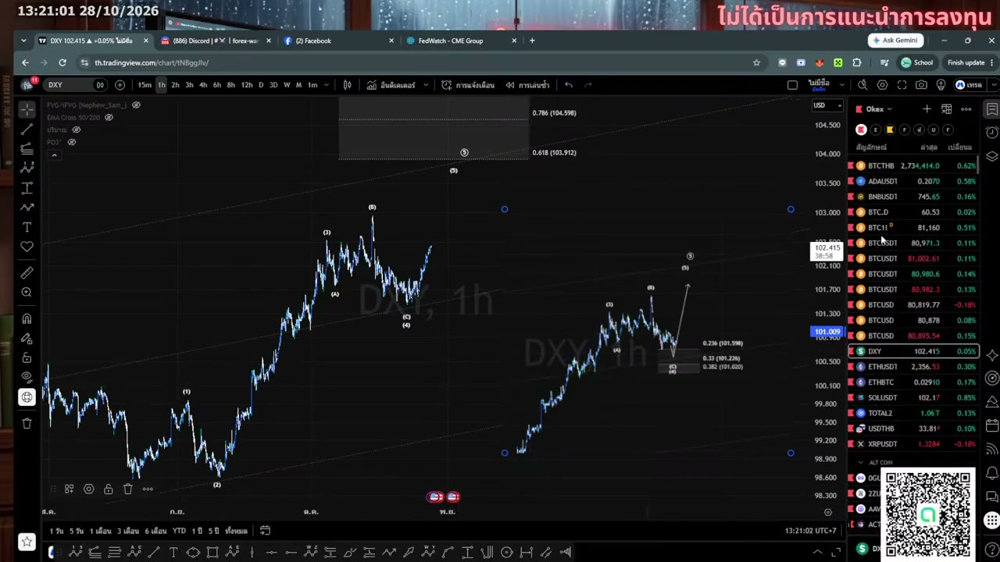

[00:22:51] สมัยนั้นยังมี P2P ที่ค่อนข้าง ค่อนค่อนข้างเอ่อ ได้ P2P ค่อนข้างบ่อยนะเจอพ่อค้าโก่งราคา ก็มีนะครับเออเจอพ่อค้าโก่งราคาก็มีนะไป แบบในระดับ 39 บาทต่อ 1 ดอลลาร์ 40 บาทก็ มีนะครับ 41 ก็มีนะถ้าใครจำได้คอมเมนต์ หน่อยนะนะครับก็เพราะฉะนั้นก็ดูในการแลก เงินดีๆแล้วกันนะครับสำหรับเรทราคาช่วง นี้นะครับเงินบาทกำลังอ่อนเลย อ่ะนะครับรอเก็บสปอร BDT ตรงไหนดีครับ เอ่อถ้าเป็นแผนส่วนตัวผมจริงๆเนี่ยต้อง บอกว่า Daily เนี่ยนะครับนะยังคงตามที่เป็นฝั่ง bullish อยู่แล้วกันนะครับนั่นก็คือกรอบ ตรงนี้เนาะอันนี้ก็คือเป็นเทรด set  up เนาะมองเป็นเวฟ 1 นะครับตามปรับ 2 นะขึ้น 3 ใช่มยถ้าเป็นมุมมอง bullish เนาะนะ ครับเอ่อ อ่ะนะครับก็ตรงเนี้ยจริงๆผมต้องบอกว่า ถ้ากาง fibo ในกล่อง A แล้วอ่ะ

[00:23:54] นะถ้ากลาง FIB ในกล่อง A แล้วนะครับส่วน ตัวเนี่ยผม รับตั้งแต่ Fibo  33 นะก็คือหลุด 77,000 ลงมาเนี่ยผมรับหมดนะอ่าก้อนตรงนี้นะ อันนี้แผนส่วนตัวนะนะ ตามกรอบFibโบ รอบที่ 1  2 5 นะครับไอ้ไอ้กล่องพวกเนี้ยคือถ้าพูด ถ้าพูดตามแบบออเดอร์รับอ่ะเอาหมดเลยตรง ถ้าราคาลงมาแบบนี้เด้ง แล้วคาดหวังให้เป็นแบบนี้นะเพราะว่าเรา มองว่าตรงนี้เป็น 1 ใช่มั้ยตรงนี้เป็น 2 โซน A ตรงนี้รับหมดนะแต่ผมรับแบบไอ้นี่นะ

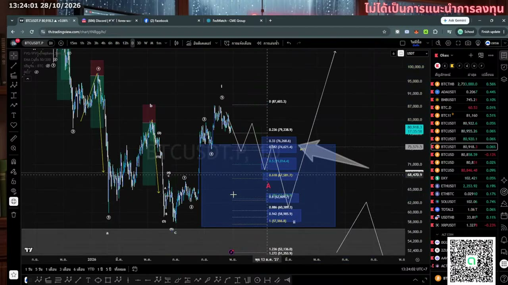

[00:24:55] ไม่ใช่ว่าหลับหูหลับตารับนะรับตาม Fibo นะครับ 33 ลงมาเนี่ย 76,000 เลงมาคือพอ คเฟิร์มแล้วว่าหลุด 77,000 ปั๊บเนี่ยคือ เอาหมดเลย อันนี้แผนส่วนตัวนะนะครับแต่เงื่อนไขก็ คืออะไรราคา สวยๆเลยเนี่ยนะครับอ่าราคาสวยๆเลยเนี่ย ราคาควรจะไม่หลุดโลเดิมแล้วนั่นหมายความ ว่า 57,500 เนี่ยต้องเป็น bottom ของรอบ อ่าอันนี้ที่ 1 ในการ DCA เนาะนะครับใน การตั้งไม้รับเพราะงั้นถามว่าเอ่อ Bitcoin ลงมาโล 79,000 แล้วอ่ะอีกนิดเดียวนะครับ อีกนิดเดียวจะลงไปตามแผนของเราแล้วก็คือ ตาม 77,000  76,000 ลงมาเนี่ยอาจจะอาจจะ ลงแค่จบแค่ 70,000 ก็ได้นะ Fibo  0.5 ถ้า เทส Falue  Gap  Week แล้วก็ไปเลยก็ได้นะ ครับเพราะงั้นผมก็จะเริ่ม DCA ณตอนนั้น เนาะถ้าใครทำถามนะนะครับแต่ไม่ได้แนะนำ การลงทุนนะนะครับอันนี้เป็นแผนส่วนตัวนะ ครับส่วนอีกนึงเนี่ยนะครับนะถ้าเกิดกรณี ไม่ใช่กล่อง A ขึ้นมาเนี่ยเป็นกล่อง B

[00:25:56] เนี่ยนะครับส่วนตัวเนี่ยผมต้องบอกว่าตรง นี้เผมจะปล่อยเลยเพราะว่าอะไรเพราะว่าใน ทิศทางตรงนี้ถ้าไม่ใช่กล่อง A เนี่ยการ เคลื่อนที่ของบitcoinเนี่ยจะต้อง invalid ทะลุลงมาทำ low ใหม่แบบนี้เลยหมายความว่า เก็บในช่วงที่ราคาเนี่ยเกิดอะไรขึ้นก็ตาม เนี่ยนะครับแล้ว[เสียงกระแอม]หลุด 57,500 ทำนิวโรต่ำเนี่ยตรงนี้น่าจะต้องมีแรงเท หลุดลงมาค่อนข้างแรงนะครับโดยเฉพาะกรอบ ราคา 50,000 ลงมาเนี่ยนะครับเข้ามาสู่โซน กล่อง BDCA เนี่ยนะครับอ่าตรงเนี้ยผมก็จะ เตรียมไว้อีก 2 เตรียมไว้อีก 1 กล่องอยู่ แล้วในการที่จะ DCA เนาะทีนี้วิธีการ DCA ของผมเนี่ยผมอาจจะแตกต่างกับชุดแรกไปที่ ผมมองตาม Fibo ของ swing  low  57,500 เนาะกับสwing high อ่า 88,000 นะก้อนตรง นี้นะผมวัดแค่ตรงนี้ใช่มั้ยเพราะว่าตรง นี้มองขึ้นนะครับแต่ถ้าลงทะลุกล่อง A มา แล้วมาเล่นโซน B เนี่ย B หรือ C ก็ตาม เนี่ยนะครับผมจะเอาสวิง low ทั้งหมดนั่น ก็คือ 10,000  5,500 เนี่ยนะครับกับยอดอั

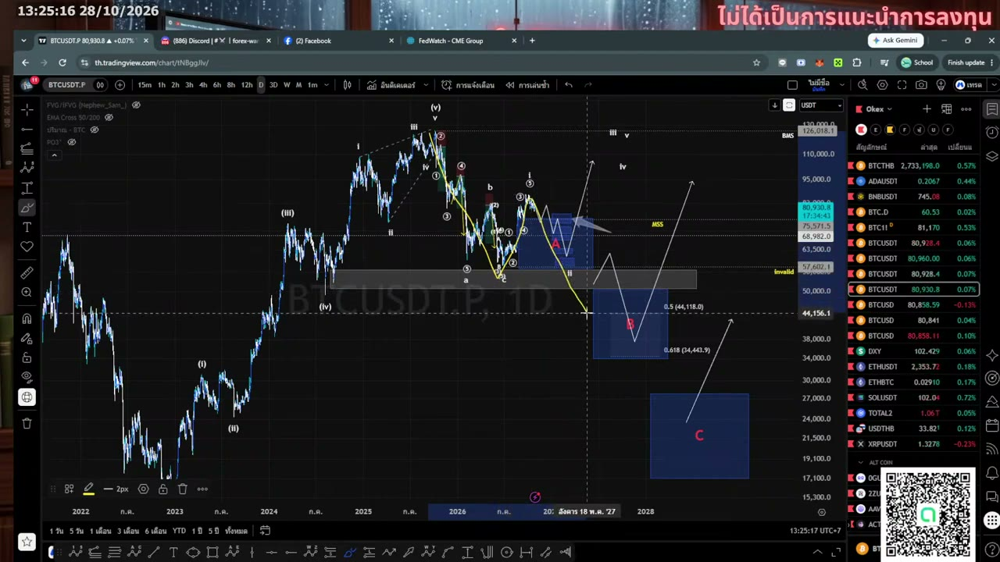

[00:26:57] High เนี่ยตรงนี้จะวัดทันทีนะครับนั่นก็ คือได้ Fibo ชุดนี้ อ่าได้ Fibo ก้อนนี้มานะครับหมายความว่า กล่อง A เนี่ยอยู่ในกรอบของ Fibo  33 เห็นมั้ครับจะตรงกับตรงนี้นี่คือกล่อง A ฮะ Fibo ใหญ่อันนี้ผมรับไปแล้วเรารับไป แล้วนะทีนี้ SERIO นี้พอราคาร่วงลงมา กล่อง B เนี่ยนะครับก็จะเป็นอะไรครับจะ เป็นโซนราคาที่ผมจะวางก็คือนั่นก็คือ 44,000 นะ Fibo  0.5 เนาะ 44,000 จนถึง 61.8 นะครับนั่นก็คือเอ่อในกรอบ B นะ 44,000 จนถึง 61.8  18 อยู่ที่ 34,400 หรือว่า 34,000 นะโดยประมาณนั้นก็คือกรอบ นี้นะราคา Fibo เห็นมั้ย นะครับส่วนการดีไซน์ DCA เนี่ยนะครับถ้า เพื่อนๆสมมุติว่าอ่า สมมุติว่าตรงนี้ผมไม้ละ 1,000 อ่าซื้อชุด ละ 1,000 ดอลลาร์อย่างเงี้ย 5 ชุดใช่มั้ย ตรงนี้ถ้าเรา mm แล้วแต่คนเลยนะถ้าเรา mm

[00:27:59] สไตล์เดียวกันตรงนี้เราก็ 1,000 ดอลลาร์ เหมือนกันคุณจะซื้อที่ Fibo  0.5  5 1,000 เหมือนกัน 61.8  18  1,000 เหมือน กันแล้วคุณรอดูทิศทางไปถัวอีกทีนึงอีกตอน ขาขึ้นก็ได้ถ้ามันกลับตัวจริงๆนะครับแต่ เอ่อถ้าคิดว่าไม่อยากได้ราคาถั่วเฉลี่ยนะ ครับนะคุณก็ต้อง mm ให้เป็นนะในการที่ อะไรครับในการที่ตรงนี้อาจจะคูณ 2 ไปนะ ครับนั่นก็คือการถั่วไม้เบิ้ลนะฮะสมมุติ ตรงนี้ 1,000 ดอลลาร์ต่อไม้ ใช่มั้ตรงนี้ต้องเท่าไหร่ครับ 2,000 ต่อ นะครับเพื่ออะไรครับเพื่อดึงราคาถั่ว เฉลี่ยเหลือให้ลงมาต่ำๆหน่อยนึงนะครับจาก ที่ผมคำนวณไปแล้วเนี่ยถ้าสมมุติคุณซื้อ ราคาเท่ากันทุกไม้จนมาถึง Fibo  61.8  8 เนี่ยราคาต้นทุนน่าจะอยู่ที่สัก 52,000 อืมราคาต้นทุนสปอตนะประมาณ 52,000 รับได้ อ่าถ้าถั่วเฉลี่ยเท่ากันจนมาถึงกล่อง B ตรงเนี้ย

[00:29:00] อยู่ที่ 52,000 รับได้มั้ยนะครับแต่ถ้า รับไม่ได้นะก็ต้องใช้วิธีการเบิ้ลไม้ถั่ว ไม้เอานะครับแต่เราจะไม่พูดถึงเรื่องของ การที่ไปรอซื้อตรงหลุมก้อนเดียวเพราะเรา เพราะเราจะไม่เดานะครับว่าตรงไหนคือหลุม เนาะนะครับแต่ถ้าคุณทำอย่างนั้นได้ก็โอเค นะอ่าอันนี้คือเราเริ่มเราเริ่มเข้าแผน ว่าราคาลงหลุด 77,000 ลงมาเนี่ย DCA  DCA DCA แล้วจบที่ 57,000 นะครับแล้วดูว่า ยืนได้มั้ถ้ายืนได้ค่อยไปถั่วข้างบนสู้นะ ครับแต่ถ้ายืนไม่ได้หลุดลงมาโอเคงั้นเข้า โซนกล่อง B แล้วก็ DCA  DCA  DCA นะครับ อันนี้ก็จะเป็น มุมมองตอนนี้นะณแผนส่วนตัวนะมุมมองตอนนี้ นะนะครับแต่เรื่องการเข้าซื้อหรือว่าการ เข้าไปเก็บ DCA เนี่ยนะครับอันนี้ก็อยู่ ที่ที่วินัยของแต่ละคนแล้วกันนะครับการ ออกแบบการดีไซน์ในการเข้าไม้เนาะนะครับ แต่ถ้าไม่คิดเยอะนะถ้าไม่คิดเยอะต้องบอก ว่าจริงๆแล้วเนี่ยคนที่ DCA มีวินัยในการ DCA ทุกวันหรือว่าทุกเดือนเนี่ยนะครับ

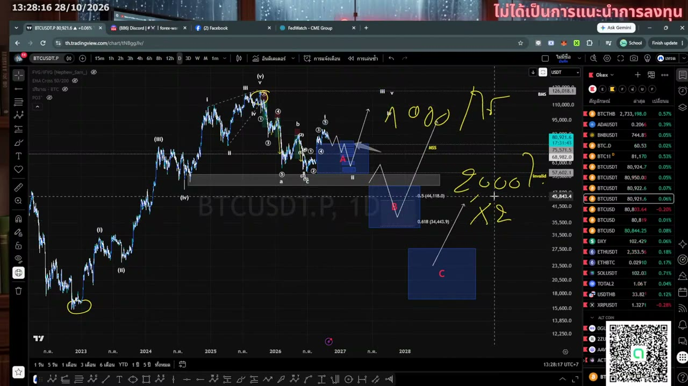

[00:30:02] กับคนที่ อ่าคนที่ DCA อ่าสมมุติคุณอาจจะ DCA ตั้งแต่ตรงเนี้ย 80,000 ลงมาเนี่ยจนมันถึงตรงเนี้ยนะครับ DCA ทุกเดือน กับคนที่รอซื้อหลุมรอ bottom อ่ะ นะต้องบอกว่าจริงๆราคาไม่ค่อยราคาถั เฉลี่ยไม่ได้ต่างกันมากนะ เออราคาถั่วเฉลี่ยไม่ได้ต่างกันมากนะครับ นะเพราะฉะนั้นขึ้นอยู่กับวิธีการของแต่ละ คนนะครับบางคนจะรอซื้อหลุมอย่างเดียวก็ ต้องท่องไว้ก่อนนะว่าเราไม่รู้ว่าหลุม อยู่ตรงไหนนะครับนะเอแค่ทำตามแผนพอนะนะ ครับประมาณนี้นะอันนี้มุมมอง DCA ส่วนตัว นะครับโอเคมย ตอนนี้ byy  the  dip  zone  a ครับ อาจารย์เมื่อไหร่จะมาใกล้แล้วคุณพออีกนิด นึงนะครับถ้ามันไม่หนีเราไปก่อนนะถ้าไม่ หนีกลับ 94,000 นะอีกนิดเดียวนะครับเพราะ ว่าโอ้โหอดทนกันมาตั้งแต่ 88,000 เนาะนะ อ่ะประมาณนี้มีใครถามเพิ่มเติมมั้ฮะอยาก

[00:31:04] ดูไหนก็พิมพ์ได้เลยนะครับสปอหรือฟิวเจอร์ ตอนนี้ตลาดก็ยังซึมๆนะก็ผมเชื่อว่าเพื่อน ๆในคอมมิunityเราอ่ะนะครับนะใครที่อยู่ก็ จริงๆตอนนี้มันเป็นโอกาสนะผมมองผมมอง อย่างี้นะครับถ้าคุณยังเชื่อมั่นในใน บitcoinอยู่อ่ะนะมันยังเป็นโอกาสเหลือ เหลืออะไรนะเหลือคีย์เลเวลอย่างเดียวเลย ว่ารีedateก็คือบitcoinตายแล้ว เดี๋พอบitcoinตายแล้วปั๊บก็นั่นนะฮะ นะครับอ้าอ่ะเราไปดูเรื่องของสัดส่วนเวลา กันนิดนึงเนาะครับในรอบของ bu แล้วก็ bar เนาะนะครับตามสัดส่วนของช่วงอ่าไซเคิลนะ ครับถ้าใครยังดูแบบนี้อยู่เนาะก็จะเห็น ว่าอ่ามันก็จะยังอิงกับที่มองว่าเป็นเวฟ 1 นะครับลง 2 นะแถวๆคือไม่ไม่ทำไม่ทำโลต่ำ กว่า 57,000 แล้วนะครับนั่นก็คือแล้วก็ ขึ้นต่อนะครับในกรอบช่วงนี้เนี่ยนะก็จะ เห็นว่าราคาเริ่มเป็นการปรับตัวย่อนะถึง แม้ว่าอาจจะยังย่อไม่เยอะก็ตามนะครับยัง คงรอคอยในระดับต่ำกว่า 77,000  7 ลงมา

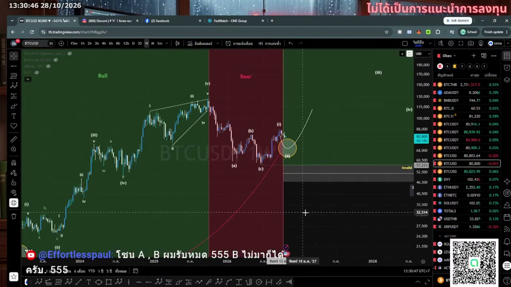

[00:32:06] เนี่ยนะครับตรงนี้ก็ถึงบอกว่าในกล่อง A เนี่ยนะครับผม DCA หมด ลงมาถึง DCA หมดเลยนะครับหรือว่าจะเริ่ม DCA ก็ได้ก็แล้วแต่มุมมองส่วนตัวเนาะนะ ครับในกรอบตรงนี้นะครับแต่ถ้าราคาผิดค่า เนี่ยหลุดลงมาเนาะทำพฤติกรรมเดิมๆเนี่ย หลุดลงมานะครับก็ยังพอเอ่อที่จะแบ่งนะ ครับแบ่งไม้ในการรับเนาะนะครับนี่ก็ใกล้ เข้ามาแล้วนะโดยเฉพาะอ่าจะเข้าสู่เดือน พฤศจิกายนนะครับในสัดส่วนเนี่ยตลาดน่าจะ วิ่งช่วงประมาณปลายปีอยู่แล้วนะครับนะ ต้องดูว่าปีนี้หรือว่าไซเคิลนี้นี่จะลงไป ต่ำกว่าเดิมอีกมั้เนาะนะครับอ่าใน รีเจคช่วง 20,000 เนี่ยบitcoinช่วง 20,000 เนี่ยจะเห็นว่าเอ่อมาย่อช่วงเดือน กุมภาพันธ์นะแล้วก็ปรับตัวขึ้นไปในเดือน มีนาคมแล้วก็ขึ้นตลอดมา 1 ปีเต็มๆเลยนะ ครับเห็นมั้ยอ่า Bullish มาตลอดเนาะ อเพราะงั้นจุดคาดหวังนะจุดคาดหวังของเรา เนี่ยชุดเนี้ยอยากเห็นการปรับตัวย่อนั่น เองนะครับ

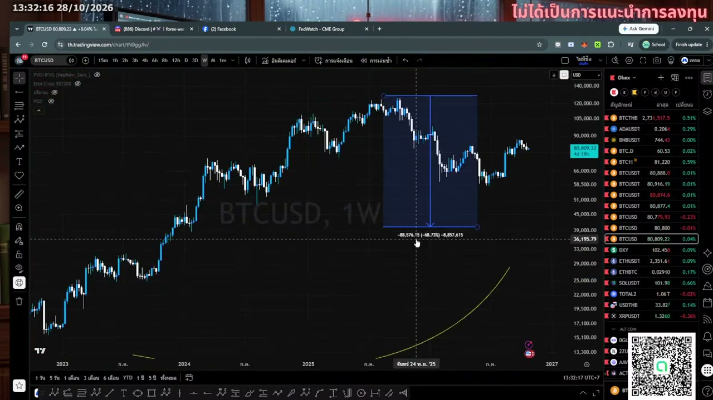

[00:33:08] อ่ะดูเรื่องของกันบ้างนะครับนะวันนี้จะ อยู่ที่บitcoinอย่างเดียวเลยนะครับจะดู เรื่องบ้างนะครับอ่าเพื่อนๆจะเห็นว่าอัน นี้ผมทำไว้เป็นมุมมองส่วนตัวนะว่า เอ่อในแต่ละช่วงไซเคิลหรือว่าช่วงแพ Action ช่วงเหตุการณ์อะไรแต่ละอย่าง เนี่ยนะครับที่ทำให้จบรอบไซเคิลเนี่ยนะ ครับบitcoinร่วงลงมาต่ำกว่า 60-70% เนี่ย บางช่วงไซเคิลเนี่ยลงมาถึง 85% ก็ นะครับแน่นอนว่าถ้าเพื่อนๆอยู่สัก cycle ที่แล้วเนี่ยนะครับเรื่องของ FTX ใช่มั้ย เรื่องของ เอ่อ Luna เนาะนะครับที่ ถูกเทลงมาเนี่ยจำได้เลยช่วงเมษายนนะถูกเท ลงมาเนี่ยทำให้ตลาดเนี่ยย่อกลับนะครับ ทิ้งตรงลงมาในระดับสัก 70% นะครับในราคา ปัจจุบันตรงนี้เนี่ยนะครับนอกจากเรื่อง ของการขึ้นภาษีสหรัฐเนี่ยนะกำแพงภาษี สหรัฐนะครับเรื่องของสงครามแล้วที่ยังคง อยู่ใช่มั้ยนะครับแล้วก็ที่มีฝัหลักมาเลย

[00:34:11] เนี่ยครับรู้สึกว่าเอ่อพวก โวalletเนี่ยจะโดนแฮกนะโดนก็ไม่น่าเชื่อ เหมือนกันว่าในไซคิลนี้นวalletเนี่ยโดน แฮกค่อนข้างบ่อยนะครับเพราะงั้นเอ่อก็ยัง คงติดตามอยู่นะครับว่าเอ่อในไซเคิลนี้ เนี่ยนะครับจะมีเรื่องของอะไรที่จะทำให้ ราคาเนี่ยถูกทุบแล้วก็กดลงมานะครับแต่ถ้า ไม่ไม่เกิดอย่างนี้ขึ้นเนี่ยหรือว่าไม่ทำ พฤติกรรมเดิมๆนะครับหรือว่าตลาดในรอบนี้ แล้วเนี่ยนะครับคนเชื่อมั่นคริปโตค่อน ข้างเยอะนะครับก็อาจจะทำให้ราคาเนี่ยมี การปรับตัวขึ้นไปเลยก็ได้อันนี้ก็ดีนะ ครับไม่เป็นไรนะครับแต่อันนี้เราก็ดู เผื่อไว้ว่าในสถานการณ์ปัจจุบันเนี่ยนะ ครับถ้าพูดถึงเรื่องของเอ่อ ในช่วงไซเคิลก่อนๆที่ผ่านมาเนี่ยนะครับ ปัจจุบันเนี่ยบitcoinเนี่ยมีการปรับตัว ย่อลงมาแค่ 55% เนาะจากโล 57,000 นะ 57,500 เนี่ยนะครับก็อาจจะเป็นไซเคิลแรก หรือเปล่าที่ปรับตัวย่อมาค่อนข้างตื้นที่ สุดนะนะครับตื้นค่อนข้าง

[00:35:12] ค่อนข้างตื้นที่สุดเลยนะครับลงไม่ต่ำกว่า 6 ไม่ถึง 60% นะครับอันนี้ก็จะให้จับตา ดูแต่ถ้าเกิดราคาหลุดลงมาเนี่ยหมายความ ว่าอะไรหมายความว่าราคาเนี่ยยังมีการเอ่อ ยังมีgปให้ร่วงลงมา อยู่อีก ละรอกนึงแล้วกันอ่าอยู่อีกละรอกนึงนั่นก็ อ่านี่นะฮะอ่าถ้าเอาแค่ 70  75% เหมือน เดิมเ Bitcoin เนี่ยอ่าจาก bottom  57,500 เนี่ยนะครับกลับลงมาอีกสัก 25% เนี่ยนะ ครับจะอยู่แถวๆสัก 45,000  46,000 อ่ะนะ ครับอันนี้ก็เอ่อ ดูไว้ใช่ว่านะดูไว้เพื่อพิจารณาเฉยๆนะ ครับแต่ก็ดูเทคนิคalเผื่อดูอะไรหลายๆ อย่างเผื่อนะครับเราจะไม่ไปแอดไปฝั่งใด ฝั่งหนึ่งเนาไม่ว่าจะเป็น Buullis หรือ Barish นะครับแต่อยากให้เพื่อนๆเนี่ย เตรียม Scenario ในการพร้อมทุกสถานการณ์ แล้วกันนะประมาณนี้นะครับอันนี้ก็จะเป็น เรื่องของการ DCA เนาะนะครับแล้วกอบกับ

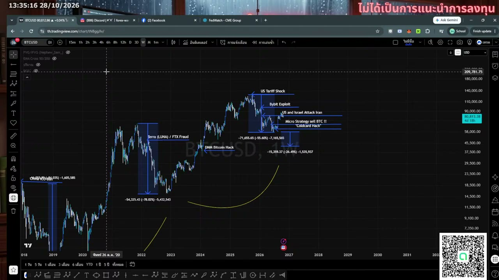

[00:36:12] เรื่องของโลIC เtimตลาดด้วยนะครับประมาณนี้นะครับ สายสายที่อยากเก็บของถูกอ่ะคนที่อยากเก็บ ของถูกเนี่ยนะครับต่ำกว่า 50,000 เนี่ยก็ ต้องแช่งให้มีเรื่องอะไรที่กระทบกระเทือน ตลาดแล้วถูกเทลงมาเนาะนะครับจริงๆผมมอง ว่าโอ้โหแค่แฮกวallet ได้เนี่ยนะครับมันก็น่าจะเรื่องใหญ่นะแต่ นี่คือโหตลาดยังขึ้นอยู่เลยยังไม่ค่อยย่อ เท่าไหร่นะครับอ่าสำหรับรอบนี้ [เสียงสูดหายใจ]อืก็เตรียมทิศทางกันต่อ เนาะฮิ 500 วันก็ประมาณวันที่ 26 พฤจิ อะไรอย่างี้ใช่ม[เสียงสูดหายใจ] ก็มีสิทธิ์นะฮะพฤจิเนาะเนี่ยก็เข้าโซนและ นะครับแต่ถ้าหลุดตรงนี้ไปก็ไม่เป็นไรนะ ครับยังยังคงมีแผนในการที่จะ DCA ตามกรอบ ไปเนาะประมาณนี้นะครับใครคิดเห็นยังไงก็ คอมเมนต์กันได้นะครับแต่อันนี้เป็นแผน ส่วนตัวนะสำหรับทั้งหมดนี้นะครับ

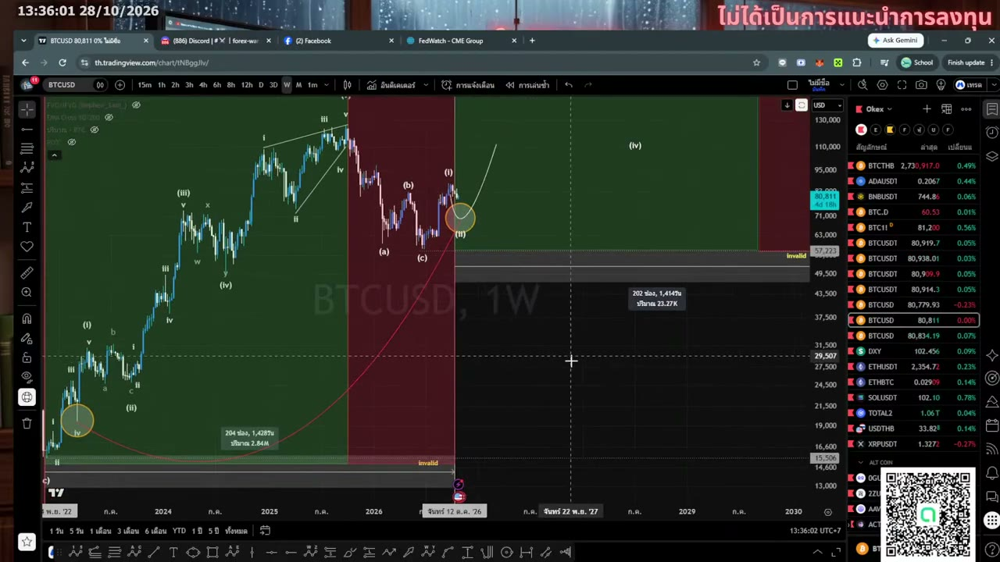

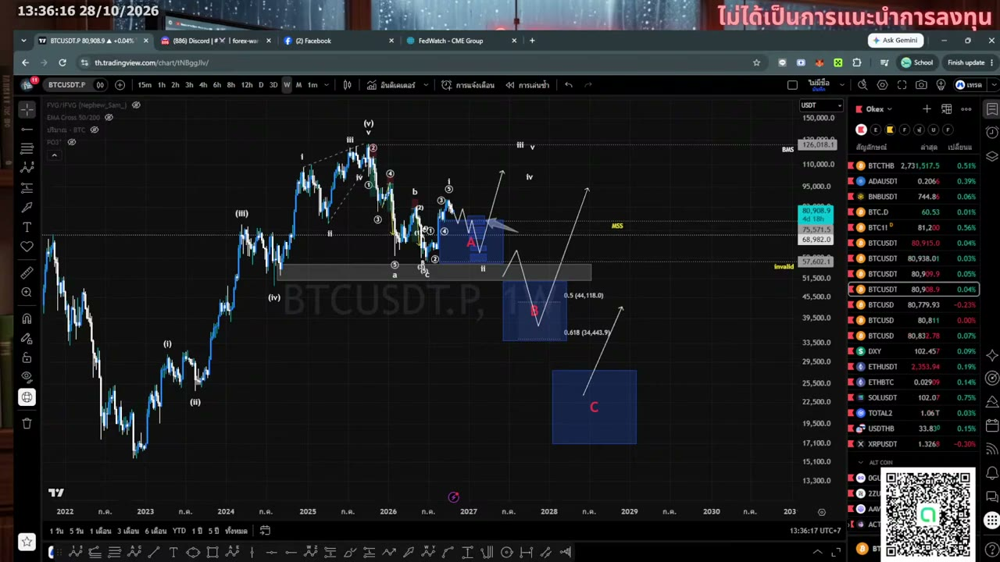

[00:37:14] อ่ะมีเพิ่มเติมมั้ยครับบitcoinน่าจะพอ แล้วเนาะน่าจะผ่านเนาะมีใครอยากดู outcoin เรียนไหนมีมั้ยครับอ่ายังมีเวลาอยู่อีก สัก 10 นาทีเนาะ 10-15 [เสียงสูดหายใจ] นาทีนะครับก่อน 14:00 น. ใครอยากดูไหนๆพิมพ์ได้เลยนะครับ ขอแอบไปดู เป็นไงมั่ง อืมเสงนี้ผมเล่นรีบาวoundมาแถวๆซัก 1,198 เนาะนะครับแต่ดูจากรูปการแล้วเนี่ยนะครับ ราคาอาจจะขึ้นไปทดสอบได้แค่สัก 1,040  40 นะตรงนี้ก็ใครเล่นมาก็น่าจะต้องกันทุน แล้วนะครับหรือว่าก็ TP1 ไปนะครับสำหรับ อ่าก็นี้นะฮะเห็นมรับแถวๆนี้เนาะนะครับ น่าจะขึ้นมาแถวๆสัก 1,330 อ่ะแค่นี้พอ แล้วนะครับอาจจะไม่ไม่ถือนานขนาดนั้นนะนะ ครับสำหรับ SE นะครับ

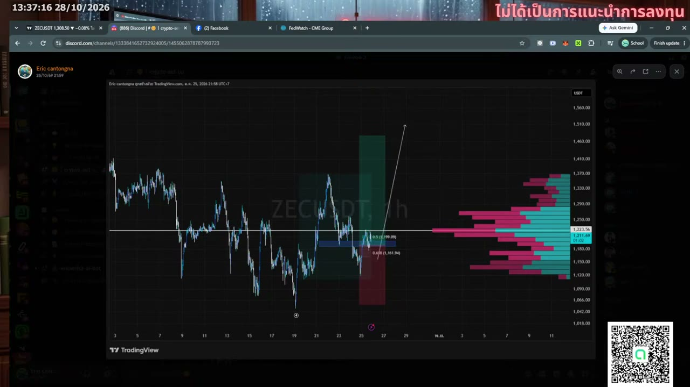

[00:38:17] อ่าประมาณนี้นะครับส่วนเอ่ออธิธีเรียม แล้วกันนะครับ 2,353 นี่นี้ลงไปทำโลที่ 2,279 นะครับeอรเนี่ย ยังคงยังคงมองในระดับการเพิ่งจบขา A แล้ว กันเนาะนะเพราะงั้นการ Pullb ขึ้นไปทำขา B เนี่ยนะครับยังคงให้ขอบข่ายเป็น B ofซไป ก่อนแล้วกันนะครับที่เ่อมีสิทธิ์ รีบาวoundไปสัก 2,400  2,450 แล้วก็มีการ ปรับตัวย่อลงต่อเนี่ยนะครับสำหรับชุดก้อน นี้นะฮะครับ นะเพราะงั้นอ่าเดี๋รอการ p  back กลับ ขึ้นไปแล้วกันเนาะ 2,400 นะครับแล้วก็ย่อ ลงมานะซึ่งในความคาดหมายเนี่ยการปรับตัว ชุดใหญ่เนี่ยนะครับสำหรับEอร์เนี่ยอาจจะ ต้องลงมาเทสซัพพอร์ตzซoneเนี่ยในระดับ 2,000 ดอลลาร์เนาะนะครับหรือว่า 1,900 ดอลลาร์นะครับอ่าชุดนี้อาจจะสวยๆมากกว่า นะการทำขา C ของ Wave  2 นะฮะถ้าเป็นเวฟ F2 นะครับก็คิดว่า

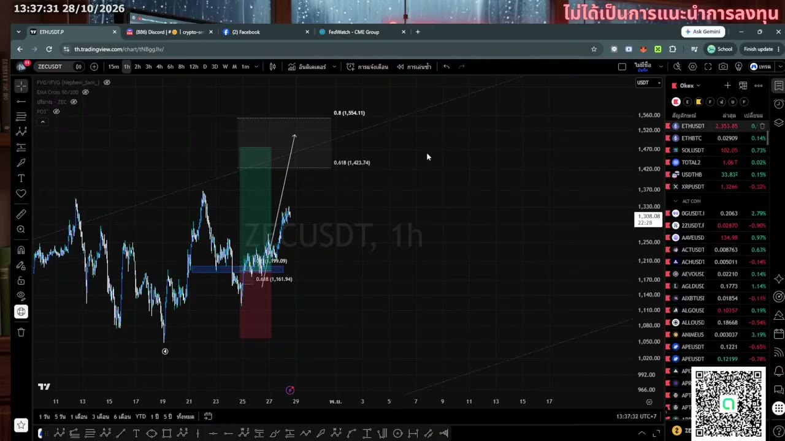

[00:39:20] อาจจะรออีกพักนึงนะรออีกพักนึงนะครับไม่ จำเป็นต้องรีบร้อนนะครับประมาณนี้ ขอคุณความรู้ดีๆก่อนอ๋อในอยู่ในกลุ่มด้วย ใช่มั้ยโอเคครับเดี๋ยวนี้กำไรมาเกือบ 700% อันนี้หมายถึงสปอหรือฟิวเจอร์ครับเนี่ยมา สอนผมด้วยมา 7 เด้งเลยเหรอโอไม่ธรรมดานะ XRP ใช่มั้ยโอเค XRP ยังคง ยังคงมองลงไปก่อนนะยังคงมองลงไปก่อนนะ ครับ A  B  A  B  C นี้มันเป็น B เป็น รหัส 3 มากกว่านะครับแต่โอเคไม่เป็นไร XRP เนี่ยส่วนมุมมองผมเนี่ยผมยังมองว่าอาจจะ ต้องลงมาอ่า bottom เนาะนะครับในระดับสัก 1.2 ดอลลาร์หรือว่า 1.99  99 นะประมาณ เนี้ยนะครับในภาพใหญ่ของสปotเนี่ยนะครับ ยังคงมองลงไปเทส Fire  Value  GAP เนาะใน

[00:40:21] time  frame เอ่อ week นะครับซึ่งเอ่อ เป้าหมายถัดไปเนี่ยนะครับราคาเนี่ยพักตัว ที่ 1.2 ได้เนี่ยหรือว่า 1.1  1 ได้เนี่ย นะครับก็ค่อยปรับตัวขึ้นต่อเนาะไอ้ถ้าgป gap  w ตัวนี้ยังอยู่เนี่ยยังไม่ต้องมี อะไรไม่มีอะไรต้องห่วงนะนะครับหรือว่าต่อ ให้ย่อมาสัก 1 ดอนเนี่ยแล้วไม่หลุด gap we เนี่ยตรงนี้ยังอยู่นะผมยังมองว่ายัง ยังเป็นโซนที่ได้ DCA อยู่นะครับก็ตรง เนี้ยหรือว่า accumulate แล้วออกข้างขึ้น ไปต่อก็ได้นะครับ มีเพิ่มเติมมั้ยฮะ อ่าคลาสเรียนเราคลาสเรียนพื้นฐานเทรด Future  Crypto เนาะเราเปิดกันต้นปีเลย นะครับปลายปีนี้ไม่เปิดนะ[เสียงหัวเราะ] ใครทักมาถามผมยังไม่เปิดนะขอพักนะครับ ช่วงช่วงปลายปีนะขอพักก่อนนะปีนี้เปิดไป 3 รุ่นและนะครับ 3 คลาสแล้วนะครับเดี๋ยวต้น ปีค่อยมาเปิดอีกทีแล้วกันนะช่วงเอ่อต้อง

[00:41:21] ดูว่าเดี๋ยวผมจะดูดูก่อนว่าสิ้นปีนี้ตลาด วิ่งจริงหรือเปล่าถ้าวิ่งจริงเนี่ยก็ยัง ไม่เปิดนะครับเพราะว่าเอาเวลาไปเทรดน่าจะ ได้ประสิทธิภาพก่อนนะครับผมจะมาเปิดอีกที ตอนตลาดย่อๆนี่แหละตอนตลาดเทรดยากก็ค่อย เปิดคอร์สค่อยเปิดคอร์สเรียน out นะครับ อ่าใครสนใจก็เดี๋ยวค่อยไปลงในเอ่อ Line OA เอานะครับ ARB ตรงนี้ต้อง TP1 แล้วนะที่ไม้ช็อตลง มาใช่มั้ยไม้เซลล์ 0.2 เนาะลงมาตรงนี้ ต้อง TP1 ครับแล้วก็เอ่อถ้าเป็นผมเนี่ยนะ ถ้าเซลล์ตรงนี้มาแล้วเนี่ย แล้ว TP1 ใช่มั้ยนะตรงนี้ผมจะกันหน้าทุน แล้วครับกันทุนคือกันตามโครงสร้างนี้แล้ว ครับอ่าราคาไม่ควรจะเกิน 0.1775  17  75 แล้วไม่ควรจะเกินตรงนี้ละ เอ่อจะมี E หรือจะอะไรก็ว่ากันไปตรงเนี้ย คือไม่ควรจะเกินละถ้าเกินผมก็ปิดทั้งหมด

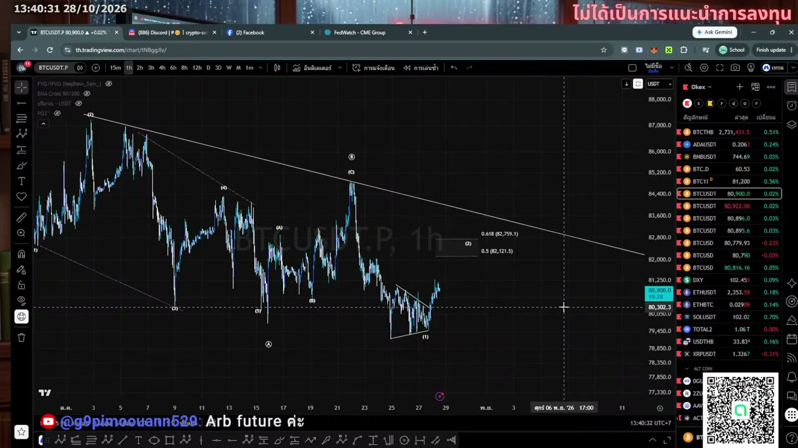

[00:42:23] เลยนะครับปิดหมดแล้วก็เดี๋รอจังหวะต่อไป นะครับสำหรับ ARB เนาะ อืเพราะไม่อยากเสี่ยงเรื่องของ overs time  frame  day นะครับกลัวจะราคาจะ p กลับขึ้นไปเดี๋ยวเพื่อนๆถือฟรีอ่ะ Solona  Sport นะฮะ Sol ยังคงให้ขอบข่ายเดิมนะครับในการที่ ตรงนี้น่าจะไม่ใช่ A นะตรงนี้พอดูจาก คลื่นแล้วไม่น่าจะใช่ A นะเหมือนเหมือน น่าจะ 4 น่าจะอยู่นี่มากกว่านะตรงนี้เป็น อืดูจากรูปการแล้วเนาะ น่าจะเพิ่งจบ A นะครับอ่าตรงนี้น่าจะจบ A ชึบๆอุ้ย

[00:43:30] อ่าน่าจะเพิ่งจบนะฮะ 1  2  3  4  5 มี diverอเจนมั้เนี่ยมีบูไดด้วยนะครับคิดว่า น่าจะเพิ่งจบนะครับสำหรับโซนะครับทีนี้ การรีบoundของ Solona เนี่ยนะครับในภาพ นี้ยังคงเอ่อคงมองในรูปแบบของซิซกไปก่อน นะครับนั่นก็คือ อ่าในขอบขายที่ไม่น่าจะเกิน 115 นะสำหรับ Solona นะสำหรับชุดนี้นะครับ อ่าไม่น่าจะเกิน 115 นะการอ่าเด้งขึ้นไปแล้วก็ลงต่อนะครับ เพราะงั้นเทรนด์ของ Solona ยังค่อนข้าง อ่อนแรงนะฮะสำหรับก้อนตรงนี้เนาะเห็นมั้ย นะครับยังอ่อนแรงอยู่นะฮะสำหรับสายสปอต ต้องรอไปอีกนิดนึงนะครับรอไปอีกนิดนึงนะ ประมาณนี้สำหรับSol่า นะเป้าหมายเป้าหมายยังคงให้ยังคงให้ราคา หลุดเอ่อ 95 อยู่นะ 95 ดอลลาร์มาพักตัว

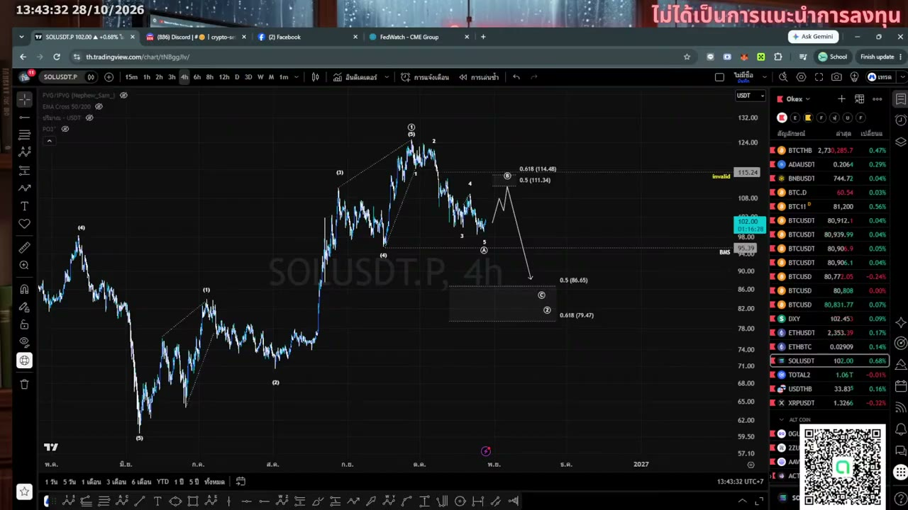

[00:44:30] สัก 80 ดอลลาร์เนี่ยนะครับอันนี้คือเป้า คาดการเนาะ มีเพิ่มเติมมฮะ อ่าสำหรับใครที่ยังไม่ได้อยู่ใน community นะครับไม่ว่าจะเป็นใน Discord ก็ดีใน Line Open  Chat ก็ดีก็อ่าเข้ามาสแกน Q Cด ด้านล่างขวามือได้นะนะครับแล้วก็พิมพ์ว่า Elb พร้อมลุยนะนะครับเราก็เอ่อเข้ามาพูด คุยกันในคอมityเราได้เนาะนะครับในกลุ่ม เนาะอ่านี้ก็มีเพื่อนๆอยู่กันเต็มไปหมด เลยนะครับ นี่ก็เริ่มเริ่มมี 2 ฝั่งะเริ่มมีคน DCA นะชวนกัน DCA นะครับเอ่อก็จะได้เห็นหลาก หลายนะเพื่อนๆหลายคนเก่งมากเลยนะครับนะ อ่าเริ่ม DCA เริ่มมีข้อมูลนะเรามีทั้ง สายTeทคnical Fundamental ก็ดีนะครับนะ แล้วก็หลายๆมุมมองเนานะครับหรือว่าจะเป็น เอ่อนอกจากคริปโตแล้วเนี่ยนะครับในอ่า ตลาดอื่นๆก็มีด้วยนะทองคำเรื่องของเงี้ย

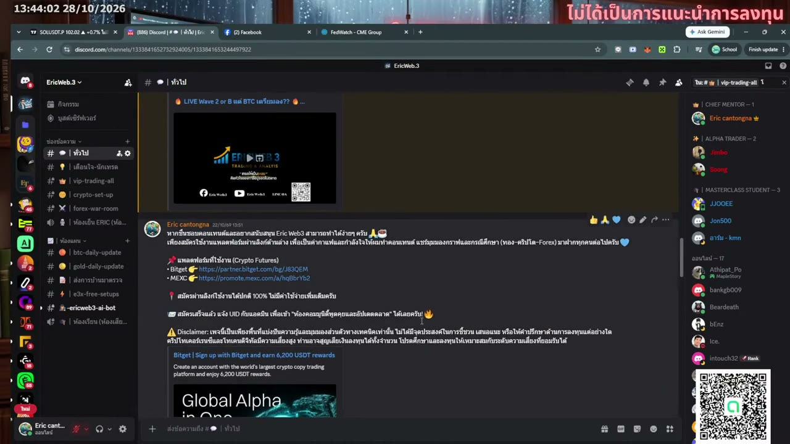

[00:45:32] นะครับเยอะเลยนะฮะ อ่าแล้วผมก็ก็ไม่ได้ไปแอด Strategy ตัว เองคนเดียวนะเพราะว่าเราก็ดูคนเก่งๆนะ ครับแล้วก็เอามาเอามาวิเคราะห์ในมุมมอง ของเราว่าไปในทิศทางเดียวกันหรือเปล่า เอ๊ะไอ้คนไหนเค้ามองต่างกับเราเราอาจจะ พลาดตรงไหนไปหรือเปล่านะครับทุกแผนเนี่ย นะครับนะเพื่อนๆสามารถนำมาปรับใช้กับเ่อ มุมมองของตัวเองได้นะแต่ว่าการตัดสินใจก็ อยู่ที่เรานั่นแหละนะฮะอือ่าเข้ามาพูดคุย กันได้นะสนุกๆนะครับคอมityนะ น้ำมัน TF  Day เมื่อกี้มองว่าลงไปก่อนนะ ฮะน้ำมัน ยังคงมองการเซลไปก่อนน่ะผมมองว่า เป็นนอนนะ อืมขึ้นไป[เสียงกระแอม]ก็โดนเซลล์นะครับ มองลงไปก่อนถ้ายังไม่ทะลุ 103 เดี๋มองลง

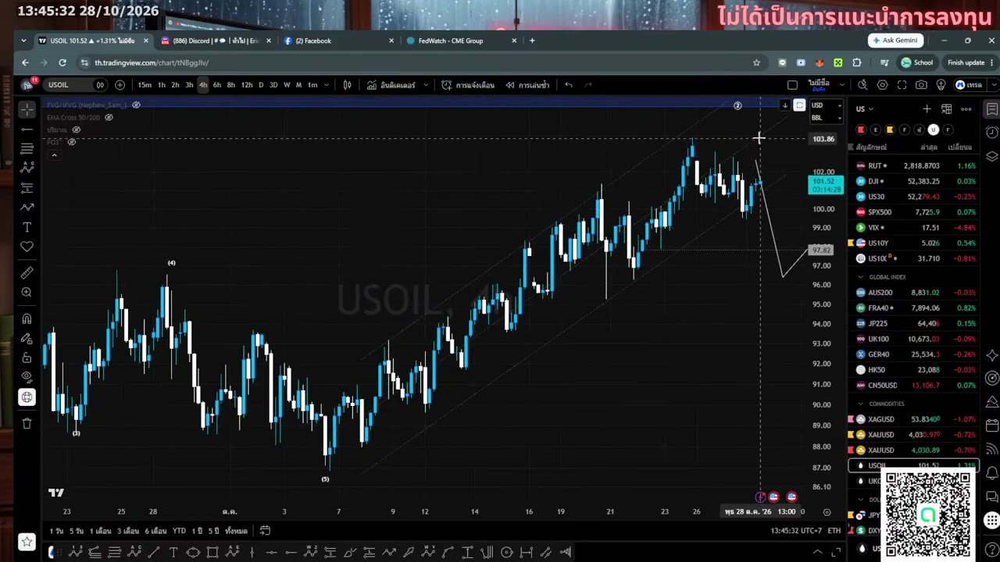

[00:46:32] ไปไปก่อนนะแล้วก็ถ้าราคาหลุด 98 นี่มองลง ไปก่อนนะในภาพใหญ่นะครับตอนนี้ยังยัง อัพเทรนอยู่ตอนนี้ผมยังไม่ทำอะไรนะทำมัน ปล่อยไปก่อนนะครับส่วน Dodge  Coin Future ใช่ม ชึบอืม Dodge คอยออกรูปแบบของ Wage แล้วครับก็คิดว่าน่าจะ ติดนะน่าจะติดแนวต้านตรงนี้แหละนะครับ 0.083 นะนะครับติดเทรนไลนเนาะนะครับแล้ว ก็ออาจปรับตัวย่อลงอีกขานึงนะครับในการทำ รหัส 5 นะอ่าหมายถึงว่าเวฟ 5 เนาะแล้วก็ ปรับตัวขึ้นต่อนะคิดว่าตรงนี้ยังเบรกไม่ ได้นะครับแต่ถ้าเบรคได้เนี่ยต้องเบรคเกิน มากกว่า 0.085  085 นะครับสำหรับ Dodge อ่าต้องเบรคเกินก็ตรงนี้ให้ได้ก่อนนะถึง จะมองว่าสวยนะครับิกับtทสlaเหรอผมไม่น่า จะมีนะเดี๋ยวเดี๋ยวผมดูให้แล้วกันนะคุณ ลิกี้นะ

[00:47:34] เดี๋ยวไว้ดูให้ เหรียญไหนถ้าผมคุ้นน่ะผมจะเห็นเลย อันนี้เหรียญอะไรอ่ะใช่เหรียญนี้มั้เนี่ย เดู เอ๊ะเคยเห็นด้วยหรอ รอบที่แล้วเคยดูให้ใช่มั้ยเนี่ยติดรีทest แล้วลง เนี่ยเปิดกราฟมาก็เจอแล้วเนี่ย เอ่อก็คงเป็นดาวเทรนอยู่แหละครับถ้า เหรียญเนี้ยผมคิดว่ายังไม่น่าเล่นนะ เอใช่มั้ติดที่เอ่อ 4.1  4.4 ประมาณเนี้ย 4.1 เนาะนะครับปรับตัวย่อก็ถ้าขึ้นไปก็ คงโดนรีทestอยู่ดีนะครับรีทestแล้วลงต่อ อยู่ดีนะครับตามเทรนไลนนะครับยังคงให้ใน การมองลงอ่ะเนาะนะครับโดยเฉพาะการที่ราคา อาจจะหลุด 1.9  9 นะ

[00:48:36] นะครับส่วนtสlaเนี่ยเดี๋ยวผมดูให้อีกที นึงคือตอนนี้โอ้โหแล้วเดี๋ยว AI จะ IPO อีกนะครับน่าจะได้นับนับกราฟ ค่อนข้างเยอะนะครับ[เสียงหัวเราะ]ก็ พยายามจะดูเทรด setup ให้กับเพื่อนๆหลายๆ ตลาดให้ได้แล้วกันนะครับแต่ว่าบางทีผมดู แค่ิปโตอย่างเดียวเนี่ยมันก็ไม่ทันแล้วนะ แล้วก็พยายามดูตัวที่แบบได้เน้นๆแล้วกัน เนาะนะครับนะครับแต่ถ้าไม่ติดอะไรแล้ว ว่างตอนนั้นน่ะก็จะนับให้เลยจะดูให้เลยนะ ครับเนี่ยอาจจะต้องสร้างห้อง พวกอเมริกาอีกมั้เนี่ยนี่ก็ค่อนข้างเยอะ แล้วนะิปโต Forex ทองคำนี่ค่อนข้างเยอะ แล้วนะอ่าคู่เงินก็มีนะครับนี่เดี๋ต้องมา เดี๋ยววันอาทิตย์นี้ต้องมาอัปเดตอีกนะ ครับแต่ค่าเงินเนี่ยผมจะสักอาทิตย์ อาทิตย์ละครั้งนะนะครับอาทิตย์ละครั้งนะ

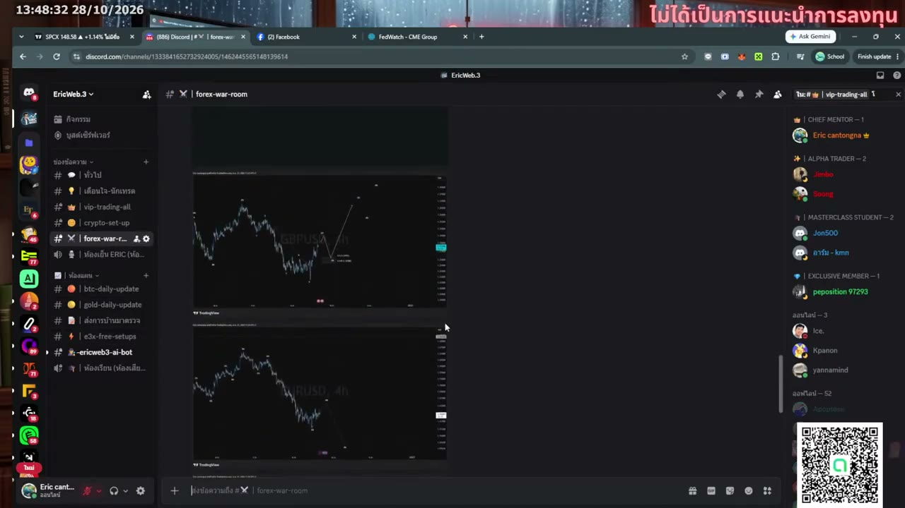

[00:49:37] แต่คริปโตเนี่ยเราตลอดอยู่แล้วนะครับ ก็จะเป็นพวกทองคำเนาะทองคำน้ำมันนะครับ อ่ะก็ประมาณนี้ ก็ฝากกดติดตามช่องใน YouTube ให้ด้วยแล้ว กันนะครับนะใกล้จะขาดอีกไม่กี่ร้อยนะก็ น่าจะ 1,000  subscribe แล้วนะครับ เอ่อพวกหุ้นน่ะเดี๋ยวผมดูให้ทีหลังดีกว่า เพราะว่าผมอยากได้ตัว data ที่มันกราฟที่ มันเยอะๆนะครับเพราะว่าถ้าผมอยู่ๆไปดูใน USDT เลยอ่ะมันข้อมูลมันอาจจะไม่ตรงเท่า ไหร่อันนี้ส่วนตัวนะอาจจะมันอาจจะไม่ตรง เท่าไหร่สมมุติจะไปดูแบบ USDT อย่างเงี้ย อืมันมันไม่ค่อยตรงอ่ะ เออถ้านับก็นับตัวเมนตัวหลักไปเลยดีกว่า จะได้เห็นโครงสร้างให้ครบๆอย่างเงี้ไม่ น่าจะครบนะ

[00:50:37] อือย่างเงี้ยอย่างเงี้ยถึงจะครบอย่าง เงี้ยถึงยังพอแบบใบแอดได้มั้งนะครับเนี่ย อ่ะประมาณนี้นะครับก็หวังว่าไลฟ์นี้จะ เป็นประโยชน์กับเพื่อนๆนะครับนะครับใคร ที่เอ่อเทรดคนเดียวแล้วเหงานะก็อย่าลืมนะ ครับเคียคนล่างขวามือนะครับเข้ามาพูดคุย กันในคunityอ่า Elb ได้นะครับสำหรับเอ่อ คิดว่าถ้าเดือนหน้าเนี่ยตลาดเป็นทิศทาง บullเนี่ยนะครับจนตลอดจนถึงปลายปีและต้น ปีเนี่ยคิดว่าน่าจะได้เทรดกันสนุกเลยแหละ นะครับแต่ถ้าตลาดยังซึมไปเนี่ยนะครับยัง ซึมลงไปอีกเนี่ยนะครับก็ไม่เป็นไรเนาะนะ ครับยังไงเอ่อคอมมิunityเราก็อยู่กันตลอด อยู่แล้วนะครับนะไม่ได้มีแค่ตลาดคริปโต อย่างเดียวก็มีหลายตลาดเลยนะก็ใครที่สนใจ ก็เข้ามาพูดคุยกันได้เนาะนะครับแล้วก็ ไลฟ์นี้ไม่ได้เป็นการแนะนำการลงทุนนะครับ เป็นเพียงแค่มุมมองส่วนตัวเนาะนะครับ เดี๋ยวไว้อัปเดตกันใหม่นะครับสำหรับบ่าย วันศุกร์นะครับศุกร์ที่ 30 ใช่มั้ยนะครับ

[00:51:39] นะสำหรับบ่ายนี้ก็ขอขอบคุณทุกคนนะครับ เดี๋ยวผมไปคุยในเอ่อ Line  Open  Chat ต่อกันในdiscอร์ดต่อะนะครับเดี๋ยวไว้เจอ กันใหม่นะครับสำหรับไลฟ์ข้างหน้าสำหรับ วันนี้สวัสดีนะครับ

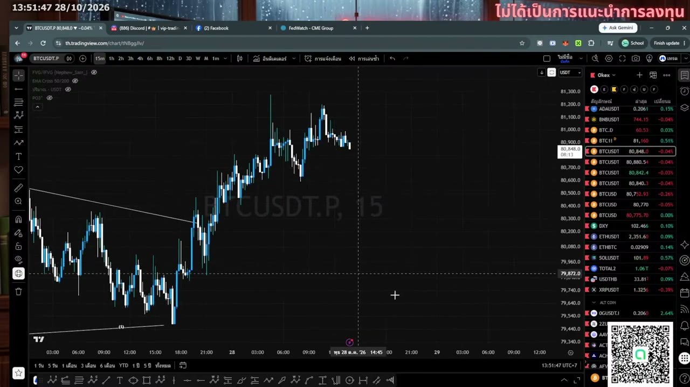

