# 🔥 LIVE BTC 76,000 ขาลงมาก่อนเลือกตั้ง ?🔥 | EricWeb3 ( 2 พ.ย. 2569)

- ช่อง: EricWeb3
- ลิงก์: https://www.youtube.com/watch?v=GKpDTYKrnzs
- วันที่: 2026-11-03
- ความยาว: 1:05:15
- ที่มา: คำบรรยายอัตโนมัติ (auto-generated) ภาษาไทยของ YouTube — อาจมีคำสะกดผิด/คำผิดเสียง
- ภาพ: 48 ภาพจากวิดีโอช่วงที่เปิดกราฟแท่งเทียน (เลือกอัตโนมัติจากสีแท่งเทียน · ตัดภาพซ้ำ) อยู่ในโฟลเดอร์ frames/

---

[00:01:35] The  city  f  behind  the air  room  no  question  ask but  no coming  back in  the dreaming  where  you  us  to  be  ocean bre  and  memory  still  holding on  to  me still  holding on  to

[00:02:44] The  city  f  behind  the room  no  question but  no coming  back  again one  on  in  the dreaming  where  you  to  The  ocean bre  and  memory  still  holding on  to  me. on  to

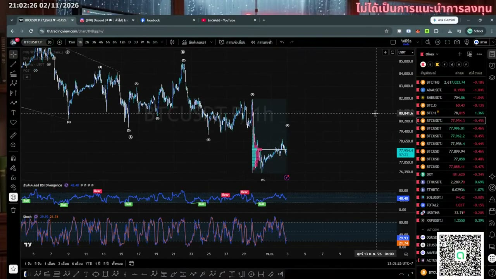

[00:03:59] โอเคสวัสดีครับทุกคนสวัสดีช่วงค่ำนะครับ สำหรับไลฟ์อริ วันนี้เราเปลี่ยนมาไลฟ์กลางคืนบ้างนะช่วง 21:00 น.นะครับจากช่วงบ่ายเนาะนะครับ เปลี่ยนมาช่วงบ่ายอ่าช่วงกลางคืนบ้างนะ ครับก็สวัสดีเพื่อนๆทุกคนนะครับ อ่าเป็นไงกันบ้างครับในเอ่อสัปดาห์ที่ ผ่านมาบitcoinนะครับแล้วก็ตลาดอื่นๆนะฮะ คิดว่าเป็นไปตามเทรด setup กันบ้างหรือ เปล่านะครับมีใครที่ติดตามเทรด setup กัน บ้างนะคอมเมนต์กันได้นะครับสวัสดีนะครับ หน้าเพจด้วยนะสวัสดีนะครับ เดี๋ยวรอสักนิดนึง อ่าใครเข้ามาแล้วได้ยินเสียงภาพชัดเจนก็ คอมเมนต์ได้เลยนะครับเดี๋เราจะได้เริ่ม

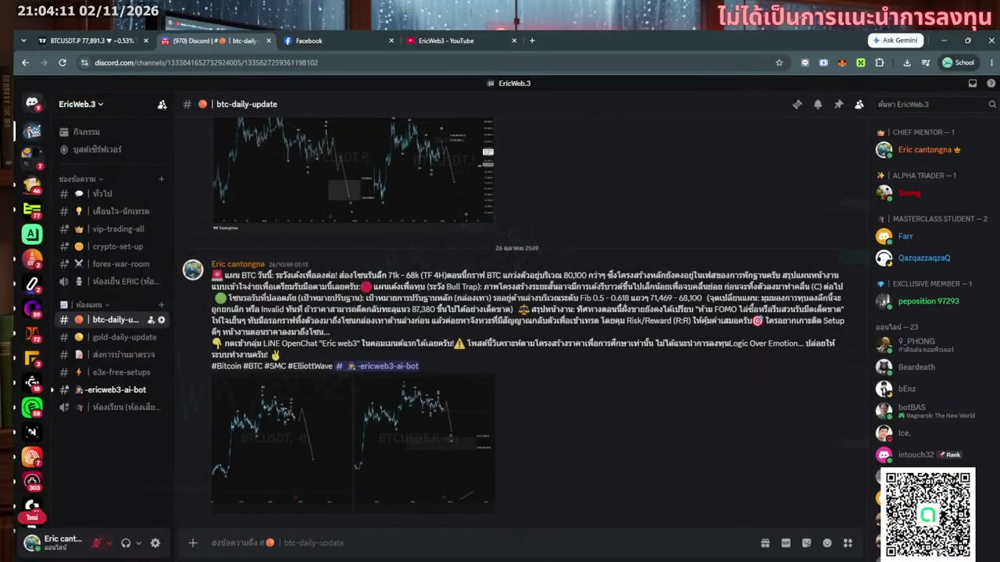

[00:05:00] อ่าวิเคราะห์แผนกันเลยนะครับสวัสดีนะครับ อ่าเปิดประเด็นมาก็ตอนนี้บitcoinอยู่ที่ 70,000 เกือบๆ 78,000 นะครับอ่าในช่วง ปลายเดือนเนี่ยยังวุนเวียนอยู่แถวๆ 81,000 อยู่เลยนะครับตอนนี้ก็เ่อมีการปรับตัวย่อ ในระดับที่เอ่อรู้สึกว่าจะหลุดมาในระดับ 76,000 ด้วยซ้ำนักนะครับวันนี้เดี๋ยวผม พูดถึงเรื่องของเอ่อการเข้าโซนของกล่อง A นะ DCA  Sport  Bitcoin นะที่ที่เอ่อทุก ไลฟ์เราพูดคุยกันมานะครับ สวัสดีครับคุณจิมสวัสดีครับ

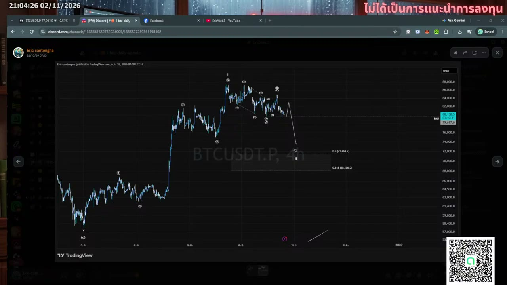

[00:05:57] โอเคนะครับเราอ้าพี่สูพี่สุมาด้วยสวัสดี ฮะโอเคนะครับเราไปพูดถึงบitคinกันก่อนดี กว่านะครับนะในเอ่อช่วงปลายเดือนเนาะเรา ตามเทรด setup กันมาในชุดของอ่าในมุมมอง ของ Bullish เนี่ยเรามองว่าโครงสร้าง เนี่ยเป็น Wave  1 นะครับเวฟ 1 ชุดใหญ่ แล้วก็เตรียมทำขา A นะ A1 นะครับไม่ว่า เป็นเวฟ A1 หรือว่าเป็นเอ่อการขึ้นรีบาว นะครับแล้วก็มาสังเกตการช็อตเนาะตั้งแต่ ส่วน 84,000 นะครับแล้วก็ 82,500 นะครับ ไม่ว่าจะเป็น Wave  B2 ตรงนี้นะครับมอง ว่าราคาเนี่ยน่าจะต้องอ่าเบรค Market Structure นะครับหลุดโซน 80,000 หรือว่า 79,500 ลงมานะครับซึ่งอ่าในช่วงอ่าปลาย เดือนเนี่ยนะครับนะก็มีเหตุการณ์ค่อนข้าง ที่จะรุนแรงนะนั่นคือการแฮก Exchange เบอร์ 1 อย่าง Binance นะครับเออแฮกค่อน ข้างแบบ นะก็ถือว่าเล่นเบอร์ใหญ่เลยนะครับเล่น

[00:07:00] เบอร์ใหญ่เลยนะครับสำหรับเอ่อฝัในครั้ง นี้นะครับในการที่เล่นแชเอ่อ Exchange นะ ครับเบอร์ 1 ของโลกเลยนะครับเพราะงั้นก็ ส่งผลให้ราคาเนี่ยมีการปรับตัวร่วงหลุดใน ระดับ 80,000 ลงมานะเข้าสู่โซน 76,000 นะ ครับ 76,000  76,500 ลงมาเลยนะครับสวัสดี คุณพอครับนะก็จะเห็นว่าในทาง TA เนี่ย จริงๆเราก็ไม่ได้คาดการณ์ว่าเขา้าจะหลุด มาได้ขนาดนั้นน่ะนะครับแต่ว่าอ่าก็ดีแล้ว ที่เอ่อมีฝัมาเนาะนะครับส่งผลให้ราคา เนี่ยมีการผลักดันเนาะนะครับให้หลุดลงมา ในระดับที่ต่ำกว่า 7,000 นะครับอันนี้ก็ จะเป็นเอ่อชุดมุมมองของเทรด setup อ่า Bitcoin นะครับในโซนเอ่อ โซนฝั่งมองลงอยู่นะครับซึ่งก็ยังคงมองว่า แผนที่เรามองลงมาเนี่ยนะครับอ่ายังคงใช้ ได้อยู่นะครับในส่วนของ position ฝั่ง นะครับ position ฝั่งช็อตจะเห็นว่าในวัน

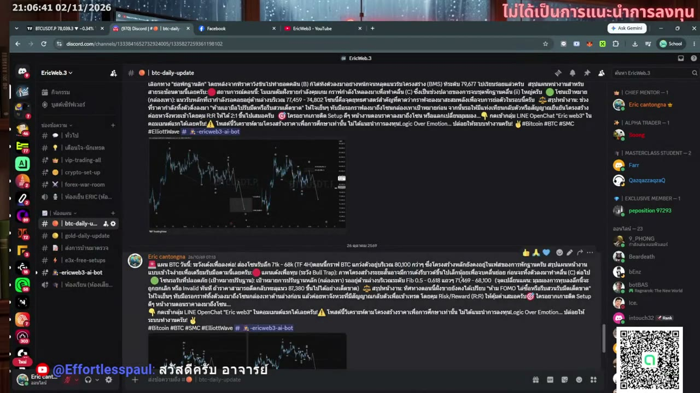

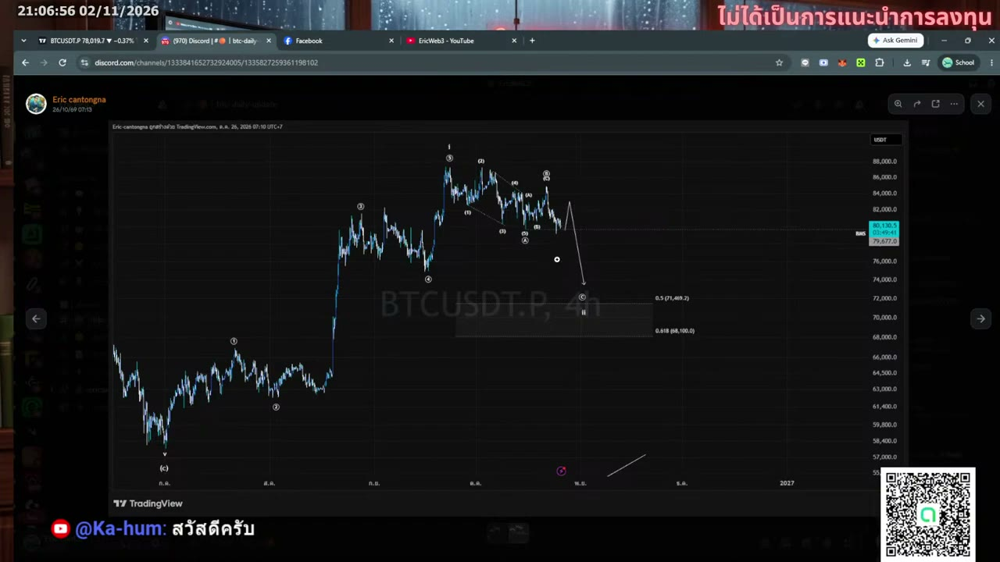

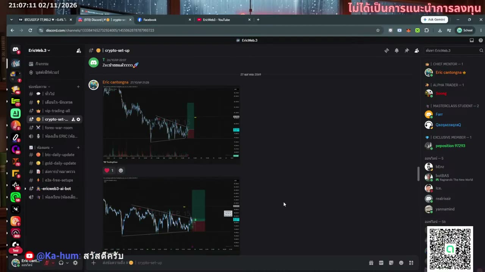

[00:08:02] ที่ 29 เนี่ยนะครับใน community เนี่ยนะ ครับผมก็มองแล้วว่าอืใน time  frame  1 ชั่วโมงเนี่ยนะครับการขึ้นไปรีทest 80,000 นะฮะ 8,700 หรือว่า 81,000 เนี่ยนะคิดว่า น่าจะ โดนกดลงมาแล้วชุดนี้มองว่าขึ้นปรับเนี่ย ข้างในเนี่ยของเวฟ 2b เนี่ยนะครับน่าจะจบ ะนะครับแล้วก็เตรียมลงเนาะนะครับถ้าปรับ จบเนี่ต้องลงเลยนะครับนะผลปรากฏว่าเอ่อ ก่อนที่จะลงมาขนาดนั้นเนี่ยนะครับราคา เนี่ยดึงกลับขึ้นไปเนี่ยเกือบในระดับ เกือบโดน Stop  Loss นะ 82,000 นะครับ เพื่อนๆหลายคนก็ถามผมนะอาจารย์ยังถือต่อ มั้ยนะพี่ยังถือต่อมั้ยผมก็บอกว่าเล่นจน กว่าจะโดน Stop  Loss นะครับตามระบบนะตาม เงื่อนไขเนาะนะครับก็ทำให้ทนถือไปนะครับ ทนดาวไปนะครับอ่าแล้วท้ายที่สุดเนี่ยพอ มีฝัออกมาเนี่ยก็เทหลุดนะครับมาอยู่ในโซน 77,000 แล้วก็อ่าไปถึงระดับ 76,500 เลย ทีเดียวนะครับเดี๋ยวเรามา recap อ่า ออเดอร์กันนิดนึงเนาะ

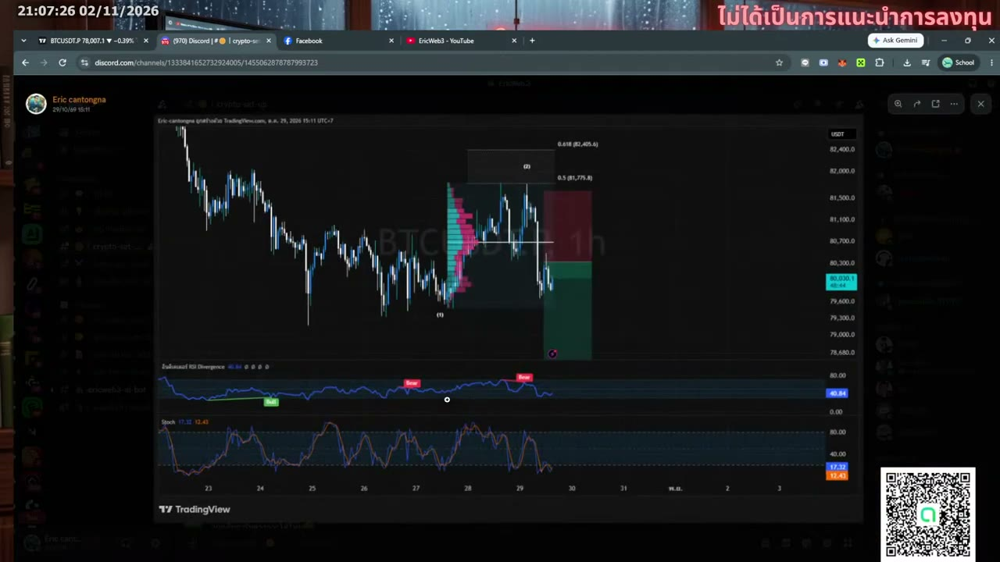

[00:09:11] อ่ะนะครับก็จะเห็นว่า position ฝั่งช็อต ชุดนี้เนี่ยนะครับผมเข้าอยู่แถวๆซัก 80,000 คือจริงๆราคาไม่ได้สวยนะครับอ่า 80,000 ประมาณ 8,500 อ่ะนะนี่เกือบโดน SL ไปแล้วนะนะครับประมาณ 8,500  100 นะครับ แล้วก็ลงมา TP ด้านล่างนะครับสำหรับชุด นี้นะครับนะผมก็ TP ถัวๆเฉลี่ยไปอยู่สัก แถวๆ 77,000 นะจริงๆก็ TP  1 แถวๆอ่า 76,500 นะครับเดี๋ยวตรงราคาเนี้ยจะมาพูด ให้ฟังว่ามีอะไรไปบ้างนะครับแล้วก็ตอน ราคาปรับตัวขึ้นมาแถวๆซักอ่า 70,000  77,5 77,800 เนี่ยไอ้ตรงนี้ก็ไป TP อีกรอบนึง นะแถวๆนี้ 2 ไม้รวมกันเนี่ยก็ อ่าราคาถเฉลี่ยอยู่สัก 70,000  17,100 นะ ครับก็ถือว่าชุดเนี้ย TP ไปแล้วก็เก็บ เนาะนะครับอ่าในขอบข่ายของ Setup นี่ยัง คงมองเป็นชุดคลื่นนะครับที่ทำรหัส 5 มอง ลงอยู่เนาะนะครับในการที่มองว่าทำรหัส 5

[00:10:13] ของขา C นะครับของคลื่นปรับเนาะนะครับอ่า เวฟ 2 นะเวฟ 2 ใหญ่นะครับเตรียมที่จะขึ้น ต่อเนาะในระดับอ่ามุมมองของ bullish นั่น เองนะครับนั่นก็คือมองว่าการลงครั้งนี้ เนี่ยนะครับมีการพักตัวเพื่อขึ้นต่อนะ ครับใน setup ของฝั่ง bullish ที่ใครคิด ว่า Bitcoin เนี่ยเตรียมขึ้นรอบใหม่นะ ครับอ่าโซน 76,500 ลงมานะครับ 71,000  67,600 เนาะนะครับถ้า เพื่อนๆติดตามกันมานี่เป็นโซนที่ต้อง เรียกว่าลดวนมารับนะถ้าใครมองว่าบitcoin เนี่ยอย่ายังแข็งแกร่งแล้วก็ยังไปต่อได้ เนี่ยยังไม่จบรอบเนี่ยนะครับเพิ่งรอบใหม่ นะครับก็เห็นว่าเอ่อตามเทรด setup เนี่ย มองว่าน่าจะเป็นชุดที่ลงมาพักตัวแล้ว เตรียมขึ้นนั่นเองนะครับสำหรับ Scenario นี้นะครับอ่ะเหมือนกันนะครับนั่นก็คือ มุมมองของการ DCA  Sport นะครับนะเพื่อนๆ

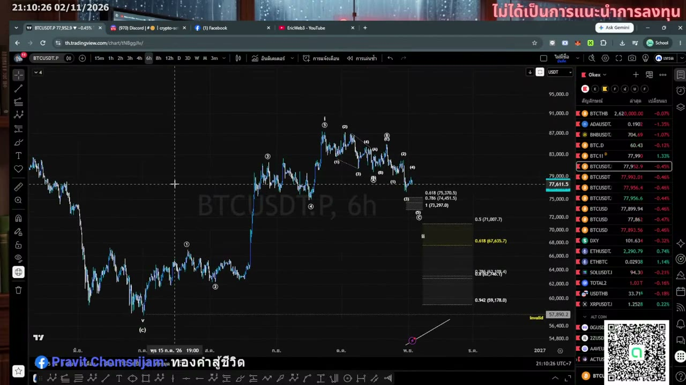

[00:11:13] จะเห็นว่าผมเนี่ยก็รอชุดนี้มานานพอสมควร นะครับที่จะเกาะรถไปเนาะนะครับแต่ทั้งๆ ที่เทรด setup ผมเนี่ยค่อนข้างจะใบแอดไป ทาง Barid มากกว่านะนะครับแต่ในแง่ของสปอ เนี่ยเราก็ตัดแอดทิ้งนะครับเพราะว่าถ้าใน เมื่อราคาเข้าเทรด setup เนี่ยนะครับก็ ต้องเล่นตามแผนนะครับนะในส่วนของการ DCA สปotเนี่ยนะครับผมก็เอ่อต้องบอกว่าตอน ราคาปรับตัวลงมาเนี่ยนะครับนะในชุดแรก เนี่ยชุดนี้ผม เข้าไปแล้วนะครับอันนี้ไม่ได้แนะนำการลง ทุนนะแต่เพียงแค่ว่าพูดแผนส่วนตัวนะว่า เอ่อ 76,000 น่ะนะครับ 76,000  76,000 1,500 เนี่ยนะครับในกล่อง DCA พวกเนี้ย นะครับนี่คือตั้งออเดอร์ไปรัวๆเลยนะใน กล่อง A นะในกรอบ A เนี่ยก็คือว่าเรามอง ว่าถ้าในกล่อง A ตรงนี้เนี่ยราคาเนี่ยไม่ ทำโลowต่ำกว่า 57,500 แล้วแล้วเตรียมขึ้น ต่อเนี่ยนะครับขึ้นรอบใหม่เนี่ยนะฮะตรง

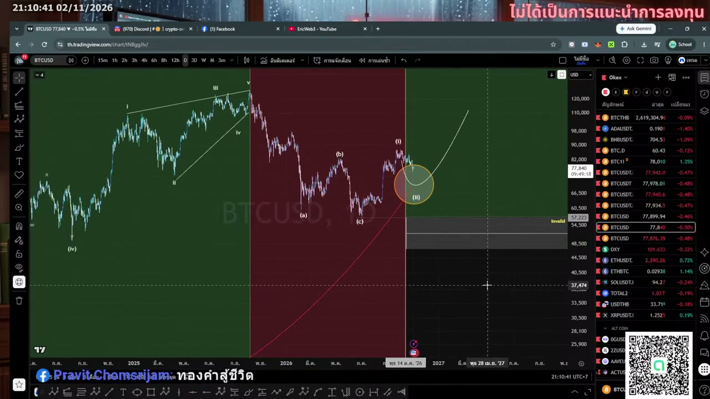

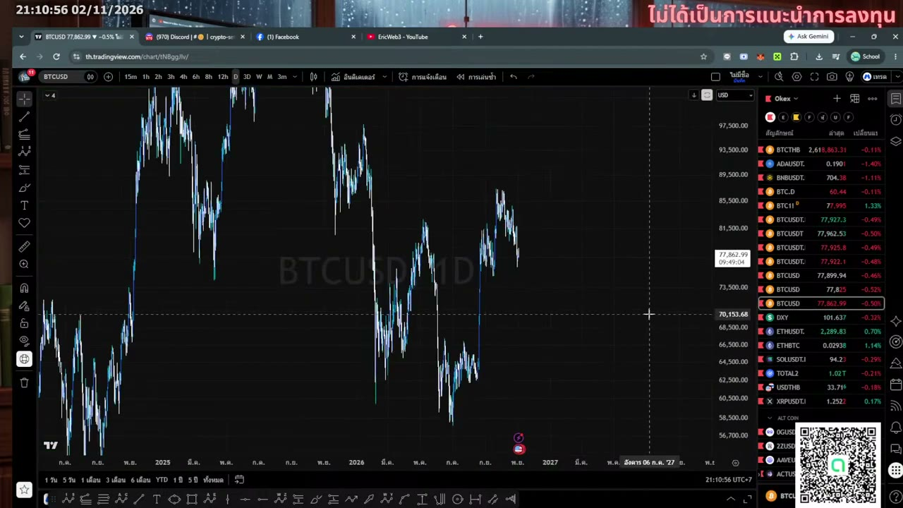

[00:12:14] นี้คือรับหมดนะตาม Fibo นะครับเพราะ ฉะนั้นเอ่อในสัปดาห์ที่แล้วเนี่ยนะฮะเอ่อ บitcoinลงมาระดับ 76,200 เนี่ยนะครับหรือ ว่า 76,000 เนี่ยชุดนี้ต้องบอกว่าแมตช แมตชไปแล้วนะครับแมตชไปแล้วนะครับ 1 ไม้ หน่อๆนะครับแล้วก็ยังคงทำตามระบบอยู่นั่น ก็คือรอตลาดเฉลยอีกทีนึงว่าอ่าจะร่วงลง หลุดไปในระดับที่ต่ำกว่า 69,000 หรือ เปล่าคือเข้าไปในระดับ 67,000  68,000 หรือเปล่านะเพราะว่า Golden Rชเนี่ยอยู่ ที่ 67,500 นะครับแล้วก็ 78.6 เนี่ยเวฟ 2 ลงลึกๆ หน่อยสวยๆเนี่ยนะครับนอกจาก 61.8  8 แล้ว เนี่ยอยู่ที่ 78.6 เนาะนะครับแถวๆ 63,000 หรือว่า 62,500 นะครับจริงๆแค่ชุดนี้ไป เนี่ยนะครับก็น่าจะแมนไป 1  2  3  4  5 5-6 ไม้แล้วนะครับสำหรับสาย DCA นะครับ อ่าก็เป็นสัญญาณบ่งบอกว่าอืมเทรด setup ที่เรารอกันมานานเนี่ยนะครับมาแล้วนะครับ

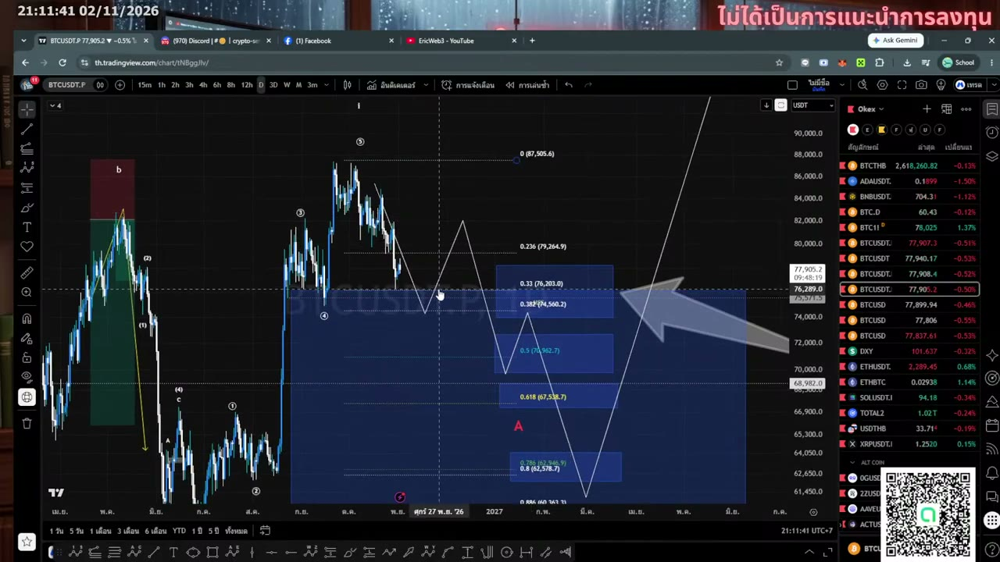

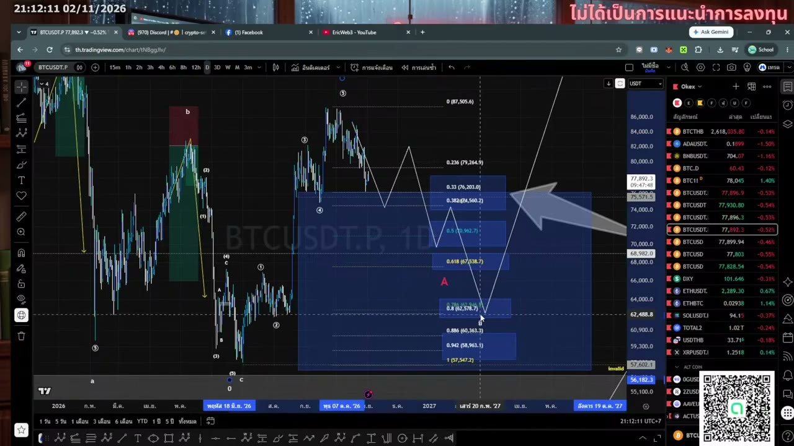

[00:13:15] มาแล้วมาถึงโซนก็เล่นไปนะครับอันนี้ไม่ ได้แนะนำการลงทุนนะเป็นแผนส่วนตัวนะนะ ครับเอ่อเงื่อนไขในถัดไปเนี่ยแน่นอนว่า ต่อให้ราคาบitcoinเนี่ยมีการปรับตัวย่อลง มา 70,000 ก็ดี 68,000 ก็ดีเนี่ยนะครับนะ ราคาไม่ควรจะทำโลต่ำกว่าเดิมเนาะนะครับ 57,500 นะครับเพราะว่าถ้าหลุดกรอบตรงนี้ ไปเนี่ยนะครับจะไปเจอโซน B พอดีนะครับโซน B ไม่ใช่โซนบายนะนะครับหมายถึงว่ากล่อง บายที่มองว่าน่าจะต้องเจียดเงินทุนเนี่ย นะครับในการแบ่งกล่อง A และกล่อง B เนี่ย นะครับมารับในชุดที่ 2 แทนนะซึ่งไอ้ชุด ที่ 2 เนี่ยผมยังไม่ได้ซอยย่อยข้างใน เหมือนกับเหมือนกับกล่อง A ตอนนี้นะครับ เพราะว่ารอให้ตลาดเฉลยก่อนเนาะว่าราคา เนี่ยสามารถหลุดในระดับต่ำกว่า 50,000 ได้นะครับถึงจะค่อยมาซอยอีกทีนึงนะครับ อ่าแล้วแต่ว่าเราจะ เก็บเท่ากันทุกไม้นะสมมุติคุณตั้งไม้ละ 1,000 ดอนเนี่ยนะฮะตรงนี้อาจจะใช้ 10 ไม้ก็ 10,000 นะครับอ่า 10,000  US นะนะ

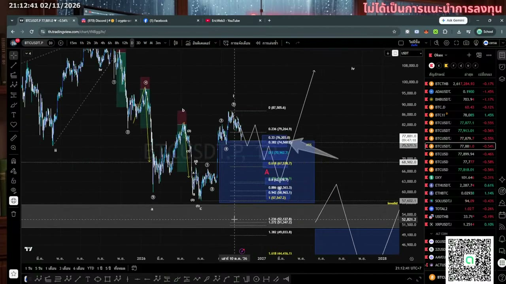

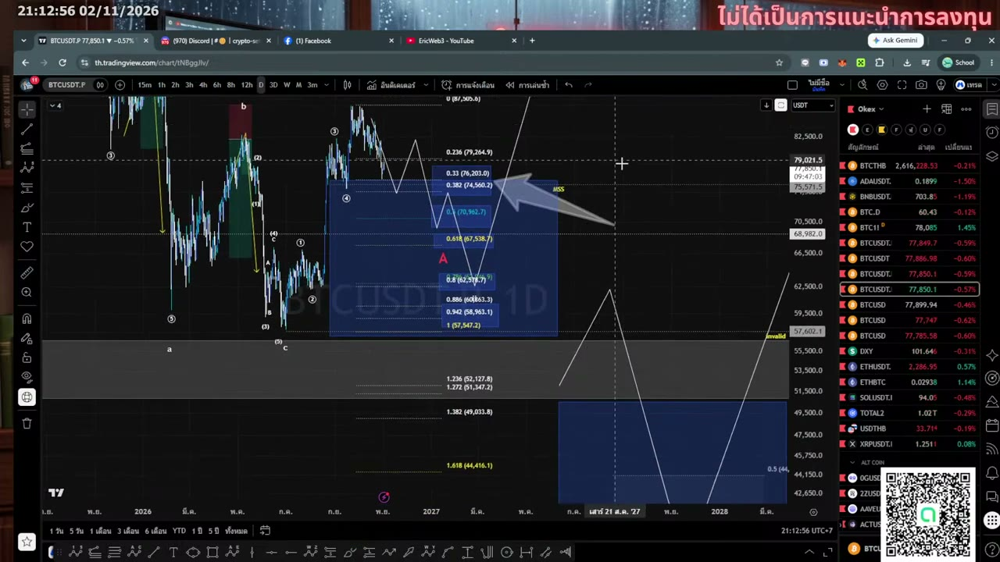

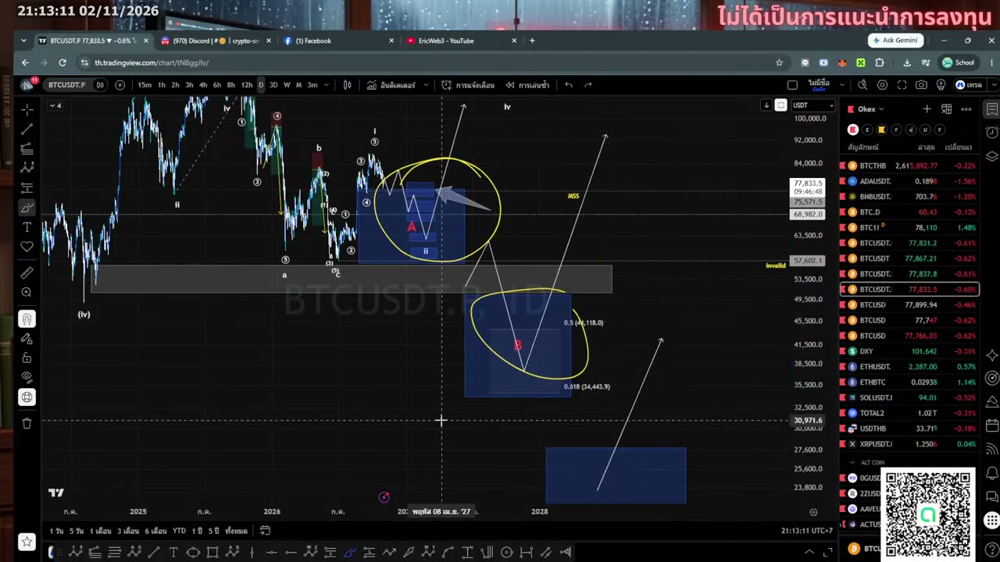

[00:14:18] ครับตรงเนี้ยอาจจะเบิ้ลหน่อยนะ 10 ไม้ เหมือนกันนะครับแต่ว่าแต่ละไม้เนี่ยเป็น ไม้ละ 2,000 ดอนนะครับตรงก็ใช้ทุนสัก 20,000 นะเพื่ออะไรเพื่อให้ราคาเนี่ย ราคาถั่วเฉลี่ยเนี่ยนะครับการเก็บสปอต เนี่ยมีการดึงลงมาตัดนั่นเองนะครับก็แล้ว แต่ว่าจะดีไซน์ยังไงเนาะนะครับแต่ถ้ารับ รับการเท่าทุกไม้เนี่ยถ้าผมจำไม่ผิดเนี่ย ราคาถั่วเฉลี่ยจะอยู่สซักประมาณ 50,000 52,000 นะจะอยู่แถวๆนี้นะอ่ารับรับเท่า กันกล่อง A กล่อง B เนี่ยราคาถั่วเฉลี่ย อยู่แถวๆนี้นะ ครับก็อยู่ที่อยู่ที่เพื่อนๆจะเป็นเน็ต แล้วกันเนาะนะครับ อ่าสเอ่อ ก็แมตไปเรียบร้อยแล้วเพราะงั้นก็มาดูว่า จะจบที่กล่อง A หรือว่าทะลุกล่อง A ลงมา B เนาะนะครับก็รอรอการเฉลยของตลาดอีกทีนึง นะสำหรับบitcoinก็จะประมาณนี้เนาะนะครับ ในเรื่องของ RSI ตอนนี้เนี่ยนะครับต้อง บอกว่าใน Time  Frame  Day เนี่ยไถลงมา ต่ำๆแล้วนะครับมาอยู่มาถ่ำมาต่ำๆอยู่สัก

[00:15:18] 34-35 เนาะนะครับเอ่อมองว่าเนี่ยชุดแนว รับ 75,000  76,200 เนี่ยนะครับโลเดิม เนี่ยนะผมมองว่าน่าจะเป็นชุดพักตัว 1 ชุด อ่าชุดพักฐานนะเป็นnextลine 1 ชุดเหมือน กันนะครับที่บitcoinเนี่ยอาจจะพักตัวแล้ว ก็มีการวกกลับขึ้นไปทดสอบจุดที่ตกลงมา เนาะนะครับอหรืออาจจะกลับมาทดสอบในระดับ อ่า 81,000 ขึ้นไปนะว่าเอ่อมีแรงกลับไป ยืนมั้นะครับถ้าไม่มีแรงกลับไปยืนเนี่ยก็ อาจจะปรับตัวลงต่อในทิศทางที่ที่เรา ประเมินกันเมื่อกี้นะครับนะฮะในส่วนถ้า ราคาเนี่ยวกกลับไปมากกว่า 12,500 เนี่ยนะ ครับมีอีก sino นึงนั่นก็คือ การที่ บitcoinเนี่ยอาจจะเพิ่งทำคลื่น 4 จบก็ได้ นะครับสำหรับมุมมองนี้ Senario นี้เพราะ งั้นเอ่อ Senario เนี้ยนะครับใครที่จะมอง ว่าบitcoinเนี่ยลงมาพักตัวแล้วจะขึ้นต่อ นะครับไประดับ 90,000  94,000 อ่ะนะครับ

[00:16:20] ก็ไม่ควรจะหลุด 74,700 แล้วนะครับก็คือ หัว 4 ตรงนี้เนาะเนี่ยตรงเนี้ยไม่ควรหลุด และนะครับเพราะว่าถ้าหลุดเนี่ยตรงนี้จะ ไหลไปข้างล่างนะนะครับก็จะไปเข้าเข้าเอ่อ เทรด set  up มองลงนะครับในการรับต่ำกว่า 70,000 หรือว่า 68,000 เนาะนะครับอันนี้ ก็จะเป็น sinario สุดท้ายเนาะนะครับ Ice เ่อ ISI  Time  frame  day  oversow เรียบร้อยแล้วนะครับส่วนใน time  frame  4 ตอนนี้ก็ยังไม่ได้มี divergent อะไรให้ เอ่อน่ากังวลสำหรับฝั่งช็อตนะตรงนี้ก็ เริ่มจะดันราคาเหมือนกันนะนะครับเพราะ งั้นผมมองว่าในการลงมาจุ่ม 76,000 หรือ ว่า 75,000 ลงมาเนี่ยนะครับอาจจะเกิด bullish  diveragent ในtimeม frame  4 เนาะราคาอาจจะยกตัวกลับไปได้ในระยะสั้นนะ ครับเอ่อส่วน senario ที่แบบแย่ๆเลยนะ ครับแย่ที่สุดเลยถ้าเกิดกรณีราคา เทหลุดลงมาแรงๆเนี่ยอันนี้ก็คือยังไกล อยู่นะเพราะว่ากว่าเขา้าจะมาเข้าเนี้ยเ ราคาบitคinเนี่ยจะต้องหลุดต่ำมาอยู่แถวๆ กรอบนี้เนาะนะครับก็คือกรอบอก 62,000 นะ

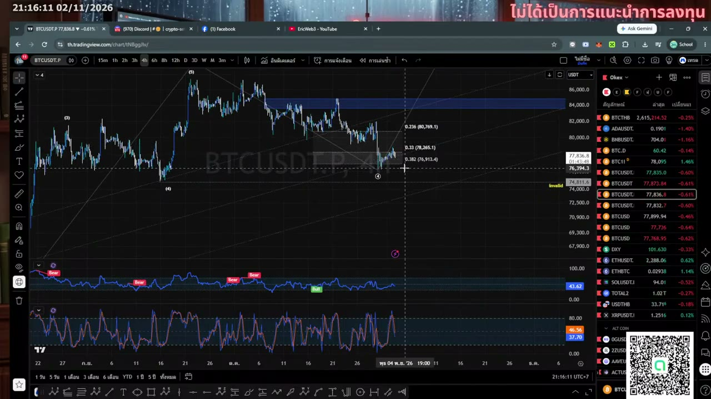

[00:17:22] ครับแล้วก็ยืนไม่อยู่เนี่ยกระแทกหลุด 57,000 ลงไปเนี่ยนะ Sinario เนี้ยกล่อง B เนี่ยจะเกิดทันทีนะฮะนะครับตอนนี้กล่อง A ของเราใช่มั้ยในการ DCA สัพพอร์ตตรงนี้ กล่อง A เนาะนะครับเพราะงั้นถ้าราคา กระแทกหลุดขนาดนี้เนี่ยอ่าก็ต้องบอกว่า อาจจะ ต้องรอก่อนนะฮะสำหรับ Senario นี้ซึ่งใน หลักๆเนี่ยถ้าสัก 60,000 เนี่ยนะครับก็ อาจจะตุ้มๆต่อมต่อแล้วนะเพราะงั้นผมถึง มองว่ากล่องตรงเผมจะไม่อินนะเพราะว่าผมจะ ต้องรอให้ราคาเนี่ยเฉลยก่อนนะครับว่าเอ้ย มาถึงอ่าแนวรับ 68,000  60,000 เนี่ยนะ ครับรับอยู่มั้ยแล้วสามารถพุแบคกลับขึ้น ไปขึ้นชุดใหม่ได้หรือเปล่านะครับถ้าไม่ ไหวตรงนี้เนี่ยเราเตรียมกระสุนสำรองใน กรอบ B อยู่แล้วนะก็รอให้ราคาเฉลยแล้วกัน นะครับในภาพใหญ่นะครับนะครับสำหรับ บitcoinก็น่าจะประมาณนี้นะในมุมมองของอ่า RSI แล้วก็กรอบแนวรับนะแล้วก็ Silio ทั้ง 3 แผนนะครับส่วนทำ frame  week นะ ครับ F  value กับอ่าทำ frame  week

[00:18:23] เนี่ยนะครับเหตุเป็นเหตุผลที่เริ่มที่จะ DCA  spot เช่นกันนะครับในการทดสอบเห็น มั้ฮะในการที่ราคาเนี่ยลงมาทดสอบ Value GAP  week เหมือนครั้งที่แล้วนะที่เคยลง มาเทสเอ่อจากการปรับตัว low ข้างล่าง เนี่ย 15,500 เนี่ยนะครับขึ้นไปทำ high ที่ 31,000 เนาะแล้วก็ลงมาเทส Fue  Gap ทำ Frame  Week นะครับที่ 24,700 นะครับแล้วก่อนที่จะทำเครื่องปรับแล้วก็ ปรับตัวสู่สู wave  3 ขยายขึ้นไปนะครับ เพราะงั้นถามว่ามันจะทำพฤติกรรมเดิมมั้ย ผมไม่รู้หรอกนะครับแต่มองแค่ว่าถ้าลงมาทำ test ไฟกับ week เนี้ยนะครับแล้วยัง เขียวๆอย่างี้อยู่เนี่ยนะอาจจะไม่หลุด 65,000 ก็ได้นะครับก็ขอรับก่อนแล้วกันนะ ขอรับก่อนนี้ยังขอรับก่อนนะครับก่อนที่ ราคาจะ pullback กลับขึ้นไปนะครับก็เป็น เหตุผลที่เริ่ม DCA ไปแล้วนะครับสำหรับ อ่ามุมมองบูชไม้แรกนั่นเองนะครับสำหรับ บitคคอร์นะครับ

[00:19:25] อ่ะประมาณนี้นะครับแล้วเพื่อนๆคิดว่า รับอยู่มั้เอ่ยนะครับโ 71,000  67,000 และ 62,700 นะครับไม่ควรที่จะทำโลต่ำกว่าเดิมก็คือ 57,500 นั่นเองนะก็คอมเมนต์กันได้นะนะ เออ DCA  A จริงนะครับ DCA จริง Stop Loss จริงนะครับจริงนะก็เล่นไปนะครับตาม ระบบเนาะนะครับ ประมาณนี้ รอน้ำมันครับเพิ่งหลุด 98 นะน้ำมันน้ำมัน เนี่ยคือถ้าหลุด 95 นี่ก็คือไม่รู้ว่า อิหร่านไปทำข้อตกลงอะไรกับอเมริกาเป่านะ ครับแต่ว่าในในทาง TA เนี่ยหน้ากราฟเนี่ยผมจริงๆชุดเวฟอ่ะ ไม่อยากนับแบบนี้เลยนะครับแต่มันมอง เหมือนเป็น douบิท็อปมากกว่านะตัว m เนาะนะจากไลฟ์

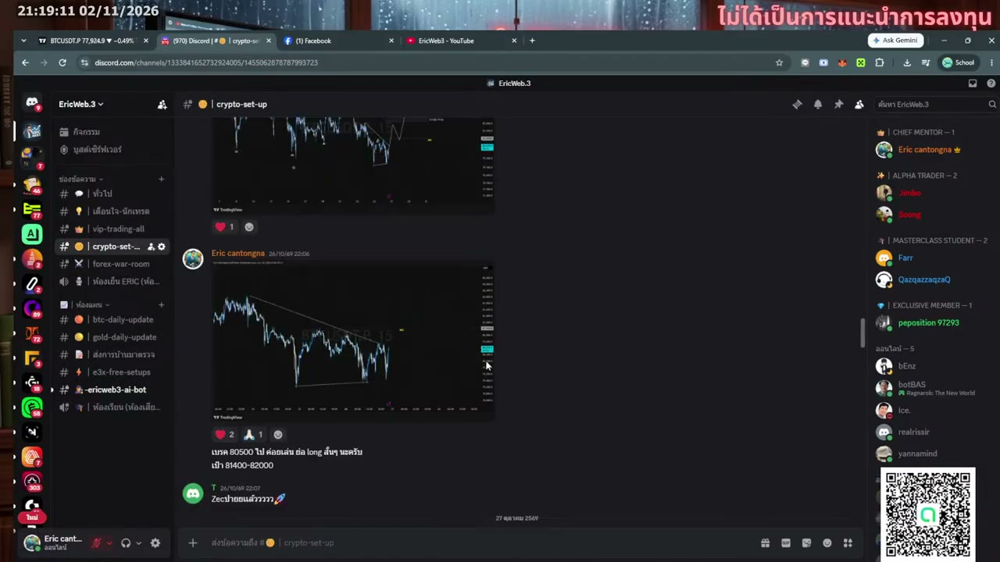

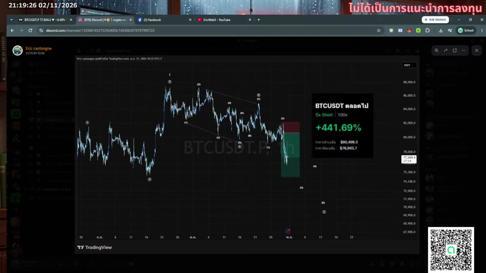

[00:20:27] ครั้งที่แล้วเรามองแบบนี้มันอาจจะไม่ได้ ลงเวอร์ขนาดนั้นนะครับนะแต่ว่าในในเทรด setup เนี่ยเราประเมินว่าราคาน่าจะติด ต้านเนาะแล้วก็ลงนะฮะ อ่าชุดนี้ฮะเพราะว่าพอเห็นราคาแบบเริ่ม หลุดเทนไลนเนี่ยผมมองว่ามันมันน่าจะเข้า แพทเทิร์นมากกว่านะนะครับก็ส่งผลให้วัน นี้เนี่ยน้ำมันหลุดหลุด 97  96 ไปนะเนี่ย เส้นเบรก market  structure นะครับอือีก นิดนึงนะอยากให้อยากให้หลุด 95 ไปเลยนะ ถ้าหลุด 95 นี่เสียโครงสร้างค่อนข้างลึก นะครับก็อาจจะลงมาพักตัวในระดับ 90 ดอลลาร์นะนะครับสำหรับน้ำมันก็ติดตามกัน อีกนิดนึงแล้วะกันนะครับส่วนทองคำวันนี้ ก็พยายามจะรื้อเทรด setup เนาะนะครับ เหมือนจะลงเป็น non  standard  connection มากกว่านะครับนะวันนี้ก็คิดคิดว่านะครับ แนวต้านเอ่อ 3,970 เนี่ยยังคงเป็นต้าน ใหญ่อยู่นะครับสำหรับทองคำนะครับจนกว่า ราคาทองคำเนี่ยถ้ากจะกลับไปยืนได้เนี่ย ต้องกลับไปทะลุในระดับ 4,000 ขึ้นไปนะนะ

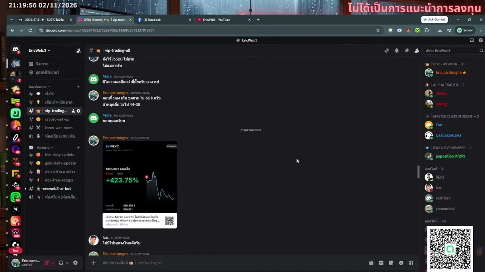

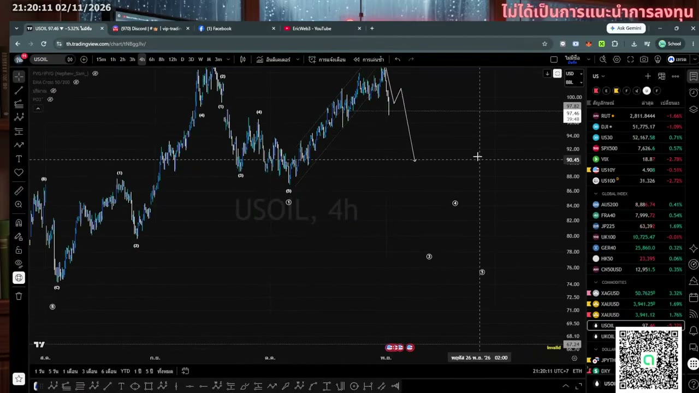

[00:21:29] ครับนะกลับไปอยู่ในระดับ 4,000 ขึ้นไปใน กรอบตรงนี้นะถ้ากลับไปยืนได้เนี่ยเดี๋เรา ค่อยมาดูอีกทีว่าจะเล่นฝั่งขาบายได้หรือ เปล่านะครับแต่มองว่าตอนนี้เนี่ยฝั่ง เซลล์ยังคุมตลาดอยู่นะครับฝั่งเซลล์ยัง คุมอยู่เนาะในในช่วงนี้นะครับก็ระมัด ระวังกันนิดนึงแล้วกันนะต่อให้มีแท่ง กระชากนะ โอเคนะครับเอ่อิปโtoก็ใครอยากดูเหรียญไหน นะครับเพื่อนๆสามารถพิมพ์ได้เลยนะครับบอก ด้วยนะเป็นสปอหรือ future เนาะนะครับ คอมเมนต์ได้เลยนะเดี๋ยวขอไปเติมน้ำนิดนึง พิได้เลยนะอยากดูเหรียญไหน

[00:22:40] ถ้ากล่อง A เอาอยู่มองว่าบitcoinไม่ควรจะ หลุด Fibo  61.8 ใช่มอืมก็คือในแง่ของ TA อ่ะ 61.8  18  Golden Rชอ่ะมันเป็นเค้า เรียกว่าอะไรฮะมันเป็นเกรด A อยู่แล้วเออ มันเป็นมันเป็นเกรด A อยู่แล้วที่ที่ อยากจะให้ลงมาแตะ Golden Rชแล้วก็ไปเลย นะถ้าหลุดต่ำกว่านั้นอันตรายมั้ย จริงๆจริงๆลงมา 63,000 อ่ะ Fibo  0. กับ 0.8 เนี่ยอุ้ยผมมองว่าก็ยังได้อยู่นะ แต่มันลึกไปนิดนึงนะครับยังได้อยู่อ่ะขอ ให้อย่างเดียวคือไม่ไม่ทำลายหัวจากจุด เริ่มต้นก็พอนะครับ แต่เอาตรงๆเลยนะเอาตรงๆเลยสำหรับส่วนตัว ผมอ่ะผมผมมองว่าไม่ว่าจะ A หรือ B อ่ะคือ ถ้าหลุด A มาเจอ B อ่ะมันก็เป็นการตอกย้ำ

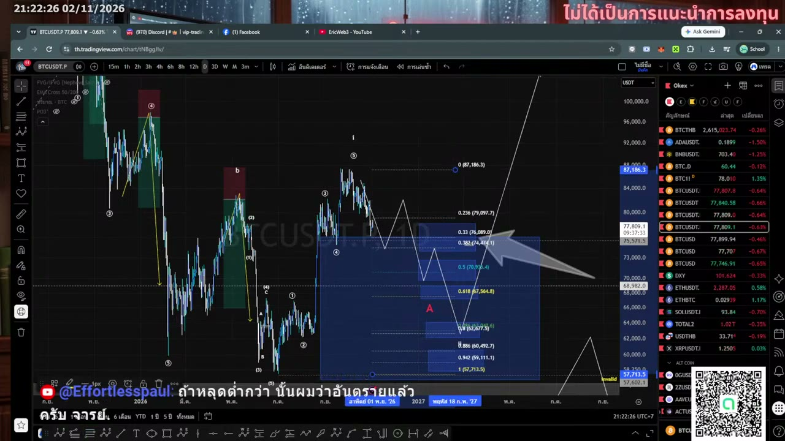

[00:23:41] นะว่าไอ้สถิติของบitcoinอ่ะที่จะต้องลง ต่ำต่ำมาในระดับเอ่อเอ่อ 70% น่ะ 60  60 70% เนี่ยไอ้ไอก้อนเนี้ย อันนี้ยังไม่ได้ยังไม่ได้ลงว่าบitcoinโดน แฮกด้วยนะนะครับก็ยิเป็นการตอกย้ำว่ามัน ควรจะลงไปอีก นะครับคือคือถ้าเพื่อนๆขาดการ บริหารจัดการ Money  Management น่ะนะ ครับคือหรือว่าติดใบแอดเกินไปว่าเอ้ยไม่ หลุดแล้วไม่หลุดโล 57,500 แล้วะเอ้ยไม่ หลุดหรอก 50,000 หรือ 44,000 อะไรแบบ เนี้ยเพราะฉะนั้นผมถึงทำกล่อง C กล่องสุด ท้ายไว้ว่าเอ่อถ้ามันหลุดมาจริงๆเนี่ยก็ ต้องยอมรับนะครับว่าเราอาจจะได้เห็น บitcoinเนี่ยลงมาในระดับที่ต่ำกว่า 40,000 ก็ได้ เพราะฉะนั้นถามว่าอยากให้มันเกิดมั้ยก็ ไม่ได้อยากเกิดนะครับแต่ทำใจไปแล้วว่าถ้า มันเกิดเราจะทำยังไงถ้าเกิดลงมาผมก็ก็ เล่นนะฮะไอ้จุดที่น่ากลัวจริงๆคือหลุดไอ้

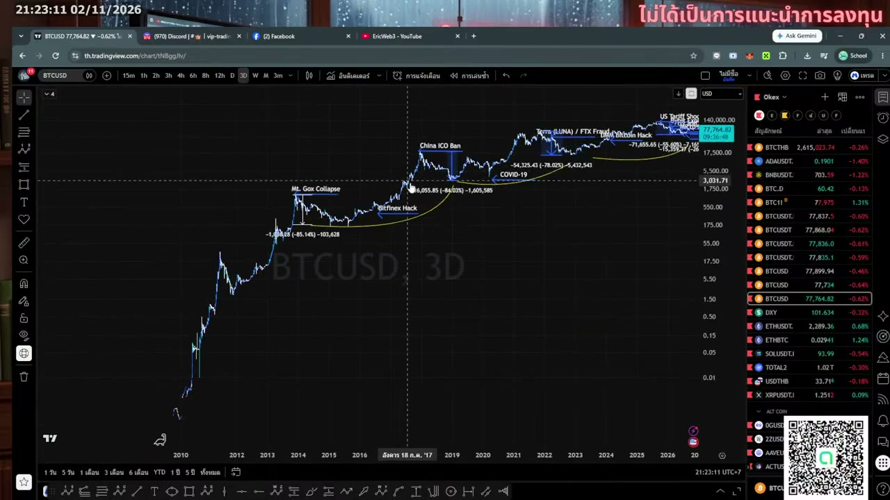

[00:24:43] ตรงเนี้ย หลุดไอ้ตรงเนี้ยอันเนี้น่ากลัวจริงจริงๆ นะไอ้หลุดไอ้หลุดโลเดิมเนี่ยอันนี้น่า กลัวนะ ถูกมย อ่าอันนี้มองไม่เห็นนะเนี่ยไอ้ไอ้กล่องเ คือน่ากลัวนะถ้างั้นจริงๆถ้าเอาสวยๆเนี่ย ไม่ว่าจะเป็น A หรือ B จะได้หมดนะครับแต่ ขอให้จบแค่ 2 กล่องนี้ไอ้กล่องนี้ไม่เอา 2 กล่องเนี่ยสวยๆ เออนะครับก็ขึ้นอยู่กับการบริหารตักเรา แหละนะครับว่าเรามีทุนอยู่ เท่าไหร่อ่ะนะเรามีทุนอยู่สมมุติว่าเรา เราเล่นได้ซักเอาแบบสวยๆแล้วกันอ่าเรามี ทุนอยู่ประมาณนึงแล้วก็เราจะแบ่งออกเป็น 30  30 ไม้ 30 ออเดอร์ นะครับก็อย่างอย่างเอาง่ายๆเลยผมก็ซื้อ เท่ากันทุกไม้อ่ะ ถูกมั้ยผมก็ซื้อเท่ากันทุกไม้นะครับแต่

[00:25:44] กล่องแต่ผมแบ่งเป็นโซนโซนนี้ 10 ไม้โซน นี้ 10 ไม้โซนนี้ 10 ไม้นะครับผมก็รับก็ เหมือนเรามันลงมาอย่างเงี้ยถ้ามันจะลงมา แบบ a  b  1  2  3  4  5 อย่างเงี้ยนะ ครับอันนี้ก็คือเล่นเล่นรับหมดอ่ะรับทุก โครงสร้างรับทุกโครงสร้างนะครับอก็ DCA ไปโดยตัวก็คือเริ่ม DCA ไปในตัวหรือก็ แล้วแต่คนนะครับถ้าอดทนรอได้จะไม่เล่นแบบ นี้ก็ได้นะครับก็รอให้ราคาทำโครงสร้าง เสร็จนะครับแล้ว accumulate อ่าตอน accumulate เนี่ยแล้วค่อยๆมาเก็บตรง เนี้ยต่ำๆได้หมดนะ ถ้าลงมาเอเด้งจะสปอตด้านบนมยก็คงก็คงเล่น เหมือนกันครับนะแต่ทีนี้ในสปอตของการด้าน บนผมอาจจะต้องพึ่งเทคนิคalเยอะหน่อยเพราะ สมมุติว่าถ้าราคาลงมาเป็นเวฟ 2 จริงๆใช่ มั้ยอ่าแต่สมมุติว่าจบแค่ตรงนี้เนาะจบอาจ จะจบ 71,000 แล้วขึ้นไปอย่างเงี้ย

[00:26:45] ผมอาจจะพิจารณาเปิด position อีกทีนึงแต่ ตอนที่จะเปิดอ่ะราคาจะต้องผ่านตรงนี้ก่อน นะครับ 80,000 อ่า 87,500 ก่อนคือต้อง เบรคตรงนี้ก่อนนะฮเบรครีทestได้สวยๆเนี่ย ผมผมอาจจะเข้าอีกทีนึงนะครับอาจจะเข้าอีก ทีนึงนะแต่ตรงนี้ต้องมั่นใจนะคือต้องมั่น ใจว่ากลับเทรนแล้วนะ อ่าต้องมั่นใจเลยว่าต้องกลับเทรนนะครับ ถึงจะถึงจะเข้า DCA เนาะ แต่เบื้องต้นเนี่ยตอนนี้เอาแค่ Fue  Gap Week ตรงนี้รับอยู่ตามแผนเราอ่ะจบละแค่ นี้ก็พอใจะ อ่ะผ่านนะครับใครเข้ามาแล้วก็คอมเมนต์พูด คุยกันได้นะครับสวัสดีนะครับนะหรือว่าจะ ขออ่าดูเหรียญไหนก็พิมพ์ได้เลยนะครับนะเด อาทิตย์นี้เราเดี๋ยวมาตามกันนิดนึงเนาะ

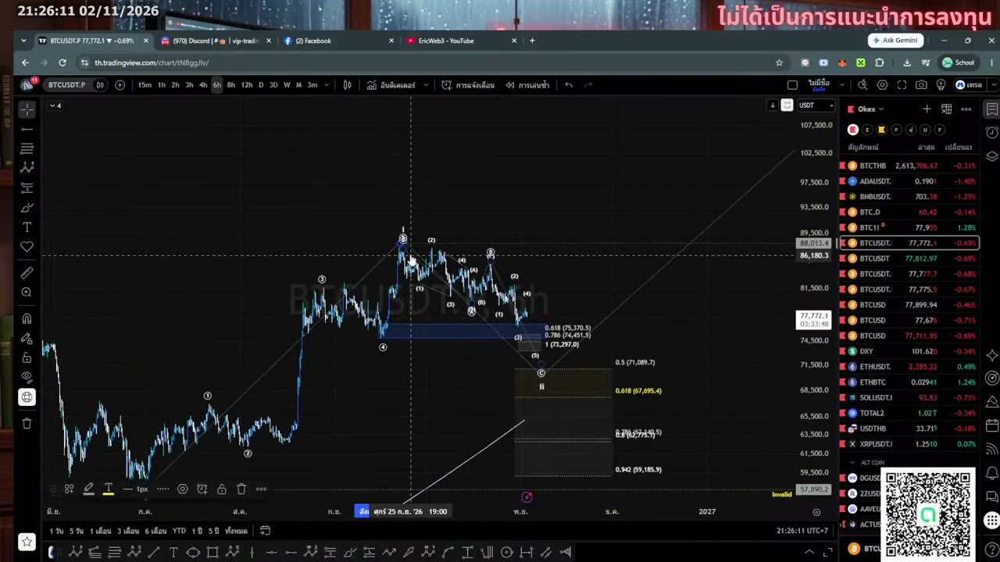

[00:27:47] เพราะว่าเป็นต้นเดือนพอดีนะครับของเดือน พฤศจิกายนนะครับตารางค่อนข้างหนาแน่นนะ ไม่ว่าจะเป็นมIDเทมเลือกตั้งนะครับแล้วก็ เอ่อnonฟารมนะครับหลายๆอย่างนะ PPI ก็มี นะต้นเดือนพฤศจิกายนนะครับยาวเลยนะคิดว่า เดือนนี้น่าจะได้คำตอบอะไรหลายๆอย่างพอสม ควรนะครับสำหรับอ่าตลาดเทรดเนาะนะครับ อ่ะขอตามไปดู เอ่อเอ่อ Solona นิดนึงแล้วกันนะครับ Solona ไปดูเทรด Setup อ่านน้อยนิดของ อ่าสำหรับเพื่อนๆที่ไม่ได้อยู่ในคอมity เนาะนะครับก็สแกน Q  Code ด้านล่างขวามือ ได้เนาะนะครับ อ่าก็จะเห็นว่าเทรด setup ผมเี่จะมีแต่ มองลงไปก่อน เข้าช็อตตอนนี้ควรเล่นสั้นๆมั้ยจริงๆไม่ ควรนะครับจริงๆต้องบอกว่าไม่ควรต้องรอดู

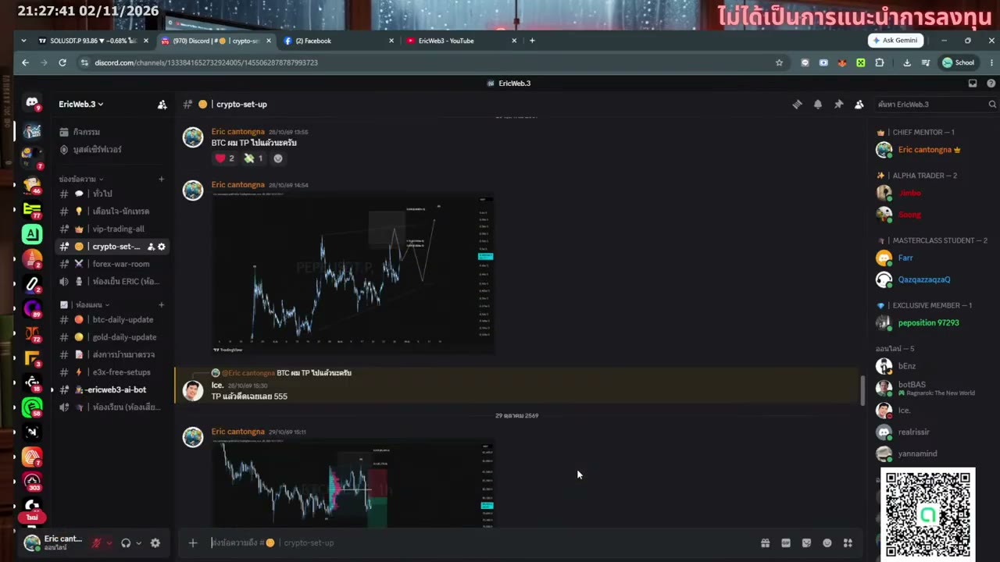

[00:28:48] ไปก่อนนะสำหรับการเล่นเล่นเอ่อเทรด หรือว่า Outcoin นี้เนาะนะครับอืต้องบอก ว่ายังไม่ควรเนาะเพราะว่าถ้ามันถ้าสมมุติ คุณเล่นช็อตแล้วคุณไม่ได้เฝ้ามันหรือว่า ไม่ได้เล่นสั้นๆน่ะมันจะเด้งใส่หน้าออกนะ เอ่อ Solona นี่ไม่รู้สึกจะขอแก้ชุดเวฟ นิดนึงนะครับน่าจะจบ B ไปแล้วตรงนี้น่าจะ เตรียมลงเอ่อ Wave  3 ของขา C นะซึ่งอ่า คิดว่านะครับคิดว่าราคาเป้าหมายเนี่ยอาจ จะมีสดมาในระดับ 86 ดอลลาร์หรือว่าโซน 80 ดอลลาร์ได้เนาะสำหรับชุดนี้เนาะก็อันนี้ ก็ลงเป็นเหมือนเป็นซิกซกนะนะครับ 535 นะ ลงมาค่อนข้างสวยเลยนะครับไหลต่อตอนแรก เนี่ยมองว่าน่าจะขึ้น B อีกรอบนึงนะแถวๆ 112 นี่ไม่ถึงแล้วนะครับปรับตัวลงแบบนี้ เบรก Market  structure นะครับงั้นเหง่น หน้ามองรับนะมองว่าให้พักตัวแถวๆกรอบอ่า 85 เนาะ 8586 ดอลลาร์เนาะนะครับสำหรับ

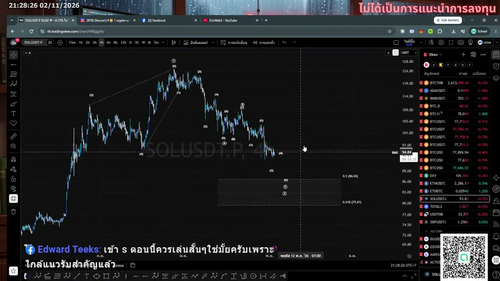

[00:29:49] กรอบนี้เนาะถ้าลงมาพักได้เนี่ยค่อนข้าง สวยเลย นะก็จะมีแนวรับอยู่เห็นมยอ่าในกรอบ 80  70 ดอลลาร์นะประมาณนี้นะ 80 ดอลลาร์ 70 ดอลลาร์เนาะแล้วก็มี 83 ดอลลาร์นะครับ XRP กับ Dodge ใช่นะครับ Future อ่า XRP เรายังคงติดตามการมองเป็นเวฟ 2 อยู่นะครับนะยังไม่ได้ยังไม่ได้ตัดมุมมอง Bullit ทิ้งนะครับยังคงมองเป็นเรื่องของ Bullit อยู่นะครับสำหรับ XRP นะครับอ่า ก็มองว่าคิดว่าราคาเนี่ยเตรียมทำรูปแบบ ลิ่มแล้วนะครับสำหรับอ่า Ring  Wight หรือว่าเป็น falling  wage ก็ได้นะครับทำ รหัส 5 เนาะนะครับในโครงสร้างนี้นะมองว่า เป็นเวฟ 4 ลง 5 นะครับซึ่งอ่าในการทำโล อีกรอบนึงเนี่ยนะครับอ่าอาจอาจจะลงที่สัก 1.2 ดอลลาร์หรือว่า 1.19  19 นะครับแล้ว ก็อาจจะเกิด bullish  divergent ใน time frame  4 นะครับก็อาจจะทำให้ปรับตัวขึ้น ได้พอสมควรส่วนจะเป็นเวฟ 3 ขยายหรือเปล่า เนี่ยอันนี้ผมก็ยังไม่รู้นะเพราะว่าต้อง

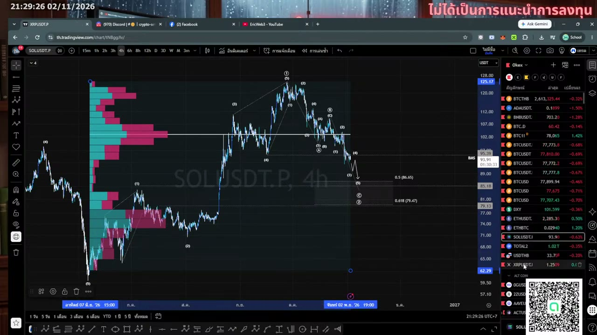

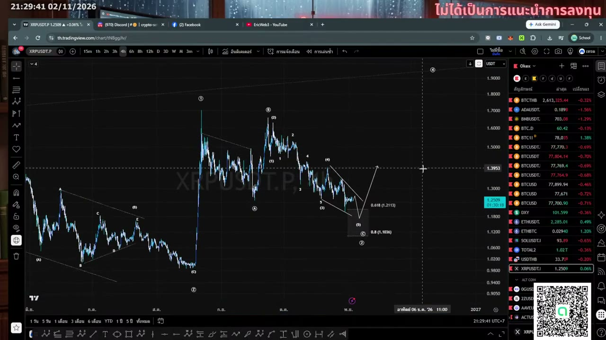

[00:30:50] รอให้ราคาเนี่ยปรับตัวย่อลงสักพักนึงเนาะ นะครับกอนนี้สำหรับอ่า XRP นะครับแต่โดย รวมเนี่ยตอนนี้ยังมองว่าอ่าเป็นฝั่ง เป็นฝั่งขาขึ้นอยู่แล้วกันนะครับเตรียม ที่จะมองขึ้นแล้วกันเนาะเพราะว่า ISI ทำ เฟมdีตอนนี้มันมัน oversow ไปแล้วอ่ะ มันเตรียมตัวที่จะงัดขึ้นเหมือนกันนะก้อน ตรงนี้นะครับสำหรับ XRP เดี๋มาดูที่ Dodgecoin ครับ Dodge  Coin ตอนนี้ก็จะคล้ายๆรูปแบบของ XRP เนาะนะ ครับอ่าเตรียมออกด้านล่างตัวนี้มี reject ไปแล้วนะเหมือน Sweep ไปแล้วนะที่ 0.072 นะครับก็คิดว่านะคิดว่าแถวๆกรอบเนี้ยถ้า จะสวยๆเลย 0.07  07 อ่ะต้อง accumulate แล้วนะครับต้องมีสัญญาณอะไรบางอย่างแล้ว นะครับสำหรับเอ่อ D นะเพราะว่าถ้าบitคin เทลงเทลงจริงๆอ่ะ LOW ตรงนี้จะเอาไม่อยู่นะคือที่ผมพูด

[00:31:53] อย่างเงี้ยผมไม่ได้ไม่ได้ไอ้นี่นะคือไอ้ ตอนที่เทรด OP อ่ะทรงแบบนี้เลยนะครับแล้ว พอตลาดถลบเนี่ยคือ OP นี่ร่วงเลยนะครับ ร่วงทำโลต่ำไปเลยนะครับเเดี๋ยวไปดูกราฟ OP ทีก็ได้ อ่าเทรดฟิวเจอร์อยู่นี่หูตาแตกหมดแล้วตอน นั้นเนี่ยฮะทรงจะคล้ายๆแบบนี้เลยครับลงมา เหมือน do แนวรับอาดีๆนะครับแล้วก็ทำท่าลงมาแตะแตะ โลด้านล่างนะแล้วก็ยกตัวนะครับเห็นมั้แตะ แล้วยกตัวนะครับพอบitคinโดนถล่มไปเลยฮะ หากู่ไม่กลับแล้วฮะตอนนี้ครับก็พยายามแบบ หาจุดที่ Stop  Loss ไว้ดีๆอ่ะก็อย่าไป ไว้ใจเยอะนะครับสำหรับเหรียญเหรียญที่ไม่ ใช่แบบเอ่อแข็งแกร่งๆแกร่งขนาดนั้นนะจริง ๆ D มันก็แข็งแกร่งนะครับ ขอุย DAS  Future เนาะไปดูซุยซุยตอนนี้

[00:32:56] ปรับตัวลงไปแล้วนะครับก็ ในภาพของซุยอ่ะมันทำ divergent ไปแล้วนะ ครับก้อนตรง อืผมยังไม่ได้นับเวฟนะแต่ว่าดูจากรูปการ แล้วเนี่ยนะเหมือนโซน 0.08  08 เน่าจะพัก ตัวนะครับก็ไม่ควรที่จะทำโลต่ำกว่าเดิมนะ เรากับการมีtheจทำเฟม 4 นะครับ รอนิดนึงนะอาจจะได้เล่นรีบาวนะอาจจะได้ เล่นรีบาวนะครับกลับไปเทส 1 ดอนอีกรอบนึง นะสุยแต่ทรงเผมผมยังไม่เล่นนะรอก่อน DAS หรอDASชไม่รู้มีหรือเปล่า อ่าใครที่อยากเข้าเทรด setup กลุ่มนะครับ ก็เคียโค้ดด้านล่างขวามือนะครับ DAS ตอนนี้ยังไม่น่าเล่นเลยนะครับเหมือน จะทำ Divergent ไปแล้วนะครับ อืคิดว่าถ้ายืนในกรอบ

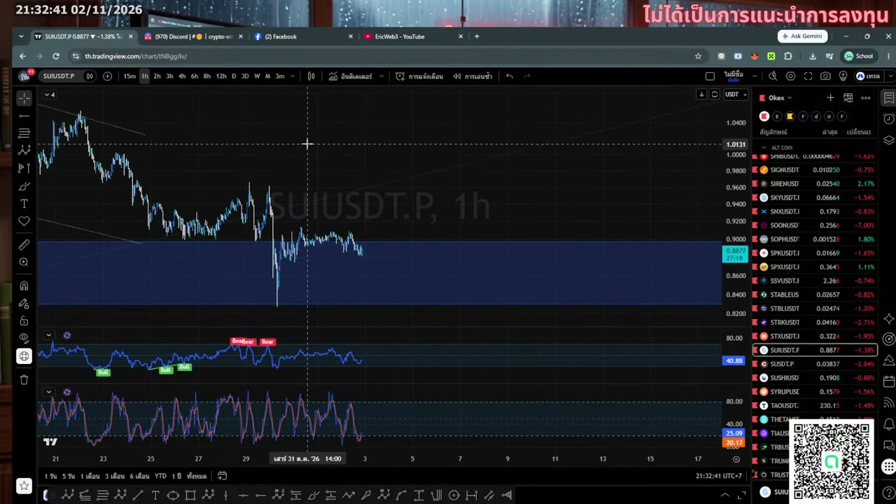

[00:33:58] 440 ดอลลาร์ได้เนี่ยอาจจะมีชุดทุน back กลับแล้วนะครับสำหรับ DAS เหมือนทำเหมือน ทำ bullish  divergent ทำ frame  day ไป แล้วนะ แต่แต่ตัวเนี้ยต้องรอเบรคก่อนมอ่ะ เออถ้า Future ต้องรอเบรกก่อน เอ่อเสกโอเคเสกอันนี้มีแน่นอนเพราะว่าตาม ให้ดูให้หลายๆคนอยู่นะครับสำหรับเสก นะครับเสกเอ่อยังยังคงแข็งแกร่งเนาะนะ ครับที่มองว่าเป็นเวฟ 4 นะเหมือนว่าจะจบ แล้วด้วยนะครับถ้าเป็นเวฟ 4 ชุดนี้เนี่ย 4 จบจบบริเวณเวฟ 4 ด้วยเห็นมั้ย 4 ย่อยของ 3 นะครับก็เดี๋ยวรอการเบรค out แล้วกันผมขอ มองเล่นฝั่ง position ฝั่งนะครับสำหรับ อ่าเสกเนาะนะครับถ้าเบรคกรอบเบรค out ชุด นี้ได้เนี่ยนะครับก็มีเป้าหมายที่ขึ้นไป ในระดับ 1,700 นะครับหรืออาจจะไปทำ high ที่ 2,000 ด้วยขึ้นไปนะครับสำหรับ SE นะ เพราะว่าอ่าในโครงข่ายของชุดนี้เนี่ยยัง คงมองว่าเอ่อราคาเนี่ยนะครับเคลียร์ RSI

[00:35:03] อะไรไปแล้วเนาะนะครับแล้วก็เตรียมจะปรับ ตัวขึ้นนะครับตอนนี้มองว่าอยู่ในกรอบของ Barent ทำ Frame  Mon มากกว่าใน Wave  5 เนาะนะครับแต่เบื้องเบื้องต้นเนี่ย เนี่ยอย่าเพิ่งคาดหวังไปไกลนะเอาแค่ตรง นี้ก่อนนะเอาแค่ 1,700 ก่อนนะให้ผ่านก่อน นะถ้าผ่านได้เนี่ยไล่ TP อย่างเดียวเลยนะ ครับเพราะว่าถ้ายิ่งขึ้น 0 เนี่ยยิ่งยิ่ง ระวังโดนตบนะระวังด้วย ผ่านนะ H กับ Near อ่ายังไงก็ฝากคลาสอelิเฟนักเรียนรุ่น 3 แล้วกันอันนี้ประกาศเลยแล้วกันนะนะครับก็ น่าจะเปิดอีกทีช่วงปลายเดือนกุมภาพันธ์ กับมีนาคมนะครับกับต้นเดือนมีนาคมเนาะนะ

[00:36:04] ครับใครที่สนใจเอ่อปูพื้นฐานการเทรดนะ ครับก็เดี๋ยวรอประกาศอีกทีนึงเนาะใน คunityแล้วกัน อื H โอ้estเด้งไปแล้วฮะตอนนี้ชุดนี้ไม่ต้อง บอกว่าผมเป็นผมผมไม่น่าเล่นนะเอ่ออาจจะ ขึ้นไปได้อีกรอบนึงนะครับแต่ขึ้นเพื่อลง แล้วนะครับตอนนี้ยังติดยังติดเทไลนอยู่นะ เห็นมั้ยยังติดเทลนเด้งอยู่นะครับนะแต่ผม มองว่าอันตรายนิดนึงเนนะครับอาจจะขึ้นไป ได้อีกนิดเดียวแล้วลงแล้วนะครับสำหรับไนะ เล่นสั้นๆพอนะครับถ้าใครเล่นรีบาวound ก้อนก้อนนี้ผมให้ใครดูนะก้อนรีทestชุดนี้ ผมให้ใครดูเนาะให้คุณให้คนในคอมityเนี่ย ให้คุณเจมส์ดูเนาะนะครับอันนี้ก็ขึ้นไป ค่อนข้างสวยเลยนะครับก็น่าจะ TP ไปแล้วนะ ครับสำหรับตรงนี้เนี่ยก็คืออาจจะอาจจะ ขึ้นต่อนะอาจจะขึ้นได้อีกนิดนิดนึงนะครับ แต่ขึ้นไปเนี่ยระวังลงแล้วนะครับก้อนนี้

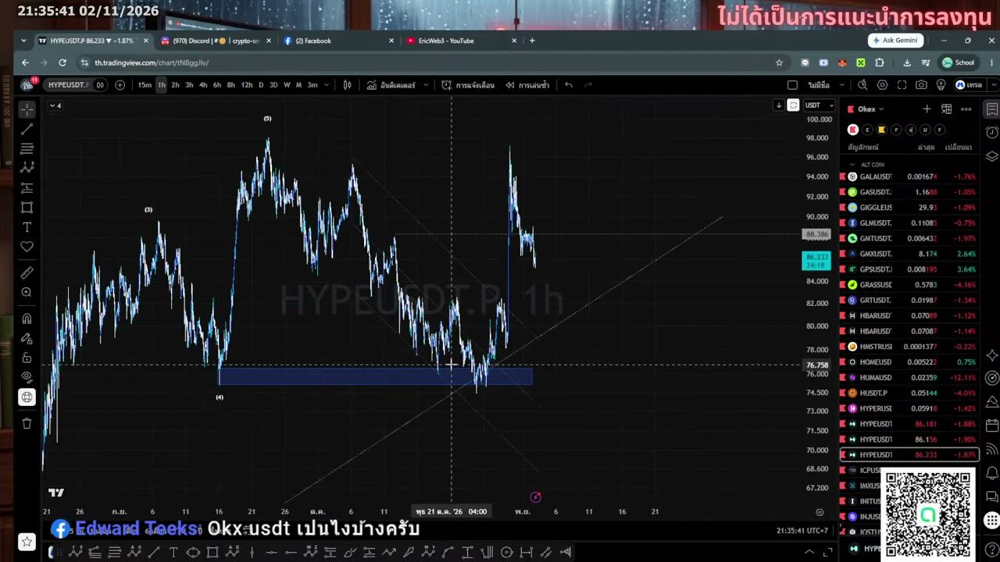

[00:37:06] สำหรับไม โอเคครับสำหรับ จริงๆยังให้อยู่ในขอบข่ายของการเป็นเวฟ 4 อยู่นะนะครับแต่ เหมือน RCI จะหลุดลุ่ยค่อนข้างเยอะเลยอ่ะ ตอนนี้ยังยังไม่เหมาะกับการเล่นเท่าไหร่ นะครับสำหรับเนียต้องรอให้พักตัวบริเวณ บริเวณไม่หลุด 3.8 ก่อนนะครับเพราะว่าถ้า หลุด 3.8  8 ไปเนี่ยอาจจะไม่ใช่เวฟ 4 แล้วนะครับ อ่าไม่ค่อยไม่ค่อยดีนะต้องรอต้องรอให้ ราคาไม่หลุด 3.8 แล้วยกนะเดี๋ยวถ้ายกเล่น รีทestอย่างนี้ได้เนี่ยอาจจะขึ้น 5 ย่อย

[00:38:06] นะครับแต่ถ้าหลุด 3.8 หลุด 3.4  4 เนี่ย ตรงนี้ไม่ใช่ 4 นะครับตรงนี้จะเป็นเอ่อ คอเลกชทันทีเนาะอ่าจะออกแบบนี้ทันทีนะ ครับสำหรับ นะครับอ่าหลายๆตัวเนี่ยต้องบอกว่าอยู่ใน ช่วงของปลายเทรนนะครับแล้วก็ส่วนตัวที่ เอ่อใกล้จบเทรนเนี่ยนะครับในฝั่งขาลงอ่ะ ที่เป็น oversold ก็จะเป็นพวก Dodgecoin Solona  XRP  Ei พวกเนี้ยนะครับแม้ กระทั่ง Bitcoin เก็อาจจะมีชุดยกตัวได้นะ ครับในการที่เป็น overs ในเอ่อ Time Frame  Day เนาะนะครับอันนี้เป็นแก๊งพวก ส่วนทางนะไม่ว่าจะเป็นเสกเป็น high นะ ครับอื โอเค XDT เป็นไงบ้างครับผมไม่ได้น่าจะเคย ดูเลยเดี๋ยว เคยดูแต่สปอต เห็นชุดเวฟแล้วอย่าขำนะ

[00:39:07] ผมก็ยังไต่เทน Line อยู่นะยังไม่ได้มี อะไรน่ากังวลอยู่นะครับก็ยังคงใช้เทรนไลน เนี่ยนะครับในราคา 60 ดอลลาร์เนี่ยนะครับ เป็นเป็นแกนวัดอยู่นะครับซึ่งจริงๆตอน เนี้ยก็พยายามจะให้เค้ารันตาม EMA 200 ในtimeม frame  day เนาะแถวๆสัก 100 นะครับหรือ อ่าสวยๆเลยเนี่ยถ้าสายสปอร์ตนี่ก็คือไม่ ควรจะหลุด EMA  200 ใน Time Frม Week นะ ครับนั่นก็คือเอ่อแถวๆ 70 ดอลลาร์เนาะ เห็นมั้แล้วเค้าก็เด้งไล่เด้งไล่มาเรื่อย ๆนะสำหรับ เอ่อเหรียญ OKB ใช่มั้ย OKB ผมผมพิมพ์ถูกปเนี่ยคุณเวิร์ดพิมพ์เป็น เหรียญ OKX เออไม่มีนะมีแต่ OKB อ่ะนะครับ

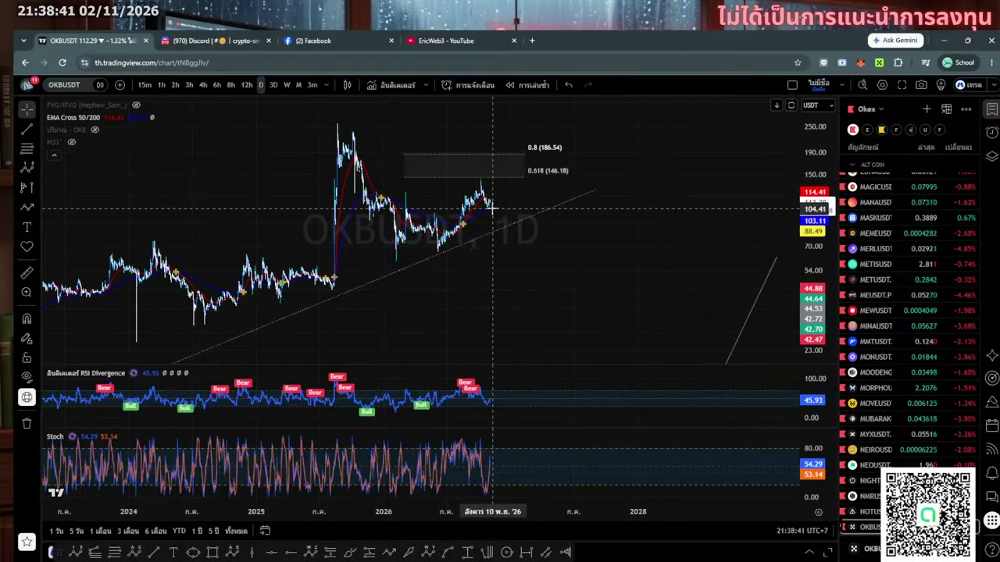

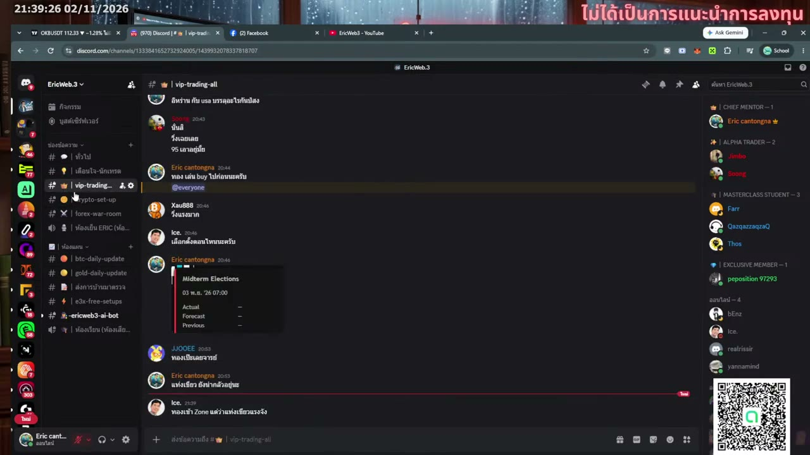

[00:40:09] อ่านี้ก็เป็น SE ใช่มยที่เล่นรีบาขึ้นไป เนาะนะครับสำหรับ setup เพื่อนๆอยากได้ เทรด set  up ก็เข้ามาพูดคุยกันในคunity เนาะนะครับ ฝากซพพอร์ตเป็นกำลังใจให้กับทีมงานนะ อันนี้ Dodge  Coin ก็ร่วงลงไปเนาะ มีเลนอื่นมั้ครับ อ่าเราไปปิดท้ายดูอร์หน่อย นะครับ Etherium อ่าEอร์เนี่ยยังกราฟยังทรงคล้ายๆกับ

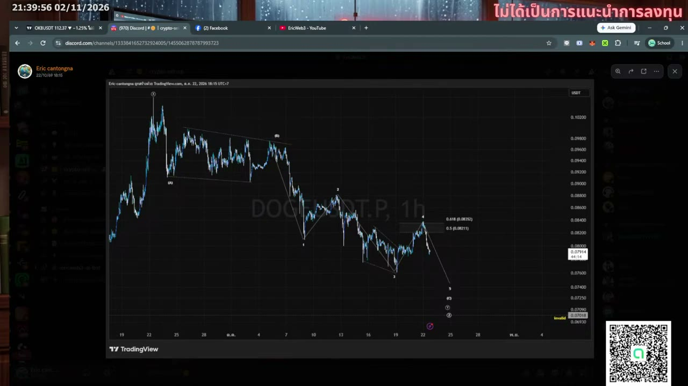

[00:41:11] บitcoinนะครับซึ่งมองว่าอาจจะขึ้นมาเทส เอ่อเอเดี๋ยวนะ มันไม่น่าจะใช่ 1 นะ ตรงนี้ อือาจจะเป็นชุดเหมือนลงเป็น non เลย อันนี้ก็ X เนาะก็ ต้องดูว่าจะลงไปในลักษณะไหนเนาะ แต่ไปทางเดียวกันนะ อ่ายังคงมองว่าอาจจะ อ่าอาจจะยังคงติดแนวต้านนะครับที่ 2,345

[00:42:13] นะสำหรับอธีเรียมนะครับในการมองเป็นขาลง ไปก่อนนะเป็นคลื่นปักเนาะก้อนตรงนี้ สำหรับeอร์ มาลองกาวทเสียงก่อนผลออกมย เหรียญทั้เหรอพี่สุงเหรียญทัเหรอ ชนจุดพู้อีกแล้ว อันตรายจริงๆ

[00:42:49] โอ้โหโอโห คือกะว่าจะให้มันจรวดอย่างี้เลยใช่มั้ย อันนี้ไม่ได้ไม่ได้แนะนำนะครับอันนี้คือ คุยกันสนุกๆนะแต่พี่สูงเค้าเอาจริงนะ เหรียญกาวแล้วมากาวกาวใส่ขำๆใช่มั้ย SL ข้างล่างเนาะโอเค จังหวะนี้รอหน้าช็อตอย่างเดียวหรือรอหรือ ไปรอลองบitcoinโซน 61.8 ล่ะครับโซน 61.8 8 ของ 5 ย่อยตรงนี้ใช่มั้ยก็อาจจะคือมัน ต้องพูดอย่างี้ก่อนว่าในแน่ของหน้าเทรดผม เทรดสั้นหรือเทรดยาวนะถ้าพูดถึงถ้าพูดถึง แบบdayดอ่ะอ่าเดี๋เดี๋ยวนี้เดี๋ยวนี้ผม

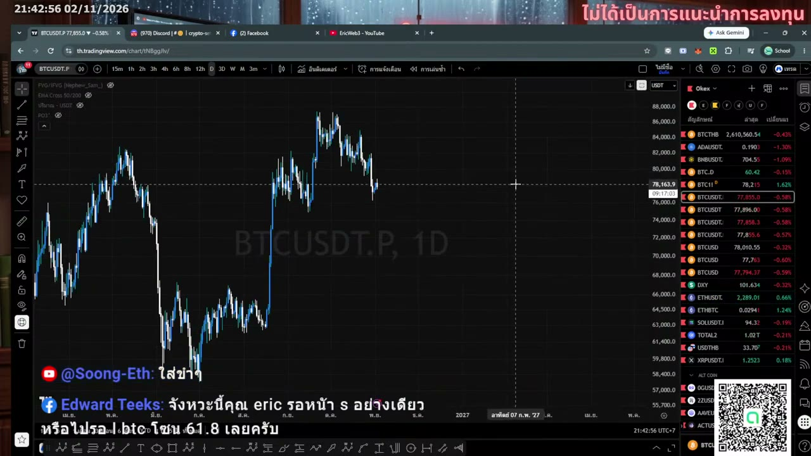

[00:43:51] เทรดสั้นนะเผมปิดเป็นชุดๆใช่มั้ก็อาจจะ ถ้าส่วนตัวผมเล่นได้ทุกคลื่นน่ะส่วนตัวผม เล่นได้หมดคือถ้าเพื่อนๆเห็นเทรด setup ผมอ่ะในเนี้ย ผมเล่นทุกคลื่นนะครับไม่ว่าจะลองจะช็อต อ่ะผมเล่นหมดอ่ะเพราะว่าอะไรเพราะว่าถ้า มันเข้าเงื่อนไขผมเล่นหมดเนาะอย่างเงี้ย อ่ะเล่นแล้วก็ปิดใช่มั้อ่าช็อตอ่า Bitcoin แล้วก็ปิด คือเล่นหมดนะครับเล่นทุกคลื่นอ่ะเอ่อ ถ้ามุมมองผมจริงๆถามว่าตรงนี้อยู่ที่ว่า ผมอยากจะเล่นหรือเปล่าจริงๆเวฟ 4 ตรง เนี้ยผมก็เล่นนะครับถ้าเป็นวันเนี้ยก็ เล่นนะเพราะว่าผมต้องนำเทรดอยู่แล้ว คือทำเทรด setup ในกลุ่มอยู่แล้วอ่ะมันก็ ต้องเทรดคือคนทำเทรด setup นะมันต้องเทรด ให้ดูด้วยถูกมยคืออยู่ๆแบบไปส่งแผนแล้ว ไม่มี PNL หรือว่าไม่มีแบบเออให้ดูว่าพา

[00:44:53] เทรดนี่มันก็กะไรอยู่นะครับพอเวลา Stop Loss ก็ Stop  Loss ให้ดูนะไม่ไม่ได้แบบ ให้ดูกำไรอ่ะนะ SL ก็ SL นะครับคือถ้า เป็นชุดเนี้ยผมก็เล่นนะครับเล่นแต่ว่าผม เล่นสั้นๆนะลงมาตรงนี้ผมก็เก็บนะครับส่วน ถามว่ารอรอลองมยก็อยู่ที่ว่าเข้าเงื่อนไข แล้วก็ตรงชุดเวฟหรือเปล่านะครับก็อาจจะรอ แต่ว่าเงื่อนไขการรอจริงๆของผมคือในใน โครงสร้างทำเฟรม 1-15 นาทีอ่ะอ่า 1-15 นาทีราคาจะต้องทำรหัส 5 ตามชุดโครงสร้าง เวฟใช่มั้เ 1  2  3  4  5 ก็เราเล่นช็อต เวฟ 4 ลงมาสมมุตินะช็อตเวฟ 4 ลงมาไป TP แถวๆนี้นะนะพอ TP จบเสร็จปั๊บเนี่ยเจอ Bullit  Revergent ใน high  time  frame ก็อาจจะเป็น time  frame  4 ใช่มั้ครับนะ ราคาทำรหัส 5 ย่อยราคามีการเบรค Market Structure  Shift ตรงนี้มี Fair  Value  Gap ผมถึงจะเล่นรองอย่างเงี้ยฮะ

[00:45:53] เนี่ยหลักผมมันไม่ได้ยากเลยเล่นแค่นี้คือ รอรอจังหวะยกใน Low  Time  frame แล้วก็ เล่นเอ่อถ้าถามว่ารอหน้าชอตอย่างได้มั้ย ก็ไม่ครับเล่นได้หมด อืถ้าเข้าเงื่อนไขคือเล่น บางไม้ก็ โดน SL บางไม้ก็ ก็ได้ ก็เล่นไซส์เดิมครับ เล่นไซส์ตามระบบของตัวเองสมมุติว่าไม้ละ

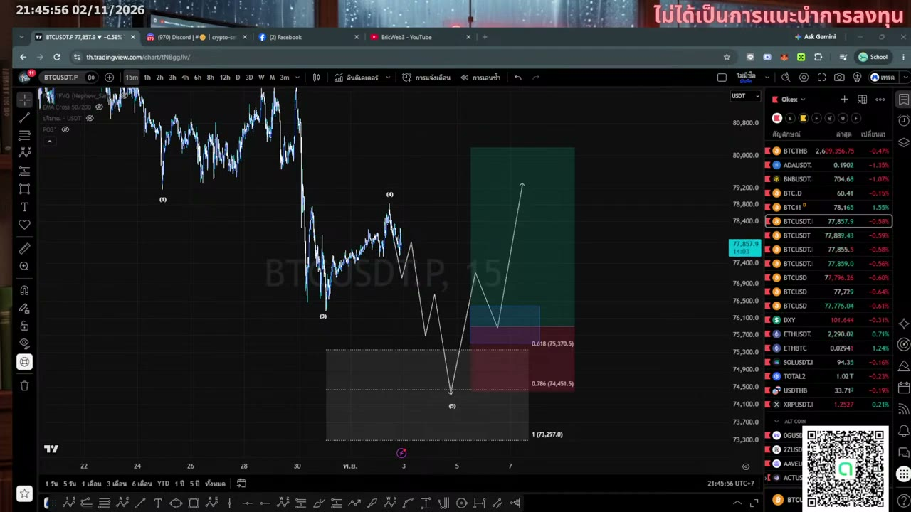

[00:46:54] 10% ของพortตก็ก็ตามนั้นเลย อันนี้ส่วนตัวนะอันนี้ส่วนตัวคือ ไอ้คำว่าสั้นๆน่ะไอ้คำว่าสั้นสั้นที่เรา พูดกันน่ะแต่ RR มันเท่ากันมั้อ่ะสมมุติ ว่าผมไปเล่นใน Time frม 4 อ่าผมไปเล่นอ่าเล่นรองสมมุตินะเล่น Time frame  4 อ่ะเข้าสมมุติว่า Bitcoin ที่ แล้วไป TP ตรงนี้ SL ตรงนี้ อ SL ผมรับได้ตรงนี้เนี่ย 2R ใช่ป่ะเห็น มย 2R ลง 100 ดอนต้องได้ 200 ดอนสมมุติ 2R แต่ถ้าผมไปเล่นใน time  frame  15 นาที อ่ะช็อต Wave  4 ตรงเนี้ย แล้วมา TP ตรงเนี้ยได้ 2R เหมือนกันน่ะ แต่ตรงเเร็วกว่า ก็เล่นได้เหมือนกันหมดมีค่าเท่ากัน มันอยู่ที่ RR นะครับกำไรที่แท้จริงอยู่

[00:47:55] ที่ RR นะ เอ่อ Levelate ไม่เกี่ยว Levelate ไม่เกี่ยวนะครับอยู่ที่ RR นะ คุณเปิดมาจinเท่าไหร่แล้วคุณได้กี่เท่า อ่ะแค่นั้นแหละ เออ 1R ที่คุณที่คุณ MM มาแล้วคุณเสีย เท่าไหร่ตามระบบอ่ะมันแค่นั้นเลยนะครับ แต่ถ้าผมจะลดไซส์จริงๆนั่นหมายความว่าคือ ผมเทรดเพื่อรักษาจังหวะเทรดเพื่อรักษา จังหวะเหมือนเราเราเทรดวอร์มอ่ะสมมุติว่า เรารับ 1 อันเนี่ยเรารับ stop  loss ได้ ที่ 100 ดอลลาร์อย่างเงี้ยนะผมอาจจะลด ไซส์มาเหลือ 50  25 อย่างเงี้ยนะครับแล้ว ก็เทรดเพราะว่าถ้าถ้าสมมุติผมมอง setup นั้นมันคลุมเครือนะครับไม่มั่นใจอ่ะผมถึง จะอย่างงั้นแต่ส่วนใหญ่แล้วอ่ะผมจะรอมาก กว่าคือถ้ามันไม่เข้าเงื่อนไขก็ไม่เทรด ไม่เข้าระบบก็ไม่เทรดก็ปล่อย เอ่อจริงๆจริงๆการเทรดทุกสวิงพวกเนี้ย จริงๆก็ไม่ได้จำเป็นนะครับถ้ารอได้ก็ก็รอ ดีกว่า

[00:49:01] ฝากคัดเรียนด้วยนะครับฝากคัดเรียนปีหน้า ด้วยนะครับเปิดอีกทีมีนานะครับกุมภาพันธ์ เอาแบบเบสิคเบสิคนะอืให้ทุกคนไปต่อยอดเอา เองนะ น้ำมันไปไงแล้วเนี่ย เอ่อก็คงจะหลุดแหละเดี๋ยวรีทestไม่ผ่าน 100 ก็ลงต่อนะครับส่วนทอง อ่าขาขึ้นมาแล้ว น่าจะขึ้นไปเทสโซน 4,000 นะครับจากจุดที่ ตกลงมาเนาะ อืถ้ายืน 4,000 ได้เนี่ยคืออาจจะได้เล่น กับเล่นหน้าสั้นๆนะ อชุดนี้ผมก็ไม่ได้เทรดนะครับเพราะว่าคือ เสี่ยงไปนิดนึง อ่าชุดสุดท้ายนี่คือก้อนนี้นะครับ 4,080 อ่าก้อนก้อนนี้แหละนะไม่ใช่สิอ่าก้อนนี้

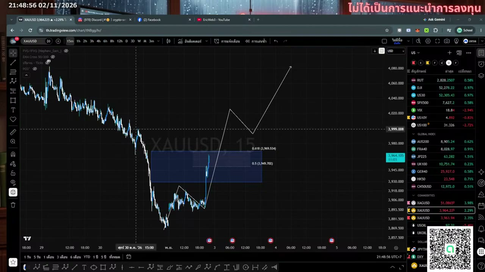

[00:50:04] นะครับเนี่ยรอบล่าสุดท้ายนะ 4,080 แล้วก็ อ่าหลุดลงมาไหลมาไกลเลยนะนะ เล่นได้แค่นะไวไวไวๆไวมากๆนะครับประมาณ นี้นะครับก็เป็นแผนส่วนตัวนะไม่ได้เป็น การแนะนำการลงทุนนะครับทุกคน ก็ฝาก Community ของElิไว้ฟรีด้วยแล้วกัน ใครที่ชอบการเทรดนะไม่ว่าจะเป็นอ่า Bitcoin นะครับหรือว่าิปโtoเนาะหรือว่า จะเป็นทองคำนะก็มีมุมมองหลายมุมมองนะก็มี เพื่อนๆในในกลุ่มเนี่ยค่อนข้างเก่งเยอะนะ ครับเก่งเยอะเลยแหละนะครับบางทีผมก็แอบ ฟังแอบวิเคราะห์ตามนะครับอืมใช้ได้อ่า เล่นหมดนะครับเล่นเห็นมั้ยเล่นหมดทุก คลื่นทุกเวอ่ะ อ่าก็ไม่ได้ไม่คิดว่า อ่าบitcoinจะลงมาในระดับ 777,000 เร็ว ขนาดนี้เหมือนกันนะครับซัพพอร์ตzซoneนะ

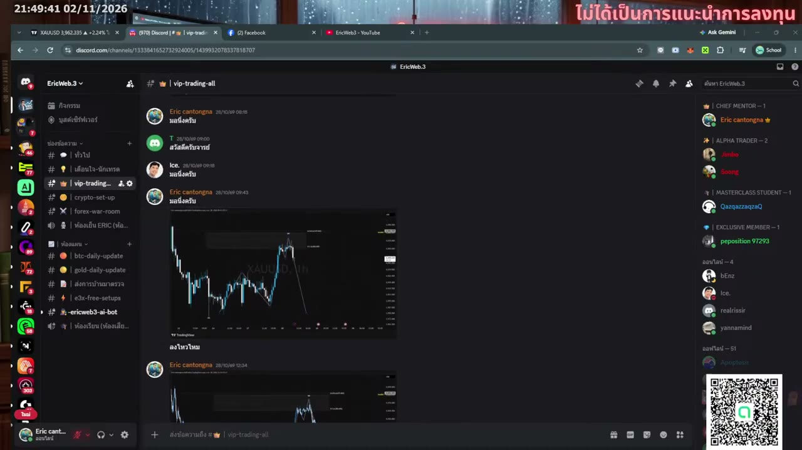

[00:51:04] แต่ลงมาแล้วก็ทำตามระบบไปเนาะตอนนี้ก็ยัง ยังคงลุ้นให้ลงอยู่ถ้าเป็นอย่างนี้เนี่ย อาจจะอาจจะจบ 2 ย่อยแล้วนะครับเตรียมที่ จะลงต่อนะใครที่เรียนกับผมไปก็เนี่ยฮะชุด นี้เนาะ เบรครีทestนะครับ อืถ้าหลุดได้ก็ลงไปประมาณนี้ ใครที่ยังไม่ได้เข้ามาพูดคุยกันในกลุ่มนะ ก็เคียโค้ดด้านล่างขวามือนะ ก็เข้ามาพูดคุยกันนะตอนเช้าๆ นะก็มีมุมมองไม่ว่าจะเป็นฟิวเจอร์หรือสปอ เมีหมดเลยนะ อ่าแล้วก็มีชุดข่าวชุดอะไรด้วย ก็เริ่มอันนี้ก็คือขิงเพื่อนๆในกลุ่มนะ ว่าเอ้ยมันมาถึงโซนแล้วผมก็ทำตามวินัย

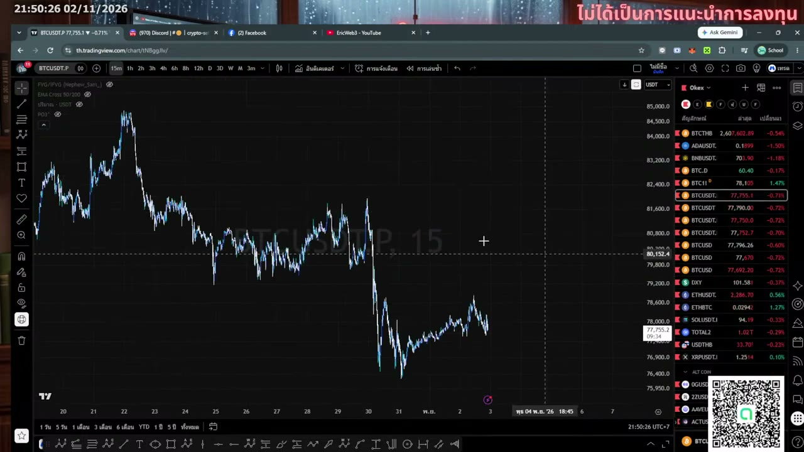

[00:52:05] แล้วผมไม่สนแล้วนี่คือการตาข่ายรอแล้วนะ ครับอันนี้ก็ไม่ได้เป็นการแนะนำการลงทุน นะครับก็ DCA ตามระบบอยู่แล้ว ตามดูตลอดครับวันที่พุ่งไปแฟช 6 เจอแผ่น นี้เพชรแรกว่าระวัง 76,000 หมายถึงว่า ระวังหมายถึงว่าระวังลงใช่มั้ เอ่อจริงๆมันก็อาจได้มันออกได้ 2 หน้าล่ะ ครับบางทีมันอาจจะตรงกับจังหวะที่เรามอง ถูกก็ได้นะตอนที่เรามองผิดมันก็ SL แค่ นั้นเอง อืมอื ปกติผมทำแผนน่ะผมไม่ได้สนใจเลยว่าใครจะ ว่ายังไงอ่ะ เพราะว่าตอนเราเทรดเองเราเสียตังค์เราก็ เสียตังค์ตัวเองอ่ะหรอกถูกมั้ยถ้าเราได้ เราก็ได้เนาะเค้าก็ไม่ได้กับเรา นะครับแต่คือเราพยายามเปิดรับนะครับเปิด รับว่าเอ้อคนอื่นเขามองแบบนี้เรามองแบบ นี้เอ๊ะมันเป็นไปได้มั้ความน่าจะเป็นไปใน ทิศทางไหนมากกว่ากันแค่นั้นเองนะครับนะก็

[00:53:06] พยายามเปิดครับทุกคนเลยนะครับก็เข้ามาพูด คุยกันได้นะในคอมityนะครับนะเข้ามาพูดคุย กันได้เนาะ เมื่อไหร่ เมื่อไหร่เอ่อหน้าช่องจะ donate ได้สักทีนะ สักไม้มั้ผมยังไม่ได้ดูเลยพี่ ไม่ได้ดูเลยตั้งแต่รอบที่แล้วที่เราเล่น กันน่ะน่ะอีนเมื่อก่อนตัวแรงนะ ไม่ได้ดูนานมากแล้วอ่ะอีเจนน่ะ โอมันไม่ทันแล้ว อ๋อมันลงมาโลตรงนี้หรอ อ๋อ Divergent

[00:54:07] อีกนิดนึงอ่ะเนี่ยเดี๋ยวถ้าลงมาเก็บไส้ ลิquidityตรงเนี้ยอีกอีกนิดนึงอ่ะอาจจะ ได้เล่นน่ะถ้าพี่สูงจะเล่น ลงมาเก็บไส้อีกนิดนึง เป็นผู้เตือนสติใช่ม โอเคอ่ามีเพิ่มเติมมั้ครับนะก็หวังว่าจะ สายรอใจเย็นๆนะฮะก็หวังว่าจะ มีประโยชน์กับเพื่อนๆทุกคนนะครับสำหรับ ไลฟ์นะครับก็แต่ถ้าอยากเข้ามาพูดคุยก็นะ ก็อยากจะให้เข้ามาพูดคุยกันเยอะๆนะครับใน คอมมิunityนะคือตอนตลาดซึมๆอ่ะเข้าใจแหละ ว่าคนก็จะถูกคัดจากตลาดไปนะครับก็จะออก กันไปเนาะนะครับนะแต่ถ้าใครที่อยู่ในมาก

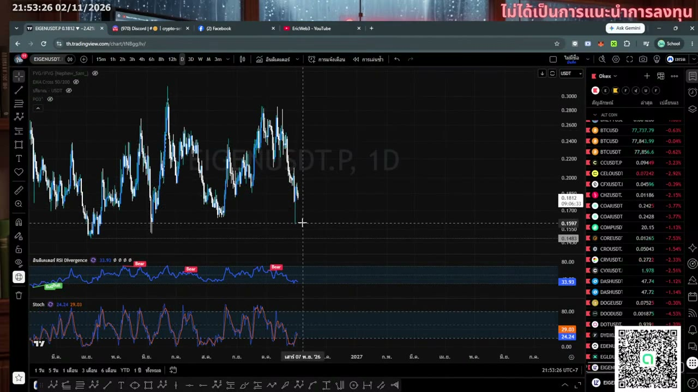

[00:55:08] กว่า 1-2 ไซเคิลแล้วอ่ะนะครับอก็จริงๆก็ จะเห็นว่าอันเนี้มันเป็นเรื่องปกตินะครับ เดี๋ยวพอพอเอ่อตลาดเริ่มกลับมาบูชเนี่ยนะ ครับก็จะเรียกคนกลับมานั่นเองนะครับแต่ ว่าอยากให้เพื่อนๆอดทนนะครับถ้ารักแล้วก็ ชื่นชอบในการเทรดเนาะนะครับอ่ารักแล้วก็ ในชื่นชอบในการเทรดก็จริงๆก็อยู่ในทุก สภาวะได้นะครับ Bitcoin  BTC มีแรงรับตลอดเลยย่อแบบไม่ ใช่ขาลงใช่มั้ยใจเย็นๆ ตรงนี้มันก็อย่างที่บอกครับมัน oversow ไปแล้วแล้วก็มันอยู่ใน next  line ค่อน ข้างสำคัญตรงนี้เป็นแนวรับสวยๆเหมือนกัน นะอื 77,000  76,000  75,000 นะเป็นแนว รับสำคัญเหมือนกันเพราะว่าถ้ามันออก เวฟ 4 ตรงนี้ก็ไม่ก็ไม่แปลกนะครับก็ไม่ เนาะแต่จริงๆถ้าจะให้มันขึ้นไปเลยอย่าง น้อยๆต้องกลับไปยืนมากกว่า 82,000 นะครับ เทรด Time Frมใหญ่หรือ Time  Frame เล็ก

[00:56:08] ไหนสูงกว่ากันขึ้นอยู่กับว่าคุณหา Age ใน ระบบนั้นแบบไหนมากกว่าครับบางทีผมเห็นคน เก่งๆเล่นในtimeมfrฟมเล็กๆวิลจเค้าก็เยอะ ก็มีนะวิลจแบบ 50-60 นี่ก็เก่งมากแล้วนะในใน time frฟม เล็กๆขนาดนั้นน่ะ นะมันมันขึ้นอยู่กับว่าคุณคุณ หาระบบเทรดของตัวเองได้แบบไหนฮะในส่วนตัว ผมนะยกตัวอย่างอ่ะส่วนตัวผมใช้ elate wave ใช่มยในการนำร่องใช่มครับ Elit Wave เนี่ย พอตลาดไซเวย์เนี่ยเล่นไม่เล่นไม่ค่อยได้ ต้องต้องอาศัยตอนตลาดเป็นเทรนด์นะตอนตลาด ไซเวย์ออกด้านข้างนะอีเว็บตายเลยนะครับ เอ่อวิลไม่ดีนะต้องพูดอย่างงี้นะครับแต่ ตอนที่ตลาดเป็นเทรนด์เนี่ยโอ้โหก็ก็ไปดี เหมือนกันนะครับนะก็จะไปใช้ TA อื่นเนาะ ในในสารอื่นนะส่วนในtimeม frame เล็ก อย่างเงี้ยนะครับจริงๆจริงๆผมก็มีลงไป

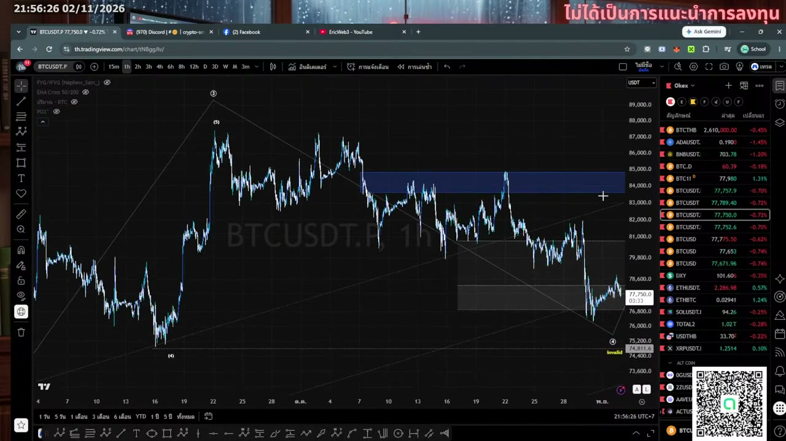

[00:57:09] เล่นใน Low  Time  Frame นะครับไม่ว่าจะ เป็น time  frame  5 นาที 3 นาทีนาทีนะไป ซิ่งมาเหมือนกันนะครับจะให้ผมมานับเวฟ 3 นาที 5 นาทีอันนี้เนี่ยน้อยค่อนข้างเยอะ นะครับแล้วก็ไม่ทันนะก็อาจจะเป็นรูปแบบ อื่นในการเล่นเล่นตาม candle นะครับ Anatomy  of  Candle หรือตาม test  value gat ใน SMC นะครับการใช้แพทเทิร์นใน time frame เล็กๆอย่างเงี้ยนะครับหรือใช้ อาศัยพวกแพทเทิร์นที่มันชินตาน่ะนะก็เทรด ไปนะครับ อืถ้าถามว่าใน time  frame ไหนเดียวกัน แบบมันอยู่มันอยู่ที่ว่าคุณหาในระบบของ ตัวเองได้ได้ดีหรือเปล่าแค่นั้นเอง แต่ถ้าเอา Elate  Wave มาใน time ทำเฟม เล็กกับ Village ผมไม่สวยเลยอันนี้ลองมา ลองมาแล้วะลองมาแล้วหมายความว่าทดสอบมา แล้วนะ

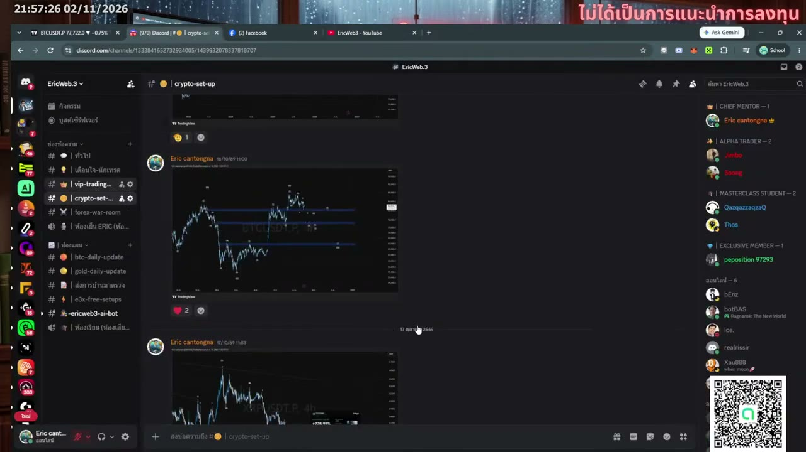

[00:58:11] อ่าวันนี้ก็พูดคุยนานหน่อย โอ้โหใครเนี่ย อันนี้ก็คือแก๊งช็อตกันมานะในช่วงปลาย เดือนเนาะ

[00:58:32] อ่าในถึงถึงบอกว่าในคลาสอ่ะคือมันเป็นคัช พื้นฐานนะครับแต่ว่ามันเป็นพื้นฐานที่ปู ให้คุณไปต่อยอดเอาเนาะว่าการเทรดจริงๆ ระบบเทรดจริงๆมันมันมันควรจะมีอะไรบ้าง เนาะนะครับเป็นสารตั้งต้นถ้าติดกระดุม เม็ดแรกถูกอ่ะมันก็ดีไปนะแต่ถ้าติดกระดุม เม็ดแรกผิดมันก็ต้องใช้เวลานิดนึง นะครับอ่ะสำหรับเดือนที่แล้วนะนะครับผมก็ ปิด Close  Out เอา position ไปนะครับ ช่วงเอ่อวันที่ 1 นะเมื่อวานนะตอนบ่ายๆก็ close  all ให้เพื่อนๆดูในคunityว่าอืม คือในระบบผมอ่ะ 1 เดือนผมทำจดบันทึกการ เทรดเลยนะครับนะพอเทรดมาแล้วตลอดเดือนนะ ไม่ว่าจะเป็นกี่พอร์ตนะนี้ 2 พอตนะนะ ไอ้พอเล็กเนี่ยคือบวกไปแค่ 50 กว่า%อนะ ครึ่งเด้งนะนะครับแต่อีกพอตนึงเนี่ยอัน นี้ก็ลองทดสอบในระบบนะอเกือบ 2 เด้งนะ ครับ 2R เนาะนะครับก็โตประมาณเกือบเนี่ย

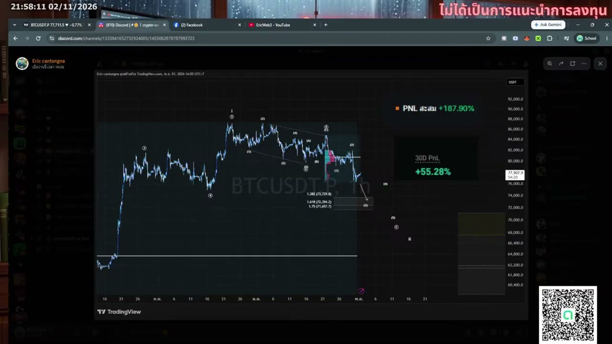

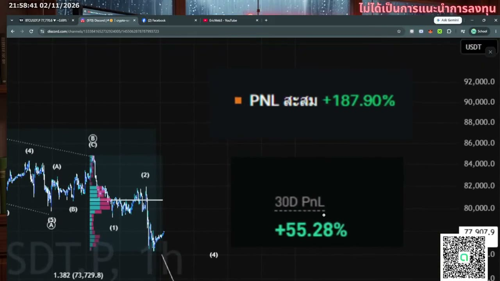

[00:59:33] 1.8  8 เท่านะครับก็ถ้าเราหาหรือว่าหา ระบบที่มันอยู่ได้อ่ะมันก็จะเริ่มปิด ประตูขาดทุนนะนะครับมันก็จะเป็นเรื่องของ กำไรแทนนะครับส่วนกำไรมากกำไรน้อยเนี่ยนะ ครับเราไม่ได้หวังเยอะนะเดือนนึงจริงๆผม หวังแค่ 30% จากทุนแค่นั้นเองนะครับแต่ จุดสำคัญเลยในในการทำระบบเทรดก็คืออะไร ทุนต้องไม่เสียนะครับถ้าเพื่อนๆยังเทรด แล้วยังวนทุนอยู่เงี้ยนะครับอาจจะต้องมา รื้อคุยกันใหม่เนาะต้องหาตัวเองไม่เจอนะ อ่าถ้าตลาดยังออกสภาพนี้ยังอยู่ในนี้ได้ นะก็ถือว่าดีนะถือว่าอยู่รอดนะแต่ถ้าตลาด กลับมาเป็นบูนี่ตรงนี้มันจะไม่ใช่จะไม่ ใช่ 1  2 เด้งแบบนี้แล้วนะครับอาจจะไป หลายเด้งอยู่นะก็ อดทนกันต่อไปนะครับประมาณนี้ โอ้ 1 ชม.

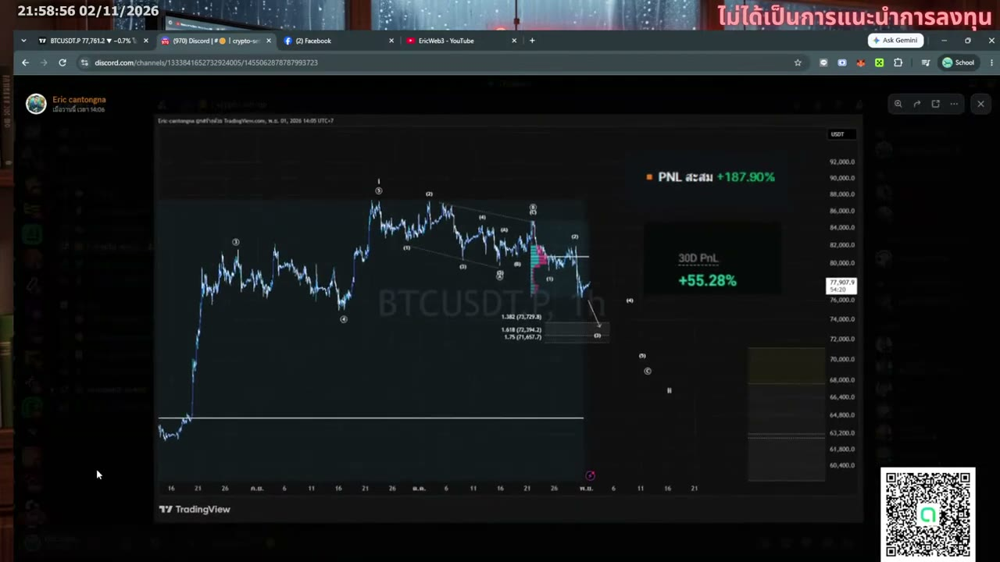

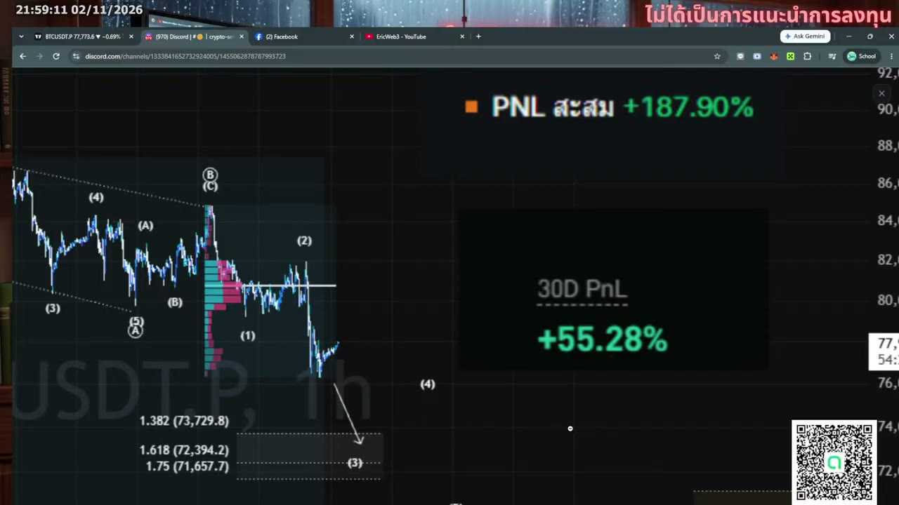

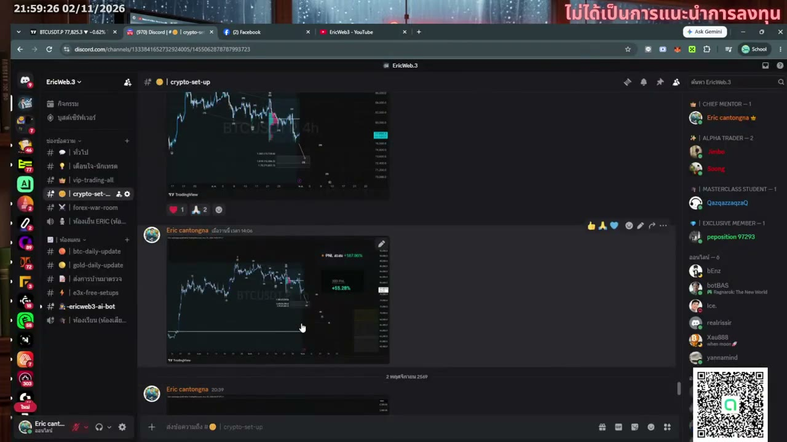

[01:00:36] มีเพิ่มเติมมั้ยครับอ่ะก็คิดว่าไลฟ์นี้จะ เป็นประโยชน์กับเพื่อนๆนะครับเดี๋ยวถ้า ใครอยากเข้าพูดคุยก็Qโคดด้านล่างขวามือนะ ครับแล้วก็ที่สำคัญคือเป็นแค่แผนส่วนตัว นะเป็นมุมมองส่วนตัวนะครับไม่ได้เป็นการ ชี้นำการลงทุนนะครับส่วนในต้นสัปดาห์ต้น เดือนนี้เนี่ยนะครับเดือนพฤศจิกายนเนี่ย ก็ถือว่าค่อนข้างมีอีเวentค่อนข้างเยอะนะ ครับแล้วก็เอ่อ คิดว่าราคาเนี่ยน่าจะสวิงยาวเลยนะครับนะ ยาวเลยในช่วงต้นเดือนเนาะนะครับลามไปจน ถึงวันที่ 8 ที่ 9 เลยนะครับไงก็ติดตาม แล้วกันนะครับปิดท้ายกันที่ดอลลาร์นะครับ ตอนนี้ก็มีการปรับตัวย่อลงนะครับถ้าราคา มีการหลุดในระดับ 100.3  3 เนี่ยนะครับ อาจจะได้เห็นดอลลาร์พักตัวเนาะนะครับอาจ จะทำให้อ่าทรัพย์สินเสี่ยงเนี่ยดีดขึ้นไป เล็กน้อยนั่นเองนะครับ อ่ะเดี๋ยวไปทำเทรด setup ต่อนะครับก็ขอ ขอบคุณทุกคนนะครับที่เข้ามาพูดคุยรับชม

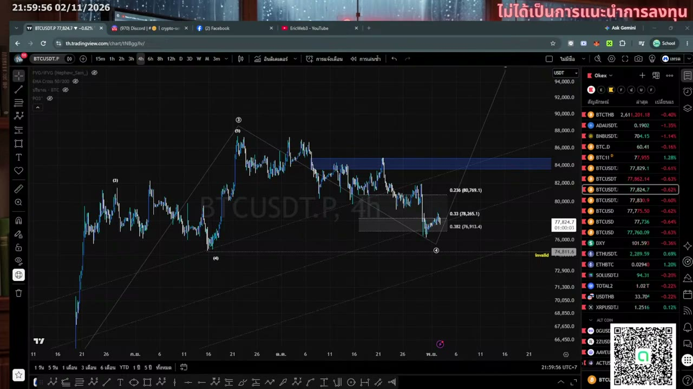

[01:01:37] รับฟังนะครับใครมีคำถามคอมเมนต์ก็เอ่อ สามารถเข้ามาพูดคุยกันในคอมityเนาะนะครับ ไม่ว่าจะเป็นdisอร์ดหรือว่าหน้าเพจก็ดีนะ ครับหรือหลายๆ Open  Chat ก็ดีนะครับแล้ว ก็เอ่อใครที่เพิ่งมาเนาะก็ไปดูย้อนหลัง ได้นะที่ช่อง YouTube นี่แหละนะครับก็ทำ ให้เรียบร้อยแล้วนะครับเดี๋ยวไว้มาอัปเดต กันใหม่นะครับเดี๋ยวเราเจอกันอีกทีคือวัน พุธแล้วกันนะครับช่วงนี้ก็พยายามจะปรับ เวลาไลฟ์เนาะเป็นจันทร์พุธนะเป็นจันทร์ วันจันทร์วันพุธนะนะครับจันทร์พุธพฤหัสบด เนี่ยพยายามจะไลฟ์ให้ได้นะครับนะก็ค่อยๆ ปรับปฏิทินอีกทีนึงนะครับสำหรับไลฟ์วัน นี้ก็ขอขอบคุณทุกคนนะครับเดี๋ยวไว้เจอกัน ใหม่ในครั้งหน้าสวัสดีสวัสดีนะครับ f  away

[01:02:42] still  it  someh  wants  to  stay turning  dark and  to every  mory fly  close like  a  s that  no  one  knows.

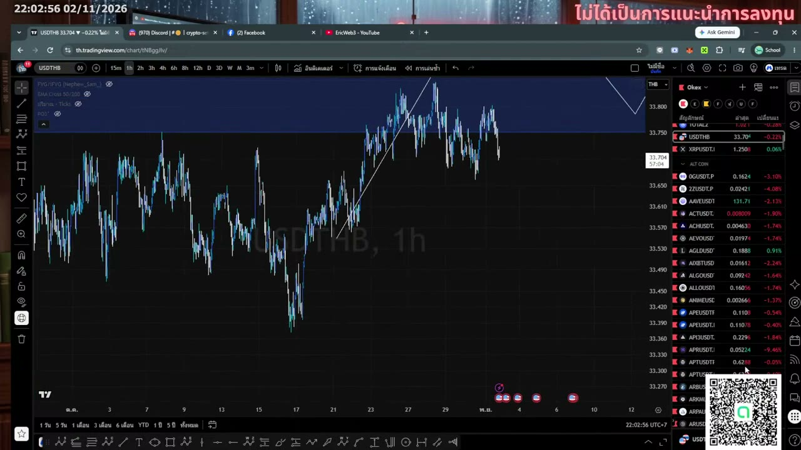

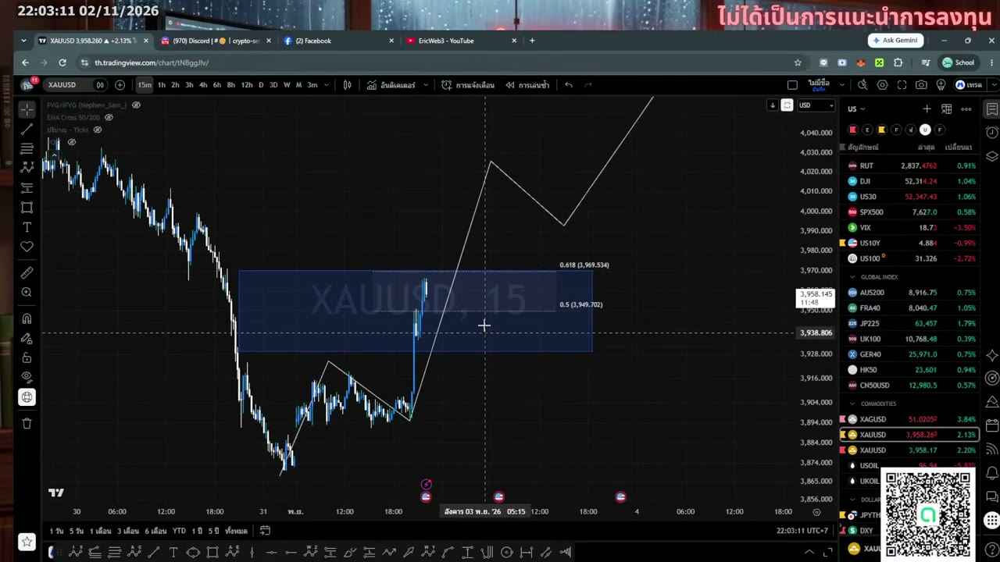

[01:04:34] turning  darkness every  mory like  a that  no  one  knows

